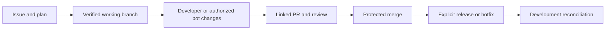

[](https://github.com/marketplace/actions/copilot-github-with-super-powers)
[](https://codecov.io/gh/vypdev/copilot)


# Copilot — GitHub with super powers

**Copilot connects the work described in a GitHub issue to its branch, implementation, pull request, review, and release.** It combines a GitHub Action for repository automation with a local CLI and web setup assistant. Enable the capabilities your team needs, including optional AI analysis and code changes.

## What can I do with it?

| Your goal | What Copilot provides | Start here |
|---|---|---|
| Organize work from issues | Issue Forms, Action-managed branches, lifecycle labels, progress, and GitHub Projects updates | [Manage issues and branches](https://docs.page/vypdev/copilot/guides/issues-and-branches) |
| Review pull requests | Bugbot findings near the code, a current review status, optional PR descriptions, and explicit requests to fix findings | [Review PRs and resolve findings](https://docs.page/vypdev/copilot/guides/review-pull-requests) |
| Ask for help or implementation | Commands to explain code, diagnose problems, plan work, or apply an authorized change and run verification | [Work with the bot](https://docs.page/vypdev/copilot/guides/work-with-the-bot) |
| Keep working branches current | Drift notices and an authorized synchronization command that verifies the merge before pushing | [Branch synchronization](https://docs.page/vypdev/copilot/issues/branch-synchronization) |
| Ship releases and hotfixes | Frozen source revisions, protected promotion PRs, version tags, GitHub Releases, and reconciliation back to development | [Release and hotfix guide](https://docs.page/vypdev/copilot/guides/releases-and-hotfixes) |

For example, a maintainer starts an admitted issue with `in-progress`. Copilot creates and verifies its branch. A developer or an authorized bot request contributes changes on that exact branch. A linked PR receives review findings and runs the repository's checks. After an authorized merge, a separately launched release can promote the accepted production commit and reconcile it into development.



AI capabilities require a configured agent runtime, an allowed model, and working authentication on the selected runner. Code-changing requests require repository write authority and run configured verification before commit/push. Release promotion follows the repository's merge policy. Installing Copilot does not grant permission to merge or deploy.

## Start with the web assistant

Use **Node.js 24 or newer**, `pnpm`, and a working checkout of the repository you want to configure:

```bash
pnpm add --global @vypdev/copilot
copilot --version
cd /path/to/your/repository
copilot setup --web
```

The CLI opens a local browser page. Pair it with the code printed in the terminal, confirm the target repository, and choose **Basic guided setup**. The assistant explains the required permissions, guides the two separate PAT roles, and shows the files and GitHub resources affected before you approve changes.

- The temporary **setup PAT** belongs to the operator and is used locally to configure the installation.
- The persistent **workflow PAT** belongs to the bot account and is stored as the Actions Secret `PAT`.
- GitHub creates both tokens in its own tabs. The assistant never creates or revokes them.

Follow the [web setup tutorial](https://docs.page/vypdev/copilot/setup-web) through installing the generated files and verifying the result. Then complete the [first issue-to-PR workflow](https://docs.page/vypdev/copilot/first-workflow). A local configuration check alone does not prove that an Action can run successfully.

`copilot setup` without `--web` launches the terminal assistant. Use `copilot setup --web --dry-run` for a no-change preview. The npm package installs the CLI and templates; running setup and installing its generated files enables the Action in your repository.

## Choose your next step

| You need… | Documentation |
|---|---|
| A short installation checklist | [Quick start](https://docs.page/vypdev/copilot/quick-start) |
| A walkthrough of browser setup | [Set up with the web assistant](https://docs.page/vypdev/copilot/setup-web) |
| Observable proof that the installation works | [First workflow](https://docs.page/vypdev/copilot/first-workflow) |
| A guide for a specific outcome | [Choose a goal](https://docs.page/vypdev/copilot/guides) |
| Token ownership, permissions, or account recovery | [Authentication](https://docs.page/vypdev/copilot/authentication) |
| Existing-installation updates, batch setup, or manual integration | [Setup and maintenance reference](https://docs.page/vypdev/copilot/how-to-use) |
| Every feature, input, and operational control | [Capabilities](https://docs.page/vypdev/copilot/features), [Configuration](https://docs.page/vypdev/copilot/configuration), [Security & Operations](https://docs.page/vypdev/copilot/security-operations) |

Setup installs the selected workflows, Issue Forms, labels, issue types, Variables, credentials, and repository agent guidance. Projects, agent routing, release/hotfix workflows, and other capabilities follow your selections. New setup offers PR approval assessment in `recommend` mode; native bot approval requires explicitly selecting `guarded` and meeting its prerequisites. See [guarded approval](https://docs.page/vypdev/copilot/pull-requests/guarded-approval).

Release templates are registry-neutral. Publishing your application or package requires your own build, validation, and deployment steps. This repository's npm publishing workflow is an example, not something setup installs into every consumer repository.

## Advanced integrations and contributing

For a manually maintained workflow, use `vypdev/copilot@v3` and supply `token: ${{ secrets.PAT }}`. Follow the [manual integration instructions](https://docs.page/vypdev/copilot/how-to-use#manual-workflow-integration-advanced) to install the supporting resources and event workflows.

The request-only `@vypdev/copilot/bugbot` API is documented in the [programmatic API guide](https://docs.page/vypdev/copilot/bugbot/programmatic-api). For local commands, see [Workflow & CLI](https://docs.page/vypdev/copilot/single-actions/workflow-and-cli).

See [CONTRIBUTING.md](CONTRIBUTING.md) for development setup and contribution requirements.
