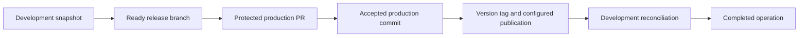

# Release and hotfix guide

Use a Release issue to ship a frozen development snapshot, or a Hotfix issue to start from an existing production version tag. Copilot coordinates preparation, protected production promotion, publication and reconciliation. Your repository supplies its product-specific build and deployment steps.

## Before launching a release

1. Enable the Release and/or Hotfix kinds in [web setup](/setup-web), keeping Issues and managed branches enabled. Review the production/development branch roles and reconciliation policy.
2. Install `copilot_deployment_orchestration.yml` and every enabled publisher (`release_workflow.yml` and/or `hotfix_workflow.yml`) on the repository's **default branch** before starting. A continuation installed only on a temporary release branch cannot wake the operation.
3. Add and validate your own preparation, build, test and deployment steps at the template extension points. Consumer templates are registry-neutral: they do not automatically publish your package to npm.
4. Check bot PAT permissions, protected target branches, merge-commit support for `production-lineage`, and native auto-merge or merge-queue readiness for the chosen mode. The release operator and workflow bot must be different identities.
5. Configure the credentials, environments and registry-specific controls required by your own deployment. This project's npm OIDC setup is documented as a [repository-specific example](/issues/deployment-orchestration#npm-trusted-publishing-for-this-repository).
6. Run `copilot doctor` after installing workflows and Variables, inspect its limitations and correct blockers. Complete the full [operator preflight](/issues/deployment-orchestration#operator-preflight).

## Launch one authorized release

1. Check the currently published version and existing open release operations. Select the next intended version without duplicating an active operation.
2. Open **Issues → New issue → Release** and complete every field, including Release Type, Release Version, Changelog and Additional Context. Use your installed form and label names.
3. A maintainer adds `in-progress`. Wait for `branched` and verify the exact linked release branch. Copilot records the development origin SHA at this cut; later development commits are outside that snapshot.
4. Once ready and explicitly authorized to deploy this release, add the installed deployment label (`deploy` by default).
5. Follow the issue's control-center card and protected promotion PR. Review the exact prepared revision and required checks; merge or let the configured protected merge mode proceed only within your authorization.
6. After production promotion, let the installed continuation publish the accepted production commit and open the configured reconciliation PRs. Complete their protected review/merge requirements.

## Verify completion

Check the durable operation and publication facts together:

- The release includes the intended fixes and the accepted production SHA.
- The immutable version tag resolves to that SHA and the GitHub Release is published.
- Your package or deployed artifact reports the expected identity/version and commit, where that metadata is available. For this repository's npm package, `gitHead` must match the accepted production SHA.
- Every configured reconciliation target completed and the operation is marked `completed` without an outstanding failure.

A merged production PR, closed issue, created tag or successful preparation job alone does not establish all of these facts.

## Hotfixes and recovery

For a hotfix, use the installed **Hotfix** form with an existing Base Version tag and the new Hotfix Version, description and solution. Start with `in-progress`, wait for readiness, then explicitly launch with `deploy`. Its origin is the selected production tag; reconciliation follows the configured development/active-release policy.

When an operation pauses or fails, reuse its existing issue and control-center recovery action. Inspect the visible phase and retained commits/PRs/publication receipts; do not create replacement managed branches, tags, releases or duplicate dispatches. Checks and reviews may be an external wait rather than a failed workflow. Use the [phase-specific recovery reference](/issues/deployment-orchestration#recovery-by-visible-phase) for the correct next action.
