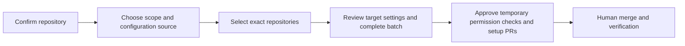

For a new installation, use the illustrated [web setup tutorial](/setup-web),
then verify [your first issue-to-PR workflow](/first-workflow). Use this page for
terminal setup details, existing-installation management, upgrades, organization
reuse, batch setup and manual integration. Choose a capability in the [goal guides](/guides).

## Recommended installation and initialization

The setup questionnaire includes an optional [guarded PR approval](/pull-requests/guarded-approval) stage. It offers `recommend` by default, which assesses readiness without submitting a native approval. Choose `guarded` explicitly only after its CI/coverage and branch-rule prerequisites are proven, or `off` to disable assessment. Existing installations do not begin approving merely by upgrading.

Install the published package globally with `pnpm`, then initialize the target
repository with `copilot setup --web` for the recommended browser path or
`copilot setup` for the terminal assistant. The package is scoped
as `@vypdev/copilot`, but it exposes the global `copilot` executable:

```bash
pnpm add --global @vypdev/copilot
copilot --version
```

Use Node.js 24 or newer. You can check the active version before installing:

```bash
node --version
```

Run repository-dependent commands from the root of the repository where you want
Copilot to operate, not from the package installation directory. Version and help
commands can be run from any directory.

Once installed, the `copilot` command is available globally. Repository-dependent commands such as `copilot setup`, `copilot doctor`, `copilot check-progress`, `copilot think`, and `copilot do` must be run **from the root of the target repository**. The `copilot upgrade`, `copilot --version`, and help flows can run from any directory. Commands that access GitHub accept `--token` or `PERSONAL_ACCESS_TOKEN` from the environment. `copilot setup` and `copilot doctor` securely prompt for the setup PAT when run interactively; no `.env` file is read or created. `copilot setup --dry-run` is the only setup mode that can run without a token. See [CLI commands](/single-actions/workflow-and-cli).

The target must be a working checkout. A bare Git repository has no files for setup or doctor to inspect and is rejected.

For interactive onboarding, follow [Set up with the web assistant](/setup-web).
It covers pairing, capability choices, the two PAT roles, plan approval, Apply,
installation of generated files and runtime verification. The terminal remains
available with `copilot setup`.

### Terminal and advanced setup behavior

`copilot setup --help` lists the tutorial, first workflow and recovery links without starting setup. The interactive journey also prints the setup guide at entry, the first-workflow link after completed Apply, and recovery guidance for blocked/partial results. Documentation opens only when you choose to follow it; see [Use the documentation](/using-the-docs).

In the terminal wizard, each question shows a short explanation, the suggested
answer, and a related documentation URL. Type `?` at a text, number, or
single-choice prompt to open detailed **what/when/where/how/why/example/effect/
verification** guidance without recording an answer. At a multi-selection
prompt, press `?` to see the same guidance without losing the current selection;
press `B` to revisit the previous question, and press Enter only when you are
ready to confirm it. At text, number and single-choice prompts, enter `:back`
to return without clearing other answers. At the final plan, enter `:edit`
and select a section to correct it before approving. Documentation opens only if
you choose to follow its URL; setup does not automatically browse to those
pages. The setup/bot PAT method, repository-owner and bot-login prompts also
accept `?` for English help without making a choice. The setup PAT prompt prints
both the authentication guide and GitHub PAT settings for manual cleanup. At
the final Apply confirmation, `?` explains which resources may change and how
to inspect a partial failure; it never approves the plan.

The web mode still opens GitHub's official form in a separate tab for each
PAT; it cannot pick your GitHub account, complete 2FA, select an individual
repository, generate a PAT, or revoke it. Confirm the account and repository
on GitHub yourself. If `PERSONAL_ACCESS_TOKEN` is available in your
environment, the web page asks whether to use it without revealing its value;
closing Copilot cannot unset the parent shell variable. `--web` cannot be
combined with `--non-interactive`, `--yes`, `--token`, `--workflow-pat`,
`--secret`, or `--confirm-unverifiable-write-permissions`: provide those
decisions in the browser or use the terminal setup instead. `--dry-run --web`
shows a no-change preview. A PAT supplied to either dry-run mode is used only
for read-only inspection; disposable Write checks and setup changes are skipped.

Before its final Apply approval, the web mode performs read-only GitHub
inspection and PAT checks; it does not dispatch or temporarily install a
credential-health workflow. Re-enter an existing bot PAT for its grant audit.
An optional existing provider Secret that you choose to keep may remain
`unverifiable`; check runtime health with `copilot doctor` after installation.
Before Apply, the assistant also checks for changes to managed guidance files
and their ownership manifest. This includes files that may be retired when
repository agent guidance is turned off; if they changed after plan approval,
setup stops before modifying them and asks you to review a fresh plan.
In the browser questionnaire, an issue-workflow choice defaulted to **All**
stays selected if you continue unchanged; clearing that selection submits
**none** explicitly.

If PR approval is enabled, the web assistant reads recent completed PR CI
runs and proposes the exact check name, GitHub App ID, and producing workflow
when the setup PAT has `Actions: read` and `Checks: read`. Open the linked run
and verify the job and its mandatory coverage step before confirming the
producer attestation. A green check is not evidence of a coverage threshold.
If no reliable candidates can be read, enter the exact tuple manually; the
assistant does not guess an App ID. Exact check and workflow names may contain
commas, including `Backend (format, detekt, test, assemble)`; commas inside an
explicit `name|App ID|workflow` tuple are preserved. Separate multiple tuples
with semicolons. The coverage check selector only offers
checks you selected as trusted producers. `check` mode trusts a CI job that
fails below your coverage budget; `numeric` mode additionally needs the
`copilot-diff-coverage-v1` reporter artifact and explicit verification.
When an active repository-owned ruleset for the configured development branch identifies an
exact check/App pair as required, the assistant links that ruleset. Otherwise
it says **not checked**; this does not mean the check is optional, because
legacy branch protection, inherited organization rulesets, or inaccessible rules may also apply. The ruleset
read uses repository Metadata access and does not add a broader PAT grant.

If the assistant stops, the result page distinguishes cancellation, expired
session, permission or storage blockers, and a potentially partial Apply.
It shows the stopped stage and a next action. After Apply it lists setup files,
Secrets, labels, issue types, Variables, and the initial tag as completed,
skipped, not started, or needing inspection, without
revealing PATs or provider error payloads. A diagnostic reference lets you
find more detail in the terminal. A "no setup changes started"
message does not mean a PAT created separately on GitHub was deleted. If
the browser reports an unknown cause, inspect the terminal's final error
before retrying. If a requested Secrets or Variables writer is unavailable,
setup stops before changing any setup resource and marks operations **not
started**. An attempted write that fails is marked **needs inspection**, since
GitHub may have applied it before reporting the error.
Secrets and Variables are **completed** only when GitHub reports a created or
updated value; if every requested value was kept unchanged, they are **skipped**.
An error shown after a rejected browser action stays visible during background
updates; a successful next action clears it.

Interactive `copilot setup` offers a guided GitHub link or manual entry for each
PAT. The first link prepares a short-lived **setup PAT** for the person
configuring the repository. Before showing it, guided setup asks only the local
choices that affect its grants, shows an exact permission preview and notes
what remains unknown until GitHub is inspected. The later questionnaire reuses
those answers. The second link, after the setup plan, prepares the
**workflow PAT** for the bot account.

Projects are a two-stage choice: before creating the setup PAT, answer only
whether you intend to use Projects so the link can include **Projects: read**.
After entering the PAT, select accessible organization Projects from the
browser checkboxes or terminal multi-select. The displayed number is the
numeric Project number used by `project-ids`, not a GraphQL `PVT_` node ID.
If GitHub cannot return a verifiable list, the assistant explains why and
offers manual entry of a Project URL or number; it does not silently treat an
empty list as proof that no Projects exist. Configure the exact **Status field
options** (not visual board columns) used for newly created and in-progress
items. Multiple selected Projects currently must share the selected Status
values; if they use different Status vocabularies, choose compatible Projects
or configure them separately. The assistant does not claim that a single value
works in every Project when discovery shows otherwise. The bot PAT needs
Project write access later, when the workflow runs.

CLI flags override only their corresponding `--config` fields. For example,
`--agent cursor` changes every role's provider while preserving its configured
model provider, model, effort, and executable. Defaults fill omitted fields.

Explicit `features.release` and `features.hotfix` values from `--config` or
CLI flags remain fixed during the pre-PAT permission review. The issue-workflow
question shows those fixed choices before you answer and rejects a selection
that contradicts them; it never quietly changes the configured feature or
the PAT grant. If either is explicitly enabled, Issues must stay enabled.
Edit the configuration or flags and restart if you intend to change that
policy.

The interactive terminal also shows your current phase: Repository → Setup
choices → Setup PAT → Plan → Bot PAT & credentials → Apply. These are milestones,
not a percentage or a fixed number of questions. Before a remote mutation
attempt, it says that no changes have been made. Checking existing Secrets may
attempt a temporary credential-health workflow before final Apply; from that
point a failed run is marked partial, with branch-inspection guidance. After
Apply starts, a failed run is likewise marked partial so
you can inspect what was installed. The initial and guided PAT views show a
compact list of required grants. Choose **view full permission table** during
review to see reasons and conditional grants without restarting the questions;
manual PAT entry shows that table directly. Supplied-token and unattended paths
retain the full table. This display never includes token values.

At the setup PAT permission review, **Review all setup choices again** starts
another pass over the same in-memory answers. The terminal marks it as a review
pass, temporarily returns to the Setup choices phase, and explains that Enter
keeps each previous answer. When the pass ends, you return to the setup PAT
permission summary with any changed grants recalculated. This is not a new
setup run; no repository changes occur during these passes. The later full
wizard still reuses these answers instead of asking them again.

Open each link in the appropriate GitHub
account, complete GitHub's sign-in/2FA, change **All repositories** to **Only
select repositories**, and **select only the intended repository**
on the form, review the grants, and paste the generated value into the hidden
terminal prompt. The links prefill fields; they neither create a PAT nor select
an individual repository. The setup PAT is suggested for one day and must be
deleted by you in GitHub after the run. The bot PAT is suggested for 90 days,
remains active as Actions Secret `PAT`, and needs renewal before expiry. See
[authentication](/authentication) for permission and recovery details.

The bot PAT link displays the selected bot login and a warning to open it under
that account. If you accidentally create a PAT as another user, choose **Enter
another bot PAT** at the account mismatch to keep your answers and approved plan
in this session. Setup asks for a fresh value and verifies it again. You can
instead choose **Stop setup**. Delete the unused PAT yourself in GitHub.

**Customize configuration** requires a supplied, validated bot PAT, including when you
preserve other Secrets. **Reuse compatible organization configuration** retains its existing binding and does not ask for its value; full capability verification remains pending. Review its destination and replacement warning in the
plan and hidden input. An organization replacement may affect other repos.
If a repository PAT would override the chosen organization PAT, open its Actions
Secrets settings and remove it manually, then choose **I have deleted the
repository PAT — check again**. Setup continues only after a fresh GitHub read
confirms removal, retaining your answers. You may instead choose **Store PAT in
the repository instead** to change only PAT storage and review the updated plan,
or **Stop setup**. Copilot does not delete or move an existing Secret for you.

If you previously installed Copilot from a local checkout, installing the published
package with pnpm switches the same `copilot` command to the published package.
Check which executable and package are active:

```bash
command -v copilot
pnpm list --global --depth 0 @vypdev/copilot
copilot --version
```

If `command -v copilot` still points to the checkout's package manager directory, remove that older global installation or update your shell's `PATH`, then open a new shell.

For the previous unscoped installation, use the package manager that installed it:

```bash
npm uninstall --global copilot
# or, if it was installed with pnpm:
corepack pnpm remove --global copilot
```

### Installing an unreleased checkout

For local development or when testing an unreleased checkout, install from the repository instead:

```bash
git clone https://github.com/vypdev/copilot.git
cd copilot
PACKAGE_TARBALL="$(npm pack --ignore-scripts --silent)"
corepack pnpm add --global "./$PACKAGE_TARBALL" --force
```

If the checkout does not include the compiled `build/` folder, run `corepack pnpm install` and `corepack pnpm run build` before packing. The tarball can be removed after installation. Packing the checkout avoids silently retaining a different global package with the same version.

### Update or reinstall the global CLI

For a published release, update the active global npm or pnpm installation:

```bash
copilot upgrade
copilot --version
```

`copilot upgrade` can be run from any directory and does not require a GitHub
repository or `PERSONAL_ACCESS_TOKEN`. It identifies the running package's npm
prefix or pnpm global directory and updates that installation with its owning
package manager. If both are installed, the active installation is updated;
the other copy is left in place.

Success is printed only after the installed package and a fresh
`copilot --version` resolved through the current `PATH` both match the selected
latest published version. An already-current version is verified in the same way.
If verification fails, the command exits unsuccessfully and explains that the
installation may already be updated. Check `command -v copilot` (or
`Get-Command copilot` in PowerShell), inspect `PATH`, and refresh the shell's
command cache or open a new terminal before retrying. Unsupported, linked, or
unidentifiable installations are rejected before any install; upgrade a source
checkout using the local-package procedure below.

If the installed version does not include the `upgrade` command, bootstrap it once
with `npm install --global @vypdev/copilot@latest` or
`pnpm add --global @vypdev/copilot@latest`, using the manager that owns the active
installation, then use `copilot upgrade` for future updates.

Before running a normal CLI command, Copilot performs a lightweight, informational check for a newer published version. The check uses a local 24-hour cache, has a short timeout, never blocks or changes the command result, and stays silent when npm is unavailable. If an update is found, Copilot prints `A new version (x.y.z) is available. Run "copilot upgrade".` The `upgrade`, `--version`, and help flows do not trigger this check. To disable it, set `COPILOT_DISABLE_UPDATE_CHECK=1`.

For an unreleased checkout, update the checkout and reinstall the local package globally:

```bash
cd /path/to/copilot
git pull --ff-only origin master
PACKAGE_TARBALL="$(npm pack --ignore-scripts --silent)"
corepack pnpm add --global "./$PACKAGE_TARBALL" --force
```

After installation, confirm the executable and installed package:

```bash
command -v copilot
copilot --help
copilot --version
corepack pnpm list --global --depth 0 @vypdev/copilot
```

The complete command reference, including every supported option, is in [Workflow & CLI](/single-actions/workflow-and-cli).

---

## Tutorial: Initialize a repository

The canonical interactive walkthrough is [web setup](/setup-web). For the
terminal alternative:

1. Install the CLI as above, change to the target repository root, and run
   `copilot setup`.
2. Choose capabilities and review the permission-affecting decisions. Create the
   temporary operator setup PAT with the guided link, then review the final
   plan. Use `:back` to revise a question or `:edit` to change a plan section.
3. Approve the reviewed plan and its disclosed temporary permission tests, supply
   the separate workflow bot PAT and required provider credentials, then confirm
   Apply. Inspect the itemized receipt for partial or blocked work.
4. Review, commit and merge the generated files through the normal protected
   process. Install them on the default branch and the configured development
   line where needed, as explained in [install the generated files](/setup-web#install-the-generated-files).
5. Run `copilot doctor --read-only` with a valid setup PAT, resolve blockers,
   and complete the [first workflow](/first-workflow). Metadata inspection does
   not verify Secret values or establish runtime success.

For unattended flags and credential provisioning, use [Workflow & CLI](/single-actions/workflow-and-cli).
The detailed workflow inventory below explains installation dependencies and
customization boundaries; the generated plan remains the exact inventory for
your selected features.

---

## Inspect configuration and make a small adjustment

Run `copilot setup --web` from your checkout. After pairing and repository
confirmation, the configuration panel explains whether Copilot is detected,
not configured, or only partly inspectable. A new checkout offers **Start
setup**. Existing workflows offer inspection, **Quick adjustments**, and
**Run the complete assistant**.

Choose **Read configuration from GitHub** to supply a temporary setup PAT.
Opening or refreshing the panel reads only. The guided link requests read
access for Variable values and Secret names; Secret presence does not prove
that its token is valid. The panel distinguishes repository values,
organization values and workflow fallbacks, including repository overrides.
Expand the workflow details to inspect every detected non-secret input.

For an independent setting such as the review comment limit, choose **Change**,
enter a value, then review the old value, new value and scope. Organization
changes show their shared impact before approval and retain existing visibility
and repository access. Copilot tests Variables Write with a temporary Variable,
removes it, checks for changes during your review, writes the single setting,
and reads it back. It returns to the panel so you can make another adjustment.
Quick adjustments never request a bot PAT or rewrite workflows and Secrets.
Choose **Finish** when you are done. A read-only inspection ends successfully
without suggesting that setup was cancelled or that anything was changed.

Use the complete assistant for agents, Projects, capabilities, credentials,
scope changes or workflows. This starts a fresh questionnaire with its usual
defaults; it does not reconstruct your customized configuration. Inspect the
panel first and review the final plan before applying it. `--skip-variables`
keeps quick adjustments read-only; `--dry-run` uses the existing full preview
assistant without the management write path.

If access is limited, reconnect with a corrected setup PAT. Unknown expressions,
environment overrides and unavailable inventories cannot authorize a quick
change. If cleanup or read-back cannot be confirmed, inspect GitHub before
retrying; Copilot does not automatically restore an earlier value. The panel
describes this checkout rather than certifying the default branch or runner.


## Reuse organization settings or configure several repositories

Run `copilot setup --web` from the current repository and confirm its owner and
name. Choose **This repository** (the default) or **Several repositories**. The
terminal equivalent for an explicit batch is `copilot setup --batch`.



Choose **Reuse compatible organization configuration** to import recognized,
valid Variables and skip their questions. Repository overrides take precedence;
explicit answers take precedence over both. Target branches, CI commands and
approval producer identities still need their own review. Reuse creates only missing repository
Variable names. If an existing repository value must change, make a separate
reviewed update and prepare a fresh plan; batch setup will not overwrite it.
Equivalent validated approval-policy JSON is retained despite formatting.
Retained Secrets require complete revision metadata before Apply. If that
metadata cannot be verified, setup stops and asks for a fresh inspection;
existing values and completed effects are preserved. The preview shows
retained shared settings and new repository overrides. Existing Secret values
are never read, copied, displayed or replaced. A missing required binding blocks
that repository; provision it separately and inspect again.

In the terminal, enter repository IDs or type `confirm` to keep the displayed
selection. A blank answer does not accept the selection.

For several repositories, select 1–25 explicit repository identities in the same
organization. Discovery is limited to the PAT's visible repositories, with
search and exact-name lookup. If needed, reconnect with a temporary operator PAT
restricted to the selected repositories. There is no implicit “all repositories”
selection. Batch Customize changes settings while retaining existing Secret
bindings; use current-repository Customize to provision new credential values.

Each target gets its own workflows, forms, labels, issue types and guidance.
The selected development branch must already exist and be readable; create or
select the intended branch before applying a blocked target. Setup does not
invent a development branch or its starting revision.
Review the exact file changes, repository Variable names, additive shared-access
grants, installation ref, base SHA and temporary permission checks. Approval can
create/remove test resources and leave GitHub history or notifications. Pending
cleanup blocks installation. Shared values, visibility and other memberships
stay unchanged. Replaced setup assets have separate backups under
`.copilot/setup-backups/`, retaining their relative paths even when their names
and contents match. Apply runs sequentially and opens at most one setup PR per
changed target in `setup/copilot/<operation-id>`. It never merges, tags,
releases or deploys. A repository with matching files needs no new PR and remains
pending verification after resource checks.

A failed target retains its completed effects while other ready targets can
continue. Stop prevents pending work; it does not remove successful grants or
PRs. One explicit retry is available in the paired session after another review.
If a permission audit ends without a confirmed cleanup report, setup saves that
uncertainty, retains existing effects and stops pending work. The saved operation
cannot resume writes. Inspect the GitHub history and local recovery journal,
resolve any temporary resources, then start a fresh setup preview.
For a closed session, use `copilot setup --web --resume-operation <operation-id>`
with a fresh temporary PAT and the same configuration. Private local receipts
contain identities, hashes and completed effects, never credentials, values or
file contents. Resume rejects a changed base, target set or desired plan before
permission probes. If the base changed (including after a merge), inspect the
retained PR and start a fresh setup preview instead. A PR means **Waiting for
merge**; credential metadata or PAT authentication does not prove runtime
permissions. Delete the temporary operator PAT yourself after finishing.

Project Status columns are selected and reviewed for the target Project. Nonempty organization column values are shown as review work and do not prefill or complete those questions.

Batch write preflight requires complete revision metadata for existing repository
Secrets; matching names alone cannot establish that a credential was not rotated.

## Manual workflow integration (advanced)

The Action can also be wired manually from a GitHub Actions workflow. This is a
lower-level integration path for repositories that cannot run the setup wizard;
it is not equivalent to the recommended `copilot setup` flow.

1. Copy only the workflow files you need from the installed package's `setup/workflows/`
   directory into `.github/workflows/`.
2. Ensure every Copilot step uses a stable Action reference such as
   `vypdev/copilot@v3` and passes a write-capable `token` where required.
3. Configure the labels, issue types, Variables, Secrets, templates, permissions,
   and workflow dependencies yourself.

For example:

```yaml
- uses: vypdev/copilot@v3
  with:
    token: ${{ secrets.PAT }}
```

Manual workflow installation only adds execution wiring. It does not initialize
the repository metadata or install the complete set of Copilot workflows. Prefer
`copilot setup` unless this manual control is intentional. See [Workflow setup](/issues/workflow-setup)
for the action-level contract.

---

## Review customizations after setup

You can tweak issue templates (text, dropdowns), workflow names, and branch names. The following points are **required** for the GitHub Action to behave correctly; the rest is optional.

**Required for the action to work:**
- **Token**: Every workflow that runs Copilot must pass the `token` input (your PAT). Typically you set `token: ${{ secrets.PAT }}` in each Copilot step. Without it, the action cannot create branches, update issues, or call the API.
- **Workflow file names for release/hotfix**: When an issue has the **deploy** label, Copilot *dispatches* a workflow by **filename**. The action inputs `release-workflow` (default: `release_workflow.yml`) and `hotfix-workflow` (default: `hotfix_workflow.yml`) must match the **exact filenames** in `.github/workflows/`. If you rename `release_workflow.yml` or `hotfix_workflow.yml`, you **must** pass the new names to the action in the workflows that invoke Copilot (e.g. in `copilot_issue.yml` add `release-workflow: 'your_release.yml'` and `hotfix-workflow: 'your_hotfix.yml'`).
- **Deploy label**: The label that triggers the deploy flow is configured by the `deploy-label` input (default: `deploy`). The issue templates and your usage must use this same label when you want to run the release or hotfix workflow.
- **Branch names in workflows**: The Commit workflow (push) often excludes the main and development branches from running (e.g. `!master`, `!develop`). If you change the default branch names (e.g. `main-branch: 'main'`, `development-branch: 'develop'`), update the `push.branches` filter in `.github/workflows/copilot_commit.yml` so it excludes those same names; otherwise the action may run on every push to main/develop or never run on feature branches.

**Runner selection:** Keep installed routing, explicitly choose GitHub-hosted jobs, reuse an existing organization profile, or enter a known self-hosted group and labels. Review effective routes and access/capacity observations per repository. Agent jobs and CLI provisioning share the agent route; ordinary validation has a separate choice. Approval observers, merge-group checks and publication stay independent. A changed dynamic route that you retain requires separate review of its matrix/inputs. No environment fallback or runner access grant is implicit. See [runner profiles](/configuration#runner-profiles). Windows service registrations omit `codex`: **Codex no soportado en runners Windows ejecutados como servicio**.

**Project verification tools:** Runner selection does not install Java or other
project runtimes. For configured verification and file-changing commands,
provision tools in each executing job before Copilot and commit the optional
reviewed [runtime declaration](/security-operations/operations/verification#repository-verification-prerequisites)
to get an actionable prerequisite check. A separate application CI job does not
prepare the comment-command job. Without the declaration, existing verification
still runs directly with its prior failure behavior.

**Copilot source repository:** A target containing a root-local `uses: ./` Action retains its existing native workflows and complete source guidance. Its Commit and Branch Sync workflows gain the temporary `copilot-permission-test-*` push exclusion; Commit also excludes installer branches. Branch Sync retains all ordinary branches, installer branches and bot pushes. The parity inventory distinguishes shared assets, missing optional assets, customizations, native extensions and incompatible generator metadata. Native CI, RepoWise, runner diagnostics, the platform smoke matrix and npm publication are intentional source extensions. Source now includes compatible manual CLI-provisioning and credential-health workflows; provisioning uses the Codex pool, while credential health keeps its independent hosted route. Future generator metadata is retained or blocks regeneration; setup does not silently migrate it.

**Optional but keep coherence:**
- **Labels**: If you change any label input (e.g. `feature-label`, `bugfix-label`, `deploy-label`), use the **same** label names in your issue templates (`labels:` in each `.yml`) and when labeling issues manually. Otherwise the action will not recognize the type or flow.
- **Branch name prefixes**: The action uses inputs like `feature-tree`, `bugfix-tree`, `release-tree`, `hotfix-tree` (defaults: `feature`, `bugfix`, `release`, `hotfix`) to create branch names. If you change them, branch names will follow the new prefixes; keep templates and docs in sync.
- **Project Status options**: Default values are "Todo" and "In Progress". If you rename the options in the Project's **Status** single-select field, set the corresponding action inputs (`project-column-issue-created`, `project-column-issue-in-progress`, etc.) to the exact option names. These legacy input names say `column`, but ProjectV2 updates the Status field, not a visual board column.

**Bugbot autofix (issue/PR comments):** Workflows that run on `issue_comment` or `pull_request_review_comment` (so users can ask the bot to fix reported findings) must grant **`contents: write`** so the action can commit and push. Autofix requires an authoritative PR/head identity; use the intended PR conversation or review thread. General implementation requests may use the issue's verified linked branch. Missing or conflicting branch evidence stops file changes before the agent runs. See [Bugbot autofix](/bugbot/autofix) and [Troubleshooting](/security-operations/operations/troubleshooting).

## What lives in `setup/` (and what gets created)

The workflow and template files under `setup/` are copied into your repo by
`copilot setup`. Manual copying is supported as an advanced integration path, but
it does not perform the rest of initialization. Credentials are never shipped in
the package or written to local configuration files. Below is a breakdown of
labels (with defaults), issue types, and the contents of `setup/` so you know what
you can customize and what must stay consistent.

### Coherence when customizing

If you rename or change any of the following, keep these in sync:

- **Label names** in the action inputs (e.g. in workflow `with:` or in repo/organization variables) must match the **labels** used in issue templates and on issues (e.g. `deploy`, `release`, `feature`).
- **Workflow filenames** for release and hotfix (e.g. `release_workflow.yml`) must match the action inputs `release-workflow` and `hotfix-workflow` wherever you call the action (e.g. in the Issue workflow that reacts to the deploy label).
- **Branch names** (main, develop, feature, bugfix, etc.) must match between the action inputs and any workflow filters (e.g. `push.branches` in the Commit workflow).

---

## Labels created by `copilot setup` (default values)

The setup creates the following labels. Names come from the action input defaults; colors and descriptions are set by the code.

### Type and flow labels

| Input key | Default label name | Purpose |
|-----------|--------------------|--------|
| Fixed start label | `in-progress` | Starts every admitted issue workflow |
| Fixed readiness label | `branched` | Added by the Action after verifying an exact linked branch |
| Fixed SDD labels | `SDD`, `contract-change` | Required SDD status and behavior-change intent |
| `feature-label` | `feature` | Feature branches |
| `enhancement-label` | `enhancement` | Treated like feature |
| `bug-label` | `bug` | Bug type |
| `bugfix-label` | `bugfix` | Bugfix branches |
| `hotfix-label` | `hotfix` | Hotfix branches (from main at tag) |
| `release-label` | `release` | Release branches (from develop) |
| `docs-label` | `docs` | Docs branches |
| `documentation-label` | `documentation` | Treated like docs |
| `chore-label` | `chore` | Chore branches |
| `maintenance-label` | `maintenance` | Treated like chore |
| `question-label` | `question` | Question issues (e.g. Think action) |
| `help-label` | `help` | Help request issues |
| `deploy-label` | `deploy` | Triggers release/hotfix workflow dispatch when added |
| `deployed-label` | `deployed` | Mark issue as deployed after workflow runs |

### Priority labels

| Input key | Default label name |
|-----------|---------------------|
| `priority-high-label` | `priority: high` |
| `priority-medium-label` | `priority: medium` |
| `priority-low-label` | `priority: low` |
| `priority-none-label` | `priority: none` |

### Size labels

| Input key | Default label name |
|-----------|---------------------|
| `size-xxl-label` | `size: XXL` |
| `size-xl-label` | `size: XL` |
| `size-l-label` | `size: L` |
| `size-m-label` | `size: M` |
| `size-s-label` | `size: S` |
| `size-xs-label` | `size: XS` |

### Progress labels

The setup creates **21 progress labels**: `0%`, `5%`, `10%`, … `100%`. Colors go from red (0%) to yellow (50%) to green (100%). These are used by the Check Progress action and commit steps to update issue progress.

### Lifecycle, activity, and waiting labels

The setup creates three related label dimensions. The durable lifecycle phase is exclusive; the temporary activity label and the waiting label are independent, so a target can have (for example) `state:specifying` and `state:ai-processing` at the same time.

| Input key | Default label name | Purpose |
|-----------|--------------------|--------|
| `state-planned-label` | `state:planned` | An implementation plan is available |
| `state-specifying-label` | `state:specifying` | A required SDD is being clarified or revised |
| `state-working-label` | `state:working` | Implementation may proceed |
| `state-reviewing-label` | `state:reviewing` | A pull request is under review |
| `state-changes-requested-label` | `state:changes-requested` | The review has active findings |
| `state-verified-label` | `state:verified` | The pull request was merged successfully |
| `state-ready-label` | `state:ready` | The latest review is ready for human action |
| `state-blocked-label` | `state:blocked` | The workflow needs human intervention |
| `state-ai-processing-label` | `state:ai-processing` | Temporary marker while a Copilot agent is working; removed at run end |
| `state-awaiting-maintainer-label` | `state:awaiting-maintainer` | Waiting for maintainer response, approval, or merge |
| `state-awaiting-issue-author-label` | `state:awaiting-issue-author` | Waiting for information or changes from the issue author |

---

## Issue types created by `copilot setup` (defaults)

For organizations that support issue types, the setup ensures these exist (name / description / color from action inputs):

| Type | Default name | Default color |
|------|--------------|---------------|
| Task | Task | blue |
| Bug | Bug | orange |
| Feature | Feature | green |
| Documentation | Documentation | pink |
| Maintenance | Maintenance | purple |
| Hotfix | Hotfix | red |
| Release | Release | yellow |
| Question | Question | gray |
| Help | Help | purple |

---

## Branch name prefixes (defaults)

Used to build branch names (e.g. `feature/42-my-title`). Configurable via action inputs:

| Input key | Default value |
|-----------|----------------|
| `main-branch` | `master` |
| `development-branch` | `develop` |
| `feature-tree` | `feature` |
| `bugfix-tree` | `bugfix` |
| `hotfix-tree` | `hotfix` |
| `release-tree` | `release` |
| `docs-tree` | `docs` |
| `chore-tree` | `chore` |

---

## Contents of `setup/` (workflows, templates, PR template)

### `setup/workflows/`

These are the available setup-managed workflows. `copilot setup` copies the
files required by the selected features to `.github/workflows/`; a manual
installation must preserve the dependencies described below. Default filenames
and roles:

| File | Purpose |
|------|--------|
| `copilot_issue.yml` | Runs on issue events (opened, edited, labeled, unlabeled, etc.): creates branches, links to projects, assignees, deploy trigger. |
| `copilot_pull_request.yml` | Runs on PR events: links PR to issue/project, reviewers, AI description, etc. |
| `copilot_pull_request_review_state.yml` | Reconciles lifecycle labels from submitted, edited, or dismissed reviews in a fixed, isolated review-state check. |
| `copilot_pull_request_approval.yml` | Optional trusted default-branch observer for evidence-gated native bot approvals; setup renders its exact CI producer names. |
| `copilot_pull_request_merge_queue.yml` | Reports the existing `Copilot - Pull Request` required-check context for `merge_group` without adding a skipped merge job to normal PR runs. |
| `copilot_commit.yml` | Runs the issue-centric push pipeline (all branches except main/develop, the installer-owned `setup/copilot/` namespace and temporary `copilot-permission-test-*` refs by default): native issue state and size/progress. It also runs Bugbot when the branch has no open PR; otherwise the PR synchronization event owns review. |
| `copilot_branch_sync.yml` | Lightweight push observer on all ordinary branches, excluding temporary `copilot-permission-test-*` refs: detects parent/working drift and maintains a synchronization notice without loading Bugbot or an agent. |
| `copilot_issue_comment.yml` | Runs on explicitly addressed issue comments: e.g. Think action (answer questions). |
| `copilot_pull_request_comment.yml` | Runs on explicitly addressed PR review comments, including translation checks. |
| `release_workflow.yml` | **Manual** (`workflow_dispatch`) with internal `prepare` and `publish` modes: prepares a release from its frozen development cut, promotes it to production, then publishes only the accepted production commit and starts reconciliation. Filename must match `release-workflow`. |
| `hotfix_workflow.yml` | **Manual** (`workflow_dispatch`) with internal `prepare` and `publish` modes: prepares a hotfix from the selected production tag, promotes it, then publishes and reconciles the accepted production commit. Filename must match `hotfix-workflow`. |
| `copilot_deployment_orchestration.yml` | Runs on marked `pull_request: closed` events: verifies the operation identity, repository, branches, and SHAs, then resumes publication or final reconciliation without polling inside the original runner. |
| `agent-cli-provisioning.yml` | **Manual** (`workflow_dispatch`): verifies that the selected agent runtime binaries and their non-interactive command surfaces are available on the target runner. |
| `copilot_credential_health.yml` | **Manual** (`workflow_dispatch`): validates selected remote credentials without exposing their values; used by `copilot doctor`. |
| `copilot_close_inactive_issues.yml` | **Scheduled every 6 hours** (also `workflow_dispatch`): closes open issues waiting for a maintainer or issue author after the configured inactivity threshold. Opt-in. |

Each Copilot workflow step passes at least `token`. Agent-capable workflows also
pass the configured CLI inputs via `vars.*`; `copilot_branch_sync.yml`
deliberately does not. The **release** and **hotfix** workflows are dispatched by
the action when an issue has the deploy label and the corresponding
release/hotfix context; they are not triggered by issue events directly.
The continuation and every enabled publishing workflow must be installed
together on the default branch before the first operation. This project enables
both release and hotfix, so it installs all three files. The close event cannot
be resumed by a continuation that exists only on the release or hotfix branch.

The distributed release/hotfix templates are registry-neutral. Their `publish`
mode creates or verifies the production tag and GitHub Release and provides a
clearly marked deployment extension point. This repository's own files under
`.github/workflows/` additionally compile, validate, smoke-test, and publish
`@vypdev/copilot` through npm OIDC; consumer setup templates never publish this
package.

The `agent-cli-provisioning.yml` workflow checks the selected runtime binaries,
reported identities, and non-interactive help commands without making a paid model request. Runtime
installation checks the selected CLI from its official source without pinning an exact version. The `copilot_credential_health.yml` workflow is
read-only with respect to repository configuration: it executes provider-specific
health checks and reports only whether each requested credential is usable. GitHub
does not expose Secret values through its API, so `copilot doctor` dispatches this
workflow when it is available on the repository's default branch. For a
non-mutating inspection after a partial setup, use `copilot doctor --read-only`:
it checks installed files, metadata, names, Variables and permissions but does
**not** dispatch the credential-health Action. Secret values are therefore
reported as unverified rather than healthy. The browser assistant recommends
this mode; running plain `copilot doctor` is a separate, explicit choice when
you want the workflow-based credential check.

When Repository Variables are enabled, setup creates the common `AGENT_*` contract,
the provider/model/effort variables for each configured `FINDINGS_*`, `FIXER_*`,
`PLANNER_*`, `REVIEWER_*`, and `TESTER_*` role, the repository and
project variables, and the AI/Bugbot variables. The workflow templates read
the optional `*_EXECUTABLE` selections too. Each value may contain only the
provider's exact basename or an absolute path to that same executable; arguments,
wrappers, and shell text are rejected.

Release/hotfix setup also writes these bounded orchestration Variables:

| Repository Variable | Action input |
|---|---|
| `RELEASE_RECONCILIATION_STRATEGY` | `release-reconciliation-strategy` |
| `HOTFIX_RECONCILIATION_STRATEGY` | `hotfix-reconciliation-strategy` |
| `RECONCILIATION_PR_MODE` | `reconciliation-pr-mode` |
| `MERGE_QUEUE_CHECK_ATTESTATIONS` | `merge-queue-check-attestations` |
| `RECONCILIATION_BACKMERGE_MODE` | `reconciliation-backmerge-mode` |
| `HOTFIX_ACTIVE_RELEASE_POLICY` | `hotfix-active-release-policy` |
| `RECONCILIATION_TREE` | `reconciliation-tree` |
| `RECONCILIATION_CLEANUP` | `reconciliation-cleanup` |
| `RECONCILIATION_ISSUE_COMPLETION` | `reconciliation-issue-completion` |
| `ORCHESTRATION_PRESENTATION_MODE` | `orchestration-presentation-mode` |
| `ORCHESTRATION_DIAGRAMS` | `orchestration-diagrams` |
| `ORCHESTRATION_COMMENT_MODE` | `orchestration-comment-mode` |

`MERGE_QUEUE_CHECK_ATTESTATIONS` defaults to `[]`. Setup accepts it as a
structured YAML array and serializes it as bounded JSON for the Action. It is a
reviewed exception only for required producers Copilot cannot prove
automatically; it is not a wildcard or a bypass for known-incompatible
workflows.

The project-only npm visibility Variables are
`NPM_VISIBILITY_POLL_INTERVAL_SECONDS` (default `20`, allowed `10`–`60`) and
`NPM_VISIBILITY_TIMEOUT_SECONDS` (default `600`, allowed `60`–`900`). They are
not Action inputs and are not created for registry-neutral consumer workflows.

When enabled, inactivity cleanup also creates `INACTIVITY_THRESHOLD_HOURS` (168
by default). The scheduled workflow closes only issues marked
`state:awaiting-maintainer` or `state:awaiting-issue-author`; it rechecks the
issue immediately before mutating it and skips candidates that became active or
entered `state:ai-processing`.

### `setup/ISSUE_TEMPLATE/`

All files here are copied to `.github/ISSUE_TEMPLATE/`.

| File | Purpose |
|------|--------|
| `config.yml` | Issue template config (e.g. `blank_issues_enabled`, contact link to Git-Flow). |
| `feature_request.yml` | Feature request; uses labels like `enhancement`, `feature`, `priority: low`. Add `in-progress` to start; the Action adds `branched` after verification. |
| `bug_report.yml` | Bug report; uses `bug`, `bugfix`, `priority: high`. Add `in-progress` to start. |
| `doc_update.yml` | Documentation; uses `documentation`, `docs`. |
| `chore_task.yml` | Chore/maintenance; uses `chore`, `maintenance`. |
| `help_request.yml` | Help request; uses `help` (no branch). |
| `hotfix.yml` | Hotfix; uses `hotfix`, `priority: high`; add `in-progress` to start. Includes Base Version, Hotfix Version, Changelog. |
| `release.yml` | Release; uses `release`, `priority: medium`; add `in-progress` to start. Includes Release Type, Version, Changelog. |

The **labels** in each template must match the label names configured in the action (or your custom inputs). For example, if you change `deploy-label` to `ready-to-deploy`, then any template or process that adds the deploy trigger must use `ready-to-deploy`.

### `setup/pull_request_template.md`

Copied to `.github/pull_request_template.md`. Used as the default body for new
PRs and as guidance for AI-generated descriptions. The shipped template asks
for a short outcome, material changes, and supported validation evidence;
validation and reviewer notes are conditional. You can add repository-specific
instructions, but the agent omits
empty boilerplate, generic checklists, and unsupported claims rather than
reproducing every heading. No Copilot logic depends on specific headings; only
the deploy/release/hotfix flows depend on **workflow filenames** and **label
names**.

---

## Optional: Configure projects, AI, and workflows

After the tutorial and file customization, you can:

- Set **repository or organization variables** for the agent CLI contract (`AGENT_PROVIDER`, `AGENT_MODEL_PROVIDER`, `AGENT_MODEL`, `AGENT_EFFORT`, `AGENT_ALLOWED_MODEL_PROVIDERS`, and `AGENT_ALLOWED_MODELS`) and, when needed, independent task overrides for `FINDINGS_*`, `REVIEWER_*`, `PLANNER_*`, `FIXER_*`, and `TESTER_*`. The supplied Copilot workflow templates forward these values to the action. Keep `CURSOR_API_KEY` available only when one of the configured task providers is Cursor.
- Enable the `inactiveIssueClosure` setup feature when you want the scheduled cleanup, and adjust `INACTIVITY_THRESHOLD_HOURS` (1–8760 hours) to match your retention policy. This feature is disabled by default because it closes GitHub issues.
- Adjust **Project Status option names** and **branch names** via action inputs so the action sets the intended Status and uses your branch naming.
- Customize **issue templates** (copy, add fields, change labels) while keeping label and workflow names consistent as above.
- Add or modify **release/hotfix** workflow steps (e.g. build, deploy) while keeping the workflow **filenames** and the action inputs `release-workflow` and `hotfix-workflow` in sync.

For a full list of inputs and behaviors, see [Configuration](/configuration) and [Features & capabilities](/features).
