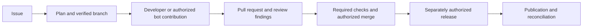

**From a GitHub issue to a reviewed change and release.**

Copilot is a GitHub Action and local CLI that connects issues, branches, pull requests, Projects, and releases. Optional AI capabilities help plan work, explain code, review changes, and apply authorized fixes.

Start by installing the capabilities you need, then verify one small documentation change from issue to PR.

<CardGroup cols={3}>
  <Card title="1. Set up in your browser" icon="gear" href="/setup-web">
    Install the CLI, pair the local assistant, review permissions and apply the plan.
  </Card>
  <Card title="2. Verify your first workflow" icon="square-check" href="/first-workflow">
    Create a documentation issue, get its verified branch, and open a linked PR.
  </Card>
  <Card title="3. Choose your next goal" icon="list-check" href="/guides">
    Manage issues, review PRs, request implementation, or prepare a release.
  </Card>
</CardGroup>

## What happens during everyday work?

| Goal | What you do | What Copilot can do |
|---|---|---|
| Organize a task | Create an installed Issue Form and add `in-progress` | Verify admission, create its managed branch, and synchronize labels and Projects |
| Understand or plan work | Address the bot with `/copilot explain` or `/copilot plan` | Return a code-aware answer or plan |
| Implement a change | Contribute normally or send an authorized `/copilot implement` request | Apply the requested change on the verified branch and run configured verification before pushing |
| Review a PR | Open or update a linked PR | Publish Bugbot findings and current review status; generate a description when enabled |
| Fix a finding | Push your fix or request `/copilot fix` with its finding ID | Recheck the current revision and reconcile the finding state |
| Release | Complete a Release or Hotfix form and explicitly launch deployment | Promote through protected PRs, publish the accepted revision, and reconcile development |

Issue/branch/Project automation uses GitHub metadata. AI analysis and editing additionally require a runner, configured runtime/model and usable credentials. Choose these capabilities deliberately during setup. See [Overview](/overview) for responsibilities and [Features & capabilities](/features) for the complete reference.

## Already installed?

Use the [setup and maintenance reference](/how-to-use) for configuration inspection, quick adjustments, organization reuse, upgrades and manual integration. Use [Troubleshooting](/security-operations/operations/troubleshooting) when a result differs from the expected workflow.
