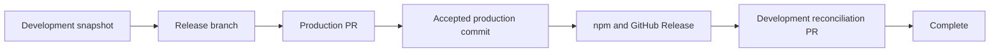

# Release and hotfix orchestration

Copilot treats a deployment as a durable, event-driven operation. The workflow
finishes after it creates a protected pull request; GitHub then wakes a separate
continuation when that PR is merged. A runner does not remain polling while
checks or reviews are pending.

## Recommended default



The same route in text is:

```text
develop@cut-SHA
  -> release/<version>@prepared-SHA
  -> PR to master
  -> accepted master merge-SHA
  -> immutable version tag + npm + GitHub Release
  -> master merge-SHA reconciled into current develop
  -> cleanup and issue completion
```

`master`, `develop`, `release`, and `sync` are defaults. Your configured branch
names and prefixes are snapshotted when the operation starts.

<Info>
  A release comes from the exact `development-branch` commit that existed when
  its release branch was cut. It does not come from production. Commits added
  later to development stay outside that release and are preserved during the
  final reconciliation.
</Info>

## Operator preflight

Complete this once before starting the first production-first operation:

- merge or install `copilot_deployment_orchestration.yml` and every enabled
  publishing workflow (`release_workflow.yml` and/or `hotfix_workflow.yml`) on
  the repository's default branch; this project enables both;
- ensure the workflow PAT belongs to a bot account different from the person
  launching the release and can write Contents, Issues, Pull requests, and
  Actions for this repository;
- allow merge commits, which `production-lineage` requires for an auditable
  ancestry relationship;
- activate required validation on every promotion/reconciliation target. This
  project requires GitHub Actions `CI Check` on both `master` and `develop`;
  RepoWise is optional and runs only through manual dispatch;
- enable repository auto-merge if selecting `auto-merge`, or configure every
  required check for `merge_group` if the target requires a merge queue, and
  add an exact attestation only for a producer Copilot cannot inspect;
- for this project's npm publication, create the exact `npm` Environment and
  both exact npm Trusted Publisher entries described below; and
- run `copilot doctor` after the new workflows and Variables are on the default
  branch.

GitHub resolves event and dispatch workflows through the default/base branch.
Installing the continuation only on a release branch is not sufficient: it must
already be present when a managed promotion PR closes.

## Release lifecycle

1. Copilot cuts `<release-tree>/<version>` from the exact current
   `development-branch` SHA and stores both the origin branch and origin SHA on
   the launcher issue.
2. Version files, build output, validation, and package smoke tests are committed
   on that frozen release branch.
3. Copilot reads classic protection and every effective ruleset for
   `main-branch`. If queue mode is selected, it verifies every required producer
   on the target and candidate refs before it creates or reuses the marked
   promotion PR.
4. Immediately before enqueue, Copilot rereads the policy, confirms whether the
   PR is already queued, and binds the mutation to the verified head SHA.
   In `auto` mode, a PR GitHub already considers ready merges at the verified
   head SHA, including when advisory checks are pending. Otherwise it asks
   GitHub for native auto-merge or leaves a maintainer-owned PR according to
   configuration.
5. The preparation run exits successfully. Pending checks are an external wait,
   not a workflow failure.
6. After the marked PR merges, Copilot verifies its repository, marker, stored
   head SHA, base, and accepted production SHA.
7. The publication continuation creates `v<version>` at that exact production
   SHA, publishes the package, waits for registry visibility, creates the
   GitHub Release, and updates the moving major Action tag.
8. Copilot applies the same live target-policy preflight before creating a sync
   branch or reconciliation PR into current development. The default source is
   the accepted production commit.
9. After reconciliation merges, Copilot applies cleanup, closes or retains the
   issue as configured, and marks the operation complete.

The immutable facts are visible in one issue control-center comment. Duplicate
events and retries update that comment instead of creating another operation.

## Language and presentation

Deployment UI follows the repository locale profile. English (`en-US`) is the
default when no locale is configured.

- The issue control center and the four optional milestone notifications use the
  effective issue locale.
- Managed promotion and reconciliation PR titles and descriptions use the
  effective pull-request locale. The stable `release(...)` or `hotfix(...)`
  prefix, refs, SHAs, tags, IDs, and marker fields are not translated.
- The GitHub Actions Job Summary uses the repository locale because it belongs to
  the run, not to the issue or PR conversation.

Empty `issues-locale` and `pull-requests-locale` values inherit
`repository-locale`. Complete reviewed catalogs ship for English and Spanish.
Any other valid BCP-47 locale uses the configured planning agent to resolve one
bounded catalog for the destination. If that response is unavailable, incomplete,
or unsafe, the whole artifact falls back to English; Copilot never mixes
languages or creates a separate fallback comment.

The installed release and hotfix workflow templates pass `repository-locale`
and preserve empty issue/PR overrides. This matters when the repository locale is
not English: replacing an empty override with `en-US` would disable inheritance.

The dashboard leads with current status and a required action only when a person
must act. Once completed, it confirms that the deployment has finished and no
further action is required. Pending-transition guidance applies to active phases.
Progress, transition, and links follow, while operation IDs and other
technical facts stay collapsed. Managed PR descriptions explain their single
purpose and consequence without repeating the dashboard. The Job Summary shows
the durable revision, branch/publication facts, retryability, and descriptive
links; it does not replay internal workflow step logs such as “created” or
“reused”.

New operations snapshot the complete canonical locale profile when they start,
so a later Variable change cannot switch an in-flight release between languages.
An operation without that snapshot is invalid and stops before continuation or
provider mutation. Start a new deployment from valid current configuration.

## Serialization, durable revisions, and safe retries

All release, hotfix, and managed-PR mutation routes for the same launcher issue
share one repository-and-issue concurrency group with `queue: max` and
`cancel-in-progress: false`. GitHub allows up to 100 pending jobs or workflow
runs in that group; additional arrivals are canceled when the queue is full.
The workflows never cancel an in-progress deployment owner. A validation job
with `permissions: {}` rejects an invalid issue, mode, version, operation ID,
title, or changelog before a job receives write permission. It uses the runtime
bundled with `actions/github-script@v9` and its automatic token, without a PAT or
configured secret. Leave `github-token` unspecified: an empty override prevents
the Action from starting. No host-installed Node executable is required by this
validation step.

### Validating `queue: max`

`queue: max` is valid at both workflow and job level. GitHub added larger
concurrency queues on [May 7, 2026](https://github.blog/changelog/2026-05-07-github-actions-concurrency-groups-now-allow-larger-queues/).
The [official concurrency documentation](https://docs.github.com/en/actions/how-tos/write-workflows/choose-when-workflows-run/control-workflow-concurrency)
defines `single` (the default) and `max`; `max` requires `cancel-in-progress` to
be `false` or omitted. Combining it with `cancel-in-progress: true` is invalid.

The generated release and hotfix workflows use:

```yaml
concurrency:
  group: copilot-deployment-${{ github.repository_id }}-${{ inputs.issue }}
  cancel-in-progress: false
  queue: max
```

The deployment continuation uses the same queue settings on its mutation job,
with the issue resolved by its read-only predecessor. A diagnostic such as
`unexpected key "queue" for "concurrency" section` from `actionlint` 1.7.12 is a
false positive against this supported syntax. Use a validator that supports
`queue: max`. Keep the generated queue setting: removing it restores the default
single pending slot, where a new pending run replaces the previous one.

Queue order is not deployment authority. If the queue reaches capacity, use
**Retry current deployment phase** from the launcher dashboard; the retry
reloads durable state before continuing.

### Durable revisions

The launcher issue stores only deployment state version 1. The first snapshot is
revision 1; every accepted state change increments it by exactly one and saves
against the previously read operation ID, phase, and revision. A stale delivery
is a successful no-op. A missing, malformed, unversioned, future, or conflicting
snapshot fails closed and is not converted or rewritten.

Every snapshot includes `lastFailure`. It is exactly `null` in a non-blocked
phase. A blocked snapshot instead requires one closed failure record containing
its category, safe message, retryability, and exact prior non-blocked phase.
Missing, extra, or contradictory fields are invalid; only the dedicated failure
transition can enter `blocked`.

There is deliberately no legacy or standalone deployment-publication path.
`create_tag`, `create_release`, `publish_github_action`, and all orchestration
continuations run only inside the serialized GitHub workflow for a durable
operation. Local action execution rejects these commands before composing any
deployment credential or mutation adapter.

Retries inspect provider receipts before repeating effects:

- managed PRs use an exact operation/issue/phase marker and frozen head SHA;
- auto-merge and merge queue operations are skipped when GitHub already
  confirms the intended state;
- version tags must resolve, including through annotated tags, to the accepted
  production SHA;
- the GitHub Release carries an exact hidden operation-and-production-SHA marker;
- this repository's npm step verifies the registry version and `gitHead` before
  publication is confirmed; and
- cleanup deletes only an operation-owned branch still at its recorded SHA.

If a tag or release is absent, retry the current serialized publication phase.
If it exists with a different SHA or marker, do not retry: the control center
keeps the conflicting facts visible for maintainer intervention.

## Hotfix lifecycle

A hotfix follows the same production-first route with one important origin
difference:

```text
latest accepted production tag
  -> hotfix/<next-patch-version>
  -> PR to production
  -> publish accepted production commit
  -> active release and/or development reconciliation
```

The hotfix origin SHA is the commit behind the selected production version tag,
not the current development head. If one active release exists, the default
`prefer-release` policy reconciles the hotfix into it so the release does not
lose the production fix. Without an active release it reconciles into
development. More than one active release blocks an ambiguous decision instead
of guessing.

## Configuration reference

Every value below is a bounded Action input supported by `copilot setup`.
Deployment choices are persisted for the lifetime of an operation;
merge-queue attestations remain live policy and are deliberately reread.

| Input | Default | Allowed values or limit | Use |
|---|---|---|---|
| `release-reconciliation-strategy` | `production-lineage` | `production-lineage`, `canonical-gitflow`, `manual` | Select the release source carried back after publication. |
| `hotfix-reconciliation-strategy` | `production-lineage` | `production-lineage`, `canonical-gitflow`, `manual` | Select the hotfix source carried back after publication. |
| `reconciliation-pr-mode` | `auto` | `auto`, `auto-merge`, `merge-queue`, `create-only` | Select who merges managed PRs. |
| `merge-queue-check-attestations` | `[]` | JSON array; 0–50 exact entries; max 16 KiB | Authorize an otherwise-unknown required check for named logical targets. |
| `reconciliation-backmerge-mode` | `auto` | `auto`, `direct`, `sync-branch` | Select the reconciliation PR head shape. |
| `hotfix-active-release-policy` | `prefer-release` | `prefer-release`, `development`, `both` | Select hotfix reconciliation targets. |
| `reconciliation-tree` | `sync` | Safe Git ref prefix, 1–100 characters | Prefix for deterministic ephemeral branches. |
| `reconciliation-cleanup` | `all` | `all`, `source-only`, `sync-only`, `none` | Select branches removed only after all targets complete. |
| `reconciliation-issue-completion` | `close` | `close`, `keep-open` | Select final launcher-issue behavior. |
| `orchestration-presentation-mode` | `guided` | `guided`, `compact`, `quiet` | Select issue dashboard detail. |
| `orchestration-diagrams` | `true` | `true`, `false` | Show the fixed Mermaid view in guided mode. |
| `orchestration-comment-mode` | `update` | `update`, `milestones` | Update one dashboard or add at most four milestone comments. |

`production-lineage` is recommended because the development branch visibly
inherits the commit accepted in production. `canonical-gitflow` instead carries
the frozen release/hotfix head to development. `manual` publishes but creates no
reconciliation PR and always leaves the issue open.

`auto` PR mode selects a required merge queue first. Otherwise it requests a
normal merge pinned to the verified head when GitHub reports a non-draft PR as
`MERGEABLE` with `CLEAN` or `UNSTABLE` readiness. `UNSTABLE` can include advisory
checks that are still pending. GitHub still enforces all current requirements.
When the PR must wait, Copilot enables native auto-merge if available, otherwise
leaves a maintainer-owned PR. Explicit `auto-merge` always uses native auto-merge.
No release runner polls an open PR.

In default `auto` mode, a known GitHub readiness rejection allows one new
inspection of the same managed PR and current rules. Copilot verifies its
operation marker, repository, branches, and frozen SHA before choosing an
alternate permitted action. It never repeats the same rejected action or loops
after a second rejection. Permission failures, changed heads, and unknown
provider failures remain blocked. Native auto-merge also pins the expected SHA.
The dashboard retains the attempted action, safe failure category, and its
retryability. Correct a retryable operational cause before using the existing
reconciliation-only resume flow when publication has already succeeded. A
nonretryable failure requires maintainer review; resume refuses that state.

Queue readiness is fail-closed. Copilot unions classic branch protection with
repository- and organization-level effective rulesets for the exact target.
Required checks are identified by `(context, integrationId)`—never by a
human-facing product name alone. Accessible GitHub Actions checks are matched
to literal job names and require `merge_group: checks_requested` on both the
target and candidate workflow definitions. Required-workflow rules are read
from their exact repository, path, ref, or SHA. Dynamic/reusable job naming,
any-source rules, inaccessible content, and third-party configuration remain
`unknown` unless covered by an exact reviewed attestation. A known missing
trigger is `unsupported` and cannot be overridden.

`auto` back-merge mode uses a unique sync branch when a strict target has
advanced. The branch starts at the current target and receives the trusted
reconciliation commit server-side, preserving target-only commits and giving
target-dependent checks a unique head SHA.

### Setup file and Repository Variable mapping

Interactive `copilot setup` asks for these values. A non-interactive setup file
places them under `repository`, and setup writes the corresponding Repository
Variable when Variable management is enabled:

| Action input | Setup configuration key | Repository Variable |
|---|---|---|
| `release-reconciliation-strategy` | `repository.releaseReconciliationStrategy` | `RELEASE_RECONCILIATION_STRATEGY` |
| `hotfix-reconciliation-strategy` | `repository.hotfixReconciliationStrategy` | `HOTFIX_RECONCILIATION_STRATEGY` |
| `reconciliation-pr-mode` | `repository.reconciliationPullRequestMode` | `RECONCILIATION_PR_MODE` |
| `merge-queue-check-attestations` | `repository.mergeQueueCheckAttestations` | `MERGE_QUEUE_CHECK_ATTESTATIONS` |
| `reconciliation-backmerge-mode` | `repository.reconciliationBackmergeMode` | `RECONCILIATION_BACKMERGE_MODE` |
| `hotfix-active-release-policy` | `repository.hotfixActiveReleasePolicy` | `HOTFIX_ACTIVE_RELEASE_POLICY` |
| `reconciliation-tree` | `repository.reconciliationTree` | `RECONCILIATION_TREE` |
| `reconciliation-cleanup` | `repository.reconciliationCleanup` | `RECONCILIATION_CLEANUP` |
| `reconciliation-issue-completion` | `repository.reconciliationIssueCompletion` | `RECONCILIATION_ISSUE_COMPLETION` |
| `orchestration-presentation-mode` | `repository.orchestrationPresentationMode` | `ORCHESTRATION_PRESENTATION_MODE` |
| `orchestration-diagrams` | `repository.orchestrationDiagrams` | `ORCHESTRATION_DIAGRAMS` |
| `orchestration-comment-mode` | `repository.orchestrationCommentMode` | `ORCHESTRATION_COMMENT_MODE` |

Action inputs are the runtime contract. Generated workflows read Repository
Variables and fall back to the same defaults. Once an operation starts, its
branch roles and orchestration choices are snapshotted; changing those Variables
does not rewrite an in-flight deployment. Merge-queue attestations are the
exception: they are live repository policy and are reread with effective target
rules at every readiness decision. Both publishing workflows and the managed-PR
continuation workflow pass `MERGE_QUEUE_CHECK_ATTESTATIONS` (with `[]` only as
the absent-variable fallback). Normal publication callbacks and reconciliation-only
resume both receive this live value in consumer and source workflows, so a
multi-target operation does not fall back to stale or empty trust policy between events.

A recommended non-interactive fragment is:

```yaml
repository:
  releaseReconciliationStrategy: production-lineage
  hotfixReconciliationStrategy: production-lineage
  reconciliationPullRequestMode: auto
  mergeQueueCheckAttestations: []
  reconciliationBackmergeMode: auto
  hotfixActiveReleasePolicy: prefer-release
  reconciliationTree: sync
  reconciliationCleanup: all
  reconciliationIssueCompletion: close
  orchestrationPresentationMode: guided
  orchestrationDiagrams: true
  orchestrationCommentMode: update
```

For an external producer that has independently been verified against queue
branches, use an exact, reviewable entry rather than a global switch:

```yaml
repository:
  reconciliationPullRequestMode: merge-queue
  mergeQueueCheckAttestations:
    - context: Vendor security gate
      integrationId: 424242
      targets: [production]
```

`integrationId: any` is accepted only when the GitHub required-check rule itself
allows any source. Target values are `production`, `development`, and
`active-release`. Unknown fields, duplicate check identities, invalid targets,
control characters, more than 50 entries, or more than 16 KiB are rejected.

### Invalid combinations

Copilot rejects configuration before mutation when:

- production and development are the same branch;
- a release, hotfix, or reconciliation prefix is empty, unsafe, or equals a
  long-lived branch;
- an attestation is malformed or exceeds its bounds; or
- either reconciliation strategy is `manual` while issue completion is `close`.

Branch prefixes cannot contain whitespace, `..`, `@{`, Git ref control
characters, or a leading/trailing slash. Arbitrary refs, shell fragments, and
custom merge graphs are not accepted.

## Repository setup

Run `copilot setup` or copy the generated continuation and every enabled
publishing contract to the default branch before launching an operation:

- `release_workflow.yml` and/or `hotfix_workflow.yml`, according to the enabled
  features, each with internal `prepare` and `publish` modes;
- `copilot_deployment_orchestration.yml`, listening only to
  `pull_request: closed` and checking out the trusted PR base; and
- a `merge_group` trigger covering `checks_requested` on every workflow that
  provides a required check for merge-queue targets. The explicit filtered form
  is recommended; GitHub's equivalent unfiltered string, list, null, and empty
  mapping forms are also recognized.

With a remote token, `copilot setup` shows live production/development readiness
inside the plan before confirmation. `copilot doctor --config <setup.yml>` uses
the same evaluator and fails when target policy drifts. Active release branches
cannot be known statically; a hotfix discovers and revalidates each actual
target before creating a sync branch or PR.

This project enables both release and hotfix, so its installation contains all
three files. A consumer that enables only one deployment kind still requires
the shared continuation but does not need the other publishing workflow.

Promotion and reconciliation PRs are created with the PAT so their events can
wake GitHub Actions. Most events caused by the repository `GITHUB_TOKEN` do not
start another workflow run. Grant only the repository permissions needed by
enabled features: Contents read/write, Issues read/write, Pull requests
read/write, and Actions read/write for continuation dispatch. The supplied PR
workflow publishes its Check Run through a short-lived `GITHUB_TOKEN` with
job-local `checks: write`; the PAT does not need Checks permission for that
recommended path. Never use `pull_request_target` to execute a managed PR head.

### npm trusted publishing for this repository

The project workflows publish `@vypdev/copilot` from `ubuntu-latest` through
npm OIDC. No npm key is stored in GitHub.

1. In GitHub, create an Environment named exactly `npm` before the first run.
   Creating it implicitly from a workflow would leave it without protection
   rules. Add required reviewers only if you intentionally want a human
   publication gate; availability depends on repository visibility and the
   GitHub plan. No Environment secret is required for OIDC.
2. On npm, add GitHub Actions trusted publishers for organization `vypdev`,
   repository `copilot`, environment `npm`, and each workflow that publishes:
   `release_workflow.yml` and `hotfix_workflow.yml`. Enter only each filename,
   including its extension; every field is case-sensitive and must match
   exactly.
3. For both npm connections, set **Allowed actions** to permit direct
   **`npm publish`**. New publisher configurations may otherwise allow only
   staged publishing, while these project workflows deliberately run
   `npm publish --access public`.
4. Use npm CLI 11.5.1 or newer and Node 22.14.0 or newer. The project uses Node
   24 on `ubuntu-latest`, which satisfies that minimum. Self-hosted runners are
   not supported by npm Trusted Publishing.
5. Keep `package.json.repository.url` equal to
   `https://github.com/vypdev/copilot.git`; npm requires the package repository
   to match the publishing repository.
6. Keep `id-token: write` scoped only to the `publish-npm` job.
7. Do not define `NPM_TOKEN` or `NODE_AUTH_TOKEN` for this path. `npm whoami`
   is not an OIDC preflight because npm obtains the short-lived credential only
   during publication.

The job checks out the immutable tag, installs the frozen lockfile, validates
package name/version and tarball contents, smoke-tests the package, skips an
already-visible exact version, and polls `npm view` every 20 seconds for a
bounded 600 seconds (10 minutes) by default. Before finalization it also verifies
that npm's
registry `gitHead` matches the accepted production SHA.

The project-specific polling controls are Repository Variables, not Action
inputs:

| Variable | Default | Allowed range |
|---|---:|---:|
| `NPM_VISIBILITY_POLL_INTERVAL_SECONDS` | `20` seconds | `10`–`60` seconds |
| `NPM_VISIBILITY_TIMEOUT_SECONDS` | `600` seconds (10 minutes) | `60`–`900` seconds |

An existing exact version is not blindly accepted: its version and `gitHead`
must match the checked-out immutable tag.

The project workflows above are specific to `@vypdev/copilot`: they compile,
validate, smoke-test, and publish npm. Reusable files under `setup/workflows`
are intentionally generic. They prepare the version, promote it, create the
tag and GitHub Release, and expose a publication extension point; they do not
build or publish `@vypdev/copilot` for consumer repositories. Consumers must
implement their own registry or deployment step and invoke
`published_deployment_action` with the same `operation-id` only after that
publication succeeds.

## Protected branches and merge queues

- Enable merge commits for managed production-lineage PRs; squash/rebase do not
  provide the ancestry guarantee required by this strategy.
- Enable repository auto-merge before explicitly selecting `auto-merge`.
- GitHub only offers native auto-merge for a PR that cannot merge immediately.
  If it rejects enabling auto-merge on a ready PR, use the corrected default
  `auto` mode and retry the operation with its existing identity. Do not remove
  required checks or merge with an admin bypass. An incomplete readiness read
  or changed head blocks safely; a fresh retry rechecks GitHub. A package
  published before a reconciliation failure remains published and is not sent
  to npm again.
- When a branch requires a merge queue, every required GitHub Actions check
  must run for `merge_group`. Copilot verifies literal GitHub Actions job names
  automatically and treats third-party or ambiguous producers as unknown until
  an exact attestation is configured.
- GitHub merge queues are available for organization-owned public repositories
  and organization-owned private repositories on Enterprise Cloud; they cannot
  be enabled by a branch-protection pattern containing `*`.
- Third-party CI must report on the temporary
  `gh-readonly-queue/<base>` branches generated by the queue. Confirm this for
  the relevant vendor before making queue mode a release dependency. Do not infer
  the producer from a display name: a branded check may still be emitted by a
  repository GitHub Actions workflow.
- A 403, partial rules response, inaccessible workflow, or ambiguous job name
  blocks automatic queue use. `create-only` is the explicit human-owned escape
  hatch; there is no optimistic legacy queue mode.
- The first failure leaves no new PR or sync branch. If policy changes between
  preflight and enqueue, the already-created PR stays open and unqueued. Retry
  after fixing policy; published npm/GitHub Release facts are preserved and are
  not republished.
- Strict development branches normally cause `auto` back-merge to use a sync
  branch when development advanced after the release cut.
- Closing a managed PR without merge blocks the operation; it never bypasses
  protection and never publishes from an unaccepted commit.

## What maintainers see

The launcher issue is the control center. `guided` shows status, a checklist,
diagram, current branch transition, next action, links, and collapsed technical
facts. `compact` removes the diagram and expanded context. `quiet` retains the
durable status, actionable failures, human requests, and completion without
routine detail.

Promotion PRs state that publication occurs only after merge. Reconciliation
PRs state prominently that the package is already public and that merging or
closing the PR cannot publish it again. Issue text follows the effective issue
locale and PR text follows the effective pull-request locale. Both inherit
`repository-locale` (`en-US` by default) unless their optional scope override is
configured. Spanish and English deployment copy is built in, with a safe English
fallback while the generic catalog resolver is rolled out to further locales.

A pending control center leads with meaning rather than internal identifiers:

```markdown
# Release 3.4.0

> **Current status:** Waiting for production acceptance
>
> **Action required:** Review or merge the production PR when its required
> checks pass.

## Progress
- [x] Release cut from `develop`
- [x] Version prepared and validated
- [ ] Promotion PR merged into `master`
- [ ] Package published
- [ ] Production reconciled into `develop`

[Open production PR](https://github.com/example/project/pull/42) ·
[Inspect prepared commit](https://github.com/example/project/commit/abc123)
```

After npm succeeds but reconciliation is pending, the primary message instead
states that the package is already public and that merging or closing the
reconciliation PR cannot publish it again. A completed view says that no action
is required. Real links, names, and hashes are sanitized and placed after these
user-facing facts.

## Recovery by visible phase

Start with the phase shown at the top of the issue control center:

```text
promotion_pr_pending
  open PR -> let GitHub finish checks/reviews
  closed unmerged, unchanged source -> reopen the PR, then rerun prepare
  source correction, still unpublished -> use explicit replace mode after complete fresh validation

publishing
  tag exists at stored production SHA -> rerun publish mode; tag is reused
  npm version exists -> rerun; package publish is skipped and verified
  tag points elsewhere -> stop and resolve the immutable-tag conflict

reconciliation_pending
  PR open without merge configured -> run resume mode with the existing operation ID and version
  PR open with merge configured -> let GitHub finish checks and merge automatically
  PR closed unmerged -> correct/reopen it, then replay the continuation
  package is already public -> never change version or republish

blocked
  retryable -> correct the stated cause and rerun the phase
  not retryable -> inspect stored SHAs/branches and choose an explicit recovery

completed
  no publication action is needed; replayed events are safe no-ops
```

If a workflow is canceled between tag creation and npm publication, rerun its
`publish` mode with the launcher issue and persisted operation ID. If npm or the
GitHub Release already exists, the continuation verifies and reuses it. An
immutable version tag at another SHA is never moved.

For an already verified publication blocked during reconciliation or cleanup, run
`resume` mode on the installed release/hotfix workflow with the existing launcher
issue, operation ID, and version. Leave title and changelog empty. This mode runs
only the reconciliation continuation; it never runs npm, tag creation, GitHub
Release creation, or the major-tag update. Use the reviewed workflow ref containing
the recovery fix when the published immutable version predates it.

For example, after checking the values in the control center:

```bash
gh workflow run release_workflow.yml --ref <reviewed-workflow-ref> \
  -f mode=resume -f issue=517 \
  -f operation-id=<existing-operation-id> -f version=3.5.2
```

Recovery verifies the durable publication identity and current tag/Release
receipts under the same issue-scoped deployment mutex. It reloads the recorded PR,
checks its marker, repository, branches, and frozen head, and reapplies the normal
merge policy. A merged PR resumes reachability verification and cleanup. A closed
unmerged PR remains blocked until corrected; a changed identity/head or conflicting
receipt fails safely. No PR is duplicated and no publication phase is replayed.
The existing dashboard remains the primary status surface; a closed launcher or
`100%` label alone does not prove that its operation reached `completed`.

An issue without a current schema-v3 orchestration block is not resumable. Start
a fresh deployment operation after confirming that no version tag, npm package,
or GitHub Release was published manually. Copilot never guesses state from
labels or branches and never delegates to a second deployment implementation.

## Replace an unpublished candidate

Use this route when promotion-only CI requires a source correction after the
candidate was prepared. Ordinary `prepare` still rejects a moved source SHA.
`publish` and `resume` never replace a candidate.

1. Inspect the control center and record its exact operation ID, current revision,
   version and managed source branch. Disable auto-merge/queue and close the old
   promotion **unmerged**. Preserve its marker and evidence.
2. Fix that same branch with a normal commit. Verify that the exact version is
   absent from **every project registry**. Copilot checks native GitHub tags and
   Releases, including drafts with proven visibility; it does not query arbitrary
   external registries. Any recorded or native publication fact blocks replacement.
3. Install compatible workflows and runtime first. In a generated consumer
   workflow, configure `Complete fresh replacement verification` to execute all
   project version/build/test/coverage/package/smoke checks and registry-vacancy
   checks. Generated templates initially omit `replace` from the mode choices and
   set the workflow-owned validation literal `REPLACEMENT_ENABLED: 'false'`.
   After replacing the failing verifier with the complete project checks, set that
   literal to `'true'` and add `replace` to the mode choices in the reviewed
   workflow. These are workflow edits, not dispatch/issue inputs or a repository
   Variable. Invalid activation still cannot bypass the verifier or identity proof.
   Keep the named guard/verification/identity steps and their direct dependencies;
   the native adapter verifies those steps in this exact run attempt.
4. Dispatch the installed release/hotfix workflow on the reviewed managed ref,
   supplying its **initial corrected commit**, not an old candidate hash. Leave
   title and changelog empty; both are preserved.

```bash
gh workflow run release_workflow.yml --ref release/1.5.2 \
  -f mode=replace -f issue=170 -f version=1.5.2 \
  -f operation-id=<current-operation-id> -f expected-revision=<current-revision> \
  -f source-sha=<full-reviewed-corrected-sha> -f confirm-unpublished=true
```

The fixed hosted read-only preflight loads this repository's helper from
`github.workflow_sha`, the GitHub-provided workflow commit. The supplied
`source-sha` is inspection data; it never selects code receiving the product token.
Consumer templates use the released standalone subaction independently of their
candidate checkout. Preflight validates native launcher/closed PR/ref/run
identity, bounded state and version vacancy **before** project preparation can
change files. The automatic token has only read permissions in that job. The
existing product token supplies native reads, with no agent/planner or state-save
capability in the `deployment-recovery` entrypoint. Blocked preflight writes only
an English/Spanish/static fallback Job Summary with a closed reason code.

The preflight Summary labels the initial commit **Reviewed source** while full
preparation is pending. Recovery summaries use **Prepared source** for the
already recorded final candidate; these labels do not certify pending PR checks.

Complete fresh preparation may commit generated files, producing a final SHA
different from the reviewed input. Each checkout is checked against its successful
predecessor. A proof is emitted only for a clean local commit matching the native
managed branch after its normal push. The final promotion job verifies successful
native preflight and producer steps from the exact run/attempt, then rereads source,
production base, old promotion and durable revision before saving a new operation.
Each path performs one complete native inspection. After inventory/producer reads,
the adapter rechecks the two pinned refs; drift blocks before persistence.
The version, origin, branch, locale and policy remain the same.

```text
Old candidate superseded; its evidence remains historical
Previous promotion -> closed, unmerged, never reassigned
Current candidate -> full new validation, new operation and ordinary promotion PR
Next action -> let normal protected PR checks and reviews finish
```

The technical history records at most eight predecessors without truncation.
Old acceptance/publication/failure callbacks cannot advance the successor. A moved
source/base/revision, foreign/open/queued promotion, unreadable authority, tag,
Release or publication receipt blocks without replacing the current state. A deploy
label alone cannot reset the operation or prove branch readiness after its old PR
closes; the explicit workflow uses the stored operation and exact closed native PR.

If saving or opening the new PR succeeded but its response was lost, inspect the
launcher and rerun the same replacement intent. An exact recorded successor takes
the recovery-only path: no version/build/push, no new operation and no duplicate
promotion. Native identity is rechecked. After acceptance the exact replay is a
no-op; continue ordinary publication/reconciliation using the **new** operation ID.
If cancellation occurred before a successor was recorded and preparation moved the
branch, review the current corrected SHA and start complete replacement preparation
again against the still-current old operation/revision. Never edit hidden JSON,
move a tag, force-push or reuse evidence from an earlier candidate.

## External platform references

- [npm Trusted Publishing](https://docs.npmjs.com/trusted-publishers/)
- [GitHub Actions events](https://docs.github.com/en/actions/reference/workflows-and-actions/events-that-trigger-workflows)
- [Triggering workflows with a PAT or GitHub App](https://docs.github.com/en/actions/how-tos/write-workflows/choose-when-workflows-run/trigger-a-workflow)
- [GitHub merge queues](https://docs.github.com/en/repositories/configuring-branches-and-merges-in-your-repository/configuring-pull-request-merges/managing-a-merge-queue)
- [GitHub deployment environments](https://docs.github.com/en/actions/reference/workflows-and-actions/deployments-and-environments)

## Security and durable facts

The issue stores the operation ID, kind, version, exact release/hotfix source
SHA, release development-origin SHA or hotfix tag-origin SHA, branch roles,
strategy, publication workflow, production merge SHA, PR identities, and
reconciliation state. Secrets and OIDC claims are never persisted.

Continuation inputs are wake-up hints. Before mutation, Copilot reloads issue
state and requires the submitted `operation-id`, expected phase, same-repository
managed marker, exact branch pair, stored source SHA, and production
reachability to agree. A fork event, forged marker, stale dispatch, or reordered
delivery cannot authorize publication.
