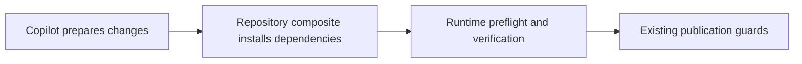

# Verification

> Source checkout only: this repository-maintainer script is not included in the installed CLI package. For a consumer installation, use `copilot doctor --read-only`, the installed CLI-provisioning workflow, and the [first workflow](/first-workflow) to inspect metadata and verify actual execution.


Run the verifier from the repository root:

```bash
node scripts/verify-agent-clis.cjs
```

The verifier MUST report the selected binary, version/help result, credential-reference status, and failures without secret values. A successful binary check does not prove a successful model request.

For a provider smoke test, use a bounded prompt that requests exactly `READY`, read-only workspace permissions, and the explicit qualified model. Record exit status and sanitized diagnostics only.

Run `copilot doctor --config <setup.yml>` to verify repository configuration and locale behavior without changing repository configuration. The human report uses `repository-locale` (`en-US` by default); issue and pull-request locale overrides appear as diagnosed facts but do not select terminal language. A non-bundled valid locale requires a ready planner/language agent and otherwise produces one complete English fallback report. Verify that stable check IDs and enums remain unchanged and that no raw provider response or credential value appears.

## Repository verification commands

For explicit file-changing or branch-sync commands with configured verification, the Copilot source coordinator provisions Node 24 and pnpm 10.12.4 before the Action, then installs the actual candidate workspace dependencies immediately before each verifier. A frozen initial install seeds the build tools needed by the fixer to regenerate admitted bundles; it does not establish readiness for another workspace revision. This is separate from standalone agent CLI installation. Read-only commands and dry runs do not need that preparation. Verification runs without agent or GitHub credentials; trusted automation commits use an empty hooks directory for that invocation after the required checks pass. Contributor hooks remain configured. Use checks that leave tracked files unchanged, such as typecheck, tests, lint and contract validators; generating platform-specific checked-in bundles during verification can correctly block publication.


Source dependency preparation is restricted to `vypdev/copilot` on its configured Linux source runner and the existing `prepare-source-verification` opt-in. It captures the external pnpm tool before candidate mutation. The version probe runs outside the candidate; frozen installation includes workspace dev dependencies and disables lifecycle scripts, pnpmfile hooks and package-manager auto-switching. Each verifier has a fresh private HOME and revalidates the current graph; the ignored `.tmp/copilot-verification-store` is only a package cache. No model, PAT or GitHub credential enters this preparation.

Supported source metadata is intentionally bounded: `pnpm@10.12.4`, root name `@vypdev/copilot`, root pnpm overrides, workspace packages/overrides, at most 32 literal relative member paths (200 ASCII characters each), 128 KiB regular single-link manifests and a 4 MiB frozen lock. Globs, external paths, `.npmrc`, member pnpm configuration, plugins, unknown settings, candidate-local/Corepack tools and arbitrary shell wrappers and unsupported source platforms block preparation until reviewed. Each process has a five-minute/64 KiB output bound; captured tool output is withheld from public results. Same-user runner access remains outside this isolation guarantee. Consumer repositories retain explicit same-job provisioning or the optional trusted native setup below; no installer is inferred for them.

A failed sync result now identifies the verification phase (`dependencies`, `repository-setup`, `runtime`, `command`), one-based command ordinal, safe script label and closed reason. It records the original head and local rollback as `restored` or `unverified`. Neither a sync commit nor a push is attempted after this failure. Inspect an `unverified` rollback before retrying; do not reset a moved head. `Retryable: No` requires inspecting/correcting the environment, frozen graph or verifier before rerunning `/copilot sync-branch`, rather than assuming every failure is transient.

Source adoption requires the new coordinator and runtime bundles on the default branch used by comment events. A merge to `develop` alone does not change that runtime. Promote through a separately reviewed, authorized repository flow before retesting affected syncs; no release is implied by local or PR validation.

On Windows, the isolated verification environment preserves the fixed non-secret operating-system metadata `SystemRoot`, `WINDIR`, `OS`, `ComSpec` and `PATHEXT`. Tests must provide their own workflow identity; production credentials and live workflow identity are not passed to repository commands.

The source workflow validator accepts the setup's literal `runs-on: {group: vypdev, labels: [self-hosted, codex, Linux]}` route. Object routes allow only `group` (optional, nonempty) and `labels` (a string or 1–10 unique strings), with literal values of at most 100 characters and no expressions or control characters. Required source role labels, Bash and pnpm isolation still apply. Group objects cannot replace hosted credential verification or the reviewed fork/merge-group quality routing. This validates configuration shape; it does not prove runner access or capacity.

## Repository verification prerequisites

The setup's runner profile chooses **where** a job runs. It does not install a
consumer project's language runtimes or dependencies. A passing application CI
job does not prepare the separate `issue_comment`, PR-comment or automated-fix
job. Each job that runs `bugbot-fix-verify-commands` must prepare its own tools,
including for `/copilot sync-branch --no-agent`. Use the [repository-owned setup
action](#repository-owned-setup) to prepare the candidate without editing generated
workflows, or retain your reviewed same-job bootstrap.

For a Kotlin/JVM project, commit a reviewed
`.copilot/verification-prerequisites.json`:

```json
{
  "schemaVersion": 1,
  "runtimes": { "java": "17", "node": "24", "pnpm": "10" }
}
```

Declare only the tools your checks require. A Node-only project can use
`"runtimes": { "node": "24", "pnpm": "10" }`. The supported keys are
`java`, `node`, `pnpm`, `python`, `go`, `dotnet`, `ruby` and `rust`; versions are
numeric prefixes with one to three components, such as `17`, `3.12` or `10.12.4`.
`17` accepts `17.0.13` and rejects `21.0.1`. Ranges, scripts, unknown keys and
unknown schema versions are rejected. The file must be a regular file of at most
16 KiB with no symbolic or hard links; its `.copilot` parent must not be a symlink.

This declaration is **optional** for compatibility. If absent or its runtime map
is empty, no runtime preflight runs and no language is inferred. Existing
consumers must add the file to obtain the new prerequisite diagnostic. Setup
does not guess or create project requirements. A declaration checks versions;
it does not install tools or dependencies and does not replace the actual tests.

Add reviewed bootstrap steps to the **same job**, after checkout and before the
Copilot step. For example, this is the placement inside an existing issue-comment
job, using the same workflow identity and permissions already configured:

```yaml
steps:
  - uses: actions/checkout@v5
    with:
      persist-credentials: false
      fetch-depth: 0
  - uses: actions/setup-java@v5
    with:
      distribution: temurin
      java-version: '17'
  - uses: pnpm/action-setup@v5
    with:
      version: 10.12.4
  - uses: actions/setup-node@v7
    with:
      node-version: '24'
  - run: pnpm install --frozen-lockfile
  # Keep the complete Copilot step and its reviewed configuration here.
```

This placement example is not a standalone workflow. Keep your existing event
authorization, checkout guards, inputs and credential bindings. Review dependency
installation as repository-controlled code; do not expose Action or agent secrets
to it. Match your Gradle wrapper, caches and additional tools to your project.
[actions/setup-java](https://github.com/actions/setup-java) supplies Java and
`JAVA_HOME`; managed runners may provision an equivalent installation. Do not
copy Java setup into projects that do not need Java.

Copilot probes declared versions immediately before each configured verification
command, inside that command's isolated environment. It uses fixed version
arguments with a five-second and 8 KiB output limit per runtime; it does not run
a manifest-provided command or installer. There are at most eight runtimes and
the existing limit of twenty verification commands remains. A tool shim can have
its own startup behavior: provision pnpm beforehand rather than relying on an
implicit Corepack download during verification.

`PATH` and `JAVA_HOME` survive isolation. When provided, an absolute `JAVA_HOME`
selects its `bin/java` (`java.exe` on Windows), including installations not on
`PATH`. Python uses `python3` on Linux/macOS and `python` on Windows; pnpm uses the
installed Windows command shim via fixed `cmd.exe` arguments. The isolated
`HOME`, temporary directories and Windows profile/cache paths remain private.
`JAVA_TOOL_OPTIONS`, `JDK_JAVA_OPTIONS`, `MAVEN_OPTS`, `GRADLE_USER_HOME`,
`NODE_OPTIONS`, agent auth-store paths and credentials are not inherited. Avoid
depending on authenticated caches or user-home build settings.

If a declared runtime is missing, incompatible or cannot be verified, the
configured repository command is not executed. The existing result reports,
for example, **Java 17 is unavailable in job copilot-issues**, with a link here
and an instruction to provision it in the same job. Raw version output is not
published. A prepared branch-sync merge is aborted without a synchronization
commit or push; automated fixes also withhold their commit and push. Correct the
declaration or bootstrap, then retry the original operation. Dry runs and
already-aligned branches do not execute verification or prove runtime readiness.

## Repository-owned setup

Each repository can prepare its dependencies in a native composite action, without
editing generated Copilot workflows. GitHub Actions executes the YAML's `uses` and
`run` steps in the same job where Copilot verifies the candidate.

The generated issue-comment and PR-review-comment workflows call
`vypdev/copilot/.github/workflows/copilot_comment_runtime.yml@v3`. This reusable
workflow keeps the complete job inside Copilot: checkout, the admitted operation,
project setup, verification continuations and native cleanup. Consumer callbacks
contain one call; they do not copy the twenty possible continuation slots.
Your dependency action stays in your own repository.

The coordinator reads the caller repository's existing Variables and receives
only the named Secrets forwarded by the generated callback. Provider credentials
remain scoped to the initial Copilot step. The project setup action receives the
existing private runtime environment. Setup retains the selected runner in the
call's `with.runs-on` JSON string, including self-hosted labels and runner groups.

GitHub Actions runner **2.336.0 or newer** is required: the coordinator's `uses: $/`
references load Copilot from the exact reusable-workflow commit, including a
consumer's pinned SHA, outside the mutable project checkout. This is supported on
GitHub.com; verify equivalent platform support before adopting it elsewhere.
See [GitHub's self-repository reference announcement](https://github.blog/changelog/2026-07-30-reference-same-repository-actions-with-self-repository-syntax/).
The existing five-minute setup limit and 120-minute job budget remain in force.



Text equivalent: prepare the candidate, install its dependencies, verify it, then
apply the existing publication guards. A separate CI job does not prepare this job.

1. Run `copilot setup` or `copilot setup --web` with a published CLI version that
   includes this onboarding support. The plan shows **Create the starter only if
   missing** or **Preserve the existing project action** at
   `.github/actions/copilot-verification-setup/action.yml`, plus the activation
   state and configured trusted main branch. Setup creates this file even when
   activation is disabled. It never overwrites an existing regular action,
   changes its auxiliary files or retires it when you disable the option.
2. Leave **Prepare dependencies with the repository verification setup action?**
   disabled while preparing the action. The generated native composite contains
   a failing placeholder with customization instructions. Replace that step with
   your project's reviewed runtime and dependency setup; no language, version or
   install command is inferred, and setup does not execute the action.
3. Update the generated comment workflows with `copilot setup --update-workflows`
   and review the complete diff. They need the reusable coordinator call; an older
   callback without native support cannot execute YAML. Review the action, auxiliary
   scripts and workflows onto the configured `main-branch` (`MAIN_BRANCH`, normally
   production). Candidate or model changes cannot replace the trusted action.
4. Enable the same question in the terminal/web assistant, or set non-secret
   configuration `repository: { verificationSetup: true }`. With Variable
   management enabled, setup plans `VERIFICATION_SETUP=true` using the selected
   storage/reuse policy. Existing configured values are shown; the default is
   `false`. If Variable management is skipped, set the effective GitHub Actions
   Variable yourself. The corresponding boolean Action input is
   `verification-setup`.
   Choose **Customize** to change an existing repository Variable; **Reuse**
   retains existing effective values. To override an inherited organization value
   just for this repository, select `VERIFICATION_SETUP` under repository Variable
   overrides and review its scope.
5. Retry an authorized modification or `/copilot sync-branch --no-agent` that
   actually needs configured verification. Inspect the native setup and verifier
   results. A dry run, no-op sync, read-only doctor result, generated file or
   installer PR does not establish runtime readiness.

The starter deliberately fails until customized. Enabling the flag before the
reviewed action is available on trusted main blocks verification and publication;
it does not bypass the placeholder. Batch setup uses the same create/preserve
rule and includes a missing starter in its installation PR. An existing action
stays outside generator ownership and out of the update diff. Unsafe parent
links, non-regular action paths and collisions block setup; inspect the path and
review a fresh plan. If a file appears after review, setup preserves it and stops
the stale creation. Dry-run, cancellation and declined approval create no starter.

For an existing installation, follow the [three-layer upgrade and rollback
procedure](/security-operations/operations/upgrade-rollback#upgrade-an-existing-copilot-repository).
This repository's `setup_platform_smoke.yml` is internal CI and is not installed
in consumer projects.

If your old comment job contains custom bootstrap steps, keep that reviewed
workflow until you move those steps into the trusted project setup action and
review its activation. A job that calls a reusable workflow cannot also declare
its own steps. Setup blocks that migration rather than silently removing custom
preparation; it also blocks malformed runner JSON or dependent runner expressions
that require separate workflow review. Plain generated callbacks and previously
upgraded callbacks retain their static runner selection automatically.

Copilot captures the complete action directory from an immutable trusted Git SHA
before candidate changes. The trusted origin ref must be available locally;
generated comment workflows use a full checkout. The runner executes that snapshot
**after merge/fix changes and before each configured verifier**, reading the actual
candidate manifests. The admitted operation continues once; the agent is not rerun.
Copilot stages the reviewed snapshot in reserved local Git metadata at
`.git/copilot-verification-setup`; the consumer's candidate files stay unchanged.
The normal directory-based `.git` checkout from generated workflows is required.
Staging remains available for native post steps. Trusted Copilot post steps reload
the pinned Git objects and verify their original content digest before those
phases with the initially pinned Git executable, so later candidate edits cannot
supply post code. Source workflows also snapshot Copilot itself outside the
mutable workspace; normal remote Action installations already use a separate
runner cache.

For Python, the consumer file can contain:

```yaml
name: Prepare project verification
runs:
  using: composite
  steps:
    - uses: actions/setup-python@v6
      id: python
      with:
        update-environment: false
        python-version: '3.12'
    - name: Install the candidate's test dependencies
      run: |
        "$PYTHON_EXECUTABLE" - <<'PYTHON'
        import os, pathlib, subprocess, venv
        home = pathlib.Path(os.environ['HOME']) / 'venv'
        venv.create(home, with_pip=True)
        tools = home / ('Scripts' if os.name == 'nt' else 'bin')
        python = tools / ('python.exe' if os.name == 'nt' else 'python')
        subprocess.check_call([str(python), '-m', 'pip', 'install',
                               '--no-cache-dir', '--require-hashes', '-r', 'requirements-test.lock'])
        with open(os.environ['GITHUB_PATH'], 'a') as paths:
            print(tools, file=paths)
        PYTHON
      shell: bash
      env:
        PYTHON_EXECUTABLE: ${{ steps.python.outputs.python-path }}
```

Keep pytest and all transitive dependencies pinned with hashes in the candidate's
`requirements-test.lock`. The verifier can remain `python -m pytest`. Adapt runtime
versions and dependency commands to your project; these examples do not infer them.
The example disables pip's cache so platform-specific cache discovery cannot create
publishable files in the candidate. To use a cache, set its path explicitly under
the private HOME or an ignored dependency directory.

For Node/pnpm:

```yaml
name: Prepare project verification
runs:
  using: composite
  steps:
    - uses: actions/setup-node@v7
      with:
        node-version: '24.x'
        package-manager-cache: false
    - uses: pnpm/action-setup@v5
      with:
        version: 10.12.4
        dest: ${{ env.HOME }}/pnpm
        standalone: false
    - run: pnpm install --frozen-lockfile --ignore-scripts
      shell: bash
```

The action may include reviewed auxiliary scripts, referenced through
`${{ github.action_path }}`. Use native external `uses` actions and `run` steps;
nested local `uses: ./...` actions are rejected because their deferred post steps
could otherwise load candidate code outside trusted staging. Review external action versions as
part of the executable setup. The composite inherits the job's operating system;
its metadata cannot declare jobs, runners or a matrix.

Each command gets a **fresh private HOME**. These dependency-only profiles stay
private until native post-job actions finish, then Copilot's final post cleanup
removes them. They are never reused by another command. Keep dependencies that
must survive native post steps under the private HOME, an ignored candidate directory
or the trusted runner tool cache, rather than inside the reserved action staging folder.

Native setup exports tools through normal Actions mechanisms such as `GITHUB_PATH`
and `JAVA_HOME`; no custom JSON helper protocol is required. Copilot accepts up to
eight new unique absolute PATH directories, each at most 2,048 characters, and
JAVA_HOME. They must exist inside the candidate workspace, its private HOME or the
captured `RUNNER_TOOL_CACHE`; unsafe links, traversal and escaping paths are rejected.
The internal closed runtime result is bounded to 16 KiB. Other `GITHUB_ENV` values
are not forwarded to verification. Use complete executable paths or supported
runtime directories when a tool needs additional environment configuration.

Copilot's PAT, provider/model inputs, agent auth stores and evidence token are not
passed to the consumer action or verifier. The Cursor API key retains its provider
condition both before the reusable-workflow call and before entering the initial
Copilot step. The native runner and external actions retain normal GitHub Actions
facilities and the job's scoped `GITHUB_TOKEN` context.
This is the existing trusted-runner boundary, not an OS sandbox against malicious
maintainer code or service-level credentials. Review setup as executable code and
avoid printing secrets. Agent credential profiles close before verification.

A native setup step has a fixed **five-minute timeout**; the worker also rejects
readiness after 300 seconds. There are at most twenty setup boundaries per operation,
one for each configured command. No automatic setup retry or limit override exists.
The action directory is bounded to 32 regular files, 64 KiB each and 256 KiB total;
its metadata must be `action.yml`, with `runs.using: composite` and 1–32 steps.
Use portable ASCII asset paths (letters, digits, `_`, `.`, `-` and `/`), at most
200 characters; parent/empty segments and Windows reserved filenames are rejected.
Native setup logs are visible in the run; there is no 64-KiB helper-output ceiling.
Copilot's own error/result comments contain only a closed cause, fixed path and
pinned trusted SHA, never copied raw setup output.

Setup must install dependencies without changing publishable code or lockfiles.
Copilot compares HEAD, branch, index, tracked edits and publishable untracked file
contents, types and executable modes before allowing the verifier to continue. Executable lookup uses that verifier's
validated PATH, so its private Python/pnpm takes precedence over the worker tools. Observations are bounded to
16 MiB, 256 untracked files and 16 MiB aggregate untracked contents. Ignore dependency
caches and keep source changes within these bounds. Failure, changed candidate,
invalid runtime output, timeout or cancellation withholds verification and push;
branch synchronization follows its existing abort/recovery.

Read-only questions/status, dry runs, already-aligned branches and empty command
lists execute no setup. Snapshot failures remain deferred until verification.
Setup/install/update preserves this consumer-owned directory and all its assets.

If a runner crash leaves an unknown reserved staging directory, preparation fails
closed rather than overwriting it. Confirm the prior job has stopped, inspect its
run, and remove only that stale `.git/copilot-verification-setup` directory before
retrying. Normal completion/cancellation uses the Action post cleanup.
Invalid session handoffs fail closed. An invocation removes only the setup request
it created after validating the session; rejection before that point leaves
preexisting request files untouched.

Native composite execution is available in the generated **GitHub Actions**
callbacks. The local CLI cannot execute `uses` steps: opted-in local verification
fails with `native-workflow-required`. Run the authorized operation in Actions,
or keep the opt-in disabled and provision your local dependencies normally.
Direct custom callers must implement the documented generated native callback
structure; setting the flag on an old single Action step is insufficient.

To roll back, set `VERIFICATION_SETUP=false` and provision dependencies before
Copilot in the same job. The unreleased `.copilot/verification-setup.mjs` prototype
is superseded; it is not executed or installed by this contract.

## Reused credential evidence

The reuse journey performs GET-only inspection of trusted installed health
results; it does not bootstrap or dispatch a workflow, execute custom scripts or
query a model. Evidence must match the packaged template, authenticated default
SHA, repository/run identity and effective Secret metadata, and be no older than
five minutes. Reads have a 15-second request and 30-second overall health budget.
Stale, missing or rotated evidence remains pending; a trusted failed check blocks
that binding. PAT authentication alone never certifies runtime Write grants.
A created setup PR is Waiting for merge, not an installed/verified result.
