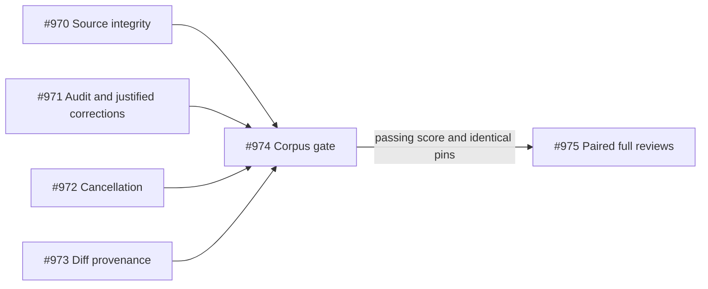

<!-- bugbot-950-backlog-index:v1 -->
## Follow-up backlog after #951 — qualification first

PR #951 is merged; its source/CI closure is complete. **The verifier profile is not qualified and BUGBOT_VERIFICATION_MODE remains disabled.**
This is a backlog, not an instruction to start branches or model runs. All 13 issues were created from the installed bug/chore forms, with one priority each.

**Start next:** #970 and #971 can be prepared in parallel. Finish the measurement-integrity controls before freezing another measured source.

### Qualification path

| Order | Issue | Priority | Closure needed |
| --- | --- | --- | --- |
| 1a | #970 — Executed source and sanitized Git provenance | High | Proven source/lock/driver identity before imports or calls |
| 1b | #971 — Diagnose failed precision, F1 and calibration | High | Independent per-error evidence and justified narrow corrections |
| 2a | #972 — Propagate explicit cancellation in the shadow runner | Medium | An interrupted operation cannot be reported complete |
| 2b | #973 — Correct deletion-only citation metadata | Medium | Grounding metadata agrees with the actual fixed diff |
| 3 | #974 — New preregistered 174-case corpus run | High | Every unchanged detection gate passes on the exact new pin |
| 4 | #975 — The 42 paired full-review slots | High | Profile-specific false-positive, positive-control, citation, integrity and latency gates |

Text equivalent: complete #970-#973 and any independently justified corrections from #971; freeze the exact implementation/drivers/runtime; run #974. Admit #975 only if the corpus actually passes for those identical pins. Six native GitHub blocked-by relationships record this sequence and the writer-install dependency below.
Closing #974 with a failed report does not satisfy the passing-score condition. A changed implementation invalidates reuse of the earlier source-bound qualification.

The previous campaign completed 174/174 but failed precision (80.23% <90%), F1 (83.13% <87%) and Brier (0.1883 >0.16). Its 42 review slots were unstarted and Sol measurements were zero. Preserve these negative results; do not turn unmatched scorer categories into independently established false bugs.
The existing p95 qualification threshold is evaluated after investigation. Do not restore token, elapsed-time or turn-count research cutoffs. Unknown token usage never rejects a supported verdict.

### Operational follow-up and rollout prerequisites

| Issue | Priority | Relationship to qualification |
| --- | --- | --- |
| #976 — Accepted dispatch without run ID | Medium | Recovery correctness before installing the new writer |
| #977 — Trusted-default status-writer installation | Medium | Blocked by #976; operational installation, not a prerequisite for local corpus/full-review dry-run |
| #980 — Approval-receipt producer trust boundary | Medium | Required trust review before any proposed enforced activation; matching run/artifact metadata is not code attestation |
| #979 — Credential-health trusted-ref policy | Medium | Separate operator/runner hardening; a branch-local condition is not an independent security boundary |
| #978 — CI aggregate-predicate validator | Low | Regression protection; the currently shipped gate already fails each worker failure |

The reported broad action-edit approval route was not reproduced by the guarded-policy packaged controls: protected bundle/workflow/action.yml edits return protected-path with zero mutations. #980 retains the narrower producer-trust limitation rather than asserting a proven approval exploit.
#977 must inspect the current trusted default revision; the absence recorded in #951 is a historical snapshot, not an assumption about a later installation. Coordinate installation tooling with existing #814. No deployment, default-branch merge or activation is authorized by this index.

### Separate Setup acceptance, outside EV-07

| Issue | Priority | Existing open observations |
| --- | --- | --- |
| #981 — Real screen-reader and 200% zoom journeys | Low | U076/U077, U081/U082, U086/U087, U091/U092: eight observations in four locales |
| #982 — Packaged platform and Windows symlink checks | Low | I039-I042 and X023/X026: six actual Linux/Windows observations |

These two issues account for all 14 open Setup ledger cases (336/350 passed). They do not block qualification of the Linux Bugbot profile. DOM inspection, another OS, a skipped test or a queued runner cannot replace the missing observation; these tasks invoke no real models.

### Preserved scope and decision

- [Final #951 report](https://github.com/vypdev/copilot/pull/951#issuecomment-6973299390) and all frozen pilot evidence stay authoritative for what actually ran.
- The [27-issue traceability matrix](https://github.com/vypdev/copilot/blob/ccefb27627cd627ccdb7d5666fd174c2ac1da07b/quality/bugbot/evidence/issue-950/traceability.md) remains canonical. No duplicate issue was opened for each historical case, and no case was closed on the strength of the merge alone.
- Existing related issues such as #954, #963 and #966 retain their own evidence and disposition. #971 should link an existing matching defect rather than duplicate it.
- Every exact enabled profile must pass independently and receive explicit maintainer approval. A passed corpus or a shadow pilot is not production activation.
- Keep production disabled, preserve independent evaluators, and require zero evaluated-PR write attempts. Retain the existing self-hosted runner policy and installation templates.

<!-- codex:goal-950-execution:v1 -->
### Qualification correction and operational validation — 2026-11-22 02:27 UTC

**PR983 merged normally** at2026-11-20T09:46:05Z: exact tested845be8a8de7dc9441d42589bbf1e2d91ac08fdc6 → develop4736cd4f0b28b2ae2579434904c6ce7b5bdea58e, with byte-identical Git tree. Issue970 was closed by the successful Action lifecycle. The maintainer subsequently delegated normal merge judgment (`estas autorizado a mergear lo que consideres, no necesitas mi aprobacion`). No further per-PR merge approval is needed; fresh SHA fences, valid findings and protections remain mandatory. Default installation requires its separate specific authorization.

**The full goal remains incomplete.** Nine protected merges are complete. Accessibility #981 is USER-DEFERRED (0/8). PR997 remains at 397de9a6271eb819f513c499a792a804684b9b69: single-use scope correction, normal945suites/18,768PASS+35historicalskips and479clean deterministic controls; all four native CI jobs and workflow44972788905 succeed, but Commit fails NONRETRYABLY on progress call-budget,0of7assessment batches verified. This is not a174-corpus result. PR999 publishes 3552e1445b49a4fc0a969bac2f6f6b13151a4409: actual adapter-write cancellation correction, same causal66PASS/8FAIL ->74PASS,27-file1,237PASS/91mapped/95registered, six changed modules100%allmetrics and normal967suites/19,780PASS+35historicalskips/build/lint.312archives preserve history. Remote step-action inventory and fresh native acceptance remain pending. Actual174/42UNSTARTED, qualificationcalls0, pilotwrites0, profileNONE; productiondisabled.

**#971 / PR984: MERGED normally at2026-11-20T12:51:29Z**, exact tested head **6e6e79cb8695bc9ef9b5b415ee20409984b788c2** → develop **c6590bd8e03aced19250d681788f53268dede600**, with parents4736+6e6. Authenticated readback proves its merged tree94f95f90e4e9c7d415bcaa283c857b400037eab7 is identical to the tested head. All8 final-head native technical groups succeed and fresh review threads have no unresolved finding. Full943-suite /18,695-test build/lint hook, committed196 shadow controls, frozen audit3 and spec/docs/graph pass. The successful merged-PR lifecycle [44739293381](https://github.com/vypdev/copilot/actions/runs/44739293381) closed issue971 at12:58:26Z; this was read back, not manually forced.

The first6e6 native coverage failed one unchanged Setup suite after a5000ms timeout and29 later same-process active-inspection guard failures. Exact adapter/journal/test bytes match old1f3, parent4736 and6e6. The isolated72/72 pass2.438s and instrumented72-assertion pass4.291s are retained; the instrumented single-file diagnostic correctly failed global coverage completeness and is not represented as a full coverage success. One accepted same-SHA native coverage/dependent-aggregate retry then genuinely passed, without changing source, timers, thresholds or runners. Full negative3,162,841-byte log/SHA806291960c16ba07bcb9b04369186e3d15ac53b04a38cc10aa21aa271d4722f2 and all native receipts remain retained. Its earlier Action clean-merge/extension hook abort and isolated6/6 pass remain separate history. Frozen28 scorer rows,22 taxonomy pairs, original failed scores and five unresolved premises are unchanged; the audit does not convert every scorer disagreement into a proven defect. #985 remains its one bounded causal correction.

**#972 / PR988:** contributor **07613d5e91a8155b6357f5a065420be38b2e5c08** is now published/read back over Action-ownedcf3736+25eaba. Ordinary943 Jest suites/18,695 tests (35oldskip,493.060s), build/lint/spec/docs/AST PASS; complete committed-source **210/210 PASS**,0failure/skip/cancel (515.782s wall). Raw22,118bytes/SHA30207acdd10cc288f194e55d6d9dcc4291913f76e630a00033b729b83b935f22 retained. Actual seven-operation ledger SHA9a0dca5792cf30f973ca77138ca397b50d5cf3ef737e3e0910b4c665018c7622 records five interrupted130/completed0/provider-failed1, allwrites[]/checkoutunchanged and provider-result-observed before abort; separate eighth cancellation case covers matched-arm cancellation. Normal same-ref push succeeded, remote076confirmed then freshPR076 after immediatecachelagcf; no push repeated. Body updated with Action configuration preserved. Final076 native eight groups/findings pending.
The successful [official972 sync44755243183/job136353130726](https://github.com/vypdev/copilot/actions/runs/44755243183/job/136353130726) remains retained againstcf3736: clean merge/no fixer, native943/18,695+385extensionfiles/5,291tests and build/typecheck/coveragebudgets/lint/docs/spec PASS. Source/bundles/lockfile match parent25eaba; cancellation drivers/bootstrap/package remain exactf133. Its full3,801,324-byte raw log SHA5fd29a9afe72b3bb412cea0a8ca96fa94e87c36a314e9d01703bafa483ddfcff, prior204ledger and Review-resolved thread proof are now published in076. No frozen result is relabeled as a later-head pass.

**The valid post-provider ordering finding is corrected in code, with final native Review confirmation still required.** The strengthened assertion actually rejects the previous early-abort fixture (targeted1FAIL, signal alreadytrue at provider-result observation; rawSHAf75d4736c018365d2be942aef8f1670ac579467c9f17a7669403fa005664f1e6). Focused corrected1/1 and full204 replay both observe settled provider-turn-failed with signalfalse, then explicitly abort, retaining interrupted/blocked status, child130 and empty writes. Focused positive243bytes/SHA9abfe51f9ce356fab5410f2708acc270a3babde9e4a5efad011f9c9d01d1e479 and readable RED/GREEN ledgers are archived. The new driver observer is internal, adds no CLI/Action setting and preserves the normal path without it. Old204 terminal replays remain preserved with the explicit missing-order limitation. ThreadPRRT_kwDONSeBW865_sfT/comment4642788101 is not manually marked resolved or represented as a current native pass.

Priorf133 normal push was confirmed after a transient PR API lag without repeating publication. That contributor correction passed ordinary943/18,695 build/lint354.020s and full committed204/204 controls638.424557s,0fail/skip/cancel; raw21,840bytes/SHAf6348e39c57ec7bf0041c17062f91c33d2f2927b0f3f796a2abfe8923d4518a8. Its readable ledger SHAa48de670ab532756ad3001fa9a628bb467789d8ac1dfb0dc16dff913510cc8e2 has seven actual bootstrap operations (five interrupted130,completed0,failed1), allwrites[]/checkoutunchanged; the eighth cancellation case is the separate matched-arm control. The old-order RED assertion remains failed; corrected ordering observes the settled provider failure before abort. Native Review136358102701 SUCCESS14:53:08Z and bot-resolved ordering finding14:52:54Z are retained against f133; they do not certify a later head. Supported sync request7042260164 is now satisfied by actualcf3736, with no manual synchronization or repeated command.

Earlier official c659 sync44740742936 published2a30 with exact parents64cd+c659, native build/typecheck/lint/spec/docs and943 Jest suites/18,695 tests (35oldskip),385 extension files/5,291 tests PASS. Full positive3,795,051bytes/SHA256539f6222255e534490df307273a7994c0549a2386e2b384f01ae10eb8a741447 is retained, scoped before the ordering correction. The readable64cd evidence-format fix genuinely passed Commit136301909158/Verification136311815574; its original118,219-byte ledger SHA7842d879082a5d6563d695973faff4bb1cc662049affb0a2f06a6875e878c797 remains exact and adf gzip history intact. Separate64cd native failure44740279836/job136306673887 had two fake-credential shell5000ms timeouts (942suites/18,693PASS,2fail,35oldskip; downstream coverage/extension not run); full3,045,129bytes/SHA188c255f55dcbb9a569ba77f7a6897c921cda993b52deaecdd8588442575ccf9 retained. Unchanged full82-case transport suite passes locally8.324s with fakecurl/zerohealthdispatches, without proving native timing cause or whole native acceptance. Earlier a8b3 extension failure/28localpass, adf binary-guard rejection,4736fixer timeout and staged/committed fixture negatives remain unchanged.

**#973 / PR986: MERGED normally at2026-11-20T14:22:57Z**, exact tested head **3a65757b7482c22d9fc29a3161a7e92be8e3718e** → develop **25eaba3a641abb05d1ac2847917c97863e5a714f** (parentsc659+3a65). All8 final native groups actually SUCCESS, mergeable/CLEAN, zero unresolved threads, fresh strict CI/admin protections and standing maintainer authorization. Authenticated readback proves the merged/tested Git tree is identical: **e51c951b4b2fd7044d927437f438db113159f20e**. Masterace49 and productiondisabled are unchanged. No bypass, force or contributor ref deletion. Issue973 was CLOSED byvypbot at14:26:00Z; merged lifecycle [44752912220](https://github.com/vypdev/copilot/actions/runs/44752912220) SUCCESS. Deployment orchestration44752912146 SKIPPED; no deployment occurred.

Final-head native static [136324805250](https://github.com/vypdev/copilot/actions/runs/44745556436/job/136324805250) passed **202/202 shadow controls**, no failure/skip/cancel; full decoded79,840bytes/SHA256257eec9c31b97812f86aeef72fe17ad28a8b023931e2dfd0c303d400b4a960e1 retained. Final native coverage [136324804864](https://github.com/vypdev/copilot/actions/runs/44745556436/job/136324804864) passed943 Jest suites/18,695 tests (35oldskips) and385 extension files/5,291 tests; full3,228,722bytes/SHA256d780b9470b2ec9d383ea07d3084afeb958f11072e982c3c196994a57d48f86d3 retained. Ordinary3a65 build/Jest/lint364.909s and docs/AST/integrity passed, with executable source/bundles/package/lock/frozen #950 artifacts identical to official7901 sync source.

The successful c659 Action sync44739840949/7901 and full logs remain published in the issue-973 evidence directory. Earlier3b29 native coverage failure (three unchanged60000ms extension hooks,19unexecuted cases,one history readiness assertion) and unchanged25/25 local diagnostic43.26s remain retained, full negative3,154,470bytes/SHAedeaffcb04a9fc1fabb964ec12bf7b9c3bf8727e7f14ada1a69e76381c7db0fc. The new real pass does not rewrite that failure or establish its timing cause. All a234/Dfe earlier attempts remain historical. No model profile is qualified by this deterministic delivery.

**#985 / PR990 — preserved prior result:** previously published **fa92ca94079ed31edada346a5fb5d5d604864ac0** (8ce+c659) passes ordinary943/18,695 build/lint367.824s,202/202 committed-source controls117.781s,6causal/spec/docs/AST checks, and native Static/Build/Commit/Verification/Review/BranchSync SUCCESS. Its new coverage44748313315/job136329289763 nevertheless FAILED: the first English SetupManagementPanel SSR render exceeded existing5000ms;942 suites/18,694 testsPASS,1failed,35oldskip; downstream coverage-budget/extension checks did not run. Full negative3,044,593bytes/SHA2567e30006aaf2cd1cf0a0bb2cf1149a22be25cf7b44abf6c1d2c2c6b63eb5ef8e0 retained. The unchanged full affected SSR suite passes32/32 locally9.762s; exact test/renderer/fixtures/policy/web/lock blobs matchfa92,8ce,c659. This is neither a native pass, timing-cause proof nor actual browser/screenreader/zoom acceptance.

After the actual973merge, supported [/copilot sync-branch request7041980928](https://github.com/vypdev/copilot/pull/990#issuecomment-7041980928) completed **SUCCESS** in [44753257593/job136346272617](https://github.com/vypdev/copilot/actions/runs/44753257593/job/136346272617), publishing **a114134011b98904b4806ddd58ec9f780d27ab60** (fa92+25eaba). The Action resolved one documentation conflict and retained both amendments. Native build/typecheck,943 Jest suites/18,695 tests (35oldskip,478.322s), module coverage budgets,385extensionfiles/5,291tests, lint/specifications/documentation all PASS. Executable source/bundles/lockfile match parent25eaba; only package difference appends the six v2 corpus controls. V1/v2/labels/IDs/order/derivation and frozen history are unchanged. Full3,788,938-byte native log/SHA2566c52f7eea0a9350be73031f85f7a1d28e2d3f5c5156233b9606aae62996644fa is retained. Ordinary contributor evidence **99c90b491fccf464c8cb2bf70e031ca799508b44** is now published/read back on the same ref, with943/18,695 build/lint323.065s and committed **208/208 PASS**,0fail/skip/cancel (136.199s wall). Documentation/specifications/AST PASS. Final-native Review136372268228 and BranchSync136371189446 SUCCESS; CI44760437195 and Commit44760431033 are active/queued. The full208 log SHAfc8472d261314be5d556dae16acbbfcee0e04f1f9460c27f0e1b44f05105d69e is retained. the previous fa92 coverage failure,32-case diagnostic and exact202-pass history are archived alongside the new native result. Those final99c9 native gates/findings now all PASS and the normal merge is recorded below; this paragraph retains the earlier delivery sequence. No unchangedfa92retry or manual25eaba synchronization occurred.

The prior official c659 sync44739846048 cleanly merged, passed build/typecheck and failed an unchanged30000ms operator Actions test plus six inspection-guard cascades. Action restored exact8ce without commit/push; reference0e6a85a1-7e38-4e9f-b3c4-24cb2e7ccd00. Full negative3,676,290bytes/SHA256c00ce5a6291c44c85cd480f42649cf898ec5e8a7b174d68caf92c6ff0d766d46, isolated8/8PASS2.667s and its new exact-base recovery plan are published in the issue-985 evidence directory. Recoveryfa92 changed no source/assertion/timer/workflow/runner/concurrency rule from the clean merge; v1/v2/derivation/174IDs/labels/order/173otherobjects and all frozen #950 artifacts stayed identical to8ce. Earlier4736 Safari abort/isolated10-case pass remain preserved; no unchanged Action retry, force or contributor remote ref creation/rename/deletion occurred.

**Current parent coordination:** #972 / [PR988](https://github.com/vypdev/copilot/pull/988) merged normally17:18:21Z, tested **26e9dd8ede0490774d59bae946156514c43f6d20** → develop **0ddac1011204db6dda45dff0f99e3ef91309c701** (parents6382+26e9). All8 final native groups SUCCESS/CLEAN, zero unresolved threads, fresh strict/admin protections and identical tested/merged tree **989c41d88ec591921e6855142bd82c50ca84b8ef**. Ordinary943/18,695 build/lint plus committed216/216 controls0fail/skip/cancel and seven actual controlled operations PASS. Final native Ubuntu Static216/2160fail/skip/cancel; coverage943/18,695(35old skips)+385files/5,291 PASS. Raw logs retained: Static89,519bytes/SHA48fade8ff0f82db3a4ced5c12545c4405559ace2122481f9210e40764961f0de; coverage3,219,653bytes/SHA9030eb57e74b336af6d682aeb8eaafa44d17c832dac149323643c4ddd33dcce2. Issue972 CLOSED17:18:39Z; [lifecycle44782006160](https://github.com/vypdev/copilot/actions/runs/44782006160)SUCCESS, deployment orchestration44782006066SKIPPED. Hold this actual merged base while974 receives official SDD/branch readiness; no manual managed-ref creation. Earlier base-scoped negatives/passes remain historical, not relabeled. Other delivery PRs need their own current-base synchronization/final gates. Normal merges remain delegated; installation authorization is separate.

**Superseded973CI coordination (#995):** CI44743417532 on old bot head7901 had all3workers terminal (staticSUCCESS, coverage/buildCANCELLED after superseding publication), only administrative always()aggregate136319971689 queued without a runner, and final3a65 CI44745556436 pending. One normal cancel returned202 at13:43:42. The old run subsequently completed CANCELLED, aggregateFAILURE, and the final-head CI moved to QUEUED by13:45:23. A later force-cancel preflight correctly stopped when the old run was no longer queued; **no force-cancel request occurred**. No active test/model investigation was interrupted by this cleanup; all old results/logs and fresh3a65 requirements remain intact. No source, runner placement, concurrency rule or protection was changed.

The actual174-case campaign (#974) and42 paired full reviews (#975) are unstarted; **no profile is qualified**. Source preparation and technical CI are distinct from those measurements. The user explicitly deferred all accessibility work (#981); its eight original human rows remain open. #982 still needs six genuine platform/service observations. Production remains disabled and evaluated-pilot write attempts remain zero. Default installation/native canary require separate specific authorization. Historical27-issue traceability, original negative measurements and installation templates remain preserved.

| Issue | PR / published SHA | Real state and executed evidence | Pending / next action |
| --- | --- | --- | --- |
| #970 | [#983](https://github.com/vypdev/copilot/pull/983) · **`845be8a8de7dc9441d42589bbf1e2d91ac08fdc6`** | Source/Git/bootstrap/plan/dependency/runtime admission and probe corrections published. **196/196 controls** (20bootstrap/17runtime), full943-suite /18,695-test build/lint hook, specs/catalog/docs/graph PASS. Native Ubuntu also reports196 controls plus spec/docs PASS. **Every final-head native CI/Commit/Verification/Review/Branch Sync check succeeds**; actual Review validates4/4 partitions and resolves all8 findings, zero open threads. Failed attempts and exact readable historical code remain retained. Health timeout applies only to --version before models; no investigation cap is added. | **MERGED** at4736cd4f0b28b2ae2579434904c6ce7b5bdea58e with explicit user authorization; issue970 CLOSED byAction. Authenticated cancellation fixtures and combined970/972 proof still require actual Action integration before #974's committed preregistration. No profile is qualified and no qualification campaign started. |
| #971 | [#984](https://github.com/vypdev/copilot/pull/984) · tested`6e6e79cb8695bc9ef9b5b415ee20409984b788c2` → **merged`c6590bd8e03aced19250d681788f53268dede600`** | Full943/18,695 build/lint,196 committed shadow/audit3/spec/docs/graph PASS; all8 final native groups PASS and zero unresolved review threads. Same tested/merged Git tree verified. Original30-failure native attempt and single successful coverage retry retained. | **MERGED; issue971 CLOSED** at12:58:26Z by successful Action lifecycle. Frozen scorer rows/failed scores unchanged; five unresolved premises remain explicit, causal985 correction is now merged as6382d54; no historical scorer row or score was changed. |
| #972 | [PR988](https://github.com/vypdev/copilot/pull/988) **MERGED**,26e9dd8ede0490774d59bae946156514c43f6d20 →0ddac1011204db6dda45dff0f99e3ef91309c701 | Ordinary943/18,695 build/lint, committed216/216 plus seven actual operations, all8 final native groups and zero unresolved threads PASS. Native943+385files/5,291; exact tested/merged tree989c41d preserved. Issue CLOSED by successful Action lifecycle. | Deterministic prerequisite integrated; preserve all earlier failures and current raw logs/receipts. No profile qualification inferred. |
| #973 | [#986](https://github.com/vypdev/copilot/pull/986) · tested`3a65757b7482c22d9fc29a3161a7e92be8e3718e` → **merged`25eaba3a641abb05d1ac2847917c97863e5a714f`** | All8 final technical groups SUCCESS/CLEAN, zero unresolved threads. Current202/202 controls and943/18,695+385files/5,291 extension tests/nativebuild PASS. Tested/mergedtree e51c951... identical. Old failures and exact logs/hashes retained. | **MERGED normally14:22:57Z; issue973CLOSED byAction14:26:00Z.** Productiondisabled/masterace49 unchanged. 985 is now merged; 972 is now merged with combined216/all8 native proof;974 can prepare its exact preregistration contract. |
| #974 | [PR997](https://github.com/vypdev/copilot/pull/997) OPEN at **397de9a6271eb819f513c499a792a804684b9b69**; actual174 UNSTARTED | Single-use canonical identity/namespace admission rejects aliases and replay before planner preparation. Causal17PASS/10FAIL ->27PASS, changed scope/pure policy100%allmetrics; corrected85-case cohort plus1unchangedskip. Normal945suites/18,768PASS+35historicalskips/build/lint; two bundles change. Full479PASS on exact clean committed source; precommit456PASS/23source-fence refusals and first normal18,766PASS/2fixtureFAIL remain retained.31scope archives plus prior25durability archives preserve negatives;22lossless suffix corrections keep original bytes under the unchanged generated-evidence contract. All4current native CI jobs SUCCESS:Static137055995786,Build137055995971,Coverage137055996017,aggregate137062818002. Actual workflow44972788905 is COMPLETED/SUCCESS on397; this does not override the separate failed Commit/Verification. Actual Commit137055986966 FAILS NONRETRYABLY:463required paths,17source parts,12classification assignments,0of7assessment batches verified,reason call-budget. The full32,937-byte log is retained at SHA-256a23ea33448a0acb663fd0e57d3be4232e4eb13481d1b3f54bd70228df5d5905c. It is a progress-assessment failure, not model-corpus evidence. Frozen plans/corpora/35logicalIDs/selectedSDD unchanged; global/native/scientific qualification UNMET. | Materialize the actual complete progress plan and correct its supported workload without dropping source/requirements or blindly increasing limits; do not retry unchanged397. Continue late-abort/callback/owner-loss/read-scope/global-driver/compliant-runtime prerequisites, fresh exact-tuple C32–C35 and committed preregistration before174. Only same-tuple174PASS permits42. |
| #975 | No PR; 42/42 slots unstarted | No passing new corpus on identical pins; zero new qualification verifier measurements. | Admit only after a genuinely passing #974 result. No profile is qualified. |
| #976 | [PR989](https://github.com/vypdev/copilot/pull/989) **MERGED**, tested12d81173119371f4b4314a9bd1f82a558babe690; merge **e2b01db2744ab293b6775b3301b94ae698c0eaa4** | All8 native groups SUCCESS, zero unresolved threads.216/216 native static controls,943Jest suites/18,715assertions+35oldskips,385extensionfiles/5,291tests; original source patch preserved through recorded exact-base recovery after actual official-sync failure. Tested/merged tree **860e2f9e9b10bd7642c7c9a2c1f0d460582668f7** identical. Action lifecycle44818980331 SUCCESS, issue closed2026-11-20T21:18:32Z; deployment44818980352 SKIPPED. | Source recovery delivery complete. Actual trusted-default installation and native canary are separate977acceptance; neither is claimed by the merge. Production remains disabled. |
| #977 | [PR993](https://github.com/vypdev/copilot/pull/993) OPEN; preparation **c7d6d6a2eb0db6d02376df8348707e5795a36999**; **not installed** | Dependency [#998/PR999](https://github.com/vypdev/copilot/pull/999) publishes **3552e1445b49a4fc0a969bac2f6f6b13151a4409**. Cancellation during batch-adapter freshness/Git-proof reads now stops the next tree/commit/ref/PR POST at synchronous transport admission. Both interactive compositions bind current activity; object intent becomes dispatched only afterward. Completed effects, exact commit/ref identities and uncertain objects survive. Actual66PASS/8FAIL ->74PASS on identical causal test bytes;27-file1,237PASS/91mapped/95registered,6changed modules100%allmetrics, normal967suites/19,780PASS+35historicalskips/build/lint. CLI8,472,597B/b4734ac06ba9ad6fe24be1cd510f6fd5f466d4588458e4dd8514ec74be7f5920;other3bundlesunchanged. Build/104files/11actualCLI0effects/API/web PASS.36canonical new archives plus276prior records=312verified;59outgoingversions/36expandedgz audited,7benign static matches/0unresolvedsecrets/0host-email paths. Parenta568 native3workers/CommitSUCCESS; new-head acceptance separate. Default inventory remainsUNKNOWN14/20. | Correct unresolved remote step-action inventory finding, obtain fresh final-head checks/review and merge source. Then reconcile inventory/fresh merged pins/eligible complete2filepreview and obtain specific installation authority. No installation/canary/producer attestation is inferred. |
| #978 | [PR987](https://github.com/vypdev/copilot/pull/987) **MERGED**, tested **277822338c4ce23f84d7c062a375bc499b61eb77**, merge **a7c23ad169bca92ade652c893f268b5c9ef566ab** | All8requiredgroupsSUCCESS,0unresolvedthreads, protected normal merge00:01:03Z. Parents e2b01db+2778223; tested/merged tree **72d75caf4d255fe54827df7b1983fc9890f0f39b** identical. Final native943SDKsuites/18,723assertions+35oldskips,385extensionfiles/5,291tests,216Nodecontrols. Coverage raw3,218,912bytes SHA58b38d4c98fd29829997aea990da9d4717e16fa427101b137ab64e9d6bc57982; static88,283bytes SHAbeddd663858963d40c08a245a577ea5eb92dc1ce7cb7629b319b029a2e514130. Originaltimeout and actualaggregateFAIL retained; singleacceptedretrypassedwithout changing25minbudget,source,runnersorprotections. Lifecycle44840926546SUCCESS; issueclosed2026-11-21T00:03:51Z; deployment44840926516SKIPPED; BranchSync44840924572SUCCESS. | Source delivery complete. No default installation, productionactivation or modelqualification implied. Masterace49e4 unchanged; BUGBOT_VERIFICATION_MODE=disabled. |
| #979 | [PR991](https://github.com/vypdev/copilot/pull/991) **MERGED**; tested **05b5c0161de32791ee4d47c8a1dce7e6d07868e9**, merge **c7b7feb4cced42697a45f1624384dfba950c4fea** | All8requiredchecksPASS/0reviewthreads; MERGEABLE/CLEAN under actual strict/admin-enforced protections. Normal944SDK/18,735PASS+35oldskip,build/lintPASS,clean. Native944SDK/18,735PASS+35oldskip;385extensionfiles/5,291PASS;216NodePASS0fail/skip/cancel. Coverage raw3,229,058bytes SHA00b474e1eb7fe9554041702096951cc7a7bc8780c87300769b4833cbfcefad28; static89,274bytes SHA2b7027e10789213f558c074af4a35e611674f4b8d2822b27e43d345da8363277. Normal protected merge parents exactlya7c23ad+05b5c0; integrated tree9f634102b7c720e653676a37a200fdd55956cb1b equals tested tree. [Lifecycle44879128946SUCCESS](https://github.com/vypdev/copilot/actions/runs/44879128946); [deployment44879128870SKIPPED](https://github.com/vypdev/copilot/actions/runs/44879128870). Issue closed and actualdevelop stillc7b7feb. Previous three native failures retained; underlying prior latency remains unproven. Separate [postmergeBranchSync44879128247](https://github.com/vypdev/copilot/actions/runs/44879128247) failsworkflow.stale, non-retryable; optionalcheckpublication403 is separately recorded and does not explain the authoritative failure. | Source-policy delivery complete. Actual credential-health dispatch, independent organization grant evidence and all8operational health flags remain false/unverified; no source merge is default installation or attestation. No protection/runner/production change. Continue#980 through one fresh official current-parent sync. |
| #980 | [PR992](https://github.com/vypdev/copilot/pull/992) **MERGED**; tested **67bfddff7931fb9287cd3256060a4876ed7d462f**, merge **09d5c2d2423057cde469e5a8790c61481859516d** | Normal protected merge, exact parents c7b7feb + 67bfdd; merged tree 25af97a796431998fed2248a84021caeae694943 equals the tested tree. All eight required checks PASS, zero unresolved findings; actual strict/admin-enforced protections unchanged. Native CI: 944 SDK suites / 18,735 assertions PASS +35 existing skips; 385 extension files /5,291 assertions PASS; 217 Node controls PASS with zero fail/skip/cancel. The first failed CI and focused-command coverage failure remain negative; exactly one unchanged technical retry passed. Coverage raw SHA063b147e41bb17185fe958de22ed0cc94d8696f69e0141c3041015d7557499c5; static raw SHAdbd4080126f1ea2302f207d248f6c9df3a6ee41a784a36b5916b5e458bb473f0. Fresh [14/14 packaged audit](https://github.com/vypdev/copilot/blob/67bfddff7931fb9287cd3256060a4876ed7d462f/quality/bugbot/evidence/issue-980/current-parent-d306/acceptance.json), exact driver, all four bundles reproduce; application enforcement and owning SDD preserved. [Lifecycle44886762273](https://github.com/vypdev/copilot/actions/runs/44886762273) and [postmerge sync44886761600](https://github.com/vypdev/copilot/actions/runs/44886761600) SUCCESS; [deployment44886762188](https://github.com/vypdev/copilot/actions/runs/44886762188) SKIPPED. Issue closed. | Source trust-boundary audit complete. It documents an operator trust assumption; independent producer-code attestation remains unverified. No default installation, canary, profile qualification, runner/protection change or production activation. All historical negatives and refuted exploit claim retained. |
| #981 | [PR994](https://github.com/vypdev/copilot/pull/994) OPEN, preparationaa5c03551d283ad62fa36d8d80912090065d212d; **USER-DEFERRED** | **0/8 actual human observations**. Frozen packageSHAabeac2c108ed9b663bef80317f38eefbd14eed35502a32952f9d418f045f0d88 and UI/CLI/script identities retained. User explicitly postponed VoiceOver and accessibility generally to prioritize service/Bugbot work. Owned local synthetic fixture stopped and endpoint verified closed; no completed human fact supplied. | Resume only when the user requests it. Keep the eight original ledger rows open and historical preparation evidence. This deferral does not block Bugbot qualification or mark accessibility accepted. |
| #982 | [PR996](https://github.com/vypdev/copilot/pull/996) OPEN, preparationbbf3bf1660a4f53e194bc2eb965287c70439741a | **0/6 actual observations**. Prepared packet retains exact source/package, original SIGSEGV/isolated6PASS/full943retry and old final native groups; none establishes platform acceptance. User reports no corresponding environments available now and can arrange an agent on a real Windows desktop. No agent or platform-observation job was dispatched. Existing default routing is hosted; prepared self-hosted routing is not installed, and org runner inspection403 is not absence proof. | A real Windows desktop may supplyI041/I042 with actual browser launch/pairing and opener fallback; LinuxI039/I040 still needs a real desktop. X023/X026 require the named actual Windows service identity and genuine symlink execution, off codex. No privilege/runner/default/template change or substitute OS/HTTP-only result. All6 remain open until evidence arrives. |

**Causal #971 correction #985 / [PR990](https://github.com/vypdev/copilot/pull/990): MERGED normally at2026-11-20T15:55:59Z**, testedhead **99c90b491fccf464c8cb2bf70e031ca799508b44** → develop **6382d54a823461b817b52407090dd9a9d92a973d** (parents25eaba+99c9). All8 final native groups SUCCESS/CLEAN, zero unresolved threads and fresh strict/admin protections. Tested/merged tree is identical: **14ac0bb4be97366afcddcd4459b90d094a9b1d64**. Final Ubuntu Static passes208/208 controls0fail/skip/cancel; native coverage943/18,695+385files/5,291extension PASS. Full logs retained: static79,828bytes/SHA858a62c6fd94760da89c043b2d1e9bbe2654b21f2716d901618b2a642d1507bb; coverage3,231,399bytes/SHA08660c7fc778abddf4c0787d81ecbc802303524a7219a4df8ff5157809645d96. Prior negatives/diagnostics remain preserved against their own revisions. Issue985 CLOSED byvypbot15:58:52Z; [merged lifecycle44768232026](https://github.com/vypdev/copilot/actions/runs/44768232026) SUCCESS. Deployment orchestration44768231834 SKIPPED; no deployment. Masterace49/productiondisabled unchanged. V2 fixes only the malformed workflow input; all174 IDs/labels/order,173 other objects,v1 and failed scores stay immutable. #974 still needs actual972 integration and an exact newly committed v2 driver/policy/preregistration; no qualification call has started.

**Qualification:** no profile qualified. The audit separates 17 FP / 11 FN scorer rows from independently established defects; 22 rows are paired taxonomy mismatches, one malformed fixture has a causal follow-up, five material premises remain unresolved. No retrospective relabeling or threshold change. All applicable profile comparisons remain unmeasured, including the owning SDD's reserved non-Python original/mutant diagnostic across Luna/Sol, three evidence arms and three repetitions. Deterministic delivery does not satisfy those model criteria.

**Remaining prerequisites:** Deterministic970/971/972/973 andcausal985 are integrated. Stop-record, attach/inspection, attempt durability, test identities and duplicate SDK scope admission have causal corrections. Current397 source-progress assessment fails call-budget before any of7assessment batches verifies; its fixed profile is120calls/30minutes. The source preflight includes classification calls plus each scope group's full comparison partitions and assessment calls. Actual group/repair dimensions must be reproduced before attributing an exact projected total; no budget/source-integrity change or unchanged retry was made. Separately, late-abort reason, callback quiescence, owner-loss cleanup, credential/oracle-free model reads, global drivers and compliant actual CLI remain unresolved. The contained worker deliberately never resolves its own stopped proof; the outer owner independently confirms PID1 and retains cancellation, so synthetic port observations alone do not prove an actual native terminal race. The actual CLI still stops before workload because bubblewrap cannot create its user namespace; kernel versus seccomp cause UNPROVEN. Fresh final closed tuple, C32–C35 and committed preregistration precede174; only same-tuple174PASS permits42.

**Historical combined-source preview:** the isolated private bare-clone preview used exact970 `845be8a8de7dc9441d42589bbf1e2d91ac08fdc6` and the original972 `e1b7d2d22c9e5cca34fa85bbfcf9f7b439c0ac88`. Git reported conflicts in `normal-flow-shadow/run.cjs`, `package.json` and `docs/development/testing.mdx`; that old972 fixture entered run directly with a minimal uncommitted manifest while970 required authenticated bootstrap admission. This preview itself generated no integration commit, remote change, test/model call or qualification. The later recovered972 implementation addresses that actual admission mismatch and passes204/204 committed-source controls, including all eight terminal states. Its later official2a30+c659 synchronization passed; the newf133ordering correction/full committed replay and subsequent25eaba parent refresh remain pending before final combined qualification pins. The earlier01097099 preview and raw output remain historical evidence.

**Governing contract and native evidence:** the complete [#950 on-demand evidence/EV-07 contract](https://github.com/vypdev/copilot/blob/ccefb27627cd627ccdb7d5666fd174c2ac1da07b/specs/bugbot-analysis-publication-and-autofix.md#950-on-demand-evidence-anchors-and-qualification) still governs full qualification, anchors, causal evidence, exact profiles, historical/paired/positive/integrity/latency gates and independent-corpus acceptance. #970's reconciliation-SDD admission/health amendments are incremental; they do not replace that owner. The owner file remains byte-equal to ccefb at845be8 (SHA-256e3bfaa9eaeca51b13d0c3c425c61317014c50bbb2023a8b081462bafbb9217fa). The [actual Ubuntu static job](https://github.com/vypdev/copilot/actions/runs/44655791812/job/136021557569) reports196 tests/pass196/fail0/skipped0, source/Git-redirection controls and both stalled --version cases, plus specification/documentation validation. Decoded native log retained:78,984UTF-8 bytes, SHA-256458181f2b7241c1bfd9902ef7e6703d7cfb5bcbf0c9b350e92a416035f6abfe5. These concrete sources address the delivery assessment's requested evidence; its estimated65% is not a qualification result or a reason to rerun it. Coverage/aggregate and the actual final-head Review now succeed; the reported delivery-assessment estimate is retained without relabeling it as profile qualification.

**Post-publication integrity check:** at exact7652c1c5, compared46 historical files byte-for-byte with baseccefb, including the unchanged v1 corpus. A closed allowlist permits only12 current driver/helper/test paths to differ under issue950; no frozen plan/oracle/result/manifest is changed. Actual local specification/documentation/Graphify/194-control/full-hook logs and their SHA-256s are retained; Graphify contains the new executePrivate/launch nodes. This is verifiable local/Git evidence, not independent host or human-review attestation. The native progress assessment's remaining verification requests are preserved rather than relabeled complete.

**Installation route check:** PR999 publishes 3552e1445b49a4fc0a969bac2f6f6b13151a4409. Its final adapter guard observes the current interactive session immediately before every file-write transport call, after all awaited provider checks. Four writes times successful freshness/Git-proof boundaries reproduce8causal failures, then pass using the same test bytes. Known prior effects and private-v1 durable receipts survive; a tree without a commit is not blindly recreated. Current95logical IDs/91mapped Jest+4package retain all94previous complete ledger objects and selected companion bytes. The27-file cohort passes1,237assertions, six changed executable modules100%allmetrics; focused command exit1 still represents unexecuted global owners, not global acceptance. Normal967SDK19,780PASS+35historicalskips/build/lint and package104files/11CLI0effects/API/webPASS. The initial1191PASS/5FAIL cohort (4restrictedlocalhostEPERM+1oldarityexpectation) and wrong local doc alias remain retained; unchanged loopback controls pass with localhost admission, and the updated compatibility assertion proves live activity.312archives verify, allnew36canonical.log.gz.59outgoingversions/36expandedgzs:7adjudicatedbenign matches,0unresolvedsecrets/host-emailpaths; no scanner suppression. Source publication used one normal push; initial PR API lag is preserved and a separate fresh readback verifies Git/ref/PR same355. Fresh native/review remains required, and uninspected remote step-action inventory remains unresolved. DefaultUNKNOWN14/20; no installation or canary.

**Shared-runner coordination ([#995](https://github.com/vypdev/copilot/issues/995)):** after checking workflow role, exact owned branch/SHA and the already-running current-head successor, canceled only the initial duplicate #981 Branch Sync observer [44613039500](https://github.com/vypdev/copilot/actions/runs/44613039500) at old base ccefb. It finished cancelled at 22:06; current-head successor [44616045862](https://github.com/vypdev/copilot/actions/runs/44616045862) succeeded at 22:10, and remote aa5c035 remains unchanged. Before/cancel/after records are retained locally. After publishing final #970, its old37560 CI run [44613311674](https://github.com/vypdev/copilot/actions/runs/44613311674) had all three workers already terminal/cancelled and only the always() aggregate queued, retaining concurrency ahead of the new01097099 CI [44627348541](https://github.com/vypdev/copilot/actions/runs/44627348541). Normal cancellation was accepted but did not close that aggregate; after rechecking no active job and unchanged current head, one [documented force-cancel](https://docs.github.com/en/rest/actions/workflow-runs#force-cancel-a-workflow-run) returned202. Old run completed cancelled at22:26:49 and the current-head CI moved from pending to queued. No active test or model investigation was interrupted; records were retained. No other repository, active current-head review, runner placement, concurrency, token or protection was changed.

**Current issue and review audit:** All13mandatory issues plus985/998 and14PRs refreshed:9merged/5open. PublicPR997 397de9a6271eb819f513c499a792a804684b9b69: normal945SDK18,768+35historicalskips,479clean controls,scope module gatesPASS; actualnativeCIworkflow44972788905 andall4jobsSUCCESS, but Commit137055986966FAILS call-budget0of7 NONRETRYABLE; new complete log/source-policy observation retained without a retry or policy change. PublicPR999 3552e1445b49a4fc0a969bac2f6f6b13151a4409:normal967SDK19,780+35historicalskips,27-file1,237PASS/91mapped/95registered,6changedmodules100%allmetrics,312archives/packagePASS;latest adapter-cancellation correction published, remote-step inventory/final native pending. Canonical120 preserves5822historicalcharacters and27original-issue traceability. #981USER-DEFERRED0/8;#982actual0/6;#977notinstalled/UNKNOWN14of20. Productiondisabled;actual174/42unstarted,qualificationcalls0,pilotwrites0,profileNONE.

**Safety state:** BUGBOT_VERIFICATION_MODE=disabled; masterace49e4a7ce0f6a007fef5d11479eb9b7a5846e3 unchanged. No default installation, consumer-template change, release, protection/runner change or credential grant. All owned model-free containment containers and the local accessibility fixture are stopped/removed. Qualification-model calls0, evaluated-pilotPRwriteattempts0,42unstarted,noqualifiedprofile; actualSetupobservations0/14.981 is deferred by explicit user priority.

<!-- codex:goal-950-continuation:121 -->
**Continuation121 — current source and native evidence (2026-11-22):** The causal progress prerequisite is now [#1000 / PR1001](https://github.com/vypdev/copilot/pull/1001), exact `aedb4ce60effe17f380e1184fb309002896763d7`. It packs consecutive whole acceptance batches into complete independently bound scopes within the unchanged64,000UTF-8-byte envelope. The same controlled12-classification/17-part/7-batch fixture moves from call-budget0/7 to53calls, preserving224requirements and34distinct source-request identities; it is not a replay of the native463-path model outputs. A genuine145-call plan still refuses. Normal945suites/18,744PASS/35historicalskips; focused58suites/1,128PASS; package/build/spec/docs/type/lint/Graphify pass. [Source and retained controls](https://github.com/vypdev/copilot/blob/aedb4ce60effe17f380e1184fb309002896763d7/quality/bugbot/evidence/issue-1000/README.md). Final native checks/review are pending; no unchanged397 retry. Integration and official parent synchronization precede #974's measurement prerequisites.

**Publisher source:** [PR999](https://github.com/vypdev/copilot/pull/999) now publishes exact `9d4b8328e5435c5dd141ba4c8b2094d488266ee7`. Five causal fixes preserve100logical IDs/96mapped Jest+4package, with27suites/1,251PASS, normal967suites/19,794PASS/35historicalskips and packaged controls. [Retained round10 evidence](https://github.com/vypdev/copilot/tree/9d4b8328e5435c5dd141ba4c8b2094d488266ee7/quality/bugbot/evidence/issue-998/review-round10). Native Build/Static/BranchSync/Commit and Verification pass. Native coverage [44980148996/job137078669280](https://github.com/vypdev/copilot/actions/runs/44980148996/job/137078669280) fails:966suites pass; one existing PAT transaction test times out at5s, then8cases fail while its first inspection remains active. Complete direct log retained separately from the incomplete initial CLI view; cause still under investigation, no retry. New opaque-script inventory, malformed resume messaging and missing runtime-module coverage registration findings are being checked/fixed. Current trusted-default inventory remains17UNKNOWN/20; no eligible installation or canary is claimed.

**Actual runner correction:** CI and reviews use the organization's self-hosted `ubuntu-runner-1`. [Read-only diagnostic44978657686](https://github.com/vypdev/copilot/actions/runs/44978657686) succeeded as a workflow but swallowed individual probe exits. Its PATH Codex0.160.0 differs from Action0.171.0 and prepared-container0.169.1; empty-environment sandbox fails and PATH-only emits no error without an individual recorded status. Local Docker failure does not establish self-hosted unavailability. Same-job exact-runtime isolation, credential/oracle exclusion and real combined late-cancellation/quiescence/owner-loss remain prerequisites; no runner privilege changes or additional infrastructure request.

**External observations and safety:** User confirms no #982 environments currently available:Linux desktop I039/I040,Windows desktop I041/I042,Windows service-account X023/X026 remain0/6; #982 does not block Bugbot Linux. #981 remains user-deferred/out of scope. Actual174/42UNSTARTED;qualification-model calls0;evaluated-pilot write attempts0;qualified profileNONE;publisherNOT INSTALLED;BUGBOT_VERIFICATION_MODE=disabled. Prior history and original27-issue traceability are preserved.

<!-- codex:goal-950-continuation:122 -->
**Continuation122 — published corrections (2026-11-22):** [PR1001](https://github.com/vypdev/copilot/pull/1001) now publishes `772fcb752c0112ee8813b996fe078ef1d7ad82e1`. The same locked dependencies are rooted within the checkout; regenerated API/recovery equal the original develop bytes. Normal945suites/18,744PASS/35historicalskips and104-file package/CLI/API/localweb pass. Fresh native Build,Static,Commit,Verification,BranchSync and Review pass; coverage/aggregate remain pending. Native build reproducibility failure is causally corrected; no merge or unchanged397retry yet.

[PR999](https://github.com/vypdev/copilot/pull/999) now publishes `68657a12e6f7f7a8717fcb4728b25679dced5a9f`: opaque scripts remain unknown; malformed resume strings report local invalid input before terminal/provider work; delivery-port constructors acquire the existing independent runtime coverage floor. [Round11 evidence](https://github.com/vypdev/copilot/tree/68657a12e6f7f7a8717fcb4728b25679dced5a9f/quality/bugbot/evidence/issue-998/review-round11) retains17complete canonical logs, all native9d negatives,103logical IDs/99mapped Jest+4package and every prior100complete ledger object/selected-companion byte.29suites/1,298PASS;3affectedmodules100%allmetrics;normal967suites/19,805PASS/35historicalskips;package104files/11CLI0effects/API/localwebPASS. Outgoing36versions/17expandedgzs:7specific unchanged benign matches,0unresolvedsecrets/accountpaths, no suppression. Fresh native checks/review are pending. Actual trusted-default reinspection at ace49 now yields20UNKNOWN/20 after removing unsafe script-absence assumptions; source hardening does not resolve dependency behavior or authorize installation.

**#974 late-cancellation investigation:** the actual outer-operation code with real Unix HTTP and modeled Engine/runtime/admission loses cancellation during final cleanup. Same expanded5-case harness:original1PASS/4FAIL;private corrected copy5PASS/0FAIL, including an asynchronous abort while the final HTTP inspection is held. The proposed fix retains durable explicit late-cancellation and waits for stop completion. Repository974 remains unchanged at397; integration after1001's merge/official parent sync and real native composition proof are still required. This is component evidence, not actual Docker/CLI qualification. Read-isolation research and remaining global/owner-loss/real-runtime proof stay open.

Safety and external state unchanged:174/42UNSTARTED;qualificationcalls0;pilotwrites0;qualifiedprofileNONE;publisherNOT INSTALLED;productiondisabled;#982userconfirmsnoneavailable0/6;#981user-deferred. Cleanup retired162verified redundant audit export/decompression copies(92,676,096allocatedbytes), retaining canonical Git blobs, every raw/scanner/adjudication receipt and active rollback/dependencies; source/main state preserved. Previous history and all27original-issue links remain exact.

<!-- codex:goal-950-continuation:123 -->
**Continuation123 — progress prerequisite merged (2026-11-22):** [PR1001](https://github.com/vypdev/copilot/pull/1001) merged normally at04:23:37UTC as `5ebb96859b32a18736f8a75be09e698c763ce163`, with parents09d5c2d and772fcb752. GitHub and Git both verify develop at that SHA. All four native CI jobs,Commit,Verification,BranchSync and Review pass; no protection bypass. Native coverage's complete3,223,795-byte log is retained with SHA25693123679d53a54d14be5978364656783b1d4e4f7ffd21dabfd8c09f08c853821;945SDKsuites/18,744PASS/35historicalskips and385extensionfiles/5,291PASS. These are source gates, not qualification models.

The following develop-push [observer44984853706](https://github.com/vypdev/copilot/actions/runs/44984853706) failed safely with workflow.stale during dependency reconciliation. Its optional check-publication403 is separate and does not explain the primary stale result; no grant or rerun was made. The observer only detects drift. After verifying the exact open974 relationship, old397head and new5ebbparent, the [official /copilot sync-branch command](https://github.com/vypdev/copilot/issues/974#issuecomment-7074224846) was posted once. Its [Action44985430951](https://github.com/vypdev/copilot/actions/runs/44985430951) is running on ubuntu-runner-1. No manual remote synchronization;974local/remote still397 at the last observation. Local late-cancellation and authority-normalization fixes remain private proposals awaiting that integration and full/native proof.

PR999 remains68657a12 with fresh nativeCommit/Verification/BranchSync/Build/StaticPASS;coverage/Review pending. Current default remains ace49,20UNKNOWN/20 and not installed. A read-only Git-bound declaration map identifies29nodes,38local edges,96opaque scripts and13uninspected reference strings(including unresolvedaliases); it is not semantic absence proof or an eligible preview. Actual174/42UNSTARTED;qualificationcalls0;pilotwrites0;profileNONE;productiondisabled;982noneavailable0/6;981deferred. History and original27-issue traceability remain preserved.

<!-- codex:goal-950-continuation:124 -->
**Continuation124 — real self-hosted execution and retained synchronization failure (2026-11-22):** the program is Codex CLI, executed by the repository's GitHub self-hosted runners. The earlier local Docker/bubblewrap failure does not establish host unavailability. Official974 sync44985430951 admitted Codex0.171.0 on ubuntu-runner-1 with Node24.21.0, passed build/types/coverage/lint/docs/specifications (946SDK suites,18,777PASS,35historical skips;385extension files,5,291PASS), then rejected verification-time changes: unexpected-paths,added2/generated-bundles2. It aborted without push;974 remains397de9a6. Complete3,797,118-byte raw log retained,SHA2565706c8ca85ba7804e7625c5ca20b696023662270416c259f242b593ca3aa0b04. No unchanged rerun or relaxed fence.

A local-only merge preview of exact397de9a6+5ebb9685 reproduces the two original CLI/Action conflicts. Building with local,locked dependency roots changes only those two conflicts;API/recovery remain byte-identical to both parents. Normal hooks are validating the generated resolution. Native logging reports counts,not the identities/bytes of the extra paths; choosing child-identical conflict bytes is only a hypothesis,not a proven native agent action. No contributor remote synchronization has occurred. Late-abort/normalization patches and actual fresh native controls remain pending.

PR99968657a12's four native CI jobs now all PASS. Review produced two new valid defects: noncanonical form templates pass profile authority even with self-consistent manifest hashes,and UDP bypasses the packaged guard. A private same-harness control using the actual planner and actual loopback send/sendto is4PASS/10FAIL on original source and14PASS/0FAIL on candidate copies;published source remains unchanged. Official998 sync44986247868 is still running on ubuntu-runner-3;its partial log shows actual build/types/coverage,not acceptance. No repeated command. Default ace49 still20UNKNOWN/20;no eligible installation preview or installation. Actual174/42UNSTARTED,qualificationcalls0,pilotwrites0,profileNONE,BUGBOT_VERIFICATION_MODE=disabled.982 has no available environments and remains0/6;981 excluded. Original27-issue traceability and all earlier negatives are preserved.

### Continuation 125 — causal prerequisites and exact-source diagnostics (2026-11-22)

Both official synchronization runs have finished negatively: #974 run44985430951/job137094840219 and #998 run44986247868/job137097338557 passed their validation commands but refused publication for unexpected paths (two added paths and two generated bundles in each result). The exact path choices are unproven. Neither run was retried unchanged. Frozen, audited recovery snapshots remain a74613e95927dae5a0d327b31ced436e22ba8259 for #997 and16ab6d9a5d360858d963a90f6dba9d14142884f3 for #999. Their exceptional publication still awaits the separate explicit approval already requested; canonical124 approval authorized that comment update only. Develop remains5ebb96859b32a18736f8a75be09e698c763ce163.

#974's subsequent ordinary follow-up607358edc02b4929560a7121722662a2411976ea is local-only and clean. It contains captured-Git bootstrap authority, POSIX fixture cleanup and owner-loss AutoRemove/removal correlation plus actual callback quiescence corrections. The exact committed component campaign passes534/534 with no skipped/cancelled controls; normal hooks pass947suites/18,786tests with35historical skips. Its deterministic/process/Unix-socket evidence and Docker mechanism prototypes do not certify fresh common native C32–C35, managed credential/oracle denial or a scientific profile. No qualification measurement has begun.

The official prerequisite [#1002 / PR1003](https://github.com/vypdev/copilot/pull/1003) now publishes2f057efbf1d65241827f6bb18564de860bd1ebf1 on its Action-created branch. It privately pins official Codex0.171.0 and same-job Node24.21.0, with seven separately recorded model-free namespace/startup/read/write-denial observations. It neither replaces #974 nor changes runner privileges. Native CI45011100858 on the first15a46a9 revision passed58diagnostic controls but failed C38 while Git setup exhausted its original30s before the intended assertion; that Git delay's cause remains unknown. Four valid review findings were causally reproduced as58PASS/5FAIL; the same63tests pass after correction, and expanded68pass. C38 now tests the original deadline with controlled clock/workspace/integrity ports through the real planner/executor and private-root cleanup; the same test rejects a deadline-reset mutant. The two complete source suites pass33tests and retain the other real Git cases.

Normal hooks on2f057efb pass946suites/18,812tests with35historical skips. The [review packet](https://github.com/vypdev/copilot/blob/2f057efbf1d65241827f6bb18564de860bd1ebf1/quality/bugbot/evidence/issue-1002/controls/linux-sandbox-diagnostic-review-round2/source-and-controls.json) preserves the complete earlier native failure and all local contrasts. Both component coverage gates, types, docs, workflows, specifications/catalog, lint and Graphify pass. Audit verifies80outgoing versions/68expanded archives with zero secret findings or personal-account paths; all four SDK bundles remain unchanged. Fresh native Build/package, Staticchecks, Commit and BranchSync pass. Native coverage and review are still running; the changed exact-head diagnostic has NOT been dispatched. No merge moves the frozen recovery base.

#977's default is still master ace49e4a7ce0f6a007fef5d11479eb9b7a5846e3. Its retained actual inventory remains20UNKNOWN/20, with19distinct uses and96opaque run steps. The production reader has no trusted dependency-closure admission route; this is an internal unresolved implementation/design gap, not a request for another environment. No eligible two-file preview, installation approval request or installation exists. #982 remains0/6 because the user reports no environments available; #981 stays excluded.

Direct production read at10:54:13UTC confirms BUGBOT_VERIFICATION_MODE=disabled. Actual174/42UNSTARTED; qualification model calls0; evaluated-pilot write attempts0; qualified profile NONE. The main checkout's12untracked paths,17shared stashes, both recovery snapshots, the clean607follow-up, original27-issue traceability and all previous negative evidence remain preserved.

### Continuation 126 — first exact-runtime outcome and causal correction (2026-11-22)

All four native CI jobs on2f057efb passed946suites/18,812tests with35historical skips; all four review threads resolved. Actual diagnostic [45016512460/job137189879318](https://github.com/vypdev/copilot/actions/runs/45016512460/job/137189879318) then ran exactly once on ubuntu-runner-1 with verified official Codex0.171.0/Node24.21.0. Both bubblewrap rows passed; unshare failed its uid-map write. All four CLI rows exited2 at argument parsing because the diagnostic prepended exec-only ignore options, also warning that CODEX_HOME was missing. No CLI sandbox read/denial executed. Local Engine observation was unavailable; cleanup completed. Job success means observations collected, not runtime qualification or unavailable Linux.

Published correction5eebe639aa446ceac5f4e6b9734e45bfaf2949c7 uses the supported root-configuration/sandbox grammar and creates its private0700CODEX_HOME. The same69control bytes retain67PASS/2FAIL→69PASS. Normal hooks pass946suites/18,813tests with35historical skips; types/docs/workflows/specs/catalog/lint/Graphify and unchanged component coverage floors pass. Audit verifies75versions/66lossless archives, zero secret/account-path findings and unchanged four SDK bundles. The [complete evidence packet](https://github.com/vypdev/copilot/tree/5eebe639aa446ceac5f4e6b9734e45bfaf2949c7/quality/bugbot/evidence/issue-1002/controls/native-cli-arguments) preserves the original native receipt/log, source contrasts and primary CLI source. New native Build/package, Staticchecks and Commit pass; coverage and review remain pending. A second diagnostic has NOT been dispatched; it requires these changed-source gates.

The first diagnostic is not retried unchanged. No new environment, runner privilege, production setting, recovery ref or develop merge changed. Both exact #997/#999 recovery snapshots still await the separately requested approval.174/42remain UNSTARTED, qualificationcalls0, evaluated-pilot writes0, profileNONE;#977still20UNKNOWN/20 with no eligible preview/installation;#982still0/6, user environments unavailable;#981excluded.

<!-- codex:goal-950-execution:end -->