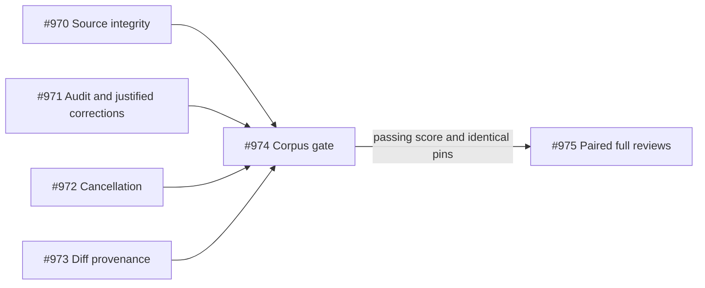

## Current execution — continuation 128

**Runtime is not admitted; no profile is qualified. Actual174/42 remain unstarted, qualification calls0 and evaluated-pilot writes0. Production verification remains disabled (direct read 2026-11-22T13:53:33.534341+00:00).**

All four native CI jobs on `8e61dbe1` pass: SDK946suites/18,854tests with35historical skips and extension385suites/5,291tests. Commit verifies41requirements in2/2batches using12/120calls with the original budget. Review completes8/8partitions. Its one new artifact-rerun claim was [refuted using the exact integrity-verified upstream2.3.2client contract](https://github.com/vypdev/copilot/pull/1003#discussion_r4658314800); all five threads are resolved. The completed findings check remains neutral, not approval; Verification and ReviewState pass. Source, settings and protections were not changed to dismiss it.

The single changed [Native3 run45028875562/job137227815416](https://github.com/vypdev/copilot/actions/runs/45028875562/job/137227815416) on **ubuntu-runner-2** verifies the full official Codex0.171.0 package, five executable/resource identities and Node24.21.0. Its original ten-row receipt retains **5PASS/3FAIL/2not-run**:

- Direct Node and systembwrap execute the identical payload with both exact output markers and exit37. Both namespace bwrap probes also produce their actual witnesses.
- Codex PATH returns the expected37 but both output streams are empty. This fails transport verification; owned read and write-denial correctly remain not-run.
- Unshare still fails its uid-map write. Empty-environment Codex now reaches bundled bwrap and fails loopback setup with RTM_NEWADDR/EPERM; it no longer fails because resources are missing.
- Systembwrap is a root-owned0755ELF,80,424bytes, SHA256 `523da3e7399044be5163aee6f57a77a6bef7454376e28f0a0627920bae1b76b6`. Its actual payload/transport results, not metadata alone, establish those component positives. Engine observation remains unavailable; cleanup completed; collection is incomplete and the job correctly fails.

Complete raw log, original receipt, ZIP and provider metadata are retained locally. Artifact14757031747: receiptSHA256 `c713a8cbb690173f96ddda00201a0446a9005fef5b7e370aa3d7e05170db0c42`; rawlogSHA256 `a46107c54e5f2ea827f05e131ef92a677aab7dbbf0d06b3efe87a88b63d2c2bb`. The prior three native observations are preserved and none is retried unchanged.

The new contrast narrows the loss to the Codex/Node output path. [Upstream report18473](https://github.com/openai/codex/issues/18473) describes the same captured-Node-stream symptom; pinned0.171seccomp denies socket-introspection calls and Node24.21falls back to a dummy stream when descriptor classification fails. This is a supported mechanism to verify, **not yet proof of the exact syscall cause on our tuple**. Next: a controlled component contrast before any diagnostic-transport correction or changed native attempt. No request for another Linux environment follows from this result.

#974/#997 and #998/#999 exact recovery approvals remain pending; develop5ebb9685 and both frozen recovery commits remain unchanged. #977 is still20UNKNOWN/20 with no eligible preview/installation. #982 is still0/6, environments unavailable; #981 is excluded. The earlier index and its complete history remain below, verbatim.

Previous canonical update127 — complete preserved text

<!-- bugbot-950-backlog-index:v1 -->
## Current execution — continuation 127

**The four-front goal remains incomplete. No profile is qualified. Production verification remains disabled; the actual 174/42 campaigns are unstarted, qualification calls are 0 and evaluated-pilot write attempts are 0.**

### Bugbot runtime prerequisite

[PR #1003](https://github.com/vypdev/copilot/pull/1003) publishes `8e61dbe1ee14b6527d725616eeea370030cdaebc`. Its normal hooks pass **946 suites / 18,854 tests**, with 35 historical skips; all eight types/docs/workflows/specifications/catalog/lint/Graphify checks pass. Audit verifies 198 outgoing versions and 186 lossless archives with zero secret/account-path findings and four unchanged SDK bundles. Fresh native CI, Commit/Verification, review and BranchSync are still required before one changed runtime diagnostic. Native3 has not been dispatched.

This runs on our existing GitHub self-hosted Linux runners. The program is official **Codex CLI 0.171.0**, with same-job Node24.21.0. The two actual previous observations remain negative evidence:

- [45016512460](https://github.com/vypdev/copilot/actions/runs/45016512460), ubuntu-runner-1: CLI argument parsing failed before any read/denial.
- [45020212032](https://github.com/vypdev/copilot/actions/runs/45020212032), ubuntu-runner-2: PATH startup returned0; read/write returned0 with empty output and failed assertions. Bare bwrap rows returned0; unshare failed uid_map. Cleanup completed and local Engine observation was unavailable.

The new ten-row receipt requires actual namespace output and compares the identical harmless Node payload directly, through bwrap and through Codex. Exactly three named transport rows require both output markers and exit37; other rows require0. Every sibling closes before cleanup, and owned read/write stay not-run until all three transports verify. The diagnostic now uses the full official package and records its resources: the prior individual archive had the same x64 CLI bytes but omitted bundled bwrap/rg/helpers. This explains missing bundled resources in the empty-PATH case; **the silent PATH payload cause remains unproven**. Both complete x64/arm64 packages were hash/inventory verified without executing Linux code locally. All 110 local controls pass; these component results do not certify SDK/model tools or qualification.

[Complete current evidence](https://github.com/vypdev/copilot/tree/8e61dbe1ee14b6527d725616eeea370030cdaebc/quality/bugbot/evidence/issue-1002/controls/execution-proof) retains both source contrasts, fixture/controller negatives, complete native receipt/log, prior native CI, full package inventories and pinned primary sources/license. Earlier packets remain unchanged. No unchanged diagnostic retry, runner privilege change, production change or develop merge occurred.

### Four fronts and pending dependencies

| Front | Published source / current result | What remains |
|---|---|---|
| #974 / #997 | Remote397de9a6; call-budget correction merged via #1001 at develop5ebb9685; frozen recoverya74613e9 and local607358ed follow-up preserved | Separately requested exact recovery approval; adopt tested prerequisites; actual same-tuple C32–C35 and credential/oracle denial; committed preregistration; then actual174 and unchanged scientific gates |
| #975 | Actual42 unstarted | A real174PASS on identical implementation/drivers/runtime, then all14subjects×3 paired reviews and all effective gates, including post-run latency |
| #977 / #998 / #999 | Remote68657a12; frozen recovery16ab6d9a preserved; trusted defaultmaster ace49e4a still20UNKNOWN/20 | Exact recovery approval and normal source completion; resolve actual trusted workflow/dependency behavior inventory. No eligible two-file preview, installation approval request or installation yet |
| #982 / #996 | Remotebbf3bf16; actual0/6; user says none of the requested environments are available | Linux desktopI039/I040, Windows desktopI041/I042, Windows serviceX023/X026. These do not block Linux Bugbot. #981 remains excluded |

Two questions already await answers; they are not new approval requests: publication of exact frozen #997/#999 recoveries, and whether an Engine is accessible with existing runner permissions (the actual diagnostics could not query `/var/run/docker.sock`, so its configured socket is unknown). No new Linux environment or privilege escalation is inferred necessary from local Docker. Preserve the reviewed develop base5ebb9685 while the exceptional recovery decision is pending.

Direct production read: **disabled** at **2026-11-22T13:18:10.549168+00:00**. Source work and ordinary CI/reviewer calls are distinct from qualification calls. No evaluated-pilot writes, installation, release, protection change or activation occurred.

### Preserved history

The previous comment reached63,183characters. Its **entire exact text through continuation126**, including all historical outcomes and original27-issue traceability, is now [preserved as readable immutable history](https://github.com/vypdev/copilot/blob/8e61dbe1ee14b6527d725616eeea370030cdaebc/quality/bugbot/evidence/issue-1002/controls/execution-proof/goal-950-canonical-through-continuation126.md), SHA256 `740604e1bbde119711b625a1c091ecf361b1281e7d6898a95df54d47b63a65a5` (63,254UTF8bytes). GitHub readback verifies Git blob `bd0d94c05a4a0aca259fc719ac6abdd74f4dfe75`. This same canonical comment remains the progress surface; no duplicate progress comment was created.

Original backlog and scope — historical

## Follow-up backlog after #951 — qualification first

PR #951 is merged; its source/CI closure is complete. **The verifier profile is not qualified and BUGBOT_VERIFICATION_MODE remains disabled.**
This is a backlog, not an instruction to start branches or model runs. All 13 issues were created from the installed bug/chore forms, with one priority each.

**Start next:** #970 and #971 can be prepared in parallel. Finish the measurement-integrity controls before freezing another measured source.

### Qualification path

| Order | Issue | Priority | Closure needed |
| --- | --- | --- | --- |
| 1a | #970 — Executed source and sanitized Git provenance | High | Proven source/lock/driver identity before imports or calls |
| 1b | #971 — Diagnose failed precision, F1 and calibration | High | Independent per-error evidence and justified narrow corrections |
| 2a | #972 — Propagate explicit cancellation in the shadow runner | Medium | An interrupted operation cannot be reported complete |
| 2b | #973 — Correct deletion-only citation metadata | Medium | Grounding metadata agrees with the actual fixed diff |
| 3 | #974 — New preregistered 174-case corpus run | High | Every unchanged detection gate passes on the exact new pin |
| 4 | #975 — The 42 paired full-review slots | High | Profile-specific false-positive, positive-control, citation, integrity and latency gates |

Text equivalent: complete #970-#973 and any independently justified corrections from #971; freeze the exact implementation/drivers/runtime; run #974. Admit #975 only if the corpus actually passes for those identical pins. Six native GitHub blocked-by relationships record this sequence and the writer-install dependency below.
Closing #974 with a failed report does not satisfy the passing-score condition. A changed implementation invalidates reuse of the earlier source-bound qualification.

The previous campaign completed 174/174 but failed precision (80.23% <90%), F1 (83.13% <87%) and Brier (0.1883 >0.16). Its 42 review slots were unstarted and Sol measurements were zero. Preserve these negative results; do not turn unmatched scorer categories into independently established false bugs.
The existing p95 qualification threshold is evaluated after investigation. Do not restore token, elapsed-time or turn-count research cutoffs. Unknown token usage never rejects a supported verdict.

### Operational follow-up and rollout prerequisites

| Issue | Priority | Relationship to qualification |
| --- | --- | --- |
| #976 — Accepted dispatch without run ID | Medium | Recovery correctness before installing the new writer |
| #977 — Trusted-default status-writer installation | Medium | Blocked by #976; operational installation, not a prerequisite for local corpus/full-review dry-run |
| #980 — Approval-receipt producer trust boundary | Medium | Required trust review before any proposed enforced activation; matching run/artifact metadata is not code attestation |
| #979 — Credential-health trusted-ref policy | Medium | Separate operator/runner hardening; a branch-local condition is not an independent security boundary |
| #978 — CI aggregate-predicate validator | Low | Regression protection; the currently shipped gate already fails each worker failure |

The reported broad action-edit approval route was not reproduced by the guarded-policy packaged controls: protected bundle/workflow/action.yml edits return protected-path with zero mutations. #980 retains the narrower producer-trust limitation rather than asserting a proven approval exploit.
#977 must inspect the current trusted default revision; the absence recorded in #951 is a historical snapshot, not an assumption about a later installation. Coordinate installation tooling with existing #814. No deployment, default-branch merge or activation is authorized by this index.

### Separate Setup acceptance, outside EV-07

| Issue | Priority | Existing open observations |
| --- | --- | --- |
| #981 — Real screen-reader and 200% zoom journeys | Low | U076/U077, U081/U082, U086/U087, U091/U092: eight observations in four locales |
| #982 — Packaged platform and Windows symlink checks | Low | I039-I042 and X023/X026: six actual Linux/Windows observations |

These two issues account for all 14 open Setup ledger cases (336/350 passed). They do not block qualification of the Linux Bugbot profile. DOM inspection, another OS, a skipped test or a queued runner cannot replace the missing observation; these tasks invoke no real models.

### Preserved scope and decision

- [Final #951 report](https://github.com/vypdev/copilot/pull/951#issuecomment-6973299390) and all frozen pilot evidence stay authoritative for what actually ran.
- The [27-issue traceability matrix](https://github.com/vypdev/copilot/blob/ccefb27627cd627ccdb7d5666fd174c2ac1da07b/quality/bugbot/evidence/issue-950/traceability.md) remains canonical. No duplicate issue was opened for each historical case, and no case was closed on the strength of the merge alone.
- Existing related issues such as #954, #963 and #966 retain their own evidence and disposition. #971 should link an existing matching defect rather than duplicate it.
- Every exact enabled profile must pass independently and receive explicit maintainer approval. A passed corpus or a shadow pilot is not production activation.
- Keep production disabled, preserve independent evaluators, and require zero evaluated-PR write attempts. Retain the existing self-hosted runner policy and installation templates.

<!-- codex:goal-950-execution:v1 -->
The complete earlier execution history is preserved at the immutable archive linked above.
<!-- codex:goal-950-continuation:127 -->
<!-- codex:goal-950-execution:end -->

