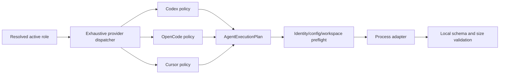

# Agent Execution Policy Hardening

- Status: Implemented — automated gates complete; controlled provider smoke remains external
- Date: 2026-09-11
- Last updated: 2026-10-12
- Catalog capability ID: `agent-runtime`
- Last verified: 2026-09-12 in the P1-C implementation worktree
- Owners: Copilot maintainers and security reviewers
- Scope: replace the shared permissive CLI policy with exhaustive provider
  plans, isolated runtime configuration, versioned runtime evidence, and
  fail-closed process execution
- Related issues/PRs: none recorded
- Required review gates: product UX, architecture, testing, documentation,
  security/operations, provider runtime smoke
- Open decisions blocking readiness: none

### Codex Windows service retirement (2026-10-12)

Current support policy: **Codex no soportado en runners Windows ejecutados como
servicio**. This supersedes historical requirements below for another live Codex
Windows service retry; it does not mark those acceptance gates successful or
claim that all Windows environments fail.

Operator evidence: all four services use the non-administrator `ci-runner`
account in Windows session 0 and must start without login. The official CLI,
including 0.162.1, under `--strict-config`, `--ignore-user-config`, and
`windows.sandbox="elevated"` could authenticate and answer while tools failed
with `0xc0000142` and command-runner pipe timeout. The same account/configuration
worked interactively; official setup did not resolve service execution.

Intentional contract:

- Operational jobs MUST retain the shared `[self-hosted, codex]` Mac/Ubuntu pool.
  Windows service registrations MUST omit `codex`; existing registrations lose
  it when recreated. Until that migration is verified, no new Windows Codex
  run may be requested. Runner recreation and Windows-only credential/CLI
  removal belong to the operator in `vypdev/lab-runners`.
- Codex integration jobs and their self-hosted fixture matrix MUST exclude
  Windows. The matrix retains macOS and Ubuntu, with unchanged full coverage,
  acceptance, package and documentation checks. The Codex diagnostics workflow
  retains Linux only. Explicit Windows Codex jobs MUST be rejected structurally.
- General hosted Ubuntu/Windows/macOS coverage and local fake platform-safety
  fixtures MUST remain. These prove launcher/ACL/process/installer contracts,
  not official Codex sandbox execution or authenticated model/tool success.
- CLI exit 0, login, installation and model response MUST remain distinct from
  actual tools. Acceptance requires a bounded fixture read/hash or edit and
  trusted post-execution verification; a failed tool does not become successful
  because the model explained it.
- Sandbox, configuration isolation, credentials, runtime provenance and
  process limits MUST remain. Community distributions, sandbox bypass, and
  converting services to interactive sessions are excluded recovery options.

Flow: remove Windows `codex` labels -> shared pool selects Mac/Ubuntu -> actual
bounded tool operation -> trusted verification -> publish only verified results.
If no supported runner is available, the job remains queued/unverified; never
restore Windows eligibility to hide that state. Retries target only a supported
runner. No provider fallback, new Action input, model call, comment or deployment
is introduced. Rollback requires a new reviewed support decision and real tool
evidence; restoring old labels/YAML alone is not acceptance.

Operator UI: `Codex no soportado en runners Windows ejecutados como servicio.
Ejecuta los jobs de Codex en Mac o Ubuntu.` This documented limitation produces
no new timeline comment. Retained general Windows results are reported as
platform fixture evidence, never as successful Codex integration.

Additional risk-derived budget: **6 distinct workflow contract cases** in
`src/tooling/__tests__/validate_workflow_contract.test.ts`: shared-pool migration
(1), explicit Windows routing rejection (1), all installed static selectors (1),
Windows Codex matrix rejection while preserving hosted Windows (1), and forbidden
Windows/missing Linux diagnostics (2). Existing matrix-removal, full coverage,
package, trusted-dispatch and documentation validator cases remain; no
repository thresholds or acceptance rows are lowered. These six cases are
counted once, not again in related specifications.

Acceptance and traceability: the six structural cases and
`pnpm run validate:workflows` enforce scheduling/fixture boundaries;
`pnpm run test:coverage` preserves full platform-safety and coverage gates;
`pnpm run validate:specifications` checks catalog/spec consistency. User/setup,
execution, smoke, runner provisioning/security, verification and synchronization
docs MUST agree. Manual runner inventory must show Windows without `codex`
before new shared-pool dogfooding. Previously open Windows Codex service checks
remain unsupported/unverified, not green; the setup 350-row budget is unchanged.

## 1. Executive summary

Every active agent role MUST resolve one complete `AgentExecutionPlan` before a
process starts. A compile-time exhaustive dispatcher delegates to separate
Codex, OpenCode, and Cursor policies. Each policy reconstructs argv and isolated
configuration from structured facts; repository/user command text cannot weaken
sandbox, network, approval, plugins, subagents, environment, persistence, or
output limits.

All roles keep Git/provider mutations in trusted Copilot code. `planner`,
`findings`, `reviewer`, and `tester` are workspace read-only. `fixer` may edit
the current workspace only; it still has no Git credentials, external write
authority, web/MCP/plugin/subagent access, or unsandboxed shell. Unsupported
provider/version/config combinations fail before spawn with a semantic action.

There are no installed users to preserve. The first implementation removes
`agent-command` and ships only structured configuration plus validated
executable selection; it contains no deprecation or compatibility path.

```text
role + provider + model + executable -> provider policy -> verified plan
                                        -> isolated files/env -> spawn -> schema validation
```

## 2. Problem, pre-implementation behavior, and evidence

### 2.1 Problem

One policy currently branches over all providers and returns unchanged arguments
when capability or provider is absent/unknown. Custom commands are validated and
then augmented, leaving a broad grammar and provider-specific bypass risk. The
policy is security-sensitive, but version/config behavior and effective
sandbox behavior are not a versioned executable contract.

### 2.2 Pre-implementation behavior

1. `enforceAgentExecutionPolicy` is fail-open for undefined capability and
   unknown provider.
2. Codex receives managed flags/config additions, but provider config ownership
   and effective-capability verification are incomplete.
3. OpenCode receives `--pure` and a named agent; Cursor receives sandbox/mode and
   fixer `--force`, but the controlled agent/config contents are not the plan's
   typed contract.
4. `AgentCliRequest` accepts optional provider/capability/environment and a full
   command string.
5. Process limits currently default to 15 minutes, 512 KiB prompt, and 4 MiB
   combined output.

### 2.3 Evidence

- Code: agent command parser/validation/defaults, execution policy, CLI client,
  provider-specific adapters, capability adapters, workflows, and setup policy.
- OpenAI Codex documentation confirms non-interactive sandbox, approval,
  strict/ignored user config, ignored rules, ephemeral sessions, output schema,
  network, history, environment, and multi-agent controls.
- OpenCode documentation confirms `--pure`, named agents, inline/isolated config,
  and allow/ask/deny permissions including edit, bash, web, task, skill, and
  external-directory authority.
- Cursor documentation confirms Ask mode, sandbox enablement, isolated config
  directory, file/command permissions, and `sandbox.json` controls for read-only/
  read-write paths and default-deny network.
- Verified local baseline versions on 2026-09-11: Codex CLI `0.153.4`, OpenCode
  `1.18.3`, and Cursor Agent `2026.09.10-fd3934a`.
  The Codex installation baseline moves to `0.156.1` for the `gpt-6-luna`
  default; the older version remains historical evidence, not a supported
  provisioned default for that model. Confirm the model using the exact pinned
  binary and the Action runner credential before rollout.

### 2.4 Retrospective classification

Not applicable. This prospective SDD refines the catalogued as-built agent
runtime SDD.

## 3. Actors, surfaces, and terminology

| Actor | Goal | Entry point | Visible surfaces |
|---|---|---|---|
| Contributor | get useful agent output without hidden authority | GitHub workflow/command | comment, check, changed files |
| Repository owner | select provider/model while retaining safety | Variables/setup/CLI flags | config, doctor, provisioning |
| Maintainer | add/upgrade one provider without shared-policy regressions | code/runtime manifest | CI and docs |
| Security reviewer | prove effective authority before spawn | plan/config/smoke evidence | Job Summary and fixtures |

`Provider control plane` is the CLI's required connection to its model service.
`Agent tool egress` is network initiated by model-selected tools/commands and is
denied. A `managed artifact` is an ephemeral config/schema/sandbox file created
from trusted code and verified by hash. `Runtime manifest` records each reviewed
provider identity and the exact package recipe used only when Copilot installs
a missing supported runtime.

## 4. Goals, non-goals, and fixed invariants

### 4.1 Goals

1. Make provider/capability omission and every unknown value terminal before spawn.
2. Express full authority as a typed semantic plan, not mutated argv.
3. Keep provider policies independent and exhaustively dispatched.
4. Prove runtime identity, exact Copilot-installed package version, and managed-config behavior.
5. Preserve structured output, cancellation, timeout, and bounded process behavior.

### 4.2 Non-goals

1. This work does not add dynamic provider plugins or runtime registration.
2. It does not give agents GitHub tokens, Git credentials, publishing authority,
   or direct commit/push ownership.
3. It does not make sandbox/network/approval/environment limits configurable.
4. It does not support arbitrary custom CLI flags or wrapper scripts.
5. It does not guarantee provider model availability. Target-runner provisioning
   and execution preflight report CLI support; doctor reports setup/configuration
   and credential readiness rather than inspecting a different local runtime.

### 4.3 Fixed product and safety invariants

1. No process starts until plan, non-empty runtime identity, artifact hashes, workspace path,
   model tuple, and role are valid.
2. Read roles cannot write workspace; fixer cannot write outside workspace.
3. Agent-selected tools have default-deny network, no web/MCP/plugin/subagent,
   and no approval/escalation path.
4. Provider model credentials are available only to the provider control plane;
   agent child tools receive no secrets.
5. Git credential/prompt/SSH environment and mutation commands are absent.
6. Repository instructions, custom commands, provider/user config, and model
   output cannot broaden the plan.
7. Prompt 512 KiB, output 4 MiB, and timeout 15 minutes remain hard maxima.
8. `agent-command` and arbitrary argv are removed outright. No deprecated input,
   parser, adapter, alias, or compatibility window remains.

## 5. Current versus proposed product journey

| Stage | Current | Proposed | User/operator effect |
|---|---|---|---|
| Resolve | optional provider/capability fields | complete typed request | early precise failure |
| Command | validate and append to string | no command input; policy builds argv | no flag bypass |
| Config | mixed user/project/provider state | ephemeral managed artifacts | reproducible authority |
| Spawn | optional environment | provider-specific allowlist | no credential leakage |
| Upgrade | replace ambient CLI silently | operator-owned runtime + reviewed install pin | explicit ownership |
| Output | process string then local parse | bounded events/final output + schema | stable contract |



Text equivalent: a complete role request goes through exactly one provider
policy; the resulting plan passes identity/config/workspace preflight; only then
does the process adapter spawn and validate bounded output.

## 6. Functional behavior and state model

### 6.1 Semantic execution plan

```text
AgentExecutionPlan {
  provider: codex | opencode | cursor
  capability: planner | findings | reviewer | fixer | tester
  executable: validated absolute path
  argv: readonly reconstructed tokens
  promptMode: stdin | final-argv
  outputProtocol: plain-text | json-lines-text-events
  workspace: canonical real path
  workspaceMode: read-only | workspace-write
  childNetwork: deny
  approval: never
  sessionPersistence: false
  output: text | local-json-schema | native-and-local-json-schema
  timeoutMs: <= 900000
  maxPromptBytes: <= 524288
  maxOutputBytes: <= 4194304
  environment: readonly allowlisted key/value map
  artifacts: readonly path/hash/purpose records
  runtimeContract: provider/version/manifest revision
}
```

The dispatcher switch has no default and uses a `never` exhaustiveness check.
All fields are required. `fixer` alone receives `workspace-write`; all other
roles receive `read-only`. `cwd` must realpath to the repository root; symlink
escape and extra writable roots reject the plan.

### 6.2 Structured configuration and executable selection

`agent-command` is deleted from configuration, CLI/action inputs, workflows,
setup, schemas, tests, and docs. No caller-provided argv or command string is
accepted. The only caller-selectable execution facts are provider, model,
supported effort/variant, and optional `agent-executable`.

If `agent-executable` is omitted, the runtime manifest supplies the provider's
expected basename and resolves it through the trusted PATH. If supplied, it is
either that exact bare basename or an absolute regular file whose real basename,
owner, and permissions pass preflight. Relative paths, alternative basenames,
wrappers/interpreters, arguments, shell operators, environment prefixes, and
response files reject.

| Provider | Required executable basename | Structured selections |
|---|---|---|
| Codex | `codex` | model, model provider, supported reasoning effort |
| OpenCode | `opencode` | provider/model and supported variant |
| Cursor | `agent` | model |

Provider policies construct every subcommand, flag, config assignment, format,
schema, sandbox, permission, isolation, and prompt token. An unknown input,
including `agent-command`, is a configuration error rather than ignored data.

### 6.3 Shared environment and process contract

The process adapter starts with an empty environment and adds only trusted
`PATH`, locale, controlled temp/config path, provider's one required credential,
and explicitly provisioned CA variables. Proxy variables are denied by default
and require an organization-managed runner policy outside repository input.
On Windows, the bounded runtime environment also admits only the platform paths
needed for Node and provider configuration (`SystemRoot`, `WINDIR`,
`USERPROFILE`, `APPDATA`, `LOCALAPPDATA`, and `PATHEXT`). These values are read
from the trusted runner process, not from repository content.
It strips `GITHUB_TOKEN`, `GH_TOKEN`, `GIT_ASKPASS`, `SSH_AUTH_SOCK`, Git author/
committer variables, cloud credentials, and every unrelated `*KEY|*SECRET|*TOKEN`.
It sets `GIT_TERMINAL_PROMPT=0`, `GIT_CONFIG_GLOBAL` to a managed empty file, and
disables provider auto-update/session sharing.

The child process uses `shell: false`, a new process group, bounded stdout/stderr,
abort/timeout TERM then bounded KILL, and exact cleanup of only its ephemeral
directory. Agent-selected verification is not trusted: Copilot runs configured
verification commands later through its existing validated trusted runner.

On Windows, the equivalent contract requires direct process launch without
`.cmd`/`.bat` shell interpretation, owner-only ACLs on the ephemeral directory
and artifacts, and bounded termination of descendants before cleanup. POSIX
mode bits and `child.kill()` alone do not prove these properties on Windows.
The process adapter MUST reject an unverified Windows runtime, preserve literal
argv/prompt bytes, suppress raw stderr, and record cancellation/timeout as a
failed capability with no trusted result. Isolated Windows fixtures MUST prove
ACL rejection, argv safety, descendant termination, and cleanup; a real runner
review remains open until observed (issue #404).
For timeout, cancellation, or output overflow, the first Windows tree request
MUST omit `taskkill /F`; the force request after the five-second grace period
MUST include `/F`. Both requests MUST use the startup-captured trusted system
tool and target the complete tree. A fixture MUST assert the distinct command
arguments and a native Windows fixture MUST still prove descendant cleanup.
The executable, its interpreter and package-owned entrypoint require a
read-only ACL preflight: trusted ownership and no untrusted write/delete/ACL
control ACE. Existing installed files are never modified. An unreadable or
unrecognized ACL fails before a provider process starts.
The preflight also checks the containing directory and each ancestor to the
volume root for untrusted ownership or rights to delete/replace a checked
path component or rewrite its ACL. It distinguishes harmless add-only rights
from delete-child rights and fails closed on unreadable descriptors. Real
Windows fixtures must pass for a safe parent and reject an untrusted
delete-child grant without changing the operator-owned executable.
The known `NT SERVICE\TrustedInstaller` SID may own a Windows ancestor,
including the system volume root; it is trusted only for ancestor assessment.
It must not make a foreign-owned executable acceptable. Hosted and service
Windows fixtures must prove this exact owner case and still reject an
untrusted parent owner or replacement grant.
The SDDL `LC` right is accepted on every directory ancestor, including the
executable's immediate parent: list access alone cannot create or replace the
executable. A fixture MUST pair direct-parent `LC` acceptance with rejection
of direct-parent create-child, delete-child, ACL-change, and generic-write
grants. `LC` remains
unrecognized on an executable file. Fixture tests must prove both decisions.
The installed file and all of its ancestors are read in one bounded,
read-only Windows PowerShell invocation. An incomplete or malformed batch
fails closed, and execution/timeout/cancellation fixtures must finish within
their existing 15-second Jest deadline on hosted and service Windows runners.
The standalone read-only verifier may reuse the complete trust decision for
help, version, and login probes in its short-lived process. It retries only
a transient ACL query timeout once; a rejected owner, ACE, or malformed
descriptor remains rejected. Action telemetry records a closed preflight
stage without including paths, arguments, prompts, or environment values.
The installed-file check reads a full Windows security descriptor; the
managed-artifact `icacls /save` snapshot contains only the DACL and is not
owner evidence for an installed executable.
The hosted Windows fixture exposed `AU:0x1301bf` on both Action and job Node;
the installed-file trust gate correctly rejects them. Repository credentialed
Action jobs route to macOS while Windows tooling ACLs are repaired and tested.
The Windows agent gate remains open even if setup web/CLI and Bash fixtures
pass; no runtime finding is waived or counted as a pass.
The `icacls /save` managed-artifact snapshot is a UTF-16LE path line followed
by an SDDL DACL line. A Windows fixture must assert this raw two-line format
and the existing owner-only verification must continue to pass. This is direct
evidence for the parser; a claim that the path and DACL share one line must not
override the observed fixture output.
The [2026-10-02 isolated platform matrix](https://github.com/vypdev/copilot/actions/runs/36955416020)
passed the fake Windows runtime cases and package smoke on hosted Windows,
Ubuntu and macOS. It does not establish self-hosted runner behavior or a live
agent result; those human gates remain open without dogfooding.

The first self-hosted Windows fixture reached `windows-intel-runner-1` and
exposed that its unprivileged service account cannot apply an ACL snapshot
with `icacls /restore`. Managed artifact hardening MUST use operations
available to the file owner to remove inherited and explicit grants, then
grant full control only to that owner's SID. It MUST verify the effective
saved DACL afterward and fail closed if any broad principal survives. A
fixture MUST begin with an explicit Everyone grant and prove it is removed.
This is a runtime prerequisite for the self-hosted fixture gate; real agent
execution remains a separate open review.

The [2026-10-02 self-hosted Windows fixture](https://github.com/vypdev/copilot/actions/runs/36972025378)
passed 20/20 fake-agent tests on `windows-intel-runner-2`, including removal
of an explicit Everyone grant, literal prompt arguments, timeout, descendant
cancellation, and cleanup. This is direct service-runner fixture evidence,
not a real agent request. The workflow remained red on unrelated canonical
Unix bundle drift until the generated files are committed and rerun.

### 6.4 Codex policy

Managed argv includes `exec`, `--strict-config`, `--ignore-user-config`,
`--ignore-rules`, `--ephemeral`, `--sandbox read-only|workspace-write`,
explicit model/provider/effort, and terminal `-`. Managed configuration sets
`approval_policy="never"`; the accepted CLI version does not expose an
equivalent `exec` flag.
Because ignoring user configuration also removes Windows backend selection,
managed configuration MUST select `windows.sandbox="elevated"`. This backend
still enforces the capability's sandbox scope and network denial; it does not
give commands administrator authority. Runner administrators own prior setup,
and Copilot MUST NOT recover by invoking setup, loading operator configuration,
or selecting full access. Two independent read-only/fixer policy cases preserve
these boundaries. The retained Windows backend policy does not establish Windows service support;
Codex service integration is retired under the 2026-10-12 decision above.
Structured roles also receive a managed `--output-schema` file and always undergo
local validation. Before Codex can start, the provider policy validates that the
schema uses the strict native subset: the root is an object, every object lists
all properties as required, every object denies additional properties, and every
array defines its item schema. Optional values are represented by a required
nullable field, never by omitting the property. An incompatible schema is a
local planning error and cannot reach the provider.

Controlled configuration sets web search disabled, multi-agent disabled,
skill dependency installation disabled, history persistence none, workspace
network false, no extra/temp writable roots, no login shell, no inherited secret
environment for spawned commands, zero project instruction bytes, and no
configured MCP/app/plugin/hook authority. A provider-version smoke MUST prove the
effective configuration rejects network, extra writes, escalation, user/project
MCP/plugins, and subagents before the version enters the manifest.

Live Linux dogfooding on 2026-10-10 reproduced a sandbox startup failure with
an empty command environment. The same read-only `/bin/true` probe succeeded
when only `PATH` was retained ([runner evidence](https://github.com/vypdev/copilot/actions/runs/38085012772)).
Codex commands therefore use core inheritance followed by an exact inclusion
list: `PATH`, `SystemRoot`, `WINDIR`, `PATHEXT`, `TMPDIR`, `TEMP`, `TMP`, `LANG`,
and `LC_ALL`. Default credential exclusion remains enabled. Home, configuration,
model/GitHub/Git/SSH/proxy credentials and all unlisted variables are denied.
This fixed system list is not a repository setting; sandbox, network, write-role
and approval boundaries remain enforced. The smoke proves startup on that VM,
not all effective authority or live-provider acceptance gates.

### 6.5 OpenCode policy

Managed argv is `opencode run --pure --agent <managed-name> --format json` plus
structured model/variant and one final prompt argument. `OPENCODE_CONFIG_DIR`
points to an empty ephemeral directory; `OPENCODE_CONFIG_CONTENT` contains the
complete managed configuration; default plugins, update checks, LSP downloads,
sharing, session continuation, attach/server, files, and remote commands are off.

Both managed agents allow read/glob/grep/list only. They deny LSP, bash,
webfetch, websearch, task, skill, external_directory, question,
session sharing, and wildcard/MCP tools. The readonly agent denies edit; the
fixer agent allows edit only under the workspace. All unspecified permissions
are deny. The config bytes and schema version are hashed into the plan. The
generic process adapter decodes bounded JSON-line text events according to the
plan's output protocol; malformed or textless event streams fail closed before
semantic response validation.

### 6.6 Cursor policy

Managed argv is `agent -p --output-format text --sandbox enabled --model <model>`;
read roles add `--mode ask` and never `--force`. Fixer uses the ordinary agent
mode plus `--force` only after managed permissions/sandbox preflight passes.

`CURSOR_CONFIG_DIR` points to an ephemeral schema-version-1 config and the
ephemeral home contains the documented `.cursor/sandbox.json`. Managed
permissions deny `Shell(*)`, `WebFetch(*)`, `Mcp(*:*)`, sensitive/external reads,
Git mutation, and every unspecified action; readonly explicitly denies all
writes, while fixer allows workspace write. A managed `sandbox.json` uses
`workspace_readonly|workspace_readwrite`, no additional paths, temp writes off,
and `networkPolicy: {default: "deny", allow: [], deny: []}`. Authority-bearing
project Cursor files (`cli.json`, `sandbox.json`, `mcp.json`, and `hooks.json`)
are rejected rather than merged. Repository rules may guide the task but cannot
widen the managed permission/sandbox boundary; controlled runtime smoke proves that
ambient/user files cannot broaden it.

If Cursor cannot prove isolated config, child-network denial, read/write mode,
and approval behavior on the current platform/version, the provider or fixer
role is `configuration.unsupported`; it never degrades to a less safe mode.

### 6.7 Runtime manifest and preflight

`src/infrastructure/agents/agent-runtime-manifest.json` records historical
known-good smoke identities and the selected providers' official standalone
sources:

| Provider | Reviewed smoke identity / missing CLI source | Required smoke |
|---|---|---|
| Codex | `codex-cli 0.156.1` / official OpenAI standalone installer | read/write boundary, network deny, approval deny, no MCP/plugin/subagent, schema and configured model |
| OpenCode | `1.18.3` / official installer or Windows release archive | readonly/fixer permissions, no bash/web/task/plugin, config isolation, JSON |
| Cursor | `2026.09.10-fd3934a` / official installer or Windows archive | readonly/fixer path boundary, network deny, no shell/MCP/plugin/subagent, noninteractive completion |

An available selected executable is never replaced and any non-empty reported
version is recorded in the admitted plan. The fixed provider argv is still
fail-closed: an incompatible runtime exits terminally and no fallback is
attempted. A missing default executable is installed from that provider's
official source in a private job directory. An explicit executable is never
installed or replaced. The new installation must report a non-empty version;
there is no exact version pin or provisioning-mode override. Source changes
require a reviewed PR with fixture, contract, and target-runner evidence.
Installer processes receive no model or GitHub credentials. The agent workflows
do not use `actions/setup-node`, npm, or pnpm to install agents.

### 6.8 State machine

| State | Entered when | User-visible meaning | Allowed next states | Recovery/owner |
|---|---|---|---|---|
| unresolved | role/config collected | validating agent | planned/rejected | configuration policy |
| planned | provider policy succeeded | checking runtime | admitted/rejected | preflight |
| admitted | identity/artifacts/workspace verified | agent running | completed/failed/cancelled | process adapter |
| completed | bounded output valid | result available | terminal | caller |
| rejected | plan/preflight invalid | process not started | unresolved after config change | setup/operator |
| failed | admitted process/schema failed | no trusted output | admitted on bounded retry | caller |
| cancelled | signal received | process group stopped | terminal/new invocation | caller |

## 7. User-facing configuration

Existing provider/model/effort and per-role override precedence remains.
`agent-command` is invalid and has no replacement that accepts arguments;
`agent-executable` may select only the validated binary described above. The
recommended default remains Codex. OpenCode and Cursor are explicit alternatives
and reuse a compatible installed runtime or use the selected official installer.

Sandbox, write role, network, approvals, environment, config directory,
permissions, plugins/MCP/subagents, session persistence, process limits, output
validation, versions, and upgrade policy are intentionally not configurable by
repository Variables/action inputs.

## 8. Clean Architecture design

### 8.1 Responsibilities and dependency direction

| Layer/boundary | Owns | Must not own/import |
|---|---|---|
| Domain/pure policy | role authority, semantic plan, executable selection | process/fs/provider CLI |
| Application | complete request, exhaustive dispatch, semantic errors | raw spawn/config files |
| Provider adapters | Codex/OpenCode/Cursor pure plan builders | other provider branches |
| Infrastructure | executable/version/artifact preflight, isolated files, spawn | role/product decisions |
| Entrypoints/setup | structured config resolution, setup doctor, target-runner provisioning | argv mutation |
| Presentation | rejected/failed/completed view | raw stderr/prompt/secret |

Each provider policy lives in a separate file with no import of another provider
policy. Structured configuration reaches the exhaustive dispatcher directly;
there is no command parser. Process adapters consume `AgentExecutionPlan`; they
cannot accept raw command/provider/capability fields.

### 8.2 Executable architecture constraints

1. Type tests require all plan fields and make provider/capability non-optional.
2. Exhaustiveness test fails when `AgentProvider` or `AgentCapability` grows
   without policy and role matrix changes.
3. AST rules prohibit raw command spawn, `shell:true`, ambient `process.env`
   forwarding, and cross-provider policy imports.
4. Golden argv/config/environment/artifact fixtures exist per 3 providers x 6 roles.
5. Adversarial configuration tests reject the removed command field, executable
   arguments/wrappers, and every unknown or duplicate structured selection.
6. Integration smokes execute safe read/write/network/shell/plugin/subagent
   probes against reviewed and compatible operator-owned versions with no live repository/provider mutation.

## 9. UI/UX and content contract

```text
Agent did not start

Impact: No model request or repository change was made.
Cause: Cursor Agent 2026.09.12 did not satisfy the fixed headless execution contract.
Action: validate the operator runtime with the documented safe smoke or install the reviewed 2026.09.10-fd3934a baseline.
Retained state: Existing files and finding state were preserved.
Reference: 6f173f89-96a3-4fc8-b90e-4f8f48e0e319
```

Pending names provider/role and “validating runtime”; action-required names one
invalid field/version; blocked states say process did not start; partial states
distinguish agent completion from later trusted verification/publication;
completed names output type and subsequent trusted action. Raw argv, config,
paths, prompt, stdout/stderr, and credentials remain in neither terminal nor
GitHub UI. Existing locale/fallback and narrow Markdown rules apply.

## 10. Failure, recovery, and cleanup

| Failure/partial state | User impact | Retained facts | Automatic retry | Required action | Cleanup |
|---|---|---|---|---|---|
| invalid tuple/command | no spawn | prior workflow state | no | correct config | remove temp plan if any |
| incompatible runtime/platform | no trusted result | prior state | no | install reviewed runtime/update Copilot | none |
| artifact/hash/preflight failure | no spawn | prior state | no | repair runner/config | remove ephemeral dir |
| timeout/cancel | process group stops | no trusted output | owning bounded policy/new event | retry if relevant | TERM/KILL + exact temp cleanup |
| output limit/schema failure | output rejected | prior state | no blind parse | fix provider/prompt/schema | discard output |
| agent completes, trusted verify fails | no commit/publish | agent workspace changes are partial | existing fixer recovery | inspect/fix/revert scoped changes | trusted coordinator owns cleanup |

## 11. Security, permissions, and privacy

1. Model API credentials are the only provider-specific secrets passed and are
   never available to agent-selected child tools.
2. GitHub/Git/SSH/cloud/proxy credentials and ambient secret-pattern variables
   are stripped.
3. Managed artifacts are mode 0600 in a unique temp directory, hashed before
   spawn, and deleted after the process exits.
4. Workspace and executable use canonical real paths with symlink/ownership/
   permission checks; no writable executable or wrapper is accepted. Git must
   report the requested canonical workspace as a repository root via its empty
   `--show-prefix` result (portable across Git for Windows path formats). In GitHub
   Actions, it must also equal the canonical `GITHUB_WORKSPACE` checkout path,
   so a nested repository cannot silently replace the intended checkout.
   A nested-repository fixture must fail before any agent process starts.
   Windows runtime fixtures that intentionally execute in a temporary Git
   checkout set `GITHUB_WORKSPACE` to that checkout for the planning call and
   restore the runner environment afterward.
5. A structured-output contract is untrusted until its native schema passes the
   strict preflight and returned bytes pass size, encoding, JSON/schema, and
   domain validation.
6. No approval prompt is possible in CI; a requested escalation is rejection,
   not timeout/fallback.

## 12. Observability and operational UX

The typed observer emits a plan-start event, an admitted preflight event, and one
terminal run event. The bounded records contain provider, role, manifest
revision/version, workspace mode, output contract, artifact hashes, phase,
duration, output byte count, failure category, retryability, and semantic code.
They never contain model/prompt/output content, argv, environment values, raw
stderr, executable/workspace/artifact paths, or user identity. Setup doctor
reports structured configuration and credential readiness. The target-runner
provisioning check reports available/missing CLIs, their runtime identity, and
pinned-install verification failures with one action; execution preflight repeats
runtime identity and fixed-plan checks before spawn.

## 13. Compatibility, migration, rollout, and rollback

1. Product compatibility/migration is not applicable because there are no
   installed users. The prior command-text shape was removed in the initial implementation;
   no parser, warning period, deprecated field, alias, or dual adapter is built.
2. Land the final plan, provider policies, reviewed-runtime/pinned-install manifest, provisioning,
   setup-doctor parity, managed artifacts, workflows, setup assets, schema, and
   docs atomically.
3. After merge, process adapters accept only `AgentExecutionPlan`; every removed
   input is unknown/invalid and cannot reach spawn.
4. Intermediate branch commits MAY stage the replacement, but the merge and
   package artifact contain only the final contract.
5. Before first real use, rollback is a complete revert. Afterwards, fix forward;
   never restore raw spawn, fail-open behavior, or a removed command parser.

## 14. Testing strategy and numeric budget

This SDD owns at least **32 distinct cases**; parameterized provider/role rows
count separately only when authority/argv differs.

| Area | Minimum cases | Required risks |
|---|---:|---|
| Plan/executable pure policy | 4 | exhaustive roles/providers, removed/unknown inputs |
| State/process lifecycle | 2 | timeout/cancel/cleanup and no-spawn rejection |
| Application dispatch | 3 | complete plan, semantic failure, structured output |
| Provider adapters | 10 | Codex/OpenCode/Cursor config, strict native schema acceptance/rejection, operator ownership, pinned install verification, fail-closed alternatives, fixed secret-free child environment, and explicit isolated Windows backend for read-only and fixer roles |
| Workflow/setup contracts | 2 | provisioning pin and doctor configuration parity |
| UX/sanitization | 1 | rejection/partial view without sensitive fields |
| Integration/security | 2 | effective sandbox matrix and env/credential isolation |
| Output rejection diagnostics | 8 | Six closed local causes, forged-diagnostic suppression, real-child observer propagation; existing size fixtures retain both stream assertions |
| **Total** | **32** | no double counting |

All provider plan, role authority, executable, and runtime-manifest policies require
100% enumerated branch coverage. Changed process/provider modules require 95%
lines/statements and 90% branches/functions; repository thresholds remain
90/90/88/82. Tests use fake executables/processes, temp workspaces, controlled
network endpoints, controlled version output, and schema fixtures; no production
provider/account/repository mutation.

Human smoke: all three reviewed versions plus one compatible newer preinstalled
runtime x one readonly role x fixer on a disposable
fixture, verifying denied outside read/write, denied tool egress, no prompt, no
session persistence, structured output, cancellation, and trusted post-agent
verification. Attach sanitized evidence to the upgrade/implementation PR.

## 15. Documentation and discoverability

Update all `docs/agents/*` runtime, command, input, model, execution, failure, and
provider pages; setup/provisioning/doctor docs; security operations; architecture;
and the release change notice. Provider pages link current official CLI/security
references, state reviewed smoke identity and official installation source, managed authority, unsupported
recovery, and upgrade process. Examples are generated/tested from golden plans.

## 16. Acceptance scenarios

1. Missing/unknown provider, role, model tuple, or plan field prevents spawn.
2. Every 3-provider x 6-role plan has expected workspace authority and fixed limits.
3. Removed command-text fields, caller argv, arguments in `agent-executable`, and unknown
   execution inputs are rejected; managed argv is deterministic and uses `shell:false`.
4. An available operator-owned runtime is recorded and never replaced. A missing
   default Codex/OpenCode runtime in `auto` is installed from the exact pinned
   package and revalidated; a missing disabled/explicit/Cursor runtime, install
   failure, post-install mismatch, or artifact-hash failure prevents spawn.
5. Read roles cannot write; fixer writes only workspace; all roles lack Git mutation.
6. Agent child tools cannot reach the network, use MCP/plugins/subagents, escalate,
   or read a model/GitHub/cloud credential.
7. A Codex schema that omits a property from `required`, permits additional
   properties, or leaves an array item undefined is rejected locally before
   spawn; a strict schema reaches native enforcement, and every provider's local
   schema rejects invalid returned output.
8. Timeout/cancel terminates the process group, discards output, and cleans only
   its owned temp directory.
9. Ambient/project/user config cannot broaden effective authority in smoke fixtures.
10. Target-runner provisioning and execution preflight agree on runtime ownership,
    official installation source, and reported identity;
    doctor agrees with the structured provider/model/credential configuration.
11. Negative fixtures prove removed command shapes are invalid and no parser,
    alias, deprecated field, or compatibility adapter ships.

## 17. Requirements traceability

| Requirement | Owner | Evidence | Documentation |
|---|---|---|---|
| complete fail-closed plan | role policy/dispatcher | exhaustive/type/no-spawn tests | execution contract |
| provider isolation | three plan policies/artifacts | golden and effective smoke matrix | provider pages |
| executable selection | configuration policy/preflight | invalid-path and removed-input fixtures | CLI/configuration reference |
| runtime support | manifest/preflight/provisioning | ownership/pinned-install/hash tests | setup/runtime pages |
| process/output safety | process adapter/strict-schema policy/output validator | env, timeout, native-schema preflight, size, returned-schema tests | failure/security docs |
| safe UX/observability | semantic mapper/presenter | redaction/view tests | troubleshooting |

## 18. Implementation sequence

1. Define plan, role authority, executable selection, and exhaustive dispatcher tests.
2. Implement three independent policies and golden managed artifacts.
3. Add reviewed-runtime/pinned-install manifest, identity/hash preflight, target-runner provisioning,
   and setup-doctor configuration parity.
4. Change the process adapter to consume only plans; add effective sandbox/env/
   lifecycle smokes.
5. Remove `agent-command` and its parser; update setup/workflows/schema/docs/SDD/
   catalog so only the final executable-selection contract remains.

## 19. Definition of Done

- [x] Every active request produces one complete plan or semantic pre-spawn rejection.
- [x] Provider/role dispatch is exhaustive and three policies are independent.
- [x] Managed argv, artifacts, environments, versions, and limits match golden evidence.
- [ ] Effective sandbox tests prove role writes, child network, config, approval,
      secrets, Git, MCP/plugins/subagents, and persistence boundaries.
- [x] Provisioning, preflight, setup doctor, workflow inputs, docs, and manifest
      agree within their explicit runtime versus configuration responsibilities.
- [x] At least 32 distinct automated cases and all repository coverage/architecture/security gates pass.
- [x] Removed command inputs fail negative fixtures and no legacy code ships.
- [x] No fail-open path, raw spawn, unknown flag, ambient environment, temporary
      waiver, or unresolved provider decision remains.

## 20. References and decisions

- Parent: `architecture-quality-and-scalability-hardening.md`.
- Baseline: `agent-runtime-provider-and-model-routing.md`.
- [OpenAI Codex developer commands](https://developers.openai.com/codex/cli/reference)
  and [configuration reference](https://developers.openai.com/codex/config-reference).
- [OpenCode CLI](https://opencode.ai/docs/cli/),
  [permissions](https://opencode.ai/docs/permissions/), and
  [agents](https://opencode.ai/docs/agents/).
- [Cursor CLI](https://cursor.com/docs/cli/overview),
  [configuration](https://cursor.com/docs/cli/reference/configuration), and
  [sandbox reference](https://cursor.com/docs/reference/sandbox).
- Decision: exact package versions are required for Copilot-owned installations;
  available operator-owned runtimes are recorded without replacement and must
  satisfy the fixed command contract at execution.
- Decision: agents edit/analyze; trusted Copilot code verifies, commits, pushes,
  publishes, and calls GitHub.

Repository verification on Windows retains only the fixed non-secret OS metadata needed by system tools and official installer fixtures (`SystemRoot`, `WINDIR`, `OS`, `ComSpec`, `PATHEXT`). The verification environment still removes credentials and live workflow identity. Queue tests provide explicit fixture identity, and unsafe local Action metadata is exercised with an unprivileged directory junction rather than requiring file-symlink privilege.

### Dogfooding output rejection diagnostics — 2026-10-11

Issue #463 run `38144699470` on `ubuntu-runner-3` rejected agent output as `provider.contract-invalid` before verification or an implementation push. Its historical `run/output` log does not prove whether the output was empty or exceeded the existing limit. New terminal observations add only one admitted local code: `output-limit`, `empty-output`, `malformed-json-event`, `invalid-json-event`, `missing-text-events`, or `unclassified`. The process adapter assigns the code where it rejects bytes; the logger revalidates it and replaces unknown values with `unclassified`. No output, prompt, path or stderr is published; process limits and schema acceptance remain unchanged. A live retry after publication is required to identify any repeated rejection.

### Full self-hosted verification deadline (2026-10-12)

Run `38270745319` completed full macOS and Ubuntu verification, but Windows was canceled by GitHub with the explicit annotation `The job has exceeded the maximum execution time of 30m0s`. This is a confirmed job deadline, distinct from the earlier CI cancellation whose cause remains unconfirmed. The installed manual self-hosted smoke has a 60-minute deadline for each of its original Windows, macOS and Ubuntu jobs. Platform selectors, fail-fast behavior, coverage and acceptance budgets, tests and validators remain unchanged. This workflow-only timing correction adds no claimed test cases and does not certify native Windows agent tool access. This historical three-platform Codex service request is superseded by the
2026-10-12 retirement above. General hosted three-platform coverage remains
required; new Codex integration runs target macOS and Ubuntu only.

### Complete manual fixture selection (2026-10-13)

Dogfooding issue [#496](https://github.com/vypdev/copilot/issues/496) found that
ordinary manual dispatch omitted hosted fixtures unless Windows Codecov export
was also selected, and that a temporary Ubuntu-only self-hosted matrix was
accepted without an explicit recovery exception. The intentional fixture
contract MUST retain hosted Ubuntu, Windows and macOS. On 2026-10-14 the
maintainer authorized temporary Ubuntu-only self-hosted routing while the four
eligible Apple Intel runners are offline. Installed operational jobs retain
their existing Linux selector. Restore the supported macOS/Ubuntu self-hosted
matrix once an eligible Apple runner returns; this exception does not waive
macOS fixture acceptance or permit Windows service Codex execution.

The companion runtime SDD defines the closed dispatch state table, eight-case
regression budget, operator journey and documentation. Structural validation
MUST accept only the complete supported matrix or the explicitly authorized
temporary Ubuntu-only matrix, reject removal of Ubuntu, and preserve full
package, coverage, acceptance and documentation checks. This change introduces
no model request, new Action input, credentials, deployment or support claim.
