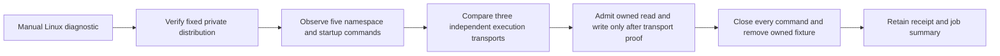

# Agent Runtime, Provider, Model, and Role Routing

- Status: In progress for official standalone agent installation
- Date: 2026-09-11
- Last updated: 2026-11-12
- Catalog capability ID: `agent-runtime`
- Last verified: 2026-09-24
- Owners: Copilot maintainers
- Scope: resolve, validate, provision, authenticate, authorize, and execute provider-neutral agent roles
- Related issues/PRs: comment automation, Bugbot, setup, PR lifecycle, and
  architecture quality and scalability hardening SDDs
- Required review gates: product UX, architecture, testing, documentation, security/operations
- Open decisions blocking readiness: none for the baseline

## 1. Executive summary

Pre-branch SDD analysis and drafting additionally bind their effective read-only
source to the host-selected immutable snapshot, after the canonical anchor check.
See [source-context admission](pre-branch-sdd-source-context.md) for the private
Git view, fixed limits, original deadline, closed failure and cleanup contract.
This internal binding adds no public runtime option or provider authority.


Copilot resolves one complete runtime/model tuple for each reachable agent role:
provider runtime, model provider, model, optional effort, and optional validated
executable selection.
Common values may be overridden per planner, findings, reviewer, fixer, or tester.
The recommended common default is Codex with `openai/gpt-6-luna`; explicit
repository Variables and role inputs retain precedence over that fallback.
Only roles reachable from the current event are checked and authenticated.
Invalid configuration or runtime failure is terminal for that capability; no
silent provider/model/executable fallback is attempted.

```text
event/command -> active roles -> common + role override -> validate allowlists
              -> installed-CLI/auth preflight -> provider adapter -> local schema
              -> semantic result
```

### Codex Windows service retirement (2026-10-12)

Current support policy: **Codex no soportado en runners Windows ejecutados como
servicio**. This supersedes historical requirements below for another live Codex
Windows service retry; it does not mark those acceptance gates successful or
claim that all Windows environments fail.

Operator evidence: all four services use the non-administrator `ci-runner`
account in Windows session 0 and must start without login. The official CLI,
including 0.162.1, under `--strict-config`, `--ignore-user-config`, and
`windows.sandbox="elevated"` could authenticate and answer while tools failed
with `0xc0000142` and command-runner pipe timeout. The same account/configuration
worked interactively; official setup did not resolve service execution.

Intentional contract:

- Operational jobs MUST retain the shared `[self-hosted, codex]` Mac/Ubuntu pool.
  Windows service registrations MUST omit `codex`; existing registrations lose
  it when recreated. Until that migration is verified, no new Windows Codex
  run may be requested. Runner recreation and Windows-only credential/CLI
  removal belong to the operator in `vypdev/lab-runners`.
- Codex integration jobs and their self-hosted fixture matrix MUST exclude
  Windows. The matrix retains macOS and Ubuntu, with unchanged full coverage,
  acceptance, package and documentation checks. The Codex diagnostics workflow
  retains Linux only. Explicit Windows Codex jobs MUST be rejected structurally.
- General hosted Ubuntu/Windows/macOS coverage and local fake platform-safety
  fixtures MUST remain. These prove launcher/ACL/process/installer contracts,
  not official Codex sandbox execution or authenticated model/tool success.
- CLI exit 0, login, installation and model response MUST remain distinct from
  actual tools. Acceptance requires a bounded fixture read/hash or edit and
  trusted post-execution verification; a failed tool does not become successful
  because the model explained it.
- Sandbox, configuration isolation, credentials, runtime provenance and
  process limits MUST remain. Community distributions, sandbox bypass, and
  converting services to interactive sessions are excluded recovery options.

Flow: remove Windows `codex` labels -> shared pool selects Mac/Ubuntu -> actual
bounded tool operation -> trusted verification -> publish only verified results.
If no supported runner is available, the job remains queued/unverified; never
restore Windows eligibility to hide that state. Retries target only a supported
runner. No provider fallback, new Action input, model call, comment or deployment
is introduced. Rollback requires a new reviewed support decision and real tool
evidence; restoring old labels/YAML alone is not acceptance.

Operator UI: `Codex no soportado en runners Windows ejecutados como servicio.
Ejecuta los jobs de Codex en Mac o Ubuntu.` This documented limitation produces
no new timeline comment. Retained general Windows results are reported as
platform fixture evidence, never as successful Codex integration.

Additional risk-derived budget: **6 distinct workflow contract cases** in
`src/tooling/__tests__/validate_workflow_contract.test.ts`: shared-pool migration
(1), explicit Windows routing rejection (1), all installed static selectors (1),
Windows Codex matrix rejection while preserving hosted Windows (1), and forbidden
Windows/missing Linux diagnostics (2). Existing matrix-removal, full coverage,
package, trusted-dispatch and documentation validator cases remain; no
repository thresholds or acceptance rows are lowered. These six cases are
counted once, not again in related specifications.

Acceptance and traceability: the six structural cases and
`pnpm run validate:workflows` enforce scheduling/fixture boundaries;
`pnpm run test:coverage` preserves full platform-safety and coverage gates;
`pnpm run validate:specifications` checks catalog/spec consistency. User/setup,
execution, smoke, runner provisioning/security, verification and synchronization
docs MUST agree. Manual runner inventory must show Windows without `codex`
before new shared-pool dogfooding. Previously open Windows Codex service checks
remain unsupported/unverified, not green; the setup 350-row budget is unchanged.

## 2. Problem, current behavior, and evidence

### 2.1 Problem

Runtime CLI, model vendor, model name, reasoning effort, credentials, execution
mode, and task responsibility are distinct concerns. Conflating them causes
unreviewed fallback, excess provisioning, credential exposure, or write-capable
agents running for read-only tasks.

### 2.2 Current behavior

1. `agent-*` supplies the common tuple; role-specific fields inherit only when blank.
2. The manifest records a reviewed runtime identity and an official standalone
   installation source for Codex, OpenCode, and Cursor.
3. Provider/model formats, executable selection, non-empty runtime identity,
   fixed provider command shape, and configured allowlists are validated.
4. Event/command policy calculates active roles before runtime preparation.
5. `ai-members-only` may prevent all requested agent runtime preparation for an unauthorized actor.
6. Runtime preparation reuses an explicit operator-owned executable. For a
   default-discovered executable, it reuses the present CLI unless a newer
   official release is verified; a missing or verified older default may use
   a private job installation without changing the operator's file. It then
   verifies the resulting executable and nonempty version. It never uses npm
   or pnpm for agent installation and never requires an exact runtime version.
7. An exhaustive dispatcher selects one independent provider policy, and a
   preflight planner produces the complete admitted execution plan.
8. A generic process adapter consumes only admitted plans; OpenCode JSON events
   are decoded before provider-neutral local schema validation.

### 2.3 Evidence and contract classification

- Observed behavior: agent domain, configuration/activation policies, execution
  planner, reviewed-runtime manifest, CLI installer/process adapter, setup workflows,
  architecture/security tests, and agent docs.
- Intentional contract: complete tuple, no implicit fallback, active-role-only
  preparation, semantic ports, local schema validation, and credential isolation.
- Known debt and limitations: an operator-owned provider CLI may change its
  command surface externally; incompatible flags fail terminally at execution.
  Installer source changes require reviewed fixtures and controlled live
  smoke evidence; credential checks remain environment-specific; cost estimates
  are not product guarantees. On Windows, npm-generated `.cmd` shims cannot be
  passed directly to Node's no-shell process APIs; PR #403 observed
  `configuration.unsupported` during Codex provisioning after Git Bash passed.
  The underlying exception was not exposed, so the shim explanation remains a
  hypothesis until isolated Windows tests and runner evidence confirm it.
- Unknown rationale: the prior `gpt-5.6-luna` default was operational
  configuration, not a permanent architecture decision.
- Implemented hardening: provider-specific execution policies and an exhaustive
  compile-time dispatcher are specified in
  [`agent-execution-policy-hardening.md`](./agent-execution-policy-hardening.md),
  under the shared gates in
  [`architecture-quality-and-scalability-hardening.md`](./architecture-quality-and-scalability-hardening.md).
  Adding a provider still requires a separate runtime-support, security, docs,
  and smoke-test change.

## 3. Actors, surfaces, and terminology

| Actor | Goal | Entry point | Surface |
|---|---|---|---|
| Repository owner | select approved runtime/model | setup/Variables/inputs | plan/docs/run |
| Workflow | request capabilities | event/single action | Job Summary/logs |
| Agent role | perform bounded task | semantic port | structured/text result |
| Provider CLI | execute model request | admitted argv/stdin | process output |

Runtime provider selects the executable; model provider selects who serves the
model. Roles are planner (read), findings (read), reviewer (read), fixer (write
workspace), and tester (read). “Active” means reachable from this exact event,
not merely configured.

## 4. Goals, non-goals, and fixed invariants

### 4.1 Goals

1. Every invocation MUST have one valid complete effective tuple.
2. Inactive roles MUST NOT be provisioned, authenticated, or invoked.
3. Provider output MUST cross a provider-neutral locally validated contract.

### 4.2 Non-goals

1. Copilot does not dynamically choose the cheapest/best model.
2. It does not fail over between providers or models.
3. It does not guarantee provider availability, price, quota, or data residency.

### 4.3 Fixed product/safety invariants

1. Missing/malformed/unsupported tuple or disallowed model fails before execution.
2. Callers cannot provide command text or argv; executable selection accepts no arguments or wrappers.
3. Read-only roles cannot receive write/network/approval authority beyond their admitted plan.
4. Agent processes never receive GitHub git credentials.
5. Structured output is locally validated even if the provider validates it.

## 5. Current versus proposed product journey

| Stage | Rejected/unsafe shape | As-built contract | Effect |
|---|---|---|---|
| Selection | provider implies model | independent qualified model | explicit behavior |
| Roles | one runtime eagerly prepared | only active role tuples | lower cost/risk |
| Invocation | caller supplies command text | provider policy builds argv | injection resistance |
| Runtime ownership | replace a newer runner CLI | reuse it and record identity | no global mutation |
| Failure | silent fallback | terminal named error | auditability |
| Output | trust provider JSON | local schema/size check | consistent contract |

No legacy behavior is supported; the hardened runtime is the only contract.

## 6. Functional behavior and state model

### 6.1 Happy path

1. Determine active roles from event/command/single action.
2. Merge common tuple with complete role overrides and validate.
3. Enforce model-provider/model allowlists and installation policy. Preflight
   credentials for every active role before provisioning any CLI; a required
   missing credential fails with the authentication error and causes zero
   installer calls. Warning-only authentication remains visible and does not
   prevent provisioning. Fixtures must prove this order.
4. Reuse an operator-installed CLI, or install the missing default executable
   from the selected provider's official standalone source in a private job
   directory. An explicitly selected executable is never replaced. A present
   default-discovered executable may be superseded for this job only by a
   verified newer official release in a private PATH overlay; its original
   file is never modified. Never require an exact runtime version.
5. Verify CLI identity and credential/login readiness.
6. Invoke the generic process adapter with the admitted role plan.
7. Bound/parse/validate output and return semantic result.

An operational Codex login probe is itself an agent process. Before `login
status`, it MUST resolve the selected executable and any Windows npm package
bin, validate the shim, direct interpreter, and package bin with the same
owner/ACL file policy used for version and execution preflight, and execute
with literal arguments and the bounded credential environment. A failed trust
check reports authentication as unavailable without starting the CLI. A
focused fixture MUST prove a writable launcher cannot run during this probe.
The admitted execution plan separately records and rechecks its launcher hash
when that plan is later executed; the synchronous login probe has no stored
execution plan to recheck.
The repository's standalone `verify-agent-clis.cjs` diagnostic MUST apply the
same installed-file owner/ACL policy to the selected shim, direct interpreter,
and package bin before any help, version, or login command. It MUST reuse the
runtime's executable trust implementation rather than keep a weaker copy, and
PATH lookup MUST not execute an unvalidated `which` or shell wrapper. An
isolated fake-CLI fixture MUST prove a writable candidate is never started.
On Windows, an npm shim under a project-local `node_modules/.bin` MUST resolve
its package from the sibling `node_modules` tree; a global shim resolves from
the prefix's `node_modules` tree. Both layouts require the same containment,
package identity and executable ACL checks before any native Node invocation.
A private local-layout fixture MUST prove positive headless help/version
readiness without a real CLI or credential, while the writable-shim fixture
continues to prove rejection before execution.
The Windows verifier fixture MUST answer both headless `exec --help` and
`--version` promptly, and report an optional missing login separately; a
fixture that hangs on help is not evidence of CLI readiness.
On hosted Windows, the isolated readiness test MUST retain its bounded verifier
stdout on failure so `NOT_READY` is distinguishable from a test harness timeout.
The verifier's `NOT_READY` result MUST distinguish executable resolution,
file trust, and headless help/version execution using fixed phase labels and
bounded status codes, without exposing paths, raw stderr, arguments, or secrets.
For a file-trust failure, the phase MUST identify whether the selected shim,
resolved interpreter, or package launcher failed the check, again without
printing its path or ACL contents.
The fake native execution, timeout, and cancellation fixtures' Jest budgets
MUST include native ACL setup and teardown on service Windows; the admitted
child still uses its own short execution deadline.
The isolated Windows verifier receives only non-secret system process variables
needed by Windows PowerShell and native process startup. Its fixture must prove
readiness on hosted Windows while retaining the 15-second ACL query deadline.
It MUST replace an inherited PowerShell 7 `PSModulePath` with only Windows
PowerShell 5.1 system module directories when launching the native shell.
The allowlist includes standard process, profile, Program Files,
and account-domain context needed for noninteractive Windows PowerShell startup;
it never includes GitHub tokens or provider credentials.
The fixture MUST separately confirm that `whoami.exe` and a no-op Windows
PowerShell command start under that bounded non-secret environment. The shell
startup probe allows the same 15-second deadline as the real ACL query; a failed
verifier ACL query identifies identity versus descriptor timeout by fixed code.

### Private shell application data (dogfooding issue #454)

The Windows implementation retry on master `fa7eb447` stopped before its fixer
because a preceding read-only agent left an untracked `Microsoft/` directory in
the checkout. The workspace guard correctly refused mutation. Missing child
shell application-data context is the suspected cause; a live Windows repeat is
required to establish recovery.

Codex child shells MUST receive explicit `APPDATA` and `LOCALAPPDATA` values
inside the Action-owned, private per-execution runtime directory. The planner
creates those directories and validates their Windows ACLs before execution;
normal, failed and cancelled execution retains existing runtime cleanup. The
Codex process's authentication environment and explicit `CODEX_HOME` remain
unchanged. The child shell allowlist admits the two explicit private values,
but still excludes host `HOME`, `USERPROFILE`, credentials and repository tokens.
These paths do not add sandbox writable roots, network access, shell profiles,
login shells, or approval authority. Do not ignore, delete or commit unexpected
checkout files as a substitute for isolating runtime state.

The repeated Windows implementation run `38133560682` identified the exact
unexpected file as `Microsoft/Windows/PowerShell/ModuleAnalysisCache`. ACL
descriptor collection starts Windows PowerShell before the private agent plan
exists. Those trusted metadata probes MUST use a fixed minimal environment:
the captured canonical system root and its system modules, with
`PSModuleAnalysisCachePath=NUL` (Microsoft's documented cache-off setting).
Descriptor commands explicitly import the trusted absolute system Utility
manifest with automatic module loading disabled before serializing the unchanged
ACL batch. They inherit no authentication, host profile, repository module path or ambient
cache override. This setting applies only to the metadata probe; it neither
disables the private cache for agent execution nor changes its authentication.
No process-global environment mutation, cache deletion, workspace ignore or
ACL-validation bypass is permitted.

Flow: trusted system root -> cache-free system-module ACL probe -> unchanged
executable/ancestor descriptor validation -> private agent plan -> execution.
Native fixtures MUST call the exact descriptor verifier in a child Node process
with present and absent host application data and deliberately poisoned module/
cache paths. Both must validate the executable and leave Git completely clean.
A subsequent real Windows implementation remains the live acceptance gate.
Source: [Windows PowerShell module cache](https://learn.microsoft.com/en-us/powershell/module/microsoft.powershell.core/about/about_windows_powershell_5.1?view=powershell-5.1).

A native Windows fixture MUST start Windows PowerShell with the actual generated
shell policy, load its file-hash module, and prove a clean Git workspace and
private runtime cleanup with both present and absent host application-data
variables. Pure policy and planner fixtures MUST also prove literal Windows path
encoding, private directories, preserved parent authentication and exclusion of
host profiles and tokens. This adds **6 distinct cases** to the 130-case baseline
and 18-case Windows extension; the two native cases run on Windows. Live Windows
agent execution is separate evidence and cannot be inferred from the fixtures.

The #462 Windows repeat on `c0dc3864` again left `Microsoft/` before the fixer;
the first application-data isolation did not prove recovery. Codex MUST bind
`PSModuleAnalysisCachePath` to one absolute filename under its private runtime
`shell/local` directory in both the parent process environment and the explicit
child-shell environment. Ambient cache paths cannot override it. The generated
value is literal TOML, including Windows backslashes, spaces and quotes. Parent
authentication and the existing shell credential/profile exclusions remain.
The cache directory already has the private ACL; cleanup removes it with the
runtime. No additional sandbox root or write/network/approval grant is added.

[Microsoft's Windows PowerShell 5.1 contract](https://learn.microsoft.com/en-us/powershell/module/microsoft.powershell.core/about/about_windows_powershell_5.1?view=powershell-5.1)
specifies a cache filename override before process startup and background cache
writes after module import. This is a bounded isolation fix, not a claim of
successful live recovery. Four additional cases cover a literal parent/child
policy, ambient cache rejection with present/absent host data, and actual native
PowerShell startup before child-policy application with a clean checkout and
runtime cleanup. The two existing child-shell native cases use the same cache
override and are not counted again.

### Semantic agent execution failures

The #461 live implementation timed out after 900,000 ms. Telemetry retained the
timeout category, but a generic comment exception wrapper discarded it. The CLI
observation and capability adapter MUST share a closed mapping: configuration
to `agent.policy-rejected`, timeout to `timeout`, cancellation to
`workflow.cancelled`, output to `provider.contract-invalid`, process to
`agent.failed`. Only typed CLI failures are mapped; unrelated exceptions retain
their identity. Adapter errors publish no raw executable, token or provider
diagnostic. Retryability is never broadened beyond either the typed CLI fact or
the closed application metadata. The route retains that semantic error and its
correlation. Five
adapter cases cover all categories, distinct from the comment SDD's three
preservation cases. Deadline, verification, sandbox and credential limits stay
unchanged; no fallback provider, model or automatic execution retry is added.

### 6.2 Alternative paths

- Different active roles in one workflow may use different runtimes/models.
- Existing Codex login may satisfy an explicit credential alternative.
- Default and explicit executables are operator-owned when present. A missing
  default executable triggers the selected provider's official installer; a
  present default executable may receive the private, verified update below.
  Explicit executables and original operator files are never replaced; failed
  or unverifiable installation fails closed.
- Optional effort maps to Codex reasoning, OpenCode variant, or provider-neutral context for Cursor.

### 6.3 State model

| State | Meaning | Next | Recovery |
|---|---|---|---|
| inactive | role unreachable | terminal | none |
| resolving | inheritance/tuple building | invalid/authorized | fix config |
| authorized | actor/model policy passed | checking runtime/ready | none |
| checking runtime | available CLI or official install | ready/failed | runner/install fix |
| authenticating | credential/login preflight | ready/failed | configure credential |
| executing | provider process running | validating/failed | inspect bounded error |
| validating | output local contract | complete/failed | provider/prompt fix |
| complete | semantic result returned | terminal | none |

No provider fallback transition exists. Retry repeats readiness checks and
must not treat a partial installation as authenticated success.

## 7. User-facing configuration

| Input | Recommended default | Allowed/bounds | Persistence |
|---|---|---|---|
| `agent-provider` | `codex` | `codex`, `opencode`, `cursor` | repository/run |
| `agent-model-provider` | `openai` | validated identifier + allowlist | repository/run |
| `agent-model` | `gpt-6-luna` | validated unqualified model + allowlist | repository/run |
| `agent-effort` | empty | validated provider-supported value | repository/run |
| `agent-executable` | reviewed basename | exact basename or absolute path to it | repository/run |
| `<role>-*` | inherit common tuple | same bounds | repository/run |
| allowlists | setup-derived exact values | comma-separated exact providers/models | workflow environment |

Model values MUST not repeat provider prefixes. A meaningful alternative is
OpenCode with an explicitly qualified allowed provider/model. Cursor requires
its documented credential.
No-fallback, local schema,
active-role-only, credential isolation, and permission modes are not configurable.
The same default MUST appear in the action input, setup plan, generated
workflow fallbacks, and default allowlist (`openai/gpt-6-luna`). A configured
repository `AGENT_MODEL` or role-specific value is intentional and MUST not be
silently rewritten by source defaults; operators migrating this repository
update `AGENT_MODEL` and `AGENT_ALLOWED_MODELS` together. The effective model is
snapshotted for a run. Existing explicit `gpt-5.6-luna` deployments remain
supported when exactly allowlisted. Reasoning effort, credentials, and provider
transport do not change as part of the default migration.

### Native Claude Code runtime

**Future runtime requirement.** Track implementation in a separate task
outside #950. The current dispatcher supports Codex, OpenCode, and Cursor.
The future contract adds `claude-code` as an independent agent provider.
It invokes Anthropic's official `claude` executable directly with
`anthropic` as its model provider. Existing `opencode` plus `anthropic`
configurations remain valid. [Bugbot profile contract](bugbot-analysis-publication-and-autofix.md#configuration-and-ownership)

| Input | Contract once implemented |
|---|---|
| Common or role-specific provider | `claude-code`. Use the existing role precedence and run snapshot. The default remains `codex`. |
| Model provider and model | Default the backend to `anthropic` for this agent. Require an admitted Claude model ID and reject any incompatible backend or disallowed model. Qualify an exact model identity. |
| Effort | Pass an explicit supported value through Claude Code's `--effort`. Validate it for the selected model and reviewed CLI contract. If omitted after an agent or backend change, use the selected model's provider default. |
| Executable and credentials | Use the official `claude` runtime, subject to the existing executable and release trust checks. For CI, pass the operator-owned `ANTHROPIC_API_KEY` only to the admitted Anthropic invocation. |

Provision and authenticate only when an active role selects Claude Code.
The infrastructure planner owns the native flags, private configuration,
capability-specific sandbox and output decoding. Extend the existing
dispatcher and execution plan rather than routing through an OpenCode
adapter. Keep provider flags and credentials outside domain and application
contracts. Claude Code runs noninteractively and Copilot validates its
structured response locally. An unsupported runtime, unavailable model,
incompatible effort, unexpected effective model, or unproven permission
boundary fails with the corresponding configuration or execution diagnostic.
Selecting Claude Code never starts another agent or a replacement model.

For detection, prove the same bounded read-only capability as the other
review agents. For verification, use the application evidence broker from
the Bugbot SDD. Each Claude Code turn runs with isolated configuration in
an empty workspace. The host retains the evidence and investigation state
for successive turns. The admitted invocation disables built-in tools,
MCP, session persistence, and ambient project hooks, plugins, or settings.
Prove the effective permissions for the runner and CLI in use, including
the effect of managed settings. A denied permission, authentication failure,
or provider interruption is recorded in the existing Job Summary and
technical diagnostics. For example, `Claude Code reviewer blocked. Configure
an Anthropic API key on the runner and rerun the review.`

Add **eight distinct deterministic runtime cases**. Cover role inheritance
and direct routing (2), incompatible backend and unsupported model/effort
(2), trusted executable and authentication isolation (2), forbidden tool
authority and malformed native response (2). Use the existing architecture,
provider policy, workflow and coverage gates. Before advertising platform
support, run a read-only authenticated smoke on each advertised platform
and a brokered verifier smoke through the normal Bugbot composition.
Record the effective runtime, model, effort, permitted operations and
validated output. Runtime installation alone does not establish role support.
Setup, runtime selection, credential guidance and Bugbot configuration
must describe only the capabilities that pass those checks.

Primary sources. [Claude Code CLI reference](https://code.claude.com/docs/en/cli-reference) ·
[Noninteractive execution](https://code.claude.com/docs/en/headless) ·
[Model and effort configuration](https://code.claude.com/docs/en/model-config) ·
[Settings precedence](https://code.claude.com/docs/en/settings)

## 8. Clean Architecture design

| Boundary | Owns | Must not own/import |
|---|---|---|
| Domain | provider/role/config tuple | process/env |
| Policies | activation, inheritance, runtime support, validation | CLI invocation |
| Application ports | findings/fixer/language capability requests | provider DTO/flags |
| Data adapters | provider-neutral capability and generic process lifecycle | workflow routing/provider authority |
| Infrastructure planning | executable/runtime-identity/artifact preflight | product role decisions |
| Entrypoints/setup | inputs and composition | provider-specific branching beyond adapters |


Dependency/cycle tests, CLI entrypoint tests, provider-port boundaries,
allowlist/docs validation, and workflow secret checks MUST prevent erosion.

## 9. UI/UX and content contract

```markdown
Pending: **Preparing the `reviewer` role.** Runtime `codex`; model `openai/gpt-6-luna`.
Action required: **Codex authentication is missing.** Log in on the runner or configure an approved fallback credential.
Blocked: **`anthropic/model-x` is outside `AGENT_ALLOWED_MODELS`.** No provider process started.
Partial: **The provider completed, but its structured result was invalid.** Nothing was published or modified.
Complete: **Reviewer completed with a locally validated result.** Continue in the linked PR status.
```

Output MUST name role, runtime, qualified model, phase, and one recovery action
without printing prompts, credentials, or raw provider response. Technical argv
is debug-only and redacted. Text accompanies icons; English is fallback; terminal
and Job Summary content remains narrow-readable. Provider errors are mapped to
stable categories before public presentation.

## 10. Failure, recovery, and cleanup

| Failure | Impact | Retained facts | Retry | Action | Cleanup |
|---|---|---|---|---|---|
| invalid tuple/allowlist | no process | config | yes | correct exact value | none |
| provisioning | CLI unavailable/partial | sanitized failure category | yes | inspect official source or provide a compatible CLI | remove private install directory |
| auth preflight | no query | credential name only | yes | login/add secret | none |
| process timeout/exit | capability fails | bounded diagnostics | yes | inspect provider/quota | terminate child |
| schema/size invalid | no trusted result | raw output not published | yes | fix prompt/provider | discard output |
| write role postflight | no trusted commit | workspace state | guarded retry | abort/review | mutation guard |

## 11. Security, permissions, and privacy

Credentials remain in provider-supported environment/login stores and are never
command arguments, prompts, result payloads, or catalog/config examples. Read
roles use read-only/no-approval/network-restricted modes where supported. Write
roles receive workspace access only after actor authorization and still cannot
own trusted git. Processes use policy-owned argv, bounded environment, timeouts,
output limits, redaction, and local schemas. Repository instructions are
untrusted input, not authorization.

## 12. Observability and operational UX

Logs/summary expose active role, provider, qualified model, configured effort,
provision/auth/execute/validate phase, elapsed time where available, and mapped
failure. Content-free Bugbot telemetry is optional. Setup/doctor and the
credential-health workflow surface readiness per credential. Inactive roles
produce no provisioning noise. Model/provider changes are operational changes
that require smoke evidence.
For an admitted CLI, the debug log MUST include the normalized first-line version identity.
That identity MUST be at most 128 printable ASCII characters; control characters
or an overlong first line fail preflight before admission. The log adapter MUST
also replace an invalid version in both message and structured observation with
a fixed diagnostic if it receives an unvalidated observation directly, so CLI
output cannot forge a log line.
On process failure it MUST expose the bounded numeric exit code and failure
category, never raw stderr, prompts, environment values, or credentials. A
provider availability label alone is insufficient to diagnose a CLI failure.
Official CLI provisioning failures MUST expose a closed stage and bounded exit
status when available (private-root, download, installer-script, installed-file,
or replacement-trust). The Action log MUST NOT include raw installer stderr,
URLs, local paths, environment values, tokens, or command arguments.
For installer-script failures it MAY add a closed reason inferred from stderr
(`hash-module`, `network`, `access-denied`, `missing-command`, or `unknown`);
the raw text MUST stay private even when debug logging is enabled.
For an `installed-file` failure it MUST add a closed reason derived only from
the local validation operation and known error codes: `missing-file`,
`invalid-file`, `unsafe-link`, `acl-hardening`, `acl-ancestor`, `acl-file`,
`acl-inspection`, `access-denied`, or `unknown`. The log MUST never interpolate
an exception message, path, principal,
installer output, or credential. Fixture tests MUST exercise each mapping and
prove that arbitrary secret-bearing exception text never reaches the log.

## 13. Compatibility, migration, rollout, and rollback

### Windows Action runtime acceptance (issue #404)

Windows support MUST use a native executable for provider version checks and
admitted execution. A `.cmd`/`.bat` wrapper MUST NOT receive agent arguments
or prompts. An explicit absolute Windows executable selection ending in
`.cmd` MUST fail at the configuration boundary, while the provider's exact
native `.exe` basename remains admissible; package-shim inspection is an
internal launcher resolution path, not an operator-selected execution plan.
The Windows planner fixture MUST prove all three paths: default PATH discovery
can resolve a trusted npm shim to a native interpreter and package bin; an
explicit native `.exe` can be admitted; and the same `.cmd` shim supplied
explicitly is rejected before an execution plan is admitted.
The Action MUST NOT use npm, pnpm, `npx`, or `actions/setup-node`
to install agent CLIs on any platform. Its six distributed agent workflows
run the JavaScript Action under the GitHub Actions runner's embedded Node;
development CI and packaging workflows keep their separate Node/pnpm setup.
When the selected default CLI is absent, Codex uses OpenAI's official
standalone installer, OpenCode uses its official standalone installer or
release binary, and Cursor uses its official installer or release package.
Windows Cursor installation MUST avoid the official script's user-wide PATH
mutation and deletion of an existing installation by using its official
archive in a private job directory. Installer child processes receive no
GitHub or model credentials. Explicit and present operator CLIs are never
replaced. Installation checks require a nonempty version and the admitted
headless command surface, without enforcing an exact version.
The installer and its child tools MUST use the same private installation root
for `TMPDIR`, `TMP` and `TEMP`. On a self-hosted runner this keeps the archive
download and extraction on runner scratch, which may have more space than the
system temporary filesystem. Use the ordinary private-root cleanup on failure.
Recognized storage write errors MUST report `write-failed` without raw output.
The installer adapter owns this behavior. No new configuration is required.
On Windows the official installer runs under Windows PowerShell 5.1 with fixed
system tool directories, a private profile, and only non-secret native process
variables. Its `PSModulePath` contains only Windows PowerShell 5.1 system module
directories derived from the validated system root. `ProgramFiles` and related
installer variables also derive from that root; ambient or workflow-supplied
Program Files paths cannot add PowerShell module locations. Inherited
PowerShell 7 module entries cannot reach it. A fixture
MUST assert the closed environment and failure-stage telemetry.
The Windows platform smoke MUST also start the native Windows PowerShell 5.1
under that exact installer environment and hash a local fixture file with
`Get-FileHash`; this verifies module loading without downloading an agent,
using credentials, or invoking setup against a repository.
If the default discovered CLI fails the executable trust preflight before its
version can run, provisioning MUST treat it as unavailable and install a fresh
official CLI in a private job directory. It MUST NOT execute or repair the
untrusted file, and the installed replacement must pass the same trust and
version checks before the Action uses it. Explicitly selected executables
remain operator-owned and fail closed. A fixture MUST prove fallback for an
unsafe default, no fallback for a generic metadata outage, and cleanup if the
official replacement also fails trust.
The [Windows service run on `8e4978e9`](https://github.com/vypdev/copilot/actions/runs/37115583847)
reached the private Codex replacement but rejected its ACL as writable before
executing the CLI. A private installation root MUST pass the same file and
ancestor trust policy before any official installer is downloaded or run.
Prefer the job temporary directory when its ancestors pass; otherwise try a
profile-local temporary directory with the same preflight. Never weaken the
ACL policy or modify the rejected operator CLI. After the official installer
returns, constrain its output to that private root, reassert owner-only ACLs
on the installed directory and executable, and check the complete executable
path again before returning it to provisioning. Failure to find a safe root or
to secure the private replacement fails closed and cleans that attempt.
Deterministic tests MUST cover unsafe first candidate, safe fallback, no safe
candidate, path escape, private executable repair, and cleanup. Hosted and
service Windows fixtures MUST exercise the real ACL preflight using only
local dummy files; a real Action job is required to verify provisioning.
The [hosted Windows fixture on `0f4c9a5e`](https://github.com/vypdev/copilot/actions/runs/37293874266)
spent 31 seconds exhausting both private-root candidates while other native
ACL and installer fixtures passed. This timing is consistent with two bounded
15-second ACL query timeouts, but the stage-only failure does not prove that
cause. A private-root candidate MAY be recreated and preflighted once more
only when its own ACL operation returns the explicit `ETIMEDOUT` code. Each
failed candidate MUST be removed before retry, every child ACL query retains
its 15-second limit, and owner/ACE/path rejection MUST NOT be retried. The
hosted fixture budget MAY allow the total of these bounded attempts; tests
MUST prove timeout-only retry, cleanup, and no retry for an unsafe ACL.
The downloader and installer shell MUST resolve from trusted system locations,
and every installer child uses a system-only `PATH`. A workflow-controlled
directory cannot supply `curl`, `sh`, `bash`, or commands called by the official
installer. On Windows, capture the runner's `SystemRoot`, `WINDIR`, and
`SystemDrive` at process startup, before accepting Action inputs; require
matching drive-absolute `SystemRoot` and `WINDIR` values, a consistent drive,
and a canonical existing Windows system directory. Reject malformed,
disagreeing, UNC, relative, or reparse-point roots. Use the captured root for
`taskkill.exe`, PowerShell, curl, version checks, and the installer child's
system-only `PATH` and module path. A later mutation of `process.env` or an
installer environment argument MUST NOT change those executable locations.
The runner startup environment is a trusted machine prerequisite; a runner
whose own system variables have been replaced before the Action process starts
is outside the Action's trust boundary. Missing trusted tools fail closed.
Bugbot's [review of `9adcd05c`](https://github.com/vypdev/copilot/actions/runs/37182427514)
still lists the earlier environment-controlled `taskkill.exe` and fixed-`C:`
findings. The current source uses the startup-captured root for both; the
threads remain review work until the new head is verified against that code
and its fixture evidence. Do not restore live environment lookup.
Fixtures MUST cover a non-`C:` system drive, malformed or disagreeing roots,
post-startup environment tampering, and a fake tool directory prepended to
`PATH` without launching the fake downloader, shell, or process-tree killer.
The actual Windows cancellation fixture MUST also change `SystemRoot` and
`WINDIR` after the Action modules load, then verify that the agent's descendant
is terminated. This guards the `taskkill.exe` call path, not only the tool-path
helper, against later environment tampering.
Official latest-version metadata retrieval MUST use the same fixed trusted
`curl` location and system-only child `PATH` as installation. A fixture MUST
prepend a fake `curl` to the caller `PATH`, verify the official version is
read through the trusted executable, and prove the fake tool is never run.
Every direct official-source download MUST be bounded before bytes are written
to disk: at most 1 MiB for installer scripts, 2 MiB for release metadata, and
256 MiB for archives. Curl receives its transfer-size limit and the local
process buffer imposes the same independent bound when a server omits its
length. Zero-byte, oversized, or failed downloads leave no partial artifact
and cannot execute or extract. Fixture tests exercise the actual download
boundary for each content class without external network access.
The [macOS Action run on `9adcd05c`](https://github.com/vypdev/copilot/actions/runs/37182424818)
failed after the official Codex script returned, at the installed-file stage.
The [official Unix installer](https://github.com/openai/codex/blob/main/scripts/install/install.sh)
publishes the visible `codex` command as a symlink to a release under
`CODEX_HOME`. Resolve that link and any intermediate links without following
one outside the newly created private root. The final target MUST be a regular
executable inside that root, while the returned command directory continues
to expose `codex` for PATH resolution. An escaped, dangling, or non-file
target fails closed and removes the installation. Fixture tests MUST cover
the official internal-link layout and an external target without downloading
a real agent. A passing macOS Action job remains required.
The [Windows Action run on `50784d14`](https://github.com/vypdev/copilot/actions/runs/37245063995)
failed at `official-installed-file` after the official Codex installer returned.
The [official Windows installer](https://github.com/openai/codex/blob/main/scripts/install/install.ps1)
publishes the visible `bin` directory as a junction into the versioned release
under `CODEX_HOME`. The installed-file gate MUST accept that directory junction
only when its resolved regular executable stays inside the new private root;
the canonical executable and all of its real parent directories MUST receive
the existing owner-only ACL hardening and executable trust check. The visible
directory remains the command directory for PATH. A junction to another root,
a dangling junction, or a linked final file MUST fail closed without changing
ACLs outside the private root. Windows hosted and self-hosted fixtures MUST
replay the official junction layout and the escape cases with dummy files.
A fresh Windows Action run MUST reach active agent roles before this gate closes;
the setup smoke matrix alone is insufficient evidence for live provisioning.
The [PR #403 Windows Action run on `3a5c22c4`](https://github.com/vypdev/copilot/actions/runs/37291440436)
again stopped at `official-installed-file` on `windows-intel-runner-1`; its
existing stage-only log cannot distinguish a missing visible file, an unsafe
link, or the real ACL gate. A subsequent runner check MUST report one of the
closed installed-file reasons if that gate fails again. The
[Action run on `0f4c9a5e`](https://github.com/vypdev/copilot/actions/runs/37293874115)
passed provisioning and the active Bugbot review role on Windows, with zero
active findings on that exact head. This confirms the Action path on that
runner; the separate hosted Windows private-root fixture failed on the same
head, and the human Windows runner review remains open.
The Windows Codex installer checks the standard `OS=Windows_NT` service
environment value before release work. The private installer environment MUST
preserve that platform fact while still excluding all credentials. The PR #403
run on `windows-intel-runner-3` failed during provisioning because the
isolation allowlist removed `OS`; a Windows fixture MUST assert that the value
reaches the official installer subprocess, and a fresh Action run MUST prove
the repair on a service runner before counting Windows agent execution.

The Windows runtime MUST use a private, owner-only ACL for generated artifacts;
POSIX mode bits are insufficient evidence on Windows. Cancellation and timeout
MUST terminate the agent process tree before generated artifacts are removed.
The process still receives the bounded environment and argv, with no inherited
GitHub token or raw diagnostic output. If an ACL or process-tree check cannot be
performed, execution fails closed. Windows CLI and Action support remain an open
acceptance gate until isolated Windows CI fixtures pass and a real runner review
confirms the job without a credential-bearing test dispatch.

Selected native executables require a read-only Windows ACL preflight before
version checks or execution. The file owner must be the runner user or a trusted platform
principal. No untrusted principal may hold write, delete, ownership, or DACL
mutation rights, whether an ACE is explicit or inherited. Read/execute access
alone may be shared. Unknown ACE rights or unreadable ACLs fail closed. The
preflight must not rewrite an operator-owned executable. Fixtures cover a
normal Git for Windows/npm or Node ACL, a broad writable grant, inherited
write, and malformed ACL evidence on hosted and service Windows runners.
The preflight also reads the containing directory and its ancestors to the
volume root. An untrusted principal must not own any path component or hold
`DELETE_CHILD`, delete, DACL/owner mutation, or generic-all rights on an
ancestor that could replace a previously checked executable. Add-only
directory grants on higher ancestors without replacement rights do not by
themselves reject an otherwise safe installed path. Reject `GW` and `FW`
generic write grants on every untrusted ancestor: they include file creation
authority and are not a narrow add-only exception. The executable's immediate
containing directory must also reject untrusted `FILE_ADD_FILE` (`0x2`) and
`FILE_ADD_SUBDIRECTORY` (`0x4`) rights, including symbolic `LC`, because
Windows may search that directory when loading a DLL. The distinction follows
[Microsoft's directory access rights](https://learn.microsoft.com/en-us/windows/win32/wmisdk/file-and-directory-access-rights-constants)
and [DLL search order](https://learn.microsoft.com/en-us/windows/win32/dlls/dynamic-link-library-search-order).
The symbolic SDDL `LC` flag encodes access-mask bit `0x4`. On a file-system
directory that bit is `FILE_ADD_SUBDIRECTORY`; read-only directory listing is
bit `0x1`. Therefore a direct executable parent granting `LC` to an untrusted
principal remains unsafe, while a higher ancestor with only that add right
does not by itself replace an existing executable. Fixtures MUST retain both
cases; a name-only reading of the directory-service SDDL alias must not
weaken the file-system trust rule.
Synthetic ACL fixtures MUST cover `GW`, `FW`, and numeric generic write on
ancestors, plus add-only rights on the immediate parent versus a higher
ancestor. Native Windows hosted and service fixtures MUST continue to admit a
safe installed executable and reject a writable containing directory. This
read-only check applies equally to native
CLIs, resolved npm shims, interpreters, and package bins; fixtures prove both
safe shared-read parents and a parent with an untrusted delete-child grant.
The known `NT SERVICE\TrustedInstaller` SID is trusted as a Windows ancestor
owner, including for `C:\`, because both hosted and service fixtures expose
that system-owned volume root. The exception applies only to ancestor
descriptors; it does not admit a foreign-owned executable. A fixture must
verify the exact SID and continue rejecting another owner or mutation grant.
The system volume may grant SDDL `LC` to another principal. On NTFS its bit
allows adding a subdirectory, but does not allow replacing the existing path
component without delete, owner, or DACL authority. Higher-ancestor checks
admit it; executable-file and immediate-parent checks reject it. The isolated
Windows matrix must cover all three cases.
The file and ancestor descriptors MUST be collected by one bounded,
read-only PowerShell process. A missing descriptor, changed count, malformed
JSON response, or query failure blocks the run. The Windows timeout and
cancellation fixtures may use a 30-second Jest budget for native ACL setup,
process-tree cleanup, and loaded service runners; each admitted provider
timeout remains independently bounded by its short test value.
The standalone CLI verifier checks the selected command, interpreter, and
launcher once before its help/version/login probes. This permits reuse only
within the same short-lived verifier process after all path components are
proven inaccessible to untrusted mutation. A transient PowerShell query
timeout may be retried once; unsafe or malformed ACL evidence is never
retried as success. Hosted and service Windows fixtures must prove readiness
without increasing the 15-second ACL query limit. The verifier fixture
supplies only non-secret Windows system plumbing variables to its child;
its `PATH` contains the private fake runtime followed by Windows system
directories, and its outer deadline includes the bounded retry and
help/version probes.
The writable-shim rejection fixture uses the same native shell plumbing and
allows up to 45 seconds for the verifier process, covering two bounded ACL
queries under concurrent coverage execution. The result MUST be the specific
unsafe ACL rejection, and its marker MUST prove the shim was never executed.
Its restricted `PATH` includes the known Node interpreter directory so npm
shim resolution can complete before the selected shim's ACL is inspected.
Agent execution failure telemetry MUST include only a closed preflight stage
(`workspace`, `ambient-configuration`, `manifest`, `selection`, `resolution`,
`invocation-trust`, `environment`, `version`, `artifacts`, or `policy`). It
MUST NOT include selected paths, argv, prompts, environment values, or raw
provider stderr. A Windows PR review failure must expose the stage before
its platform gate can close.
For a Windows executable trust rejection, telemetry MUST also carry a closed
reason code distinguishing file owner, ancestor owner, writable principal,
invalid ACL format (descriptor batch, missing DACL, ACE shape or flags, and
rights token), ACL query timeout/failure, and owner identity failure.
Unknown failures use a generic code. The exception and observation must never
carry a raw path or ACL entry into the log, and fixture tests must cover that
boundary. The reason is diagnostic only and cannot relax the trust decision.
Numeric SDDL ACE masks MUST reject both generic write (`0x40000000`) and
generic all (`0x10000000`) for an untrusted principal, as well as file-specific
mutation bits. Focused tests MUST exercise those generic rights directly;
the mask definition should make their inclusion reviewable without mental
hexadecimal arithmetic.
The equivalent documented two-letter SDDL rights MUST use their filesystem
bit meaning: `CC` is file read/directory list; `SW` is read extended attributes;
`WP` is execute/traverse; `LO` is read attributes. `RP`, `CR`, and `DT` grant
file mutation or a parent mutation and MUST not silently become trusted reads.
Unknown rights remain rejected. A service Windows runner must prove the
installed CLI's descriptor is accepted or rejected for a concrete known right,
not because its standard token was absent from the parser.
The installed-file preflight must read the full descriptor, including owner;
`icacls /save` exports a DACL only and cannot establish ownership. A bounded
read-only Windows ACL query is required, while generated runtime artifacts
retain their separate owner-only `icacls` policy.
The standalone readiness verifier's restricted environment can stall the
PowerShell `Get-Acl` cmdlet before help execution. Its installed-file trust
query MUST read the same full SDDL owner and DACL through the direct .NET file
access-control API in Windows PowerShell, without changing ACLs or broadening
the admitted owner/rights policy. A hosted Windows fake-CLI fixture MUST pass
through help, version, and optional login with that restricted environment.

The 2026-10-02 hosted Windows fixture found an effective
`Authenticated Users: 0x1301bf` (modify) grant on both the Action-embedded Node
and setup-node's job Node. The owner-aware ACL preflight correctly rejected
them. The revised Action does not invoke either ambient Node to install a
missing native agent CLI; an existing npm `.cmd` shim still needs a separately
trusted Node executable. The runner owner reports that the self-hosted Node ACL
has since been corrected and requests the shared `self-hosted, codex` pool.
The installed workflows use those two labels. A normal PR or commit run
assigned to Windows MUST complete the isolated runtime path, and a manually
authorized service fixture MUST verify private artifacts, descendant
cancellation, and cleanup before that platform gate closes.
The full hosted Windows coverage suite MUST use a private ACL-validated Node
copy when a fixture exercises an npm package launcher; the ambient job Node
can legitimately fail the product's trust policy. Assertions comparing Windows
resolved executable paths MUST ignore case only, and fixture Jest deadlines
MUST account for native ACL setup while keeping the admitted child timeout
bounded. Windows coverage MUST exercise rejection of `.cmd` execution plans
and an interpreter path that is no longer canonical after preflight. The full
Windows agent execution module must meet its 95% line/statement and 90%
branch/function budgets; a passing isolated subset alone is insufficient.
A malformed spawn argument that causes a synchronous process-start exception
MUST become a bounded process failure and remove the private runtime directory;
the Windows full-coverage suite MUST exercise that recovery branch.
Runner owners must verify native provider executables and their ACLs. The
GitHub-hosted fixture is historical evidence of an unsafe ambient Node and
does not establish service-runner safety. A new isolated installer/agent
fixture must pass on Windows; do not infer Windows agent support from Git
Bash, an installer exit code, or Mac Action success.

There is no legacy provider alias or silent model fallback. Blank role fields
inherit common fields; invalid explicit values fail. A new provider/model is
rolled out by updating domain types, runtime-support/allowlist policy, provider plan,
setup/workflows, credentials, docs, tests, and controlled smoke evidence.
Previously generated `AGENT_PROVISIONING` Variables are ignored by the Action;
the setup assistant no longer asks for this obsolete mode or generates the
Variable. Existing configuration files may still contain the legacy field for
read compatibility, but it does not select an installation policy.
Rollback restores the prior tuple/installer source; provider-created external effects are
handled under that provider's policy. For this default-only migration, rollback
restores both repository Variables (`AGENT_MODEL=gpt-5.6-luna` and
`AGENT_ALLOWED_MODELS=openai/gpt-5.6-luna`) and the source/workflow defaults;
changing only one side would fail allowlist preflight. A controlled Codex smoke
run MUST verify the target model with the runner credential before declaring the
new effective default healthy.
The installer source and generated provisioning workflow MUST advance together
when the provider changes its installation contract. The
`0.153.4` CLI rejects `gpt-6-luna`; the reviewed `0.156.1` CLI passes a local
authenticated `codex exec` smoke. Repository Actions must still prove the same
tuple with their own credential. An explicit operator-owned CLI is never silently
replaced. A default-discovered CLI may use the private, verified update below;
the operator-owned file remains untouched and the admitted CLI still requires
version and model smoke.
The PR #403 run on `apple-intel-runner-1` admitted an installed `0.149.1` CLI
and then recorded repeated process exit 1 before Bugbot completed a partition.
The older-version/model incompatibility is plausible from the `0.153.4`
observation, but the current log discards the CLI diagnostic and does not prove
the cause. Runtime failure observations MUST classify only bounded, recognized
stderr patterns into a closed diagnostic code (unsupported option/configuration,
model unavailable, authentication, transport/rate-limit, or unclassified).
They MUST never emit raw stderr, prompts, credentials, paths, argv, output, or
arbitrary provider text. The code is diagnostic only: it MUST NOT select a
fallback model, replace an installed CLI, or turn a failed review green.
Fixture tests MUST prove recognized codes, unknown text, truncation and secret
non-disclosure. A fresh PR check must provide the actual classified code before
the `0.149.1` failure is attributed to a specific cause.

For a default provider command that is already present, the Action MAY use a
newer current official stable release when its bounded, credential-free
metadata check proves that release is newer than the installed version. Codex
uses its official stable release channel, OpenCode uses its official GitHub
latest-release metadata, and Cursor uses
the version embedded in its official platform installer script. An update is
installed into a private job directory and placed first on that job's PATH;
the runner's executable, user files and persistent PATH MUST NOT be changed.
The Action process keeps this private PATH overlay for the remainder of its
run so later agent resolution executes the admitted replacement. This does not
write the runner service, user, or machine PATH. Restoring the process PATH
immediately after validation would make the subsequent task select the old or
untrusted executable. A fixture MUST prove that the selected private command
remains resolvable for execution and that failure restores the prior process
PATH.
An explicitly selected executable is always used as selected. Unavailable,
malformed or incomparable update metadata leaves the existing CLI in use;
it never selects an arbitrary version or a second provider. Installer failure
after a proven update MUST fail before agent execution. An agent task that has
already started MUST NOT be automatically repeated with a different CLI. The
official installer result MUST pass the same version and executable checks and
be newer than the existing CLI before it is admitted. Fixture tests cover
older/equal/newer/unparseable versions, metadata outage, explicit executable,
private PATH overlay and cleanup. This is update detection, not exact version
pinning.

### Exact Linux sandbox prerequisite observations — issue #1002 (2026-11-22)

Observed limitation: diagnostic44978657686 inspected PATH Codex0.160.0 while
ordinary Actions44985430951/44986247868 used0.171.0. The existing Bash step
discards individual statuses with `|| true`. Its unchanged bytes on default
ace49, executed with five modeled probe commands returning37, exit0 overall.
That is actual Bash/component evidence, not a Linux or Codex observation.

Intentional contract: the existing manual Linux diagnostic MUST provision the
official standalone Codex0.171.0 distribution privately in the same job as
Node24.21.0. The closed x64/arm64 release table pins complete archive sizes and
SHA256digests from the official release. The adapter MUST verify the full
download and pinned full-package inventory before extraction/execution,
record actual native executable and Node byte hashes, and require the exact
reported version before probing. No global CLI installation, npm lifecycle,
model request, public input, repository Variable or runtime fallback is added.



Text equivalent: trusted workflow selection precedes private preparation. Only
verified preparation admits five namespace/startup probes, then three independent
transport controls in parallel. Only all three verified controls admit the two
owned read/write probes. Completion closes every owned
processes, retains each observation, cleans the private fixture and publishes
one receipt plus one Job Summary. None of those steps grants qualification.

The schemaVersion4 receipt has ten fixed observations: unprivileged user/network namespace creation,
two existing bubblewrap configurations, Codex empty-environment startup,
Codex PATH-only startup, three execution-transport controls, an owned fixture
read/hash, and an owned write-denial canary. Namespace probes MUST produce their
exact Node stdout witness as well as exit0; silent success does not prove payload
execution. Every executed probe MUST retain its actual exit or signal, explicit
pass/fail/unavailable/cancelled state and bounded privacy-projected output.
Absent or malformed status, signal termination, launch errors, truncation and
wrong expected output cannot pass. Write denial requires the expected actual
child result and trusted post-command absence; a sandbox startup failure or a
created canary cannot become a successful denial. Probe results are never
collapsed into the aggregate workflow exit code.

Output collection MUST retain the contiguous first65,536 raw bytes of each
channel independently, including the available prefix of an overflowing chunk.
Later chunks MUST NOT fill a gap after discarded bytes. The adapter MUST decode
the joined prefix once as UTF8 with replacement, so a valid character split
between delivered chunks is preserved. Invalid original UTF8 or a byte-limit
split character can produce a replacement character in that explicitly declared
text view. `outputTextEncoding=utf8-replacement` identifies this behavior.
Each executed native result's `outputCapture` MUST separately retain per-channel
`observedBytes`, `retainedBytes`, `observedSha256` and `retainedSha256`, computed
from original buffers. Observed identities cover all bytes delivered through
child close, including bytes delivered after truncation initiates termination;
they do not claim bytes the terminated child never delivered. Retained identities
cover only the bounded raw prefix. Existing `stdoutSha256`/`stderrSha256` continue
to identify the unprojected decoded text, while displayed text remains privacy
projected. Raw bytes are not published to bypass that projection. No spawned
child means capture metadata is unavailable. Truncation MUST remain a failed
observation and cannot admit owned read/write probes.

The distribution MUST be `codex-package-<target>.tar.gz`, matching the layout
selected by the reviewed official installer, never the individual CLI archive.
Both complete x64/arm64 packages have been checksum-verified and their full
member/type/size/hash inventories retained without executing Linux programs.
They share the exact pinned name-list digest. The x64 CLI bytes equal those of
the former individual archive, but that archive omits the bundled resources:
version/executable identity alone is not composition identity. Preserve all
package members under a fresh owned runtime directory. Require owned regular
non-symlink Codex, code-mode host, exec server, rg and bwrap files before any CLI
version command; paths MUST NOT traverse symlinks. Record their actual byte
counts/hashes. Bounded owned package metadata MUST exactly match the fixed
layout/version/target/entrypoint/resource/path fields. A missing resource,
malformed or wrong metadata, or inventory drift fails preparation. There is no
fallback to the individual archive or npm lifecycle, and no global installation.
See the reviewed [official installer](https://github.com/openai/codex/blob/b412ff32c417f855c2b2d1581b77058eed87c84b/scripts/install/install.sh)
and [0.171.0 release](https://github.com/openai/codex/releases/tag/rust-v0.171.0).

All owned Node witness/read/denial payloads MUST emit their evidence with
synchronous raw descriptor writes (`fs.writeSync` to1/2). They MUST NOT depend
on `process.stdout` or `process.stderr` stream classification. This changes the
measurement channel only: fixed payload content, expected markers, exit codes,
sandbox permissions and admission rules remain authoritative. SchemaVersion4
MUST declare `payloadOutputTransport=node-fd-write-sync` and
`nodeStreamCompatibility=not-measured`; neither the receipt nor summary may infer
that arbitrary Node streams, SDK/model tools or qualification are supported.
The Job Summary MUST show that measurement method and compatibility limit.
Earlier schemaVersion1/2/3 receipts remain immutable under their original methods.
No network/seccomp relaxation, proxy bypass or new transport/config selector is
permitted to recover output.

The three transport IDs are `node-execution-transport`,
`bwrap-execution-transport` and `codex-path-execution-transport`. Each MUST run
the identical harmless Node payload and verify its exact stdout marker, stderr
marker and exit37 with an explicit null signal. Only those three fixed IDs may
pass with37; the seven other IDs still require0. Missing/string-invalid output,
missing status/signal, truncation, timeout, cancellation or absent expected
markers cannot pass. Actual empty output has its empty-byte digest; unavailable
output is null with a null digest. A failed or unavailable transport leaves
`executionTransportVerified=false`, both owned probes `not-run` with
`execution-unverified`, collection incomplete and exit1. The three independent
commands MUST all settle, including rejection and cancellation, before cleanup;
no sibling remains active after the owned directory is removed. Only one
transport invokes Codex and its private home. This bounded three-command
concurrency does not schedule model work or change command/job bounds.

The native receipt MAY retain fixed `/usr/bin/bwrap` canonical path, byte count,
SHA256, ELF/script/other format, owner UID/GID and mode. Observation requires a
nonempty regular file at most2MiB, with device/inode/size/time identity unchanged
across its read. Unavailable or drifting metadata cannot become a byte identity.
This passive observation always leaves `payloadExecutionVerified=false`; a
hash, executable format or owner is not execution or sandbox proof. The path and
bound are fixed, with no public helper/socket/backend selector.

The fixed Codex arguments MUST follow the pinned CLI's actual host-sandbox
grammar: root `--config` pairs precede `sandbox -- <owned command>`. The
`exec` options `--ignore-user-config` and `--ignore-rules` are not sandbox
arguments and MUST NOT be prepended. Configuration isolation uses the fresh
owned HOME, CODEX_HOME, XDG directory and cwd; it does not bypass managed
system requirements. Create CODEX_HOME as an owned0700directory before any
CLI version or sandbox command. This diagnostic contract does not change the
ordinary SDK's `exec` policy. See the pinned [CLI root command dispatch](https://github.com/openai/codex/blob/rust-v0.171.0/codex-rs/cli/src/main.rs)
and [host sandbox arguments](https://github.com/openai/codex/blob/rust-v0.171.0/codex-rs/cli/src/lib.rs).

| State | Visible result | Next action |
|---|---|---|
| Preparing | Runtime preparation pending; no probe execution claim | Await the owned download/version checks |
| Preparation failed/missing | Failed boundary; all remaining probes not-run | Inspect the retained receipt before a changed attempt |
| Mixed observations | Separate failed/unavailable and positive rows | Investigate the actual failed prerequisite |
| Cancelled | Actual child cancellation and remaining not-run rows | Preserve incomplete observations; no blind replay |
| Observation complete | All ten rows and exact byte identities retained | Independently verify actual SDK/read-denial composition |

Representative Job Summary (illustrative):

```text
Linux sandbox diagnostic
Runtime preparation: observed. Codex target: 0.171.0.
codex-fixture-read: pass (verified), exit0
codex-write-denial: fail (command-failed), exit1
Next: inspect failed or unavailable prerequisites before qualification.
SDK/model tools, credential/oracle denial and qualification remain unverified.
```

The pure policy module owns the closed release table, outcome interpretation,
privacy projection and summary. The diagnostic use case owns preparation/probe
ordering and partial outcomes through semantic ports. Its native adapter owns
fixed process/download/filesystem/local-Engine operations, scoped credentials-free
HOME/config, actual close callbacks and private cleanup. The workflow owns Linux
placement, Node provisioning and receipt retention. These standalone diagnostic
modules MUST NOT import or mutate ordinary agent role/provisioning/application
state. Existing source boundaries and routing validators remain authoritative.

CLI arguments, executable URLs, package version, probes and host paths are not
user configuration. The x64/arm64 selection follows the observed host architecture;
unsupported architectures fail preparation. Existing `[self-hosted,codex,Linux]`,
contents-read permission, resource counters and Windows Codex retirement remain.
The diagnostic job has a15-minute orchestration allowance. Its download60s,
three preparation commands and eight sequential probe phases at command20s plus
post-termination1s, and Engine3s have a nominal294s total allowance. The former
five-minute job left only6s for checkout, Node setup, hashing, receipt writing
and artifact retention. The additional job margin is operational headroom,
not a guarantee against stalled filesystem/kernel I/O. The four fixed technical
timeouts remain unchanged and share one internal immutable table; they are not investigation,
turn/read/token/heartbeat limits. No sudo, privilege, seccomp, sysctl, AppArmor,
sandbox-bypass, runner registration or global configuration change is permitted.

Cancellation MUST reach the actual owned command and settle its close before
cleanup. Cancellation during a probe, the independent Engine observation or
final cleanup MUST leave `executionIncomplete=true` and exit1, even when all
earlier rows passed. No later probe is admitted after a cancelled command.
The Job Summary MUST show collection completeness and cleanup separately from
probe outcomes. Fully collected negative probe observations may still exit0;
an interrupted collection cannot.

Adapter-construction failures, including unsupported hosts and private-directory
initialization failures, MUST retain the same exclusive receipt and summary,
failed preparation, ten not-run rows and exit1. Initialization removes only
its newly owned root before propagating the original failure. Its receipt
distinguishes `not-created`, `completed`, `failed` and unavailable cleanup;
cleanup failure cannot replace the first failure or imply success. Engine
version and API-version fields MUST be strings before format validation;
JSON numbers cannot become observed identities through regular-expression coercion.
Private temporary files MUST be removed after successful or failed
preparation/probes; cleanup failure stays visible. A read-only local Engine
version observation is independent: unavailable or present does not establish
a conforming container, and no image/container/workload is created. The workflow
retains its report unconditionally, including negative preparation, with no
new issue/PR comment stream. Report output projects account/private paths and
does not inherit or enumerate credentials. Production settings are not mutated;
the receipt does not infer their live values from a constant.

For a failed local Engine connection, the observer MUST preserve only a closed
optional `connectionFailure` tag: `ENOENT` means `missing-socket`, `EACCES` or
`EPERM` means `access-denied`, and `ECONNREFUSED` means `connection-refused`.
Unknown, absent, non-string or prototype-key code values MUST leave that field
absent. Keep `state:unavailable` and `cause:local-engine-unavailable`; never
serialize the raw error code, message, stack, path or arbitrary provider text.
The same classification applies to synchronous request construction failure.
Existing schema4 receipts without the optional field remain cause-unknown;
earlier native observations MUST NOT acquire a retroactively inferred cause.

The Job Summary MUST display only fixed Engine status text. For example:

| Visible status | Meaning and next action |
|---|---|
| Engine: unavailable (socket missing) | The request reported no socket at the fixed job path; inspect the existing runner's local Engine configuration. This does not prove Docker is absent from the host. |
| Engine: unavailable (socket access denied) | The request reported denied access; inspect the job identity and reviewed socket access. No permission change is automatic. |
| Engine: unavailable (connection refused) | The local endpoint refused the connection; inspect service/socket availability from that job. |
| Engine: unavailable (cause unknown) | No accredited cause is available; retain the receipt without inventing one. |
| Engine: version metadata observed; workload not verified | A version response is retained; an actual conforming runtime remains unproven. |

Unrecognized or forged failure text MUST project to cause-unknown and cannot
reach the summary. The pure diagnostic policy owns classification/presentation;
the HTTP adapter owns the request and its original close-before-cleanup rule.
The fixed Unix socket, GET `/version`, timeouts, permissions, package/runtime
pins and no-workload contract remain unchanged. There is no new selector,
backend, global installation, privilege change or research limit.

This adds **eight distinct controls** to130 (138 total): four known native
connection codes; three unknown/absent/prototype-key and privacy cases; one
closed summary/forged-text/metadata-only case. Controlled HTTP events establish
classification, not an actual runner connection failure. Preserve the matched
133PASS/5FAIL→138PASS contrast with identical test-file bytes, all module/global
floors and every earlier native outcome. After a new committed source passes
its exact-head source gates and review, one changed model-free observation MAY
collect the previously missing Engine cause on an existing self-hosted runner.
It cannot retry Native4 unchanged, infer a cause for it, authorize a workload,
or substitute for #974's SDK/model-tool/credential/oracle and native prerequisites.
The evidence packet and operator page MUST retain that distinction.

| Path | Change |
|---|---|
| `quality/bugbot/evidence/issue-1002/controls/engine-connection-cause/README.md` | create |
| `quality/bugbot/evidence/issue-1002/controls/engine-connection-cause/source-and-controls.json` | create |
| `docs/security-operations/security/self-hosted-runners.mdx` | update |
| `specs/catalog.json` | update |
| `specs/CATALOG.md` | update |

### Exact marker bytes and preparation boundaries — PR #1003 review follow-up

Observed source `a01610d0` accepted surrounding whitespace through `.trim()`
and dropped the adapter's known `package-metadata` failure tag to `unknown`.
The first defect can mark unexpected bytes as verified; the second hides the
actual failed preparation phase. The matched authored tests retain
138 PASS / 7 FAIL before correction and 145 PASS after correction with identical
test-file bytes. These are component observations; no new actual runner or
qualification outcome is inferred.

The pure policy MUST compare each specified marker with the unmodified captured
channel. Leading/trailing spaces, tabs, CR/LF and Unicode whitespace MUST produce
`fail (assertion-mismatch)` when they add bytes to an expected marker. Exact
positive markers, including the actual empty channels of marker-free startup
probes, retain their existing semantics. Output capture, raw/projected digests,
truncation, explicit cancellation and exit-code requirements remain unchanged.
The adapter still validates package metadata before CLI version/fixture work.
The outer use case MUST retain the closed `package-metadata` boundary when that
validation fails, emit ten preparation-failed not-run rows, mark collection
incomplete and perform owned cleanup. Raw metadata or error text is not exposed.

Operator flow: inspect the reviewed source -> run the unchanged manual Linux
workflow -> inspect Summary state -> inspect the retained artifact's exact
failure/bytes -> correct the cause before a changed attempt. For example:

| Situation | Existing Summary surface | Retained artifact / action |
|---|---|---|
| Extra newline around a transport marker | `fail (assertion-mismatch)`; owned probes not admitted | Inspect the original bounded channel and producer; no whitespace normalization or inferred success |
| Malformed package metadata | Runtime preparation failed; collection incomplete; cleanup completed if observed | `preparation.boundary: package-metadata`; inspect the fixed package/layout before another changed run |
| Exact expected markers and status | Existing pass rows | Retain exact evidence; SDK/model-tool and qualification acceptance remain separate |

The manual workflow retains the repository's existing trusted-operator model:
GitHub requires repository write access for manual dispatch, and existing source
CI already executes the selected same-repository branch on this self-hosted pool.
The operator MUST choose the exact reviewed revision after its source gates.
This is an operator trust prerequisite, not an isolation boundary enforced by
read-only token permissions or disabled checkout credentials. Fork admission,
runner privileges, hosted-job exceptions and workflow routing remain unchanged.
No claim of protection against a malicious repository writer is introduced.
See the retained review adjudication and the existing self-hosted runner contract.

Seven additional risk-derived logical cases extend the 138-case baseline to
**145**: six distinct extra-byte patterns exercise stdout/stderr and transport
versus owned-read classification; one composition case routes actual private
file preparation through the native adapter and outer receipt with modeled
release/process ports and a controlled Engine port. It verifies the metadata
boundary, ten not-run rows, no CLI invocation beyond archive preparation and
owned cleanup. The earlier positive fixture now supplies its exact expected
marker rather than a normalized newline. All previous cases and coverage floors
remain; pure policy retains 100% for all metrics. Deterministic controls use no
new wait, live service or model call. Keep actual runner acceptance distinct.

Schema 4 and existing selectors remain unchanged. Older receipts retain their
original values and executed source identity. Rollback selects the previous
source; no output, decision or receipt is rewritten. The operator page, catalog
and generated catalog MUST record the corrected semantics and
`quality/bugbot/evidence/issue-1002/controls/review-output-integrity` evidence.
Fresh final-head CI, Commit, Verification, Review and all valid finding decisions
remain required before the next changed model-free observation. Production
verification stays disabled, actual 174/42 unstarted and evaluated-pilot writes 0.

Risk-derived minimum12new deterministic cases: four outcome/exit/signal/missing
metadata; three exact-version/provenance/fixed-command/credential boundaries;
two owned cleanup/cancellation; three workflow/summary/routing. Parameterized
distinct behaviors count once each and executed counts MUST be recorded. Preserve
all previous budgets and global coverage floors. Add both runtime CJS modules
to coverage collection on supported POSIX test hosts; the pure outcome policy SHOULD reach100%branches, with
module gates of95%lines/statements and90%branches/functions for it. The native
adapter retains90%lines/statements,82%branches and88%functions. Its actual POSIX
process/filesystem fixtures and module coverage are not applicable on Windows,
where this Linux-only adapter cannot run; retain portable policy/use-case/HTTP/
workflow cases and every existing Windows SDK/global gate. No new Windows Codex
job or platform-success claim is introduced. Modeled ports
cannot substitute for the actual same-job self-hosted observation.

Review correction evidence adds ten distinct controls beyond the first58:
five reproduce the four review defects (two numeric Engine fields), three
cover late/independent cancellation, and two cover initialization cleanup and
its failure. The same63controls retain the causal58PASS/5FAIL→63PASS contrast;
the expanded68controls retain the additional boundaries. Native CI45011100858
passed all first58diagnostic controls but failed source-context-C38 while Git
preparation exhausted its original30s deadline before the intended assertion.
That delay's cause is unknown. The deadline-focused C38 fixture now uses a
controlled monotonic clock and semantic workspace/integrity ports with the
actual planner, execution admission and owned-directory cleanup. Its unchanged
plan must expire before child launch; an intentional deadline-reset mutant
must fail the same control. All other real Git/source integration controls and
all production deadlines remain. Neither component proof replaces native CI.

First exact-source native diagnostic45016512460/job137189879318 ran on
ubuntu-runner-1 with verified official Codex0.171.0 and Node24.21.0. Both
bubblewrap commands passed. Unshare failed to write uid_map; all four CLI
commands exited2 at argument parsing, before any CLI sandbox/read/denial
execution, and reported missing CODEX_HOME. The local Engine observation was
unavailable and cleanup completed. Preserve all seven outcomes and the original
artifact: job success means collection completed, never sandbox acceptance.
Native CI on2f057efb passed946suites/18,812tests with35historical skips and all
four review threads resolved. Two additional boundary assertions reproduce
the diagnostic grammar and missing-directory defects as67PASS/2FAIL across
69controls; the same control bytes must pass after correction. One new grammar
case and the refined existing real-filesystem case extend the risk budget.
Only a new committed source identity and passing source gates permit a changed
native diagnostic. Do not repeat45016512460 or infer CLI/tool acceptance from
the positive bubblewrap rows.

The changed native diagnostic45020212032/job137201216439 ran once on
ubuntu-runner-2 at5eebe639 with the same verified Codex/Node executable hashes.
Under the retained schemaVersion1 contract its seven outcomes were3PASS/4FAIL:
unshare exit1 (uid_map), both bare bubblewrap commands exit0, empty-environment
Codex exit101 (neither PATH nor adjacent bundled bwrap available), PATH startup
exit0, and read/write both exit0 with empty stdout and stderr. The last two were
assertion mismatches, never accepted read/denial. Engine remained unavailable;
cleanup completed. The actual loss of payload execution/output is unresolved.
Pinned upstream sources preserve argument vectors and inherited stdout/stderr;
source inspection does not prove where this native loss occurs. Preserve both
original schemaVersion1 receipts without retroactive reclassification.

The execution-proof correction adds31 distinct cases to the prior69: three
silent-zero namespace rejections,13 pure typed-output/transport policies, six
transport admission and sibling-settlement/cancellation races, eight real-file
helper-identity cases, and one cancellation of three actual Node process groups.
The last case uses modeled routing, not actual Codex/bubblewrap or nativeC34.
The same72test bytes first reproduce69PASS/3FAIL on the prior driver, then72PASS
with namespace witnesses; expanded controls pass100/100. Retain the first
71PASS/1FAIL partial-success fixture mismatch and the98PASS/1FAIL helper-drift
fixture failure separately: the latter did not inject its fault across macOS
path aliases, and correcting that fixture did not change product source.
Pure policy is100% across metrics; adapter lines99.5%, statements96.1%,
branches89.3%, functions94.23% exceed unchanged floors. Updated schema/table
assertions refine existing cases rather than double-counting them. New native
acceptance requires a new committed source and all source gates before one
changed diagnostic; never repeat45020212032 unchanged or claim its cause fixed.

The package-composition extension adds ten cases (110 total): one same-byte
causal positive demonstrates rejection of the complete official layout by the
prior individual-archive driver, then acceptance after correction; nine reject
missing bwrap/rg/exec-server/code-mode-host, symlink bwrap, malformed metadata
and wrong layout/version/target before CLI version execution. The first new
control attempt did not compile because its fixture referenced an unimported
filesystem name; preserve it separately from the subsequent actual causal
failure. A source-capture guard also stopped before changes because one appended
newline broke the reviewed installer checksum; its corrected snapshot matches
the exact approved checksum. Neither controller failure is native evidence.
The package correction explains missing bundled resources in the empty-PATH
observation; the native PATH payload/output cause remains unresolved.

Third changed-source native observation45028875562/job137227815416 at8e61dbe1
ran once on ubuntu-runner-2 with the full verified0.171package and Node24.21.0.
Its original schemaVersion2 receipt retains5PASS/3FAIL/2not-run. Direct Node and
system bwrap both deliver identical stdout/stderr markers and exit37; namespace
bwrap commands also deliver witnesses. Codex PATH returns37 but both streams
are empty, so transport fails and read/write remain not-run. Unshare uid_map
fails; empty-environment Codex reaches its now-present bundled bwrap and fails
loopback RTM_NEWADDR with EPERM. Engine remains unavailable; cleanup completes.
This narrows loss to the Codex/Node output path and preserves the failed gate.

Pinned [Codex0.171 seccomp policy](https://github.com/openai/codex/blob/rust-v0.171.0/codex-rs/linux-sandbox/src/seccomp.rs)
denies socket-introspection calls under restricted networking. Pinned
[Node24.21/libuv classification](https://github.com/nodejs/node/blob/v24.21.0/deps/uv/src/unix/tty.c)
returns unknown when those calls fail on socket-backed descriptors, and
[Node's stream initialization](https://github.com/nodejs/node/blob/v24.21.0/lib/internal/bootstrap/switches/is_main_thread.js)
then installs a dummy Writable. The [upstream report](https://github.com/openai/codex/issues/18473)
describes the matching symptom. Source and that report support the mechanism;
we have not independently traced syscalls on our exact native tuple.

A separate actual local Linux component contrast, using existing Node24.20ARM
as UID1001 with no capabilities/network/host mounts, applies only the three
additional introspection denials. Its four fixed cases show that socket-backed
Node streams become dummy Writable/outputless while synchronous raw FD output
survives; unfiltered stream and FD baselines both work. The initial Python
launcher exited127 before any case because Python was absent. The corrected
launcher uses already-present Perl without installing dependencies or granting
privileges. This is actual syscall/Node component evidence, not Codex, SDK,
namespace isolation or the exact self-hosted24.21x64 composition.

The correction adds six distinct Jest cases to110 (116 total): namespace
witness1, two-channel transport1, actual read/missing-file2, modeled EROFS
and actual unexpected canary write2. These use real owned Node processes and
output descriptors with explicitly modeled dummy streams. They do not claim
actual sandbox denial. The same116test-file bytes retain111PASS/5FAIL before
and116PASS after changing only payload writes. Subsequent schema/UI assertions
refine existing cases without increasing the count. Preserve both native and
component negatives. A new committed source and source gates MUST precede one
changed native observation; do not retry45028875562 or infer high-level Node
stream compatibility from the new raw-FD probes. All coverage floors remain.

Capture-integrity maintenance adds nine distinct cases to116 (125 total):
split UTF8 in two channels2, overflow followed by a later small chunk in both
channels2, malformed original UTF8/raw digests1, byte-limit split character1,
independent channel budgets/late observed bytes1, exact byte limit1 and receipt
projection with separate byte identities1. Deterministic child-delivery ports
control chunk boundaries; existing actual owned-process/pipe/close tests remain
separate. Preserve matched old/new source and all control outcomes. The earlier
CI run45032430479 retains its one unrelated real-journal fixture timeout at5005ms
against5000ms, with18,859tests passing and35historical skips; all116diagnostic
controls passed. Its exact pending I/O stage is unobserved. The lost-response
Variable fixture adopts the existing20s allowance of the successful real-journal
Variable fixtures; HTTP/runtime/research/qualification limits do not change.
A separate one-time6s post-real-fsync delay contrasts the old and corrected test
budget; it models slow storage and is not a trace of that native failure.

The changed [run 45038779876](https://github.com/vypdev/copilot/actions/runs/45038779876)
executed immutable source `94d760065b208488432f6644b69a1991ad8b5597` on
ubuntu-runner-4 after all source gates passed and the review validated 10/10
partitions with all six threads resolved. It verified the full Codex 0.171.0
distribution and Node 24.21.0, then retained eight passing and two failing rows.
All three transport controls returned both exact markers and 37. Owned read
matched the fixture digest; owned write returned DENIED and the trusted canary
absence check passed. Unshare still failed uid_map with EPERM, and the
empty-PATH bundled bubblewrap still failed loopback RTM_NEWADDR with EPERM.
Engine remained unavailable; collection and cleanup completed. These negatives
remain part of the successful collection, not successful prerequisite outcomes.
The schema 4 original receipt, complete job log, raw byte identities, artifact
metadata and full preceding CI/Commit/Review are preserved in the catalogued
`quality/bugbot/evidence/issue-1002/controls/native-raw-fd-observation` packet.
The preflight initially stopped before any POST because its optional neutral
approval check was attached to Commit rather than Branch Sync. The corrected
guard verified that exact out-of-scope assessment, with every critical gate and
all resolved threads still required, before sending its only diagnostic POST.
An evidence-only publication MUST NOT repeat this observation or claim its new
Git commit was executed. SDK/model-tool acceptance, credential/oracle exclusion
and common native C32–C35 remain independently unobserved. No 174/42 campaign or
production activation follows from these model-free results.

Startup-observation maintenance adds **five distinct controls** to125 (130 total):
already-cancelled/no-spawn, real missing executable, no-spawn receipt projection,
real successfully spawned empty output, and a modeled error after successful
spawn. The existing modeled chunk fixture emits `spawn` before data on both old
and new source. Preserve the matched126PASS/4FAIL→130PASS contrast with identical
test-file bytes; the original successful native observations remain unchanged.
The strengthened existing parsed-workflow case verifies placement/permissions,
the unchanged four technical timers and at least600s of job margin over the
nominal294s allowance. No actual workflow timeout was observed or reproduced;
the insufficient margin is a source/contract defect.

The native adapter MUST leave both output channels and `outputCapture` null
unless the child actually emits `spawn`. Already-signaled cancellation and a
launch failure cannot fabricate an observed empty stream. Receipt channel
digests remain null for these unavailable channels. A successfully spawned
command with no bytes MUST retain empty strings and empty-byte capture hashes;
an error after spawn does not erase captured bytes. Exit, cancellation, failure,
close-before-cleanup, privacy and schema4 semantics remain unchanged. The15-minute
job allowance changes no research, model, call, corpus, scientific or consumer
runtime limits. These controls establish process/receipt behavior, not a new
same-job Codex observation or qualification. Required coverage and source gates
remain; native evidence is retained by its original executed source identity.

The catalogued startup-observation packet retains both complete raw logs with
matched test identities, focused coverage including its unrelated-owner exit1,
and the previous canonical comment verbatim. Its changed-module gates pass;
repository-global/native gates remain separate. Documentation inventory:

| Path | Change |
|---|---|
| `quality/bugbot/evidence/issue-1002/controls/startup-observation/README.md` | create |
| `quality/bugbot/evidence/issue-1002/controls/startup-observation/source-and-controls.json` | create |
| `docs/security-operations/security/self-hosted-runners.mdx` | update |
| `specs/catalog.json` | update |
| `specs/CATALOG.md` | update |

Acceptance and traceability: fixed archive mismatch or version mismatch rejects
before probes; every negative/missing/signal/cancelled probe has its own preserved
status; fixture read matches its trusted digest; successful denial leaves no
canary; cancellation/cleanup settles owned resources; workflow structure retains
the above scheduling/permissions and unconditional receipt; job content separates
observations from qualification. The focused diagnostic and workflow tests,
normal hooks/global coverage, workflow/docs/specification validators, generated
catalog and Graphify MUST pass. User/runner operations docs MUST explain the
artifact, partial/failure/cancelled states, privacy and changed-attempt recovery.
One changed exact-head/version diagnostic on an existing self-hosted Linux runner
is required after source gates; retain every outcome without an unchanged retry.

This prerequisite is separate from #974's source recovery and does not replace
its branch. Fresh common native C32–C35, actual CLI credential/oracle exclusion,
committed174preregistration and scientific gates remain required. The existing
#974/#998 recovery snapshots cannot silently change, and this task must not
move their reviewed develop base while their specific recovery approval is
pending. Rollback is an ordinary reviewed source change; old status-swallowing
diagnostics cannot be reclassified as a qualification pass.

## 14. Testing strategy and numeric budget

| Area | Minimum cases | Risks |
|---|---:|---|
| Activation/config/runtime support | 30 | event roles, inheritance, formats, allowlists |
| Provision/auth/execution state | 24 | modes, retries, timeout, partial install |
| Provider plans/error mapping | 24 | argv/stdin/env/effort/output per provider |
| Workflow/setup contracts | 21 | secrets, official installer sources, absence of setup-node/npm/pnpm in agent workflows, active inputs, shared model fallback and exact allowlist across action/setup/workflows |
| UX/sanitization | 12 | phase/errors/redaction/narrow output |
| Integration/security/cutover | 19 | role→provider, injection, credentials, new provider, configured-variable precedence and model smoke |
| **Total** | **130** | no double counting |

Installer scratch coverage includes at least three cases. Inherited temporary
paths cannot reach the installer, a Unix script can stage its archive under
the private root, and a write failure emits a bounded diagnostic and removes
the partial archive. The source PR and Commit workflows must also reach review
on a fresh head in the `vypdev` pool after a provisioning incident.

The Windows extension adds at least 18 distinct fixture cases: 6 for official
installer selection and executable resolution, 4 for missing/redirected sources
and operator-owned executables, 4 for ACL/artifact rejection, and 4 for execution,
descendant cancellation, timeout, and cleanup. This is an extension to the
130-case baseline, with no reused case counted twice. CI MUST run these cases on
Windows and retain macOS/Ubuntu coverage. A live agent run is a separate human
gate and is not part of automated acceptance.

The live failure/cache extension adds **9 distinct cases**: five typed CLI
category mappings and four private module-cache policy/planner/native scenarios.
This is separate from the 130-case baseline, 18-case Windows extension and
6-case private application-data extension. Required native cases run on Windows;
fixture success never substitutes for a live agent execution.

The trusted ACL-probe cache extension adds **4 distinct cases**: exact system-only
environment, absence of credential/profile inheritance without ambient mutation,
and two native exact-probe clean-workspace cases with host application data
present/absent. They are additional to the 130 + 18 + 6 + 9 case budgets.

The installer-cache extension adds **2 distinct native Windows cases** with
host application data present/absent. They start PowerShell 5.1 hash-module
commands in a real Git checkout using the actual private installer environment,
allow its cache worker to run and prove no checkout-relative or inherited cache
is created. Trusted installers disable their module-analysis cache before
PowerShell starts; provider execution keeps its separate private cache policy.
These cases are additional to the baseline and all previous extensions.

The verification-environment extension adds **3 distinct cases**: two private
Windows profile/cache/cleanup cases with host data present/absent and one native
child that imports the actual system-root validator and invokes PowerShell from
a real Git checkout. Verification preserves the non-secret `SystemDrive` machine
fact required by the validator and the declared Jest worker-recycling flag;
profile and module-cache paths always belong to the fresh temporary home.
Credentials and operator authentication-store references remain excluded.

The protected verification-temp extension adds **2 distinct cases**: a portable
isolation/cleanup case for all four temporary-directory variables, and a native
Windows preflight of a private dummy agent inside the actual isolated profile.
These are additional to every preceding budget. Windows verification homes MUST
pass the existing owner/ancestor ACL checks before use, with the existing safe
profile-local fallback. `TMP`, `TEMP`, `TMPDIR` and `RUNNER_TEMP` MUST identify one
private temporary subdirectory inside that home rather than inherited host
directories. The child profile MUST NOT inherit operator authentication paths.
Nested fixtures and installers use those protected ancestors; unsafe candidates
still fail closed and no host directory ACL may be modified.

Live [run 38137358379](https://github.com/vypdev/copilot/actions/runs/38137358379)
reproduced three private-installation preflight failures inside verification on
`windows-intel-runner-1`, although the native smoke on another runner passed.
It was canceled after more than twenty minutes without new test output. The
installed repository verification command now requests Jest `--runInBand` for
the repeat; serialization is an operational experiment, not proof that either
the full verification or live agent operation succeeded.

Global thresholds remain; activation/configuration/executable policies SHOULD reach
100% branch coverage. Use fake executables/processes/credentials and no live
provider in unit/integration tests. Each provider requires controlled smoke tests
for read and applicable write modes. Human evidence covers setup/doctor/action/CLI
errors and credential masking.

## 15. Documentation and discoverability

| Audience | Artifact | Required content |
|---|---|---|
| User | execution/runtime/model docs | tuple and defaults |
| Setup owner | input/CLI configuration | roles, credentials, allowlists |
| Operator | provisioning/failure and upgrade/rollback docs | readiness, paired Variable migration, smoke, recovery |
| Contributor | this SDD/architecture | semantic ports/adapters |

## 16. Acceptance scenarios

1. An event prepares only its reachable roles.
2. Blank role fields inherit common tuple; invalid explicit values do not fallback.
3. Disallowed provider/model or unsafe executable selection fails before process execution.
4. Each provider receives its documented argv/stdin/effort without secrets.
5. Unauthorized mutation request prepares no write role.
6. Missing CLI/auth reports one phase-specific recovery action.
7. Invalid/oversized structured output is rejected locally and not published.
8. Runtime failure does not invoke a second provider/model.
9. Adding a provider cannot pass without an exhaustive plan policy, security, workflow, docs, and smoke evidence.
10. A non-empty explicit runtime version is recorded and executed without
    replacement; a default-discovered CLI is reused or privately updated only
    after verified newer official metadata, and a missing default uses the
    official standalone source.
11. With no explicit model override, action/setup/generated workflows choose
    `gpt-6-luna` and the exact allowlist includes `openai/gpt-6-luna`; a
    configured model outside that allowlist fails before execution.
12. With explicit repository or role model configuration, that value retains
    precedence; changing only the source fallback does not claim to migrate the
    effective model. Updating both repository Variables and running a controlled
    smoke test establishes the new effective default without changing effort.
13. The manifest, generated provisioning workflow, and operator documentation
    identify official Codex, Cursor, and OpenCode sources. No exact runtime
    version is required; a CLI that rejects the selected model fails normally.
14. On Windows, a missing default CLI installs from the official source into a
    private job directory, verifies a nonempty version, and executes a fake
    native binary with literal arguments without invoking a command shell.
15. A malformed or redirected installer source, weak runtime ACL, or failed process-tree
    termination blocks execution or reports failure without trusted output or
    leaked prompt/credentials. The fixture leaves no managed artifacts.

## 17. Requirements traceability

| Requirement | Owner | Evidence | Documentation |
|---|---|---|---|
| active roles | activation policy | activation tests | execution contract |
| tuple/allowlist | config policies | builder/policy tests | model selection |
| Luna default and migration | domain default, setup projection, action and workflow fallbacks | default/override/allowlist contract tests and controlled runner smoke | input reference, model selection, upgrade/recovery |
| Official standalone installer | runtime manifest and generated provisioning workflow | source/selection tests and isolated cross-platform fixtures; controlled Action smoke remains open | CLI provisioning and recovery |
| provisioning/auth | provisioner/preflight adapters | ownership/install/infra tests | provisioning/credentials |
| semantic execution | capability adapter/provider plans | policy and process tests | runtime/CLI commands |
| local validation/security | parsers/schema/environment | security tests | failure/trust docs |
| Windows runtime | official archive/installer adapter, planner, process and ACL adapters | isolated fake installer, native executable, ACL, descendant cancellation and cleanup matrix; self-hosted runner and live agent review remain open | provisioning and failure policy |

## 18. Maintenance sequence

1. Update role/config/runtime-support contracts and exhaustive tests.
2. Update semantic ports/use cases and activation cases.
3. Update provider/provision/auth adapters and fake executable tests.
4. Update setup/workflows/docs/catalog and smoke matrix.
5. Run full gates plus controlled provider and human UX validation.

## 19. Definition of Done

- [ ] The 130-case budget, coverage, architecture, workflow, and docs gates pass.
- [ ] Every active/inactive, config, provisioning, auth, execution, and validation state is tested.
- [ ] Credentials, executable selection, output, read/write authority, and no-fallback rules pass security review.
- [ ] All five UI states and setup/action/CLI surfaces are accessible and redacted.
- [ ] Provider smoke evidence and rollback instructions exist.
- [ ] Documentation and catalog reflect current defaults, allowlists, reviewed
  runtime identities, and official installation sources without exact version pins.

## 20. References and decisions

- Primary sources: catalogued agent code, workflows, tests, and docs.
- Related SDDs: setup; comment automation; Bugbot; PR lifecycle.
- Planned hardening: `agent-execution-policy-hardening.md` owns provider-policy
  isolation and its cross-provider security contract; the architecture
  hardening SDD owns shared sequencing and verification gates.
- Decision: semantic role ports and explicit complete tuples; no fallback.
- Rejected: eager provisioning, shell-string assembly, provider DTOs in use cases.
- Follow-up: automatic model selection is outside this baseline.

### Hosted Windows startup investigation (2026-10-11)

PR #465 hosted Windows smoke run 38146124779 failed 29 isolated runtime
fixtures. The native descriptor PowerShell process repeatedly reached its
15-second timeout; a nested verification-environment probe also reached its
60-second timeout. Earlier self-hosted Windows run 38142246677 passed those
fixtures. This difference does not identify a root cause or prove the
authenticated fixer works on either runner.

The existing platform smoke workflow now offers a bounded, read-only
`windows_startup_probe` dispatch. One hosted Windows job compares six fixed
20-second probes: baseline and isolated Write-Output; isolated .NET console
output; isolated explicit system Utility manifest or DLL followed by Write-Output;
and isolated explicit Utility DLL followed by the ACL helper's JSON cmdlet.
These use fixed commands and trusted absolute Windows system paths only.
It records only the fixed
environment label, closed status and elapsed milliseconds. It never records
stdout, stderr, errors, environment values, credentials or paths. It does not
change process permissions, ACL policy, sandboxing or verification requirements.

This investigation tool makes no feature-readiness claim and does not replace
the mandatory smoke fixtures. Its six live probes are operational evidence,
not additional unit cases or a completed acceptance gate. The default workflow
behavior described here is historical; the manual fixture contract below
supersedes the hosted dispatch selection. Probe-only dispatch does not start
full fixture jobs or export coverage.

Initial diagnostic run 38150007571 on master 4575bbc3 proved that a minimal
PowerShell command times out in the isolated ACL environment both before and
after a successful 947 ms runner-baseline invocation. Subsequent probes separate
non-secret system metadata, temp variables, and profile variables; this does not
change the admitted agent environment or execution permissions. The success of
the diagnostic workflow itself is not a successful isolated startup result.

Expanded run 38150471451 showed a different hosted VM with isolated startup
18,757 ms initially and around 12,000 ms thereafter, versus 233 ms baseline.
Adding each tested system/temp/profile group independently did not remove the
delay. This demonstrates timing variability as well as the isolated overhead;
it does not establish a single missing variable or justify disabling ACL checks.
Disposable-profile cache comparisons remain investigation evidence only.

Cache comparison run 38151029504 found that all eight isolated variants reached
the 20-second timeout while the runner baseline completed in 651 ms. Native,
absolute and disabled cache selections with disposable profiles did not isolate
the cause. The next six-probe comparison tests combined non-secret Windows
metadata and module-path selection. It never copies token/proxy/auth variables,
prints metadata values, or changes the agent environment.

Combined comparison run 38152468447 timed out all five isolated variants at
20 seconds; the runner baseline completed in 622 ms. Combined metadata,
disposable profiles and the runner module path did not remove the difference.
The next six probes separate PATH from module/cache settings in both directions.
This remains diagnosis only: no production process environment or trust check
is relaxed, and process output/environment values are never reported.

PATH comparison run 38153237008 preserved a ready baseline when PATH alone was
replaced by the isolated system PATH (311 ms). Replacing the module-path/cache
pair in the baseline instead caused a 20-second timeout. All three isolated
PATH variants also timed out. This narrows the next comparison to the two
module settings independently; it does not yet identify which causes the delay.

Control comparison run 38154093700 found that adding cache-off alone to the
ready runner baseline caused a 20-second timeout. The isolated system module
path alone retained a 527 ms baseline. Every minimal environment still timed
out, including without cache overrides. The next comparison distinguishes
process startup from command discovery using .NET console output and explicit
trusted system Utility imports. This is a hypothesis test, not a proven repair;
ACL checks, the agent environment and process timeouts remain unchanged.


Utility-discovery run 38154939851 kept the isolated environment unchanged: the
ordinary Write-Output probe timed out at 20 seconds, direct .NET console output
completed in 210 ms, and an explicit trusted system Utility manifest followed
by Write-Output completed in 242 ms. This reproduces a command-discovery delay,
not slow native PowerShell startup. Explicit DLL imports produced an unexpected
result and are not used in the repair.

The descriptor helper now explicitly imports that system Utility manifest,
disables automatic module-loading fallback, and then runs the existing complete
file/ancestor descriptor collection and JSON serialization. The fixed minimal
environment, cache-off value, 15-second timeout, 1 MiB output bound, DACL rules
and authentication isolation are unchanged. Five new invocation contracts check
trusted import ordering, literal escaping, unsafe owner refusal, complete ancestor
batches and timeout classification. Actual hosted/native Windows smoke proof is
pending and must be recorded independently; diagnostic success is not acceptance.

Native Windows run 38156569251 on source fe3e7ed72f454f5db54059636dddd26ec5fbef1a
passed all five isolated runtime suites (95 passed, eight platform skips), then
all 565 full suites (7,421 passed, 20 platform skips), every coverage budget and
the documentation/contract validators. Its overall job was cancelled at the
30-minute deadline during setup-node's post-job pnpm cache archive, after those
checks had completed. This proves the descriptor repair on the native runner,
but does not count as an end-to-end successful job or hosted Windows acceptance.

Persistent self-hosted smoke runners now disable dependency-cache backup and
automatic package-manager caching, while hosted pnpm caching is unchanged.
The complete test path, worker memory bounds and 30-minute job deadline remain
unchanged. Two workflow contracts prevent explicit or automatic cache backup
from reappearing. A fresh completed native run remains required.

### Hosted Windows shell-fixture correction (2026-10-11)

Hosted run `38159744824`, head `c62f303a`, passed 92 isolated runtime cases but failed the three native shell hash fixtures at their existing 15-second subprocess boundary. All ACL probes passed. Native Windows run `38159821530` subsequently passed full coverage and cleanup after the cache-export correction; that independent success does not certify hosted startup.

The shell fixtures now disable automatic module discovery and import the absolute system `Microsoft.PowerShell.Utility.psd1` manifest before their hash operation, using .NET path construction. They still exercise the actual private parent and Codex shell environments, both presence/absence of host application data, correct hash-module operation, checkout cleanliness, private-directory ACLs, cleanup and the unchanged 15-second boundary. They neither inherit host profiles nor require ambient module caches. This measures bounded startup with an explicitly selected system module; it does not promise that arbitrary first-time cmdlet discovery fits the same boundary. Fresh hosted acceptance remains pending.

Cache-free native Windows job `114530212856` finished successfully, including all post steps, on master `45d8aeeb`. Ubuntu also completed. The macOS job lost runner communication during build and supplied no final log, so the run is not classified as cross-platform success; recovery and a fresh macOS execution are required.

### Explicit Windows sandbox selection and fresh diagnostics (2026-10-11)

Actual `/copilot fix` run `38162629567` and two read-only diagnosis commands on
Windows could not execute shell tools. Explicit `login=false` did not repair the
rejection. The official Codex 0.162.1 implementation returns a forbidden decision
when Windows filesystem restrictions have no selected backend and approvals are
disabled. Ignoring user configuration removes a user-supplied backend selection.
This supports a configuration cause, but does not prove successful native agent
access on these runners.

The hermetic Codex policy MUST select `windows.sandbox="elevated"` explicitly,
retain its capability's read-only/workspace-write scope, never load operator rules
or configuration, and retain network denial, empty extra writable roots and
disabled approvals. Runner administrators own provisioning; the Action adds no
setup invocation or full-access recovery. Two distinct policy cases exercise
read-only and fixer authority; live shell access and verified edit/push remain
required acceptance evidence. Primary sources:
[exact Codex exec policy](https://github.com/openai/codex/blob/rust-v0.162.1/codex-rs/core/src/exec_policy.rs)
and [Windows sandbox guide](https://learn.chatgpt.com/docs/windows/windows-sandbox).

Hosted run `38164031391` still failed three hash fixtures, now in approximately
five seconds rather than at their timeout. Their failure assertions now expose
only closed diagnostic tokens (timeout, command-not-found, or failed), never raw
stderr. Two additional fixed, read-only startup probes compare the hash with an
explicit system Utility manifest against Utility plus Management. The probe count
is eight and every process remains capped at 20 seconds; fixture subprocesses
remain capped at 15 seconds. No probe result is counted as a unit test or native
agent acceptance. A successful diagnostic job can still contain failed probes.


Hosted probe run `38165897450` on `c3394562` established the remaining hash
fixture cause: Utility alone returned `command-not-found` in 445 ms; explicit
Utility plus Management returned `ready` in 1083 ms. The same immutable system
file and environment were used. The three fixtures now import both absolute
system manifests while retaining disabled discovery and their 15-second bound.
Fresh hosted smoke remains required; successful timing probes do not certify
that smoke or the authenticated agent. The actual agent diagnosis after explicit
backend selection reported `open sandbox setup mutex`; this is a separate runner
provisioning failure and leaves actual Windows shell/edit acceptance open.

### Restored runner diagnosis (2026-10-12)

All three self-hosted smoke jobs obtained runners in native run38237789370.
All three completed the full coverage/acceptance and post-job path: Windows
passed 7,737 cases with 20 platform skips; macOS and Ubuntu each passed 7,723
with 35 platform skips. All unchanged coverage and acceptance budgets passed. Actual native doctor parent-sync38237827284 on
Windows admitted/completed the pinned CLI but left conflict markers; the
workspace guard stopped publication. Actual macOS SDDdiff parent-sync38238399004
resolved two conflicts, passed571suites7723tests35skips and publishedad279527.
These distinguish runner availability, fixture acceptance and real agent writes.

The existing manual diagnostic workflow adds a bounded, read-only Windows
service observation. Its output MUST contain only fixed field names, numeric OS
version, closed account/mutex states and booleans. It MUST NOT emit account names,
paths, marker contents, credentials or raw process output. It opens an existing
Global\CodexSandboxSetup object with the access requested by Codex's existing
CreateMutexW operation, closes the handle immediately, and neither creates nor
acquires a mutex or changes its descriptor. Marker presence alone MUST NOT count
as operational agent acceptance. No backend, runtime, permission, platform, test
budget or verification deadline changes. The current numeric test floors remain
unchanged; existing154structural workflow cases and validators plus a native
Windows observation validate this reversible operator diagnostic. Native observation `38240077874` succeeded on `windows-intel-runner-1`: Windows
version `10.0.26300.0`, ordinary Windows account, administrator token false,
configured Codex home true, setup marker present and existing setup mutex absent.
An absent mutex is an observation, not proof of denied access or the reported
agent failure's cause. Real Windows agent tool/write acceptance remains open. The official pinned mutex contract is
[Codex0.162.1 setup mutex](https://github.com/openai/codex/blob/rust-v0.162.1/codex-rs/windows-sandbox-rs/src/setup_mutex.rs).


### Reported sandbox tool failure with a completed CLI (2026-10-12)

Native Windows read canary `38277727370` produced no digest although Codex exited 0. The operator then reproduced the exact tool error under the runner identity: `Failed to create unified exec process: helper_unknown_error: open sandbox setup mutex`; the tool returned -1 before the model described its failure and the CLI completed. Authentication and process completion are not proof of sandboxed execution. Host provisioning remains operator-owned; no version-only repair, backend fallback or permission change is implied.

Within the existing first-8-KiB stderr bound, runtime MUST recognize only the concrete unified-exec/Windows-sandbox error prefix and retain the closed hint `reported-sandbox-setup-mutex`. A nonzero CLI exit uses the existing failure observation. A zero CLI exit MAY retain that hint on the completed process observation and MUST display that the provider reported a sandbox tool failure, directing the operator to inspect runner setup. CLI output, exit status, retryability and workflow semantics remain unchanged. No stdout/model-prose classification, capability-success claim, raw stderr, paths, credentials or provider text may cross the observation port. Unknown, bare near-match or out-of-bound stderr does not create this hint. Observation callback failure cannot alter execution.

The extension adds 14 distinct cases: three closed classifier cases; one real CLI-0 client/observer/privacy case and five process-boundary cases for stdout-only text, unknown stderr, split chunks, truncation and a throwing observer; two terminal logger cases for valid and forged hints; three unexpected planner/provider and missing-output-cause cases preserve bounded fallback failure observations. They are additional to every preceding test budget, with no double counting. All global and module thresholds remain required. There is no new user configuration or schema migration; absent hints retain the previous completion presentation.

Acceptance: exact recognized stderr and valid CLI-0 output returns the unchanged output and a completed observation carrying only the fixed hint; stdout-only mentions, unknown/truncated diagnostics and forged logger values cannot produce or leak a hint. Native Windows acceptance must still prove an actual sandboxed read and write after operator recovery. A model completion alone remains insufficient.

Local verification passed all 578 suites and 7,830 tests with 35 configured platform skips (7,865 total). All existing budgets passed. The changed client has 100% lines/statements/functions and 96.77% branches; classifier and terminal logger have 100% all four metrics. Those changed paths are now explicit per-file coverage gates. Build, types, lint, documentation, specifications/catalog and graph update passed. Native hint acceptance remains pending publication.

### Hosted verification-environment fixture follow-up (2026-10-13)

Hosted Windows job `115329566454` on `e462afe5` failed the real standalone
PowerShell fixture after approximately 61 seconds. Its nested script converted
all child failures to exit 2, so the log did not prove the child error code.
This is not evidence about real Codex tool execution in Windows services.

The existing fixture now uses explicit absolute system Utility and Management
manifests with automatic module discovery disabled, matching the trusted probes
above. It still resolves the exact trusted system root, starts real PowerShell,
hashes the same system executable, checks checkout cleanliness and private
cache cleanup, and preserves the 60/70/75-second child/parent/test boundaries.
The fixture MUST expose only a fixed stage, child status, error code and closed
failure category on failure; raw child stderr, credentials and paths are not
printed by that diagnostic. Success still requires exit zero and `verified`.

No production runtime capability, platform selection, sandbox, permission,
configuration or numeric test floor changes. One existing native acceptance case
is strengthened; no additional case is allocated or counted. The existing full
coverage, hooks and hosted Windows job remain mandatory. Replaying the original
failed head is separate evidence from acceptance of this changed fixture, and
must not be conflated. Codex-on-Windows-services remains unsupported; hosted
Node/PowerShell and isolated fake-agent coverage stays enabled.

The same follow-up also covers hosted job `115329838256`: all isolated runtime
fixtures passed, but the full suite's literal-argv fixture failed with `EPERM`
while deleting its unique temporary root after execution assertions. Its cleanup
now uses five finite retries with 100-ms linear backoff, matching the existing
Windows fixture pattern and [Node's rmSync contract](https://nodejs.org/api/fs.html#fsrmsyncpath-options).
It still fails if cleanup cannot complete; no error is swallowed, fixture is
skipped, or child/agent deadline is extended. The lock's owner remains unknown.
This strengthens a second existing case without adding a counted case.

### Complete manual platform dogfooding (2026-10-13)

Observed defect: issue [#496](https://github.com/vypdev/copilot/issues/496)
records that ordinary `Setup Platform Smoke` dispatch skipped all three hosted
fixture jobs unless Windows coverage export was requested. A temporary
Ubuntu-only self-hosted matrix also lacked explicit evidence of a maintainer
exception. On 2026-10-14 the maintainer authorized temporary Ubuntu-only
self-hosted routing because the four eligible Apple Intel runners are offline.
The source-repository runner policy was subsequently revised by the maintainer
while reviewing #951. The current contract uses the repository's self-hosted
runners for this smoke workflow and makes full platform smoke an explicit
protected-master dispatch. Pull requests receive the ordinary self-hosted
Linux CI checks. Installation templates retain their consumer defaults.

The workflow MUST implement this selection contract:

| Entrypoint/inputs | Self-hosted Ubuntu/Windows/macOS fixtures | Self-hosted Ubuntu Codex service | PowerShell probe | Codecov export |
|---|---|---|---|---|
| PR opened/synchronized | Skip | Skip | Skip | Skip |
| Manual `master`, default inputs | Run | Run | Skip | Skip |
| Manual `master`, export only | Run | Run | Skip | After fixture success |
| Manual `master`, probe only | Skip | Skip | Run | Skip |
| Manual `master`, probe and export | Run | Skip | Run | After fixture success |
| Manual branch other than `master` | Skip | Skip | Skip | Skip |

The platform fixture matrix uses `[self-hosted, codex, Linux]`,
`[self-hosted, Windows]` and `[self-hosted, codex, macOS]`.
The separate service fixture retains temporary Ubuntu-only routing until
the operator restores the previously authorized macOS service capacity.
Platform fixtures and authenticated Codex service acceptance are distinct.

Flow: protected dispatch -> evaluate the probe/export inputs -> run the
selected platforms independently -> inspect the native jobs -> report only
the platform evidence actually completed. Export and the five-minute
PowerShell probe remain opt-in. No agent model, reasoning effort or
application feature is enabled by these routing choices.

The native jobs show whether a selected platform is queued, running,
failed/canceled or complete. Queued macOS work requires the corresponding
self-hosted capacity. A partial or failed matrix retains completed evidence
and requires repair and rerun of the missing platform before claiming full
cross-platform acceptance. Full completion requires all selected jobs.
Each state links to its native workflow and platform job.

The workflow owns dispatch and runner placement. The workflow validator
enforces protected-master manual admission, self-hosted placement,
`fail-fast: false`, preserved package, coverage, acceptance and documentation
steps, and the prohibition on Windows service Codex routing. Reruns exercise
isolated fixtures. They do not deploy releases.

The eight deterministic selection and matrix controls remain owned by
`src/tooling/__tests__/validate_workflow_contract.test.ts`. Their selected
events, protected ref, probe/export combinations and runner preservation
must match the current workflow. No coverage threshold or platform
acceptance is lowered. A native manual run is required before claiming
cross-platform acceptance. The source-repository PR CI and this manual
matrix provide separate evidence.

Operator instructions in `docs/development/testing.mdx` cover dispatch,
isolated probes, export, runner recovery and partial evidence. Run
`validate:workflows`, `validate:documentation` and
`validate:specifications` when this routing contract changes.

### Hosted Windows job headroom (2026-10-21, PR #654)

The hosted platform fixture job uses a fixed 30-minute Windows limit and
20 minutes for Ubuntu/macOS. Evidence: run 39644175943 completed Windows in
19m34s; run 39645186744 reached the former 20-minute job bound during coverage
without an assertion failure. This increases only orchestration headroom:
agent process, PowerShell, ACL, credential, worker-concurrency and coverage
requirements remain unchanged. A fresh exact-head Windows pass is mandatory;
other platforms and a canceled run cannot substitute. Existing workflow and
platform checks remain the acceptance artifacts; this configuration amendment
adds no agent capability, user input or distinct application test case. See
docs/development/testing.mdx for contributor operation.

### Codex installer endpoint recovery (issue #680, 2026-10-24)

**Observed incident:** the documented `chatgpt.com/codex/install.sh` endpoint
returned HTTP 404 before the agent started. This blocked both issue branch
creation and native PR review. Installer execution and agent execution had not
occurred; retrying the same source did not repair the outage.

**Intentional contract:** only a failed primary Codex script download MAY use
one recovery source. The infrastructure manifest MUST name the official
`openai/codex` script at immutable commit
`b412ff32c417f855c2b2d1581b77058eed87c84b`, with a separate SHA-256 for the Unix
and Windows bytes. Recovery MUST validate the official repository, full commit,
platform suffix and digest format before downloading; verify the downloaded
bytes before starting a shell; and fail closed on a second download or integrity
failure. This is a pin of reviewed installer code, not of the installed CLI:
the official script still selects its current stable runtime. Historical
`reviewedVersion` remains a smoke baseline.

```text
Primary Codex script download
  -> success -> run once -> validate private executable -> normal agent task
  -> failure -> fixed official recovery download -> SHA-256 verification
                  -> success -> run once -> validate private executable
                  -> failure -> stop and remove the private installation
```

The textual flow is: try the primary source, recover once only if its download
fails, verify recovery bytes before execution, then use the existing private
installation and executable validation. A script execution failure, invalid
installed executable, or already-started task MUST NOT select recovery or a
second provider. Cursor and OpenCode keep their existing sources.

The recovery stays inside the installer adapter; application provisioning,
role/model selection, semantic ports, authentication, and presentation keep
their existing contracts. The infrastructure-only manifest has no Action input,
CLI flag, repository variable, environment override or user-supplied URL. Each
transfer retains HTTPS-only redirects, 1 MiB script bounds, 120-second curl and
130-second process limits. The script still has a 300-second execution limit.
Both attempts use the same private HOME and credential-free, system-only PATH.
Partial files and the private root are removed on failure; runner installations,
profiles and persistent PATH remain untouched.

**Operator UX and recovery:** no additional issue comment or notification is
created by source recovery. A successful recovery continues normal provisioning
and review. A blocked operation retains its existing sanitized configuration
error and stage diagnostic, such as `official-download-checksum` or
`official-download-exit-22`; raw stderr, credentials and private paths remain
excluded. Representative existing failure text is:

> The codex runtime is unavailable or its official installation failed.

The operator inspects the run's provisioning stage, updates to a reviewed
Copilot release containing this recovery, then reruns the failed operation.
Merging source into `develop` alone does not update consumers of stable tags.
When both official sources are unavailable or integrity fails, the operation
remains blocked before branch creation, review completion or publication; a
pre-existing compatible explicit executable remains the documented alternative.
Cancellation, replay and cleanup follow ordinary provisioning semantics. No
new durable state or migration is introduced. Rollback selects the preceding
Copilot release and restores its previous source behavior.

**Additional numeric budget:** at least **13 distinct deterministic cases**,
separate from existing budgets: one successful credential-free recovery; one
checksum rejection; three failed/empty/oversized recovery transfers; five invalid
source/digest metadata cases; one installer execution failure without recovery;
and two other providers without recovery. Existing primary-success, oversized
primary, runtime selection, ACL/link validation and provisioning tests remain.
The recovery suite executes on native Linux, macOS and Windows CI; actual
network-backed private installation plus version/headless-help validation is
required in smoke evidence. Repository coverage thresholds remain in force.

| Requirement / observable acceptance | Implementation / evidence | Documentation |
|---|---|---|
| Failed primary download can install the official stable Codex runtime once | `agent_installer_recovery.test.ts`, actual private-install smoke | CLI provisioning |
| Changed bytes, nonofficial/unversioned sources and wrong-platform scripts never execute | recovery metadata/digest cases and existing private-root/link/ACL suites | CLI provisioning trust boundary |
| Execution failure does not switch source/provider or restart a task | execution-failure and provider-isolation cases; existing provisioner tests | CLI configuration |
| Upgrade is explicit; stable tags do not follow `develop` automatically | catalog/manifest and release ref evidence | CLI provisioning upgrade guidance |

Definition of Done for this extension: the 13-case floor, actual private-install
smoke, native platform checks, full current-head review without unresolved
findings, existing build/architecture/documentation/specification checks and
repository coverage gates pass before merge. Publication is a separate
maintainer-authorized operation.

Primary source: [official immutable Unix installer](https://github.com/openai/codex/blob/b412ff32c417f855c2b2d1581b77058eed87c84b/scripts/install/install.sh)
and [Windows installer](https://github.com/openai/codex/blob/b412ff32c417f855c2b2d1581b77058eed87c84b/scripts/install/install.ps1).
