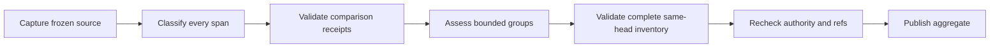
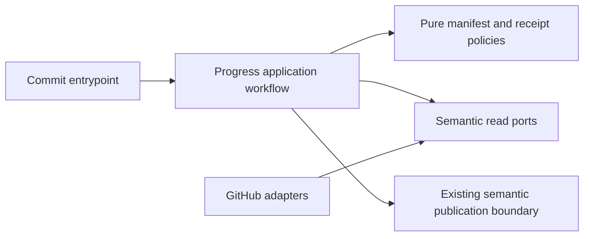

# Commit scope batches and same-head evidence

- Status — Draft awaiting maintainer selection
- Date — 2026-11-07
- Capability — `github-communication-experience`
- Owners — Copilot maintainers
- Scope — Complete bounded acceptance assessment and atomic eligibility for progress publication
- Related work — https://github.com/vypdev/copilot/issues/916 and https://github.com/vypdev/domus/pull/29
- Review gates — architecture, test coverage, documentation, GitHub UX and security
- Open product decisions — none proposed. Maintainer selection is required before Action publication.

## 1. Executive summary

Commit evaluates complete acceptance scope in bounded batches. Every required or uncertain obligation has one validated outcome with traceable evidence from the same immutable evaluated head. Only a complete, current aggregate becomes eligible for the existing progress publication flow. Previous progress remains visible during assessment and after any completeness failure.

```text
Capture source → freeze inventory → classify bounded parts → collect comparison receipts → assess bounded requirement groups → validate every same-head outcome → recheck authority and refs → publish one aggregate
```

## 2. Problem, current behavior, and evidence

The pinned Domus issue body has SHA-256 `f5c01613456235e349179026a023ad992b3d95fc427568f27c8f7e31fbf8b2d0`. Base is `5b7bdcdee3a9e98d6669bfd34ce750ae30a8c775` and head is `2a35e2a3bcfe98b58ddf184b6e781a1f8e3745d5`. Release v3.10.8 at `8246440d6d9158f6d6b75231b081e612ed76a789` recovered 157 paths in 16 comparison parts, captured 300 human and 60 operational lines, and rejected the historical classification of 108 required-or-uncertain lines against 32 at L136. The classified count does not establish semantic uniqueness.

The released capture and full Commit rejection can be replayed without a model, using the original public comparison, immutable Git objects and an explicitly identified deterministic classification fixture. Independent consumer CI passed on that head. Domus subsequently advanced to `c64c6a75a0731b16d4b376d981acf90753f44310` and again hit the same capacity boundary with 129 classified lines. Keep this later observation separate from the pinned replay.

Existing scope, comparison recovery, response validation and freshness logic live in `src/application/usecases/actions/progress_analysis_workflow.ts`, `src/application/usecases/actions/check_progress_workflow.ts` and `src/application/policies/progress_scope_policy.ts`. This prospective contract extends that behavior. Historical motivations beyond the documented finite response envelopes remain unverified.

## 3. Actors, surfaces, and terminology

Maintainers inspect the issue, PR, progress card, Check and Job Summary. Commit owns an invocation-local attempt. The host owns source spans, requirement IDs, assignment, budgets and publication eligibility. The model supplies classified observations and requirement outcomes through strict schemas. An evidence receipt is a validated reference to admitted immutable comparison content, with its evaluated head and source identity. A missing implementation is an assessable outcome when cited evidence supports that finding. A missing evidence receipt leaves assessment incomplete.

## 4. Goals, non-goals, and fixed invariants

| Requirement | Behavior |
|---|---|
| SDD-I916-R1 | Account for every captured human source span exactly once while preserving operational configuration separation and selected published SDD reconciliation. |
| SDD-I916-R2 | Allocate host-owned requirement and exclusion identities from frozen source provenance, stable across batch sizes, order and retries. Preserve original qualifiers, case links and issue or verified SDD references. |
| SDD-I916-R3 | Bind every scope manifest, assignment and receipt to the repository, issue snapshot, owning PR when present, pinned base, evaluated head and verified SDD authority. |
| SDD-I916-R4 | Use bounded classification, comparison and assessment batches with explicit per-attempt resource accounting and preflight. |
| SDD-I916-R5 | Accept exactly one compatible outcome for every required or uncertain ID and traceable evidence admitted for the same evaluated head. Reject absent, foreign, conflicting or wrong-head evidence. |
| SDD-I916-R6 | Reduce only a complete receipt inventory deterministically. Preserve source references and produce one bounded aggregate. Uncertainty cannot produce completion. |
| SDD-I916-R7 | Recheck full issue snapshot, selected SDD authority, PR ownership, base and head before the existing progress write boundary. Incomplete or stale attempts make zero publication attempts. |
| SDD-I916-R8 | Use an idempotent identity derived from frozen publication inputs. Duplicate compatible deliveries and repeated current attempts converge on the same semantic publication. |
| SDD-I916-R9 | Present safe batch coverage and an actionable retained-state diagnostic in Checks and the Job Summary without publishing partial percentages. |
| SDD-I916-R10 | Replay pinned Domus through Commit and preserve ordinary one-batch, approved-seed, configuration and independent review gates. Update specifications, catalog evidence and operator documentation together. |

Implementation acceptance excludes merge or release authorization. Independent CI and review retain their existing roles. Configuration cannot weaken same-head evidence, completeness or freshness checks.

## 5. Current versus proposed product journey

| Stage | Current behavior | Proposed behavior | Visible effect |
|---|---|---|---|
| Scope | One classification and at most 32 selected clauses | Complete source coverage followed by bounded assessment assignments | Legitimate larger scope can continue |
| Evidence | Complete immutable comparison recovery | Retain complete recovery and bind requirement citations to accepted receipts | Each outcome identifies its evidence head |
| Publication | One completed assessment with freshness checks | Complete aggregate and authority checks before the existing boundary | Previous progress persists throughout incomplete work |



The sequence captures all source, validates all evidence, assesses every obligation, verifies completeness and freshness, and then permits one aggregate publication.

## 6. Functional behavior and state model

The application freezes repository identity, full issue body digest, PR ownership, base and evaluated head before querying the agent. It uses the existing configuration exclusion and verified draft publication policies. Stable IDs identify original physical source spans within that frozen source, including the canonical selected SDD obligation and retained aliases. Classification order cannot allocate IDs.

Classification assigns every host span once. Required and uncertain entries remain obligations. Exclusions and context retain their ownership. The complete manifest retains source quotes, qualifiers, case provenance and publication authority. Assignment plans contain at most 32 obligations per assessment request. Source classification may use different bounded groups without renumbering obligations.

Comparison facts retain their native source or unit identities and pinned head. Requirement outcomes cite admitted evidence receipts. Supported outcomes require implementation evidence from regular source content. Generated metadata alone cannot establish implementation or test execution. Missing or uncertain outcomes require a traceable observation or complete-inventory absence justification bound to the evaluated head. A model echoing the requested SHA without an admitted evidence reference is insufficient.

The host rejects missing IDs, foreign assignments, incompatible duplicates, missing source coverage and unverified references. Compatible duplicate delivery is idempotent. Aggregate order follows the frozen manifest. Preserve ordinary one-batch assessment behavior, including existing progress scoring and completion validation. For multiple batches, aggregate each validated batch percentage weighted by its obligation count, while requiring all obligations and preserving the completion invariant. Batch order and duplicate delivery cannot change that aggregate. Different batch sizes preserve source and evidence identities.

| State | Meaning | Next transition |
|---|---|---|
| Captured | Frozen source and comparison identities are known | Plan bounded assignments |
| Assessing | Some validated receipts exist and previous progress remains | Continue within budget |
| Complete | Every obligation has a compatible same-head outcome | Recheck freshness |
| Retained | Evidence, authority, freshness or capacity failed | Diagnose and start a fresh complete attempt |
| Published | Complete current aggregate passed the existing boundary | Normal semantic reconciliation |

Cancellation discards invocation-local partial receipts. A later attempt reconstructs the complete frozen inventory. No partial state is promoted to a percentage.

## 7. User-facing configuration

No new Action input, secret, permission, repository switch or operator-selected ref is introduced. Existing agent and locale settings keep their documented precedence and validation. The protocol snapshots its fixed profile per attempt.

| Resource | Fixed bound | Scope |
|---|---:|---|
| Captured nonempty source lines | 1024 | Existing capture boundary |
| Unicode points per source line | 1200 | Existing capture boundary |
| Source lines per classification assignment | 32 | At most 32 classification requests |
| Requirements in the aggregate | 256 | At most 8 assessment assignments |
| Exclusions in the aggregate | 256 | Separate retained inventory |
| Obligations per assessment assignment | 32 | Existing per-assessment clause envelope |
| Scope manifest UTF-8 bytes | 262144 | Complete attempt |
| Acceptance scope UTF-8 bytes per request | 64000 | Existing request envelope |
| Comparison parts | 64 | Existing framed comparison bound |
| Comparison aggregate bytes | 384000 | Existing bound, further constrained by native prompt preflight |
| Agent calls including repairs | 120 | Complete attempt |
| Repair per assigned request | 1 | Existing repair categories only |
| Native prompt bytes | 524288 | Existing envelope including schema and framing |
| Attempt elapsed milliseconds | 1800000 | Fail before the next request or publication |
| Published summary Unicode points | 8000 | Existing field bound with compact source references for larger aggregates |
| Published remaining Unicode points | 8000 | Existing field bound |

These are proposed fixed ceilings. Implementation records measured Domus usage and tests every boundary. Byte and deadline accounting includes retries. An exhausted bound retains prior progress. Operators use the default bounded flow. A larger legitimate scope requires a reviewed future profile. Unchanged incomplete attempts cannot opt out of evidence validation.

## 8. Clean Architecture design

Pure policies own manifest identities, assignment, receipt validation, capacity accounting and deterministic reduction. Application workflows orchestrate existing issue, comparison, agent and publication ports. Provider adapters retain immutable content recovery and native PR ownership. Composition binds repository identity and capabilities. Existing entrypoints continue to invoke Commit and CheckProgress. Presentation renders safe counts, compact source references and recovery actions separately from mutation decisions.



The entrypoint delegates orchestration to the application, which uses pure decisions and semantic ports, then exposes a validated aggregate to presentation. Domain and application code cannot import concrete GitHub SDKs or subprocess execution. Repository architecture checks, TypeScript and deterministic application tests enforce these boundaries. Receipts are invocation-local. Existing semantic publication identity and freshness fences own durable convergence. A stale competing attempt cannot acquire publication eligibility from another attempt's receipts.

## 9. UI/UX and content contract

The primary view states retained or verified progress first, then the next action and links. Batch counts remain supplemental diagnostic state. During processing show “Checking all acceptance requirements. Previous progress remains available.” A retained example is “Progress retained. Verified 2 of 3 batches. R17 has no evidence for the evaluated head. Inspect this run and retry after resolving the missing evidence.” A completed example is “Acceptance assessment completed for this head. Verified all 4 batches and 108 requirement outcomes.” These are representative fixture counts, not claims about the pinned historical classification.

After a partial provider write, report the completed operation and the failed synchronization separately. Reconcile the same semantic publication instead of claiming rollback of a successful label write. Keep one existing progress card, with no comment per batch. Existing locale resolution supports English and Spanish with the existing fallback. Use textual state labels, descriptive run and comparison links, readable narrow layouts and plain text diagnostics. Source prose, mentions, Markdown markers, commands and URLs remain untrusted and pass existing publication sanitization.

## 10. Failure, recovery, and cleanup

| Failure | Effect | Recovery | Retained state |
|---|---|---|---|
| Missing or wrong-head receipt | Zero progress publication attempts | Resolve evidence and rerun a complete attempt | Existing progress and labels |
| Omitted, foreign or conflicting ID | Reject complete aggregate | Inspect assignment and response contract | Existing progress and labels |
| Issue, SDD, PR, base or head moves | Reject stale attempt | Assess a fresh pinned source | Existing progress and labels |
| Resource or time bound exhausted | Stop within the fixed profile | Inspect counts and reviewed capacity | Existing progress and labels |
| Transient provider failure | Preserve provider classification | Existing bounded repair or fresh retry | Existing progress and labels |
| Publication synchronization fails after a write | Report partial success accurately | Existing idempotent reconciliation | Completed write and its verified identity |

Temporary source and receipts expire with the attempt. Cleanup preserves source changes and necessary verification evidence. No model output, partial percentage or unverified snapshot is durable progress authority.

## 11. Security, permissions, and privacy

Keep existing least-privilege read and progress mutation ports. Agent requests remain read-only and operate exclusively on supplied immutable evidence. Bind receipts to repository, issue and PR identities to reject cross-repository replay. Validate evidence references against the host inventory, not model claims. No workspace inspection, arbitrary URL fetch, secret logging or provider output dumping is introduced. Diagnostics contain bounded host-owned IDs and counts. Forged provenance, stale deliveries and prompt injection cannot grant publication authority.

## 12. Observability and operational UX

Checks and the Job Summary identify phase, verified and expected batches, requirement coverage, evaluated head, failing assignment and safe missing IDs. The run and native comparison provide navigation. Log resource usage and the aggregate publication identity without raw model responses. Waiting for evidence retains existing progress and has no partial percentage. Preserve genuine authentication, rate-limit and transport errors. The 120-call attempt budget covers retries and existing one-repair categories. No notifications are emitted for individual batches.

## 13. Compatibility, migration, rollout, and rollback

Ordinary one-batch behavior retains its normal entrypoints, percentage interpretation, native evidence recovery, locale and completion rules, with the same-head receipt validation added at publication eligibility. Preserve #828 operational configuration separation and #910 selected published draft authority. Legacy persisted progress remains visible until a complete fresh assessment succeeds. No issue configuration schema migration is needed because receipts are invocation-local. Roll out through the reviewed PR and existing maintainer release process. Rollback restores the previous evaluator and its finite limits while preserving existing progress cards and labels.

## 14. Testing strategy and numeric budget

At least 20 distinct deterministic cases are required. Parameterized variants count only for different observable behavior. Existing repository thresholds remain in force and all added pure-policy branches require coverage. The changed patch targets full coverage. Use frozen clocks, immutable IDs and agent fakes. CI does not depend on live GitHub or model calls. Inspect representative English and Spanish retained and completed views manually and record that review.

| Area | Minimum distinct cases | Behaviors/risks covered |
|---|---:|---|
| Inventory and identity | 5 | Complete span coverage, provenance, stable IDs, uncertainty and exclusions |
| Batching and schema | 5 | Multiple groups, reordering, retries, response shape and bounds |
| Evidence and publication | 6 | Same-head coverage, omitted and foreign receipts, conflicts, stale refs and zero writes |
| Replay and compatibility | 4 | Pinned Domus, single batch, verified seed and diagnostics |
| Total | 20 | Distinct cases with requirement links |

| Case ID | Area | Requirements | Scenario |
|---|---|---|---|
| CommitScope916-C01 | Inventory and identity | SDD-I916-R1 | Every human span has one checked classification and operational spans stay excluded. |
| CommitScope916-C02 | Inventory and identity | SDD-I916-R2 | Changing assignment size or order preserves frozen source IDs. |
| CommitScope916-C03 | Inventory and identity | SDD-I916-R2 | A unique published SDD obligation retains its source and case references. |
| CommitScope916-C04 | Inventory and identity | SDD-I916-R1 | Uncertain scope remains an assessed obligation. |
| CommitScope916-C05 | Inventory and identity | SDD-I916-R1 | Exclusions keep their source without becoming implementation requirements. |
| CommitScope916-C06 | Batching and schema | SDD-I916-R4 | At least 33 genuinely distinct obligations complete in multiple bounded groups. |
| CommitScope916-C07 | Batching and schema | SDD-I916-R6 | Reordered assignment delivery produces the same ordered aggregate. |
| CommitScope916-C08 | Batching and schema | SDD-I916-R8 | Compatible duplicate receipts preserve the same aggregate and publication identity. |
| CommitScope916-C09 | Batching and schema | SDD-I916-R5 | Invalid remaining or requirement response fields reject the whole attempt. |
| CommitScope916-C10 | Batching and schema | SDD-I916-R4 | Aggregate, request, call and elapsed budgets reject safely at their boundaries. |
| CommitScope916-C11 | Evidence and publication | SDD-I916-R3, SDD-I916-R5 | Every accepted requirement evidence reference resolves to the evaluated immutable head. |
| CommitScope916-C12 | Evidence and publication | SDD-I916-R5, SDD-I916-R7 | Missing requirement or evidence receipt produces zero publication attempts. |
| CommitScope916-C13 | Evidence and publication | SDD-I916-R3, SDD-I916-R5 | Wrong SHA, repository, issue, PR, manifest or assignment identity produces zero writes. |
| CommitScope916-C14 | Evidence and publication | SDD-I916-R5 | Conflicting duplicate outcomes reject the aggregate before any publication attempt. |
| CommitScope916-C15 | Evidence and publication | SDD-I916-R7 | Changed issue, SDD authority, PR ownership, base or head retains prior progress. |
| CommitScope916-C16 | Evidence and publication | SDD-I916-R7, SDD-I916-R8 | A stale competing attempt cannot reuse receipts or publish progress. |
| CommitScope916-C17 | Replay and compatibility | SDD-I916-R10 | The pinned Domus comparison and original body reproduce legacy rejection and candidate complete same-head validation through Commit. |
| CommitScope916-C18 | Replay and compatibility | SDD-I916-R10 | Ordinary one-batch and configuration separation remain supported. |
| CommitScope916-C19 | Replay and compatibility | SDD-I916-R1, SDD-I916-R10 | Selected published seed deduplicates scope while unselected or mismatched authority retains state. |
| CommitScope916-C20 | Replay and compatibility | SDD-I916-R9, SDD-I916-R10 | Safe retained-state counts, missing IDs and localized views appear in Checks and Job Summary without partial progress. |

## 15. Documentation and discoverability

Update the owning scope and capacity SDDs with the new contract and evidence. Update Commit behavior and troubleshooting with the normal batch journey, fixed profile, same-head gate, complete retry behavior and safe diagnostics. Existing setup and credential requirements remain applicable. Explain rollback and one-batch compatibility. Validate links, specifications, generated catalog and build artifacts with the repository tooling.

| Path | Change |
|---|---|
| specs/batched-progress-scope.md | create |
| specs/progress-scope-source-ownership.md | update |
| specs/progress-capacity-diagnostics.md | update |
| specs/catalog.json | update |
| specs/CATALOG.md | update |
| docs/issues/branch-management.mdx | update |
| docs/security-operations/operations/troubleshooting.mdx | update |
| docs/security-operations/operations/error-reference.mdx | update |
| src/application/usecases/actions/progress_analysis_workflow.ts | reference |
| src/application/usecases/actions/check_progress_workflow.ts | reference |
| src/application/policies/progress_scope_policy.ts | reference |

## 16. Acceptance scenarios

Given the pinned Domus body and complete comparison, deterministic Commit replay records the legacy failure separately and allows the candidate to proceed only with an accepted outcome and same-head evidence for every manifest obligation. Given 33 distinct obligations, multiple bounded assignments preserve their IDs and reduce to one validated result. Given absent or foreign evidence, incompatible duplicates, changed authority, stale refs or an exhausted budget, no progress publication is attempted. Given supported ordinary one-batch or selected published-seed input, existing entrypoints and complete freshness controls remain supported. Given a failed larger attempt, the prior percentage remains visible and safe diagnostics explain its incomplete coverage.

## 17. Requirements traceability

| Requirement | Cases |
|---|---|
| SDD-I916-R1 | CommitScope916-C01, CommitScope916-C04, CommitScope916-C05, CommitScope916-C19 |
| SDD-I916-R2 | CommitScope916-C02, CommitScope916-C03 |
| SDD-I916-R3 | CommitScope916-C11, CommitScope916-C13 |
| SDD-I916-R4 | CommitScope916-C06, CommitScope916-C10 |
| SDD-I916-R5 | CommitScope916-C09, CommitScope916-C11, CommitScope916-C12, CommitScope916-C13, CommitScope916-C14 |
| SDD-I916-R6 | CommitScope916-C07 |
| SDD-I916-R7 | CommitScope916-C12, CommitScope916-C15, CommitScope916-C16 |
| SDD-I916-R8 | CommitScope916-C08, CommitScope916-C16 |
| SDD-I916-R9 | CommitScope916-C20 |
| SDD-I916-R10 | CommitScope916-C17, CommitScope916-C18, CommitScope916-C19, CommitScope916-C20 |

## 18. Implementation sequence

After maintainer selection and verified Action publication, implement pure manifest, assignment and receipt policies with deterministic tests. Integrate bounded orchestration and publication eligibility through existing application ports. Add Commit replay and race coverage. Update presentation, English and Spanish diagnostics, documentation, owning SDDs and catalog evidence. Run applicable architecture, type, specification, test, build and coverage validations. Run `graphify update .` and verify the final PR head and review checks.

## 19. Definition of Done

Every requirement has linked acceptance and test evidence. All 20 minimum cases, repository checks, changed-patch coverage and architecture constraints pass on the final implementation SHA. Domus legacy and candidate results remain distinguishable and every accepted outcome cites that candidate's evaluated head. Same-head, complete-aggregate, source authority and resource boundaries hold through Commit. Documentation, catalog and generated artifacts are synchronized. English and Spanish primary views receive human-readable review. The PR links #916 and the final SHA evidence. Maintainer review controls merge and release.

## 20. References and decisions

Primary evidence is https://github.com/vypdev/domus/actions/runs/42326869987/job/128264082043 and https://github.com/vypdev/domus/runs/128264839973. Independent CI is https://github.com/vypdev/domus/actions/runs/42326875268/job/128267393049. The implementation contract uses the existing capability and a new companion document because automated updates require canonical owner headings. Existing source ownership, immutable comparison, capacity diagnostics and selected-seed contracts remain applicable. The fixed batching profile is an engineering proposal for maintainer selection, with measured usage to be recorded during implementation.

## Actionable remaining work for #950

- Status — Proposed for implementation in #950
- Date — 2026-11-13
- Owner — Commit progress maintainers
- Review gates — source evidence, publication authority, GitHub UX and security
- Open product decisions — none

Commit already publishes a percentage, a summary and a **Next** field on its
owned progress comment. That field can combine many batch results into a
single block of prose. The [#951 assessment at `53b21735`](https://github.com/vypdev/copilot/actions/runs/43467614059/job/132030813477)
validated 111 requirement outcomes in four batches from 51 source parts. It
reported 57% after [the preceding attempt timed out](https://github.com/vypdev/copilot/actions/runs/43456814572/job/131993001742)
with no partial assessment. Use this comparison as a large regression fixture.
The displayed percentage is a progress estimate for the assessed scope.
Requirement counts describe outcomes. Neither gives a time or effort estimate.

### Behavior and ownership

| Requirement | Contract |
|---|---|
| CPR-01 | After validating the complete same-head assessment, update the existing Commit progress comment on its current canonical destination. Show the estimated percentage, short assessed head, and exact totals for supported requirements, missing implementation and requirements that still need evidence. Link the issue, the owning PR when present, and the pinned assessment. On that PR, the existing Bugbot status comment links the verified Commit assessment when its issue and PR binding is available through authorized reads. If the assessment predates the head, label the assessment's own SHA and say that it is the previous assessment. |
| CPR-02 | Project pending items from the validated requirement inventory. Group them under **Implementation still needed** and **Verification or clarification needed**. An item carries the host-owned requirement ID, a concise description of what is missing, one concrete next action, a link to the issue or verified SDD scope, and a decisive same-head evidence reference when the observation admits an exact locator. Keep conditions and exclusions from the scope. Describe unavailable evidence as a verification gap. Never infer missing implementation from a missing observation. |
| CPR-03 | Put missing implementation before evidence gaps in the preview. Within each group keep the manifest source order, honoring an explicit order from the admitted scope when present. Show up to six items, reserving one slot per nonempty group before distributing remaining slots. State the exact remaining count and link the complete inventory for this SHA and scope. Keep the full bounded list in the existing Job Summary when it fits. If needed and already supported by the host, use a deterministic artifact linked from that summary, with the native run, attempt and content digest. Only link output that the application observed as published. If the full inventory is unavailable, say so and link the run for diagnostics. A GitHub rendering or artifact failure leaves the validated assessment and existing label authority intact and reports the precise publication effect. |
| CPR-04 | Bind the estimate, counts, items and evidence links to one validated repository, issue, owning PR when present, base, head, scope digest and authorized attempt. A fresh complete result replaces the assessment in place. Duplicate, stale, canceled and incomplete attempts cannot overwrite it or change its percentage or labels. Historical cards with prose only retain that assessment until a fresh valid structured result exists. A retry uses the current authority and never guesses pending work from partial batches or an older SHA. |
| CPR-05 | At 100% show that all scoped requirements are supported and render no pending checklist. If the accepted assessment is below 100%, the card identifies the admitted open requirements and why they remain open. Use unchecked bullets as a read-only assessment, with no click-to-complete controls or new issue creation. The result never grants approval, closes the issue or changes Bugbot findings. Publish no comments per requirement. |

```text
Freeze scope and comparison → validate every requirement outcome
→ derive estimate, grouped counts and pending work → fence issue, PR and refs
→ update one existing progress card and link the complete inventory
```

The application carries validated structured outcomes through complete
reduction and passes an immutable projection to presentation. Pure policy
owns grouping, ordering, bounded preview and missing-evidence semantics.
The existing semantic publication boundary owns freshness, idempotency and
write ordering. Provider adapters own native references and observed write
results. Presentation and the model cannot write state or supply trusted
locators. Use the existing fixed assessment and publication budgets. Derive
the view without another model call or broader read/write permissions.
Carry older result payloads through the existing reader. Invalid additive
projection data cannot mint a structured assessment or silently hide items
from an otherwise valid prior card. There are no new public variables or
GitHub comments and no coupling to the verification rollout switch.

### GitHub content examples

```markdown
## Progress · 45% estimated

Assessed head 53b21735 · 11 of 24 requirements supported
8 need implementation · 5 need verification or clarification

### Implementation still needed
- R12 · Expose the validated partition count in the existing PR card.
  [Requirement](…) · [Review telemetry at the assessed SHA](…)

### Verification or clarification needed
- R19 · Run the large-review interruption case and capture its terminal state.
  [Acceptance case](…) · [Assessment run](…)

11 more pending requirements. [Full assessment](…) · [Linked pull request](…)
```

The counts and requirements are illustrative. These examples describe the
primary behavior under different outcomes.

| State | Primary content and next action |
|---|---|
| Pending or canceled | “Assessing 53b21735. Last assessment: 45% at 4b052fb5.” The active status belongs in the run/check. The retained assessment stays labeled with its own SHA. |
| Partial implementation, complete assessment | “45% estimated. Eight requirements need implementation and five need evidence.” Show the two groups and link the full list. |
| Action required | “R19 needs a successful cancellation control on this head.” Link the acceptance source and applicable run. Avoid commands or requirements inferred from untrusted text. |
| Failed or incomplete assessment | “Progress retained at 45% for 4b052fb5. Evidence for 53b21735 is incomplete. Open the run to inspect the missing batch.” Keep the existing percentage and items. |
| Complete | “100% estimated. All 24 assessed requirements are supported for 53b21735.” Link the scope and assessment. |

Use the existing locale and whole-artifact fallback, reviewed English and
Spanish examples, short stacked items and descriptive links. Use headings
and labels that convey status without color. Inspect mobile and desktop
rendering in light and dark themes. Bound and sanitize source and model text,
paths, links and provider messages. Only the application may add an
issue, SDD, Git, CI or artifact link from validated identities. Never expose
raw model output, repository excerpts or private run details in the card.

### Acceptance and test evidence

The first implementation projects validated outcomes into the Commit card
and the Job Summary. It links the pinned issue or SDD and admitted head
paths, with no invented line coordinates. GitHub Actions supplies the
attempt link. The full assessment fits the existing Job Summary, so this
stage adds no artifact producer. The PR backlink, controlled large live
replay and visual review remain separate acceptance evidence.

Minimum **13 distinct deterministic cases**, with repository-wide and
changed-module coverage gates and every branch of new pure policies. Use
pinned fixtures, controlled publication ports and semantic assertions in
addition to golden rendering.

| Requirement | Cases | Acceptance evidence |
|---|---:|---|
| CPR-01 | 2 | The 45% fixture reports correct counts with independent estimate semantics, in-place publication and a PR link that labels the assessment's own SHA. A large pinned #951 fixture preserves all 111 requirement identities from 51 source parts. |
| CPR-02 | 3 | Missing implementation and unavailable verification are grouped correctly. Evidence and source links resolve to the admitted scope and head. Forged locators, untrusted markup, excluded scope and invented actions cannot enter the view. |
| CPR-03 | 3 | Preview bounds and group representation preserve exact remaining counts. The complete view contains every pending ID exactly once, including through the bounded output route. An unavailable or failed detail publication emits no unverified link and retains accurate write status. |
| CPR-04 | 3 | Duplicate delivery edits at most the owned card. Supersession, cancellation and incomplete evidence preserve the prior estimate and items. Legacy prose survives until a complete current assessment replaces it. |
| CPR-05 | 2 | At 100% no pending item is shown and closure/approval authority is unchanged. English and Spanish incomplete views expose a textual actionable list, with no interactive completion controls or added comments. |

Implement typed projection first, then add deterministic rendering and link
validation, same-head publication tests, and the large comparison replay.
Update `docs/issues/branch-management.mdx` with the progress estimate and
pending-work examples and the troubleshooting path. Run specification,
documentation, architecture, workflow, full test, coverage, bundle and
Graphify checks. Record manual rendering and the pinned #951 replay in the
PR before declaring the change complete. Production verification remains
subject to the separate #950 qualification and activation decision.
