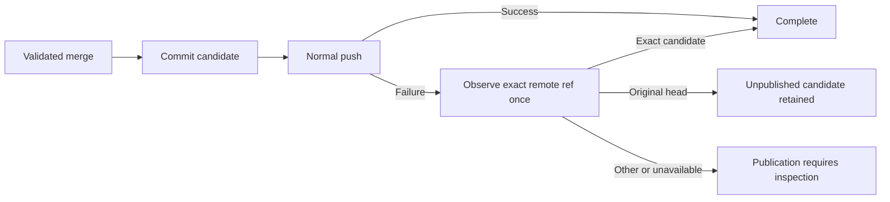

# Branch synchronization publication recovery

- Status: Implemented candidate; remote merge acceptance pending
- Date: 2026-11-03
- Catalog capability ID: `branch-synchronization`
- Last verified: 2026-11-03, local source/tests/document review; remote gates remain independent
- Owners: Copilot maintainers
- Scope: Workflow-write denial guidance and truthful recovery after committing a
  branch synchronization candidate.
- Related issue: [#844](https://github.com/vypdev/copilot/issues/844)
- Review gates: UX, architecture, security, testing, documentation, complete
  automated review and 100% modified-line coverage
- Open decisions blocking readiness: none; acceptance execution remains pending.

## 1. Executive summary

A completed local merge is no longer an abortable in-progress merge. After a
push failure, Copilot MUST preserve that candidate, observe the requested remote
head through the trusted Git port, and report what it can actually verify.
An explicit workflow-write rejection MUST identify the maintainer's credential
recovery instead of suggesting an unchanged automatic retry. No permission,
branch ownership, verification or publication guard is weakened.

```text
Authorize -> prepare/verify -> recheck heads -> commit candidate -> normal push
                                              success -> completion
                                              failure -> bounded remote read
                                              -> unpublished / published / unknown
```

## 2. Problem, current behavior and evidence

### 2.1 Problem

The reported consumer sync commits its merge, receives GitHub's workflow-scope
rejection, then tries `git merge --abort`. Git reports absent MERGE_HEAD. The
reply is generic retryable `workflow.failed`, hiding the required capability
and distinction between an unchanged remote and committed local candidate.

### 2.2 Observed baseline

At `c1d593dc`, `BranchSyncWorkspaceAdapter.commitAndPush` clears its in-progress
flag only after push succeeds. `GitCommitAdapter` does not capture push stderr
as a typed safe diagnostic. `SyncBranchUseCase` attempts abort for every thrown
failure and unconditionally says no push completed. A lost acknowledgment can
therefore also produce an unsupported publication claim.

### 2.3 Evidence and limits

[#844](https://github.com/vypdev/copilot/issues/844) and both original comments
identify consumer run `41297433053`, job `124821122631`, original child
`695e5c31a466b8a42c8840c46f708141979b35e4`, parent
`a97294385798b31e98c200e7ed93e355ffc7c9a7` and candidate `39f69a7`.
A later independently authorized consumer reconciliation did not fix the SDK.
It grants no exceptional branch-management authority to this implementation.

The local baseline uses actual SDK source/use case and real temporary Git
repositories. A local server hook reproduces the denial message shape. All six
controls pass: original remote, separate dirty user checkout, committed
candidate, exact candidate parents, no force push and no fixer. Four desired
behaviors fail: specific authorization error, nonretryable guidance, structured
recovery and absence of postcommit abort. This is Git/transport evidence, not
real GitHub credential validation or consumer execution. The versioned
[controlled before/after proof](../quality/branch-sync/evidence/issue-844.json)
records those boundaries and binds the after observation to source hashes;
[real Git regression cases](../src/tooling/__tests__/branch_sync_publication_integration.test.ts)
exercise denial, unrelated rejection, lost acknowledgement and unavailable
remote observation.

Primary provider contracts: [OAuth scopes](https://docs.github.com/en/apps/oauth-apps/building-oauth-apps/scopes-for-oauth-apps)
and [fine-grained permissions](https://docs.github.com/en/rest/authentication/permissions-required-for-fine-grained-personal-access-tokens).
GitHub documents a same-path/content-on-another-branch exception to the classic
workflow scope. Workflow path presence alone is not denial proof.

### 2.4 Retrospective classification

Not applicable: the owning implemented SDD remains the baseline; this companion
specifies a correction with independently captured before/after evidence.

## 3. Actors, surfaces and terminology

| Actor | Goal | Surface |
|---|---|---|
| Maintainer | Synchronize through the admitted command | Issue/PR reply, run |
| Credential owner | Correct a proven publication capability problem | Existing credential/setup configuration |
| SDK | Preserve candidate and truthful source facts | Semantic result, logs, API |

**Candidate** is the committed local merge. **Published** means the normal push
succeeded or the requested remote ref independently equals that exact candidate.
**Unchanged** is a successful native remote observation equal to the prepared
original child. **Changed** means another observed head, without claiming its
ancestry. **Unverified** means insufficient identity/read evidence. Runner-local
retention is temporary, not a durable backup or a remote commit link.

## 4. Requirements, non-goals and invariants

| Requirement | Contract |
|---|---|
| BSP-R1 | Capture only a bounded trusted-push stderr suffix; classify explicit workflow-write denial without exposing raw text. |
| BSP-R2 | Mark successful commit before later reads/push; never abort or reset that committed candidate during recovery. |
| BSP-R3 | Perform one bounded remote-head observation after failure; missing facts never establish non-publication. |
| BSP-R4 | Recognize a remotely confirmed exact candidate without a second push; bind publication facts to the prepared child. |
| BSP-R5 | Publish nonretryable localized workflow guidance or truthful unknown-publication recovery; preserve authorization and managed-branch ownership. |
| BSP-R6 | Keep docs, catalog, source, bundles and meaningful before/after regression evidence aligned. |

Non-goals: automatic permission grants/token refresh, new credential inputs,
force push/rebase/reset of user work, remote branch creation/deletion, bypassing
GitHub enforcement, durable candidate artifacts, or consumer-specific recovery.

## 5. Product journey

| Stage | Before | Corrected behavior |
|---|---|---|
| Prepare/verify | Existing safety gates | Unchanged |
| Commit | Flag still says merging | Candidate becomes committed immediately |
| Push rejection | Opaque process error | Bounded safe reason and remote observation |
| Recovery | Invalid merge abort | Preserve committed state; no second push |
| Operator | Generic retry | Capability action or explicit publication uncertainty |



Text equivalent: commit ends the abortable phase; a failed push triggers one
read, which either proves original head, confirms the candidate, or preserves
uncertainty. No recovery push, reset or credential expansion occurs.

## 6. Functional state model

1. Retain existing command authorization, ref validation, sensitive conflict
   limits, credential-free verification and immediate remote-head comparison.
2. Before commit, normal abort/restoration remains applicable under existing
   ownership and unchanged-head/merge-parent guards.
3. Once commit returns successfully, clear abortable state before reading its
   identity or attempting push. A missing/invalid identity stops publication.
4. Push uses the same existing ref and credential confinement. Its adapter
   captures at most 8,192 bytes of stderr suffix; raw error text, stdout and
   workflow path presence cannot independently establish workflow capability.
5. On failure, fetch only the existing working ref and read FETCH_HEAD. Sanitize
   object IDs to canonical nonzero 40/64-character hex or `unavailable`.
6. Return immutable closed facts: reason, remote state, original/candidate/
   observed IDs and whether push was attempted. Do not store token or stderr.
7. Exact remote candidate confirmation is successful reconciliation, explicitly
   worded as verification after a failed response. Original-head binding MUST
   match this preparation; inconsistent/replayed facts cannot claim success.
8. All other postcommit outcomes fail without automatic retry. Preserve the
   candidate locally and say the runner may discard it later. Never link an
   unpublished candidate as if it existed on GitHub.

| State | Meaning | Next action |
|---|---|---|
| Preparing/verifying | No synchronization commit yet | Existing verification or safe abort |
| Candidate committed | Merge cannot be aborted | Normal push / identity inspection |
| Push accepted | Normal remote publication completed | Existing completion/observer |
| Candidate confirmed remotely | Failed response, exact candidate read | Completion, no duplicate push |
| Workflow denied | Remote reported missing workflow-write capability | Maintainer reviews credential and current ref |
| Original head observed | Candidate not observed on remote | Fix actual cause before fresh managed sync |
| Other/unavailable head | Publication not established | Inspect native ref; no blind retry |

## 7. Configuration

No new public setting, permission, state schema or retry switch. Recommended:
keep the managed command and configure an eligible repository publisher through
existing credential/setup ownership. Alternative: existing dry-run or no-agent
modes retain their meanings; neither adds credential authority.

The 8 KiB diagnostic suffix, closed reason/state enums, canonical identity
validation, one postfailure remote read, no automatic retry/grant/force push,
and preservation of user work are fixed. Classic OAuth/PAT workflow scope and
fine-grained/App workflow-write capability are credential-family-specific;
never infer them solely from a token prefix or changed workflow path.

## 8. Clean Architecture

| Layer | Responsibility | Forbidden dependency |
|---|---|---|
| Domain | Closed push/publication facts and validation | GitHub SDK, process, filesystem |
| Infrastructure | Bounded stderr, trusted Git operations, merge phase and remote observation | Presentation text or permission grants |
| Application | Reconcile facts with preparation, choose outcome and semantic recovery | Raw stderr/provider DTOs |
| Presentation | Complete localized impact/action/retained-state text | Mutation or remote-state inference |
| Composition | Existing repository/token binding | New broad credentials or copied orchestration |

```text
Authorized command -> sync use case -> workspace semantic port
                           |              <- Git workspace adapter
                           |                   -> trusted Git port/adapter
                           -> validated domain facts -> localized presentation
```

State is invocation-local. Existing ports remain narrow; typed postcommit
failures extend their behavioral contract. They are not permission to publish.
Architecture/import/port tests enforce boundaries. Real Git fixtures belong in
tooling test support, outside production application/domain paths.

## 9. UI/UX contract

Reuse existing correlated replies, summary/check and CLI/API semantic errors.
No extra comment per stderr chunk or retry. SHA values are technical details;
primary text answers status, cause, action and retained state in that order.

| State | Representative primary content |
|---|---|
| Pending | “Branch synchronization is preparing the merge. No action required.” |
| Verification failed | Existing verified restoration and command-stage guidance |
| Workflow denied | “The remote rejected workflow-file publication. A maintainer must review the publisher credential before rerunning the managed command.” |
| Unpublished | “The remote still points to the original head. The local candidate was retained.” |
| Unknown | “The remote head could not be established; publication remains unknown. Inspect it before retrying.” |
| Confirmed | “The merge candidate was independently confirmed remotely after a failed push response. No second push was attempted.” |

Both English and Spanish MUST render complete outcomes without untranslated
placeholders. Preserve default/fallback locale and correlation reference.
Use one fixed recovery-guide link inserted after localization; no provider text
can inject links, commands, mentions or capability instructions. Existing
text/headings support mobile, light/dark and screen-reader reading; no new
browser/VoiceOver UI journey is introduced.

## 10. Failure, recovery and cleanup

| Failure | Verified effects | Recovery |
|---|---|---|
| Precommit verification/conflict | No synchronization commit/push; restoration as observed | Existing guarded abort |
| Candidate identity read | Commit command completed; no push attempted | Preserve local candidate; inspect identity |
| Explicit workflow denial | Committed candidate plus independently observed remote state | Review eligible credential, then fresh managed sync |
| Other push failure | Publication may have happened | One read; exact candidate completes, other/missing evidence requires inspection |
| Postfailure read fails | No authoritative remote state | Unknown, not “unchanged” |
| Foreign/forged facts | No valid scoped completion | Provider-contract failure; no fabricated publication |

No reset or abort after commit. No force push or automatic credential change.
Candidate IDs aid diagnosis but are not durable backup promises. A fresh
command starts from current authoritative refs; repeating unchanged missing
capability is not recovery. Product source/runtime/approval/coverage gates are
independent of transport recovery.

## 11. Security and privacy

Capture belongs only to trusted push execution. Keep raw stderr/exception text,
URLs, paths, tokens and headers out of recovery variables and logs generated by
this feature. Denial text is a reported cause, not instruction authority.
Existing credentials are confined to trusted fetch/push, never fixer or
verification. No scope probing by publishing workflow files, no other-branch
workaround, no new tools/permissions and no automatic private-source artifact.

## 12. Observability

Keep existing correlation/run links. Expose only fixed stage/reason/state,
canonical IDs and push-attempt fact. Reconcile source facts independently of
model wording. Distinguish committed local effect, publication observation and
remote completion. Old raw logs remain original incident evidence, not proof of
current remote state. No progress notifications or comment amplification.

## 13. Compatibility and rollout

Normal success, aligned/dry-run, no-agent, verification and catalog paths retain
existing behavior. Add one explicit verified-after-failed-response outcome and
two closed recovery descriptors; no stored operation migration or public input.
Custom workspace implementations must report postcommit outcomes through the
semantic contract; untyped failure cannot claim a known non-publication.
Rollback restores code/presentation together and cannot undo a published merge.

## 14. Numeric test budget

Minimum **48 distinct new cases**, each counted once; derive cases from the
following risks rather than adding implementation-mirroring assertions.

| Area | Minimum | Risks |
|---|---:|---|
| Pure facts/validation | 12 | States, nonzero SHA boundaries, inconsistent/forged data |
| Capture/classification | 8 | Native variants, chunks/tail bound, unrelated errors, secrecy |
| Workspace transitions | 12 | Before/after commit, identity failure, independent observations, no reset/abort/retry |
| Use-case reconciliation | 6 | Original binding, confirmed publication, unknown state, generic compatibility |
| Localized presentation | 6 | EN/ES impact/action/retention, fixed links, no placeholders/secrets |
| Real Git integration | 4 | Server denial, preserved remote/user tree, committed identity, lost response without duplicate publication |
| **Total** | **48** | Existing command, credential, catalog and verification contracts remain mandatory |

Require 100% changed coverable lines with zero misses/partials in official
Codecov against the correct current base, 100% new pure-policy metrics and
existing repository budgets. Use deterministic clocks/IDs/fakes plus real local
Git; no real credential, permission grant, provider write or consumer execution
in tests. Full Linux/macOS/Windows, complete review and package/docs/spec checks
remain merge prerequisites. No human browser acceptance required for this fix.

### Local acceptance evidence (2026-11-03)

The current candidate passes **878 Jest suites / 17,071 tests**, with 35 existing
skips. It adds **105 distinct cases**: 49 facts/validation, 16 capture,
13 workspace, 9 reconciliation, 14 localized presentation and 4 real Git.
The four new pure modules measure 100% lines, statements, functions and branches
(45 lines / 58 branches), enforced by a dedicated exhaustive budget.
Full-suite LCOV measures **114/114 modified coverable lines**, zero misses or
partials against `c1d593dc`. Extension regression tests remain 267/267 with all
coverage metrics at 100%. These are local results, not official Codecov or
remote/native-platform acceptance. The PR must separately verify its current
head and live base before merge; the historical incident is not relabeled as
execution by this runtime.

## 15. Documentation

Update branch-synchronization and troubleshooting docs with normal success,
workflow-write denial, temporary candidate retention, other/unavailable heads,
credential-family guidance and managed recovery. Explain that a job permission
setting does not expand a separately configured PAT scope. Preserve observer,
no-agent/dry-run and approval documentation. Link the companion from the owning
SDD/catalog; validate navigation, documentation, schemas and generated catalog.

## 16. Acceptance

1. The original-shaped local server denial yields nonretryable authorization
   guidance, original remote observation and retained candidate, with no abort.
2. A lost push response followed by the exact remote candidate yields explicit
   verified completion with one push only.
3. A different/unavailable remote head yields truthful uncertainty; no retry,
   reset, abort, source loss or invented publication occurs.
4. Candidate identity failure never pushes; precommit failure still uses normal
   guarded restoration. Separate dirty user work remains untouched.
5. Known workflow-denial variants classify only from bounded push stderr;
   unrelated text/paths/exception messages do not demand scope expansion.
6. Forged/inconsistent/scoped-to-another-child facts cannot report success or
   disclose untrusted recovery operands. EN/ES views retain all verified facts.

## 17. Traceability

| Requirement | Owner | Evidence | Docs |
|---|---|---|---|
| BSP-R1 | Git push diagnostic/adapter | Chunk/classification/security tests | Troubleshooting |
| BSP-R2 | Workspace phase ownership | Real Git and commit-boundary tests | Synchronization |
| BSP-R3 | Remote observation/fact validation | Four-state/failed-read tests | Both pages |
| BSP-R4 | Use-case reconciliation | Exact candidate and original-binding tests | Synchronization |
| BSP-R5 | Semantic recovery/presentation | Descriptor, locale, link and secrecy tests | Troubleshooting |
| BSP-R6 | Catalog/SDDs/bundles | Validators, before/after proof, native gates | This companion |

## 18. Implementation order

Freeze meaningful baseline, define closed facts and bounded capture, correct
merge phase, reconcile remote observations, wire semantic/localized recovery,
add real Git/race/security tests, update docs/catalog, build bundles, validate
full coverage/native review, audit exact head/base and merge normally.

## 19. Definition of Done

- [ ] BSP-R1–6 and six acceptance scenarios have executable evidence.
- [ ] Minimum test distribution and strict changed-line/pure-policy coverage pass.
- [ ] Architecture, phase ownership, secrecy and no new authority are enforced.
- [ ] All primary states, EN/ES content and temporary retention are accurate.
- [ ] Docs, catalog, bundles, Graphify and required validators pass.
- [ ] Current-head CI/three-platform checks and complete finding-free review pass;
      official Codecov verifies every modified line before merge.

## 20. References and decisions

- [Owning branch-sync SDD](./branch-synchronization-and-conflict-recovery.md).
- [Verification/setup contract](./repository-verification-setup-hooks.md).
- Decision: act on observed denial; do not infer capability from paths or token
  prefixes, automatically grant permission, reset committed work or conflate
  missing remote evidence with non-publication.
- Follow-up: durable candidate export or richer provider capability introspection
  needs its own reviewed ownership, privacy and permission contract.
