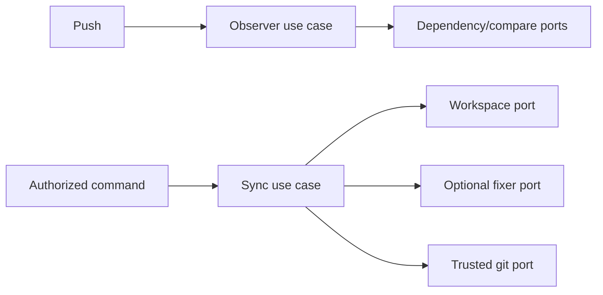

# Branch Synchronization and Conflict Recovery

- Status: Implemented
- Date: 2026-09-11
- Last verified: 2026-10-13
- Owners: Copilot maintainers
- Scope: all-branch drift observation and authorized parent-to-working-branch synchronization
- Related issues/PRs: [PR #387](https://github.com/vypdev/copilot/pull/387), managed issue lifecycle, semantic GitHub publication, and agent runtime SDDs
- Required review gates: product UX, architecture, testing, documentation, security/operations
- Open decisions blocking readiness: none

## 1. Executive summary

A lightweight all-branch observer finds open parent→working-branch relationships,
compares them, and maintains one issue status card when a branch falls behind.
The card itself is the only initial notification. When a previously aligned
card becomes stale again, one short, source-fingerprinted action notification
links back to current status; equivalent retries remain silent.
Authorized users can dry-run or merge the parent into the working branch. Clean
merges need no agent; eligible conflicts may use the fixer inside a strict path,
Git-state, verification, credential, and remote-head boundary.

```text
push any branch -> resolve dependencies -> compare -> upsert/resolve one card
                                             -> aligned-to-stale only: notify once
authorized sync -> fetch heads -> prepare merge -> clean OR guarded fixer
                -> verify -> recheck heads -> trusted commit/push -> observer resolves card
```

## 2. Problem, current behavior, and evidence

### 2.1 Problem

Feature chains and long-running branches drift as parents advance. Running the
full issue/agent pipeline on main/develop/release pushes is expensive and noisy,
while blind automated merges can overwrite concurrent work or expose credentials.

### 2.2 Current behavior

1. `copilot_branch_sync.yml` observes every non-deletion push with no agent inputs.
2. It reads open issues/PRs with pagination and resolves dependencies first from
   durable Copilot configuration, then linked branches and PR base/head facts.
3. It compares affected relationships and upserts one bot-owned status card;
   alignment resolves the same card. The initial stale state creates no second
   comment, while a later aligned-to-stale transition creates one immutable,
   linked action notification per trusted source head.
4. `/copilot sync-branch` or a bounded mentioned phrase invokes authorization
   and resolves the conversation target.
5. `--dry-run`, `--no-agent`, and `--from` alter only documented bounded behavior.
6. Workspace preparation fetches exact remote heads and performs a no-ff merge.
7. Conflicts are eligible for fixer only at ≤20 non-sensitive conflicted paths.
8. The fixer edits conflict files without staging or Git index write authority.
   Trusted workspace code validates HEAD/merge parent, original paths, protected
   index entries and worktree markers, then stages only the original unresolved
   conflict paths before verification. It rechecks unresolved/unstaged paths and
   cached markers. Once validated, later verification-induced worktree/index
   changes are rejected rather than staged again. Staging failure aborts safely.
   When `specs/CATALOG.md` belongs to the original conflict set, the trusted
   adapter MUST validate resolved metadata and regenerate that derived index
   with the Action-bundled validator before staging and verification. A clean
   merge that already changes both catalog files receives the same canonical
   refresh before its protected index snapshot. Metadata/index input and index
   output are bounded to 10 MiB each; missing, invalid, non-regular or external
   evidence paths fail closed. The adapter MUST NOT execute repository code,
   expand the original merge paths, rewrite metadata, or refresh again after
   verification. This is fixed behavior with no configuration switch.
9. Verification, merge-state validation, and remote-head recheck precede trusted commit/push.

Live dogfooding [run 38137355386](https://github.com/vypdev/copilot/actions/runs/38137355386)
reproduced a catalog conflict whose resolved metadata retained new evidence but
whose generated index contained an incorrect path count. The verification test
rejected it and the merge aborted without a push. The canonical refresh above
addresses the derived-file resolution; metadata preservation remains the
fixer's responsibility and all merge-state and remote-head guards still apply.

### 2.3 Evidence and contract classification

- Observed behavior: branch-sync domain, policies, use cases, repositories,
  workspace/time adapters, workflow, and docs.
- Intentional contract: separate observer, durable-first discovery, sticky
  status card, transition-only notification, clean-merge fast path, conflict
  boundary, and race-safe push.
- Known debt and limitations: observation scales with open issue/PR pagination;
  relationships without durable configuration need an open PR; no live large-repo
  performance evidence is checked in.
- Unknown rationale: the original polling/GraphQL query shape is not a permanent API contract.
- Proposed improvements: indexed durable dependency storage requires a separate current-state design.

## 3. Actors, surfaces, and terminology

| Actor | Goal | Entry point | Surface |
|---|---|---|---|
| Contributor | know branch is stale | parent/child push | issue notice |
| Maintainer | align safely | comment command | result comment/commit |
| Observer workflow | compare only | all-branch push | sticky notice |
| Fixer agent | resolve eligible conflicts | guarded merge workspace | conflict paths only |

“Parent” is the branch whose commits the “working branch” must contain. A
dependency is owned by durable issue configuration when available. “Aligned”
means the comparison shows no parent commits missing from the working branch.

## 4. Goals, non-goals, and fixed invariants

### 4.1 Goals

1. Parent drift MUST become visible without invoking an agent.
2. Sync MUST never push work prepared from stale remote heads.
3. Conflict assistance MUST be path- and state-bounded.
4. Newly required human action MUST be visible without notifying on every push.

### 4.2 Non-goals

1. The observer does not run Bugbot, issue sizing, or full commit automation.
2. Sync does not rebase, force-push, auto-merge PRs, or resolve release reconciliation.
3. The fixer cannot choose branches or git operations.

### 4.3 Fixed product/safety invariants

1. Observer workflows MUST remain agent-free and all-branch.
2. Deletion pushes and invalid/same parent-child targets MUST not merge.
3. Sensitive/workflow paths and >20 conflicts MUST not use automated fixing.
4. Verification runs credential-free; only trusted fetch/push receives credentials.
5. Both remote heads MUST match preparation immediately before commit/push.
6. Only an aligned-to-stale transition with a canonical source head MAY create
   an action notification; a fingerprint replay MUST create none.

## 5. Current versus proposed product journey

| Stage | Broad/unsafe alternative | As-built contract | Effect |
|---|---|---|---|
| Observe | full commit workflow | metadata-only observer | low cost/no model |
| Notify | comment per push | one status card plus transition-only notification | current state stays visible without hiding newly required action |
| Merge | agent always | clean git merge first | deterministic |
| Conflict | unrestricted edits | exact conflict-path guard | bounded risk |
| Push | trust checkout | remote-head compare | race safety |

The implemented product change adds the transition-only notification without
changing dependency discovery, merge, authorization, or conflict safety.

## 6. Functional behavior and state model

### 6.1 Happy path

1. Observer resolves and compares an affected dependency.
2. It creates or updates a stale status card with branches and next command.
   Initial creation is the event's only notification.
3. Authorized maintainer invokes sync; clean merge is prepared and verified.
4. Remote heads remain unchanged; trusted code commits/pushes.
5. The bot-authored push runs the observer and resolves downstream/current cards.
6. If a later parent push makes an aligned card stale, the observer updates the
   card and creates one short notification linked to it.

### 6.2 Alternative paths

- Already aligned returns a no-op result.
- Dry run reports clean/conflicted, aborts, and invokes no agent.
- `--no-agent` permits clean merge and safely aborts conflict.
- `--from` overrides only the parent after ref validation.
- Eligible conflict invokes fixer, validates exact paths/state, then follows normal verify/push.

### 6.3 State model

| State | Meaning | Next | Recovery |
|---|---|---|---|
| unknown relation | no parent/working fact | observed when linked | create/link PR/config |
| aligned | no parent drift | stale | parent advances |
| stale | status card active | preparing/aligned | invoke sync/manual merge |
| preparing | exact heads/merge prepared | conflicted/verifying/aborted | wait |
| conflicted | git conflicts exist | fixing/aborted | eligible fixer/manual |
| verifying | merge state/commands checked | pushing/aborted | repair tests |
| pushing | heads revalidated | aligned/failed | inspect remote |
| aborted | no push completed | stale | retry latest |

Replays keep the same card and do not repeat a transition fingerprint.
Parent-child chains are reevaluated after bot
pushes. Any failure attempts merge abort and reports whether no push occurred.

## 7. User-facing configuration

| Input/option | Default | Allowed | Persistence |
|---|---|---|---|
| `check_branch_sync_action` | workflow-owned | exact single action | per observer run |
| `--dry-run` | false | flag | command only |
| `--no-agent` | false | flag | command only |
| `--from <branch>` | discovered parent | one validated ref | command only |
| fixer role tuple | common agent inheritance | validated provider/model/effort/command | run |
| verify commands | empty | bounded parsed commands | repository/run |

All-branch observation, no agent in observer, no-ff merge, conflict/file limits,
sensitive paths, credential isolation, remote-head validation, and no force push
are not configurable.

## 8. Clean Architecture design

| Boundary | Owns | Must not own/import |
|---|---|---|
| Domain | command options/natural-language phrase | Git/GitHub |
| Policies | dependency normalization, eligibility, outcome presentation | subprocesses |
| Use cases | observe and synchronize sequencing | provider DTOs |
| Ports | dependency query, compare, workspace, fixer, git, auth | concrete clients |
| Adapters | GraphQL pagination, Git workspace, timers | product policy |
| Workflows | event/permissions/composition inputs | agent configuration in observer |



Architecture and workflow contract tests MUST forbid agent inputs in the
observer and keep git/provider implementations outside application policy.

## 9. UI/UX and content contract

```markdown
Pending: **`feature/B` is 3 commits behind `feature/A`.** No automatic merge is running.
Action required: **Synchronize the branch.** Run `/copilot sync-branch` in issue #42.
Blocked: **2 conflicts include `.github/workflows/ci.yml`.** Automated resolution is forbidden; merge manually.
Partial: **Merge prepared, but verification failed.** Nothing was pushed; the stale card remains.
Complete: **Merged `feature/A` into `feature/B` and pushed `abc1234`.** The card is resolved.
```

One sticky issue card owns current drift and links parent, working branch,
issue/PR, and command guidance. The first stale observation creates only this
card. An aligned-to-stale transition may additionally create this default-English
message:

```markdown
Branch synchronization needs attention: `feature/B` is behind `feature/A`. [Open the current status](https://github.com/example/project/issues/42#issuecomment-8).
```

The transition message is at most 400 characters and two links, is immutable
after publication, and is deduplicated by bot ownership, dependency identity,
closed action, and canonical push head—not by its wording. Command results name
outcome, verification count, and commit SHA when present. `--dry-run` explicitly
says nothing was pushed. English is the default and fallback; the configured
issue locale supplies one complete catalog for the card, transition, and
duplicate pointer. Visual icons have text; untrusted refs, translated Markdown,
paths, and diagnostics are sanitized.

When the complete sentence with branch names exceeds its fixed 120-character
copy budget, the notification uses a complete localized compact sentence and
the same trusted status link. The status card retains both exact branch names.
Visible notification and duplicate-pointer copy never contains internal
untrusted-content truncation markers or a partially displayed branch reference.
Provider-controlled copy remains sanitized and bounded before publication; this
presentation choice adds no configuration or publication side effect.

## 10. Failure, recovery, and cleanup

| Failure | Impact | Retained facts | Retry | Action | Cleanup |
|---|---|---|---|---|---|
| relation unavailable | no comparison | issue/PR facts | yes | link PR/config | none |
| compare/provider error | card may be stale | prior card | yes | rerun observer | none |
| ineligible conflict | no push | merge aborted | after manual resolution | merge manually | abort |
| verification/state fail | no push | remote branches | yes | fix command/code | abort |
| head race | no stale push | new heads | yes | rerun | abort |
| post-push card update fails | merge exists, card stale | commit SHA | yes | rerun observer | no commit rollback |
| action-notification create fails | stale card is current but the timeline alert may be absent | updated stale card and failing result | no domain replay | open the card from the run | later stale runs remain quiet |
| exact concurrent notification duplicate | duplicate timeline item | oldest exact bot-owned notification | automatic | none | delete duplicate or compact it to a localized pointer |

## 11. Security, permissions, and privacy

Observer has read-only implicit token permissions and uses explicit PAT only for
needed GitHub reads/comment writes. Sync requires fresh actor authorization.
Branch refs, issue markers, PR content, conflict paths, fixer output, and verify
commands are untrusted and validated. Credentials are scoped to trusted
subprocesses; agent/verification environments are credential-free. Sensitive
paths, unexpected index/worktree changes, and control sequences fail closed.

## 12. Observability and operational UX

Observer logs dependency count/comparison outcomes without agent telemetry.
Sticky cards expose current stale/aligned fact. The repository-locale Job
Summary records transition topic, target, fingerprint, created/reused effect,
and bounded duplicate-compaction IDs without copying visible prose. Sync result payload includes
outcome, branches, initial SHAs, conflicts, verification count, and commit SHA.
Failures say “no push completed” when true. Workflow contracts ensure bot pushes
remain observable and downstream relationships can update.

## 13. Compatibility, cutover, rollout, and rollback

There are no installed users or production marker state to migrate. Linked
branches and PR references use the current durable dependency contract. Stale
and aligned cards use only the shared semantic publication envelope; removed,
unknown, malformed, human-authored, and third-party markers are inert and are
never adopted or rewritten. Installing or removing the observer does not change
branch history. Rollback restores one complete known-good code/schema bundle;
existing cards and immutable notifications remain ordinary GitHub comments, and
any completed merge remains an auditable commit reverted normally if necessary.

### Explicit conflict recovery

Live dogfooding on 2026-10-11 found that `--no-agent` correctly aborted the
conflicted synchronization of issue #454, but its correlated reply discarded the
known cause and gave only generic workflow recovery. Conflict eligibility MUST
retain a closed recovery descriptor for agent-disabled and fixer-unavailable
states. English and Spanish presentation MUST identify the blocker, name the
existing synchronization command or configuration action, offer dry-run
inspection, and state that no synchronization commit was pushed. The descriptor
accepts only the fixed `/copilot sync-branch` command; translated catalog prose
cannot invent a command or override conflict, sensitive-path, verification or
remote-head safeguards. Workspace validation failures MUST carry a closed diagnostic code from
`src/domain/branch_sync_validation.ts` through the adapter, use case, workflow
log and correlated English/Spanish reply. Raw reasons, path names and provider
output MUST NOT become public recovery variables. Unknown codes map to
`unclassified`; constructing a forged public descriptor is rejected. These
codes distinguish invalid catalog evidence, unstaged changes, protected paths,
merge identity, staging, whitespace and remote races. The failure still aborts
without a push. Dogfooding run 38140515377 motivated this contract because the
resolution was rejected before verification, but the published failure hid which
workspace control rejected it.

When the trusted catalog refresh rejects a resolution, the operator log MUST
identify its closed validation phase: workspace/file boundary, metadata JSON
or remaining conflict markers, metadata/evidence shape, evidence path boundary,
catalog contract, or index output. It MUST NOT include repository paths,
metadata values, validator messages, exception text, or raw provider output.
This diagnosis does not relax validation, rewrite metadata, or permit a push.
Native dogfooding runs `38173557022` and `38176196334` returned
`sdd-catalog-invalid` without identifying the failing catalog phase; the abort
then restored the worktree, so inspecting retained Git status could not recover
that information. The phase is captured by trusted validation before abort.

## 14. Testing strategy and numeric budget

| Area | Minimum cases | Risks |
|---|---:|---|
| Commands/dependency/eligibility | 24 | options, links, limits, sensitive paths |
| State/idempotency/races | 59 | card/transition replay, concurrent duplicates, chains, remote heads, abort |
| Use cases/workspace | 98 | clean/conflict/dry-run/verify/push; four existing real-Git conflict cases, two trusted-staging failures, two localized recovery routes, and five real catalog merges covering preserved evidence, invalid metadata, verification mutation and clean refresh/abort; fifteen closed/forged diagnostic cases with localized replies and no push; ten real-Git generated-bundle cases preserving vendor whitespace while rejecting source/unregistered-path whitespace, staged/unstaged markers, protected index changes and verification mutation |
| Adapters/workflow contracts | 55 | pagination, git states, all-branch/no-agent, exact captured NUL records; thirteen canonical-index cases covering stale counts/markers, checkout line endings, missing/invalid/oversized inputs, unregistered/outside evidence and external symlinks; five closed-phase security cases preserving the index and suppressing untrusted metadata, paths and parser/validator output |
| UX/localization/sanitization | 21 | cards, transition/pointers, arbitrary locale, long refs, translated controls, errors, and two complete closed recovery presentations and one complete validation-diagnostic presentation |
| Integration/security/cutover | 29 | observe→sync→resolve→stale, credentials, exact current markers, removed-marker rejection, and two forged recovery-command rejections and one forged diagnostic-descriptor rejection |
| **Total** | **286** | no double counting |

Global thresholds remain; dependency/eligibility policies SHOULD reach 95%
branch coverage. Fake git/GitHub/timers replace live services and waits. Tests
must exercise interrupted merge states and remote races. Manual evidence covers
sticky card updates, transition notifications, chained branches, PR/issue rendering, and conflict guidance.

## 15. Documentation and discoverability

| Audience | Artifact | Required content |
|---|---|---|
| Contributor | branch synchronization | card, notification lifecycle, and commands |
| Maintainer | comment commands | authority/options |
| Operator | troubleshooting/security | abort/race/credentials |
| Developer | this SDD/architecture | ports and git boundary |

## 16. Acceptance scenarios

1. Any non-deletion branch push checks only affected open dependencies with no agent.
2. An initial stale push creates one card and no second comment; identical stale
   pushes mutate nothing, while a changed comparison updates only that card.
3. Dry run reports clean/conflicted and leaves worktree/remote unchanged.
4. Clean sync verifies and pushes without fixer.
5. Unauthorized, same-branch, invalid-ref, sensitive, or >20-conflict requests do not push.
6. Eligible conflicts allow only conflict-path edits and valid merge state.
7. Verification or remote-head race aborts and reports no push.
8. Bot push triggers observer and updates dependent child relations.
9. Untrusted paths/refs/output cannot expose credentials or escape commands.
10. An aligned-to-stale transition with a canonical source head updates the card
    and creates one localized linked notification; replay creates none.
11. Concurrent exact transition notifications retain the oldest bot-owned
    comment and delete or compact later duplicates without touching other users.
12. A transition-publication failure preserves the already updated stale card,
    returns a sanitized publication failure, and does not replay branch work.
13. A long Action-created ref or verbose localized copy produces a bounded,
    complete compact notification with its trusted status link, no partial ref,
    and no internal truncation marker; maximum refs and repository identifiers
    remain within the 400-character budget.

14. An agent can resolve a real merge by editing its allowed file without
    staging. Trusted code stages that file, runs all configured verification
    commands and performs the ordinary race-checked commit/push. Remaining
    markers, outside edits, staging failure and verification mutation produce
    no commit/push. This ownership is fixed and has no opt-out configuration.

## 17. Requirements traceability

| Requirement | Owner | Evidence | Documentation |
|---|---|---|---|
| dependency discovery | policy/repository | dependency tests | detection flow |
| sticky observer and actionable transition | observe use case + shared transition workflow | observer/policy/reconciliation tests | branch sync lifecycle |
| safe merge | sync use case/workspace | sync/workspace tests | align branch |
| conflict boundary | eligibility/workspace policies | security/path tests and six trusted-staging regressions including real Git | conflict boundary |
| workflow separation | workflow validator | contract tests | why separate |

## 18. Maintenance sequence

1. Update command/dependency/eligibility policies and tests.
2. Update observer/sync use cases including replay/race cases.
3. Update GraphQL/git/time adapters and workflow checks.
4. Update cards, notifications, results, docs, and catalog.
5. Run full automated and human branch-chain UX validation.

## 19. Definition of Done

- [x] The current 286-case budget, coverage, architecture, and workflow gates pass.
- [x] Clean/conflict/dry-run/replay/race/abort paths retain correct state.
- [x] Agent, verify, and credentials remain in separate trust boundaries.
- [x] Card/transition states, links, localization, accessibility, and noise budgets pass.
- [x] Documentation and catalog evidence are current.
- [x] Repository PR checks exercise the observer and publication behavior; live
      conflict resolution remains covered by the established fake-workspace suite.

## 20. References and decisions

- Primary sources: catalogued branch-sync code, workflows, tests, and docs.
- Related SDDs: managed issue lifecycle; comment automation; agent runtime.
- Decision: observe cheaply on all branches; invoke fixer only for eligible conflicts.
- Rejected: full commit workflow everywhere, force push, agent-owned git.
- Follow-up: indexed dependency storage/performance study is outside this baseline.

### Dogfooding correction: Windows verification heap (2026-10-11)

Sync run 38149808386 merged develop e2b6b3e6 into the managed #454 workspace
without conflicts, then failed before commit/push because the full Jest process
exhausted its approximately 1.8 GB Node heap. The configured `pnpm run test
--runInBand` bypassed the repository's existing Windows service-worker recycling.
The remote feature head remained fb8f3d9b. This is a verification failure, not
proof that synchronization was published or that the merge itself failed.

The repository variable `BUGBOT_AUTOFIX_VERIFY_COMMANDS` now retains five checks:
typecheck, `pnpm run test:coverage`, lint, documentation, and specifications.
Coverage uses the existing maximum of two workers and the installed Windows
service flag's 512 MB idle-worker recycling. The existing coverage budgets and
setup acceptance validator also run. No tests, skips, thresholds, or runtime
permissions were weakened. Comment 6110538037 starts the Action-owned retry;
its final native verification and remote publication remain acceptance evidence
to collect, not an assumed successful result.

### Generated-bundle conflict recovery (2026-10-12)

Native readiness sync `38240164032` on macOS resolved nine conflicts, then stopped
before verification because ordinary ncc/vendor whitespace in the two generated
bundles failed `git diff --check`. No source conflict markers remained in that log;
no synchronization commit was pushed. Ten new real-Git cases reproduce three
false rejections and retain seven independent source, marker, index and
verification-mutation boundaries.

Whitespace validation MUST remain strict on source and every unregistered
path. Exactly `build/cli/index.js`, `build/api/index.js` and
`build/github_action/index.js` MAY retain generator whitespace; Git conflict-marker
validation MUST still run on all three, both before trusted staging and on the
staged result. No content is normalized or rewritten by this check. Protected
non-conflicted index entries, original conflict paths, HEAD/MERGE_HEAD, subsequent
verification immutability and remote-head fences remain unchanged. The 180-case
budget includes these ten additional cases; native recovery is pending.

### Command preparation and integration checks (2026-10-12)

Native38243835206 accepted a command with leading whitespace, prepared a clean
merge, then failed its first verification because the workflow had skipped Node,
pnpm and dependencies. Its literal prefix test disagreed with the whitespace-
accepting domain parser. The same canonical command in38244493155 prepared
tools, passed572suites7747tests20Windowsplatformskips and five verification
commands, and published0f016278. Its later provider read failure during
configuration persistence retained the completed push and durable reply;
reconciliation38251354862 reportedalready-aligned and completedSUCCESS without
a second merge/push. This distinguishes operation completion from run completion.

The installed preparation expressions MUST cover parser whitespace and bot
mentions when verification is configured. They MAY conservatively prepare an
otherwise read-only request; this is a toolchain scheduling hint and MUST NOT
authorize commands, edits, branch work or models. Existing fork/actor admission,
runner selectors, dry-run/no-agent semantics, timeout and test budgets remain
unchanged. Existing154structural workflow cases and fresh native whitespace
acceptance validate this reversible workflow correction; no mirrored prose tests
are added. The conflict prompt also requires available offline affected-module
tests and typecheck, including missing optional adapters and both entrypoints.
Independent mandatory verification remains the publication gate. This addresses
readiness integration38243961378, where7852cases passed but the optional-adapter
fallback was lost by the merge resolution. Native recovery remains pending.


### Recover issue work state after completed synchronization (2026-10-12)

Native run `38253646042` completed all five checks and published merge `86db9b1962915111f02613b4f49ec50a6a3f1cf6` on Windows, but issue #464 retained `state:blocked` and `state:awaiting-maintainer` while develop remained unchanged. Lifecycle policy recognized completed implementation and branch readiness, but not the completed synchronization result.

For an issue-comment request on a branch-bearing issue, a current successful `SyncBranchUseCase` result now recovers `working` only with canonical parent/child object IDs, bounded distinct branch names and a nonnegative integer check count. A merged result must have executed and retain a canonical pushed commit. Already-aligned evidence can recover work without repeating the merge or push. Any other current executed failure takes precedence. Dry-runs, unavailable/malformed/foreign results, branchless help, unrelated events and PR readiness remain unchanged. This is a coarse work-state transition, not certification of current SDD or approval readiness.

Twenty-four risk cases reproduce three missing transitions before the change; two additional nonexecuted-failure/count contracts complete 26 distinct regressions. They increase only the state allocation from 24 to 50 and the total from 180 to 206. No shared communication, SDD gate or feature case is recounted. Live recovery remains pending publication and replay on the aligned issue.

### Freeze the resolved workspace after trusted staging (2026-10-12)

Native diff synchronization `38270632343` passed all configured verification commands but was rejected by the final `unexpected-paths` guard. Six real-Git regressions reproduce original conflicts resolved to the child's unchanged bytes or deletion: trusted staging removes those paths from porcelain status, so the prepared unmerged path set is not the correct verification baseline.

After the first trusted staging and all existing checks, the adapter MUST freeze the resolved workspace paths. Only disappearance of original conflicted paths is admitted at this transition; new paths and disappearance of non-conflicted parent changes remain rejected. Every later validation retains exact equality with this resolved baseline. This also rejects staged or unstaged verification mutations that reintroduce an unchanged resolved path. HEAD, MERGE_HEAD, original conflict authority, protected index entries, whitespace, catalog, verification and remote-head guards remain required. The inventory is now 212 distinct cases, including six new real-Git resolution and mutation cases. Native retry remains required to certify the observed incident.


### Derive communication totals from verified evidence (2026-10-12)

Native history sync `38277725099` passed its functional tests but rejected the merged communication ledger: semantic allocations totaled 247 with declared total 245; locale allocations totaled 153 with declared total 157. Within an original conflict on `src/architecture/github_communication_test_budget.json`, trusted infrastructure MUST derive only each `allocatedCases` value from the retained file rows before first staging. It MUST validate the derived ledger with the Action-bundled validator, preserving the fixed baseline, identities, specification ownership, required 135/146 minima, disjoint evidence and actual qualifying test declarations. No merged-branch script is loaded. Invalid or missing metadata/evidence aborts with `communication-budget-invalid` and a closed phase only.

The ledger, specification and test files are regular files confined to the workspace and bounded to 512 KiB each; evidence remains within `src/…test.ts`, with at most 256 positive allocations per budget and at most 10,000 cases per row. These are fixed controls, without new configuration. Healthy ledger bytes remain untouched. Normalization MUST NOT occur for an unclaimed conflict, unrelated file or later verification pass. Sixteen adapter cases and five real-Git merge cases verify arithmetic-only repair, healthy preservation, unchanged invalid inputs, path/size/shape/privacy limits, evidence counts, original authority, verification mutation and moved-head protection. One additional existing localized diagnostic row covers the new closed code. The inventory is 234 distinct cases.

A real verification-mutation test also showed that Git's normal `merge --abort` can refuse a tracked resolution changed after staging. If normal abort fails, infrastructure MAY restore the originally clean prepared workspace with `reset --hard` to its captured child SHA only after independently confirming both HEAD and MERGE_HEAD still match the prepared identities. A moved identity MUST remain untouched; no untracked file cleanup is authorized. This fallback runs only inside the Action-owned prepared workspace, never on a contributor checkout.

Acceptance: a resolved ledger with correct retained rows and stale totals passes first validation with only totals changed; wrong minima/baseline, duplicate or overclaimed evidence never stage or push; a later verification mutation is rejected, never normalized again, and restores the original child when identities remain unchanged. A moved HEAD is retained. Every existing verification and final remote-head fence remains required. Native retry remains necessary to certify the observed history incident.

Local verification passed all 578 suites and 7,813 tests, with 35 configured platform skips (7,848 total), unchanged global/module gates and the explicit 308/350 setup ledger. The new normalizer has 100% lines/functions, 98.3% statements and 97.82% branches in its focused coverage run. Typecheck, lint, documentation, catalog/specifications and graph update passed. The first restricted run could not bind the local web fixtures to 127.0.0.1; the identical full suite passed with loopback permitted, without skips or test changes.


### Closed workspace-shape diagnosis (2026-10-12)

Native history retry `38287091398` on macOS stopped with `unexpected-paths` before metadata normalization. The abort preserved both remote branches, but no retained evidence distinguished additions from disappearing prepared paths. On this rejection, trusted infrastructure MUST report only a fixed phase (resolution, trusted staging or verification) and numeric counts of added paths, removed conflicted/protected paths and added canonical generated bundles. Private names, paths, raw Git/provider output and metadata values remain excluded. Validation authority and abort behavior remain unchanged. Three distinct phase/count/privacy cases extend the inventory from 234 to 237. The log supports a targeted recovery; it does not establish which cause occurred in the earlier run.

### Codex service platform scope (2026-10-12)

The Windows heap incident above remains historical verification evidence.
Agent-capable synchronization now uses the shared Mac/Ubuntu `codex` pool;
Windows service registrations omit `codex`. No new Windows-service Codex
sync/fixer retry is an acceptance requirement. General Windows fixtures and
coverage budgets remain. Failed verification preserves the managed remote
head, and model/CLI success is not proof of real tools. See the authoritative
[service retirement and six-case routing budget](./agent-runtime-provider-and-model-routing.md).


### Retire synchronization advice after native closure (2026-10-13, issue #478)

Native PR #473 merged and closed issue #472 with verified `100%` and Project
Done, while its existing card `6132289120` still requested synchronization.
The parent-push observer had read the issue while it was open; no closure step
retired the card. Native closure and Git alignment are independent facts.

```text
parent push -> discover dependency -> fresh native issue -> open: compare + fenced writes
                                                   -> closed: retire owned existing cards
merged PR -> native closure + selective metadata -> fresh closure -> retire owned cards
reopen/change/denied read -> retain current comments, report verification unavailable
```

The observer MUST verify the exact native issue before comparing and immediately
before every card, transition and duplicate mutation. A closed issue MUST NOT
receive new synchronization advice. The merged-PR route MUST run independent
retirement after completion reconciliation, including retained native closure
with a metadata failure. Retirement only reads native issue state and comments
and updates existing bot-owned shared-envelope branch-sync cards for that exact
issue and dependency key. It MUST NOT create/delete comments, mutate labels,
change branches, run a model or claim alignment/completion from closure alone.
Unknown/malformed envelopes, foreign users/targets, and immutable transition
notifications remain untouched. At most twenty matching status cards are
admitted per run; a larger set fails before writes. This fixed boundary has no
configuration or permission expansion.

Before each update the original card body and author MUST still match and a
fresh native sample MUST remain closed with the same reason. Reopening, changed
ownership/body/reason, denied reads and invalid identity stop publication.
Earlier completed updates survive a later failure and the result reports their
count; replay performs no unchanged writes. GitHub does not provide a joint
issue/comment conditional transaction: the fresh read bounds the race but cannot
make those separate provider operations atomic. A later closure reconciliation
repairs the card. Reopened work becomes eligible for fresh normal observation.

Representative English card: **Issue closed: synchronization recommendation
retired. No branch synchronization is required for this closed issue. The
previous recommendation is historical. Issue closure does not certify that the
branches are synchronized.** Spanish uses the complete equivalent catalog.
The original comment ID/link and marker identity remain; obsolete command and
comparison guidance disappear. Previous short transition alerts remain
historical and their status link now points to the retired card.

Forty distinct new cases extend the prior 237 to 277: nine observer
closure/denial/race cases, twenty-four retirement ownership/replay/provider/
partial-effect/limit cases, two complete English/Spanish presentations, and
three merged/unmerged workflow sequencing cases and two physical comment-facade cases. The new retirement use case
requires 95% lines/statements and 90% branches/functions; global and existing
module thresholds remain. Publication-writer architecture evidence explicitly
records the one retirement updater and fresh-open mutation wrappers.

Acceptance: merging an open managed PR closes its linked issue, retains native
completion metadata, and changes an existing status card to historical closure
without another alert or Git operation. Replaying that closed PR performs no
unchanged update. A concurrent reopen/changed card/provider denial leaves the
current card untouched and preserves earlier effects. User documentation in
`docs/issues/branch-synchronization.mdx` describes history, retry and reopening.
Native browser evidence must verify the existing link and retired copy after
promotion; local tests alone do not certify the provider lifecycle.


Native finding `4255545522` exposed a reopened issue whose aligned branch retained
the `closed:issue` card. Two explicit reopened comparisons verify terminal copy
is replaced by the fresh aligned/stale result; the aligned case failed before
the fix. A third case preserves quiet replay of an already aligned reopened
card. Retirement composition also supplies a physically frozen read/update-only
comment facade, excluding create/delete methods and capturing original bound
operations. Two capability cases verify that boundary and mutable-alias safety.
These five distinct cases complete the 277-case budget without changing any gate.


### Closed-issue lifecycle entrypoint (2026-10-13)

Native finding `4255769345` correctly observed that already-closed issues cannot
be discovered through the open-dependency query. Push-time retirement is a
race fence, not a historical closed-issue scan. Both installed and distributed
issue workflows MUST subscribe to `closed`, including bot-authored native
closures. Only exact `issues:closed` with native closed state and a positive
safe issue number bypasses the PAT-user loop gate; bot label/comment/other
feedback remains discarded and single actions retain their existing admission.

After the ordinary queue/setup reads, a trusted closed issue callback MUST enter
a dedicated retirement route before workflow admission or runtime preparation.
It receives only the existing-card retirement use case. It MUST NOT invoke
open-work routes, agents, lifecycle/activity label writers, branch/SDD preparation
or hidden configuration persistence, even when retirement fails or current
workflow labels are unmanaged. The same fresh native/card fences and replay
budget apply; normal open or unknown-state events retain their previous behavior.
Manually closed and inactivity-bot closed issues therefore retire their cards
without requiring a merged PR. Existing unrelated metadata is preserved.

Six additional distinct integration cases cover successful/failed terminal
routing, unmanaged closed work and the narrow bot-event positive/unsafe-ID/
feedback boundaries, extending this capability to 283 cases (237 + 46). Four
closed/open/unknown-state persistence cases belong only to execution lifecycle
and are not counted here. Existing workflow structural validation covers both
templates; runner, timeout and permission contracts remain unchanged.
Acceptance requires a real non-PR closure to update its existing owned card with
no branch, SDD, label, model or configuration effects, followed by quiet replay.


Two further structural workflow cases enforce the closed subscription and reject
using its bot exception on an ordinary comment workflow. The validator requires
the exact narrow exception only for issue lifecycle templates; all other actor
and fork gates retain their previous expressions. This brings the owning budget
to 285 (237 + 48). The four persistence cases above remain disjoint.


Native finding `4256491077` identified issue cards retired using the PR locale.
Merged-PR retirement MUST capture the issue locale, with complete English
fallback when a legacy partial context omits it. A distinct mixed-locale
projection case failed before the correction and verifies the immutable captured
issue locale; the budget is now 286 (237 + 49). CI `38370750425` also exposed
three new route fixtures inheriting live workflow identity after the existing
suite restored its environment. Their before/after hooks now isolate and
restore those four variables; the same tests and queue/runtime gates remain.


Native finding `4256651462` exposed retirement running on later edits or label
callbacks whose issue was already closed. Only exact `issues:closed` enters
retirement; other native closed-issue callbacks MUST be quiet no-ops before
runtime, open-work, retirement or lifecycle/activity mutations. This preserves
the earlier artifact-label protection while avoiding unsolicited cleanup
retries. Two distinct edit/label integration regressions failed before the
correction and raise this capability to 288 cases (237 + 51); the four separate
configuration-persistence cases remain owned by execution lifecycle.


Native finding `4256913955` exposed repeated full-history enumeration before each
card update. Retirement MUST enumerate the existing inventory once and use at
most twenty targeted native comment reads before updates. The shared physically
read-only native witness adapter verifies exact repository endpoint, comment ID,
issue URL, bot author and private SHA-256 body identity without redirects or
returning comment prose. The witness and target are frozen. Denied, unavailable,
changed or malformed native facts preserve closure and prevent that update;
previously completed updates remain reported. Existing native witness security
cases retain their own ownership and are not counted twice. One twenty-card
call-budget regression failed before the correction; two distinct targeted
reader rejection cases extend branch synchronization to 291 (237 + 54). Four
execution-persistence cases remain disjoint.


Retirement's no-model boundary intentionally differs from active observation:
English and Spanish use bundled complete copy, while other configured issue
locales MUST receive complete English fallback without a catalog-generation
request. Native finding `4257093263` interpreted the active-observation locale
paragraph as a promise for closure too. User documentation now makes the
retirement boundary explicit. One distinct unsupported-locale application case
verifies fallback, retained card identity and the narrow read budget; the owning
inventory becomes 292 (237 + 55), with four execution cases still separate.


Native review `38379114626` identified catalog resolution occurring before the
fresh native closure read. The observer MUST admit a currently open dependency
before requesting its locale catalog and MUST re-read native state after that
await before comparing branches. Closed dependencies enter static retirement
without invoking the catalog resolver. A dependency closing during localization
is retired without comparison or a new alert. One catalog promise remains shared
across admitted open dependencies. Five distinct order/race/call-budget cases cover initial closure (failed before
the correction), closure during localization, denied/foreign final native reads
and one shared catalog across two admitted dependencies. The owning inventory
is now 297 (237 + 60), plus four separately owned configuration-persistence cases.
