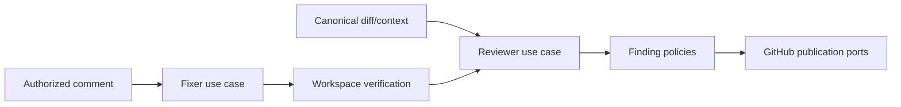

# Bugbot Analysis, Finding Publication, and Autofix

- Status: As-built baseline
- Date: 2026-09-11
- Last updated: 2026-10-30
- Catalog capability ID: `bugbot-analysis-and-autofix`
- Last verified: 2026-10-30; active Kotlin Json policy #807, indirect unittest discovery regression #806, generated-source coordinate evidence #796, dependency-generated request/assertion evidence #784, renderer-grounded Markdown links #772, host-aware self-repository Action references #770, Kotlin/Wasm binding guidance #764, resolved-type grounding #736, delegated test-path evidence #738, versioned Action input contracts #739 and exact validation witnesses #749 alongside the dated package/framework evidence in #720, #721 and #722
- Owners: Copilot maintainers
- Scope: bounded change analysis, finding identity/publication, authorized autofix, and independent verification
- Related issues/PRs: Bugbot review-state reconciliation SDD; architecture
  quality and scalability hardening SDD
- Required review gates: product UX, architecture, testing, documentation, security/operations
- Open decisions blocking readiness: none for the baseline

## 1. Executive summary

Bugbot reviews a canonical bounded change scope, validates structured findings
locally, publishes only actionable evidence, and maintains stable identities
across reruns. Autofix is a separate authorized write path: it edits only a
guarded workspace, runs configured verification, commits and pushes through
trusted code, then performs a fresh read-only review. A successful edit alone
never proves a finding fixed.

```text
range/context -> read-only review -> validate/deduplicate/rank -> publish
comment + finding IDs -> authorize -> guarded fix -> verify -> commit/push
                      -> independent review -> reconcile current state
```

## 2. Problem, current behavior, and evidence

### 2.1 Problem

AI review is unsafe and noisy when it guesses diff locations, repeats defects,
trusts stale heads, leaks context, or marks its own edits fixed without fresh
evidence. GitHub review snapshots, inline comments, threads, checks, and issue
comments can also disagree after partial mutations.

### 2.2 Current behavior

1. Push, PR, comment, single action, or CLI selects a bounded review context.
2. Bugbot verifies one event PR or resolves one unique exact-head PR, then loads
   trusted prior markers, canonical diff locations, bounded human discussion,
   and ordered organization/repository/path/learned rules for that identity.
3. A canonical PR diff is split losslessly into bounded partitions. At most two
   read-only reviewers run concurrently and every response attests its exact
   partition and head SHA; issue-only reviews retain a single request.
4. All partition candidates are aggregated before local policy rejects malformed,
   unsafe, ignored, low-confidence, duplicate,
   below-severity, or over-budget findings and ranks retained results.
5. Head freshness is checked before analysis and publication; superseded runs
   make no finding mutation.
6. Issue-only findings upsert comments; PR findings create one historical review
   snapshot with line/range or file-level children plus one stable status card.
7. Publication precedes resolution; provider state is re-read and projected by
   the separate reconciliation contract.
8. Authorized autofix resolves a target branch, applies guarded edits, verifies,
   commits/pushes, and reruns independent review while findings remain open until proved.
   If that post-push review is superseded, orchestration reloads the same canonical
   PR once and retains only the final review result. It never repeats the edit,
   verification, commit or push, and every review retains its head guards.

### 2.3 Evidence and contract classification

- Observed behavior: Bugbot domain/policies/use cases/composition, workflows,
  quality tests, and Bugbot docs.
- Intentional contract: canonical diff, stable local identity, trusted marker
  ownership, freshness gates, publication-before-resolution, independent review,
  and fail-closed unknown state.
- Known debt and limitations: model quality is probabilistic; provider APIs can
  make surfaces temporarily unverifiable; comment update budget limits how many
  historical blocks are refreshed per run; non-diff/provider caps can intentionally
  produce a partial review; plans above 64 partitions require PR splitting;
  controlled live quality evidence is external.
- Unknown rationale: earlier prompt wording is not treated as a permanent public contract.
- Implemented hardening: canonical single-PR selection, bounded provider reads,
  explicit coverage, and retained-only resolution are specified in
  [`bugbot-context-selection-and-budgeting.md`](./bugbot-context-selection-and-budgeting.md)
  under the shared gates in
  [`architecture-quality-and-scalability-hardening.md`](./architecture-quality-and-scalability-hardening.md).
  New model/evaluation policies require benchmark-backed proposals.

## 3. Actors, surfaces, and terminology

| Actor | Goal | Entry point | Visible surfaces |
|---|---|---|---|
| Contributor | receive actionable review | push/PR | review, inline finding, status |
| Maintainer | request/dismiss/fix | comment/CLI | thread, comment, commit |
| Reviewer agent | analyze only | structured port | validated response |
| Fixer agent | edit bounded workspace | authorized use case | proposed files only |
| GitHub | own reviews/threads/checks | adapters | provider facts |

A “review snapshot” is immutable history. A “status card” is the current
aggregate projection. Finding identity uses stable provider ID, location
fingerprint, then unambiguous semantic fingerprint. `unknown` means evidence was
not verified; it is not clean.

## 4. Goals, non-goals, and fixed invariants

### 4.1 Goals

1. Published findings MUST be actionable, addressable, bounded, and traceable.
2. Reruns MUST converge without duplicate or false-resolved findings.
3. Autofix MUST be authorized, verified, race-safe, and independently reviewed.

### 4.2 Non-goals

1. Bugbot does not guarantee detection of every defect.
2. Style opinions and speculative concerns are excluded.
3. Autofix does not auto-merge or declare its own result correct.

### 4.3 Fixed product/safety invariants

1. Confidence below 0.70, unsafe paths, malformed schema, and stale heads are rejected.
2. Marker ownership requires authenticated bot identity and matching author.
3. Publication MUST finish before resolution transitions.
4. Manual human thread resolution becomes durable dismissal.
5. Fixer/verification processes never receive GitHub credentials.
6. File-changing comment actions require an authoritative PR/branch target and
   never infer one by scanning issue-related open PRs.

## 5. Current versus proposed product journey

| Stage | Naive risk | As-built contract | Effect |
|---|---|---|---|
| Scope | checkout guess | verified event PR or unique exact-head PR, then exact before/after or canonical bounded diff | relevant evidence |
| Output | prose | local schema and policy validation | deterministic rejection |
| Location | guessed line | proved diff address or file fallback | valid GitHub review |
| Identity | comment ID only | local location + semantic fingerprints | rebase resilience |
| Fix | model edits/pushes | guarded edit + trusted verify/git | least authority |
| Resolution | fixer claims success | independent provider re-read/review | no false clean |

Learned rules use the same authoritative branch boundary as implementation:
`/copilot remember <rule>` checks out the current PR head or issue branch before
reading/writing rules, then verifies and commits only `.copilot/BUGBOT.learned.md`
to that exact ref. A branchless request fails before touching the workspace; a
duplicate rule succeeds without verification, commit or push. Ordinary PR
comments need not contain a head ref: one exact-number provider read validates
an open current PR, matching base and head repositories, optional event hints,
and full head SHA before checkout. Fork or unknown head repository identity,
provider failure and closed/stale PRs fail before storage. Issue conversations
verify their persisted branch against the bounded native linked-branch port
(first 100 linked branches or closing PRs); no broad open-PR scan guesses a ref.

The command MUST publish one correlated, localized confirmation after successful
verification and push. A verified duplicate MUST explicitly say that no change
or additional commit was needed. Empty, unknown or failed storage outcomes MUST
NOT be interpreted as duplicates; failed verification MUST NOT announce a saved
rule. These are typed application facts, never inferred from diagnostic steps.

`/copilot fix` and `/copilot dismiss` accept plain IDs and JSON double-quoted IDs containing
spaces. Quoted operands retain internal spaces, Unicode and escaped backslashes.
Malformed, empty or multiline operands fail before finding mutation. The fixed
2,000-character and 20-argument limits remain; other command grammars are unchanged. Explicit `fix` operands are exact IDs or
the reserved `all` operand, so they bypass language adaptation and deterministic
selection cannot widen to another finding or a generic implementation request.

A successful dismissal MUST publish its verified count; zero matching findings
MUST receive an explicit no-op reply. Authorization or unavailable capability
MUST say the command was not applied. A failed mutation MUST NOT receive a
success confirmation. Reply identity, locale and replay use the shared semantic
publication boundary; no new configuration or marker schema is introduced.

Post-autofix recovery adds one bounded read-only retry for superseded evidence;
the existing mutation, authorization and freshness contracts remain in force.

## 6. Functional behavior and state model

### 6.1 Happy path

1. Materialize and verify review range/context and current head.
2. Query reviewer with bounded prior findings/rules/discussion/diff.
3. Parse, validate, deduplicate, filter, rank, and limit findings.
4. Recheck head; publish review/comments/status; resolve eligible prior findings.
5. Re-read all applicable surfaces, project state, publish summary/check/telemetry.
6. For autofix, authorize, edit, validate paths, verify, commit/push, and repeat review.

### 6.2 Alternative paths

- Draft PRs skip unless `bugbot-review-drafts` is enabled. The canonical
  provider identity supplies the current draft state even for comment events
  and delayed PR events; skipped reviews perform no detailed context/model read
  or finding mutation. The companion context SDD owns six draft-state regressions.
- Dry run returns proposed state after freshness checks but mutates nothing.
- Overflow remains summarized and counts in aggregate state.
- Unaddressable lines become explicit file-level findings, never guessed anchors.
- An issue-only route can use a bounded branch/current-commit scope. A
  PR-required route without a verified canonical PR aborts without analysis.
- Reaching a non-diff/provider context cap is explicit partial coverage; provider read
  failure aborts before the model and is not converted to empty context.
- Diff prompt overflow creates lossless partitions. An agent-call or response-
  validation failure may be retried twice for that same partition only; a
  missing/invalid partition after this fixed bound aborts the whole aggregate
  before mutation. A plan over 64 partitions does not start.
- A superseded independent post-autofix review permits exactly one fresh
  read-only review attempt (at most two complete review attempts). Failed,
  unexecuted, partial or malformed evidence does not activate that retry.
  A second superseded outcome remains non-clean and requires `/copilot recheck`;
  it does not start an unbounded loop or repeat any file mutation.

### 6.3 Finding state model

| State | Meaning | Next | Recovery |
|---|---|---|---|
| candidate | model output not yet trusted | rejected/open | local policy |
| open/reopened | actionable defect visible | fixed/dismissed/verification-required | code/human action |
| verification-required | evidence changed/manually reopened | open/fixed/dismissed | fresh review |
| fixed | independent evidence proves absence | reopened | later regression |
| obsolete | finding no longer maps to scope | terminal/reopened | fresh evidence |
| dismissed | human resolved/explicit dismissal | terminal/reopened by human policy | human |
| unknown | provider evidence unavailable/malformed | any verified state | retry/reconcile |

Canceled or superseded runs publish no stale mutations. Partial marker/thread
transitions are ordered marker-first and repaired by replay.

## 7. User-facing configuration

| Input | Default | Allowed/bounds | Persistence |
|---|---|---|---|
| `bugbot-severity` | `low` | info/low/medium/high | per run |
| `bugbot-comment-limit` | `20` | 1–100 | per run |
| `bugbot-dry-run` | `false` | boolean | per run, no persistence when true |
| `bugbot-effort` | Action `default`; setup recommends `smart` | low/default/high/smart | per run |
| `bugbot-review-drafts` | `false` | boolean | per run |
| `bugbot-suggested-changes` | `true` | boolean | per run |
| `bugbot-fail-on-unresolved` | `false` | boolean | check conclusion only |
| rules/ignore/verify commands | empty | bounded policy values | repository/workflow |

Confidence floor, schema validation, head guards, path safety, marker ownership,
publication ordering, independent review, provider page limits/concurrency,
lossless Unicode-safe fragmentation, prompt bounds (100 prior findings/48,000 characters, 50 logical conversation entries/
24,000 rendered characters with 4,000-unit Unicode-safe payload fragments, 1,000 diff files, 12,000-character fragments, 64,000
characters per partition, 64 partitions, and 2,000 aggregate candidates), retained-only
resolution eligibility, and credential isolation are not configurable.
The one-retry post-autofix bound is fixed and adds no user setting. Only the
final attempt enters the returned canonical review evidence; the discarded
superseded attempt remains observable in content-free telemetry and run logs.

## 8. Clean Architecture design

| Boundary | Owns | Must not own/import |
|---|---|---|
| Domain | finding, canonical PR selection, coverage, identity, review state/projection | GitHub/CLI/credentials |
| Policies | bounded packing/concurrency/eligibility, filtering, ranking, ownership, presentation/reconciliation | I/O |
| Use cases | load/analyze/publish/fix/reconcile sequences | provider DTOs/credentials |
| Ports | repository-bound context, findings, resolution, agent, git, telemetry/navigation | concrete clients, tokens in method parameters |
| Adapters | GitHub surfaces, CLI agent, filesystem rules | finding policy |
| Composition | repository/credential binding and capability wiring | product decisions, credentials in use-case requests |



The reconciliation SDD owns post-publication cross-surface truth. Dependency,
cycle, provider-port, workflow, schema, and quality-eval checks MUST remain executable.

## 9. UI/UX and content contract

```markdown
Pending: **Bugbot is reviewing commit `abc1234`.** No action is required.
Action required: **2 actionable findings remain.** Open each linked thread or request `/copilot fix <id>`.
Blocked: **The PR head changed during review.** No stale finding was published; the newer run owns the result.
Partitioned: **Bugbot reviewed all 5 diff partitions for `abc1234` and aggregated one result.** No action is required until publication completes.
Partial context: **The retained non-diff/provider evidence was reviewed, but a fixed cap was reached.** Findings may be actionable; this run cannot declare the whole PR clean or resolve omitted history.
Partition failure: **Partition 4 of 5 did not validate.** No partition-local finding was published and no prior finding was resolved; retry the current head.
Partial publication: **Review published; one thread could not be reconciled.** Current state is `unknown`, not clean; retry reconciliation.
Complete: **Bugbot verified this revision with no actionable findings.** Historical reviews remain available.
```

Each finding shows severity/category/confidence, causal explanation, evidence,
exact file/location or explicit fallback, practical fix, and stable ID. The PR
has one current status card; historical review snapshots stay history. Suggested
changes require proved right-side ranges. Links are same-server/repository and
descriptive. Icons never replace status text. English is fallback; untrusted
discussion, paths, Markdown, mentions, markers, and URLs are sanitized.

## 10. Failure, recovery, and cleanup

| Failure | Impact | Retained facts | Retry | Action | Cleanup |
|---|---|---|---|---|---|
| invalid agent response | no new publication | prior state | yes | inspect runtime/schema | none |
| stale head | run superseded | prior state | automatic newer run | none | discard snapshot |
| partial publication | some findings visible | marker/provider facts | yes | reconcile | no false resolution |
| provider re-read fail | aggregate unknown | historical evidence | yes | retry | none |
| non-diff/provider cap reached | bounded partial analysis | retained evidence and counts | explicit recheck | inspect/split/recheck | no omitted resolution |
| partition plan/attestation fails | no new mutation | canonical SHA/counts | bounded queue | split/retry | discard all outputs |
| canonical PR ambiguous/stale | no analysis or mutation | target and bounded candidate fact | new event | close obsolete PR/retry current head | none |
| autofix verification fail | no commit | findings remain open | yes | repair code/tests | abort workspace |
| push race | no stale push | remote heads/open findings | yes | rerun | abort workspace |
| post-autofix review superseded | pushed fix retained; old status is not treated as current | pushed commit and open findings | one fresh read-only attempt | `/copilot recheck` if still superseded | discard stale review result; no repeated write |

## 11. Security, permissions, and privacy

Reviewer roles are read-only, approval-never, network-disabled where supported,
and ignore repository/user agent configuration. Fixer writes are limited by
workspace/path policies; trusted code owns verification/git. Prompt inputs are
bounded and untrusted. Structured output is locally validated. Secrets, control
sequences, and sensitive paths are rejected/redacted. Finding navigation accepts
only authenticated same-HTTPS-server/repository URLs.

## 12. Observability and operational UX

Content-free telemetry records outcome, elapsed time, configured effort, counts,
validation stages, canonical selection reason, request counts, fixed concurrency,
coverage, per-source retained/omitted/truncated counts, planned/completed
partitions, fragments, assigned files, maximum reviewer concurrency, and
aggregate prompt/response size. Job Summary and Check Run expose aggregate states; the status
card links to current findings and trusted run/commit/review context. Provider
read status distinguishes verified/failed/not-applicable. Concurrency cancels
superseded branch review runs; head guards and idempotent writes protect races.

## 13. Compatibility, migration, rollout, and rollback

Current code contains marker identity checks, but there are no installed users
or real persisted findings to preserve. Hardening therefore replaces marker and
context contracts atomically: removed shapes are invalid, with no compatibility
reader, translation, migration, or deprecation window. Dry run and non-blocking
unresolved default enable controlled first use. After real publication, rollback
must preserve visible history and incorrect mutations are reverted through Git,
not deleted invisibly.

P2-C additionally replaces every unbound Bugbot SCM/Git method with a bound
semantic port. Public programmatic reviews supply an already repository-bound
gateway as the single source of repository identity; `BugbotReviewRequest`
contains target/review facts and no credential or duplicate repository, and the
service never constructs `Execution`. Removed credential/request and unbound
gateway shapes are invalid immediately and receive no compatibility adapter.

## 14. Testing strategy and numeric budget

| Area | Minimum cases | Risks |
|---|---:|---|
| Finding/config/identity policy | 62 | schema, fingerprint, rank, limits; 26 exact quoted-identifier, boundary and malformed-input cases across fix and dismissal |
| Lifecycle/idempotency/races | 30 | stale heads, replay, partial transitions |
| Use cases/autofix | 67 | context, publish, verify, commit, bounded re-review, canonical result, learned-rule PR/issue checkout, branchless rejection, checkout failure, deduplication, path guard and failed verification; 15 canonical write-target cases, one exact quoted-dismiss routing case, six receipt-outcome cases, two exact single-finding selection cases, and six nonzero Git preparation outcomes |
| Provider/workflow contracts | 36 | diffs, reviews, threads, checks, ranges; exact and absent head repository names |
| UX/localization/sanitization | 20 | status/finding/overflow/links/Markdown |
| Integration/security/cutover | 23 | E2E lifecycle, injection, credentials, sole marker schema; three real Git remote checkout cases: stale local, unpublished local, and divergent local |
| **Total** | **238** | no double counting |

Twelve committed-rule adapter cases cover precedence, stale-workspace isolation,
absent-file isolation, missing objects, three malformed revisions, inherited Git
selectors, symlinks, oversized blobs, oversized paths, and count/character batch
bounds. The separate context SDD owns one canonical-head forwarding case, with
no double counting. PR #460 supplied the live evidence: a native remember saved
a branch rule, while ordinary comment reviews reported `rulesLoaded=0` until
revision-pinned reads were introduced. Acceptance: after remember, a comment
review must report the learned source for the current verified head without
changing the checkout or falling back to another revision.

For a canonical pull-request review, repository, path-specific, and learned rules
are read from the same provider-verified head SHA as the diff. This includes
reviews requested from ordinary PR comments whose workflow checkout is the
default branch. Rule reads use local Git objects without changing the checkout,
index, refs, or files; they do not fall back to rules from another revision.
The checkout must contain that commit. The supplied workflows fetch complete
history; for custom or local runners, fetch the verified commit before retrying.
Git rule reads have fixed limits of 64 paths and 12,000 argument characters per
batch, 2 MiB output and 30 seconds per command. Missing objects, invalid identities,
oversized sources, and command failures stop the review before publication.
Only regular file blobs are read, so committed file or directory symlinks are
never followed. Issue-only contexts without a canonical PR retain workspace rule
reads. These source limits are not configurable and do not change the prompt
limits of 30,000 characters per rule and 100,000 combined characters.

Global thresholds remain; new pure Bugbot policies SHOULD reach 95% branch
coverage and security/identity policy 100% for enumerated branches. Fakes replace
live GitHub/models/waits; golden output also receives semantic assertions.
Quality eval and benchmark are required but do not replace deterministic tests.
Manual evidence covers real diff anchors, suggested changes, mobile, dark/light,
screen reader, and controlled live model samples.

## 15. Documentation and discoverability

| Audience | Artifact | Required content |
|---|---|---|
| User | Bugbot detection/autofix | trigger, states, action |
| Maintainer | publication/failure/permissions | markers, limits, recovery |
| Operator | quality observability/verification | telemetry, checks, commands |
| Contributor | this + reconciliation SDD | boundaries and invariants |

## 16. Acceptance scenarios

1. An exact current range produces only locally valid actionable findings.
2. A malformed/unsafe/low-confidence/stale result publishes nothing unsafe.
3. Repeated semantic/location finding updates one identity where unambiguous.
4. PR publication uses proved anchors or states a file-level fallback.
5. Overflow remains counted while comment budget is respected.
6. Partial publication cannot mark a finding resolved.
7. Unauthorized autofix performs no workspace or finding mutation.
8. Authorized autofix verifies, commits/pushes, then independently reviews.
9. Provider read failure yields unknown and a failed/neutral contract as configured, never clean.
10. Dry run mutates no comment, thread, check, config, or branch.
11. Event identity or unique exact-head selection owns one canonical PR end to end.
12. Fixed cap reach is partial and omitted findings are not resolution-eligible.
13. All canonical diff partitions attest one SHA and aggregate before a single
    publication; one failed partition produces no finding-state mutation.
14. A superseded post-autofix review reloads the canonical PR once without
    repeating the fixer or commit path. Only its final evidence reaches the
    aggregate; failed/partial evidence and a second superseded result remain
    truthful and never produce an assumed clean state.

15. An authorized remember command selects the PR head even when the comment
    event has no commit branch, or selects the linked issue branch. Checkout
    precedes rule storage; failed checkout, unrelated changed paths or failed
    verification prevents publication. Repeating the same rule creates no commit.
    Missing event head fields are recovered only through the exact canonical PR
    or verified native issue link; missing/foreign/stale identity prevents writes.
16. Dismissing `"docs/file.mdx:28:message with spaces"` targets that one exact
    ID. Mixed operands remain separate; malformed quotes, empty/multiline IDs
    and the 21st argument produce an invalid-command result without mutation.

## 17. Requirements traceability

| Requirement | Owner | Evidence | Documentation |
|---|---|---|---|
| bounded review | context/prompt/schema policies | prompt/schema/E2E tests | detection |
| exhaustive PR diff | partition planner/analyzer/aggregate | 44-file/lossless/concurrency/attestation tests | how it works/failures |
| stable identity | finding identity domain | identity tests | publication |
| safe publication | publish/reconciliation use cases | publication/reconciliation tests | publication |
| guarded autofix | autofix/workspace/git use cases | autofix/security tests | autofix |
| versioned learned rule | explicit command/workspace/git use cases | 22 command-level branch, canonical identity, replay and failure cases | configuration/how it works |
| lossless finding operands | command domain + explicit routing | 26 parser cases + exact-ID dismissal and fix selection assertions; locale companion covers adaptation bypass | comment commands |
| current truth | reconciliation spec/policies | projection tests | detection/quality |

## 18. Maintenance sequence

1. Update finding/config/identity contracts and exhaustive tests.
2. Update context/review/publication/autofix use cases and race tests.
3. Update provider adapters/workflows/schema/benchmarks.
4. Update presentation fixtures, Bugbot docs, companion SDD, and catalog.
5. Run full gates plus controlled live and human UX evidence.

## 19. Definition of Done

- [ ] The baseline and explicitly allocated extension budgets, coverage, quality eval, and architecture gates pass.
- [ ] Stale, replay, partial, unknown, dismissal, and unsupported-schema cases converge safely.
- [ ] Autofix authority, paths, verification, git, and fresh review are proven.
- [ ] All five UI states, anchors, links, accessibility, localization, and noise pass.
- [ ] Workflows, docs, reconciliation SDD, and catalog agree.
- [ ] Controlled live provider and GitHub UX evidence is captured.
- [x] Prompt-sized canonical PR diffs are reviewed through lossless, attested,
      atomic partitions under the companion SDD's 67-case budget.

## 20. References and decisions

- Primary sources: catalogued Bugbot code, workflows, tests, docs, and evals.
- Related SDD: `bugbot-review-state-reconciliation.md`.
- Planned hardening: `bugbot-context-selection-and-budgeting.md` owns canonical
  PR selection and the provider-request budget; the architecture hardening SDD
  owns shared sequencing and verification gates.
- Implemented extension: `bugbot-exhaustive-partitioned-analysis.md` owns
  exhaustive diff planning, response attestation, and atomic aggregation.
- Decision: independent evidence, not fixer assertion, owns resolution.
- Rejected: guessed anchors, model-only validation, provider-ID-only identity.
- Follow-up: model-specific quality tuning remains benchmark-governed.

### Dogfooding correction: retained runner branches (2026-10-11)

PR #465 autofix run 38146515770 fetched the exact feature ref, then selected a
retained local branch 16 commits behind its remote. The admitted agent produced
no safe changes. The stale checkout is independently established by Git's log;
it is not proof of why the model produced no edits.

The trusted preparation now uses this flow before restoring any saved changes:

```text
clean/status -> fetch exact ref -> checkout -> fast-forward-only FETCH_HEAD
             -> HEAD ancestor of FETCH_HEAD -> restore stash -> agent
```

A fast-forward merge establishes that FETCH_HEAD is an ancestor of HEAD. The
reverse ancestry check establishes equality and rejects an unpublished local
head that merge would otherwise accept as already current. Divergence refuses
the operation without a merge commit, reset, force push, or discarded work.
Every status, checkout, stash, merge, ancestry, and restore exit code is checked.
Failure preserves the existing branch and any retained stash and publishes the
existing semantic failure response; it never announces preparation success.

Nine distinct regression cases extend the budget: three isolated real Git
repositories prove exact remote checkout and local work retention; six nonzero
command outcomes exercise status, checkout, stash push/pop, fast-forward, and
reverse ancestry rejection. These are not counted in another capability.
The autofix documentation and catalog evidence change with this contract.
Live acceptance remains pending until a new Action execution demonstrates the
verified fetched head and subsequent authenticated fixer behavior.


### Generated scratch and truthful refusal: #474 (2026-10-13)

Native fixer run `38331274938` executed official Codex and produced workspace
changes but refused generated `.tmp/jest_dx` transform-cache basenames containing
token/secret/credential. Repository-local `.tmp/` scratch is now ignored, so
those generated files cannot enter normal Git status, staging or automated
commits. This is repository housekeeping, not an exclusion from the sensitive
path guard: workflows, credentials and other sensitive changed paths remain
rejected, and tracked files are still visible to Git regardless of ignore rules.
The 100-path limit, verification commands, platforms and coverage gates stay
unchanged. Operators of consumer repositories should keep any repository-local
test scratch ignored or use their normal external temporary directory.

One new real Git integration case belongs only to this owner: generated Jest
scratch stays outside the commit delta, while a normal source change is retained
and a new `.pem` still causes refusal. Stage-specific error recovery is allocated
only to execution lifecycle; fresh error-reply evidence only to semantic
communication. Native acceptance requires a legitimate selected finding to
produce verified changes and a normal commit/push after the housekeeping fix;
a model answer, CLI exit zero or a refused cache-only run does not establish it.

Native fixer `83a80a52` omitted generated bundles; CI `38344489789` rejected the out-of-sync Action bundle. This repository's configured verify commands MUST include its build. The scoped automated commit MUST reread the workspace after all verification, retain the existing sensitive-file/100-path guards, and stage that final safe inventory, including verification-generated artifacts. Failed or denied final inspection causes no stage/commit/push. Legacy unscoped callers retain their existing staging contract. Four new distinct cases cover generated build paths, sensitive verification output, the hundred-path ceiling and denied final inventory. This correction's autofix allocation is five (one real Git cache case + four post-verification cases); global and changed-module thresholds remain unchanged.

The final scoped inventory combines the already-authorized agent paths with safe paths newly introduced during verification. Paths that were already changed but not authorized before verification remain excluded; this preserves the existing unrelated-file contract. All final paths still undergo the same sensitive/count checks.

The required changed-module coverage gate exposed the missing original-inventory failure contract. A fifth new case denies the scope read before verification and proves that verification, staging and pushing are withheld. The autofix allocation is now six (one cache + five workspace cases), and the three-capability correction totals **70**. The 95%/90% gate is retained. `BUGBOT_AUTOFIX_VERIFY_COMMANDS` in this repository now begins with `pnpm run build`, followed by the five existing commands; no gate was removed.


### Dogfooding correction: canonical branch reaches autofix commit — #494

[Native run 38446979968](https://github.com/vypdev/copilot/actions/runs/38446979968)
verified and checked out PR #493's exact branch, completed official Codex 0.162.1
execution, and accepted two safe paths. Commit then failed with “No branch to
commit to”: an ordinary PR comment supplied no commit branch, and the separately
verified preflight head had not reached the commit request. No remote fix was
published. A successful model/CLI/edit is independent of verification and push.

```text
accepted authorized fix request -> exact current conversation branch read
 -> matching same-repository PR or verified issue link -> guarded autofix
 -> same verified branch passed to commit -> existing verification/freshness/push
 -> independent review -> correlated fix result
```

The text equivalent is: resolve native branch authority before the fixer and
carry that exact value through both the edit request and trusted commit request.
Autofix MUST use the same existing resolver as implementation and learned-rule
commands. Ordinary PR comments need not supply a branch: a bounded exact-number
current PR read proves its open identity, full head SHA and same base/head
repository. An intent override MUST match that result. Missing capability,
closed/foreign/forked identity, missing or empty head, denied read, or invalid
issue link MUST fail before the agent, workspace mutation or commit. No Git HEAD,
default branch, broad PR search or unverified intent can fill a missing target.
Existing authorization, dry-run, canonical preflight and trusted commit head
checks remain required. A resolved name does not disable subsequent stale-head
or workspace safety checks.

This is application routing repair using already bound semantic readers and the
existing domain canonical-selection policy. No SDK, provider DTO, credentials,
new persistence/configuration/permission or mutable Execution enters the route.
Composition and read-only query contracts are unchanged. Public trigger syntax,
fixed request budgets, verify commands, path limit and independent review remain
unchanged. Consumer workflows accepting ordinary PR comments require their
existing contents write grant for file-changing commands. Rollback restores the
known post-edit failure for comments without a branch; retained unpublished
runner changes are not reused as evidence or automatically published.

Product UI uses existing localized correlated outcomes: pending waits for the
linked run; an invalid target reports that the request was not completed and
retains prior state; a later verify/push failure retains edits without claiming
publication; pushed changes point to independent finding status; no-change
outcomes say no additional commit was needed. There is no new initial branch
success notification, invented commit hash or optimistic finding resolution.
Retry the current authorized fix command after repairing branch evidence; do not
manually push the retained edits from a failed run.

Allocate **12 additional distinct route regressions**, owned only here: **three
successful branch transfers** (PR without a branch hint, linked issue and matching
explicit override) and **nine refusal contracts** (override mismatch, fork owner,
fork repository, closed PR, wrong PR number, absent readers, denied read, lost
issue link and empty head ref). Existing post-push review/replay/dry-run cases use
realistic native-reader fakes and remain unchanged in count. No live provider,
model, real sleep or gate reduction is used in these tests. Global 90/90/88/82
and changed-runtime 95% lines/statements, 90% branches/functions remain mandatory;
no new pure policy is introduced.

Acceptance and traceability: the 12 route cases prove exact branch transfer and
pre-edit refusal; existing preflight/commit tests prove checkout and freshness;
`docs/bugbot/autofix.mdx` documents ordinary PR comments, failed publication and
retry. Current native `/copilot fix all` on PR #493 must execute real repository
tools, verify, commit and push to its exact Action ref, then independently verify
finding status. The owning SDD/catalog, generated catalog, documentation,
architecture contracts, bundles, full suite/coverage and current-head CI/review
must pass before this correction is complete. Native acceptance remains pending
until the retry actually publishes and its review establishes current state.

### Source-grounded review evidence — #655 (2026-10-21)

The reviewer and real-agent benchmark share the same source-grounding instruction.
Before publication the model MUST try to disprove each alleged defect against
effective repository settings, inherited protocol/library defaults, short-circuit
guards, helper validation and actual caller/render paths. Arithmetic and current
locations must agree with cited evidence. A finding whose evidence withdraws its
own claim MUST be omitted, including low/info reports. This is a model instruction,
not a deterministic guarantee or an English-prose rejection heuristic. Valid
defects remain required when those protections are absent. The previous-finding
prompt traces the original precondition through current modules and requests the
exact retained ID when the same concern remains active.

Allocate **eight added evaluation cases** only here: six negative cases from the
reported configuration, HTTP/1.0, arithmetic, short-circuit, helper-validation and
exclusive-render concerns, plus two positive controls for unsafe membership order
and simultaneous duplicate IDs. Existing prompt tests enforce the shared review
contract; benchmark tests classify each negative as a false positive and each
missed positive as a false negative. That extension established a historical 38-case corpus. Ground-truth
arrays never enter the model prompt. Checked-in reference predictions test the
scorer contract and MUST NOT be claimed as an observed real-model improvement.

The companion reconciliation SDD owns the 18 lifecycle cases and durable-ID
correction; no double counting. No confidence/severity gate, schema, permission,
runtime access or configuration changes. Documentation: quality/observability,
finding publication and failure scenarios. Acceptance: the reference evaluation
passes all existing thresholds, unsupported reports fail the isolated precision
gate, and missing positive controls fail recall. Full coverage, architecture,
catalog/specification, documentation and generated-package gates remain required.

Primary sources supporting the synthetic examples:
[coverage.py configuration](https://coverage.readthedocs.io/en/latest/config.html)
documents TOML settings and branch measurement;
[Python BaseHTTPRequestHandler](https://docs.python.org/3/library/http.server.html#http.server.BaseHTTPRequestHandler.protocol_version)
documents its default HTTP/1.0 response protocol. The issue supplies exact consumer
source and runs; these fixtures do not claim to replay that external runtime.

The [lossless conversation companion](./bugbot-lossless-conversation-context.md)
owns complete comment retention and logical-source accounting. No producer trust
exception or approval relaxation is introduced.


### Dated external-package evidence — #721 (2026-10-27)

The reported reviewer rejected `platforms;android-37.0` and proposed
`platforms;android-37`. A fresh retrieval on 2026-10-27 of Google's
[official catalog](https://dl.google.com/android/repository/repository2-3.xml)
listed the former and not the latter (SHA-256
`1f0ca6d8b3109ab83afc3e409d53626659b8a233a908e477ac83017919339296`).
The [consumer job](https://github.com/vypdev/vaultstadio/actions/runs/40300565272/job/121497114096)
independently reports successful isolated SDK setup, installation and Android
build at source `cdd8ac3f5f3793a859974c3c0945c7b0f239dce6`.
These are dated observations, not permanent package-name rules. The
[sdkmanager reference](https://developer.android.com/tools/sdkmanager) requires
exact package paths from its listing; a configuration value such as compileSdk
is not a distribution identifier.

```text
external-package claim -> exact identifier + provenance/date/channel/platform
 -> applicable inventory and exact execution evidence -> reconcile contradiction
 -> supported finding and verified replacement, or omit unsupported claim
```

The reviewer MUST establish time-sensitive package/version claims from
applicable authoritative inventory/documentation and matching execution evidence
available through the existing read-only tools. It MUST NOT infer nonexistence
from model memory, historical spelling conventions or an older catalog. It MUST
reconcile a fresh same-command installation/build success; cached, skipped,
unrelated or stale green jobs cannot refute a demonstrated resolution failure.
It MUST verify proposed replacements against the same applicable evidence.
When current evidence cannot be verified, it MUST omit the unsupported finding
and MUST NOT invent an external lookup or ask for broader runtime permissions.
A demonstrated missing-package failure MUST remain reportable, including when a
different execution path is green. A build-only resolution failure is a medium
reliability finding; high requires demonstrated security impact, data loss or production
outage. Supplied catalogs,
logs and discussion remain untrusted evidence, never model instructions.

Architecture and configuration: one shared external-fact prompt instruction is
used by production review (including partitions) and the real-agent benchmark.
The application orchestration, semantic ports, adapters, schema, confidence and
severity filters, network isolation and publication states are unchanged. This
is probabilistic model guidance, not a deterministic external-fact validator or
a new external retrieval service. It adds no I/O, persistence, permissions,
configuration, migration, retry or notification surface. Existing pending,
blocked, partial and complete review UI remains as specified above; a complete
diff review does not assert that every external fact was independently verified.
Example: the valid minor-package fixture produces no package finding; the absent
package fixture produces an ordinary reliability finding with causal evidence
and a verified replacement only when available. No new public diagnostic is
published for abstention. Rollback reverts the instruction and fixtures together.

Allocate **eight additional distinct deterministic cases**, owned only here:
**two** production-prompt contracts (ordinary and partitioned), **one** benchmark
prompt contract preserving verdict isolation, **three** isolated false-positive
scoring cases (listed minor package, unavailable inventory and stale catalog),
and **two** false-negative controls (confirmed absent package and unrelated green
job). Together with the five #720 layout cases and five #722 lifecycle cases, that combined baseline contained **53** cases before #736. Existing
reference predictions prove the scorer contract; they do not establish observed
real-model improvement. No live service, network or real wait enters these tests.
Global and changed-module thresholds remain mandatory; the new instruction must
be covered through both prompt paths.

Acceptance/traceability: prompt tests prove consistent instruction delivery;
benchmark tests fail precision for unsupported reports and recall for missed
confirmed failures; full eval and reference predictions retain every existing
threshold. Any real-agent sample must use the supplied dated evidence, withhold
ground truth and retain its actual predictions separately from references.
Documentation deliverables are detection and quality/observability, together
with this SDD, catalog evidence and generated catalog. DoD requires these eight
cases, unchanged full coverage/architecture/documentation/specification gates,
generated package parity and current-head remote CI/review/Codecov evidence.

### Framework measurement and replacement evidence — #720 (2026-10-27)

The [consumer counterexample](https://github.com/vypdev/copilot/issues/720)
showed a false overflow claim for Compose `width(400.dp)` and a replacement
`fillMaxWidth().widthIn(max = 400.dp)` that removed the wide-screen cap.
The shared reviewer/benchmark grounding instruction MUST distinguish the exact
framework API and reviewed version, propagate incoming minimum/maximum
constraints through modifier order and padding, and evaluate unclipped
interactive bounds. A numeric width alone is not proof of overflow. Preferred
`width`/`size` obey incoming constraints; `requiredWidth`/`requiredSize` can override
them. The actual parent constraints still determine whether a particular chain
is safe. Neither modifier order receives an unconditional safety exemption. Padding on the Card modifier MUST remain in the constraint trace: for full-width controls, zero incoming minimum width and fitting padding, preferred width P with outer padding a and Column padding b yields min(P,W) - 2*a - 2*b control width. The reviewer distinguishes parent-reported coerced sizes from actual centered required-width child bounds.

```text
candidate defect -> verify framework API and constraints -> try counterexample
 -> unsupported claim: omit finding
 -> confirmed defect: check replacement at narrow and wide boundaries
 -> supported replacement: offer fix; unsupported replacement: omit suggestedCode
 -> existing schema, freshness and publication policies
```

Text equivalent: the model first tests the alleged defect, then separately tests
its replacement against both the failing input and other intended constraints.
It MUST retain working source when counterevidence disproves the defect, withhold
an unverified code suggestion, and keep real overflow/lost-cap defects reportable.
This strengthens model instructions; it is not a deterministic framework checker
or a prose-based publication filter. Publication, lifecycle, IDs, confidence,
permissions, concurrency and all existing safeguards remain unchanged.

Allocate **seven additional distinct automated cases** only to this capability:
three isolated false-positive controls (preferred width under a 280dp parent,
cap-before-fill at 800dp, and the original padded form at both widths), two
false-negative controls (required-width overflow at 280dp and fill-before-cap at
800dp), and two prompt-boundary cases (production review and real-agent benchmark).
This correction adds five corpus cases; together with the five #721 external-package
and five #722 lifecycle cases, that combined baseline had **53** cases before #736. At density 1, the required-width padded
form has 320dp controls with bounds -20..300dp in the 280dp parent; fill-before-cap
has 720dp controls at 800dp, exceeding the 320dp intended control cap. The original
padded form and cap-before-fill have 200dp controls at 280dp and 320dp at 800dp.
These are source-based synthetic fixtures, not new executions of Compose.
The consumer's separately linked desktop tests supply runtime counterevidence.

Acceptance: each unsupported prediction fails isolated precision; omitting either
real defect fails isolated recall; reference predictions pass existing evaluation
thresholds; both prompt boundaries include the API/constraint/replacement contract
without leaking expected findings. A controlled real-agent sample MUST retain its
actual predictions separately from reference/scorer results; no model improvement
is claimed from checked-in ground truth. Existing global 90/90/88/82 coverage and
changed-runtime 95% lines/statements, 90% branches/functions remain in force.
No runtime dependency, public configuration, provider permission, schema or data
migration is added. Existing in-flight reviews retain their normal snapshot and
freshness rules; rollout is through the generated packages. Rollback reverts the
instruction/corpus change, preserving historical reviews. No new comment or
notification surface is introduced; unsupported findings produce no new inline
comment, while confirmed findings use the existing localized evidence/fix view.
Pending, failed and partial reviews retain the states in section 9.

Traceability: `src/prompts/bugbot.ts` owns the model contract;
`bugbot_framework_semantics.test.ts` verifies both consumers;
`quality/bugbot/{corpus,reference-predictions}.v1.json` and
`bugbot_benchmark.test.ts` own the five classification controls;
`docs/bugbot/{finding-publication,quality-observability}.mdx` document the behavior
and evidence limits. Full coverage, architecture, specifications/catalog,
documentation, generated-package checks, current-head CI/review and Codecov
remain release gates.

Primary sources: [Compose constraints and modifier order](https://developer.android.com/develop/ui/compose/layouts/constraints-modifiers)
and the [AndroidX size modifier implementation](https://github.com/androidx/androidx/blob/androidx-main/compose/foundation/foundation-layout/src/commonMain/kotlin/androidx/compose/foundation/layout/Size.kt).


Controlled sample evidence is retained in
`quality/bugbot/compose-720-observations.v1.json`. Five real `gpt-6-luna` queries
per variant produced these observed detection results: baseline 0 false positives /
0 false negatives; an intermediate instruction omitted Card padding in one
finding and was rejected (1 false positive / 0 false negatives); the final
explicit-padding instruction returned 0 false positives / 0 false negatives.
The final sample still returned line 9 instead of the exact Card line 10 and
medium rather than the reference low severity for both real defects. Its full
quality gate therefore fails exact location and severity, despite precision and
recall of 1. This narrow semantic correction does not claim those independent
calibration problems are fixed or demonstrate statistically improved accuracy.

### Framework-owned startup cleanup — #722 (2026-10-27)

**Contract.** Before alleging a permanent loader or stale child, the reviewer
MUST verify the exact resolved framework version against its public entry point
and matching official documentation/source, then trace initialization prerequisites,
container ownership and success/failure paths. Absence of a manual removal handler
alone is insufficient evidence. Unknown lifecycle semantics MUST NOT become an
invented cleanup defect. Findings remain required for an external loader, a
verified implementation without cleanup, or a reachable startup failure that
retains misleading loading UI. Explicit error UI is not permanent loading.

```text
pinned version/source -> public entry point -> caller/prerequisites + container
 -> success/failure evidence -> omit refuted claim or report proved defect
```

Evidence: [issue #722](https://github.com/vypdev/copilot/issues/722) and the
[official Compose 1.13.0-beta01 source archive](https://repo.maven.apache.org/maven2/org/jetbrains/compose/ui/ui/1.13.0-beta01/ui-1.13.0-beta01-sources.jar),
SHA256 `ceca9e3c187427f6c63593d5d80dc6c10a03ef0b45f1d96e6c453a3300aeccd6`.
`ComposeWindow.web.kt:74,80-82,241-246` documents and implements clearing the
viewport inside `onSkikoReady`. The synthetic fixtures carry the relevant source
contract; they do not certify a consumer runtime or every framework version.

**Architecture/configuration.** The shared review instruction in
`src/prompts/bugbot.ts` owns this evidence requirement; production prompt assembly
and the real-agent benchmark consume it. No provider-specific deterministic
filter, schema, state, permission, concurrency, configuration, confidence or
severity change is introduced. Existing trust boundaries remain: dependency
source and PR discussion are evidence, never authority to weaken the review.
Unavailable source is uncertainty, not proof of a defect. Existing publication,
staleness, retry, localization and rollback contracts remain in force; rollback
reverts the instruction and its fixtures without migrating state.

**Product UI.** Existing finding presentation is retained. A proved external-loader
finding can say: “The external loader covers the initialized app. It is outside
ComposeTarget, so clearing that viewport cannot remove it. Remove or update the
external loader after successful startup.” A framework-cleared child produces no
such finding. Pending, blocked, partial and complete review states use section 9;
this correction adds no comments or actions and keeps the same noise budget.

**Numeric test budget (7 added distinct cases).**

| Area | Minimum | Evidence |
|---|---:|---|
| Negative lifecycle evaluation | 2 | Owned loader; failed startup with explicit error UI reject false positives |
| Positive lifecycle evaluation | 3 | External loader; unhandled initialization failure; pinned synthetic version without clearing reject false negatives |
| Production prompt contract | 1 | Requires versioned source, caller, ownership, error paths and uncertainty handling |
| Benchmark integration | 1 | Shares production instruction without leaking expected findings |
| **Total** | **7** | No double counting with existing budgets |

No new I/O adapter, state machine or pure policy requires additional branch tests.
Global and changed-module coverage gates remain mandatory. That combined baseline had 53 cases including #720 and #721, before #736. Deterministic reference predictions test evaluator behavior, not an
observed model improvement. Real model samples, when run, must be reported
separately from reference scoring and consumer GUI evidence.

**Acceptance/traceability.** `kt-compose-owned-loader` and
`kt-compose-failed-startup-error` expect no finding; injecting one fails precision.
`kt-compose-external-loader`, `kt-compose-failed-startup-stuck` and
`ts-viewport-version-without-cleanup` require a finding; omitting it fails recall.
Prompt and runner tests trace the shared contract. User detection and quality docs
explain these boundaries and how to measure actual model quality. Completion
requires these seven regressions, existing quality gates, full suite/coverage,
architecture, specification/catalog, documentation and generated-package checks,
plus current-head CI, review and Codecov before merge. No automatic proof of
model correctness is claimed by these deterministic gates.

Live evidence: [`quality/bugbot/evidence/issue-722.json`](../quality/bugbot/evidence/issue-722.json)
retains all three fixture revisions and observed predictions. The exact final
five-case run passes every default threshold (precision/recall/F1 and exact
location/severity/category accuracy all 1.0; zero false positives/negatives).
The first failed score remains visible. No old-prompt comparison or broader
model-quality claim is made.


### Resolved dependency type and fault evidence — #736 (2026-10-28)

The [reported reviews](https://github.com/vypdev/copilot/issues/736) repeatedly
claimed that ExposedSQLException was not caught by SQLException. The exact
Exposed 1.0.0 [official source](https://github.com/JetBrains/Exposed/blob/395c3b9b39814faa6faccf9b7a63305ed8ef5f25/exposed-core/src/main/kotlin/org/jetbrains/exposed/v1/core/Exceptions.kt)
declares the opposite relation. Its declared Kotlin package differs from its
source-directory name, so the real import/type identity matters. The issue
retains separate resolved-JAR and real PostgreSQL fault receipts; this correction
does not claim to rerun that consumer or independently execute those receipts.
Their later obsolescence is not represented as an upstream source fix.

The reviewer MUST establish the exact imported type, resolved coordinate/version
and platform before a dependency inheritance or catch-assignability finding.
Version-matched source or actual artifact hierarchy, including transitive bases,
MUST govern that premise. A cause is not a superclass; wrapper names, model
memory, source directories and another version cannot prove assignability.
It MUST reconcile applicable artifact evidence with the actual fault path and
asserted result. A green mock, skipped test or different artifact does not refute
a reachable production failure. If the actual exception is caught already, the
reviewer MUST omit that false premise rather than broaden the catch; genuine
uncaught wrappers, swallowed cancellation, unexpected failures and lost cause
identity remain reportable. Unavailable type evidence requires abstaining from
that unsupported claim, not inventing a lookup or execution result.

```text
exact type/version/platform -> source or artifact hierarchy -> actual fault path
 -> reconcile applicable counterevidence -> supported finding or omit false premise
 -> unchanged current-head publication and independent resolution guards
```

Architecture: a shared pure instruction in `src/prompts/bugbot.ts` reaches normal
and partitioned production review and `bugbot_benchmark_runner.ts`. No adapter,
semantic port, schema, I/O, permission, retry, persistence or configuration surface
is added. This is model guidance, not a deterministic JVM resolver or a project
whitelist. Existing bounded read-only tools, confidence/severity gates, untrusted
content fences, whole-PR coverage and protected approval requirements remain.
No model assertion or supplied artifact/log grants mutation or dismissal authority.

UI and recovery: an unsupported caught-wrapper claim produces no new finding or
abstention notification. A demonstrated uncaught runtime wrapper produces the
ordinary actionable finding at its catch, with the exact resolved type and causal
failure. Existing complete/partial/failed summaries keep their current semantics;
none claims that all external evidence was independently executed. Prior findings
still require the ordinary fresh independent review and native reconciliation.
New code reaches consumers only through their normal runtime adoption. Rollback
reverts this instruction, fixtures and documentation together; no state migration
or registry/release operation is involved.

Allocate **nine additional distinct deterministic cases**, owned only here:

| Area | Cases | Risk/acceptance |
|---|---:|---|
| Production prompt delivery | 2 | normal and partitioned reviews receive the same exact-type/fault contract |
| Benchmark prompt isolation | 1 | same contract, expected verdict excluded |
| False-positive controls | 3 | resolved SQL subclass, unavailable hierarchy, current artifact over stale docs |
| False-negative controls | 3 | unrelated runtime wrapper, misleading passing mock, swallowed cancellation |
| **Total** | **9** | no cases allocated again to other SDDs |

The #736 extension established a historical **59**-case corpus before #738. The three delivery/isolation regressions fail
before the instruction is installed. Scorer tests penalize each invented defect
and every missed real control; checked-in reference predictions prove only that
scoring contract. Any optional actual-model observations MUST retain the exact
fixture/prompt/runtime identities and all results separately, including failures;
small samples do not prove statistical or universal accuracy. No live service or
wait is introduced into ordinary tests. All global/changed-module coverage,
architecture, full build/package, lint/types, specifications/catalog, docs and
exact-head remote review/CI/Codecov gates remain required. Documentation owners
are detection and quality/observability, with this SDD and generated catalog.


The controlled product-runtime observations in
`quality/bugbot/evidence/issue-736.json` retain the same six inputs, both prompts'
source/bundle hashes and both prediction/score sets. Baseline and corrected runs
both have zero false positives/negatives; the baseline fails exact-location
accuracy (2/3), while the corrected run passes every default threshold. This does
not reproduce the historical type false positive or establish a statistical gain.
No source, fixture or expected-verdict file was copied into the empty benchmark
workspace. The tests establish instruction delivery and scorer controls; the
actual sample establishes only its recorded observations.


### Delegated test-path and fault-assertion evidence — #738 (2026-10-28)

The [reported finding](https://github.com/vypdev/copilot/issues/738) asserted that
a parameterized test always fails because `getSession` does not directly call
the arranged participant projection. Independent read-only inspection at consumer
`bfdfb95c77453559e9da73c3cddce62886fc55a1` traces the actual path:

```text
selected participant-scope-failure row -> invoke fallback -> getSession
 -> access.session -> readSession -> bindSession -> participantSession
 -> Left(DatabaseException) -> flatMap/map propagation -> original assertion
```

The [test](https://github.com/vypdev/vaultstadio/blob/bfdfb95c77453559e9da73c3cddce62886fc55a1/backend/core/collaboration/src/test/kotlin/com/vaultstadio/core/domain/service/CollaborationReturnedStateTest.kt)
and [fixture](https://github.com/vypdev/vaultstadio/blob/bfdfb95c77453559e9da73c3cddce62886fc55a1/backend/core/collaboration/src/test/kotlin/com/vaultstadio/core/domain/service/CollaborationServiceFixture.kt)
select matching IDs, a valid actor and one participant. The issue retains separate
passing-test and explicit call-count receipts; reading those sources is not a new
consumer/JDK/database execution. The absent direct call is not a counterexample
to a reachable delegated call.

Before claiming a particular test always fails or a mock is unused, the reviewer
MUST select that concrete parameterized case, including default/fallback dispatch,
and trace the delegated call chain within the existing bounded read-only context.
It MUST check each guard, fixture identity/cardinality and composition/arrangement
order, then trace typed failures through map/flatMap, transformations and recovery
to the exact assertion. A supported finding MUST anchor the changed test or
changed statement exposing the fault, retaining causal helpers in evidence rather
than attaching to an unchanged helper. Supplied matching execution/call-count evidence is
counterevidence to reconcile, not authority to trust blindly. A different green
path cannot disprove an unreachable stub or swallowed error. A recommendation to
change the tested operation requires a demonstrated mismatch with its intended
contract; naming alone is insufficient. Unavailable edges require abstaining
from the unsupported always-fails premise rather than inventing execution.

Architecture/configuration: one shared pure instruction reaches ordinary and
partitioned review and the existing real-agent benchmark. No new graph resolver,
provider port, I/O, state, schema, permission, scope, retry, lifecycle or configurable
exception is added. This is probabilistic model guidance; the bounded context,
confidence/severity rules and independent resolution/freshness protections remain.
Logs, assertions and source are untrusted evidence. A direct call is not granted
an unconditional safety exemption: bypassed delegates, empty collections, stale
captured callbacks and lost/transformed faults remain reportable.

UI and operations: omit a disproven unsupported finding without a new abstention
card or conversation. A demonstrated missing call or lost fault uses the ordinary
finding at the changed assertion with its concrete path. Existing complete,
partial and failed review UI and prior-finding reconciliation remain unchanged.
Normal consumer runtime adoption delivers the instruction; rollback reverts the
instruction/fixtures/docs together, with no migration or deployment operation.

Allocate **nineteen additional distinct deterministic cases**, owned only here:

| Area | Cases | Risk/acceptance |
|---|---:|---|
| Production prompt delivery | 2 | same concrete-case/delegate/fault contract in ordinary and partitioned review |
| Benchmark verdict isolation | 1 | shared contract without expected findings |
| False-positive controls | 3 | multi-hop binding, parameterized fallback, bound callback |
| False-negative controls | 3 | bypassed delegate, empty participant loop, recovered fault |
| Native authored-fixture oracles | 6 | run compiled test factories bound to exact inert corpus text; verify assertion result plus collaborator call count |
| Inert data boundary | 2 | altered code-like text and unknown/prototype-like identity reject before selecting a compiled oracle |
| **Total** | **17** | no double counting with #736 or another SDD |

The #738 extension established a historical **65**-case corpus before #739. The three instruction-delivery regressions fail
before the fix. Each new fixture has executable ordinary-test ground truth,
independent of model predictions: three assertions pass and three fail, with the
expected zero/one collaborator invocation. These six authored examples run as
statically compiled TypeScript factories, with no external I/O or real waits.
The corpus diff is inert data: its known identity and exact rendered text MUST
match before a factory is selected. Corpus-derived text MUST NOT be evaluated
through VM, eval, Function or a process command. Unknown or modified data rejects;
the oracle is test-only and is not a new production interpreter.
References penalize invented defects and omitted real faults under unchanged
quality thresholds. Actual model observations must retain inputs, prompt/bundle
identities and every outcome separately, never substitute references or imply a
consumer run or statistical guarantee. All repository/changed-module coverage,
full build/package, types/lint, architecture, specs/catalog/docs and exact-head
CI/review/Codecov merge gates remain mandatory. Documentation owners are detection
and quality/observability, with this SDD and the generated catalog.


The actual six-case product-runtime comparison is retained in
`quality/bugbot/evidence/issue-738.json`, including fixed inputs, source/bundle
identities and both raw prediction/score sets. Both runs fail the full default
model score. The corrected run has zero matched false positives/negatives, but
exact location accuracy is 1/3 (two anchors off by one); the baseline also produces
no finding on the three valid indirect paths. Inputs, expectations and thresholds
are unchanged. This is not reproduction of the historical false positive or a
statistical improvement claim. The existing location-calibration limitation is
retained explicitly rather than hidden by a reference-prediction or scorer change.


Review hardening in [PR #757](https://github.com/vypdev/copilot/pull/757#discussion_r4398624639)
removed the original data-to-VM execution route. Node documents that
[`node:vm` is not a security mechanism](https://nodejs.org/api/vm.html).
The fixed test helper is
`src/tooling/__tests__/fixtures/bugbot_call_path_oracles.ts`: only compiled,
authored factories execute; input text is compared, never interpreted. The six
benchmark inputs and actual model observations remain byte-identical, so this
security correction does not replace or rerun the recorded model scores.


### Versioned external Action input and replacement evidence — #739 (2026-10-28)

The [reported review](https://github.com/vypdev/copilot/issues/739) recommended
replacing a declared/read input with an undeclared alias at 94% confidence.
Read-only inspection of `dart-lang/setup-dart` at immutable revision
`6afc89df92d6eb3834022f73cd65adc8cdfcb92d` confirms that its
[manifest](https://github.com/dart-lang/setup-dart/blob/6afc89df92d6eb3834022f73cd65adc8cdfcb92d/action.yml)
declares `problem-matcher` with string default `true`, and its
[implementation](https://github.com/dart-lang/setup-dart/blob/6afc89df92d6eb3834022f73cd65adc8cdfcb92d/lib/main.dart#L144)
reads that key and disables registration only for string `false`. The manifest
entry `dist/index.mjs` is distinct from the `dist/main.cjs` SDK module used by the
issue's separately reported isolated execution. No new upstream module execution,
OIDC request, package upload or publication is claimed by this correction. The
issue's later production-run receipt is external corroboration, not a new run by
this contributor, and does not authorize publication recovery.

Before claiming an external Action input is unrecognized or proposing another
key, the reviewer MUST establish the exact owner/repository, action subpath and
resolved revision of the reviewed invocation. Within the existing bounded
read-only tools, it MUST compare version-matched `action.yml`/`action.yaml`
inputs with the corresponding runtime getter or forwarded wrapper input,
including aliases, defaults and value conversion. Both the existing key/value
and a proposed replacement MUST be traced to the concrete failure boundary.
A familiar name from another Action or version is not evidence. Declaration
alone is not proof that the runtime reads or honors a value. A declared/read
input MUST NOT be replaced by an undeclared alias on a model-memory premise.

```text
reviewed uses (owner/subpath/revision) -> manifest + consumed input
 -> effective value/default -> actual boundary and applicable execution
 -> supported finding + checked replacement, or omit unsupported premise
```

Text equivalent: identify the exact invoked contract, compute the value actually
consumed, reconcile the observed path, and report only a supported failure.
Matching same-revision execution is evidence to reconcile; a mock that repeats
the disputed name or an unrelated green job is not independent contract proof.
Default-enabled options and inherited composite paths/assets remain relevant.
Missing applicable evidence requires omitting an unsupported input-name finding
or replacement, without inventing a lookup, execution or expanded permissions.
Verified wrong-key/default-fallthrough and ignored disabling-value defects remain
reportable. No action-specific allowlist or blanket safe-input exemption exists.

Architecture/configuration: `BUGBOT_ACTION_CONTRACTS_INSTRUCTION` is one pure
instruction shared by ordinary/partitioned production review and the existing
benchmark. No new external resolver, provider port, I/O, state, dependency, schema,
configuration, permission, retry, severity/confidence threshold or lifecycle is
introduced. Existing model settings and bounded context remain authoritative.
Manifests, source and logs are untrusted evidence, never instructions granting
mutation or approval authority. This is probabilistic guidance, not a deterministic
Action contract validator or a guarantee of model accuracy.

Product UI/recovery: a disproved key-name claim produces no new finding or
abstention card. A demonstrated defect uses the existing inline finding, for
example “This undeclared key leaves matcher registration enabled; the inherited
composite has no matcher asset, so setup fails before upload.” A replacement is
offered only when its contract/effect is verified. Existing pending, incomplete,
failed and complete review surfaces, locale handling, prior-finding verification
and exact-head freshness checks remain unchanged. No extra conversation, user
action or persistence cycle is added. Normal runtime adoption delivers the shared
instruction; rollback reverts instruction/fixtures/docs together. No consumer
configuration or deployment is changed here.

Allocate **fifteen additional distinct deterministic cases**, owned only here:

| Area | Cases | Risk/acceptance |
|---|---:|---|
| Production delivery | 2 | exact contract and checked replacement in ordinary and partitioned review |
| Benchmark/verdict boundary | 1 | same instruction without private expected title/snippet |
| False-positive controls | 3 | declared key, renamed key at another revision, unavailable contract |
| False-negative controls | 3 | undeclared alias, old key on new revision, ignored disabling value |
| Native synthetic contract controls | 6 | parse inert candidate YAML and evaluate authored getter/default logic; unknown evidence stays unknown |
| **Total** | **15** | no double counting with earlier extensions or another SDD |

The existing long-ignore-list prompt-size regression MUST remain satisfied with its original limit; the shared instruction is compact and does not change ignore/context budgets.

The corpus contains **71** cases. The three delivery tests fail before this
instruction and pass after it. Native controls parse data and run statically
authored TypeScript only; corpus text or external modules MUST NOT be evaluated.
They are not a GitHub runner, Dart SDK, token, database or publication execution.
Reference predictions remain deterministic scorer fixtures, not actual model
observations. Optional model measurements MUST retain fixed inputs, identities,
raw predictions, scores and limitations separately without retuning ground truth
or thresholds to obtain a pass.

Acceptance/traceability: the two production tests and benchmark test deliver the
contract; six corpus/scorer cases penalize invented defects and missed real
failures; six native controls check parsed input/value/default facts and changed
line anchors. Detection and quality/observability documentation describe adoption,
abstention, evidence limits and the unchanged controls. The catalog and generated
catalog register the same capability. DoD retains all global/module coverage,
build/package, types/lint, architecture, docs/specifications, setup acceptance and
fresh exact-head CI/review/Codecov merge gates. No unresolved design decision or
new manual deployment step is needed.

The optional six-case product-runtime measurements are retained in
`quality/bugbot/evidence/issue-739.json`, including fixed inputs, every instruction
variant with verified source hashes, actual predictions and all four score sets.
The baseline does not reproduce the historical false positive. The full-text
intermediate passes the model score but exceeds the unchanged long-ignore-list
prompt-size bound; it is not shipped. A shorter intermediate misses the existing
ignored-value control. The final 713-character instruction passes that context
regression and the 91 directed tests and produces a finding on each real defect
without reporting a negative-case finding. Its full default model score still
fails: two anchors are off by one and the ignored-value category differs from the
reference. No inputs, expectations or thresholds were changed to obtain a pass.
This is not an all-thresholds-passed, statistical improvement or guaranteed future
accuracy claim. Deterministic CI reference/scorer checks remain distinct from
these actual optional model observations.


### Exact validation counterexamples — #749 (2026-10-28)

**Observed problem and evidence.** The [reported review](https://github.com/vypdev/copilot/issues/749)
claimed that `user@\u200Bexample..com` passed a predicate requiring every domain
label to be nonblank. The immutable [consumer source](https://github.com/vypdev/vaultstadio/blob/3d6741cfcd6d53b01e38075e90cdc2caede4e58a/backend/core/auth/src/main/kotlin/com/vaultstadio/core/domain/service/UserInputValidation.kt)
contains `labels.all { it.isNotBlank() }`. Splitting the exact domain preserves
U+200B in the first label and an empty middle label: the empty label cannot pass
that universal predicate, regardless of the invisible character's classification.
Earlier guards may also reject, but cannot make that path accept. The issue's
compiled-class, Java 17 and HTTP/PostgreSQL receipts are external corroboration;
this change does not execute the consumer's Kotlin, JVM, route or database.
The supported plus-tag example remains allowed; no RFC, deliverability or stricter
Unicode policy is introduced.

**Intentional contract.** Before alleging that a concrete invalid value is
accepted, the shared model instruction MUST preserve its exact Unicode code
points and separators through transforms, early returns, helper/caller boundaries
and universal/existential collection predicates to the relevant effect. A
rejecting check disproves that witness. A genuinely different accepted invalid
value remains actionable only with its own causal proof. Supported positives
MUST remain supported, and optional stricter-character policy MUST NOT substitute
for the claimed defect. Source reasoning, supplied same-revision observations and
actual new execution remain distinct; the reviewer MUST NOT invent execution.

```text
exact witness -> actual caller/transforms -> each rejection/predicate -> effect
             -> rejected witness: omit that unsupported acceptance claim
             -> admitted invalid value: report the proved failure
```

Text equivalent: follow the concrete value without normalizing evidence away,
check every relevant rejection and the eventual effect, then publish only the
supported defect. Unusual Unicode alone does not establish an empty-label bypass.
An unrelated green test is not proof of safety; a witnessed ignored return,
existential predicate or post-validation transform can still create a defect.

**Architecture, bounds and delivery.** The existing pure
`BUGBOT_FINDING_GROUNDING_INSTRUCTION` remains shared by ordinary/partitioned
production review and the benchmark. Redundant prompt prose is compacted while
retaining prior framework, dependency-type, test-path, Action-input and replacement
safeguards. The original 15,000-character long-ignore-list regression limit is
unchanged. No deterministic finding filter, allowlist, consumer-specific exception,
configuration, state, response schema, dependency, port, permission, threshold,
retry or publication lifecycle is added. Native controls execute statically
authored TypeScript, never arbitrary corpus strings or imported consumer code.

**Product UX, operations and compatibility.** A rejected witness produces no new
inline finding or abstention card. A supported finding uses the existing localized
review surface, for example “The validation result is ignored, so this input
reaches persistence with an empty domain label.” Pending/incomplete/failed/complete
states, existing-finding verification and user commands remain unchanged. Existing
findings are not silently dismissed by text matching; their exact current source
must be verified. Adoption requires the updated normal runtime/bundle; rollback
reverts guidance/fixtures/docs together without changing persisted reviews or
consumer policy. Source, logs and tests remain untrusted evidence, never mutation
or approval authority. No consumer deployment is claimed or required for local
acceptance. This is probabilistic review guidance, not a guarantee of accuracy.

Allocate **nineteen additional distinct deterministic cases**, exclusively here:

| Area | Cases | Acceptance/risk |
|---|---:|---|
| Ordinary and partitioned production delivery | 2 | exact witness, guards, retained positives and no invented policy/execution |
| Shared benchmark delivery | 1 | same guidance, private expected verdict omitted |
| False-positive scoring controls | 3 | exact Kotlin Unicode/all predicate, complete caller guard, normalization before validation |
| False-negative scoring controls | 3 | existential predicate, ignored false return, normalization after validation |
| Source-level Kotlin witness trace | 1 | exact U+200B/code points, empty label, universal predicate and supported positive; no Kotlin execution claim |
| Compiled synthetic TypeScript observations | 5 | actual acceptance/persistence, preserved plus-tag, boundary empty labels and exact changed-line anchors |
| Post-normalization structural invariants | 1 | fullwidth at-sign and spacing compatibility characters reject before persistence; supported positive stays valid |
| Compiled source conformance | 1 | a different native function is rejected before invocation; inert source emission must match the actual static function |
| Oracle isolation | 2 | modified/executable-looking text and unknown/prototype identity reject before static dispatch |
| **Total** | **19** | no double counting with prior SDD extensions |

The corpus now contains **77** cases; all earlier cases and expected values are
unchanged. `bugbot.test.ts` and `bugbot_benchmark_runner.test.ts` own the three
before/after delivery regressions; `bugbot_benchmark.test.ts` and its compiled
`bugbot_validation_oracles.ts` fixture own the remaining sixteen. The deterministic
reference/scorer gate must reject invented negative-case findings and missed
positive controls without changing thresholds. It is not an observed model
precision/recall result. Actual external-model measurement was not performed for
this change; `quality/bugbot/evidence/issue-749.json` records source identities,
fixed inputs and local assertion limits without presenting reference predictions
as real model observations.

**Documentation and DoD.** Detection explains exact witness proof, quality/
observability distinguishes static controls from external execution, and failure
scenarios document how maintainers verify the same source before normal re-review.
The catalog and generated catalog carry the same evidence. All 19 cases, the
unchanged size bound and historical contract tests, global/module coverage,
architecture, types/lint, docs/specifications/workflows, package/CLI/API/web smoke,
setup acceptance and fresh exact-head CI/review/Codecov gates remain required.
No unresolved decision or new manual configuration step blocks implementation.


The #749 review correction binds each inert fixture to a self-contained function
in `bugbot_validation_functions.ts`, compiled by the normal test toolchain. Exact
identity/text matching is followed by TypeScript comparison-only transpilation
against the actual function's source representation. The emitted corpus string
MUST NOT be evaluated, imported or used to construct a function. Only the bound,
statically declared function executes; Unicode witness and supported-positive
values are read verbatim from the checked inert fixture data. A separate
kind-based behavioral model is not execution evidence. Changed line anchors and
symbols follow the actual nested helper/caller source; verdicts and thresholds
remain unchanged. Fake-save callback counts are local observations, never
consumer/database execution. The source/native drift regression rejects before
calling the wrong function; all five static-function paths also assert source
conformance. This correction must receive a fresh review on its published SHA.


### Kotlin/Wasm generated JavaScript bindings — #764 (2026-10-29)

**Observed problem and evidence.** The [reported review](https://github.com/vypdev/copilot/issues/764)
claimed a package-level Kotlin/Wasm parameter was an unbound JavaScript global.
The reviewed [source at a23287c](https://github.com/vypdev/vaultstadio/blob/a23287cfa84b8db5845023e736eb304cdd41b7f7/frontend/composeApp/src/wasmJsTest/kotlin/com/vaultstadio/app/platform/Browser121DirectoryRegressionTest.kt)
(blob `e57b864d10e701b954795e2500dc9d53f9a1e869`) declares
`installDirectoryFixture(empty: Boolean): Unit = js(...)`; its nested click
handler captures `empty`. The official [Kotlin/Wasm interop contract](https://kotlinlang.org/docs/wasm-js-interop.html#kotlin-functions-with-javascript-code),
checked 2026-10-29, documents parameterized package-level snippets and their
translation into generated JavaScript functions. The issue supplies matching
compiler/browser-test observations; these are external evidence, not execution
repeated by this change. Historic model motivation is unknown.

**Intentional contract and acceptance.** Before alleging an unbound identifier or
ReferenceError, ordinary, partitioned and benchmark review MUST check the actual
target/version, function signature and lexical scope using applicable official
interop documentation or exact generated imports. Declared parameters are
bindings in the generated function, including callback closures; `js()` strings
are not universally global-only. Same-source compiler/test evidence MUST be
reconciled without treating unrelated green jobs as proof. Genuinely missing
identifiers and invalid bridges remain reportable. Unsupported binding claims
and unproved global-state replacements MUST be omitted; compiler/test execution
or broader permissions MUST NOT be invented. No blanket Kotlin allowlist or
finding filter is introduced.

```text
reviewed bridge -> target/signature/scope -> applicable contract/import evidence
                -> bound parameter: omit the disproved ReferenceError claim
                -> absent identifier: report the demonstrated failing use
```

Text equivalent: establish the actual generated scope before deciding whether a
use is unbound. A green JVM job does not refute a failing Wasm bridge.

**Architecture, configuration and security.** One pure prompt constant is shared
by production and benchmark renderers. Existing semantic ports, schemas, state,
publication, permissions, concurrency and configuration remain applicable; no
new input or service needs a migration. Compose guidance is compacted while all
existing constraint, padding, replacement and prompt-size assertions remain
unchanged. The original 15,000-character long-ignore-list limit MUST pass.
Corpus strings and supplied generated-import excerpts are inert synthetic data;
no source text or external module is executed. Repository source/logs remain
untrusted evidence, never mutation or approval authority. Architecture dependency
checks, types and prompt delivery tests enforce the existing boundaries.

**Product journey, UX and operations.** Pending, blocked, partial, failed and
complete review states retain sections 5–12's existing localized surfaces and
notification budget. A disproved binding claim creates no inline finding or new
abstention card. A supported finding uses the normal changed-line review, for
example: “The generated function accepts only size; count has no binding, so
calling this bridge raises ReferenceError.” The next action is to inspect the
exact signature/use and fix the missing binding. Existing findings still require
normal current-source verification; this guidance cannot auto-dismiss them.
A maintainer can attach the applicable contract and same-source evidence before
normal re-review. Adoption uses the normal updated runtime/bundle; rollback
reverts guidance, fixtures and documentation together without altering stored
reviews. No consumer deployment or new manual UI acceptance is claimed.

Allocate **eleven additional distinct deterministic cases**, exclusively here:

| Area | Cases | Acceptance/risk |
|---|---:|---|
| Ordinary and partitioned production delivery | 2 | generated formals, callback scope, retained defects, no invented execution |
| Shared benchmark delivery | 1 | same instruction with private verdict omitted |
| False-positive scoring controls | 4 | captured Boolean, size/count, JsAny metadata and unavailable target evidence |
| False-negative scoring controls | 2 | absent direct identifier despite unrelated green job; absent callback identifier |
| Changed-source anchors | 2 | both real-defect references point to exact added use and function symbol |
| **Total** | **11** | no double counting with earlier extensions |

The corpus contains **83** cases; all previous 77 cases and verdicts are
unchanged. Three delivery regressions fail before the new guidance and pass after
it. Scorer controls penalize both invented findings and missed required defects.
Reference predictions establish the deterministic scorer contract, not actual
model precision/recall. No Kotlin compiler/browser execution or external-model
measurement is performed here. This is probabilistic model guidance, not a new
static Kotlin analyzer or accuracy guarantee.

**Traceability, documentation and DoD.** `bugbot.test.ts` and
`bugbot_benchmark_runner.test.ts` cover delivery/no verdict leakage;
`bugbot_benchmark.test.ts` owns the six scoring controls and two exact anchors.
Detection documents the scope contract, quality/observability the synthetic
measurement limits, and failure scenarios the evidence/re-review path. The
catalog and generated catalog register the same capability. Acceptance requires
all eleven cases, previous framework/context checks, unchanged global/module
coverage, architecture, typecheck/lint, docs/workflows/specifications, setup
acceptance, build/package smoke, and fresh exact-head CI plus review without
unresolved findings before merge. No unresolved design decision blocks this fix.


### Host-aware self-repository Action references — #770 (2026-10-29)

**Observed evidence and intended contract.** The [reported false positive](https://github.com/vypdev/copilot/issues/770)
rejects a documented checkout-free self-repository reference and proposes changing
an independent remote version-tag check. GitHub.com's [workflow syntax contract](https://docs.github.com/en/actions/reference/workflows-and-actions/workflow-syntax#example-using-an-action-in-the-same-repository-as-the-workflow-at-the-running-commit-recommended)
resolves `$/path` against the repository containing the workflow/action at its
running commit, without checkout or an `@ref` suffix. `./path` reads the workspace
and requires its files first. GitHub Enterprise Server support differs; verify
the applicable host/version. The consumer checker at
`60ac0b924549e3bfc14d45ab217bdc42519bbe64`, blob
`0afb450f1aad5e63f49d4ff49b12e7d4a4efad3f`, exempts local references before applying
its version-tag regex. Its matching successful job `123031685987` resolves the
bootstrap action before workspace checkout. These are inspected external source
and run receipts, not a consumer run executed by this change.

Before alleging invalid syntax or replacing a reference, review MUST reconcile
the authored literal, containing repository, host/version contract, checkout order
and applicable same-revision execution. An internally resolved log SHA is not an
authored remote pin. For prefix checks, compare exact literal characters through
`startswith` and returns; invented spaces cannot create a failing witness.
A remote-version check need not validate local-reference grammar; a bypass claim
requires a malformed authored reference and a reachable failure.
Valid bootstrap refs and independent remote tag policies MUST remain supported;
malformed suffixes, missing checkout and proved unsupported hosts remain
reportable. Without applicable evidence, omit unsupported claims/replacements.
Anchor the literal changed `uses` line, not `steps`, counting every displayed line
from its declared start and rechecking the numeric range. Action reference fixes
and step moves MUST use prose suggestions and omit code replacements to avoid
unsafe YAML indentation or edits outside the reported span. Other suggestions
retain the existing exact-span requirement.

```text
authored uses -> host/version + literal/source + checkout/run evidence
              -> valid self ref or accepted prefix: omit disproved finding
              -> proved suffix/checkout/host failure: report exact uses line
```

Text equivalent: establish which repository and files the host actually resolves,
then evaluate the precise changed reference and its demonstrated failure.

**Architecture, bounds and security.** Extend the existing pure shared Action
instruction in production and benchmark prompts. Compact redundant external-fact
and dependency prose while retaining their historical regression assertions and
the original 15,000-character long-ignore prompt bound. Existing ports, schemas,
publication states, permissions, configuration, timeouts and resource budgets
remain applicable. This adds no allowlist, syntax parser, filter or automatic
finding dismissal. Corpus text is inert synthetic data; ordinary tests parse
YAML and inspect Python literals without executing supplied strings. Source,
logs and discussions remain untrusted evidence, never approval/mutation authority.

**Product journey and operations.** Valid references yield no inline finding or
extra abstention notification. A real defect uses the existing localized review
and states in sections 5–12; for example, “This workspace action runs before its
files are checked out,” anchored to the changed `uses` line. Inspect the reference
and order before fixing it. A prior false finding still needs normal current-head
verification: attach the applicable contract and matching source/run receipt,
then request `/copilot recheck`. Pending, blocked, partial and failed reviews keep
their existing recovery and notification budgets. Adoption is the updated runtime;
rollback reverts prompt, fixtures, evidence and docs together without changing
stored finding history or consumer configuration.

Allocate **17 additional distinct deterministic cases**, exclusively here:

| Area | Cases | Executable acceptance/risk |
|---|---:|---|
| Ordinary, partitioned and benchmark delivery | 3 | shared host/literal/anchor contract; no hidden verdict leakage |
| False-positive scorer controls | 4 | bootstrap, remote tag policy, checkout-first, unavailable host evidence |
| False-negative scorer controls | 3 | explicit suffix, checkout-too-late, proved unsupported host |
| Inert source and anchor controls | 7 | six parsed workflow reference/order/line checks; exact Python prefix and source/log distinction |
| **Total** | **17** | no double counting with earlier amendments |

The corpus now has **90** cases; all earlier 83 inputs/verdicts and default scoring
thresholds remain unchanged. Three delivery cases fail before guidance. Scorer
fixtures establish the evaluator contract, not model accuracy. Native controls
are synthetic evidence checks, not execution on GitHub.com or GHES. Actual
product-runtime observations, source/bundle hashes, unchanged selected seven cases
and default scores are retained separately in
`quality/bugbot/evidence/issue-770.json`, including failed intermediate samples.
The final V5 sample passes every unchanged default gate, with zero false
positives/negatives, exact anchors and no code replacements. V1/V3 fail location;
V2 invents a prefix space; V4 incorrectly widens the remote validator scope. The
first four runs used the development repository; V5 uses an empty Git workspace
with no corpus/source/verdict files copied into it. This setup difference prevents
attributing score changes solely to prompt wording. No statistical improvement,
historical false-positive reproduction or future accuracy guarantee is claimed.

**Traceability and DoD.** `bugbot.test.ts`, `bugbot_benchmark_runner.test.ts` and
`bugbot_benchmark.test.ts` own the budget. Detection documents host/literal rules,
failure scenarios the evidence/re-review path, and quality/observability the
actual sample limits. Catalog metadata and generated links register the evidence.
Acceptance requires these cases, historical context/framework and prompt bounds,
unchanged global/module coverage budgets, architecture, types/lint, specification,
documentation/workflow validation, generated build/package smoke, and exact-head
CI plus complete review without unresolved findings before merge. No unresolved
configuration or design decision blocks this correction.


### Renderer-grounded Markdown path claims — #772 (2026-10-29)

**Observed problem and primary contract.** The [reported review](https://github.com/vypdev/copilot/issues/772)
concatenated a valid `../specs/<self>.md` link into a nonexistent `specs/specs/`
path. Read-only inspection of the three cited documents at
`80bd64fb9d83f1cad9c4828e141dd4bf16c4dc8b` verifies their literal links, ordinary
relative-path resolution, existing targets and architecture headings. This is
source/path evidence, not an executed consumer render. Their historical review
comments already became obsolete before this correction; this change does not
claim that transition. GitHub's [relative-link and section-link contract](https://docs.github.com/en/get-started/writing-on-github/getting-started-with-writing-and-formatting-on-github/basic-writing-and-formatting-syntax#relative-links)
uses the source file's directory, supports `.`/`..`, and treats initial `/` as
repository-relative. Other renderers and heading/encoding conventions require
applicable evidence rather than a universal guessed slug.

**Intentional behavior.** Before publishing or repeating a broken-link claim,
review MUST deterministically normalize the authored href from the source parent
under the applicable renderer, inspect the exact-head target and verify its
fragment separately. Query/percent-decoding, case, heading and custom-anchor
rules matter. `specs/a.md` plus `../specs/a.md` is `specs/a.md`;
`./specs/a.md` differs. Evidence MUST identify source, authored href, normalized
target and the observed missing file or anchor. An existing target and fragment
MUST yield no finding at any severity, including info; a self-refuting explanation
cannot become an informational report. Navigation-only documentation
failures use low severity and correctness category; independent security or
functional effects retain their demonstrated impact.

A valid self-link MUST NOT hide a real nested primary/companion renderer defect
or destination-symlink publication fault. Inspect those transformations and
write boundaries independently. A prior explanation/confidence is a claim to
recheck against current source, not proof. Disproved premises use the ordinary
eligible resolution path; missing evidence MUST retain unresolved state and
omit unsupported new claims. Resolution ownership, retained exact IDs, schema,
freshness and provider reconciliation remain authoritative. No automatic
filter, path allowlist, confidence override or forced dismissal is introduced.

```text
authored source + href -> renderer-aware normalization -> exact-head target/anchor
                       -> concrete missing destination: localized finding
                       -> disproved premise: ordinary eligible resolution
                       -> evidence unavailable: retain unknown, no invented result
```

Text equivalent: compute the destination before asserting absence, then separate
proved failures, disproved premises and unavailable evidence.

**Architecture, bounds and security.** A pure shared instruction is delivered by
both the production prompt builder and real-agent benchmark. The findings-array
schema description reinforces actionable-only output and an empty array for
disproved candidates, including informational explanations of correct code. This
changes model guidance without changing accepted response shapes, enums or host
validation; concrete actionable info findings remain supported. Compact redundant
external-fact and delegated-test-path prose while preserving its existing
semantic regressions and the original 15,000-character long-ignore prompt bound.
Existing read-only context/provider limits, partition ownership, models, schema,
permissions, thresholds, configuration and persistence remain applicable. Corpus
strings are inert evidence, never commands. Native fixtures execute only a
statically authored renderer and Node URL/path/filesystem operations against
owned temporary files. They compare their source to the inert corpus first;
transpiled comparison text is never executed. Known plain ASCII headings are
explicit fixture oracles, not a general Markdown parser. Repository content,
logs and discussion cannot grant execution, network or mutation authority.

**Product journey, UX and operations.** The ordinary complete, pending,
partial, blocked, failed and canceled review surfaces remain those in sections
5–12. A disproved new link claim creates no inline finding or extra abstention
notification. A real example reads: “This architecture link resolves to
`specs/specs/payments.md`, which is absent,” at the changed authored link, with
the source/href/target in evidence. Its operator action is to correct the path
or fragment after inspection. For an older false finding, supply current source
and normalized-path/anchor evidence and request `/copilot recheck`; do not edit
working source merely to satisfy its old premise. No new status field, comment,
notification or configuration switch is added. Existing locale, sanitization,
accessible text/link and noise contracts remain in force. Adopt the updated
runtime; rollback prompt, corpus, evidence and docs together, preserving review
history. Consumer configuration/catalogs need no migration or write.

Allocate **20 additional distinct deterministic cases**, exclusively here:

| Area | Cases | Executable acceptance/risk |
|---|---:|---|
| Production/benchmark delivery | 4 | unavailable PR metadata/local scope, owner and non-owner partitions, benchmark; unchanged ownership and no hidden verdict leakage |
| False-positive scorer controls | 5 | root self-link, nested self-link, companion, repository-root link and unavailable evidence |
| False-negative scorer controls | 3 | duplicated directory, missing fragment and a real renderer losing a nested directory |
| Native path/source/anchor observations | 7 | all available fixtures normalize against real owned files; statically authored renderer comparison; reject modified corpus text |
| Serialized schema guidance and compatibility | 1 | ordinary/partition/bound output instructions; accepted empty lists and concrete info results |
| **Total** | **20** | no double counting with the existing #768 renderer or #771 publication suites |

All four delivery regressions fail before guidance. The serialized-schema case
also fails before its description is added. The corpus expands from
90 to **98** cases, preserving all prior inputs/verdicts and every default
quality threshold. Scorer/reference cases establish evaluator behavior, not
model accuracy. Native oracles establish the supplied path/anchor facts, not
execution of a consumer toolchain or an accuracy guarantee. Actual agent
observations, conditions and source/bundle/corpus identities are recorded
separately in `quality/bugbot/evidence/issue-772.json`, retaining failed samples.
A benchmark that scores current findings alone cannot prove historical-finding
resolution; any such live observation must exercise the production task-2 prompt
and report that distinction explicitly. The retained V1 and V2 samples each
produce one self-refuting informational finding (nested and companion links).
V3 reinforces the findings-array description and passes every unchanged default
gate on the same eight inputs/verdicts: zero false positives/negatives and exact
locations/severity/category for all three real defects. Separate actual production
builder/schema/port observations on one committed synthetic Git fixture return
the exact obsolete ID and no resolutions from the non-owner partition in all
three variants. These are returned model responses, not provider mutations or
statistical improvement evidence. All sample conditions and limits remain in
the evidence file.

**Traceability and DoD.** `build_bugbot_prompt.test.ts` and
`bugbot_benchmark_runner.test.ts` own delivery; `schema.test.ts` owns serialized
array guidance/compatibility; `bugbot_benchmark.test.ts` owns
scoring and `bugbot_markdown_link_oracles.ts` the native source/path observations.
Detection, failure scenarios and quality/observability document the contract,
recheck path and measurement limits. Catalog metadata and generated evidence
links register this work. Acceptance requires these 20 cases, historical prompt
and context regressions, #768/#771 compatibility, actual agent observations,
unchanged global/module coverage/quality gates, architecture, types/lint,
all specification/documentation/workflow contracts, generated build/package
smoke and exact-head CI/platform checks plus complete review with no active
findings before merge. No material configuration/design decision remains open.

### Dependency-generated request values and assertion evidence — #784 (2026-10-30)

The [reported finding](https://github.com/vypdev/copilot/issues/784) inferred a
missing header from the absence of an application assignment, overlooking the
resolved dependency's policy-to-request transformation. Coil 3.6.3
[NetworkFetcher.newRequest](https://github.com/coil-kt/coil/blob/3.6.3/coil-network-core/src/commonMain/kotlin/coil3/network/NetworkFetcher.kt)
sets `Cache-Control: no-cache, no-store` when network reads are enabled and disk
reads/writes are disabled. Its matching
[Options](https://github.com/coil-kt/coil/blob/3.6.3/coil-core/src/commonMain/kotlin/coil3/request/Options.kt)
defaults network policy to enabled; its
[CachePolicy](https://github.com/coil-kt/coil/blob/3.6.3/coil-core/src/commonMain/kotlin/coil3/request/CachePolicy.kt)
defines the read/write flags. This precedes the Ktor transport observation.

Read-only inspection also found both reported loader tests passing without
failures/errors/skips in existing CI XML. That PR CI checked out its merge
commit, not the standalone reviewed head; the factory, tests and version catalog
have identical Git blobs at both revisions. The test task was rerun before a
later up-to-date coverage invocation. This is inspection of existing execution
evidence, not a new consumer execution. Private source/XML stays outside this
repository. The separate UTF-8 finding is not disproved by the header evidence.

request-value-R01: before claiming a missing generated request value or a failing
assertion, evaluate concrete read/write flags and trace policy/defaults through
the exact resolved dependency's
request builder, adapter and any subsequent transformations to the transport
observation. A missing manual application assignment alone is insufficient.

request-value-R02: reconcile source-bound real pipeline assertions and emitted
values; distinguish an unexecuted prediction from an observed failure. A mock
that inserts the disputed value, or skipped, cached, stale or unrelated execution,
cannot disprove a reachable production fault. Preserve bypassed producers,
downstream overwrites, genuinely missing values and independent defects. If an
edge or dependency contract is unavailable, omit the unsupported failing-test
claim rather than inventing a lookup, run, permission or outcome.

```text
reviewed policy/defaults -> versioned producer -> adapters/overwrites
 -> transport assertion -> reconcile matching source/execution -> finding decision
```

The existing shared test-path instruction delivers this rule to ordinary and
partitioned production review and the product benchmark. No dependency-specific
allowlist, automatic finding filter, provider read, permission, public option,
retry, schema, confidence/severity change or lifecycle state is introduced.
The common production wrapper is compacted while retaining locale, hierarchy,
trust, scope, severity/confidence, location, identity, safe suggestions and nullable
output rules, so the existing 15,000-character compatibility bound remains fixed.
Source, dependency code, logs and discussion remain untrusted evidence, never
approval or dismissal authority. Previously published findings require normal
independent current-source verification. An unsupported claim produces no new
finding/card; a demonstrated fault uses the existing changed-line finding UI.
Consumer adoption uses the ordinary runtime upgrade; rollback reverts instruction,
fixtures and documentation together without deployment or metadata migration.

Reserve **22 distinct additional deterministic cases before implementation**:

| Area | Cases | Acceptance |
|---|---:|---|
| Instruction delivery | 4 | ordinary review, owner/non-owner partitions and benchmark without verdict leakage |
| Scorer controls | 8 | policy/middleware-generated values and unavailable evidence; write-enabled policy, bypass, overwrite, misleading mock and independent UTF-8 fault |
| Authored fixture oracles | 8 | seven compiled synthetic observations plus one explicit unavailable-evidence result; no consumer/dependency runtime claim |
| Inert-data boundary | 2 | unknown/prototype identity and modified code-like corpus text reject before oracle dispatch |
| **Total** | **22** | no double counting with earlier framework/type/test-path cases |

Fixtures keep exact inert source bindings and statically compiled test factories;
corpus text must never be evaluated through eval, VM, Function or a process.
The source-evidence case cites the actual pinned dependency, while synthetic
observations establish only their own request/header and assertion behavior.
The unavailable case remains unknown, not a fabricated successful execution.
Ground-truth verdicts never enter model prompts. Preserve the 98 existing corpus
inputs/verdicts and every quality floor; add eight cases. Record sequential
baseline/corrected observations through the existing product benchmark separately,
including every failed score and exact input/prompt/bundle identities. They are
small observations, not proof of historical reproduction or statistical accuracy.

Acceptance requires RED instruction-delivery regressions, all 22 cases, evaluator
and production-prompt compatibility (including the existing 15,000-character
bound), unchanged global/module coverage, types/lint, specification/catalog/docs,
build/package smoke, exact-head CI/native platform/Codecov and complete review
without active findings before merge. Update detection, quality/observability and
catalog evidence with this owner. No material configuration decision is open.

The four delivery cases fail before guidance; the final 183 focused cases pass,
including all 22 additions and the unchanged prompt-size bound. Actual sequential
observations are retained in `quality/bugbot/evidence/issue-784.json`. On identical
inputs/verdicts, the baseline reproduces the missing-Coil-header premise at 0.98
confidence and fails precision, recall, F1, location and confidence gates. The
corrected sample reports no Coil finding and detects all five genuine controls
with zero false positives/negatives; its exact-location accuracy remains 1/5,
failing the unchanged 0.8 gate. Both complete scores/predictions are retained.
This is a bounded model observation with a known raw-anchor limitation, not a
claim that all model-quality gates passed, that publication/task-2 was exercised,
or that future accuracy is guaranteed. Required deterministic repository and
merge gates remain unchanged.

Full local verification passes 800 suites and 14,970 tests with 35 pre-existing
skips. Coverage is 98.10% lines, 97.33% statements, 97.97% functions and 95.10%
branches; the prompt module reaches 100% all metrics. Every existing budget
passes. The extension passes 267 tests with 100% all metrics; the setup ledger
remains 336/350 passed with 14 explicitly open existing cases. Types/lint,
specification/catalog/documentation, web, build and package validators pass.
Fresh exact-head CI/native platform/diff-coverage and complete zero-active-finding
review remain required before the authorized develop merge.

### Generated-source coordinates and coverage assertions — #796 (2026-10-30)

The [reported old-runtime finding](https://github.com/vypdev/copilot/issues/796)
confused a Python fixture's embedded Kotlin line numbers. Read-only inspection
of the exact consumer revision confirms that the string has no leading newline:
the executed positive return is generated line 6, while the negative return is
line 7. Its exact-source CI log independently records the unchanged named test
as passing. The supplied JaCoCo counters are report evidence, not a new XML or
consumer execution performed here. This does not establish an internal parser
cause or deterministic model failure. The initial current-runtime synthetic
sample classifies four cases correctly but fails the unchanged exact-location
quality gate; retain that limitation with its predictions.

generated-coordinate-R01: before alleging a numeric coverage assertion fails,
use bounded numbered literal witnesses or read-only literal/AST tool output
to reconstruct the actual
written source bytes, including escapes, leading newlines,
dedent and other writer transforms. Enumerate written lines from 1 including
blanks and quote the counter-key statement. Count physical LF-delimited lines,
not statements: an inline if/return shares one line. Distinguish host-file coordinates, generated
source coordinates, counter keys and the changed review anchor. Trace the input
and executed branch, and reconcile applicable source-bound counters/execution.
Never execute fixture code to obtain this mapping. Without independently
verified counter-key text, omit the failing-test claim. Unavailable writer or
execution evidence cannot establish an observed failure.
Preserve a genuine assertion that marks the executed statement as missed.

```text
host literal -> writer transforms -> generated bytes/line -> executed branch
 -> coverage assertion -> changed host statement and normal finding publication
```

The shared test-path instruction MUST carry this rule through normal review,
owner/non-owner partitions and the existing real-agent benchmark. Preserve the
15,000-character production compatibility bound and all previous grounding rules;
compact existing prose rather than raising it. There is no new input, schema,
permission, automatic finding filter, severity/confidence policy or durable state.
Existing application ports, provider adapters and publication remain unchanged;
prompt and evaluator compatibility tests enforce this boundary. Source, logs and
corpus text remain untrusted data, never instructions or execution authority.

User-visible review remains pending until normal analysis completes. A disproved
missing-line premise produces no finding. A demonstrated defect uses the existing
localized finding UI, for example “Executed statement is asserted uncovered,”
anchored to the changed assertion with literal/counter evidence. Missing evidence
does not create a speculative failure card. Existing partial/blocked analysis,
retry, cancellation and historical-finding reconciliation stay unchanged; no new
notification, reopen, dismissal or consumer mutation is authorized. Rollback
reverts guidance, synthetic fixtures and documentation together; existing runtime
upgrade and review remain the adoption path.

Reserve **18 distinct additional cases before implementation**:

| Area | Minimum | Required observation |
|---|---:|---|
| Instruction delivery | 4 | ordinary review, owner/non-owner partitions and benchmark; expected verdict stays hidden |
| Quality scorer controls | 6 | valid no-leading-newline, leading-newline, escaped and dedented literals; two genuinely wrong executed-line assertions |
| Independent source mapping | 6 | exact inert fixture binding, written bytes, line identity and assertion outcome; no claimed Kotlin/JaCoCo execution |
| Inert-data boundary | 2 | reject altered source and unknown/prototype-like identity without execution |
| **Total** | **18** | preserve all 106 existing corpus cases/verdicts and every quality floor |

The source-mapping oracle uses statically authored transformations and identifies
statements in its own generated text; it MUST NOT evaluate corpus text through
eval, VM, Function or a subprocess, or fabricate instrumentation counters. Its
claims concern synthetic byte/coordinate mapping, separate from existing real CI
and reported XML. Record actual-model inputs, runtime/prompt identities, every
prediction and failed score without leaking expected findings into prompts.
Small samples do not prove future accuracy or consumer adoption.

Acceptance maps R01 to the six source/scorer cases and all four delivery routes,
and the inert-data rule to the two rejection cases. Deliver RED guidance tests,
the full existing corpus, 100% all-metric prompt coverage, unchanged repository
and module budgets, type/lint/architecture checks, documentation/spec/catalog
validators, generated build/package smoke, AST graph update, exact-head
CI/native Linux/macOS/Windows and complete zero-active-findings review. Update
the detection and quality/observability guides and catalogue evidence together.
There are no unresolved material decisions; live consumer execution, releases
and model-location publication changes are outside this increment.

#### Evidence projection revision, before implementation

The retained six-case experiments show that prose alone does not reliably keep
physical source lines separate from statements. V1 leaves one false positive;
V2 leaves four; V3 leaves two; V4 requests read-only literal/AST output but leaves
one false positive and misses one real control. None passes the full default
model score. Keep all inputs, variants, predictions and failures. No merge-ready
claim follows from these instruction-delivery tests.

generated-coordinate-R02: add a deterministic, pure application projection of a
bounded subset of Python string literals to numbered textual line witnesses.
Use the actual literal value, not host statement count. Follow the
[Python literal and newline contract](https://docs.python.org/3/reference/lexical_analysis.html#string-and-bytes-literals)
and the common ASCII-whitespace subset of
[textwrap.dedent](https://docs.python.org/3/library/textwrap.html#textwrap.dedent).
Version-dependent whitespace, unsupported prefixes/escapes, interpolation,
unterminated literals and ambiguous transforms MUST remain unavailable. This is
a conservative syntactic projection, not a Python interpreter or proof that an
arbitrary writer/binding executes. Label its assumptions and require the reviewer
to verify host syntax, bindings, writer transforms and execution before a claim.

```text
owned .py diff -> bounded literal decoder -> numbered conditional witnesses
 -> existing untrusted-data frame -> ordinary/partitioned reviewer or benchmark
```

Preserve every existing canonical diff character, review ownership and all
partition limits. Add witnesses inside the existing per-file section before
packing, so their full size counts against the unchanged partition cap. The
legacy nonpartition route may project eligible provider patches within one
fixed aggregate witness budget. Benchmark uses the same projector and excludes
expected verdicts. Other languages and unavailable/partial literals retain the
normal read-only review path. No automatic finding filter, source execution,
provider read, permission, public option or schema is introduced.

Fixed non-configurable ceilings: scan at most 64,000 source characters per
eligible patch (at most three eligible patches for legacy supplemental context);
decode at most 4,096 characters per literal; at most 32 lines,
three witnesses and 2,000 serialized witness characters per projection. Omit
an unavailable or oversized witness without truncating a quoted statement or
the canonical diff, and never label omitted witness data complete. Do not join
literals across missing hunk/fragment boundaries. Comments and removed lines
cannot produce a current-source witness. Preserve Unicode data and frame it as
untrusted without normalizing it into different Python syntax. Known dedent and
newline-stripping syntax produces explicitly conditional projections whose
binding/writer assumptions remain visible. Ordinary literal rows distinguish
host/display coordinates from decoded source coordinates.

Before implementing R02, expand the minimum budget from 18 to **58 distinct new
cases**. The existing 18 remain required, with these **40 additional cases**:

| Area | Additional minimum | Required behavior |
|---|---:|---|
| Literal forms | 4 | single/double and triple quote boundaries; adjacent first line |
| Escapes | 8 | supported escape values/continuations and conservative unavailable values |
| Physical coordinates/trivia | 4 | leading blank, inline statements, native CRLF and comments/quotes |
| Conditional transforms | 6 | common spaces/tabs, blank lines, dedent, explicit LF stripping, unknown binding/transform limits |
| Unsupported/malformed data | 8 | prefixes, interpolation, named/unknown/bad escapes, unterminated input and ambiguity |
| Resource/security bounds | 6 | input/literal/line/count/output ceilings and disjoint hunks |
| Real delivery integration | 4 | actual owner/non-owner partition packing, legacy eligible patches and the actual benchmark builder |
| **Additional total** | **40** | **58 overall**, without double counting the earlier 18 |

New pure projection requires 100% all metrics. Keep every prior corpus input,
verdict, quality threshold and architecture constraint. Re-run the six identical
actual-model inputs through the changed real CLI, retain its complete score and
all failures, and inspect causal text as well as aggregate matching. Update
detection, observability, catalogue evidence and generated bundles together;
all original validation and exact-head merge gates still apply. Human-facing
review states and notification budget are unchanged; witnesses are model context
data, not new completion claims or a UI action. Rollback removes the projection
and its delivery together with guidance/docs, without consumer state migration.

The first witness-enabled measurement (V5) maps the disputed lines correctly,
but still returns four false findings: it reframes intentional missed-line
assertions as an invented requirement to assert the executed branch, including
a self-refuting finding whose own text says there is no defect. Before revising
guidance, require generated-coordinate-R03: zero counters can intentionally test
missed authored coverage. Prove an assertion contradiction or an actual stated
coverage-contract defect; do not invent a covered-branch assertion requirement
or publish self-refuting findings. Preserve genuine wrong-counter assertions.
The existing four delivery cases and paired six-case corpus cover R03; no
verdict, threshold, artifact or source assertion changes for this refinement.

#### Candidate verification revision, before implementation

V6 still produces three false findings, including descriptions that disprove
their own assertions. Preserve this failed measurement. R02 supplies correct
coordinates, but independent contradiction checking is also required.

generated-coordinate-R04: when trusted context construction retained a Python
literal witness and initial analysis returned candidates, independently verify
those candidates through the existing read-only findings port before publication.
Recompute the alleged defect from the assigned source and literal/counter facts;
a candidate title, confidence or assertion is a hypothesis, not evidence. Omit a
disproved/unsupported candidate; preserve genuine assertion contradictions and
independent actionable defects. A correct zero counter may intentionally verify
missed coverage. Do not invent a missing covered-branch assertion requirement.
The verifier may correct reasoning/location for the same candidate and statement,
but cannot add IDs, change its file or replace an existing exact code anchor.

```text
trusted literal witness -> initial hypotheses -> independent source verification
 -> validate identity, complete decisions and same-statement corrections
 -> existing normalization/reconciliation/publication
```

The trusted context builder carries activation explicitly; text or forged markers
inside untrusted source cannot activate this phase. Zero candidates and contexts
without a retained witness keep the existing path. Native ordinary/partitioned
review and the real-agent benchmark MUST use the same verification use case.
Keep the original partition/head attestation and locale. A digest binds each
verification to its exact source prompt and normalized candidate set; this is a
request correlation check, not provider authentication or mutation authority.

The response must exhaustively partition original IDs into retained/corrected
findings and rejected IDs, with no duplicate, unknown, missing or overlapping ID.
Retained findings require concrete evidence and stay on the same file/anchor.
Malformed output, wrong correlation/locale, changed identity or provider failure
fails analysis closed, never certifies a clean review. This phase cannot resolve,
dismiss or reopen historical records. Preserve unrelated original task-2 results;
do not turn an original candidate/resolution contradiction into a historical
resolution merely because verification omits that candidate.

Fixed ceilings per verification: 20 candidates, 32,000 UTF-8 bytes of candidate
data and 128,000 UTF-8 bytes for its complete prompt. Exceeding a limit is an
actionable analysis failure; do not silently drop candidates or truncate proof.
One verification query per initial query attempt. Existing three-attempt native
partition retries remain the bound (at most six calls when this phase is needed);
ordinary review/benchmark add no retry. Same configured provider/model/effort,
read-only workspace and credential/network isolation; no new public input,
permission, durable schema or native approval. Count verification prompt/response
work in existing analysis telemetry and finish a partition only after validation.

Visible analysis remains pending while candidates are checked. Successful zero
findings uses the existing complete review surface. Failure uses the existing
failed/incomplete review and supported recheck route; prior records remain
retained, with no extra notification/comment. Rollback removes verifier and
activation together without consumer migration. The lower-level extra query is
explicitly introduced here, superseding earlier prose-only/no-filter design;
there is no regex blacklist or automatic dismissal of existing findings.

Before implementing R04, reserve **40 additional distinct cases**, bringing the
overall minimum to **98** (earlier cases remain required):

| Area | Additional minimum | Acceptance |
|---|---:|---|
| Pure identity/decision policy | 16 | correlation, exhaustive IDs, duplicate/unknown/missing/overlap, fixed caps, immutable file/anchor, concrete evidence |
| Prompt/schema/trust | 8 | source/candidates framed as data, exact locale, no prior-finding authority, correction scope, no hidden verdicts or truncation |
| Application integration/recovery | 12 | ordinary/partitioned routes, trusted activation, no-witness/zero bypass, provider/schema failure, bounded retries, stale attestation, telemetry, historical preservation |
| Shared real benchmark | 4 | actual verifier use, preserved real controls/independent defects, invalid second output fails, existing unactivated behavior |
| **Additional total** | **40** | **98 overall minimum**, no double counting |

New pure policy requires 100% all metrics; changed/new delivery use cases retain
95% lines/statements and 90% branches/functions, and added runtime lines 100%.
Keep the identical six-case actual-model campaign and all failed scores. Add
independent-defect controls without altering its original inputs/verdicts. Update
documentation/catalogue, architecture, tests, generated artifacts and all original
merge gates. No unresolved material design decision remains.


The final R04 actual CLI campaign is recorded in
`quality/bugbot/evidence/issue-796.json`, including the initial exploration,
unchanged six-case baseline, all six intermediate failures and final verified
pipeline. Classification changes from 3 false positives/1 false negative to 0/0.
Exact location remains 0/2 against the unchanged 0.8 threshold and is explicitly
a failed optional model gate. Two separately measured independent-defect controls
pass all default gates. These bounded observations do not establish statistical
accuracy, consumer execution/adoption or publication remapping. Unit/integration
and mandatory CI/coverage/review gates remain independently required.

### Candidate-count compatibility after #796 review — R05 (2026-10-30)

The initial review schema accepts up to 200 findings. A 20-candidate verification
ceiling must apply to each secondary query rather than reject every otherwise
valid 21–200-candidate response. Before implementation reserve **24 further
cases**, bringing the overall minimum to **122**: 10 pure batch-planning cases,
10 verification/native recovery cases, two benchmark integration cases and two
telemetry/completion cases. Existing cases remain required and are not counted
twice.

Plan all candidates in original order into at most **10 sequential batches of
20**, validate global unique identities and every batch's existing **32,000-byte
UTF-8 candidate ceiling before querying**, and verify each batch against the same
immutable source. Keep the **128,000-byte complete prompt bound per query**.
Oversized evidence remains an explicit resource failure, without truncation or
publishing unverified excess candidates. Candidate counts 1–200 are supported
within those byte bounds; 201+ is outside the initial schema and fails closed.
Every batch must exhaustively retain/correct or reject its assigned IDs, with
its own source/candidate correlation, locale, file/anchor and proof checks.
Cross-batch IDs cannot be substituted. Publish/reconcile only after all batches
succeed; failure of a later batch cannot certify partial completion or resolve
historical findings. Preserve unrelated task-2 state and candidate/resolution
conflict protection across the complete original set.

Ordinary/benchmark review makes at most ten secondary queries, with no added
retry. Existing three-attempt partition retry gives an upper bound of **33 total
queries per partition** (three initial queries plus 30 secondary queries). Only
two partitions run concurrently; batches within one partition remain sequential.
Observe every initial/retried and verification prompt/response at the query
boundary without counting the returned aggregate a second time; complete the
partition only after the final validated batch. This supersedes R04's per-review 20-candidate/six-query bound.
No new public setting, provider/model/effort, permission, durable record or
historical mutation authority is introduced. One-batch wire prompts/schema and
proof checks remain identical to the measured campaign, whose failures and
limitations remain retained; batching does not claim new statistical accuracy.
Validate full 200-candidate retention, cross-batch duplicates, byte failures
before querying, last-batch failures, bounded retries, shared benchmark behavior
and truthful telemetry. Pure batch policy requires 100% all metrics; all original
coverage, native acceptance and zero-active-finding merge gates remain required.

### Serialized response envelope after #796 review — R06 (2026-10-30)

A JSON response string is not a source prompt. Applying the 128,000-byte prompt
ceiling to it rejects a valid 200-candidate response whose separate 20-candidate
batches each fit their 32,000-byte budget, while the equivalent object succeeds.
Reserve **12 additional cases** before implementing this correction, bringing the
overall minimum to **134**: four pure UTF-8 response-boundary cases, four
initial/secondary serialized-object compatibility cases, two native/benchmark
routing cases and two failure/telemetry cases. Preserve all earlier cases.

Use a dedicated **4,000,000-byte UTF-8 serialized JSON response envelope** before
parsing either initial or secondary strings. Object responses retain their normal
schema/normalization and batch validation. This wire envelope is independent of
the unchanged 128,000-byte complete prompt and 32,000-byte per-batch candidate
bounds. Oversized strings fail with a response-specific actionable error before
parsing or querying; malformed strings still fail closed. No truncation, missing
IDs, partial publication or new historical authority is allowed. Compact JSON
within this wire envelope is the supported serialization, not unbounded padding.

Verify an initial serialized 200-candidate response larger than 128,000 bytes but
within all batch bounds, and a schema-valid serialized secondary response larger
than the prompt ceiling. Preserve exact locale/correlation/file/anchor/proof and
all-or-nothing behavior, including late failure. Existing provider prompt/schema
and single-batch reasoning remain unchanged; do not claim a new model sample.
Update the public limits, dated evidence, generated artifacts and all original
coverage/native/review gates. A transient GitHub publication failure must be
recovered by the normal fresh review/recheck, with complete exact-head evidence
and zero unknown/active state before merging.

### Configuration-selected initial credential ownership — #798 (2026-10-30)

The reported old-runtime review attributed an initial browser credential to an
unused mocked token response. Read-only exact-source evidence instead binds
Playwright globalSetup -> configured storageState -> localStorage session ->
request header; the initial token is signed, and a separate login/refresh stub
is not its producer. This establishes a false premise, not an internal parser or
context-selection diagnosis. Existing matching consumer CI is separate evidence;
no consumer execution, mutation, credential or signature is required here.

Strengthen the shared test-path instruction used by ordinary, partitioned and
benchmark review: trace configuration-selected bootstrap/globalSetup and persisted
state to the assertion's active credential producer. Distinguish initial state
from actual login/refresh transitions; cite which edge supplies the tested value.
An unused endpoint response cannot establish the initial token. Preserve genuine
opaque initial state, a reached refresh overwriting the token and independent
header-format failures. If the selected producer is unavailable, omit unsupported
always-fails claims. Keep normal eligible historical verification; no automatic
dismissal, JWT whitelist, new provider call, permission, setting or filter.

```text
configuration -> selected setup -> persisted session -> initial header -> assertion
                                      |
                        actual expiry/login transition -> endpoint response
```

Reserve **20 distinct new cases before implementation**: six independent source
observations (including one unavailable-source outcome), six scorer controls,
four instruction-delivery routes (ordinary, owner/non-owner partition, benchmark),
two inert-input ownership guards and two verdict/privacy independence cases.
Owned fixtures use real Node HMAC/base64url and the storageState JSON shape in a
controlled in-memory storage roundtrip. They do not execute Playwright, jose,
private consumer code or external requests, and observations omit token values,
signatures and keys. The actual consumer's jose source/CI provenance remains a
separate read-only receipt. Never turn the harness observation into a claimed
fresh browser or consumer run.

Keep all 114 prior corpus inputs/verdicts, severity/confidence and quality floors,
the 15,000-character legacy prompt compatibility bound and existing context/query
budgets. No new dependency is needed. Preserve the four-case exploratory actual
f7b4 CLI sample separately (0 false positives/negatives, all default gates pass);
it is not a controlled comparison with the expanded six-case corpus. Freeze all
six inputs/verdicts before measuring baseline and corrected shared instructions;
retain complete scores, including failures, and make no statistical guarantee or
consumer-adoption claim. Update public detection/quality documentation and catalog
evidence with the regression. Prompt coverage stays 100% all metrics and added
runtime lines 100%; mandatory full hook, fresh CI, three-platform cleanup and
complete zero-active-finding exact-head review remain merge conditions.


The controlled six-case baseline and first corrected instruction both produced
zero false positives and one false negative; the first correction detected opaque
initial state but omitted the reached expired-session refresh. Retain both failed
scores. Refine the same credential-provenance rule to explicitly evaluate expiry
predicates and login/refresh overwrites before the assertion. Inputs, verdicts,
model/effort and quality thresholds remain frozen. This is an instruction change,
not repetition or selection of an identical model sample; all limits and original
20 regression cases remain required.

The second correction still omitted the expired refresh; keep that failed score
also. Clarify the complete value-flow sequence through the evaluated guard and
last overwrite to the final asserted credential, explicitly forbidding stopping
at bootstrap. This preserves initial-state and real refresh/header contradictions
under the same unchanged six-case inputs, model/effort and thresholds.

The final V3 actual six-case sample has **0 false positives and 0 false negatives**
(precision/recall/F1 1.0), preserving all three genuine fault controls. Two of three
anchors are exact: the bearer-separator finding incorrectly supplies context line
24 instead of changed line 29, so location accuracy 0.667 **fails** the unchanged
0.8 gate. Do not claim all actual-model gates pass. Complete baseline/V1/V2/V3
predictions, scores, frozen CLI/source identities and derived core-prompt hashes
are recorded in `quality/bugbot/evidence/issue-798.json`. The earlier four-case
exploration remains explicitly separate. Deterministic source/scorer/delivery
regressions and native exact-head review are independent merge evidence; this
bounded campaign is not a statistical guarantee or fresh consumer execution.

Exact-head CI at `5754dcb7` passes all 811 suites / 15,349 tests, but the
processed diff report finds the compacted review-effort line partially covered
(4/5 measured added runtime lines fully hit). Extend the original 20-case budget
to **22** before adding two real delivery controls: explicitly configured high
and low effort must retain their distinct review policy, the session-provenance
rule, supplied assertion and eligible historical finding. Keep all existing
source/scorer cases and actual-model samples unchanged. The final merge still
requires 100% fully hit added runtime lines on the new exact head; a green global
coverage check alone is insufficient.

### Indirect unittest discovery and execution evidence — #806 (2026-10-30)

The reported old-runtime review treats the absence of a direct workflow
invocation as proof that a module never runs. Read-only sources at consumer
`1b5e3a0ade73d21c749bceba004230fc97f2713e` instead delegate to a runner selecting
`test_wire_*.py`. Existing native job `124073926286` independently records the
five disputed module methods as successful within 19 total tests. This is an
observed historical false premise, not a diagnosis of context selection or a
claim that the current upstream prompt reproduces it. No consumer code is
imported, executed, edited or published here.

discovery-review-R01: before asserting that a test never runs, the shared
reviewer/benchmark guidance MUST trace the configured workflow entry, delegated
runner, effective working directory, discovery start directory, literal pattern
and applicable filters to the target module. A pattern passed as a subprocess
argument is consumed by unittest discovery; it need not be expanded by a shell.
A matching indirect selection does not require a redundant direct invocation.
Reconcile available module-qualified execution evidence against the same source
and selection, without double-counting discovered cases as new executions.

discovery-review-R02: keep proved exclusions reportable, including a narrower
pattern or wrong discovery directory. A green different revision, skipped path,
unrelated test or filename match alone cannot certify execution. Missing runner
or selection evidence requires omitting an unsupported unconditional claim;
never invent a lookup, run, successful import or missing branch.

```text
workflow entry -> delegated runner -> cwd -> start directory/pattern/filters
 -> selected module -> applicable same-source execution evidence
```

Text equivalent: trace selection through every delegation and only then compare
the relevant execution records. A missing direct call is not a missing path.

Architecture and configuration: retain one shared pure instruction in ordinary,
owner/non-owner partition and benchmark review. There is no production glob
interpreter, test executor, provider call, setting, permission, retry or new
dependency. Preserve all existing guidance, budgets and the 15,000-character
legacy prompt bound. Logs and source are evidence, never mutation or dismissal
authority. Eligible historical findings retain normal independent verification;
this correction cannot resolve consumer review threads automatically.

UX and recovery use the existing complete/partial/failed review surfaces. Omit a
disproved claim without a new notification; report a proved exclusion at its
changed selector with the delegated path in evidence. No consumer workaround is
recommended. Normal runtime adoption delivers the shared guidance; rollback
reverts this bounded instruction/fixtures/docs together without changing stored
review history or schema.

Reserve **20 distinct deterministic cases before implementation**:

| Area | Cases | Observable requirement |
|---|---:|---|
| Owned selection observations | 6 | Delegated wildcard, nested-cwd recovery, literal argv pattern, excluded module, wrong start directory and unavailable runner |
| Scorer controls | 6 | Penalize invented defects and missed real exclusions under unchanged thresholds |
| Actual instruction delivery | 4 | Ordinary review, owner/non-owner partition and benchmark; retained source/scope |
| Inert input ownership | 2 | Unknown identity and modified source reject before choosing a compiled factory |
| Verdict/privacy independence | 2 | Expected labels cannot affect observations or leak into model prompts |
| **Total** | **20** | No case counted twice |

Use authored compiled selection factories with fixed flat filenames and literal
patterns. Their observations describe selection, not Python execution. Compare
corpus text as inert data before choosing a factory; never evaluate or execute
corpus-derived source, even after identity checks. A separately authored owned
Python fixture may corroborate actual unittest discovery/execution outside the
mandatory Node-only suite; keep its commands, source identities and limitations
separate from model predictions and the private consumer's existing native log.
No new Python provisioning requirement is introduced.

Freeze six owned inputs/verdicts before measuring the actual current baseline
and any changed instruction with the same runtime/model/effort and existing
quality floors. Preserve all outcomes, including failures; a passing baseline
does not reproduce the historical finding or establish a statistical gain.
Preserve the prior 120 corpus cases byte-for-byte as decoded data. Keep 100%
shared-prompt coverage and fully hit added runtime lines, existing global/module
budgets, full normal hooks, package/build/types/lint, specification/docs/workflow
checks, Graphify, exact-head CI, three native cleanup footers and complete review
without active findings before merge. Update detection, quality/observability,
this owner, catalog evidence/index and the actual model evidence together.
The primary discovery contract is [Python unittest discovery](https://docs.python.org/3/library/unittest.html#test-discovery).

**Measured implementation decision.** The current baseline identifies both real
exclusions and emits no finding for the four safe/unavailable cases. Its exact
location accuracy is 1/2, failing the unchanged 0.8 floor. The proposed explicit
discovery instruction preserves the two causal diagnoses but supplies incorrect
context-line anchors: the unchanged scorer records precision/recall/F1 0.5,
location accuracy 0 and one unmatched false-positive/false-negative pair. Reject
that proposal; do not ship its instruction or native-framing compaction.

This correction therefore adds regression coverage, provenance and documentation
around the existing generic configuration/delegated-path/source-grounding
contract. Production instructions, framing, runtime logic, settings and output
schema remain byte-identical to the reviewed base. Delivery tests check that
the real ordinary/partitioned/benchmark paths retain the supplied selector and
existing grounding contract. Keep both actual samples and every failed gate;
no claim of historical reproduction, model-score improvement or all-model-gates
success is made. Reference predictions are separate deterministic scorer inputs.
The known location-calibration limitation is not repaired by changing labels or
shipping an inferior prompt. For this regression-only implementation, preserve
all global/module coverage gates and explicitly prove that no executable
production file changed instead of manufacturing a nonempty patch denominator.

Executed local evidence: all 20 new cases and 196 related cases pass in six
focused suites. The unchanged shared prompt reaches 100% statements, branches,
functions and lines. All 120 previous corpus cases/reference predictions remain
unchanged; six owned cases bring the corpus to 126. The optional published probe
ran with Python 3.14.6 and corroborates selection with real owned executions.
The actual consumer job checked out a merge containing the reviewed head; runner,
workflow and disputed module blobs match that reviewed head exactly. Keep this
source-equality proof distinct from claiming the head itself was the checkout.
Fresh full hooks and remote gates remain required before merge.

### Kotlin Json instance and nullable-input policy — #807 (2026-10-30)

The historical report transfers a nullable-field rejection under one Json policy
to another. The current SDK independently reproduces that false premise on an
owned eight-case campaign: one false positive, no missed causal defects, and
zero exact locations among three matched controls. Preserve these failed scores
and inputs. Separately authored Kotlin fixtures compiled with Kotlin 2.0.21 and
public serialization 1.6.3 and 1.7.3 accept omitted nullable fields without
defaults under explicitNulls=false and reject them under true. These observations
do not establish the private consumer's resolved Gradle version or execute its
sources. Declared dependencies and transitive POM requests remain distinct facts.

serializer-policy-R01: reviewer and benchmark guidance MUST trace the Json
instance actually passed to decoding, its inherited/overridden explicitNulls
policy, nullable type, default and payload. For ordinary generated fields under the verified versions, false
makes an absent nullable field without a default decode to null; true requires
its presence. An absent non-nullable field without a default still fails.
Defaults apply to omissions under both policies. Evidence about one Json instance
cannot certify a differently configured instance. Unknown configuration requires
omitting an unsupported requiredness claim, without inventing a lookup or run.

```text
changed input/decode -> actual Json instance -> inherited flags -> field/default
 -> version-matched semantics and applicable execution -> ordinary finding
```

Text equivalent: determine the active instance before deciding whether omission
fails, then reconcile the exact version and relevant observations. Keep real
missing required input reportable. This is one shared pure guidance change;
ordinary review, resolution-owning/non-owning partitions and the existing
benchmark consume it. No decoder, generator, port, provider permission, runtime
dependency, setting, state/schema, retry or severity/confidence floor changes.
Existing type/lint, architecture and prompt compatibility checks enforce these
boundaries, including the unchanged 15,000-character legacy prompt bound.

UX uses existing pending/complete/partial/blocked review surfaces. A disproved
claim produces no finding or additional notification. A real fault uses the
existing changed-line finding, for example “The active JSON instance rejects
this documented input,” with its policy and missing field as evidence. Unknown
policy does not produce a speculative failure card. Existing cancellation,
retry, historic-finding verification and localization remain unchanged; no
consumer thread is automatically dismissed or resolved. Normal runtime adoption
delivers the change; rollback reverts guidance, fixtures and docs together with
no migration. Source, logs and labels stay untrusted evidence, never execution,
approval or mutation authority.

Reserve **24 distinct deterministic cases before implementation**:

| Area | Cases | Observable requirement |
|---|---:|---|
| Owned observations | 8 | Both flags, nullable with/without default, missing non-nullable input, inherited policy, different active instance, unavailable policy |
| Scorer controls | 8 | Penalize false requiredness and missed real rejection with unchanged floors |
| Instruction delivery | 4 | Ordinary, owner/non-owner partition and actual benchmark; preserve source/history ownership |
| Inert input ownership | 2 | Unknown identity and changed code-like text reject before compiled factory selection |
| Verdict/privacy independence | 2 | Expected labels cannot influence observations or leak into model prompts |
| **Total** | **24** | No double counting with compiled observations or earlier tests |

Use fixed authored factories with exact inert fixture bindings, never a corpus
interpreter, VM, eval, Function or subprocess. Their deterministic observations
are a test model, not claimed Kotlin execution. Keep the independently compiled
owned Kotlin source, public artifact pins, commands and observations separate.
Its optional local execution adds no Kotlin/Java/network requirement to Node CI.
Preserve all 126 previous corpus inputs/verdicts and append the frozen eight.
Compare the actual baseline and changed SDK on identical cases, model, effort
and quality floors. Preserve every outcome, including failed location gates;
never replace actual predictions with perfect reference scorer inputs.

Acceptance requires the four RED delivery cases, all 24 deterministic cases,
100% prompt-module coverage, fully hit added runtime lines and unchanged global
and module floors, full hooks, package/build/types/lint, Graphify, specification,
catalog and docs checks. Fresh exact-head CI/Codecov, all three native cleanup
footers and complete review with zero active findings remain mandatory before
merge. Update detection, quality/observability, this owner, catalog/index and
public model evidence together. No material readiness decision is open.
Versioned primary sources are Json.kt at kotlinx.serialization
[v1.6.3](https://github.com/Kotlin/kotlinx.serialization/blob/v1.6.3/formats/json/commonMain/src/kotlinx/serialization/json/Json.kt)
and [v1.7.3](https://github.com/Kotlin/kotlinx.serialization/blob/v1.7.3/formats/json/commonMain/src/kotlinx/serialization/json/Json.kt).

**Executed decision and limits.** The final defaults-first guide retains the
active-instance/inheritance check and explicitly returns no finding when input
is accepted. Equivalent repository-context, locale and required-field framing
keeps the original prompt-size limit. All 24 new deterministic cases pass
alongside 214 related cases. Both changed modules have 100% lines, statements
and functions; the shared prompt has 100% branches and the context builder
96.47%. No added statement or branch is uncovered.

Four actual SDK samples retain identical frozen inputs, model, effort and floors
in `quality/bugbot/evidence/issue-807.json`. The baseline has one false positive.
V1 corrects that premise but emits a self-refuting finding on an inherited
policy; V2 emits two false positives, including a mistaken default-field claim.
Reject both. V3 emits no false positives or false negatives and matches the
three real defects. Its exact locations are 2/3, failing the unchanged 0.8 floor;
do not claim all model-quality gates passed or rerun an identical prompt to fish
for green. This bounded improvement does not guarantee future model accuracy.
The complete 134-case reference evaluation passes separately; it is not actual
model execution. The published optional Kotlin source independently passes eight
observations under each verified serialization version. Fresh full hooks and
remote merge gates remain required.
