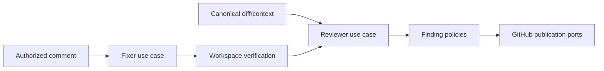

# Bugbot Analysis, Finding Publication, and Autofix

- Status: As-built baseline
- Date: 2026-09-11
- Last updated: 2026-10-21
- Catalog capability ID: `bugbot-analysis-and-autofix`
- Last verified: 2026-10-21; identity continuity and grounding correction tracked in #655
- Owners: Copilot maintainers
- Scope: bounded change analysis, finding identity/publication, authorized autofix, and independent verification
- Related issues/PRs: Bugbot review-state reconciliation SDD; architecture
  quality and scalability hardening SDD
- Required review gates: product UX, architecture, testing, documentation, security/operations
- Open decisions blocking readiness: none for the baseline

## 1. Executive summary

Bugbot reviews a canonical bounded change scope, validates structured findings
locally, publishes only actionable evidence, and maintains stable identities
across reruns. Autofix is a separate authorized write path: it edits only a
guarded workspace, runs configured verification, commits and pushes through
trusted code, then performs a fresh read-only review. A successful edit alone
never proves a finding fixed.

```text
range/context -> read-only review -> validate/deduplicate/rank -> publish
comment + finding IDs -> authorize -> guarded fix -> verify -> commit/push
                      -> independent review -> reconcile current state
```

## 2. Problem, current behavior, and evidence

### 2.1 Problem

AI review is unsafe and noisy when it guesses diff locations, repeats defects,
trusts stale heads, leaks context, or marks its own edits fixed without fresh
evidence. GitHub review snapshots, inline comments, threads, checks, and issue
comments can also disagree after partial mutations.

### 2.2 Current behavior

1. Push, PR, comment, single action, or CLI selects a bounded review context.
2. Bugbot verifies one event PR or resolves one unique exact-head PR, then loads
   trusted prior markers, canonical diff locations, bounded human discussion,
   and ordered organization/repository/path/learned rules for that identity.
3. A canonical PR diff is split losslessly into bounded partitions. At most two
   read-only reviewers run concurrently and every response attests its exact
   partition and head SHA; issue-only reviews retain a single request.
4. All partition candidates are aggregated before local policy rejects malformed,
   unsafe, ignored, low-confidence, duplicate,
   below-severity, or over-budget findings and ranks retained results.
5. Head freshness is checked before analysis and publication; superseded runs
   make no finding mutation.
6. Issue-only findings upsert comments; PR findings create one historical review
   snapshot with line/range or file-level children plus one stable status card.
7. Publication precedes resolution; provider state is re-read and projected by
   the separate reconciliation contract.
8. Authorized autofix resolves a target branch, applies guarded edits, verifies,
   commits/pushes, and reruns independent review while findings remain open until proved.
   If that post-push review is superseded, orchestration reloads the same canonical
   PR once and retains only the final review result. It never repeats the edit,
   verification, commit or push, and every review retains its head guards.

### 2.3 Evidence and contract classification

- Observed behavior: Bugbot domain/policies/use cases/composition, workflows,
  quality tests, and Bugbot docs.
- Intentional contract: canonical diff, stable local identity, trusted marker
  ownership, freshness gates, publication-before-resolution, independent review,
  and fail-closed unknown state.
- Known debt and limitations: model quality is probabilistic; provider APIs can
  make surfaces temporarily unverifiable; comment update budget limits how many
  historical blocks are refreshed per run; non-diff/provider caps can intentionally
  produce a partial review; plans above 64 partitions require PR splitting;
  controlled live quality evidence is external.
- Unknown rationale: earlier prompt wording is not treated as a permanent public contract.
- Implemented hardening: canonical single-PR selection, bounded provider reads,
  explicit coverage, and retained-only resolution are specified in
  [`bugbot-context-selection-and-budgeting.md`](./bugbot-context-selection-and-budgeting.md)
  under the shared gates in
  [`architecture-quality-and-scalability-hardening.md`](./architecture-quality-and-scalability-hardening.md).
  New model/evaluation policies require benchmark-backed proposals.

## 3. Actors, surfaces, and terminology

| Actor | Goal | Entry point | Visible surfaces |
|---|---|---|---|
| Contributor | receive actionable review | push/PR | review, inline finding, status |
| Maintainer | request/dismiss/fix | comment/CLI | thread, comment, commit |
| Reviewer agent | analyze only | structured port | validated response |
| Fixer agent | edit bounded workspace | authorized use case | proposed files only |
| GitHub | own reviews/threads/checks | adapters | provider facts |

A “review snapshot” is immutable history. A “status card” is the current
aggregate projection. Finding identity uses stable provider ID, location
fingerprint, then unambiguous semantic fingerprint. `unknown` means evidence was
not verified; it is not clean.

## 4. Goals, non-goals, and fixed invariants

### 4.1 Goals

1. Published findings MUST be actionable, addressable, bounded, and traceable.
2. Reruns MUST converge without duplicate or false-resolved findings.
3. Autofix MUST be authorized, verified, race-safe, and independently reviewed.

### 4.2 Non-goals

1. Bugbot does not guarantee detection of every defect.
2. Style opinions and speculative concerns are excluded.
3. Autofix does not auto-merge or declare its own result correct.

### 4.3 Fixed product/safety invariants

1. Confidence below 0.70, unsafe paths, malformed schema, and stale heads are rejected.
2. Marker ownership requires authenticated bot identity and matching author.
3. Publication MUST finish before resolution transitions.
4. Manual human thread resolution becomes durable dismissal.
5. Fixer/verification processes never receive GitHub credentials.
6. File-changing comment actions require an authoritative PR/branch target and
   never infer one by scanning issue-related open PRs.

## 5. Current versus proposed product journey

| Stage | Naive risk | As-built contract | Effect |
|---|---|---|---|
| Scope | checkout guess | verified event PR or unique exact-head PR, then exact before/after or canonical bounded diff | relevant evidence |
| Output | prose | local schema and policy validation | deterministic rejection |
| Location | guessed line | proved diff address or file fallback | valid GitHub review |
| Identity | comment ID only | local location + semantic fingerprints | rebase resilience |
| Fix | model edits/pushes | guarded edit + trusted verify/git | least authority |
| Resolution | fixer claims success | independent provider re-read/review | no false clean |

Learned rules use the same authoritative branch boundary as implementation:
`/copilot remember <rule>` checks out the current PR head or issue branch before
reading/writing rules, then verifies and commits only `.copilot/BUGBOT.learned.md`
to that exact ref. A branchless request fails before touching the workspace; a
duplicate rule succeeds without verification, commit or push. Ordinary PR
comments need not contain a head ref: one exact-number provider read validates
an open current PR, matching base and head repositories, optional event hints,
and full head SHA before checkout. Fork or unknown head repository identity,
provider failure and closed/stale PRs fail before storage. Issue conversations
verify their persisted branch against the bounded native linked-branch port
(first 100 linked branches or closing PRs); no broad open-PR scan guesses a ref.

The command MUST publish one correlated, localized confirmation after successful
verification and push. A verified duplicate MUST explicitly say that no change
or additional commit was needed. Empty, unknown or failed storage outcomes MUST
NOT be interpreted as duplicates; failed verification MUST NOT announce a saved
rule. These are typed application facts, never inferred from diagnostic steps.

`/copilot fix` and `/copilot dismiss` accept plain IDs and JSON double-quoted IDs containing
spaces. Quoted operands retain internal spaces, Unicode and escaped backslashes.
Malformed, empty or multiline operands fail before finding mutation. The fixed
2,000-character and 20-argument limits remain; other command grammars are unchanged. Explicit `fix` operands are exact IDs or
the reserved `all` operand, so they bypass language adaptation and deterministic
selection cannot widen to another finding or a generic implementation request.

A successful dismissal MUST publish its verified count; zero matching findings
MUST receive an explicit no-op reply. Authorization or unavailable capability
MUST say the command was not applied. A failed mutation MUST NOT receive a
success confirmation. Reply identity, locale and replay use the shared semantic
publication boundary; no new configuration or marker schema is introduced.

Post-autofix recovery adds one bounded read-only retry for superseded evidence;
the existing mutation, authorization and freshness contracts remain in force.

## 6. Functional behavior and state model

### 6.1 Happy path

1. Materialize and verify review range/context and current head.
2. Query reviewer with bounded prior findings/rules/discussion/diff.
3. Parse, validate, deduplicate, filter, rank, and limit findings.
4. Recheck head; publish review/comments/status; resolve eligible prior findings.
5. Re-read all applicable surfaces, project state, publish summary/check/telemetry.
6. For autofix, authorize, edit, validate paths, verify, commit/push, and repeat review.

### 6.2 Alternative paths

- Draft PRs skip unless `bugbot-review-drafts` is enabled. The canonical
  provider identity supplies the current draft state even for comment events
  and delayed PR events; skipped reviews perform no detailed context/model read
  or finding mutation. The companion context SDD owns six draft-state regressions.
- Dry run returns proposed state after freshness checks but mutates nothing.
- Overflow remains summarized and counts in aggregate state.
- Unaddressable lines become explicit file-level findings, never guessed anchors.
- An issue-only route can use a bounded branch/current-commit scope. A
  PR-required route without a verified canonical PR aborts without analysis.
- Reaching a non-diff/provider context cap is explicit partial coverage; provider read
  failure aborts before the model and is not converted to empty context.
- Diff prompt overflow creates lossless partitions. An agent-call or response-
  validation failure may be retried twice for that same partition only; a
  missing/invalid partition after this fixed bound aborts the whole aggregate
  before mutation. A plan over 64 partitions does not start.
- A superseded independent post-autofix review permits exactly one fresh
  read-only review attempt (at most two complete review attempts). Failed,
  unexecuted, partial or malformed evidence does not activate that retry.
  A second superseded outcome remains non-clean and requires `/copilot recheck`;
  it does not start an unbounded loop or repeat any file mutation.

### 6.3 Finding state model

| State | Meaning | Next | Recovery |
|---|---|---|---|
| candidate | model output not yet trusted | rejected/open | local policy |
| open/reopened | actionable defect visible | fixed/dismissed/verification-required | code/human action |
| verification-required | evidence changed/manually reopened | open/fixed/dismissed | fresh review |
| fixed | independent evidence proves absence | reopened | later regression |
| obsolete | finding no longer maps to scope | terminal/reopened | fresh evidence |
| dismissed | human resolved/explicit dismissal | terminal/reopened by human policy | human |
| unknown | provider evidence unavailable/malformed | any verified state | retry/reconcile |

Canceled or superseded runs publish no stale mutations. Partial marker/thread
transitions are ordered marker-first and repaired by replay.

## 7. User-facing configuration

| Input | Default | Allowed/bounds | Persistence |
|---|---|---|---|
| `bugbot-severity` | `low` | info/low/medium/high | per run |
| `bugbot-comment-limit` | `20` | 1–100 | per run |
| `bugbot-dry-run` | `false` | boolean | per run, no persistence when true |
| `bugbot-effort` | Action `default`; setup recommends `smart` | low/default/high/smart | per run |
| `bugbot-review-drafts` | `false` | boolean | per run |
| `bugbot-suggested-changes` | `true` | boolean | per run |
| `bugbot-fail-on-unresolved` | `false` | boolean | check conclusion only |
| rules/ignore/verify commands | empty | bounded policy values | repository/workflow |

Confidence floor, schema validation, head guards, path safety, marker ownership,
publication ordering, independent review, provider page limits/concurrency,
lossless Unicode-safe fragmentation, prompt bounds (100 prior findings/48,000 characters, 50 conversation entries/
24,000 characters, 1,000 diff files, 12,000-character fragments, 64,000
characters per partition, 64 partitions, and 2,000 aggregate candidates), retained-only
resolution eligibility, and credential isolation are not configurable.
The one-retry post-autofix bound is fixed and adds no user setting. Only the
final attempt enters the returned canonical review evidence; the discarded
superseded attempt remains observable in content-free telemetry and run logs.

## 8. Clean Architecture design

| Boundary | Owns | Must not own/import |
|---|---|---|
| Domain | finding, canonical PR selection, coverage, identity, review state/projection | GitHub/CLI/credentials |
| Policies | bounded packing/concurrency/eligibility, filtering, ranking, ownership, presentation/reconciliation | I/O |
| Use cases | load/analyze/publish/fix/reconcile sequences | provider DTOs/credentials |
| Ports | repository-bound context, findings, resolution, agent, git, telemetry/navigation | concrete clients, tokens in method parameters |
| Adapters | GitHub surfaces, CLI agent, filesystem rules | finding policy |
| Composition | repository/credential binding and capability wiring | product decisions, credentials in use-case requests |



The reconciliation SDD owns post-publication cross-surface truth. Dependency,
cycle, provider-port, workflow, schema, and quality-eval checks MUST remain executable.

## 9. UI/UX and content contract

```markdown
Pending: **Bugbot is reviewing commit `abc1234`.** No action is required.
Action required: **2 actionable findings remain.** Open each linked thread or request `/copilot fix <id>`.
Blocked: **The PR head changed during review.** No stale finding was published; the newer run owns the result.
Partitioned: **Bugbot reviewed all 5 diff partitions for `abc1234` and aggregated one result.** No action is required until publication completes.
Partial context: **The retained non-diff/provider evidence was reviewed, but a fixed cap was reached.** Findings may be actionable; this run cannot declare the whole PR clean or resolve omitted history.
Partition failure: **Partition 4 of 5 did not validate.** No partition-local finding was published and no prior finding was resolved; retry the current head.
Partial publication: **Review published; one thread could not be reconciled.** Current state is `unknown`, not clean; retry reconciliation.
Complete: **Bugbot verified this revision with no actionable findings.** Historical reviews remain available.
```

Each finding shows severity/category/confidence, causal explanation, evidence,
exact file/location or explicit fallback, practical fix, and stable ID. The PR
has one current status card; historical review snapshots stay history. Suggested
changes require proved right-side ranges. Links are same-server/repository and
descriptive. Icons never replace status text. English is fallback; untrusted
discussion, paths, Markdown, mentions, markers, and URLs are sanitized.

## 10. Failure, recovery, and cleanup

| Failure | Impact | Retained facts | Retry | Action | Cleanup |
|---|---|---|---|---|---|
| invalid agent response | no new publication | prior state | yes | inspect runtime/schema | none |
| stale head | run superseded | prior state | automatic newer run | none | discard snapshot |
| partial publication | some findings visible | marker/provider facts | yes | reconcile | no false resolution |
| provider re-read fail | aggregate unknown | historical evidence | yes | retry | none |
| non-diff/provider cap reached | bounded partial analysis | retained evidence and counts | explicit recheck | inspect/split/recheck | no omitted resolution |
| partition plan/attestation fails | no new mutation | canonical SHA/counts | bounded queue | split/retry | discard all outputs |
| canonical PR ambiguous/stale | no analysis or mutation | target and bounded candidate fact | new event | close obsolete PR/retry current head | none |
| autofix verification fail | no commit | findings remain open | yes | repair code/tests | abort workspace |
| push race | no stale push | remote heads/open findings | yes | rerun | abort workspace |
| post-autofix review superseded | pushed fix retained; old status is not treated as current | pushed commit and open findings | one fresh read-only attempt | `/copilot recheck` if still superseded | discard stale review result; no repeated write |

## 11. Security, permissions, and privacy

Reviewer roles are read-only, approval-never, network-disabled where supported,
and ignore repository/user agent configuration. Fixer writes are limited by
workspace/path policies; trusted code owns verification/git. Prompt inputs are
bounded and untrusted. Structured output is locally validated. Secrets, control
sequences, and sensitive paths are rejected/redacted. Finding navigation accepts
only authenticated same-HTTPS-server/repository URLs.

## 12. Observability and operational UX

Content-free telemetry records outcome, elapsed time, configured effort, counts,
validation stages, canonical selection reason, request counts, fixed concurrency,
coverage, per-source retained/omitted/truncated counts, planned/completed
partitions, fragments, assigned files, maximum reviewer concurrency, and
aggregate prompt/response size. Job Summary and Check Run expose aggregate states; the status
card links to current findings and trusted run/commit/review context. Provider
read status distinguishes verified/failed/not-applicable. Concurrency cancels
superseded branch review runs; head guards and idempotent writes protect races.

## 13. Compatibility, migration, rollout, and rollback

Current code contains marker identity checks, but there are no installed users
or real persisted findings to preserve. Hardening therefore replaces marker and
context contracts atomically: removed shapes are invalid, with no compatibility
reader, translation, migration, or deprecation window. Dry run and non-blocking
unresolved default enable controlled first use. After real publication, rollback
must preserve visible history and incorrect mutations are reverted through Git,
not deleted invisibly.

P2-C additionally replaces every unbound Bugbot SCM/Git method with a bound
semantic port. Public programmatic reviews supply an already repository-bound
gateway as the single source of repository identity; `BugbotReviewRequest`
contains target/review facts and no credential or duplicate repository, and the
service never constructs `Execution`. Removed credential/request and unbound
gateway shapes are invalid immediately and receive no compatibility adapter.

## 14. Testing strategy and numeric budget

| Area | Minimum cases | Risks |
|---|---:|---|
| Finding/config/identity policy | 62 | schema, fingerprint, rank, limits; 26 exact quoted-identifier, boundary and malformed-input cases across fix and dismissal |
| Lifecycle/idempotency/races | 30 | stale heads, replay, partial transitions |
| Use cases/autofix | 67 | context, publish, verify, commit, bounded re-review, canonical result, learned-rule PR/issue checkout, branchless rejection, checkout failure, deduplication, path guard and failed verification; 15 canonical write-target cases, one exact quoted-dismiss routing case, six receipt-outcome cases, two exact single-finding selection cases, and six nonzero Git preparation outcomes |
| Provider/workflow contracts | 36 | diffs, reviews, threads, checks, ranges; exact and absent head repository names |
| UX/localization/sanitization | 20 | status/finding/overflow/links/Markdown |
| Integration/security/cutover | 23 | E2E lifecycle, injection, credentials, sole marker schema; three real Git remote checkout cases: stale local, unpublished local, and divergent local |
| **Total** | **238** | no double counting |

Twelve committed-rule adapter cases cover precedence, stale-workspace isolation,
absent-file isolation, missing objects, three malformed revisions, inherited Git
selectors, symlinks, oversized blobs, oversized paths, and count/character batch
bounds. The separate context SDD owns one canonical-head forwarding case, with
no double counting. PR #460 supplied the live evidence: a native remember saved
a branch rule, while ordinary comment reviews reported `rulesLoaded=0` until
revision-pinned reads were introduced. Acceptance: after remember, a comment
review must report the learned source for the current verified head without
changing the checkout or falling back to another revision.

For a canonical pull-request review, repository, path-specific, and learned rules
are read from the same provider-verified head SHA as the diff. This includes
reviews requested from ordinary PR comments whose workflow checkout is the
default branch. Rule reads use local Git objects without changing the checkout,
index, refs, or files; they do not fall back to rules from another revision.
The checkout must contain that commit. The supplied workflows fetch complete
history; for custom or local runners, fetch the verified commit before retrying.
Git rule reads have fixed limits of 64 paths and 12,000 argument characters per
batch, 2 MiB output and 30 seconds per command. Missing objects, invalid identities,
oversized sources, and command failures stop the review before publication.
Only regular file blobs are read, so committed file or directory symlinks are
never followed. Issue-only contexts without a canonical PR retain workspace rule
reads. These source limits are not configurable and do not change the prompt
limits of 30,000 characters per rule and 100,000 combined characters.

Global thresholds remain; new pure Bugbot policies SHOULD reach 95% branch
coverage and security/identity policy 100% for enumerated branches. Fakes replace
live GitHub/models/waits; golden output also receives semantic assertions.
Quality eval and benchmark are required but do not replace deterministic tests.
Manual evidence covers real diff anchors, suggested changes, mobile, dark/light,
screen reader, and controlled live model samples.

## 15. Documentation and discoverability

| Audience | Artifact | Required content |
|---|---|---|
| User | Bugbot detection/autofix | trigger, states, action |
| Maintainer | publication/failure/permissions | markers, limits, recovery |
| Operator | quality observability/verification | telemetry, checks, commands |
| Contributor | this + reconciliation SDD | boundaries and invariants |

## 16. Acceptance scenarios

1. An exact current range produces only locally valid actionable findings.
2. A malformed/unsafe/low-confidence/stale result publishes nothing unsafe.
3. Repeated semantic/location finding updates one identity where unambiguous.
4. PR publication uses proved anchors or states a file-level fallback.
5. Overflow remains counted while comment budget is respected.
6. Partial publication cannot mark a finding resolved.
7. Unauthorized autofix performs no workspace or finding mutation.
8. Authorized autofix verifies, commits/pushes, then independently reviews.
9. Provider read failure yields unknown and a failed/neutral contract as configured, never clean.
10. Dry run mutates no comment, thread, check, config, or branch.
11. Event identity or unique exact-head selection owns one canonical PR end to end.
12. Fixed cap reach is partial and omitted findings are not resolution-eligible.
13. All canonical diff partitions attest one SHA and aggregate before a single
    publication; one failed partition produces no finding-state mutation.
14. A superseded post-autofix review reloads the canonical PR once without
    repeating the fixer or commit path. Only its final evidence reaches the
    aggregate; failed/partial evidence and a second superseded result remain
    truthful and never produce an assumed clean state.

15. An authorized remember command selects the PR head even when the comment
    event has no commit branch, or selects the linked issue branch. Checkout
    precedes rule storage; failed checkout, unrelated changed paths or failed
    verification prevents publication. Repeating the same rule creates no commit.
    Missing event head fields are recovered only through the exact canonical PR
    or verified native issue link; missing/foreign/stale identity prevents writes.
16. Dismissing `"docs/file.mdx:28:message with spaces"` targets that one exact
    ID. Mixed operands remain separate; malformed quotes, empty/multiline IDs
    and the 21st argument produce an invalid-command result without mutation.

## 17. Requirements traceability

| Requirement | Owner | Evidence | Documentation |
|---|---|---|---|
| bounded review | context/prompt/schema policies | prompt/schema/E2E tests | detection |
| exhaustive PR diff | partition planner/analyzer/aggregate | 44-file/lossless/concurrency/attestation tests | how it works/failures |
| stable identity | finding identity domain | identity tests | publication |
| safe publication | publish/reconciliation use cases | publication/reconciliation tests | publication |
| guarded autofix | autofix/workspace/git use cases | autofix/security tests | autofix |
| versioned learned rule | explicit command/workspace/git use cases | 22 command-level branch, canonical identity, replay and failure cases | configuration/how it works |
| lossless finding operands | command domain + explicit routing | 26 parser cases + exact-ID dismissal and fix selection assertions; locale companion covers adaptation bypass | comment commands |
| current truth | reconciliation spec/policies | projection tests | detection/quality |

## 18. Maintenance sequence

1. Update finding/config/identity contracts and exhaustive tests.
2. Update context/review/publication/autofix use cases and race tests.
3. Update provider adapters/workflows/schema/benchmarks.
4. Update presentation fixtures, Bugbot docs, companion SDD, and catalog.
5. Run full gates plus controlled live and human UX evidence.

## 19. Definition of Done

- [ ] The baseline and explicitly allocated extension budgets, coverage, quality eval, and architecture gates pass.
- [ ] Stale, replay, partial, unknown, dismissal, and unsupported-schema cases converge safely.
- [ ] Autofix authority, paths, verification, git, and fresh review are proven.
- [ ] All five UI states, anchors, links, accessibility, localization, and noise pass.
- [ ] Workflows, docs, reconciliation SDD, and catalog agree.
- [ ] Controlled live provider and GitHub UX evidence is captured.
- [x] Prompt-sized canonical PR diffs are reviewed through lossless, attested,
      atomic partitions under the companion SDD's 67-case budget.

## 20. References and decisions

- Primary sources: catalogued Bugbot code, workflows, tests, docs, and evals.
- Related SDD: `bugbot-review-state-reconciliation.md`.
- Planned hardening: `bugbot-context-selection-and-budgeting.md` owns canonical
  PR selection and the provider-request budget; the architecture hardening SDD
  owns shared sequencing and verification gates.
- Implemented extension: `bugbot-exhaustive-partitioned-analysis.md` owns
  exhaustive diff planning, response attestation, and atomic aggregation.
- Decision: independent evidence, not fixer assertion, owns resolution.
- Rejected: guessed anchors, model-only validation, provider-ID-only identity.
- Follow-up: model-specific quality tuning remains benchmark-governed.

### Dogfooding correction: retained runner branches (2026-10-11)

PR #465 autofix run 38146515770 fetched the exact feature ref, then selected a
retained local branch 16 commits behind its remote. The admitted agent produced
no safe changes. The stale checkout is independently established by Git's log;
it is not proof of why the model produced no edits.

The trusted preparation now uses this flow before restoring any saved changes:

```text
clean/status -> fetch exact ref -> checkout -> fast-forward-only FETCH_HEAD
             -> HEAD ancestor of FETCH_HEAD -> restore stash -> agent
```

A fast-forward merge establishes that FETCH_HEAD is an ancestor of HEAD. The
reverse ancestry check establishes equality and rejects an unpublished local
head that merge would otherwise accept as already current. Divergence refuses
the operation without a merge commit, reset, force push, or discarded work.
Every status, checkout, stash, merge, ancestry, and restore exit code is checked.
Failure preserves the existing branch and any retained stash and publishes the
existing semantic failure response; it never announces preparation success.

Nine distinct regression cases extend the budget: three isolated real Git
repositories prove exact remote checkout and local work retention; six nonzero
command outcomes exercise status, checkout, stash push/pop, fast-forward, and
reverse ancestry rejection. These are not counted in another capability.
The autofix documentation and catalog evidence change with this contract.
Live acceptance remains pending until a new Action execution demonstrates the
verified fetched head and subsequent authenticated fixer behavior.


### Generated scratch and truthful refusal: #474 (2026-10-13)

Native fixer run `38331274938` executed official Codex and produced workspace
changes but refused generated `.tmp/jest_dx` transform-cache basenames containing
token/secret/credential. Repository-local `.tmp/` scratch is now ignored, so
those generated files cannot enter normal Git status, staging or automated
commits. This is repository housekeeping, not an exclusion from the sensitive
path guard: workflows, credentials and other sensitive changed paths remain
rejected, and tracked files are still visible to Git regardless of ignore rules.
The 100-path limit, verification commands, platforms and coverage gates stay
unchanged. Operators of consumer repositories should keep any repository-local
test scratch ignored or use their normal external temporary directory.

One new real Git integration case belongs only to this owner: generated Jest
scratch stays outside the commit delta, while a normal source change is retained
and a new `.pem` still causes refusal. Stage-specific error recovery is allocated
only to execution lifecycle; fresh error-reply evidence only to semantic
communication. Native acceptance requires a legitimate selected finding to
produce verified changes and a normal commit/push after the housekeeping fix;
a model answer, CLI exit zero or a refused cache-only run does not establish it.

Native fixer `83a80a52` omitted generated bundles; CI `38344489789` rejected the out-of-sync Action bundle. This repository's configured verify commands MUST include its build. The scoped automated commit MUST reread the workspace after all verification, retain the existing sensitive-file/100-path guards, and stage that final safe inventory, including verification-generated artifacts. Failed or denied final inspection causes no stage/commit/push. Legacy unscoped callers retain their existing staging contract. Four new distinct cases cover generated build paths, sensitive verification output, the hundred-path ceiling and denied final inventory. This correction's autofix allocation is five (one real Git cache case + four post-verification cases); global and changed-module thresholds remain unchanged.

The final scoped inventory combines the already-authorized agent paths with safe paths newly introduced during verification. Paths that were already changed but not authorized before verification remain excluded; this preserves the existing unrelated-file contract. All final paths still undergo the same sensitive/count checks.

The required changed-module coverage gate exposed the missing original-inventory failure contract. A fifth new case denies the scope read before verification and proves that verification, staging and pushing are withheld. The autofix allocation is now six (one cache + five workspace cases), and the three-capability correction totals **70**. The 95%/90% gate is retained. `BUGBOT_AUTOFIX_VERIFY_COMMANDS` in this repository now begins with `pnpm run build`, followed by the five existing commands; no gate was removed.


### Dogfooding correction: canonical branch reaches autofix commit — #494

[Native run 38446979968](https://github.com/vypdev/copilot/actions/runs/38446979968)
verified and checked out PR #493's exact branch, completed official Codex 0.162.1
execution, and accepted two safe paths. Commit then failed with “No branch to
commit to”: an ordinary PR comment supplied no commit branch, and the separately
verified preflight head had not reached the commit request. No remote fix was
published. A successful model/CLI/edit is independent of verification and push.

```text
accepted authorized fix request -> exact current conversation branch read
 -> matching same-repository PR or verified issue link -> guarded autofix
 -> same verified branch passed to commit -> existing verification/freshness/push
 -> independent review -> correlated fix result
```

The text equivalent is: resolve native branch authority before the fixer and
carry that exact value through both the edit request and trusted commit request.
Autofix MUST use the same existing resolver as implementation and learned-rule
commands. Ordinary PR comments need not supply a branch: a bounded exact-number
current PR read proves its open identity, full head SHA and same base/head
repository. An intent override MUST match that result. Missing capability,
closed/foreign/forked identity, missing or empty head, denied read, or invalid
issue link MUST fail before the agent, workspace mutation or commit. No Git HEAD,
default branch, broad PR search or unverified intent can fill a missing target.
Existing authorization, dry-run, canonical preflight and trusted commit head
checks remain required. A resolved name does not disable subsequent stale-head
or workspace safety checks.

This is application routing repair using already bound semantic readers and the
existing domain canonical-selection policy. No SDK, provider DTO, credentials,
new persistence/configuration/permission or mutable Execution enters the route.
Composition and read-only query contracts are unchanged. Public trigger syntax,
fixed request budgets, verify commands, path limit and independent review remain
unchanged. Consumer workflows accepting ordinary PR comments require their
existing contents write grant for file-changing commands. Rollback restores the
known post-edit failure for comments without a branch; retained unpublished
runner changes are not reused as evidence or automatically published.

Product UI uses existing localized correlated outcomes: pending waits for the
linked run; an invalid target reports that the request was not completed and
retains prior state; a later verify/push failure retains edits without claiming
publication; pushed changes point to independent finding status; no-change
outcomes say no additional commit was needed. There is no new initial branch
success notification, invented commit hash or optimistic finding resolution.
Retry the current authorized fix command after repairing branch evidence; do not
manually push the retained edits from a failed run.

Allocate **12 additional distinct route regressions**, owned only here: **three
successful branch transfers** (PR without a branch hint, linked issue and matching
explicit override) and **nine refusal contracts** (override mismatch, fork owner,
fork repository, closed PR, wrong PR number, absent readers, denied read, lost
issue link and empty head ref). Existing post-push review/replay/dry-run cases use
realistic native-reader fakes and remain unchanged in count. No live provider,
model, real sleep or gate reduction is used in these tests. Global 90/90/88/82
and changed-runtime 95% lines/statements, 90% branches/functions remain mandatory;
no new pure policy is introduced.

Acceptance and traceability: the 12 route cases prove exact branch transfer and
pre-edit refusal; existing preflight/commit tests prove checkout and freshness;
`docs/bugbot/autofix.mdx` documents ordinary PR comments, failed publication and
retry. Current native `/copilot fix all` on PR #493 must execute real repository
tools, verify, commit and push to its exact Action ref, then independently verify
finding status. The owning SDD/catalog, generated catalog, documentation,
architecture contracts, bundles, full suite/coverage and current-head CI/review
must pass before this correction is complete. Native acceptance remains pending
until the retry actually publishes and its review establishes current state.

### Source-grounded review evidence — #655 (2026-10-21)

The reviewer and real-agent benchmark share the same source-grounding instruction.
Before publication the model MUST try to disprove each alleged defect against
effective repository settings, inherited protocol/library defaults, short-circuit
guards, helper validation and actual caller/render paths. Arithmetic and current
locations must agree with cited evidence. A finding whose evidence withdraws its
own claim MUST be omitted, including low/info reports. This is a model instruction,
not a deterministic guarantee or an English-prose rejection heuristic. Valid
defects remain required when those protections are absent. The previous-finding
prompt traces the original precondition through current modules and requests the
exact retained ID when the same concern remains active.

Allocate **eight added evaluation cases** only here: six negative cases from the
reported configuration, HTTP/1.0, arithmetic, short-circuit, helper-validation and
exclusive-render concerns, plus two positive controls for unsafe membership order
and simultaneous duplicate IDs. Existing prompt tests enforce the shared review
contract; benchmark tests classify each negative as a false positive and each
missed positive as a false negative. The corpus now has 38 cases. Ground-truth
arrays never enter the model prompt. Checked-in reference predictions test the
scorer contract and MUST NOT be claimed as an observed real-model improvement.

The companion reconciliation SDD owns the 18 lifecycle cases and durable-ID
correction; no double counting. No confidence/severity gate, schema, permission,
runtime access or configuration changes. Documentation: quality/observability,
finding publication and failure scenarios. Acceptance: the reference evaluation
passes all existing thresholds, unsupported reports fail the isolated precision
gate, and missing positive controls fail recall. Full coverage, architecture,
catalog/specification, documentation and generated-package gates remain required.

Primary sources supporting the synthetic examples:
[coverage.py configuration](https://coverage.readthedocs.io/en/latest/config.html)
documents TOML settings and branch measurement;
[Python BaseHTTPRequestHandler](https://docs.python.org/3/library/http.server.html#http.server.BaseHTTPRequestHandler.protocol_version)
documents its default HTTP/1.0 response protocol. The issue supplies exact consumer
source and runs; these fixtures do not claim to replay that external runtime.
