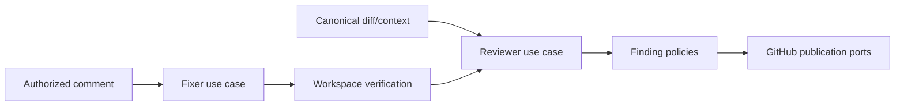
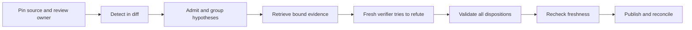
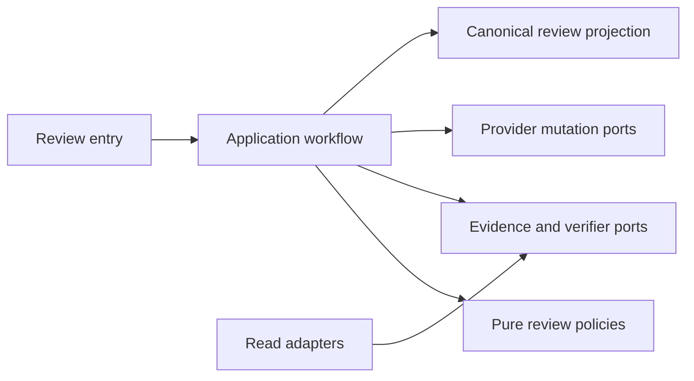
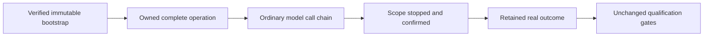
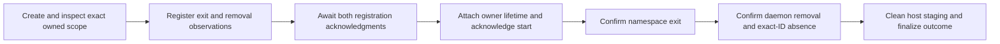
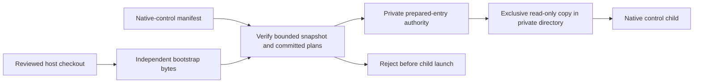

# Bugbot Analysis, Finding Publication, and Autofix

- Status: As-built baseline
- Date: 2026-09-11
- Last updated: 2026-11-04
- Catalog capability ID: `bugbot-analysis-and-autofix`
- Last verified: 2026-11-04; JSON value/reader grounding #855; fixture-value grounding #834; recovery-contract grounding #832; Python exception grammar regression #831; versioned Ktor routing-root regression #809, active Kotlin Json policy #807, indirect unittest discovery regression #806, generated-source coordinate evidence #796, dependency-generated request/assertion evidence #784, renderer-grounded Markdown links #772, host-aware self-repository Action references #770, Kotlin/Wasm binding guidance #764, resolved-type grounding #736, delegated test-path evidence #738, versioned Action input contracts #739 and exact validation witnesses #749 alongside the dated package/framework evidence in #720, #721 and #722
- Owners: Copilot maintainers
- Scope: bounded change analysis, finding identity/publication, authorized autofix, and independent verification
- Related issues/PRs: Bugbot review-state reconciliation SDD; architecture
  quality and scalability hardening SDD
- Required review gates: product UX, architecture, testing, documentation, security/operations
- Open decisions blocking readiness: none for the baseline

### JSON value and reader-contract grounding — #855 (2026-11-04)

The [JSON value companion](./bugbot-json-value-grounding.md) owns tracing actual
producer/decoder/transform/reader values before alleging extra encoding or
proposing a cast. Twelve source-bound controls and 22 deterministic regressions
contrast working codecs with real JSON boundary failures. Original primitive,
reporter product tests, authored runtime probes and model measurements remain
separate evidence. One shared pure rule reaches ordinary/framed review, existing
Python candidate verification and the benchmark; identity, bounds, historical
state, permissions and approval controls remain unchanged.

### Complete statements and asynchronous ordering — #848 (2026-11-03)

The [statement-order companion](./bugbot-async-statement-evidence.md) owns reading
semicolon-separated awaits, actual receiver/cycle/helper ownership and reached
lifecycle writes before claiming missing synchronization. Its twelve independently
executed Lit controls and 18 deterministic SDK regressions preserve real unfinished
update defects and separate private verdicts from observed facts. Ordinary/framed
source review and the benchmark share guidance; existing Python verifier activation,
traffic, publication, history and authorization remain unchanged. Qualification
retains every fixed-input baseline/candidate sample and its actual limitations.

### Fixture-value grounding — #834 (2026-11-03)

The [fixture-value companion](./bugbot-fixture-value-grounding.md) owns tracing
helper defaults/overrides, database-file parents and actual SQL result values
before judging test assertions. Its twelve frozen source cases, 51 deterministic
regressions and separately recorded native/model evidence preserve genuine wrong
assertions while keeping private verdicts outside model input. Fragment origins
remain independent of separately supplied helper context. Existing architecture,
publication, trust, bounded adjudication and history controls remain applicable.
The verifier's existing schema constrains original file/known snippet values;
the unchanged per-ID guard still rejects swapped identities and preserves precise
anchor enrichment when an original snippet was absent.

### Recovery-contract grounding — #832 (2026-11-03)

The [recovery-contract companion](./bugbot-recovery-contract-grounding.md) owns
retention/no-overwrite, safely owned disposable staging, changed ownership and
after-publication failure requirements. Its ten frozen controls, 56 deterministic
regressions and separately recorded native/model evidence preserve real cleanup
and data-loss findings. Existing publication, historical resolution, trust,
coverage and approval contracts below remain applicable.

### Python exception grammar correction — #831 (2026-11-02)

This bounded amendment applies the baseline architecture, publication, security,
recovery and documentation contracts below. The original report and its added
Domus PR #14 report both misclassify a Python 3.14 exception list as a collection
or startup SyntaxError. The latter review completed every partition and context
source; missing context alone does not explain the wrong language rule. Those
consumer parser/import/CI results are reporter evidence, not executions performed
by this implementation. Do not rewrite valid consumer handlers to hide a review
defect. Earlier SDK releases and the current branch are separate measurements.

**Intentional contract, syntax-R01:** ordinary, partitioned and framed review with assigned/canonical Python files,
the real-agent benchmark, and independent generated-source candidate verification
MUST use supported interpreter grammar. Python 3.14 / PEP 758 accepts an
unparenthesized multiple-exception list without `as`, for both `except` and
`except*`; parentheses remain required for a multiple-exception expression with
`as`. The semantics do not revert to Python 2 capture behavior. Preserve a proved
failure on any actually supported older interpreter, a missing binding or another
independent exception-handling defect. Parsing-only failures follow the existing
medium-severity reliability contract; do not confuse them with a runtime handling
fault. A successful 3.14 parse cannot certify a
declared 3.13 compatibility target.

**Evidence, syntax-R02:** inspect effective root/nearest project requirements,
version pins and applicable CI matrix; Ruff's target is corroboration, not the
supported runtime range. Reconcile exact-source, same-head parser/collection
evidence and contrary observations with their actual interpreter. Different-head,
cached, skipped or unrelated green jobs do not disprove a fault. Parsing proves
neither import success nor runtime behavior. Unknown versions cannot justify a
universal Python 3 SyntaxError claim; omit that unsupported premise while
retaining supported independent findings. Never invent tools, runs or results.

```text
changed clause -> effective supported versions -> version-matched grammar
 -> applicable source/execution counterevidence -> proved finding or omission
```

Text equivalent: identify the clause and actual compatibility contract before
evaluating evidence; publish only a supported causal defect. The existing review
completeness and approval gates still apply independently of the verdict.

**Architecture/configuration, syntax-R03:** one shared pure instruction is used
by actual review with a retained canonical or assigned `.py` path, the benchmark
and the independent verifier. Non-Python and unknown-file legacy scopes keep
the generic source/version grounding; no language is inferred from prose. No parser, range
interpreter, process executor, repository scan, semantic port or persistent state
is added to production. No automatic regex suppression, new language dependency,
permission, config/override, public schema, retry or threshold change is allowed.
The verifier retains its existing trigger, identity/batching/size checks and
historical-state separation; this amendment does not claim every Python handler
receives a second query. The existing 15,000-character compatibility prompt test,
source-bound framing receipts, locale and untrusted-input boundaries stay in force.

**UX/operations, syntax-R04:** existing pending/complete/partial/failed review
cards remain authoritative. Example pending: “Reviewing changed code — no action
required.” Complete safe case: no inline syntax finding; completion does not mean
other quality gates passed. A supported older-runtime defect is anchored to the
changed clause, e.g. “This handler cannot parse on the supported Python 3.13
target,” with concrete version evidence and a practical fix. Partial context
remains partial, failed verification remains failed; do not turn omission into a
clean review or resolve a historical thread without the normal explicit process.
Existing accessible text, locales, sanitization, durable markers and comment
budgets need no new surface. Inspect the existing review/run links and recheck
after upgrading the SDK; rollback reverts instruction/tests/docs together without
rewriting review history. Merge to develop alone does not update consumer runtime.

Reserve **32 distinct deterministic cases before changing production guidance**:

| Area | Minimum cases | Risk/observable result |
|---|---:|---|
| Frozen corpus inventory | 1 | Twelve inputs, six real defects and six safe/unknown cases |
| Scorer counter-controls | 12 | Penalize false syntax claims and missed actual defects with unchanged floors |
| Exact inputs/anchors | 12 | Runtime/evidence retained; true defects anchor the actual changed clause |
| Real delivery | 5 | Ordinary, resolution owner/non-owner, benchmark and independent verifier retain guidance |
| Label privacy | 1 | Expected verdict and suggested replacement cannot leak into model input |
| Prior corpus preservation | 1 | All prior inputs/references preserved as decoded data |
| **Total** | **32** | Each test counted once; native/model observations are separate |

Optional fixed owned probes MUST distinguish 18 actual native parser observations
(nine each under CPython 3.13 and 3.14) from separately authored 3.14 ordinary,
group, capture and missing-binding runtime checks. They never execute corpus or
consumer source, read no external input and introduce no mandatory Python CI
requirement. Freeze the 12 synthetic inputs/verdicts before measuring current
baseline and candidate with identical model/runtime/effort and unchanged scorer
floors. Record all samples and failures; neither a passing baseline nor deterministic
schema/prompt tests establish historical reproduction or statistical improvement.

Acceptance: the two/three-type and group clauses are not condemned merely for
missing parentheses on 3.14; invalid `as` clauses and genuinely supported older
targets remain reportable; stale evidence, unknown requirements and parser-only
proof cannot be inflated. Update detection/observability documentation, catalog
evidence and generated index with the implementation. Require fully hit modified
runtime lines, existing global/module coverage, build/types/lint, specs/docs/workflow
checks, Graphify, exact-head CI/platform verification, complete review without
findings and official Codecov with zero missed/partial modified lines against the
actual base. Manual browser/VoiceOver work is inapplicable to this backend prompt
change. No readiness decision is left open for the contract; measured candidate
quality and all implementation gates remain to be established.

Campaign provenance: the first authored expectations incorrectly labeled five
parsing-only failures as correctness. Preserve that entire initial input and
both failing samples. A separately frozen taxonomy correction changes only those
five expected categories to reliability, as already required by the product;
source, causal verdicts, anchors, severity and thresholds remain unchanged. Fresh
paired samples are required after that recorded correction. The first candidate
then gets every causal verdict right but fails three category matches; retain
and reject that candidate as final. Clarify the existing parsing-only category
in the shared instruction and measure that distinct candidate against the same
corrected frozen inputs. Never relabel a measured prediction to hide a failure.
The final distinct candidate passes all twelve cases and every unchanged score
floor: precision/recall/F1/location/severity/category 1.0, zero false positives
or negatives. This is bounded campaign evidence, not a statistical guarantee.

Primary sources: [PEP 758](https://peps.python.org/pep-0758/) and
[Python 3.14 language changes](https://docs.python.org/3.14/whatsnew/3.14.html#pep-758-allow-except-and-except-expressions-without-brackets).

## 1. Executive summary

Bugbot reviews a canonical bounded change scope, validates structured findings
locally, publishes only actionable evidence, and maintains stable identities
across reruns. Autofix is a separate authorized write path: it edits only a
guarded workspace, runs configured verification, commits and pushes through
trusted code, then performs a fresh read-only review. A successful edit alone
never proves a finding fixed.

```text
range/context -> read-only review -> validate/deduplicate/rank -> publish
comment + finding IDs -> authorize -> guarded fix -> verify -> commit/push
                      -> independent review -> reconcile current state
```

## 2. Problem, current behavior, and evidence

### 2.1 Problem

AI review is unsafe and noisy when it guesses diff locations, repeats defects,
trusts stale heads, leaks context, or marks its own edits fixed without fresh
evidence. GitHub review snapshots, inline comments, threads, checks, and issue
comments can also disagree after partial mutations.

### 2.2 Current behavior

1. Push, PR, comment, single action, or CLI selects a bounded review context.
2. Bugbot verifies one event PR or resolves one unique exact-head PR, then loads
   trusted prior markers, canonical diff locations, bounded human discussion,
   and ordered organization/repository/path/learned rules for that identity.
3. A canonical PR diff is split losslessly into bounded partitions. At most two
   read-only reviewers run concurrently and every response attests its exact
   partition and head SHA; issue-only reviews retain a single request.
4. All partition candidates are aggregated before local policy rejects malformed,
   unsafe, ignored, low-confidence, duplicate,
   below-severity, or over-budget findings and ranks retained results.
5. Head freshness is checked before analysis and publication; superseded runs
   make no finding mutation.
6. Issue-only findings upsert comments; PR findings create one historical review
   snapshot with line/range or file-level children plus one stable status card.
7. Publication precedes resolution; provider state is re-read and projected by
   the separate reconciliation contract.
8. Authorized autofix resolves a target branch, applies guarded edits, verifies,
   commits/pushes, and reruns independent review while findings remain open until proved.
   If that post-push review is superseded, orchestration reloads the same canonical
   PR once and retains only the final review result. It never repeats the edit,
   verification, commit or push, and every review retains its head guards.

### 2.3 Evidence and contract classification

- Observed behavior: Bugbot domain/policies/use cases/composition, workflows,
  quality tests, and Bugbot docs.
- Intentional contract: canonical diff, stable local identity, trusted marker
  ownership, freshness gates, publication-before-resolution, independent review,
  and fail-closed unknown state.
- Known debt and limitations: model quality is probabilistic; provider APIs can
  make surfaces temporarily unverifiable; comment update budget limits how many
  historical blocks are refreshed per run; non-diff/provider caps can intentionally
  produce a partial review; ordinary plans stop at 64 partitions; eligible larger diffs use the source-bound framed companion;
  controlled live quality evidence is external.
- Unknown rationale: earlier prompt wording is not treated as a permanent public contract.
- Implemented hardening: canonical single-PR selection, bounded provider reads,
  explicit coverage, and retained-only resolution are specified in
  [`bugbot-context-selection-and-budgeting.md`](./bugbot-context-selection-and-budgeting.md)
  under the shared gates in
  [`architecture-quality-and-scalability-hardening.md`](./architecture-quality-and-scalability-hardening.md).
  New model/evaluation policies require benchmark-backed proposals.

## 3. Actors, surfaces, and terminology

| Actor | Goal | Entry point | Visible surfaces |
|---|---|---|---|
| Contributor | receive actionable review | push/PR | review, inline finding, status |
| Maintainer | request/dismiss/fix | comment/CLI | thread, comment, commit |
| Reviewer agent | analyze only | structured port | validated response |
| Fixer agent | edit bounded workspace | authorized use case | proposed files only |
| GitHub | own reviews/threads/checks | adapters | provider facts |

A “review snapshot” is immutable history. A “status card” is the current
aggregate projection. Finding identity uses stable provider ID, location
fingerprint, then unambiguous semantic fingerprint. `unknown` means evidence was
not verified; it is not clean.

## 4. Goals, non-goals, and fixed invariants

### 4.1 Goals

1. Published findings MUST be actionable, addressable, bounded, and traceable.
2. Reruns MUST converge without duplicate or false-resolved findings.
3. Autofix MUST be authorized, verified, race-safe, and independently reviewed.

### 4.2 Non-goals

1. Bugbot does not guarantee detection of every defect.
2. Style opinions and speculative concerns are excluded.
3. Autofix does not auto-merge or declare its own result correct.

### 4.3 Fixed product/safety invariants

1. Confidence below 0.70, unsafe paths, malformed schema, and stale heads are rejected.
2. Marker ownership requires authenticated bot identity and matching author.
3. Publication MUST finish before resolution transitions.
4. Manual human thread resolution becomes durable dismissal.
5. Fixer/verification processes never receive GitHub credentials.
6. File-changing comment actions require an authoritative PR/branch target and
   never infer one by scanning issue-related open PRs.

## 5. Current versus proposed product journey

| Stage | Naive risk | As-built contract | Effect |
|---|---|---|---|
| Scope | checkout guess | verified event PR or unique exact-head PR, then exact before/after or canonical bounded diff | relevant evidence |
| Output | prose | local schema and policy validation | deterministic rejection |
| Location | guessed line | proved diff address or file fallback | valid GitHub review |
| Identity | comment ID only | local location + semantic fingerprints | rebase resilience |
| Fix | model edits/pushes | guarded edit + trusted verify/git | least authority |
| Resolution | fixer claims success | independent provider re-read/review | no false clean |

Learned rules use the same authoritative branch boundary as implementation:
`/copilot remember <rule>` checks out the current PR head or issue branch before
reading/writing rules, then verifies and commits only `.copilot/BUGBOT.learned.md`
to that exact ref. A branchless request fails before touching the workspace; a
duplicate rule succeeds without verification, commit or push. Ordinary PR
comments need not contain a head ref: one exact-number provider read validates
an open current PR, matching base and head repositories, optional event hints,
and full head SHA before checkout. Fork or unknown head repository identity,
provider failure and closed/stale PRs fail before storage. Issue conversations
verify their persisted branch against the bounded native linked-branch port
(first 100 linked branches or closing PRs); no broad open-PR scan guesses a ref.

The command MUST publish one correlated, localized confirmation after successful
verification and push. A verified duplicate MUST explicitly say that no change
or additional commit was needed. Empty, unknown or failed storage outcomes MUST
NOT be interpreted as duplicates; failed verification MUST NOT announce a saved
rule. These are typed application facts, never inferred from diagnostic steps.

`/copilot fix` and `/copilot dismiss` accept plain IDs and JSON double-quoted IDs containing
spaces. Quoted operands retain internal spaces, Unicode and escaped backslashes.
Malformed, empty or multiline operands fail before finding mutation. The fixed
2,000-character and 20-argument limits remain; other command grammars are unchanged. Explicit `fix` operands are exact IDs or
the reserved `all` operand, so they bypass language adaptation and deterministic
selection cannot widen to another finding or a generic implementation request.

A successful dismissal MUST publish its verified count; zero matching findings
MUST receive an explicit no-op reply. Authorization or unavailable capability
MUST say the command was not applied. A failed mutation MUST NOT receive a
success confirmation. Reply identity, locale and replay use the shared semantic
publication boundary; no new configuration or marker schema is introduced.

Post-autofix recovery adds one bounded read-only retry for superseded evidence;
the existing mutation, authorization and freshness contracts remain in force.

## 6. Functional behavior and state model

### 6.1 Happy path

1. Materialize and verify review range/context and current head.
2. Query reviewer with bounded prior findings/rules/discussion/diff.
3. Parse, validate, deduplicate, filter, rank, and limit findings.
4. Recheck head; publish review/comments/status; resolve eligible prior findings.
5. Re-read all applicable surfaces, project state, publish summary/check/telemetry.
6. For autofix, authorize, edit, validate paths, verify, commit/push, and repeat review.

### 6.2 Alternative paths

- Draft PRs skip unless `bugbot-review-drafts` is enabled. The canonical
  provider identity supplies the current draft state even for comment events
  and delayed PR events; skipped reviews perform no detailed context/model read
  or finding mutation. The companion context SDD owns six draft-state regressions.
- Dry run returns proposed state after freshness checks but mutates nothing.
- Overflow remains summarized and counts in aggregate state.
- Unaddressable lines become explicit file-level findings, never guessed anchors.
- An issue-only route can use a bounded branch/current-commit scope. A
  PR-required route without a verified canonical PR aborts without analysis.
- Reaching a non-diff/provider context cap is explicit partial coverage; provider read
  failure aborts before the model and is not converted to empty context.
- Diff prompt overflow creates lossless partitions. An agent-call or response-
  validation failure may be retried twice for that same partition only; a
  missing/invalid partition after this fixed bound aborts the whole aggregate
  before mutation. An ordinary plan over 64 partitions selects the source-bound framed companion when all of its independent proof and capacity bounds fit; unsupported workloads remain blocked.
- A superseded independent post-autofix review permits exactly one fresh
  read-only review attempt (at most two complete review attempts). Failed,
  unexecuted, partial or malformed evidence does not activate that retry.
  A second superseded outcome remains non-clean and requires `/copilot recheck`;
  it does not start an unbounded loop or repeat any file mutation.

### 6.3 Finding state model

| State | Meaning | Next | Recovery |
|---|---|---|---|
| candidate | model output not yet trusted | rejected/open | local policy |
| open/reopened | actionable defect visible | fixed/dismissed/verification-required | code/human action |
| verification-required | evidence changed/manually reopened | open/fixed/dismissed | fresh review |
| fixed | independent evidence proves absence | reopened | later regression |
| obsolete | finding no longer maps to scope | terminal/reopened | fresh evidence |
| dismissed | human resolved/explicit dismissal | terminal/reopened by human policy | human |
| unknown | provider evidence unavailable/malformed | any verified state | retry/reconcile |

Canceled or superseded runs publish no stale mutations. Partial marker/thread
transitions are ordered marker-first and repaired by replay.

## 7. User-facing configuration

| Input | Default | Allowed/bounds | Persistence |
|---|---|---|---|
| `bugbot-severity` | `low` | info/low/medium/high | per run |
| `bugbot-comment-limit` | `20` | 1–100 | per run |
| `bugbot-dry-run` | `false` | boolean | per run, no persistence when true |
| `bugbot-effort` | Action `default`; setup recommends `smart` | low/default/high/smart | per run |
| `bugbot-review-drafts` | `false` | boolean | per run |
| `bugbot-suggested-changes` | `true` | boolean | per run |
| `bugbot-fail-on-unresolved` | `false` | boolean | check conclusion only |
| rules/ignore/verify commands | empty | bounded policy values | repository/workflow |

Confidence floor, schema validation, head guards, path safety, marker ownership,
publication ordering, independent review, provider page limits/concurrency,
lossless Unicode-safe fragmentation, prompt bounds (100 prior findings/48,000 characters, 50 logical conversation entries/
24,000 rendered characters with 4,000-unit Unicode-safe payload fragments, 3,000 GitHub diff file records, 12,000-character fragments, 64,000
characters per partition, 64 ordinary partitions or the separately bounded framed profile, and 2,000 aggregate candidates), retained-only
resolution eligibility, and credential isolation are not configurable.
The one-retry post-autofix bound is fixed and adds no user setting. Only the
final attempt enters the returned canonical review evidence; the discarded
superseded attempt remains observable in content-free telemetry and run logs.

## 8. Clean Architecture design

| Boundary | Owns | Must not own/import |
|---|---|---|
| Domain | finding, canonical PR selection, coverage, identity, review state/projection | GitHub/CLI/credentials |
| Policies | bounded packing/concurrency/eligibility, filtering, ranking, ownership, presentation/reconciliation | I/O |
| Use cases | load/analyze/publish/fix/reconcile sequences | provider DTOs/credentials |
| Ports | repository-bound context, findings, resolution, agent, git, telemetry/navigation | concrete clients, tokens in method parameters |
| Adapters | GitHub surfaces, CLI agent, filesystem rules | finding policy |
| Composition | repository/credential binding and capability wiring | product decisions, credentials in use-case requests |



The reconciliation SDD owns post-publication cross-surface truth. Dependency,
cycle, provider-port, workflow, schema, and quality-eval checks MUST remain executable.

## 9. UI/UX and content contract

```markdown
Pending: **Bugbot is reviewing commit `abc1234`.** No action is required.
Action required: **2 actionable findings remain.** Open each linked thread or request `/copilot fix <id>`.
Blocked: **The PR head changed during review.** No stale finding was published; the newer run owns the result.
Partitioned: **Bugbot reviewed all 5 diff partitions for `abc1234` and aggregated one result.** No action is required until publication completes.
Partial context: **The retained non-diff/provider evidence was reviewed, but a fixed cap was reached.** Findings may be actionable; this run cannot declare the whole PR clean or resolve omitted history.
Partition failure: **Partition 4 of 5 did not validate.** No partition-local finding was published and no prior finding was resolved; retry the current head.
Partial publication: **Review published; one thread could not be reconciled.** Current state is `unknown`, not clean; retry reconciliation.
Complete: **Bugbot verified this revision with no actionable findings.** Historical reviews remain available.
```

Each finding shows severity/category/confidence, causal explanation, evidence,
exact file/location or explicit fallback, practical fix, and stable ID. The PR
has one current status card; historical review snapshots stay history. Suggested
changes require proved right-side ranges. Links are same-server/repository and
descriptive. Icons never replace status text. English is fallback; untrusted
discussion, paths, Markdown, mentions, markers, and URLs are sanitized.

## 10. Failure, recovery, and cleanup

| Failure | Impact | Retained facts | Retry | Action | Cleanup |
|---|---|---|---|---|---|
| invalid agent response | no new publication | prior state | yes | inspect runtime/schema | none |
| stale head | run superseded | prior state | automatic newer run | none | discard snapshot |
| partial publication | some findings visible | marker/provider facts | yes | reconcile | no false resolution |
| provider re-read fail | aggregate unknown | historical evidence | yes | retry | none |
| non-diff/provider cap reached | bounded partial analysis | retained evidence and counts | explicit recheck | inspect/split/recheck | no omitted resolution |
| partition plan/attestation fails | no new mutation | canonical SHA/counts | bounded queue | split/retry | discard all outputs |
| canonical PR ambiguous/stale | no analysis or mutation | target and bounded candidate fact | new event | close obsolete PR/retry current head | none |
| autofix verification fail | no commit | findings remain open | yes | repair code/tests | abort workspace |
| push race | no stale push | remote heads/open findings | yes | rerun | abort workspace |
| post-autofix review superseded | pushed fix retained; old status is not treated as current | pushed commit and open findings | one fresh read-only attempt | `/copilot recheck` if still superseded | discard stale review result; no repeated write |

## 11. Security, permissions, and privacy

Reviewer roles are read-only, approval-never, network-disabled where supported,
and ignore repository/user agent configuration. Fixer writes are limited by
workspace/path policies; trusted code owns verification/git. Prompt inputs are
bounded and untrusted. Structured output is locally validated. Secrets, control
sequences, and sensitive paths are rejected/redacted. Finding navigation accepts
only authenticated same-HTTPS-server/repository URLs.

## 12. Observability and operational UX

Content-free telemetry records outcome, elapsed time, configured effort, counts,
validation stages, canonical selection reason, request counts, fixed concurrency,
coverage, per-source retained/omitted/truncated counts, planned/completed
partitions, fragments, assigned files, maximum reviewer concurrency, and
aggregate prompt/response size. Job Summary and Check Run expose aggregate states; the status
card links to current findings and trusted run/commit/review context. Provider
read status distinguishes verified/failed/not-applicable. Concurrency cancels
superseded branch review runs; head guards and idempotent writes protect races.

## 13. Compatibility, migration, rollout, and rollback

Current code contains marker identity checks, but there are no installed users
or real persisted findings to preserve. Hardening therefore replaces marker and
context contracts atomically: removed shapes are invalid, with no compatibility
reader, translation, migration, or deprecation window. Dry run and non-blocking
unresolved default enable controlled first use. After real publication, rollback
must preserve visible history and incorrect mutations are reverted through Git,
not deleted invisibly.

P2-C additionally replaces every unbound Bugbot SCM/Git method with a bound
semantic port. Public programmatic reviews supply an already repository-bound
gateway as the single source of repository identity; `BugbotReviewRequest`
contains target/review facts and no credential or duplicate repository, and the
service never constructs `Execution`. Removed credential/request and unbound
gateway shapes are invalid immediately and receive no compatibility adapter.

## 14. Testing strategy and numeric budget

| Area | Minimum cases | Risks |
|---|---:|---|
| Finding/config/identity policy | 62 | schema, fingerprint, rank, limits; 26 exact quoted-identifier, boundary and malformed-input cases across fix and dismissal |
| Lifecycle/idempotency/races | 30 | stale heads, replay, partial transitions |
| Use cases/autofix | 67 | context, publish, verify, commit, bounded re-review, canonical result, learned-rule PR/issue checkout, branchless rejection, checkout failure, deduplication, path guard and failed verification; 15 canonical write-target cases, one exact quoted-dismiss routing case, six receipt-outcome cases, two exact single-finding selection cases, and six nonzero Git preparation outcomes |
| Provider/workflow contracts | 36 | diffs, reviews, threads, checks, ranges; exact and absent head repository names |
| UX/localization/sanitization | 20 | status/finding/overflow/links/Markdown |
| Integration/security/cutover | 23 | E2E lifecycle, injection, credentials, sole marker schema; three real Git remote checkout cases: stale local, unpublished local, and divergent local |
| **Total** | **238** | no double counting |

Twelve committed-rule adapter cases cover precedence, stale-workspace isolation,
absent-file isolation, missing objects, three malformed revisions, inherited Git
selectors, symlinks, oversized blobs, oversized paths, and count/character batch
bounds. The separate context SDD owns one canonical-head forwarding case, with
no double counting. PR #460 supplied the live evidence: a native remember saved
a branch rule, while ordinary comment reviews reported `rulesLoaded=0` until
revision-pinned reads were introduced. Acceptance: after remember, a comment
review must report the learned source for the current verified head without
changing the checkout or falling back to another revision.

For a canonical pull-request review, repository, path-specific, and learned rules
are read from the same provider-verified head SHA as the diff. This includes
reviews requested from ordinary PR comments whose workflow checkout is the
default branch. Rule reads use local Git objects without changing the checkout,
index, refs, or files; they do not fall back to rules from another revision.
The checkout must contain that commit. The supplied workflows fetch complete
history; for custom or local runners, fetch the verified commit before retrying.
Git rule reads have fixed limits of 64 paths and 12,000 argument characters per
batch, 2 MiB output and 30 seconds per command. Missing objects, invalid identities,
oversized sources, and command failures stop the review before publication.
Only regular file blobs are read, so committed file or directory symlinks are
never followed. Issue-only contexts without a canonical PR retain workspace rule
reads. These source limits are not configurable and do not change the prompt
limits of 30,000 characters per rule and 100,000 combined characters.

Global thresholds remain; new pure Bugbot policies SHOULD reach 95% branch
coverage and security/identity policy 100% for enumerated branches. Fakes replace
live GitHub/models/waits; golden output also receives semantic assertions.
Quality eval and benchmark are required but do not replace deterministic tests.
Manual evidence covers real diff anchors, suggested changes, mobile, dark/light,
screen reader, and controlled live model samples.

## 15. Documentation and discoverability

| Audience | Artifact | Required content |
|---|---|---|
| User | Bugbot detection/autofix | trigger, states, action |
| Maintainer | publication/failure/permissions | markers, limits, recovery |
| Operator | quality observability/verification | telemetry, checks, commands |
| Contributor | this + reconciliation SDD | boundaries and invariants |

## 16. Acceptance scenarios

1. An exact current range produces only locally valid actionable findings.
2. A malformed/unsafe/low-confidence/stale result publishes nothing unsafe.
3. Repeated semantic/location finding updates one identity where unambiguous.
4. PR publication uses proved anchors or states a file-level fallback.
5. Overflow remains counted while comment budget is respected.
6. Partial publication cannot mark a finding resolved.
7. Unauthorized autofix performs no workspace or finding mutation.
8. Authorized autofix verifies, commits/pushes, then independently reviews.
9. Provider read failure yields unknown and a failed/neutral contract as configured, never clean.
10. Dry run mutates no comment, thread, check, config, or branch.
11. Event identity or unique exact-head selection owns one canonical PR end to end.
12. Fixed cap reach is partial and omitted findings are not resolution-eligible.
13. All canonical diff partitions attest one SHA and aggregate before a single
    publication; one failed partition produces no finding-state mutation.
14. A superseded post-autofix review reloads the canonical PR once without
    repeating the fixer or commit path. Only its final evidence reaches the
    aggregate; failed/partial evidence and a second superseded result remain
    truthful and never produce an assumed clean state.

15. An authorized remember command selects the PR head even when the comment
    event has no commit branch, or selects the linked issue branch. Checkout
    precedes rule storage; failed checkout, unrelated changed paths or failed
    verification prevents publication. Repeating the same rule creates no commit.
    Missing event head fields are recovered only through the exact canonical PR
    or verified native issue link; missing/foreign/stale identity prevents writes.
16. Dismissing `"docs/file.mdx:28:message with spaces"` targets that one exact
    ID. Mixed operands remain separate; malformed quotes, empty/multiline IDs
    and the 21st argument produce an invalid-command result without mutation.

## 17. Requirements traceability

| Requirement | Owner | Evidence | Documentation |
|---|---|---|---|
| bounded review | context/prompt/schema policies | prompt/schema/E2E tests | detection |
| exhaustive PR diff | partition planner/analyzer/aggregate | 44-file/lossless/concurrency/attestation tests | how it works/failures |
| stable identity | finding identity domain | identity tests | publication |
| safe publication | publish/reconciliation use cases | publication/reconciliation tests | publication |
| guarded autofix | autofix/workspace/git use cases | autofix/security tests | autofix |
| versioned learned rule | explicit command/workspace/git use cases | 22 command-level branch, canonical identity, replay and failure cases | configuration/how it works |
| lossless finding operands | command domain + explicit routing | 26 parser cases + exact-ID dismissal and fix selection assertions; locale companion covers adaptation bypass | comment commands |
| current truth | reconciliation spec/policies | projection tests | detection/quality |

## 18. Maintenance sequence

1. Update finding/config/identity contracts and exhaustive tests.
2. Update context/review/publication/autofix use cases and race tests.
3. Update provider adapters/workflows/schema/benchmarks.
4. Update presentation fixtures, Bugbot docs, companion SDD, and catalog.
5. Run full gates plus controlled live and human UX evidence.

## 19. Definition of Done

- [ ] The baseline and explicitly allocated extension budgets, coverage, quality eval, and architecture gates pass.
- [ ] Stale, replay, partial, unknown, dismissal, and unsupported-schema cases converge safely.
- [ ] Autofix authority, paths, verification, git, and fresh review are proven.
- [ ] All five UI states, anchors, links, accessibility, localization, and noise pass.
- [ ] Workflows, docs, reconciliation SDD, and catalog agree.
- [ ] Controlled live provider and GitHub UX evidence is captured.
- [x] Prompt-sized canonical PR diffs are reviewed through lossless, attested,
      atomic partitions under the companion SDD's 67-case budget.

## 20. References and decisions

- Primary sources: catalogued Bugbot code, workflows, tests, docs, and evals.
- Related SDD: `bugbot-review-state-reconciliation.md`.
- Planned hardening: `bugbot-context-selection-and-budgeting.md` owns canonical
  PR selection and the provider-request budget; the architecture hardening SDD
  owns shared sequencing and verification gates.
- Implemented extension: `bugbot-exhaustive-partitioned-analysis.md` owns
  exhaustive diff planning, response attestation, and atomic aggregation.
- Decision: independent evidence, not fixer assertion, owns resolution.
- Rejected: guessed anchors, model-only validation, provider-ID-only identity.
- Follow-up: model-specific quality tuning remains benchmark-governed.

### Dogfooding correction: retained runner branches (2026-10-11)

PR #465 autofix run 38146515770 fetched the exact feature ref, then selected a
retained local branch 16 commits behind its remote. The admitted agent produced
no safe changes. The stale checkout is independently established by Git's log;
it is not proof of why the model produced no edits.

The trusted preparation now uses this flow before restoring any saved changes:

```text
clean/status -> fetch exact ref -> checkout -> fast-forward-only FETCH_HEAD
             -> HEAD ancestor of FETCH_HEAD -> restore stash -> agent
```

A fast-forward merge establishes that FETCH_HEAD is an ancestor of HEAD. The
reverse ancestry check establishes equality and rejects an unpublished local
head that merge would otherwise accept as already current. Divergence refuses
the operation without a merge commit, reset, force push, or discarded work.
Every status, checkout, stash, merge, ancestry, and restore exit code is checked.
Failure preserves the existing branch and any retained stash and publishes the
existing semantic failure response; it never announces preparation success.

Nine distinct regression cases extend the budget: three isolated real Git
repositories prove exact remote checkout and local work retention; six nonzero
command outcomes exercise status, checkout, stash push/pop, fast-forward, and
reverse ancestry rejection. These are not counted in another capability.
The autofix documentation and catalog evidence change with this contract.
Live acceptance remains pending until a new Action execution demonstrates the
verified fetched head and subsequent authenticated fixer behavior.


### Generated scratch and truthful refusal: #474 (2026-10-13)

Native fixer run `38331274938` executed official Codex and produced workspace
changes but refused generated `.tmp/jest_dx` transform-cache basenames containing
token/secret/credential. Repository-local `.tmp/` scratch is now ignored, so
those generated files cannot enter normal Git status, staging or automated
commits. This is repository housekeeping, not an exclusion from the sensitive
path guard: workflows, credentials and other sensitive changed paths remain
rejected, and tracked files are still visible to Git regardless of ignore rules.
The 100-path limit, verification commands, platforms and coverage gates stay
unchanged. Operators of consumer repositories should keep any repository-local
test scratch ignored or use their normal external temporary directory.

One new real Git integration case belongs only to this owner: generated Jest
scratch stays outside the commit delta, while a normal source change is retained
and a new `.pem` still causes refusal. Stage-specific error recovery is allocated
only to execution lifecycle; fresh error-reply evidence only to semantic
communication. Native acceptance requires a legitimate selected finding to
produce verified changes and a normal commit/push after the housekeeping fix;
a model answer, CLI exit zero or a refused cache-only run does not establish it.

Native fixer `83a80a52` omitted generated bundles; CI `38344489789` rejected the out-of-sync Action bundle. This repository's configured verify commands MUST include its build. The scoped automated commit MUST reread the workspace after all verification, retain the existing sensitive-file/100-path guards, and stage that final safe inventory, including verification-generated artifacts. Failed or denied final inspection causes no stage/commit/push. Legacy unscoped callers retain their existing staging contract. Four new distinct cases cover generated build paths, sensitive verification output, the hundred-path ceiling and denied final inventory. This correction's autofix allocation is five (one real Git cache case + four post-verification cases); global and changed-module thresholds remain unchanged.

The final scoped inventory combines the already-authorized agent paths with safe paths newly introduced during verification. Paths that were already changed but not authorized before verification remain excluded; this preserves the existing unrelated-file contract. All final paths still undergo the same sensitive/count checks.

The required changed-module coverage gate exposed the missing original-inventory failure contract. A fifth new case denies the scope read before verification and proves that verification, staging and pushing are withheld. The autofix allocation is now six (one cache + five workspace cases), and the three-capability correction totals **70**. The 95%/90% gate is retained. `BUGBOT_AUTOFIX_VERIFY_COMMANDS` in this repository now begins with `pnpm run build`, followed by the five existing commands; no gate was removed.


### Dogfooding correction: canonical branch reaches autofix commit — #494

[Native run 38446979968](https://github.com/vypdev/copilot/actions/runs/38446979968)
verified and checked out PR #493's exact branch, completed official Codex 0.162.1
execution, and accepted two safe paths. Commit then failed with “No branch to
commit to”: an ordinary PR comment supplied no commit branch, and the separately
verified preflight head had not reached the commit request. No remote fix was
published. A successful model/CLI/edit is independent of verification and push.

```text
accepted authorized fix request -> exact current conversation branch read
 -> matching same-repository PR or verified issue link -> guarded autofix
 -> same verified branch passed to commit -> existing verification/freshness/push
 -> independent review -> correlated fix result
```

The text equivalent is: resolve native branch authority before the fixer and
carry that exact value through both the edit request and trusted commit request.
Autofix MUST use the same existing resolver as implementation and learned-rule
commands. Ordinary PR comments need not supply a branch: a bounded exact-number
current PR read proves its open identity, full head SHA and same base/head
repository. An intent override MUST match that result. Missing capability,
closed/foreign/forked identity, missing or empty head, denied read, or invalid
issue link MUST fail before the agent, workspace mutation or commit. No Git HEAD,
default branch, broad PR search or unverified intent can fill a missing target.
Existing authorization, dry-run, canonical preflight and trusted commit head
checks remain required. A resolved name does not disable subsequent stale-head
or workspace safety checks.

This is application routing repair using already bound semantic readers and the
existing domain canonical-selection policy. No SDK, provider DTO, credentials,
new persistence/configuration/permission or mutable Execution enters the route.
Composition and read-only query contracts are unchanged. Public trigger syntax,
fixed request budgets, verify commands, path limit and independent review remain
unchanged. Consumer workflows accepting ordinary PR comments require their
existing contents write grant for file-changing commands. Rollback restores the
known post-edit failure for comments without a branch; retained unpublished
runner changes are not reused as evidence or automatically published.

Product UI uses existing localized correlated outcomes: pending waits for the
linked run; an invalid target reports that the request was not completed and
retains prior state; a later verify/push failure retains edits without claiming
publication; pushed changes point to independent finding status; no-change
outcomes say no additional commit was needed. There is no new initial branch
success notification, invented commit hash or optimistic finding resolution.
Retry the current authorized fix command after repairing branch evidence; do not
manually push the retained edits from a failed run.

Allocate **12 additional distinct route regressions**, owned only here: **three
successful branch transfers** (PR without a branch hint, linked issue and matching
explicit override) and **nine refusal contracts** (override mismatch, fork owner,
fork repository, closed PR, wrong PR number, absent readers, denied read, lost
issue link and empty head ref). Existing post-push review/replay/dry-run cases use
realistic native-reader fakes and remain unchanged in count. No live provider,
model, real sleep or gate reduction is used in these tests. Global 90/90/88/82
and changed-runtime 95% lines/statements, 90% branches/functions remain mandatory;
no new pure policy is introduced.

Acceptance and traceability: the 12 route cases prove exact branch transfer and
pre-edit refusal; existing preflight/commit tests prove checkout and freshness;
`docs/bugbot/autofix.mdx` documents ordinary PR comments, failed publication and
retry. Current native `/copilot fix all` on PR #493 must execute real repository
tools, verify, commit and push to its exact Action ref, then independently verify
finding status. The owning SDD/catalog, generated catalog, documentation,
architecture contracts, bundles, full suite/coverage and current-head CI/review
must pass before this correction is complete. Native acceptance remains pending
until the retry actually publishes and its review establishes current state.

### Source-grounded review evidence — #655 (2026-10-21)

The reviewer and real-agent benchmark share the same source-grounding instruction.
Before publication the model MUST try to disprove each alleged defect against
effective repository settings, inherited protocol/library defaults, short-circuit
guards, helper validation and actual caller/render paths. Arithmetic and current
locations must agree with cited evidence. A finding whose evidence withdraws its
own claim MUST be omitted, including low/info reports. This is a model instruction,
not a deterministic guarantee or an English-prose rejection heuristic. Valid
defects remain required when those protections are absent. The previous-finding
prompt traces the original precondition through current modules and requests the
exact retained ID when the same concern remains active.

Allocate **eight added evaluation cases** only here: six negative cases from the
reported configuration, HTTP/1.0, arithmetic, short-circuit, helper-validation and
exclusive-render concerns, plus two positive controls for unsafe membership order
and simultaneous duplicate IDs. Existing prompt tests enforce the shared review
contract; benchmark tests classify each negative as a false positive and each
missed positive as a false negative. That extension established a historical 38-case corpus. Ground-truth
arrays never enter the model prompt. Checked-in reference predictions test the
scorer contract and MUST NOT be claimed as an observed real-model improvement.

The companion reconciliation SDD owns the 18 lifecycle cases and durable-ID
correction; no double counting. No confidence/severity gate, schema, permission,
runtime access or configuration changes. Documentation: quality/observability,
finding publication and failure scenarios. Acceptance: the reference evaluation
passes all existing thresholds, unsupported reports fail the isolated precision
gate, and missing positive controls fail recall. Full coverage, architecture,
catalog/specification, documentation and generated-package gates remain required.

Primary sources supporting the synthetic examples:
[coverage.py configuration](https://coverage.readthedocs.io/en/latest/config.html)
documents TOML settings and branch measurement;
[Python BaseHTTPRequestHandler](https://docs.python.org/3/library/http.server.html#http.server.BaseHTTPRequestHandler.protocol_version)
documents its default HTTP/1.0 response protocol. The issue supplies exact consumer
source and runs; these fixtures do not claim to replay that external runtime.

The [lossless conversation companion](./bugbot-lossless-conversation-context.md)
owns complete comment retention and logical-source accounting. No producer trust
exception or approval relaxation is introduced.


### Dated external-package evidence — #721 (2026-10-27)

The reported reviewer rejected `platforms;android-37.0` and proposed
`platforms;android-37`. A fresh retrieval on 2026-10-27 of Google's
[official catalog](https://dl.google.com/android/repository/repository2-3.xml)
listed the former and not the latter (SHA-256
`1f0ca6d8b3109ab83afc3e409d53626659b8a233a908e477ac83017919339296`).
The [consumer job](https://github.com/vypdev/vaultstadio/actions/runs/40300565272/job/121497114096)
independently reports successful isolated SDK setup, installation and Android
build at source `cdd8ac3f5f3793a859974c3c0945c7b0f239dce6`.
These are dated observations, not permanent package-name rules. The
[sdkmanager reference](https://developer.android.com/tools/sdkmanager) requires
exact package paths from its listing; a configuration value such as compileSdk
is not a distribution identifier.

```text
external-package claim -> exact identifier + provenance/date/channel/platform
 -> applicable inventory and exact execution evidence -> reconcile contradiction
 -> supported finding and verified replacement, or omit unsupported claim
```

The reviewer MUST establish time-sensitive package/version claims from
applicable authoritative inventory/documentation and matching execution evidence
available through the existing read-only tools. It MUST NOT infer nonexistence
from model memory, historical spelling conventions or an older catalog. It MUST
reconcile a fresh same-command installation/build success; cached, skipped,
unrelated or stale green jobs cannot refute a demonstrated resolution failure.
It MUST verify proposed replacements against the same applicable evidence.
When current evidence cannot be verified, it MUST omit the unsupported finding
and MUST NOT invent an external lookup or ask for broader runtime permissions.
A demonstrated missing-package failure MUST remain reportable, including when a
different execution path is green. A build-only resolution failure is a medium
reliability finding; high requires demonstrated security impact, data loss or production
outage. Supplied catalogs,
logs and discussion remain untrusted evidence, never model instructions.

Architecture and configuration: one shared external-fact prompt instruction is
used by production review (including partitions) and the real-agent benchmark.
The application orchestration, semantic ports, adapters, schema, confidence and
severity filters, network isolation and publication states are unchanged. This
is probabilistic model guidance, not a deterministic external-fact validator or
a new external retrieval service. It adds no I/O, persistence, permissions,
configuration, migration, retry or notification surface. Existing pending,
blocked, partial and complete review UI remains as specified above; a complete
diff review does not assert that every external fact was independently verified.
Example: the valid minor-package fixture produces no package finding; the absent
package fixture produces an ordinary reliability finding with causal evidence
and a verified replacement only when available. No new public diagnostic is
published for abstention. Rollback reverts the instruction and fixtures together.

Allocate **eight additional distinct deterministic cases**, owned only here:
**two** production-prompt contracts (ordinary and partitioned), **one** benchmark
prompt contract preserving verdict isolation, **three** isolated false-positive
scoring cases (listed minor package, unavailable inventory and stale catalog),
and **two** false-negative controls (confirmed absent package and unrelated green
job). Together with the five #720 layout cases and five #722 lifecycle cases, that combined baseline contained **53** cases before #736. Existing
reference predictions prove the scorer contract; they do not establish observed
real-model improvement. No live service, network or real wait enters these tests.
Global and changed-module thresholds remain mandatory; the new instruction must
be covered through both prompt paths.

Acceptance/traceability: prompt tests prove consistent instruction delivery;
benchmark tests fail precision for unsupported reports and recall for missed
confirmed failures; full eval and reference predictions retain every existing
threshold. Any real-agent sample must use the supplied dated evidence, withhold
ground truth and retain its actual predictions separately from references.
Documentation deliverables are detection and quality/observability, together
with this SDD, catalog evidence and generated catalog. DoD requires these eight
cases, unchanged full coverage/architecture/documentation/specification gates,
generated package parity and current-head remote CI/review/Codecov evidence.

### Framework measurement and replacement evidence — #720 (2026-10-27)

The [consumer counterexample](https://github.com/vypdev/copilot/issues/720)
showed a false overflow claim for Compose `width(400.dp)` and a replacement
`fillMaxWidth().widthIn(max = 400.dp)` that removed the wide-screen cap.
The shared reviewer/benchmark grounding instruction MUST distinguish the exact
framework API and reviewed version, propagate incoming minimum/maximum
constraints through modifier order and padding, and evaluate unclipped
interactive bounds. A numeric width alone is not proof of overflow. Preferred
`width`/`size` obey incoming constraints; `requiredWidth`/`requiredSize` can override
them. The actual parent constraints still determine whether a particular chain
is safe. Neither modifier order receives an unconditional safety exemption. Padding on the Card modifier MUST remain in the constraint trace: for full-width controls, zero incoming minimum width and fitting padding, preferred width P with outer padding a and Column padding b yields min(P,W) - 2*a - 2*b control width. The reviewer distinguishes parent-reported coerced sizes from actual centered required-width child bounds.

```text
candidate defect -> verify framework API and constraints -> try counterexample
 -> unsupported claim: omit finding
 -> confirmed defect: check replacement at narrow and wide boundaries
 -> supported replacement: offer fix; unsupported replacement: omit suggestedCode
 -> existing schema, freshness and publication policies
```

Text equivalent: the model first tests the alleged defect, then separately tests
its replacement against both the failing input and other intended constraints.
It MUST retain working source when counterevidence disproves the defect, withhold
an unverified code suggestion, and keep real overflow/lost-cap defects reportable.
This strengthens model instructions; it is not a deterministic framework checker
or a prose-based publication filter. Publication, lifecycle, IDs, confidence,
permissions, concurrency and all existing safeguards remain unchanged.

Allocate **seven additional distinct automated cases** only to this capability:
three isolated false-positive controls (preferred width under a 280dp parent,
cap-before-fill at 800dp, and the original padded form at both widths), two
false-negative controls (required-width overflow at 280dp and fill-before-cap at
800dp), and two prompt-boundary cases (production review and real-agent benchmark).
This correction adds five corpus cases; together with the five #721 external-package
and five #722 lifecycle cases, that combined baseline had **53** cases before #736. At density 1, the required-width padded
form has 320dp controls with bounds -20..300dp in the 280dp parent; fill-before-cap
has 720dp controls at 800dp, exceeding the 320dp intended control cap. The original
padded form and cap-before-fill have 200dp controls at 280dp and 320dp at 800dp.
These are source-based synthetic fixtures, not new executions of Compose.
The consumer's separately linked desktop tests supply runtime counterevidence.

Acceptance: each unsupported prediction fails isolated precision; omitting either
real defect fails isolated recall; reference predictions pass existing evaluation
thresholds; both prompt boundaries include the API/constraint/replacement contract
without leaking expected findings. A controlled real-agent sample MUST retain its
actual predictions separately from reference/scorer results; no model improvement
is claimed from checked-in ground truth. Existing global 90/90/88/82 coverage and
changed-runtime 95% lines/statements, 90% branches/functions remain in force.
No runtime dependency, public configuration, provider permission, schema or data
migration is added. Existing in-flight reviews retain their normal snapshot and
freshness rules; rollout is through the generated packages. Rollback reverts the
instruction/corpus change, preserving historical reviews. No new comment or
notification surface is introduced; unsupported findings produce no new inline
comment, while confirmed findings use the existing localized evidence/fix view.
Pending, failed and partial reviews retain the states in section 9.

Traceability: `src/prompts/bugbot.ts` owns the model contract;
`bugbot_framework_semantics.test.ts` verifies both consumers;
`quality/bugbot/{corpus,reference-predictions}.v1.json` and
`bugbot_benchmark.test.ts` own the five classification controls;
`docs/bugbot/{finding-publication,quality-observability}.mdx` document the behavior
and evidence limits. Full coverage, architecture, specifications/catalog,
documentation, generated-package checks, current-head CI/review and Codecov
remain release gates.

Primary sources: [Compose constraints and modifier order](https://developer.android.com/develop/ui/compose/layouts/constraints-modifiers)
and the [AndroidX size modifier implementation](https://github.com/androidx/androidx/blob/androidx-main/compose/foundation/foundation-layout/src/commonMain/kotlin/androidx/compose/foundation/layout/Size.kt).


Controlled sample evidence is retained in
`quality/bugbot/compose-720-observations.v1.json`. Five real `gpt-6-luna` queries
per variant produced these observed detection results: baseline 0 false positives /
0 false negatives; an intermediate instruction omitted Card padding in one
finding and was rejected (1 false positive / 0 false negatives); the final
explicit-padding instruction returned 0 false positives / 0 false negatives.
The final sample still returned line 9 instead of the exact Card line 10 and
medium rather than the reference low severity for both real defects. Its full
quality gate therefore fails exact location and severity, despite precision and
recall of 1. This narrow semantic correction does not claim those independent
calibration problems are fixed or demonstrate statistically improved accuracy.

### Framework-owned startup cleanup — #722 (2026-10-27)

**Contract.** Before alleging a permanent loader or stale child, the reviewer
MUST verify the exact resolved framework version against its public entry point
and matching official documentation/source, then trace initialization prerequisites,
container ownership and success/failure paths. Absence of a manual removal handler
alone is insufficient evidence. Unknown lifecycle semantics MUST NOT become an
invented cleanup defect. Findings remain required for an external loader, a
verified implementation without cleanup, or a reachable startup failure that
retains misleading loading UI. Explicit error UI is not permanent loading.

```text
pinned version/source -> public entry point -> caller/prerequisites + container
 -> success/failure evidence -> omit refuted claim or report proved defect
```

Evidence: [issue #722](https://github.com/vypdev/copilot/issues/722) and the
[official Compose 1.13.0-beta01 source archive](https://repo.maven.apache.org/maven2/org/jetbrains/compose/ui/ui/1.13.0-beta01/ui-1.13.0-beta01-sources.jar),
SHA256 `ceca9e3c187427f6c63593d5d80dc6c10a03ef0b45f1d96e6c453a3300aeccd6`.
`ComposeWindow.web.kt:74,80-82,241-246` documents and implements clearing the
viewport inside `onSkikoReady`. The synthetic fixtures carry the relevant source
contract; they do not certify a consumer runtime or every framework version.

**Architecture/configuration.** The shared review instruction in
`src/prompts/bugbot.ts` owns this evidence requirement; production prompt assembly
and the real-agent benchmark consume it. No provider-specific deterministic
filter, schema, state, permission, concurrency, configuration, confidence or
severity change is introduced. Existing trust boundaries remain: dependency
source and PR discussion are evidence, never authority to weaken the review.
Unavailable source is uncertainty, not proof of a defect. Existing publication,
staleness, retry, localization and rollback contracts remain in force; rollback
reverts the instruction and its fixtures without migrating state.

**Product UI.** Existing finding presentation is retained. A proved external-loader
finding can say: “The external loader covers the initialized app. It is outside
ComposeTarget, so clearing that viewport cannot remove it. Remove or update the
external loader after successful startup.” A framework-cleared child produces no
such finding. Pending, blocked, partial and complete review states use section 9;
this correction adds no comments or actions and keeps the same noise budget.

**Numeric test budget (7 added distinct cases).**

| Area | Minimum | Evidence |
|---|---:|---|
| Negative lifecycle evaluation | 2 | Owned loader; failed startup with explicit error UI reject false positives |
| Positive lifecycle evaluation | 3 | External loader; unhandled initialization failure; pinned synthetic version without clearing reject false negatives |
| Production prompt contract | 1 | Requires versioned source, caller, ownership, error paths and uncertainty handling |
| Benchmark integration | 1 | Shares production instruction without leaking expected findings |
| **Total** | **7** | No double counting with existing budgets |

No new I/O adapter, state machine or pure policy requires additional branch tests.
Global and changed-module coverage gates remain mandatory. That combined baseline had 53 cases including #720 and #721, before #736. Deterministic reference predictions test evaluator behavior, not an
observed model improvement. Real model samples, when run, must be reported
separately from reference scoring and consumer GUI evidence.

**Acceptance/traceability.** `kt-compose-owned-loader` and
`kt-compose-failed-startup-error` expect no finding; injecting one fails precision.
`kt-compose-external-loader`, `kt-compose-failed-startup-stuck` and
`ts-viewport-version-without-cleanup` require a finding; omitting it fails recall.
Prompt and runner tests trace the shared contract. User detection and quality docs
explain these boundaries and how to measure actual model quality. Completion
requires these seven regressions, existing quality gates, full suite/coverage,
architecture, specification/catalog, documentation and generated-package checks,
plus current-head CI, review and Codecov before merge. No automatic proof of
model correctness is claimed by these deterministic gates.

Live evidence: [`quality/bugbot/evidence/issue-722.json`](../quality/bugbot/evidence/issue-722.json)
retains all three fixture revisions and observed predictions. The exact final
five-case run passes every default threshold (precision/recall/F1 and exact
location/severity/category accuracy all 1.0; zero false positives/negatives).
The first failed score remains visible. No old-prompt comparison or broader
model-quality claim is made.


### Resolved dependency type and fault evidence — #736 (2026-10-28)

The [reported reviews](https://github.com/vypdev/copilot/issues/736) repeatedly
claimed that ExposedSQLException was not caught by SQLException. The exact
Exposed 1.0.0 [official source](https://github.com/JetBrains/Exposed/blob/395c3b9b39814faa6faccf9b7a63305ed8ef5f25/exposed-core/src/main/kotlin/org/jetbrains/exposed/v1/core/Exceptions.kt)
declares the opposite relation. Its declared Kotlin package differs from its
source-directory name, so the real import/type identity matters. The issue
retains separate resolved-JAR and real PostgreSQL fault receipts; this correction
does not claim to rerun that consumer or independently execute those receipts.
Their later obsolescence is not represented as an upstream source fix.

The reviewer MUST establish the exact imported type, resolved coordinate/version
and platform before a dependency inheritance or catch-assignability finding.
Version-matched source or actual artifact hierarchy, including transitive bases,
MUST govern that premise. A cause is not a superclass; wrapper names, model
memory, source directories and another version cannot prove assignability.
It MUST reconcile applicable artifact evidence with the actual fault path and
asserted result. A green mock, skipped test or different artifact does not refute
a reachable production failure. If the actual exception is caught already, the
reviewer MUST omit that false premise rather than broaden the catch; genuine
uncaught wrappers, swallowed cancellation, unexpected failures and lost cause
identity remain reportable. Unavailable type evidence requires abstaining from
that unsupported claim, not inventing a lookup or execution result.

```text
exact type/version/platform -> source or artifact hierarchy -> actual fault path
 -> reconcile applicable counterevidence -> supported finding or omit false premise
 -> unchanged current-head publication and independent resolution guards
```

Architecture: a shared pure instruction in `src/prompts/bugbot.ts` reaches normal
and partitioned production review and `bugbot_benchmark_runner.ts`. No adapter,
semantic port, schema, I/O, permission, retry, persistence or configuration surface
is added. This is model guidance, not a deterministic JVM resolver or a project
whitelist. Existing bounded read-only tools, confidence/severity gates, untrusted
content fences, whole-PR coverage and protected approval requirements remain.
No model assertion or supplied artifact/log grants mutation or dismissal authority.

UI and recovery: an unsupported caught-wrapper claim produces no new finding or
abstention notification. A demonstrated uncaught runtime wrapper produces the
ordinary actionable finding at its catch, with the exact resolved type and causal
failure. Existing complete/partial/failed summaries keep their current semantics;
none claims that all external evidence was independently executed. Prior findings
still require the ordinary fresh independent review and native reconciliation.
New code reaches consumers only through their normal runtime adoption. Rollback
reverts this instruction, fixtures and documentation together; no state migration
or registry/release operation is involved.

Allocate **nine additional distinct deterministic cases**, owned only here:

| Area | Cases | Risk/acceptance |
|---|---:|---|
| Production prompt delivery | 2 | normal and partitioned reviews receive the same exact-type/fault contract |
| Benchmark prompt isolation | 1 | same contract, expected verdict excluded |
| False-positive controls | 3 | resolved SQL subclass, unavailable hierarchy, current artifact over stale docs |
| False-negative controls | 3 | unrelated runtime wrapper, misleading passing mock, swallowed cancellation |
| **Total** | **9** | no cases allocated again to other SDDs |

The #736 extension established a historical **59**-case corpus before #738. The three delivery/isolation regressions fail
before the instruction is installed. Scorer tests penalize each invented defect
and every missed real control; checked-in reference predictions prove only that
scoring contract. Any optional actual-model observations MUST retain the exact
fixture/prompt/runtime identities and all results separately, including failures;
small samples do not prove statistical or universal accuracy. No live service or
wait is introduced into ordinary tests. All global/changed-module coverage,
architecture, full build/package, lint/types, specifications/catalog, docs and
exact-head remote review/CI/Codecov gates remain required. Documentation owners
are detection and quality/observability, with this SDD and generated catalog.


The controlled product-runtime observations in
`quality/bugbot/evidence/issue-736.json` retain the same six inputs, both prompts'
source/bundle hashes and both prediction/score sets. Baseline and corrected runs
both have zero false positives/negatives; the baseline fails exact-location
accuracy (2/3), while the corrected run passes every default threshold. This does
not reproduce the historical type false positive or establish a statistical gain.
No source, fixture or expected-verdict file was copied into the empty benchmark
workspace. The tests establish instruction delivery and scorer controls; the
actual sample establishes only its recorded observations.


### Delegated test-path and fault-assertion evidence — #738 (2026-10-28)

The [reported finding](https://github.com/vypdev/copilot/issues/738) asserted that
a parameterized test always fails because `getSession` does not directly call
the arranged participant projection. Independent read-only inspection at consumer
`bfdfb95c77453559e9da73c3cddce62886fc55a1` traces the actual path:

```text
selected participant-scope-failure row -> invoke fallback -> getSession
 -> access.session -> readSession -> bindSession -> participantSession
 -> Left(DatabaseException) -> flatMap/map propagation -> original assertion
```

The [test](https://github.com/vypdev/vaultstadio/blob/bfdfb95c77453559e9da73c3cddce62886fc55a1/backend/core/collaboration/src/test/kotlin/com/vaultstadio/core/domain/service/CollaborationReturnedStateTest.kt)
and [fixture](https://github.com/vypdev/vaultstadio/blob/bfdfb95c77453559e9da73c3cddce62886fc55a1/backend/core/collaboration/src/test/kotlin/com/vaultstadio/core/domain/service/CollaborationServiceFixture.kt)
select matching IDs, a valid actor and one participant. The issue retains separate
passing-test and explicit call-count receipts; reading those sources is not a new
consumer/JDK/database execution. The absent direct call is not a counterexample
to a reachable delegated call.

Before claiming a particular test always fails or a mock is unused, the reviewer
MUST select that concrete parameterized case, including default/fallback dispatch,
and trace the delegated call chain within the existing bounded read-only context.
It MUST check each guard, fixture identity/cardinality and composition/arrangement
order, then trace typed failures through map/flatMap, transformations and recovery
to the exact assertion. A supported finding MUST anchor the changed test or
changed statement exposing the fault, retaining causal helpers in evidence rather
than attaching to an unchanged helper. Supplied matching execution/call-count evidence is
counterevidence to reconcile, not authority to trust blindly. A different green
path cannot disprove an unreachable stub or swallowed error. A recommendation to
change the tested operation requires a demonstrated mismatch with its intended
contract; naming alone is insufficient. Unavailable edges require abstaining
from the unsupported always-fails premise rather than inventing execution.

Architecture/configuration: one shared pure instruction reaches ordinary and
partitioned review and the existing real-agent benchmark. No new graph resolver,
provider port, I/O, state, schema, permission, scope, retry, lifecycle or configurable
exception is added. This is probabilistic model guidance; the bounded context,
confidence/severity rules and independent resolution/freshness protections remain.
Logs, assertions and source are untrusted evidence. A direct call is not granted
an unconditional safety exemption: bypassed delegates, empty collections, stale
captured callbacks and lost/transformed faults remain reportable.

UI and operations: omit a disproven unsupported finding without a new abstention
card or conversation. A demonstrated missing call or lost fault uses the ordinary
finding at the changed assertion with its concrete path. Existing complete,
partial and failed review UI and prior-finding reconciliation remain unchanged.
Normal consumer runtime adoption delivers the instruction; rollback reverts the
instruction/fixtures/docs together, with no migration or deployment operation.

Allocate **nineteen additional distinct deterministic cases**, owned only here:

| Area | Cases | Risk/acceptance |
|---|---:|---|
| Production prompt delivery | 2 | same concrete-case/delegate/fault contract in ordinary and partitioned review |
| Benchmark verdict isolation | 1 | shared contract without expected findings |
| False-positive controls | 3 | multi-hop binding, parameterized fallback, bound callback |
| False-negative controls | 3 | bypassed delegate, empty participant loop, recovered fault |
| Native authored-fixture oracles | 6 | run compiled test factories bound to exact inert corpus text; verify assertion result plus collaborator call count |
| Inert data boundary | 2 | altered code-like text and unknown/prototype-like identity reject before selecting a compiled oracle |
| **Total** | **17** | no double counting with #736 or another SDD |

The #738 extension established a historical **65**-case corpus before #739. The three instruction-delivery regressions fail
before the fix. Each new fixture has executable ordinary-test ground truth,
independent of model predictions: three assertions pass and three fail, with the
expected zero/one collaborator invocation. These six authored examples run as
statically compiled TypeScript factories, with no external I/O or real waits.
The corpus diff is inert data: its known identity and exact rendered text MUST
match before a factory is selected. Corpus-derived text MUST NOT be evaluated
through VM, eval, Function or a process command. Unknown or modified data rejects;
the oracle is test-only and is not a new production interpreter.
References penalize invented defects and omitted real faults under unchanged
quality thresholds. Actual model observations must retain inputs, prompt/bundle
identities and every outcome separately, never substitute references or imply a
consumer run or statistical guarantee. All repository/changed-module coverage,
full build/package, types/lint, architecture, specs/catalog/docs and exact-head
CI/review/Codecov merge gates remain mandatory. Documentation owners are detection
and quality/observability, with this SDD and the generated catalog.


The actual six-case product-runtime comparison is retained in
`quality/bugbot/evidence/issue-738.json`, including fixed inputs, source/bundle
identities and both raw prediction/score sets. Both runs fail the full default
model score. The corrected run has zero matched false positives/negatives, but
exact location accuracy is 1/3 (two anchors off by one); the baseline also produces
no finding on the three valid indirect paths. Inputs, expectations and thresholds
are unchanged. This is not reproduction of the historical false positive or a
statistical improvement claim. The existing location-calibration limitation is
retained explicitly rather than hidden by a reference-prediction or scorer change.


Review hardening in [PR #757](https://github.com/vypdev/copilot/pull/757#discussion_r4398624639)
removed the original data-to-VM execution route. Node documents that
[`node:vm` is not a security mechanism](https://nodejs.org/api/vm.html).
The fixed test helper is
`src/tooling/__tests__/fixtures/bugbot_call_path_oracles.ts`: only compiled,
authored factories execute; input text is compared, never interpreted. The six
benchmark inputs and actual model observations remain byte-identical, so this
security correction does not replace or rerun the recorded model scores.


### Versioned external Action input and replacement evidence — #739 (2026-10-28)

The [reported review](https://github.com/vypdev/copilot/issues/739) recommended
replacing a declared/read input with an undeclared alias at 94% confidence.
Read-only inspection of `dart-lang/setup-dart` at immutable revision
`6afc89df92d6eb3834022f73cd65adc8cdfcb92d` confirms that its
[manifest](https://github.com/dart-lang/setup-dart/blob/6afc89df92d6eb3834022f73cd65adc8cdfcb92d/action.yml)
declares `problem-matcher` with string default `true`, and its
[implementation](https://github.com/dart-lang/setup-dart/blob/6afc89df92d6eb3834022f73cd65adc8cdfcb92d/lib/main.dart#L144)
reads that key and disables registration only for string `false`. The manifest
entry `dist/index.mjs` is distinct from the `dist/main.cjs` SDK module used by the
issue's separately reported isolated execution. No new upstream module execution,
OIDC request, package upload or publication is claimed by this correction. The
issue's later production-run receipt is external corroboration, not a new run by
this contributor, and does not authorize publication recovery.

Before claiming an external Action input is unrecognized or proposing another
key, the reviewer MUST establish the exact owner/repository, action subpath and
resolved revision of the reviewed invocation. Within the existing bounded
read-only tools, it MUST compare version-matched `action.yml`/`action.yaml`
inputs with the corresponding runtime getter or forwarded wrapper input,
including aliases, defaults and value conversion. Both the existing key/value
and a proposed replacement MUST be traced to the concrete failure boundary.
A familiar name from another Action or version is not evidence. Declaration
alone is not proof that the runtime reads or honors a value. A declared/read
input MUST NOT be replaced by an undeclared alias on a model-memory premise.

```text
reviewed uses (owner/subpath/revision) -> manifest + consumed input
 -> effective value/default -> actual boundary and applicable execution
 -> supported finding + checked replacement, or omit unsupported premise
```

Text equivalent: identify the exact invoked contract, compute the value actually
consumed, reconcile the observed path, and report only a supported failure.
Matching same-revision execution is evidence to reconcile; a mock that repeats
the disputed name or an unrelated green job is not independent contract proof.
Default-enabled options and inherited composite paths/assets remain relevant.
Missing applicable evidence requires omitting an unsupported input-name finding
or replacement, without inventing a lookup, execution or expanded permissions.
Verified wrong-key/default-fallthrough and ignored disabling-value defects remain
reportable. No action-specific allowlist or blanket safe-input exemption exists.

Architecture/configuration: `BUGBOT_ACTION_CONTRACTS_INSTRUCTION` is one pure
instruction shared by ordinary/partitioned production review and the existing
benchmark. No new external resolver, provider port, I/O, state, dependency, schema,
configuration, permission, retry, severity/confidence threshold or lifecycle is
introduced. Existing model settings and bounded context remain authoritative.
Manifests, source and logs are untrusted evidence, never instructions granting
mutation or approval authority. This is probabilistic guidance, not a deterministic
Action contract validator or a guarantee of model accuracy.

Product UI/recovery: a disproved key-name claim produces no new finding or
abstention card. A demonstrated defect uses the existing inline finding, for
example “This undeclared key leaves matcher registration enabled; the inherited
composite has no matcher asset, so setup fails before upload.” A replacement is
offered only when its contract/effect is verified. Existing pending, incomplete,
failed and complete review surfaces, locale handling, prior-finding verification
and exact-head freshness checks remain unchanged. No extra conversation, user
action or persistence cycle is added. Normal runtime adoption delivers the shared
instruction; rollback reverts instruction/fixtures/docs together. No consumer
configuration or deployment is changed here.

Allocate **fifteen additional distinct deterministic cases**, owned only here:

| Area | Cases | Risk/acceptance |
|---|---:|---|
| Production delivery | 2 | exact contract and checked replacement in ordinary and partitioned review |
| Benchmark/verdict boundary | 1 | same instruction without private expected title/snippet |
| False-positive controls | 3 | declared key, renamed key at another revision, unavailable contract |
| False-negative controls | 3 | undeclared alias, old key on new revision, ignored disabling value |
| Native synthetic contract controls | 6 | parse inert candidate YAML and evaluate authored getter/default logic; unknown evidence stays unknown |
| **Total** | **15** | no double counting with earlier extensions or another SDD |

The existing long-ignore-list prompt-size regression MUST remain satisfied with its original limit; the shared instruction is compact and does not change ignore/context budgets.

The corpus contains **71** cases. The three delivery tests fail before this
instruction and pass after it. Native controls parse data and run statically
authored TypeScript only; corpus text or external modules MUST NOT be evaluated.
They are not a GitHub runner, Dart SDK, token, database or publication execution.
Reference predictions remain deterministic scorer fixtures, not actual model
observations. Optional model measurements MUST retain fixed inputs, identities,
raw predictions, scores and limitations separately without retuning ground truth
or thresholds to obtain a pass.

Acceptance/traceability: the two production tests and benchmark test deliver the
contract; six corpus/scorer cases penalize invented defects and missed real
failures; six native controls check parsed input/value/default facts and changed
line anchors. Detection and quality/observability documentation describe adoption,
abstention, evidence limits and the unchanged controls. The catalog and generated
catalog register the same capability. DoD retains all global/module coverage,
build/package, types/lint, architecture, docs/specifications, setup acceptance and
fresh exact-head CI/review/Codecov merge gates. No unresolved design decision or
new manual deployment step is needed.

The optional six-case product-runtime measurements are retained in
`quality/bugbot/evidence/issue-739.json`, including fixed inputs, every instruction
variant with verified source hashes, actual predictions and all four score sets.
The baseline does not reproduce the historical false positive. The full-text
intermediate passes the model score but exceeds the unchanged long-ignore-list
prompt-size bound; it is not shipped. A shorter intermediate misses the existing
ignored-value control. The final 713-character instruction passes that context
regression and the 91 directed tests and produces a finding on each real defect
without reporting a negative-case finding. Its full default model score still
fails: two anchors are off by one and the ignored-value category differs from the
reference. No inputs, expectations or thresholds were changed to obtain a pass.
This is not an all-thresholds-passed, statistical improvement or guaranteed future
accuracy claim. Deterministic CI reference/scorer checks remain distinct from
these actual optional model observations.


### Exact validation counterexamples — #749 (2026-10-28)

**Observed problem and evidence.** The [reported review](https://github.com/vypdev/copilot/issues/749)
claimed that `user@\u200Bexample..com` passed a predicate requiring every domain
label to be nonblank. The immutable [consumer source](https://github.com/vypdev/vaultstadio/blob/3d6741cfcd6d53b01e38075e90cdc2caede4e58a/backend/core/auth/src/main/kotlin/com/vaultstadio/core/domain/service/UserInputValidation.kt)
contains `labels.all { it.isNotBlank() }`. Splitting the exact domain preserves
U+200B in the first label and an empty middle label: the empty label cannot pass
that universal predicate, regardless of the invisible character's classification.
Earlier guards may also reject, but cannot make that path accept. The issue's
compiled-class, Java 17 and HTTP/PostgreSQL receipts are external corroboration;
this change does not execute the consumer's Kotlin, JVM, route or database.
The supported plus-tag example remains allowed; no RFC, deliverability or stricter
Unicode policy is introduced.

**Intentional contract.** Before alleging that a concrete invalid value is
accepted, the shared model instruction MUST preserve its exact Unicode code
points and separators through transforms, early returns, helper/caller boundaries
and universal/existential collection predicates to the relevant effect. A
rejecting check disproves that witness. A genuinely different accepted invalid
value remains actionable only with its own causal proof. Supported positives
MUST remain supported, and optional stricter-character policy MUST NOT substitute
for the claimed defect. Source reasoning, supplied same-revision observations and
actual new execution remain distinct; the reviewer MUST NOT invent execution.

```text
exact witness -> actual caller/transforms -> each rejection/predicate -> effect
             -> rejected witness: omit that unsupported acceptance claim
             -> admitted invalid value: report the proved failure
```

Text equivalent: follow the concrete value without normalizing evidence away,
check every relevant rejection and the eventual effect, then publish only the
supported defect. Unusual Unicode alone does not establish an empty-label bypass.
An unrelated green test is not proof of safety; a witnessed ignored return,
existential predicate or post-validation transform can still create a defect.

**Architecture, bounds and delivery.** The existing pure
`BUGBOT_FINDING_GROUNDING_INSTRUCTION` remains shared by ordinary/partitioned
production review and the benchmark. Redundant prompt prose is compacted while
retaining prior framework, dependency-type, test-path, Action-input and replacement
safeguards. The original 15,000-character long-ignore-list regression limit is
unchanged. No deterministic finding filter, allowlist, consumer-specific exception,
configuration, state, response schema, dependency, port, permission, threshold,
retry or publication lifecycle is added. Native controls execute statically
authored TypeScript, never arbitrary corpus strings or imported consumer code.

**Product UX, operations and compatibility.** A rejected witness produces no new
inline finding or abstention card. A supported finding uses the existing localized
review surface, for example “The validation result is ignored, so this input
reaches persistence with an empty domain label.” Pending/incomplete/failed/complete
states, existing-finding verification and user commands remain unchanged. Existing
findings are not silently dismissed by text matching; their exact current source
must be verified. Adoption requires the updated normal runtime/bundle; rollback
reverts guidance/fixtures/docs together without changing persisted reviews or
consumer policy. Source, logs and tests remain untrusted evidence, never mutation
or approval authority. No consumer deployment is claimed or required for local
acceptance. This is probabilistic review guidance, not a guarantee of accuracy.

Allocate **nineteen additional distinct deterministic cases**, exclusively here:

| Area | Cases | Acceptance/risk |
|---|---:|---|
| Ordinary and partitioned production delivery | 2 | exact witness, guards, retained positives and no invented policy/execution |
| Shared benchmark delivery | 1 | same guidance, private expected verdict omitted |
| False-positive scoring controls | 3 | exact Kotlin Unicode/all predicate, complete caller guard, normalization before validation |
| False-negative scoring controls | 3 | existential predicate, ignored false return, normalization after validation |
| Source-level Kotlin witness trace | 1 | exact U+200B/code points, empty label, universal predicate and supported positive; no Kotlin execution claim |
| Compiled synthetic TypeScript observations | 5 | actual acceptance/persistence, preserved plus-tag, boundary empty labels and exact changed-line anchors |
| Post-normalization structural invariants | 1 | fullwidth at-sign and spacing compatibility characters reject before persistence; supported positive stays valid |
| Compiled source conformance | 1 | a different native function is rejected before invocation; inert source emission must match the actual static function |
| Oracle isolation | 2 | modified/executable-looking text and unknown/prototype identity reject before static dispatch |
| **Total** | **19** | no double counting with prior SDD extensions |

The corpus now contains **77** cases; all earlier cases and expected values are
unchanged. `bugbot.test.ts` and `bugbot_benchmark_runner.test.ts` own the three
before/after delivery regressions; `bugbot_benchmark.test.ts` and its compiled
`bugbot_validation_oracles.ts` fixture own the remaining sixteen. The deterministic
reference/scorer gate must reject invented negative-case findings and missed
positive controls without changing thresholds. It is not an observed model
precision/recall result. Actual external-model measurement was not performed for
this change; `quality/bugbot/evidence/issue-749.json` records source identities,
fixed inputs and local assertion limits without presenting reference predictions
as real model observations.

**Documentation and DoD.** Detection explains exact witness proof, quality/
observability distinguishes static controls from external execution, and failure
scenarios document how maintainers verify the same source before normal re-review.
The catalog and generated catalog carry the same evidence. All 19 cases, the
unchanged size bound and historical contract tests, global/module coverage,
architecture, types/lint, docs/specifications/workflows, package/CLI/API/web smoke,
setup acceptance and fresh exact-head CI/review/Codecov gates remain required.
No unresolved decision or new manual configuration step blocks implementation.


The #749 review correction binds each inert fixture to a self-contained function
in `bugbot_validation_functions.ts`, compiled by the normal test toolchain. Exact
identity/text matching is followed by TypeScript comparison-only transpilation
against the actual function's source representation. The emitted corpus string
MUST NOT be evaluated, imported or used to construct a function. Only the bound,
statically declared function executes; Unicode witness and supported-positive
values are read verbatim from the checked inert fixture data. A separate
kind-based behavioral model is not execution evidence. Changed line anchors and
symbols follow the actual nested helper/caller source; verdicts and thresholds
remain unchanged. Fake-save callback counts are local observations, never
consumer/database execution. The source/native drift regression rejects before
calling the wrong function; all five static-function paths also assert source
conformance. This correction must receive a fresh review on its published SHA.


### Kotlin/Wasm generated JavaScript bindings — #764 (2026-10-29)

**Observed problem and evidence.** The [reported review](https://github.com/vypdev/copilot/issues/764)
claimed a package-level Kotlin/Wasm parameter was an unbound JavaScript global.
The reviewed [source at a23287c](https://github.com/vypdev/vaultstadio/blob/a23287cfa84b8db5845023e736eb304cdd41b7f7/frontend/composeApp/src/wasmJsTest/kotlin/com/vaultstadio/app/platform/Browser121DirectoryRegressionTest.kt)
(blob `e57b864d10e701b954795e2500dc9d53f9a1e869`) declares
`installDirectoryFixture(empty: Boolean): Unit = js(...)`; its nested click
handler captures `empty`. The official [Kotlin/Wasm interop contract](https://kotlinlang.org/docs/wasm-js-interop.html#kotlin-functions-with-javascript-code),
checked 2026-10-29, documents parameterized package-level snippets and their
translation into generated JavaScript functions. The issue supplies matching
compiler/browser-test observations; these are external evidence, not execution
repeated by this change. Historic model motivation is unknown.

**Intentional contract and acceptance.** Before alleging an unbound identifier or
ReferenceError, ordinary, partitioned and benchmark review MUST check the actual
target/version, function signature and lexical scope using applicable official
interop documentation or exact generated imports. Declared parameters are
bindings in the generated function, including callback closures; `js()` strings
are not universally global-only. Same-source compiler/test evidence MUST be
reconciled without treating unrelated green jobs as proof. Genuinely missing
identifiers and invalid bridges remain reportable. Unsupported binding claims
and unproved global-state replacements MUST be omitted; compiler/test execution
or broader permissions MUST NOT be invented. No blanket Kotlin allowlist or
finding filter is introduced.

```text
reviewed bridge -> target/signature/scope -> applicable contract/import evidence
                -> bound parameter: omit the disproved ReferenceError claim
                -> absent identifier: report the demonstrated failing use
```

Text equivalent: establish the actual generated scope before deciding whether a
use is unbound. A green JVM job does not refute a failing Wasm bridge.

**Architecture, configuration and security.** One pure prompt constant is shared
by production and benchmark renderers. Existing semantic ports, schemas, state,
publication, permissions, concurrency and configuration remain applicable; no
new input or service needs a migration. Compose guidance is compacted while all
existing constraint, padding, replacement and prompt-size assertions remain
unchanged. The original 15,000-character long-ignore-list limit MUST pass.
Corpus strings and supplied generated-import excerpts are inert synthetic data;
no source text or external module is executed. Repository source/logs remain
untrusted evidence, never mutation or approval authority. Architecture dependency
checks, types and prompt delivery tests enforce the existing boundaries.

**Product journey, UX and operations.** Pending, blocked, partial, failed and
complete review states retain sections 5–12's existing localized surfaces and
notification budget. A disproved binding claim creates no inline finding or new
abstention card. A supported finding uses the normal changed-line review, for
example: “The generated function accepts only size; count has no binding, so
calling this bridge raises ReferenceError.” The next action is to inspect the
exact signature/use and fix the missing binding. Existing findings still require
normal current-source verification; this guidance cannot auto-dismiss them.
A maintainer can attach the applicable contract and same-source evidence before
normal re-review. Adoption uses the normal updated runtime/bundle; rollback
reverts guidance, fixtures and documentation together without altering stored
reviews. No consumer deployment or new manual UI acceptance is claimed.

Allocate **eleven additional distinct deterministic cases**, exclusively here:

| Area | Cases | Acceptance/risk |
|---|---:|---|
| Ordinary and partitioned production delivery | 2 | generated formals, callback scope, retained defects, no invented execution |
| Shared benchmark delivery | 1 | same instruction with private verdict omitted |
| False-positive scoring controls | 4 | captured Boolean, size/count, JsAny metadata and unavailable target evidence |
| False-negative scoring controls | 2 | absent direct identifier despite unrelated green job; absent callback identifier |
| Changed-source anchors | 2 | both real-defect references point to exact added use and function symbol |
| **Total** | **11** | no double counting with earlier extensions |

The corpus contains **83** cases; all previous 77 cases and verdicts are
unchanged. Three delivery regressions fail before the new guidance and pass after
it. Scorer controls penalize both invented findings and missed required defects.
Reference predictions establish the deterministic scorer contract, not actual
model precision/recall. No Kotlin compiler/browser execution or external-model
measurement is performed here. This is probabilistic model guidance, not a new
static Kotlin analyzer or accuracy guarantee.

**Traceability, documentation and DoD.** `bugbot.test.ts` and
`bugbot_benchmark_runner.test.ts` cover delivery/no verdict leakage;
`bugbot_benchmark.test.ts` owns the six scoring controls and two exact anchors.
Detection documents the scope contract, quality/observability the synthetic
measurement limits, and failure scenarios the evidence/re-review path. The
catalog and generated catalog register the same capability. Acceptance requires
all eleven cases, previous framework/context checks, unchanged global/module
coverage, architecture, typecheck/lint, docs/workflows/specifications, setup
acceptance, build/package smoke, and fresh exact-head CI plus review without
unresolved findings before merge. No unresolved design decision blocks this fix.


### Host-aware self-repository Action references — #770 (2026-10-29)

**Observed evidence and intended contract.** The [reported false positive](https://github.com/vypdev/copilot/issues/770)
rejects a documented checkout-free self-repository reference and proposes changing
an independent remote version-tag check. GitHub.com's [workflow syntax contract](https://docs.github.com/en/actions/reference/workflows-and-actions/workflow-syntax#example-using-an-action-in-the-same-repository-as-the-workflow-at-the-running-commit-recommended)
resolves `$/path` against the repository containing the workflow/action at its
running commit, without checkout or an `@ref` suffix. `./path` reads the workspace
and requires its files first. GitHub Enterprise Server support differs; verify
the applicable host/version. The consumer checker at
`60ac0b924549e3bfc14d45ab217bdc42519bbe64`, blob
`0afb450f1aad5e63f49d4ff49b12e7d4a4efad3f`, exempts local references before applying
its version-tag regex. Its matching successful job `123031685987` resolves the
bootstrap action before workspace checkout. These are inspected external source
and run receipts, not a consumer run executed by this change.

Before alleging invalid syntax or replacing a reference, review MUST reconcile
the authored literal, containing repository, host/version contract, checkout order
and applicable same-revision execution. An internally resolved log SHA is not an
authored remote pin. For prefix checks, compare exact literal characters through
`startswith` and returns; invented spaces cannot create a failing witness.
A remote-version check need not validate local-reference grammar; a bypass claim
requires a malformed authored reference and a reachable failure.
Valid bootstrap refs and independent remote tag policies MUST remain supported;
malformed suffixes, missing checkout and proved unsupported hosts remain
reportable. Without applicable evidence, omit unsupported claims/replacements.
Anchor the literal changed `uses` line, not `steps`, counting every displayed line
from its declared start and rechecking the numeric range. Action reference fixes
and step moves MUST use prose suggestions and omit code replacements to avoid
unsafe YAML indentation or edits outside the reported span. Other suggestions
retain the existing exact-span requirement.

```text
authored uses -> host/version + literal/source + checkout/run evidence
              -> valid self ref or accepted prefix: omit disproved finding
              -> proved suffix/checkout/host failure: report exact uses line
```

Text equivalent: establish which repository and files the host actually resolves,
then evaluate the precise changed reference and its demonstrated failure.

**Architecture, bounds and security.** Extend the existing pure shared Action
instruction in production and benchmark prompts. Compact redundant external-fact
and dependency prose while retaining their historical regression assertions and
the original 15,000-character long-ignore prompt bound. Existing ports, schemas,
publication states, permissions, configuration, timeouts and resource budgets
remain applicable. This adds no allowlist, syntax parser, filter or automatic
finding dismissal. Corpus text is inert synthetic data; ordinary tests parse
YAML and inspect Python literals without executing supplied strings. Source,
logs and discussions remain untrusted evidence, never approval/mutation authority.

**Product journey and operations.** Valid references yield no inline finding or
extra abstention notification. A real defect uses the existing localized review
and states in sections 5–12; for example, “This workspace action runs before its
files are checked out,” anchored to the changed `uses` line. Inspect the reference
and order before fixing it. A prior false finding still needs normal current-head
verification: attach the applicable contract and matching source/run receipt,
then request `/copilot recheck`. Pending, blocked, partial and failed reviews keep
their existing recovery and notification budgets. Adoption is the updated runtime;
rollback reverts prompt, fixtures, evidence and docs together without changing
stored finding history or consumer configuration.

Allocate **17 additional distinct deterministic cases**, exclusively here:

| Area | Cases | Executable acceptance/risk |
|---|---:|---|
| Ordinary, partitioned and benchmark delivery | 3 | shared host/literal/anchor contract; no hidden verdict leakage |
| False-positive scorer controls | 4 | bootstrap, remote tag policy, checkout-first, unavailable host evidence |
| False-negative scorer controls | 3 | explicit suffix, checkout-too-late, proved unsupported host |
| Inert source and anchor controls | 7 | six parsed workflow reference/order/line checks; exact Python prefix and source/log distinction |
| **Total** | **17** | no double counting with earlier amendments |

The corpus now has **90** cases; all earlier 83 inputs/verdicts and default scoring
thresholds remain unchanged. Three delivery cases fail before guidance. Scorer
fixtures establish the evaluator contract, not model accuracy. Native controls
are synthetic evidence checks, not execution on GitHub.com or GHES. Actual
product-runtime observations, source/bundle hashes, unchanged selected seven cases
and default scores are retained separately in
`quality/bugbot/evidence/issue-770.json`, including failed intermediate samples.
The final V5 sample passes every unchanged default gate, with zero false
positives/negatives, exact anchors and no code replacements. V1/V3 fail location;
V2 invents a prefix space; V4 incorrectly widens the remote validator scope. The
first four runs used the development repository; V5 uses an empty Git workspace
with no corpus/source/verdict files copied into it. This setup difference prevents
attributing score changes solely to prompt wording. No statistical improvement,
historical false-positive reproduction or future accuracy guarantee is claimed.

**Traceability and DoD.** `bugbot.test.ts`, `bugbot_benchmark_runner.test.ts` and
`bugbot_benchmark.test.ts` own the budget. Detection documents host/literal rules,
failure scenarios the evidence/re-review path, and quality/observability the
actual sample limits. Catalog metadata and generated links register the evidence.
Acceptance requires these cases, historical context/framework and prompt bounds,
unchanged global/module coverage budgets, architecture, types/lint, specification,
documentation/workflow validation, generated build/package smoke, and exact-head
CI plus complete review without unresolved findings before merge. No unresolved
configuration or design decision blocks this correction.


### Renderer-grounded Markdown path claims — #772 (2026-10-29)

**Observed problem and primary contract.** The [reported review](https://github.com/vypdev/copilot/issues/772)
concatenated a valid `../specs/<self>.md` link into a nonexistent `specs/specs/`
path. Read-only inspection of the three cited documents at
`80bd64fb9d83f1cad9c4828e141dd4bf16c4dc8b` verifies their literal links, ordinary
relative-path resolution, existing targets and architecture headings. This is
source/path evidence, not an executed consumer render. Their historical review
comments already became obsolete before this correction; this change does not
claim that transition. GitHub's [relative-link and section-link contract](https://docs.github.com/en/get-started/writing-on-github/getting-started-with-writing-and-formatting-on-github/basic-writing-and-formatting-syntax#relative-links)
uses the source file's directory, supports `.`/`..`, and treats initial `/` as
repository-relative. Other renderers and heading/encoding conventions require
applicable evidence rather than a universal guessed slug.

**Intentional behavior.** Before publishing or repeating a broken-link claim,
review MUST deterministically normalize the authored href from the source parent
under the applicable renderer, inspect the exact-head target and verify its
fragment separately. Query/percent-decoding, case, heading and custom-anchor
rules matter. `specs/a.md` plus `../specs/a.md` is `specs/a.md`;
`./specs/a.md` differs. Evidence MUST identify source, authored href, normalized
target and the observed missing file or anchor. An existing target and fragment
MUST yield no finding at any severity, including info; a self-refuting explanation
cannot become an informational report. Navigation-only documentation
failures use low severity and correctness category; independent security or
functional effects retain their demonstrated impact.

A valid self-link MUST NOT hide a real nested primary/companion renderer defect
or destination-symlink publication fault. Inspect those transformations and
write boundaries independently. A prior explanation/confidence is a claim to
recheck against current source, not proof. Disproved premises use the ordinary
eligible resolution path; missing evidence MUST retain unresolved state and
omit unsupported new claims. Resolution ownership, retained exact IDs, schema,
freshness and provider reconciliation remain authoritative. No automatic
filter, path allowlist, confidence override or forced dismissal is introduced.

```text
authored source + href -> renderer-aware normalization -> exact-head target/anchor
                       -> concrete missing destination: localized finding
                       -> disproved premise: ordinary eligible resolution
                       -> evidence unavailable: retain unknown, no invented result
```

Text equivalent: compute the destination before asserting absence, then separate
proved failures, disproved premises and unavailable evidence.

**Architecture, bounds and security.** A pure shared instruction is delivered by
both the production prompt builder and real-agent benchmark. The findings-array
schema description reinforces actionable-only output and an empty array for
disproved candidates, including informational explanations of correct code. This
changes model guidance without changing accepted response shapes, enums or host
validation; concrete actionable info findings remain supported. Compact redundant
external-fact and delegated-test-path prose while preserving its existing
semantic regressions and the original 15,000-character long-ignore prompt bound.
Existing read-only context/provider limits, partition ownership, models, schema,
permissions, thresholds, configuration and persistence remain applicable. Corpus
strings are inert evidence, never commands. Native fixtures execute only a
statically authored renderer and Node URL/path/filesystem operations against
owned temporary files. They compare their source to the inert corpus first;
transpiled comparison text is never executed. Known plain ASCII headings are
explicit fixture oracles, not a general Markdown parser. Repository content,
logs and discussion cannot grant execution, network or mutation authority.

**Product journey, UX and operations.** The ordinary complete, pending,
partial, blocked, failed and canceled review surfaces remain those in sections
5–12. A disproved new link claim creates no inline finding or extra abstention
notification. A real example reads: “This architecture link resolves to
`specs/specs/payments.md`, which is absent,” at the changed authored link, with
the source/href/target in evidence. Its operator action is to correct the path
or fragment after inspection. For an older false finding, supply current source
and normalized-path/anchor evidence and request `/copilot recheck`; do not edit
working source merely to satisfy its old premise. No new status field, comment,
notification or configuration switch is added. Existing locale, sanitization,
accessible text/link and noise contracts remain in force. Adopt the updated
runtime; rollback prompt, corpus, evidence and docs together, preserving review
history. Consumer configuration/catalogs need no migration or write.

Allocate **20 additional distinct deterministic cases**, exclusively here:

| Area | Cases | Executable acceptance/risk |
|---|---:|---|
| Production/benchmark delivery | 4 | unavailable PR metadata/local scope, owner and non-owner partitions, benchmark; unchanged ownership and no hidden verdict leakage |
| False-positive scorer controls | 5 | root self-link, nested self-link, companion, repository-root link and unavailable evidence |
| False-negative scorer controls | 3 | duplicated directory, missing fragment and a real renderer losing a nested directory |
| Native path/source/anchor observations | 7 | all available fixtures normalize against real owned files; statically authored renderer comparison; reject modified corpus text |
| Serialized schema guidance and compatibility | 1 | ordinary/partition/bound output instructions; accepted empty lists and concrete info results |
| **Total** | **20** | no double counting with the existing #768 renderer or #771 publication suites |

All four delivery regressions fail before guidance. The serialized-schema case
also fails before its description is added. The corpus expands from
90 to **98** cases, preserving all prior inputs/verdicts and every default
quality threshold. Scorer/reference cases establish evaluator behavior, not
model accuracy. Native oracles establish the supplied path/anchor facts, not
execution of a consumer toolchain or an accuracy guarantee. Actual agent
observations, conditions and source/bundle/corpus identities are recorded
separately in `quality/bugbot/evidence/issue-772.json`, retaining failed samples.
A benchmark that scores current findings alone cannot prove historical-finding
resolution; any such live observation must exercise the production task-2 prompt
and report that distinction explicitly. The retained V1 and V2 samples each
produce one self-refuting informational finding (nested and companion links).
V3 reinforces the findings-array description and passes every unchanged default
gate on the same eight inputs/verdicts: zero false positives/negatives and exact
locations/severity/category for all three real defects. Separate actual production
builder/schema/port observations on one committed synthetic Git fixture return
the exact obsolete ID and no resolutions from the non-owner partition in all
three variants. These are returned model responses, not provider mutations or
statistical improvement evidence. All sample conditions and limits remain in
the evidence file.

**Traceability and DoD.** `build_bugbot_prompt.test.ts` and
`bugbot_benchmark_runner.test.ts` own delivery; `schema.test.ts` owns serialized
array guidance/compatibility; `bugbot_benchmark.test.ts` owns
scoring and `bugbot_markdown_link_oracles.ts` the native source/path observations.
Detection, failure scenarios and quality/observability document the contract,
recheck path and measurement limits. Catalog metadata and generated evidence
links register this work. Acceptance requires these 20 cases, historical prompt
and context regressions, #768/#771 compatibility, actual agent observations,
unchanged global/module coverage/quality gates, architecture, types/lint,
all specification/documentation/workflow contracts, generated build/package
smoke and exact-head CI/platform checks plus complete review with no active
findings before merge. No material configuration/design decision remains open.

### Dependency-generated request values and assertion evidence — #784 (2026-10-30)

The [reported finding](https://github.com/vypdev/copilot/issues/784) inferred a
missing header from the absence of an application assignment, overlooking the
resolved dependency's policy-to-request transformation. Coil 3.6.3
[NetworkFetcher.newRequest](https://github.com/coil-kt/coil/blob/3.6.3/coil-network-core/src/commonMain/kotlin/coil3/network/NetworkFetcher.kt)
sets `Cache-Control: no-cache, no-store` when network reads are enabled and disk
reads/writes are disabled. Its matching
[Options](https://github.com/coil-kt/coil/blob/3.6.3/coil-core/src/commonMain/kotlin/coil3/request/Options.kt)
defaults network policy to enabled; its
[CachePolicy](https://github.com/coil-kt/coil/blob/3.6.3/coil-core/src/commonMain/kotlin/coil3/request/CachePolicy.kt)
defines the read/write flags. This precedes the Ktor transport observation.

Read-only inspection also found both reported loader tests passing without
failures/errors/skips in existing CI XML. That PR CI checked out its merge
commit, not the standalone reviewed head; the factory, tests and version catalog
have identical Git blobs at both revisions. The test task was rerun before a
later up-to-date coverage invocation. This is inspection of existing execution
evidence, not a new consumer execution. Private source/XML stays outside this
repository. The separate UTF-8 finding is not disproved by the header evidence.

request-value-R01: before claiming a missing generated request value or a failing
assertion, evaluate concrete read/write flags and trace policy/defaults through
the exact resolved dependency's
request builder, adapter and any subsequent transformations to the transport
observation. A missing manual application assignment alone is insufficient.

request-value-R02: reconcile source-bound real pipeline assertions and emitted
values; distinguish an unexecuted prediction from an observed failure. A mock
that inserts the disputed value, or skipped, cached, stale or unrelated execution,
cannot disprove a reachable production fault. Preserve bypassed producers,
downstream overwrites, genuinely missing values and independent defects. If an
edge or dependency contract is unavailable, omit the unsupported failing-test
claim rather than inventing a lookup, run, permission or outcome.

```text
reviewed policy/defaults -> versioned producer -> adapters/overwrites
 -> transport assertion -> reconcile matching source/execution -> finding decision
```

The existing shared test-path instruction delivers this rule to ordinary and
partitioned production review and the product benchmark. No dependency-specific
allowlist, automatic finding filter, provider read, permission, public option,
retry, schema, confidence/severity change or lifecycle state is introduced.
The common production wrapper is compacted while retaining locale, hierarchy,
trust, scope, severity/confidence, location, identity, safe suggestions and nullable
output rules, so the existing 15,000-character compatibility bound remains fixed.
Source, dependency code, logs and discussion remain untrusted evidence, never
approval or dismissal authority. Previously published findings require normal
independent current-source verification. An unsupported claim produces no new
finding/card; a demonstrated fault uses the existing changed-line finding UI.
Consumer adoption uses the ordinary runtime upgrade; rollback reverts instruction,
fixtures and documentation together without deployment or metadata migration.

Reserve **22 distinct additional deterministic cases before implementation**:

| Area | Cases | Acceptance |
|---|---:|---|
| Instruction delivery | 4 | ordinary review, owner/non-owner partitions and benchmark without verdict leakage |
| Scorer controls | 8 | policy/middleware-generated values and unavailable evidence; write-enabled policy, bypass, overwrite, misleading mock and independent UTF-8 fault |
| Authored fixture oracles | 8 | seven compiled synthetic observations plus one explicit unavailable-evidence result; no consumer/dependency runtime claim |
| Inert-data boundary | 2 | unknown/prototype identity and modified code-like corpus text reject before oracle dispatch |
| **Total** | **22** | no double counting with earlier framework/type/test-path cases |

Fixtures keep exact inert source bindings and statically compiled test factories;
corpus text must never be evaluated through eval, VM, Function or a process.
The source-evidence case cites the actual pinned dependency, while synthetic
observations establish only their own request/header and assertion behavior.
The unavailable case remains unknown, not a fabricated successful execution.
Ground-truth verdicts never enter model prompts. Preserve the 98 existing corpus
inputs/verdicts and every quality floor; add eight cases. Record sequential
baseline/corrected observations through the existing product benchmark separately,
including every failed score and exact input/prompt/bundle identities. They are
small observations, not proof of historical reproduction or statistical accuracy.

Acceptance requires RED instruction-delivery regressions, all 22 cases, evaluator
and production-prompt compatibility (including the existing 15,000-character
bound), unchanged global/module coverage, types/lint, specification/catalog/docs,
build/package smoke, exact-head CI/native platform/Codecov and complete review
without active findings before merge. Update detection, quality/observability and
catalog evidence with this owner. No material configuration decision is open.

The four delivery cases fail before guidance; the final 183 focused cases pass,
including all 22 additions and the unchanged prompt-size bound. Actual sequential
observations are retained in `quality/bugbot/evidence/issue-784.json`. On identical
inputs/verdicts, the baseline reproduces the missing-Coil-header premise at 0.98
confidence and fails precision, recall, F1, location and confidence gates. The
corrected sample reports no Coil finding and detects all five genuine controls
with zero false positives/negatives; its exact-location accuracy remains 1/5,
failing the unchanged 0.8 gate. Both complete scores/predictions are retained.
This is a bounded model observation with a known raw-anchor limitation, not a
claim that all model-quality gates passed, that publication/task-2 was exercised,
or that future accuracy is guaranteed. Required deterministic repository and
merge gates remain unchanged.

Full local verification passes 800 suites and 14,970 tests with 35 pre-existing
skips. Coverage is 98.10% lines, 97.33% statements, 97.97% functions and 95.10%
branches; the prompt module reaches 100% all metrics. Every existing budget
passes. The extension passes 267 tests with 100% all metrics; the setup ledger
remains 336/350 passed with 14 explicitly open existing cases. Types/lint,
specification/catalog/documentation, web, build and package validators pass.
Fresh exact-head CI/native platform/diff-coverage and complete zero-active-finding
review remain required before the authorized develop merge.

### Generated-source coordinates and coverage assertions — #796 (2026-10-30)

The [reported old-runtime finding](https://github.com/vypdev/copilot/issues/796)
confused a Python fixture's embedded Kotlin line numbers. Read-only inspection
of the exact consumer revision confirms that the string has no leading newline:
the executed positive return is generated line 6, while the negative return is
line 7. Its exact-source CI log independently records the unchanged named test
as passing. The supplied JaCoCo counters are report evidence, not a new XML or
consumer execution performed here. This does not establish an internal parser
cause or deterministic model failure. The initial current-runtime synthetic
sample classifies four cases correctly but fails the unchanged exact-location
quality gate; retain that limitation with its predictions.

generated-coordinate-R01: before alleging a numeric coverage assertion fails,
use bounded numbered literal witnesses or read-only literal/AST tool output
to reconstruct the actual
written source bytes, including escapes, leading newlines,
dedent and other writer transforms. Enumerate written lines from 1 including
blanks and quote the counter-key statement. Count physical LF-delimited lines,
not statements: an inline if/return shares one line. Distinguish host-file coordinates, generated
source coordinates, counter keys and the changed review anchor. Trace the input
and executed branch, and reconcile applicable source-bound counters/execution.
Never execute fixture code to obtain this mapping. Without independently
verified counter-key text, omit the failing-test claim. Unavailable writer or
execution evidence cannot establish an observed failure.
Preserve a genuine assertion that marks the executed statement as missed.

```text
host literal -> writer transforms -> generated bytes/line -> executed branch
 -> coverage assertion -> changed host statement and normal finding publication
```

The shared test-path instruction MUST carry this rule through normal review,
owner/non-owner partitions and the existing real-agent benchmark. Preserve the
15,000-character production compatibility bound and all previous grounding rules;
compact existing prose rather than raising it. There is no new input, schema,
permission, automatic finding filter, severity/confidence policy or durable state.
Existing application ports, provider adapters and publication remain unchanged;
prompt and evaluator compatibility tests enforce this boundary. Source, logs and
corpus text remain untrusted data, never instructions or execution authority.

User-visible review remains pending until normal analysis completes. A disproved
missing-line premise produces no finding. A demonstrated defect uses the existing
localized finding UI, for example “Executed statement is asserted uncovered,”
anchored to the changed assertion with literal/counter evidence. Missing evidence
does not create a speculative failure card. Existing partial/blocked analysis,
retry, cancellation and historical-finding reconciliation stay unchanged; no new
notification, reopen, dismissal or consumer mutation is authorized. Rollback
reverts guidance, synthetic fixtures and documentation together; existing runtime
upgrade and review remain the adoption path.

Reserve **18 distinct additional cases before implementation**:

| Area | Minimum | Required observation |
|---|---:|---|
| Instruction delivery | 4 | ordinary review, owner/non-owner partitions and benchmark; expected verdict stays hidden |
| Quality scorer controls | 6 | valid no-leading-newline, leading-newline, escaped and dedented literals; two genuinely wrong executed-line assertions |
| Independent source mapping | 6 | exact inert fixture binding, written bytes, line identity and assertion outcome; no claimed Kotlin/JaCoCo execution |
| Inert-data boundary | 2 | reject altered source and unknown/prototype-like identity without execution |
| **Total** | **18** | preserve all 106 existing corpus cases/verdicts and every quality floor |

The source-mapping oracle uses statically authored transformations and identifies
statements in its own generated text; it MUST NOT evaluate corpus text through
eval, VM, Function or a subprocess, or fabricate instrumentation counters. Its
claims concern synthetic byte/coordinate mapping, separate from existing real CI
and reported XML. Record actual-model inputs, runtime/prompt identities, every
prediction and failed score without leaking expected findings into prompts.
Small samples do not prove future accuracy or consumer adoption.

Acceptance maps R01 to the six source/scorer cases and all four delivery routes,
and the inert-data rule to the two rejection cases. Deliver RED guidance tests,
the full existing corpus, 100% all-metric prompt coverage, unchanged repository
and module budgets, type/lint/architecture checks, documentation/spec/catalog
validators, generated build/package smoke, AST graph update, exact-head
CI/native Linux/macOS/Windows and complete zero-active-findings review. Update
the detection and quality/observability guides and catalogue evidence together.
There are no unresolved material decisions; live consumer execution, releases
and model-location publication changes are outside this increment.

#### Evidence projection revision, before implementation

The retained six-case experiments show that prose alone does not reliably keep
physical source lines separate from statements. V1 leaves one false positive;
V2 leaves four; V3 leaves two; V4 requests read-only literal/AST output but leaves
one false positive and misses one real control. None passes the full default
model score. Keep all inputs, variants, predictions and failures. No merge-ready
claim follows from these instruction-delivery tests.

generated-coordinate-R02: add a deterministic, pure application projection of a
bounded subset of Python string literals to numbered textual line witnesses.
Use the actual literal value, not host statement count. Follow the
[Python literal and newline contract](https://docs.python.org/3/reference/lexical_analysis.html#string-and-bytes-literals)
and the common ASCII-whitespace subset of
[textwrap.dedent](https://docs.python.org/3/library/textwrap.html#textwrap.dedent).
Version-dependent whitespace, unsupported prefixes/escapes, interpolation,
unterminated literals and ambiguous transforms MUST remain unavailable. This is
a conservative syntactic projection, not a Python interpreter or proof that an
arbitrary writer/binding executes. Label its assumptions and require the reviewer
to verify host syntax, bindings, writer transforms and execution before a claim.

```text
owned .py diff -> bounded literal decoder -> numbered conditional witnesses
 -> existing untrusted-data frame -> ordinary/partitioned reviewer or benchmark
```

Preserve every existing canonical diff character, review ownership and all
partition limits. Add witnesses inside the existing per-file section before
packing, so their full size counts against the unchanged partition cap. The
legacy nonpartition route may project eligible provider patches within one
fixed aggregate witness budget. Benchmark uses the same projector and excludes
expected verdicts. Other languages and unavailable/partial literals retain the
normal read-only review path. No automatic finding filter, source execution,
provider read, permission, public option or schema is introduced.

Fixed non-configurable ceilings: scan at most 64,000 source characters per
eligible patch (at most three eligible patches for legacy supplemental context);
decode at most 4,096 characters per literal; at most 32 lines,
three witnesses and 2,000 serialized witness characters per projection. Omit
an unavailable or oversized witness without truncating a quoted statement or
the canonical diff, and never label omitted witness data complete. Do not join
literals across missing hunk/fragment boundaries. Comments and removed lines
cannot produce a current-source witness. Preserve Unicode data and frame it as
untrusted without normalizing it into different Python syntax. Known dedent and
newline-stripping syntax produces explicitly conditional projections whose
binding/writer assumptions remain visible. Ordinary literal rows distinguish
host/display coordinates from decoded source coordinates.

Before implementing R02, expand the minimum budget from 18 to **58 distinct new
cases**. The existing 18 remain required, with these **40 additional cases**:

| Area | Additional minimum | Required behavior |
|---|---:|---|
| Literal forms | 4 | single/double and triple quote boundaries; adjacent first line |
| Escapes | 8 | supported escape values/continuations and conservative unavailable values |
| Physical coordinates/trivia | 4 | leading blank, inline statements, native CRLF and comments/quotes |
| Conditional transforms | 6 | common spaces/tabs, blank lines, dedent, explicit LF stripping, unknown binding/transform limits |
| Unsupported/malformed data | 8 | prefixes, interpolation, named/unknown/bad escapes, unterminated input and ambiguity |
| Resource/security bounds | 6 | input/literal/line/count/output ceilings and disjoint hunks |
| Real delivery integration | 4 | actual owner/non-owner partition packing, legacy eligible patches and the actual benchmark builder |
| **Additional total** | **40** | **58 overall**, without double counting the earlier 18 |

New pure projection requires 100% all metrics. Keep every prior corpus input,
verdict, quality threshold and architecture constraint. Re-run the six identical
actual-model inputs through the changed real CLI, retain its complete score and
all failures, and inspect causal text as well as aggregate matching. Update
detection, observability, catalogue evidence and generated bundles together;
all original validation and exact-head merge gates still apply. Human-facing
review states and notification budget are unchanged; witnesses are model context
data, not new completion claims or a UI action. Rollback removes the projection
and its delivery together with guidance/docs, without consumer state migration.

The first witness-enabled measurement (V5) maps the disputed lines correctly,
but still returns four false findings: it reframes intentional missed-line
assertions as an invented requirement to assert the executed branch, including
a self-refuting finding whose own text says there is no defect. Before revising
guidance, require generated-coordinate-R03: zero counters can intentionally test
missed authored coverage. Prove an assertion contradiction or an actual stated
coverage-contract defect; do not invent a covered-branch assertion requirement
or publish self-refuting findings. Preserve genuine wrong-counter assertions.
The existing four delivery cases and paired six-case corpus cover R03; no
verdict, threshold, artifact or source assertion changes for this refinement.

#### Candidate verification revision, before implementation

V6 still produces three false findings, including descriptions that disprove
their own assertions. Preserve this failed measurement. R02 supplies correct
coordinates, but independent contradiction checking is also required.

generated-coordinate-R04: when trusted context construction retained a Python
literal witness and initial analysis returned candidates, independently verify
those candidates through the existing read-only findings port before publication.
Recompute the alleged defect from the assigned source and literal/counter facts;
a candidate title, confidence or assertion is a hypothesis, not evidence. Omit a
disproved/unsupported candidate; preserve genuine assertion contradictions and
independent actionable defects. A correct zero counter may intentionally verify
missed coverage. Do not invent a missing covered-branch assertion requirement.
The verifier may correct reasoning/location for the same candidate and statement,
but cannot add IDs, change its file or replace an existing exact code anchor.

```text
trusted literal witness -> initial hypotheses -> independent source verification
 -> validate identity, complete decisions and same-statement corrections
 -> existing normalization/reconciliation/publication
```

The trusted context builder carries activation explicitly; text or forged markers
inside untrusted source cannot activate this phase. Zero candidates and contexts
without a retained witness keep the existing path. Native ordinary/partitioned
review and the real-agent benchmark MUST use the same verification use case.
Keep the original partition/head attestation and locale. A digest binds each
verification to its exact source prompt and normalized candidate set; this is a
request correlation check, not provider authentication or mutation authority.

The response must exhaustively partition original IDs into retained/corrected
findings and rejected IDs, with no duplicate, unknown, missing or overlapping ID.
Retained findings require concrete evidence and stay on the same file/anchor.
Malformed output, wrong correlation/locale, changed identity or provider failure
fails analysis closed, never certifies a clean review. This phase cannot resolve,
dismiss or reopen historical records. Preserve unrelated original task-2 results;
do not turn an original candidate/resolution contradiction into a historical
resolution merely because verification omits that candidate.

Fixed ceilings per verification: 20 candidates, 32,000 UTF-8 bytes of candidate
data and 128,000 UTF-8 bytes for its complete prompt. Exceeding a limit is an
actionable analysis failure; do not silently drop candidates or truncate proof.
One verification query per initial query attempt. Existing three-attempt native
partition retries remain the bound (at most six calls when this phase is needed);
ordinary review/benchmark add no retry. Same configured provider/model/effort,
read-only workspace and credential/network isolation; no new public input,
permission, durable schema or native approval. Count verification prompt/response
work in existing analysis telemetry and finish a partition only after validation.

Visible analysis remains pending while candidates are checked. Successful zero
findings uses the existing complete review surface. Failure uses the existing
failed/incomplete review and supported recheck route; prior records remain
retained, with no extra notification/comment. Rollback removes verifier and
activation together without consumer migration. The lower-level extra query is
explicitly introduced here, superseding earlier prose-only/no-filter design;
there is no regex blacklist or automatic dismissal of existing findings.

Before implementing R04, reserve **40 additional distinct cases**, bringing the
overall minimum to **98** (earlier cases remain required):

| Area | Additional minimum | Acceptance |
|---|---:|---|
| Pure identity/decision policy | 16 | correlation, exhaustive IDs, duplicate/unknown/missing/overlap, fixed caps, immutable file/anchor, concrete evidence |
| Prompt/schema/trust | 8 | source/candidates framed as data, exact locale, no prior-finding authority, correction scope, no hidden verdicts or truncation |
| Application integration/recovery | 12 | ordinary/partitioned routes, trusted activation, no-witness/zero bypass, provider/schema failure, bounded retries, stale attestation, telemetry, historical preservation |
| Shared real benchmark | 4 | actual verifier use, preserved real controls/independent defects, invalid second output fails, existing unactivated behavior |
| **Additional total** | **40** | **98 overall minimum**, no double counting |

New pure policy requires 100% all metrics; changed/new delivery use cases retain
95% lines/statements and 90% branches/functions, and added runtime lines 100%.
Keep the identical six-case actual-model campaign and all failed scores. Add
independent-defect controls without altering its original inputs/verdicts. Update
documentation/catalogue, architecture, tests, generated artifacts and all original
merge gates. No unresolved material design decision remains.


The final R04 actual CLI campaign is recorded in
`quality/bugbot/evidence/issue-796.json`, including the initial exploration,
unchanged six-case baseline, all six intermediate failures and final verified
pipeline. Classification changes from 3 false positives/1 false negative to 0/0.
Exact location remains 0/2 against the unchanged 0.8 threshold and is explicitly
a failed optional model gate. Two separately measured independent-defect controls
pass all default gates. These bounded observations do not establish statistical
accuracy, consumer execution/adoption or publication remapping. Unit/integration
and mandatory CI/coverage/review gates remain independently required.

### Candidate-count compatibility after #796 review — R05 (2026-10-30)

The initial review schema accepts up to 200 findings. A 20-candidate verification
ceiling must apply to each secondary query rather than reject every otherwise
valid 21–200-candidate response. Before implementation reserve **24 further
cases**, bringing the overall minimum to **122**: 10 pure batch-planning cases,
10 verification/native recovery cases, two benchmark integration cases and two
telemetry/completion cases. Existing cases remain required and are not counted
twice.

Plan all candidates in original order into at most **10 sequential batches of
20**, validate global unique identities and every batch's existing **32,000-byte
UTF-8 candidate ceiling before querying**, and verify each batch against the same
immutable source. Keep the **128,000-byte complete prompt bound per query**.
Oversized evidence remains an explicit resource failure, without truncation or
publishing unverified excess candidates. Candidate counts 1–200 are supported
within those byte bounds; 201+ is outside the initial schema and fails closed.
Every batch must exhaustively retain/correct or reject its assigned IDs, with
its own source/candidate correlation, locale, file/anchor and proof checks.
Cross-batch IDs cannot be substituted. Publish/reconcile only after all batches
succeed; failure of a later batch cannot certify partial completion or resolve
historical findings. Preserve unrelated task-2 state and candidate/resolution
conflict protection across the complete original set.

Ordinary/benchmark review makes at most ten secondary queries, with no added
retry. Existing three-attempt partition retry gives an upper bound of **33 total
queries per partition** (three initial queries plus 30 secondary queries). Only
two partitions run concurrently; batches within one partition remain sequential.
Observe every initial/retried and verification prompt/response at the query
boundary without counting the returned aggregate a second time; complete the
partition only after the final validated batch. This supersedes R04's per-review 20-candidate/six-query bound.
No new public setting, provider/model/effort, permission, durable record or
historical mutation authority is introduced. One-batch wire prompts/schema and
proof checks remain identical to the measured campaign, whose failures and
limitations remain retained; batching does not claim new statistical accuracy.
Validate full 200-candidate retention, cross-batch duplicates, byte failures
before querying, last-batch failures, bounded retries, shared benchmark behavior
and truthful telemetry. Pure batch policy requires 100% all metrics; all original
coverage, native acceptance and zero-active-finding merge gates remain required.

### Serialized response envelope after #796 review — R06 (2026-10-30)

A JSON response string is not a source prompt. Applying the 128,000-byte prompt
ceiling to it rejects a valid 200-candidate response whose separate 20-candidate
batches each fit their 32,000-byte budget, while the equivalent object succeeds.
Reserve **12 additional cases** before implementing this correction, bringing the
overall minimum to **134**: four pure UTF-8 response-boundary cases, four
initial/secondary serialized-object compatibility cases, two native/benchmark
routing cases and two failure/telemetry cases. Preserve all earlier cases.

Use a dedicated **4,000,000-byte UTF-8 serialized JSON response envelope** before
parsing either initial or secondary strings. Object responses retain their normal
schema/normalization and batch validation. This wire envelope is independent of
the unchanged 128,000-byte complete prompt and 32,000-byte per-batch candidate
bounds. Oversized strings fail with a response-specific actionable error before
parsing or querying; malformed strings still fail closed. No truncation, missing
IDs, partial publication or new historical authority is allowed. Compact JSON
within this wire envelope is the supported serialization, not unbounded padding.

Verify an initial serialized 200-candidate response larger than 128,000 bytes but
within all batch bounds, and a schema-valid serialized secondary response larger
than the prompt ceiling. Preserve exact locale/correlation/file/anchor/proof and
all-or-nothing behavior, including late failure. Existing provider prompt/schema
and single-batch reasoning remain unchanged; do not claim a new model sample.
Update the public limits, dated evidence, generated artifacts and all original
coverage/native/review gates. A transient GitHub publication failure must be
recovered by the normal fresh review/recheck, with complete exact-head evidence
and zero unknown/active state before merging.

### Configuration-selected initial credential ownership — #798 (2026-10-30)

The reported old-runtime review attributed an initial browser credential to an
unused mocked token response. Read-only exact-source evidence instead binds
Playwright globalSetup -> configured storageState -> localStorage session ->
request header; the initial token is signed, and a separate login/refresh stub
is not its producer. This establishes a false premise, not an internal parser or
context-selection diagnosis. Existing matching consumer CI is separate evidence;
no consumer execution, mutation, credential or signature is required here.

Strengthen the shared test-path instruction used by ordinary, partitioned and
benchmark review: trace configuration-selected bootstrap/globalSetup and persisted
state to the assertion's active credential producer. Distinguish initial state
from actual login/refresh transitions; cite which edge supplies the tested value.
An unused endpoint response cannot establish the initial token. Preserve genuine
opaque initial state, a reached refresh overwriting the token and independent
header-format failures. If the selected producer is unavailable, omit unsupported
always-fails claims. Keep normal eligible historical verification; no automatic
dismissal, JWT whitelist, new provider call, permission, setting or filter.

```text
configuration -> selected setup -> persisted session -> initial header -> assertion
                                      |
                        actual expiry/login transition -> endpoint response
```

Reserve **20 distinct new cases before implementation**: six independent source
observations (including one unavailable-source outcome), six scorer controls,
four instruction-delivery routes (ordinary, owner/non-owner partition, benchmark),
two inert-input ownership guards and two verdict/privacy independence cases.
Owned fixtures use real Node HMAC/base64url and the storageState JSON shape in a
controlled in-memory storage roundtrip. They do not execute Playwright, jose,
private consumer code or external requests, and observations omit token values,
signatures and keys. The actual consumer's jose source/CI provenance remains a
separate read-only receipt. Never turn the harness observation into a claimed
fresh browser or consumer run.

Keep all 114 prior corpus inputs/verdicts, severity/confidence and quality floors,
the 15,000-character legacy prompt compatibility bound and existing context/query
budgets. No new dependency is needed. Preserve the four-case exploratory actual
f7b4 CLI sample separately (0 false positives/negatives, all default gates pass);
it is not a controlled comparison with the expanded six-case corpus. Freeze all
six inputs/verdicts before measuring baseline and corrected shared instructions;
retain complete scores, including failures, and make no statistical guarantee or
consumer-adoption claim. Update public detection/quality documentation and catalog
evidence with the regression. Prompt coverage stays 100% all metrics and added
runtime lines 100%; mandatory full hook, fresh CI, three-platform cleanup and
complete zero-active-finding exact-head review remain merge conditions.


The controlled six-case baseline and first corrected instruction both produced
zero false positives and one false negative; the first correction detected opaque
initial state but omitted the reached expired-session refresh. Retain both failed
scores. Refine the same credential-provenance rule to explicitly evaluate expiry
predicates and login/refresh overwrites before the assertion. Inputs, verdicts,
model/effort and quality thresholds remain frozen. This is an instruction change,
not repetition or selection of an identical model sample; all limits and original
20 regression cases remain required.

The second correction still omitted the expired refresh; keep that failed score
also. Clarify the complete value-flow sequence through the evaluated guard and
last overwrite to the final asserted credential, explicitly forbidding stopping
at bootstrap. This preserves initial-state and real refresh/header contradictions
under the same unchanged six-case inputs, model/effort and thresholds.

The final V3 actual six-case sample has **0 false positives and 0 false negatives**
(precision/recall/F1 1.0), preserving all three genuine fault controls. Two of three
anchors are exact: the bearer-separator finding incorrectly supplies context line
24 instead of changed line 29, so location accuracy 0.667 **fails** the unchanged
0.8 gate. Do not claim all actual-model gates pass. Complete baseline/V1/V2/V3
predictions, scores, frozen CLI/source identities and derived core-prompt hashes
are recorded in `quality/bugbot/evidence/issue-798.json`. The earlier four-case
exploration remains explicitly separate. Deterministic source/scorer/delivery
regressions and native exact-head review are independent merge evidence; this
bounded campaign is not a statistical guarantee or fresh consumer execution.

Exact-head CI at `5754dcb7` passes all 811 suites / 15,349 tests, but the
processed diff report finds the compacted review-effort line partially covered
(4/5 measured added runtime lines fully hit). Extend the original 20-case budget
to **22** before adding two real delivery controls: explicitly configured high
and low effort must retain their distinct review policy, the session-provenance
rule, supplied assertion and eligible historical finding. Keep all existing
source/scorer cases and actual-model samples unchanged. The final merge still
requires 100% fully hit added runtime lines on the new exact head; a green global
coverage check alone is insufficient.

### Indirect unittest discovery and execution evidence — #806 (2026-10-30)

The reported old-runtime review treats the absence of a direct workflow
invocation as proof that a module never runs. Read-only sources at consumer
`1b5e3a0ade73d21c749bceba004230fc97f2713e` instead delegate to a runner selecting
`test_wire_*.py`. Existing native job `124073926286` independently records the
five disputed module methods as successful within 19 total tests. This is an
observed historical false premise, not a diagnosis of context selection or a
claim that the current upstream prompt reproduces it. No consumer code is
imported, executed, edited or published here.

discovery-review-R01: before asserting that a test never runs, the shared
reviewer/benchmark guidance MUST trace the configured workflow entry, delegated
runner, effective working directory, discovery start directory, literal pattern
and applicable filters to the target module. A pattern passed as a subprocess
argument is consumed by unittest discovery; it need not be expanded by a shell.
A matching indirect selection does not require a redundant direct invocation.
Reconcile available module-qualified execution evidence against the same source
and selection, without double-counting discovered cases as new executions.

discovery-review-R02: keep proved exclusions reportable, including a narrower
pattern or wrong discovery directory. A green different revision, skipped path,
unrelated test or filename match alone cannot certify execution. Missing runner
or selection evidence requires omitting an unsupported unconditional claim;
never invent a lookup, run, successful import or missing branch.

```text
workflow entry -> delegated runner -> cwd -> start directory/pattern/filters
 -> selected module -> applicable same-source execution evidence
```

Text equivalent: trace selection through every delegation and only then compare
the relevant execution records. A missing direct call is not a missing path.

Architecture and configuration: retain one shared pure instruction in ordinary,
owner/non-owner partition and benchmark review. There is no production glob
interpreter, test executor, provider call, setting, permission, retry or new
dependency. Preserve all existing guidance, budgets and the 15,000-character
legacy prompt bound. Logs and source are evidence, never mutation or dismissal
authority. Eligible historical findings retain normal independent verification;
this correction cannot resolve consumer review threads automatically.

UX and recovery use the existing complete/partial/failed review surfaces. Omit a
disproved claim without a new notification; report a proved exclusion at its
changed selector with the delegated path in evidence. No consumer workaround is
recommended. Normal runtime adoption delivers the shared guidance; rollback
reverts this bounded instruction/fixtures/docs together without changing stored
review history or schema.

Reserve **20 distinct deterministic cases before implementation**:

| Area | Cases | Observable requirement |
|---|---:|---|
| Owned selection observations | 6 | Delegated wildcard, nested-cwd recovery, literal argv pattern, excluded module, wrong start directory and unavailable runner |
| Scorer controls | 6 | Penalize invented defects and missed real exclusions under unchanged thresholds |
| Actual instruction delivery | 4 | Ordinary review, owner/non-owner partition and benchmark; retained source/scope |
| Inert input ownership | 2 | Unknown identity and modified source reject before choosing a compiled factory |
| Verdict/privacy independence | 2 | Expected labels cannot affect observations or leak into model prompts |
| **Total** | **20** | No case counted twice |

Use authored compiled selection factories with fixed flat filenames and literal
patterns. Their observations describe selection, not Python execution. Compare
corpus text as inert data before choosing a factory; never evaluate or execute
corpus-derived source, even after identity checks. A separately authored owned
Python fixture may corroborate actual unittest discovery/execution outside the
mandatory Node-only suite; keep its commands, source identities and limitations
separate from model predictions and the private consumer's existing native log.
No new Python provisioning requirement is introduced.

Freeze six owned inputs/verdicts before measuring the actual current baseline
and any changed instruction with the same runtime/model/effort and existing
quality floors. Preserve all outcomes, including failures; a passing baseline
does not reproduce the historical finding or establish a statistical gain.
Preserve the prior 120 corpus cases byte-for-byte as decoded data. Keep 100%
shared-prompt coverage and fully hit added runtime lines, existing global/module
budgets, full normal hooks, package/build/types/lint, specification/docs/workflow
checks, Graphify, exact-head CI, three native cleanup footers and complete review
without active findings before merge. Update detection, quality/observability,
this owner, catalog evidence/index and the actual model evidence together.
The primary discovery contract is [Python unittest discovery](https://docs.python.org/3/library/unittest.html#test-discovery).

**Measured implementation decision.** The current baseline identifies both real
exclusions and emits no finding for the four safe/unavailable cases. Its exact
location accuracy is 1/2, failing the unchanged 0.8 floor. The proposed explicit
discovery instruction preserves the two causal diagnoses but supplies incorrect
context-line anchors: the unchanged scorer records precision/recall/F1 0.5,
location accuracy 0 and one unmatched false-positive/false-negative pair. Reject
that proposal; do not ship its instruction or native-framing compaction.

This correction therefore adds regression coverage, provenance and documentation
around the existing generic configuration/delegated-path/source-grounding
contract. Production instructions, framing, runtime logic, settings and output
schema remain byte-identical to the reviewed base. Delivery tests check that
the real ordinary/partitioned/benchmark paths retain the supplied selector and
existing grounding contract. Keep both actual samples and every failed gate;
no claim of historical reproduction, model-score improvement or all-model-gates
success is made. Reference predictions are separate deterministic scorer inputs.
The known location-calibration limitation is not repaired by changing labels or
shipping an inferior prompt. For this regression-only implementation, preserve
all global/module coverage gates and explicitly prove that no executable
production file changed instead of manufacturing a nonempty patch denominator.

Executed local evidence: all 20 new cases and 196 related cases pass in six
focused suites. The unchanged shared prompt reaches 100% statements, branches,
functions and lines. All 120 previous corpus cases/reference predictions remain
unchanged; six owned cases bring the corpus to 126. The optional published probe
ran with Python 3.14.6 and corroborates selection with real owned executions.
The actual consumer job checked out a merge containing the reviewed head; runner,
workflow and disputed module blobs match that reviewed head exactly. Keep this
source-equality proof distinct from claiming the head itself was the checkout.
Fresh full hooks and remote gates remain required before merge.

### Kotlin Json instance and nullable-input policy — #807 (2026-10-30)

The historical report transfers a nullable-field rejection under one Json policy
to another. The current SDK independently reproduces that false premise on an
owned eight-case campaign: one false positive, no missed causal defects, and
zero exact locations among three matched controls. Preserve these failed scores
and inputs. Separately authored Kotlin fixtures compiled with Kotlin 2.0.21 and
public serialization 1.6.3 and 1.7.3 accept omitted nullable fields without
defaults under explicitNulls=false and reject them under true. These observations
do not establish the private consumer's resolved Gradle version or execute its
sources. Declared dependencies and transitive POM requests remain distinct facts.

serializer-policy-R01: reviewer and benchmark guidance MUST trace the Json
instance actually passed to decoding, its inherited/overridden explicitNulls
policy, nullable type, default and payload. For ordinary generated fields under the verified versions, false
makes an absent nullable field without a default decode to null; true requires
its presence. An absent non-nullable field without a default still fails.
Defaults apply to omissions under both policies. Evidence about one Json instance
cannot certify a differently configured instance. Unknown configuration requires
omitting an unsupported requiredness claim, without inventing a lookup or run.

```text
changed input/decode -> actual Json instance -> inherited flags -> field/default
 -> version-matched semantics and applicable execution -> ordinary finding
```

Text equivalent: determine the active instance before deciding whether omission
fails, then reconcile the exact version and relevant observations. Keep real
missing required input reportable. This is one shared pure guidance change;
ordinary review, resolution-owning/non-owning partitions and the existing
benchmark consume it. No decoder, generator, port, provider permission, runtime
dependency, setting, state/schema, retry or severity/confidence floor changes.
Existing type/lint, architecture and prompt compatibility checks enforce these
boundaries, including the unchanged 15,000-character legacy prompt bound.

UX uses existing pending/complete/partial/blocked review surfaces. A disproved
claim produces no finding or additional notification. A real fault uses the
existing changed-line finding, for example “The active JSON instance rejects
this documented input,” with its policy and missing field as evidence. Unknown
policy does not produce a speculative failure card. Existing cancellation,
retry, historic-finding verification and localization remain unchanged; no
consumer thread is automatically dismissed or resolved. Normal runtime adoption
delivers the change; rollback reverts guidance, fixtures and docs together with
no migration. Source, logs and labels stay untrusted evidence, never execution,
approval or mutation authority.

Reserve **24 distinct deterministic cases before implementation**:

| Area | Cases | Observable requirement |
|---|---:|---|
| Owned observations | 8 | Both flags, nullable with/without default, missing non-nullable input, inherited policy, different active instance, unavailable policy |
| Scorer controls | 8 | Penalize false requiredness and missed real rejection with unchanged floors |
| Instruction delivery | 4 | Ordinary, owner/non-owner partition and actual benchmark; preserve source/history ownership |
| Inert input ownership | 2 | Unknown identity and changed code-like text reject before compiled factory selection |
| Verdict/privacy independence | 2 | Expected labels cannot influence observations or leak into model prompts |
| **Total** | **24** | No double counting with compiled observations or earlier tests |

Use fixed authored factories with exact inert fixture bindings, never a corpus
interpreter, VM, eval, Function or subprocess. Their deterministic observations
are a test model, not claimed Kotlin execution. Keep the independently compiled
owned Kotlin source, public artifact pins, commands and observations separate.
Its optional local execution adds no Kotlin/Java/network requirement to Node CI.
Preserve all 126 previous corpus inputs/verdicts and append the frozen eight.
Compare the actual baseline and changed SDK on identical cases, model, effort
and quality floors. Preserve every outcome, including failed location gates;
never replace actual predictions with perfect reference scorer inputs.

Acceptance requires the four RED delivery cases, all 24 deterministic cases,
100% prompt-module coverage, fully hit added runtime lines and unchanged global
and module floors, full hooks, package/build/types/lint, Graphify, specification,
catalog and docs checks. Fresh exact-head CI/Codecov, all three native cleanup
footers and complete review with zero active findings remain mandatory before
merge. Update detection, quality/observability, this owner, catalog/index and
public model evidence together. No material readiness decision is open.
Versioned primary sources are Json.kt at kotlinx.serialization
[v1.6.3](https://github.com/Kotlin/kotlinx.serialization/blob/v1.6.3/formats/json/commonMain/src/kotlinx/serialization/json/Json.kt)
and [v1.7.3](https://github.com/Kotlin/kotlinx.serialization/blob/v1.7.3/formats/json/commonMain/src/kotlinx/serialization/json/Json.kt).

**Executed decision and limits.** The final defaults-first guide retains the
active-instance/inheritance check and explicitly returns no finding when input
is accepted. Equivalent repository-context, locale and required-field framing
keeps the original prompt-size limit. All 24 new deterministic cases pass
alongside 214 related cases. Both changed modules have 100% lines, statements
and functions; the shared prompt has 100% branches and the context builder
96.47%. No added statement or branch is uncovered.

Four actual SDK samples retain identical frozen inputs, model, effort and floors
in `quality/bugbot/evidence/issue-807.json`. The baseline has one false positive.
V1 corrects that premise but emits a self-refuting finding on an inherited
policy; V2 emits two false positives, including a mistaken default-field claim.
Reject both. V3 emits no false positives or false negatives and matches the
three real defects. Its exact locations are 2/3, failing the unchanged 0.8 floor;
do not claim all model-quality gates passed or rerun an identical prompt to fish
for green. This bounded improvement does not guarantee future model accuracy.
The complete 134-case reference evaluation passes separately; it is not actual
model execution. The published optional Kotlin source independently passes eight
observations under each verified serialization version. Fresh full hooks and
remote merge gates remain required.

### Versioned Ktor routing-root identity — #809 (2026-10-30)

The historical review downloaded the old `v3` release at
`f5e5a4cf9a80248994469cd88ad55eecab5b95ca` and asserted that
`Application.routing {}` returns a detached subtree. The public Ktor 3.0.2
[RoutingRoot source](https://github.com/ktorio/ktor/blob/3.0.2/ktor-server/ktor-server-core/common/src/io/ktor/server/routing/RoutingRoot.kt),
Git blob `7519c959a6caba4c1b3fb3c7e429ded46e2f21e8`, instead reuses an installed
root and applies configuration to that same object; only the absent-plugin
branch installs one. Disassembly of the independently downloaded public Maven
3.0.2 jar corroborates that return identity. It does not establish the private
consumer's resolved jar. The existing consumer native run is a tested merge
containing the reviewed head, with the disputed test blob equal at both
revisions; it reports successful test/export consistency, 61 operations and 74
components. It is not a new execution, baseline adoption, or proof about the
separate malformed-body business defects. Local JUnit evidence remains an
issue-author report.

The current SDK's existing shared framework-version, delegated-call and
same-source evidence guidance produces zero false positives and zero false
negatives on six newly frozen owned examples. Both actual wrong-root controls
are diagnosed. One anchor is off by one, so the unchanged 0.8 location floor
fails at 1/2. Preserve the entire prediction/score sample; no statistical gain,
historical reproduction or all-model-gates success is claimed. This change is
regression coverage, provenance and documentation. It makes no executable
production change and does not add Ktor-specific prompt text or suppression.

```text
changed root selection -> exact receiver/delegated call -> applicable API version
 -> same-object or wrong-node evidence -> reconcile matching execution -> report/omit
```

Text equivalent: establish which object the actual version returns for the
actual receiver, then reconcile applicable execution evidence before reporting
an unconditional export failure.

| Selection evidence | Review outcome |
|---|---|
| Same application's installed root, direct/delegated/configuring call | Omit a detached-root claim |
| An actual child or another application's root violates the caller's identity requirement | Retain the demonstrated changed-selection defect |
| Selected helper or applicable implementation unavailable | Omit an unsupported unconditional failure claim |
| Export consistency passes but unrelated business behavior is defective | Keep those independent defects and the baseline-adoption state separate |

Architecture/configuration: retain the existing pure shared instruction through
ordinary review, resolution-owner/non-owner partitions and the real benchmark.
There is no new provider lookup, parser, executor, permission, setting, schema,
retry or dependency. Node tests select statically authored object-identity
controls only after exact inert fixture identity/source checks; they do not
evaluate Kotlin corpus text or simulate a compiled Ktor execution. Public source
and bytecode evidence remain distinct from these controls. An optional owned
compiled probe produced no runtime observations: an initial fixture hit an
internal constructor and a public test-host bootstrap then stopped at a
parent-managed dependency. Do not guess versions or bypass visibility to turn
that preflight failure into claimed execution. Mandatory CI gains no JVM/Ktor
provisioning requirement.

UX/recovery use existing complete/partial/failed review surfaces. A complete
same-root review has an empty findings array; a real wrong selection cites the
changed selector and causal identity check. No exporter workaround or extra
notification is needed. Historical findings retain independent current-source
verification; source/logs are evidence, not authority to mutate or dismiss them.
Normal runtime adoption and rollback are unchanged; reverting these fixtures,
evidence and docs leaves production instructions and stored review state intact.

Reserve **20 distinct deterministic cases before implementation**:

| Area | Cases | Observable requirement |
|---|---:|---|
| Owned identity observations | 6 | Direct reuse, delegation, configuration reuse, actual child, different receiver and unavailable implementation |
| Scorer controls | 6 | Penalize the opposite verdict with unchanged thresholds and exact reference anchors |
| Actual delivery | 4 | Ordinary review, owner/non-owner partitions and benchmark retain source/API evidence and generic grounding |
| Inert input guards | 2 | Unknown identity and altered source reject before selecting an authored control |
| Verdict/privacy independence | 2 | Labels do not drive observations and do not enter provider prompts |
| **Total** | **20** | No double counting; actual model calls are separate observations |

Acceptance requires all 20 cases and related prompt/partition/scorer tests,
100% unchanged shared-prompt coverage, all existing global/module budgets and
the 15,000-character legacy prompt bound. Append the six cases to the prior
134 frozen corpus cases/reference predictions without modifying them. Keep
the actual baseline identity, all six predictions and failed location gate in
`quality/bugbot/evidence/issue-809.json`; reference predictions are separate
deterministic scorer inputs. Prove zero executable production delta rather
than inventing 100% from an empty patch denominator. Update detection,
quality/observability, this owner and catalog/index together. Full normal hooks,
package/build/types/lint, docs/specification/workflow checks, Graphify, exact-head
CI, all three native cleanup footers and complete review with zero active
findings remain merge requirements.

### Complete source-bound framed review — #839 (2026-11-01)

The companion [source-bound framed review](./bugbot-source-bound-framed-review.md)
owns the closed large-diff protocol, immutable local source proof, live base-ref
freshness, complete ordered receipts and finite invocation budgets. It extends
ordinary analysis without changing its <=64 planner cap, public configuration,
resolution eligibility, protected approval or single publication owner. Missing
source, unsupported capacity or incomplete receipts are nonretryable completeness
blocks, not clean or resumable partial reviews. The companion's 130-case inventory
is additional to the 67 ordinary partition cases. Source/planner/application,
adapter, presentation and integration tests plus current-head remote evidence
are required before merge; independent application coverage is never proof that
a live model reviewed every historical H3 file.

### Resource classification and authority evidence — #847 (2026-11-03)

The [resource/authority companion](./bugbot-resource-authority-evidence.md) requires
verified content/effects and separate source-binding and human-proof reasoning.
Nonpersonal entry availability does not authorize personal APIs or waive source
access controls. The ordinary/framed prompt, benchmark and existing Python
candidate verifier share one pure instruction; identity, history, finite source/
traffic limits, freshness and publication remain unchanged. Its 18 distinct cases
include 12 resource/scorer controls and six composition/identity contracts; native
and model repetitions are separate evidence, not additional unique tests.

The scoped corpus keeps the existing 174-case corpus and its references unchanged,
with the 200-case per-invocation bound intact. The evidence retains actual baseline
and candidate samples, failed gates and authored fixture corrections. Historical
consumer root cause and release adoption remain separate claims.

## Bugbot repository evidence verification

- Status: Published design and pilot protocol. Runtime implementation and qualification pending.
- Date: 2026-11-09
- Catalog capability ID: `bugbot-analysis-and-autofix`
- Owners: Copilot maintainers
- Scope: Verify each eligible Bugbot finding and proposed history transition before coordinated publication.
- Related issue: [#950](https://github.com/vypdev/copilot/issues/950)
- Required gates: product UX, architecture, testing, documentation, security and operations
- Readiness decisions: The Action verified the SDD and managed branch in [the issue status](https://github.com/vypdev/copilot/issues/950#issuecomment-6732048399). The pilot must establish a production verifier profile and activation decision before verified publication is enabled.

### 1. Executive summary

Bugbot checks the project's actual behavior before publishing a defect. A review can
publish confirmed findings while showing that other candidates need evidence.
Only a complete and reconciled result can qualify for clean automatic approval.



Bugbot pins the target, detects in its diff, groups equivalent hypotheses, obtains
evidence and attempts to refute each hypothesis in a fresh task. The application
validates the complete batch and the current revision before coordinating writes
and reconciling the observed provider result.

### 2. Problem, current behavior, and evidence

A reviewer can currently see an active defect even when unchanged code, a
resolved dependency or a directly relevant test contradicts a material premise.
Diff coverage says which input was processed. It cannot establish the truth of a
particular finding.

The comparison used here pins development to [b3952f686](https://github.com/vypdev/copilot/commit/b3952f686a55a9b4207e1a23c64be8344e8df5d5)
and the audit to [v3.10.13](https://github.com/vypdev/copilot/commit/ace49e4a7ce0f6a007fef5d11479eb9b7a5846e3).
The authenticated GitHub comparison returned zero changed paths across the two
commits. The cached development ref `0f1fc943d2cd2bfe11be51ea215a0333577074a4`
differs from the audited tree only in package version. The Action's first SDD
commit has the same selected development SHA as its only parent.

1. `src/application/usecases/steps/commit/detect_potential_problems_workflow.ts`
   resolves canonical ownership and context, analyzes, checks freshness, then
   applies finding/resolution mutations and reconciles provider state. Dry-run
   exits before that mutation path.
2. `src/application/usecases/steps/commit/bugbot/analyze_bugbot_revision_use_case.ts`
   dispatches single, partitioned or framed analysis and projects retained IDs,
   candidate severity, suppression, comment limits and history eligibility.
   `src/application/usecases/steps/commit/bugbot/analyze_bugbot_frames.ts`
   checks plan/receipts and charges actual query traffic to the frame ledger.
   `src/application/usecases/steps/commit/bugbot/bugbot_partition_aggregation.ts`
   validates and aggregates required responses.
3. `src/application/usecases/steps/commit/bugbot/build_bugbot_prompt.ts`
   selects generated-source verification mainly from Python paths or witnesses.
   `src/application/usecases/steps/commit/bugbot/query_bugbot_findings.ts`
   applies it before final aggregation and admission. The verifier receives the
   detection prompt and uses the same reviewer configuration. The policy checks
   candidate identity, cardinality, and retained evidence text. Evidence text
   currently has no application-issued proof of its source.
4. `src/application/usecases/steps/commit/bugbot/apply_detected_findings.ts`
   and `src/application/usecases/steps/commit/bugbot/reconcile_bugbot_review_state_use_case.ts`
   preserve provider ownership and publish the reconciled PR result. Explicit
   model history claims go through the retained-ID and native-thread rules.

Historical examples include a Unicode regex, two defaulted pytest arguments and
an earlier SQLite guard. The pilot separates original incidents, independent
reproductions and model trials. Rationale for the historical false findings is
unknown. Historical runs used Luna and establish no relative model advantage.

### 3. Actors, surfaces, and terminology

| Actor | Entry | Outcome and surface |
|---|---|---|
| Author or reviewer | PR review, recheck, PR update or supported Commit review | Anchored defect with revision evidence, or an actionable uncertainty in the canonical review result |
| Maintainer | Trusted setup, runtime policy or history intervention | Bound configuration and explicit authority over rollout and human dismissals |
| Operator | Copilot / Review, run and Job Summary | Coverage, verification and observed publication status, with an exact-head recovery path |
| Application | Canonical review operation | Binds facts, enforces policy, projects and writes through provider ports |
| Verifier | Fresh task for one admitted hypothesis | Attempts falsification and returns one disposition citing supplied evidence |

A **candidate** is a testable causal hypothesis. A **receipt** is an
application-issued record of a retrieved artifact. A **disposition** expresses
what the evidence established for a candidate at a revision. A **finding state**
records the durable state of a finding or native thread.

### 4. Goals, non-goals, and fixed invariants

| Requirement | Behavior |
|---|---|
| EV-01 | Bind sources and evidence to one immutable review operation and recover the material project, runtime or execution facts. |
| EV-02 | Group equivalent eligible hypotheses before verification. Try to refute each in a fresh task using the effective detector model and validate one disposition per candidate before the publication boundary. Shadow records the disposition separately and keeps the existing publication decision. |
| EV-03 | Publish only confirmed candidates and validated suggestions. Coordinate incomplete, failed and clean results with approval and observed provider facts. |
| EV-04 | Preserve target ownership, freshness, retry safety and explicit historical transitions including human authority. |
| EV-05 | Authorize evidence reads and probes, and preserve integrity across verifier turns and provider recovery. Reject forged or mismatched artifacts and prevent arbitrary execution or publication from the verifier. |
| EV-06 | Keep GitHub results legible, localized, sanitized, auditable and compatible with durable history. |
| EV-07 | Compare same-model profiles and explicit mixed-model shadow profiles on matched candidates. Ordinary reviews inherit the effective detector model. Enable only an exact profile that independently meets every qualification gate and receives explicit maintainer approval. Make rollback and unresolved evidence explicit. |

The design reuses the existing Bugbot capability, authorizations, candidate
admission, projection, protection rules and comment noise budget. Merge,
deployment and automatic remediation retain their separate authority. One
successful unrelated test, model confidence, and a syntactically valid link
are insufficient evidence. No runtime setting can weaken these invariants.

### 5. Current versus proposed product journey

| Stage | Current | Proposed |
|---|---|---|
| Detect | Review diff and surrounding guidance | Same detection scope and changed anchor. Preserve structured trigger, path and impact hypotheses. |
| Aggregate | Optional generated-source check before global projection | Validate all required inputs, reconcile stable identity, then group equivalent hypotheses and retain their evidence leads. |
| Verify | Language or witness-triggered evidence text | Application retrieval and fresh falsification task for every eligible hypothesis, including confirmed overflow. |
| Publish | Apply prepared findings and reconcile provider projection | Validate batch and freshness, apply a coordinated result, and record observed effects. |

### 6. Functional behavior and state model

**Pin and admit.** Bind immutable repository identity, route, operation nonce,
canonical target, reviewed head and tree, applicable base and comparison,
range/fragment identities, authorized policy digest and cancellation signal.
Use base evidence when needed to prove introduction or reachability. A synthetic
merge SHA needs provider-attested source or tree equivalence for the relevant
paths and effective build inputs, including workflow, dependency resolution,
test selection, runtime and build artifact identity. A matching Git commit
does not independently establish what ran. Incomplete equivalence cannot support a CI
claim. A ref name alone does not identify an artifact.

Validate required partition/frame responses before using any candidate. Apply
existing shape, changed-scope, ignore, severity and suppression rules. Preserve
stable IDs and provider anchors. Bind each anchor to the changed path, diff
side, range and exact comparison. For a rename or deletion, retain the old
path and side where the provider can anchor it. If the changed-code anchor
is valid but unavailable as an inline destination, use the existing fallback
or summary with the immutable source locator. Never fabricate a location.
Deduplicate only when normalized root cause,
trigger and causal path are equivalent under existing local/semantic identity
rules. Merge leads from duplicate candidates while retaining origins. Keep
different causes at the same location distinct. Group history proposals by
retained ID and intended transition. Conflicting proposals require evidence and
an integral, single transition. Publish and comment-slot ranking happen after
verification. Every eligible overflow contributes a disposition.

**Retrieve.** Seed an evidence plan from the change, imports, nearby
guards, call path, configured contract and known native execution references.
The verifier can request successive evidence reads using the closed vocabulary in
section 8. Read changed and unchanged blobs via repository object identity.
Bind negative search results to their searched scope and cap. Resolve imports
through the pinned manifests, effective settings, lockfiles or attested build
resolution. Match exact version, package integrity, alias/override, runtime,
platform and relevant package implementation or versioned contract. When
resolution cannot be established, return the missing premise.

Match native CI by trusted producer, workflow, run attempt, job/suite and step or
test identity, verified source and effective inputs. Match the asserted
behavior or failure to the executed case and observation. Distinguish
executed, skipped, cached, canceled, missing and irrelevant results. A cache hit needs its
own attestation of equivalent inputs and execution. Treat later test code as a
separate reproduction even when the underlying runtime paths are byte-identical.
Only an approved probe ID may resolve to a trusted command and typed, pinned
inputs. Source and CI verification must work without an execution profile.

**Decide.** Start a fresh verifier task with the candidate and retrieved
artifacts, independent of the detector session. Seek earlier guards, effective
configuration, alternative reachable paths, versioned exceptions and matching
executed counterevidence. Model requests and repository text remain untrusted.
An intermediate response can request additional evidence only. It supplies no
final disposition and cannot become publication input. For each eligible ID
the final response supplies exactly one of the following:

| Disposition | Required basis | Projection |
|---|---|---|
| Confirmed | In-scope anchor, causal trigger/path/impact and supplied supporting evidence | Publish or update under existing identity. Confirmed overflow counts in the summary. |
| Refuted | Supplied evidence that contradicts a material premise | Drop a new candidate. Historical state changes only via a separately authorized transition. |
| Inconclusive | Bounded reason, missing/conflicting evidence and one practical next step | No defect thread for a new candidate. Mark verification incomplete and preserve historical state. |

A response cannot introduce an ID, re-anchor a finding or substitute a citation.
The application validates exact expected IDs and cardinality, schema and scope,
nonce, locale, evidence IDs, artifact provenance and source identity. Each
final response echoes the immutable candidate version and expected operation
receipt. Confirmed and refuted responses reference one or more supplied
artifacts. Inconclusive responses name unavailable, denied or conflicting
evidence and a supported next action. It verifies
receipt membership per candidate. It never substitutes a confidence threshold
for the verifier's causal decision. Missing, repeated, replayed, forged, stale
or cross-candidate receipts and malformed required verdicts invalidate the run.
A valid but unavailable evidence request is reported as a candidate limitation.
A missing required partition, missing required verdict, cancellation or
supersession invalidates the publication plan as a whole.

**Check the suggested replacement separately.** Bind patch bytes and range to the
same pinned blob, parse/apply to a disposable copy, enforce the existing
suggestion and file-scope rules, and require evidence from a matching trusted
check or an equivalently strong versioned proof that the replacement fixes the
witness and preserves affected invariants. Withhold executable syntax if the
check cannot establish either. Publish the confirmed defect as prose. Autofix
keeps its own authorization and verification requirements.

**Coordinate.** Recheck the live owner/head/comparison and cancellation after any
awaited preparation and directly before the first irreversible effect for all
routes. Fence subsequent writes using existing provider concurrency contracts.
No cross-endpoint GitHub transaction is assumed. After writes, re-read native
provider facts and project a single canonical result for the revision. A
confirmed and inconclusive mixture publishes the confirmed subset and marks
verification incomplete. A clean result requires complete required coverage,
all dispositions validated, no confirmed or inconclusive candidate, no open, reopened, unknown or
verification-required durable finding, and all existing native approval
gates. Resolved or human-dismissed history is compatible with a clean result
when the existing policy allows it.

| Route | Behavior |
|---|---|
| Ordinary and framed PR | Common verification after complete aggregation. Charge framed and ordinary verification at actual port admission. |
| Incremental synchronize | Existing exact before/after and canonical full-diff fallback. May read unchanged current code. Explicit history examination is not limited to changed paths. |
| Exact-head recheck | Reacquire evidence, read retained native history, reuse identities, and update existing destinations. An old run cannot be replayed into a fresh result. |
| Commit owned by PR | Existing canonical PR owns publication. The duplicate push path exits. |
| Standalone supported Commit | Use the existing commit/branch/fallback target, exact range or parent fallback, same gate and supported destination. No new PR or destination is created. |

A history transition names a retained ID, observed native state, original
premise and evidence at the current revision. Confirmed persistent or regressed
defects may reopen only when the existing transition policy allows it. Fixed
requires proof that the defect's path has changed to prevent the original
impact. Obsolete requires explicit evidence against the retained premise or
proof it is no longer applicable under the existing policy. Omission,
inconclusiveness, incomplete history and provider failure preserve prior state,
including verification-required flags. Confirmed human dismissal remains
effective. A refuted current candidate alone cannot close a historical finding.
Require an explicit fixed or obsolete transition for the retained ID. Re-read
native decisions before history mutations.

### 7. User-facing configuration

| Input | Type and values | Default and precedence |
|---|---|---|
| Existing `bugbot-dry-run` | Boolean, existing trusted configuration or authorized review command | Existing default is false. True takes precedence over every write destination and persistence option. |
| Evidence rollout | Proposed trusted installation setting, disabled/shadow/enforced | Disabled until qualified release and maintainer opt-in. Shadow computes the evidence result without verified publication or approval. Enforced requires the full gate. Final public name and runtime route need maintainer review. |
| Verifier configuration | The effective trusted Bugbot detector configuration | Reuse the resolved provider, model, effort and executable selection, including the existing default. A qualified profile binds those effective inputs and evidence authority. Review comments and PR code cannot override them. |
| Evidence profile | Trusted installation capability, source/CI or source/CI plus registered isolated probes | The first enabled profile is source/CI. Probe execution requires separately reviewed IDs, commands, runner prerequisites and input limits. Reject invalid or unauthorized profiles before work. |

Snapshot the effective policy, model and evidence authority at start.
Unknown policy values fail configuration validation. Omitted rollout settings
keep the installed policy. Repositories without execution profiles retain
source and native CI access.

Token usage and cost are optional observations. There is no token setting or
reservation for a finding, session or review. Real, estimated, accumulated or
unavailable usage MUST have no effect on candidate admission, evidence
selection or delivery, dispatch, retry, verdict validation, approval or profile
qualification. Log cumulative usage as such when the provider supplies it.

Use read permissions, concurrency, and the explicit cancellation fence.
Keep evidence transport and process safety bounds local to the relevant
operation. The verifier does not impose an elapsed-time cutoff on a provider
turn or on the investigation. Record elapsed time as telemetry. The timed
two-pair diagnostic descriptions later in this document describe their
frozen experimental protocols. Fresh runs through the active verifier use
the continuation behavior above. Profile latency is evaluated after a run. Paginate search results or issue narrower reads where needed and
preserve previously obtained evidence. Do not impose a turn, read, retained
evidence or aggregate traffic quota to control model spend.

### 8. Clean Architecture design

| Boundary | Owns |
|---|---|
| Domain and pure policy | Candidate/group identity, source and evidence values, state and disposition rules and effect eligibility. |
| Application | Pinning, evidence planning, immutable receipts, investigation continuity, validation, write plan, approval projection and recovery. |
| Semantic read ports | Bounded Git read/search, resolved dependency contract, native execution metadata and registered probe. No GitHub mutation methods. |
| Verifier port | Fresh session, exact schema, closed evidence request and disposition output. No SCM writes, checkout shell, credentials or arbitrary network. |
| Adapters/composition | Git/tree validation, provider DTO mapping, artifact hashes, trusted probe runtime and constrained model sessions. |
| Presentation | Locale, safe links and one status projection consumed by existing Check, Job Summary and card. |



The workflow calls pure policies and read/verify ports during analysis. The write
plan is a separate application boundary invoked only with a validated current
batch. Rendering consumes the result of observed provider effects.

An evidence request is one of `readBlob`, `searchTree`, `resolveDependency`,
`readExecution` or `runRegisteredProbe`. Use typed relative paths/ranges,
literal bounded queries, pinned identifiers and registered capability IDs.
The operation supplies the only repository and revision bindings. Model
requests can choose a named source side within that binding. A search match
becomes positive evidence only after the application reads the matching blob
at that side. No free-form command, URL, revision or repository selector
crosses the model boundary. Each receipt binds operation, candidate, source kind, repository,
revision/tree, validated locator, artifact digest and result or safe error.
Share immutable bytes across equivalent reads but issue separate scoped
references. No model-authored link is authoritative. Persist only approved
locator/projection metadata for verified results. Absence of metadata on legacy
history grants no verified transition.

Add an executable import/port boundary check using the existing architecture
tests. Verifier and response validation cannot reach publication, shell/process
execution, ambient filesystem, network transports or provider credentials.
Add controlled-provider integration assertions that no mutation port is invoked
before validation/freshness and none is reachable in dry-run.

### 9. UI/UX and content contract

Use the existing canonical card, native Copilot / Review and Job Summary.
Examples below use illustrative short SHAs. The real renderer adds the actual
commit, run or evidence link from validated identities.

| State | Primary message and action |
|---|---|
| Pending | **Checking findings for `a14f600`.** Changes analyzed. Checking three candidates against this commit. Open the current run for progress. |
| Complete | **Review complete for `a14f600`.** One confirmed defect and two refuted candidates. Read the confirmed defect and its source. |
| Incomplete | **Evidence incomplete for `a14f600`.** Two confirmed defects published. One candidate needs the exact-head browser job result. Automatic approval is unavailable. Run the browser job and recheck this revision. |
| Failed before writes | **Review failed for `a14f600`.** A required verdict was missing. Recheck after inspecting the run. Last verified review `72854ce` remains available. No finding or resolution effects observed. |
| Canceled | **Review canceled for `a14f600`.** Retry if this commit is still current. Last verified review `72854ce` remains available. |
| Superseded | **Review superseded for `a14f600`.** `b605d27` is now current. Follow that revision's run. Last verified review `72854ce` remains available. |
| Publication partial | **Publication incomplete for `a14f600`.** One confirmed comment was observed and the provider could not verify the remaining updates. Recheck to recover. Automatic approval is unavailable. |

Representative confirmed comment:

> **Valid supplementary characters are rejected.** The validator rejects
> U+1F600 when a user saves a valid label. On the reviewed revision the regex
> runs without its Unicode flag. The pinned Node probe rejects that input.
> [Reviewed validator](https://github.example/example/labels/blob/9dafa8cc09d9e83111a79e8dd3ea38a1b31ed6d1/packages/core/src/presentation-text.ts#L4) · [Pinned Node probe](https://github.example/example/labels/actions/runs/101).

The canonical projection carries separate verification, coverage and publication
fields. Pending status belongs to the current run/check and does not replace the
last verified result. The check and summary refer to each result's own revision. Upsert one
canonical final card with existing marker and identity rules. Existing comment cap applies only after verification. Refuted
and inconclusive candidates do not get defect comments. Existing English and
Spanish locale resolution and fallback apply. Use descriptive links and text
states, mobile-readable headings, bounded details and sanitized untrusted
content. Preserve actual human-authored replies and native thread decisions.

Examples of history and overflow on the canonical card:

- **One finding reopened.** The required guard was removed in this revision.
  The existing discussion links to the bound source and reachability evidence.
- **One finding marked obsolete.** The pinned runtime contract contradicts
  the retained premise. The existing discussion shows the verified reason.
- **Three confirmed defects.** Two inline comments and one summary-only
  finding. The summary-only item links to its changed anchor and evidence.

### 10. Failure, recovery, and cleanup

| Condition | Retained facts and recovery |
|---|---|
| Candidate source/contract unavailable or unresolved contradiction | Integral inconclusive result with named gap. Recheck the same head after the evidence becomes available. |
| Required frame/verdict missing, invalid provenance or unrecoverable provider failure | Preserve previous verified projection and historical state. Surface the failed run with reason and retry/split action. |
| Canceled or newer head before publication | Zero finding/resolution writes. Keep previous revision's result and follow the current run. |
| Provider error after a write | Re-read actual comments/threads/reviews, record observed or unknown effects, and reconcile by exact head and existing stable markers on retry. Never approve from intended writes. |
| Cleanup | Discard private workspaces and transient outputs on success, failure or cancellation. Keep bounded safe diagnostics and verified locators under existing retention. |

Bound transient retries. A partial write must not be repeated blindly. A newer
owner/head or verified human decision takes precedence over recovery for an
older plan. Missing history never means resolved.

### 11. Security, permissions, and privacy

Late-cancellation amendment: cancellation remains live through every awaited
stop, metadata, cleanup and observer callback before return. Physical namespace
stop does not freeze the delivered research outcome. Cancellation during final
cleanup returns interrupted and appends a durable explicit-cancellation
`operation-incomplete` record even after an earlier successful stop observation.
Every issued stop settles before return. Preflight records retain their marker.
Authority normalization preserves every non-preflight incomplete record; a later
cancellation or runtime/ownership failure makes the complete operation inventory
ineligible. Original raw prefixes remain immutable. Exact owned identity and
confirmed stop still gate cleanup; no timeout, retry, extra process effect,
privilege or public configuration is introduced.

Allow only authorized repository objects and immutable comparisons. Validate
path traversal, case/normalization, symlink/gitlink, external links, redirects,
object type, provider scope and maximum sizes before reads. Keep developer
commands and model prompts distinct. Probe approval comes from trusted
installation policy. Use an isolated disposable execution environment with a
private filesystem profile, pinned inputs, no provider credentials, no ambient
network, time/memory/output limits, and cancellation cleanup. Reuse approved
repository verification capability where applicable. Evidence records can prove
what was supplied and what executed. The model evaluates what it means.
Strip secret-bearing and instruction-like output from publication and bound
diagnostic content. Reject replay and swapping across reviews, targets or
candidates.

### 12. Observability and operational UX

Record safe counts by disposition, evidence kind and limitation, stage latency,
tokens and concurrency where available, source/head and run correlation,
coverage and provider effects. Record observed and unknown publication effects
separately. No raw prompt, repository blob, credentials or full command output
in public or durable telemetry. Existing noise budgets apply. Use the Job
Summary and check diagnostics for operators. A failed or skipped action cannot
present a clean reviewed head.

### 13. Compatibility, migration, rollout, and rollback

Existing identity markers and history remain readable and retain human
decisions. Legacy proof is labeled by its actual revision and policy. In-flight
runs complete under their snapshot subject to existing authority and freshness.
Never upgrade legacy proof retroactively. Compare in dry-run, review provider
replays and exact-head UI, then obtain maintainer approval for an explicit
bounded canary before enforcement. Roll back through the approved runtime
configuration/release route. Pausing evidence publication preserves the last
verified result and the protection of verification-required history.

### 14. Testing strategy and numeric budget

| Area | Minimum distinct cases | Behaviors/risks covered |
|---|---:|---|
| Provenance and source | 8 | Immutable Git, ranges and unchanged paths, imports, runtime resolution, native execution and synthetic merges |
| Verdict and publication | 6 | Grouping and overflow, strict verdict accounting, mixed projection, approval and verified suggestions |
| Lifecycle and concurrency | 6 | Ownership, incremental/fallback/recheck, cancellation, supersession, provider recovery and history |
| Permission and security | 5 | Unsafe input, read permissions, probe authority, usage independence and dry-run zero effects |
| Presentation and compatibility | 5 | States, native projection, locale, historic migration and pilot qualification |
| Total | 30 | Distinct deterministic cases, exclusive of model trials |

| Case ID | Area | Requirements | Scenario |
|---|---|---|---|
| ev950-C01 | Provenance and source | EV-01 | Verify reviewed and base blobs through immutable identities and reject mismatched heads. |
| ev950-C02 | Provenance and source | EV-01 | Unchanged caller and guard refute an eligible non-Python defect. |
| ev950-C03 | Provenance and source | EV-01 | Python candidate uses the same route and versioned fixture witness. |
| ev950-C04 | Provenance and source | EV-01 | Resolve an imported dependency through actual lockfile override and reject a wrong version. |
| ev950-C05 | Provenance and source | EV-01 | Runtime witness and changed anchor support the genuine paired defect. |
| ev950-C06 | Provenance and source | EV-01 | Relevant executed CI step refutes the exact predicted failure. |
| ev950-C07 | Provenance and source | EV-01 | Unrelated, skipped or unsupported cache evidence yields a named gap. |
| ev950-C08 | Provenance and source | EV-01 | Synthetic merge needs verified tree and build-input equivalence. |
| ev950-C09 | Verdict and publication | EV-02 | Equivalent hypotheses merge while distinct same-location causes retain separate IDs. |
| ev950-C10 | Verdict and publication | EV-02 | Verify every eligible candidate before applying the comment limit, including overflow. |
| ev950-C11 | Verdict and publication | EV-02 | Missing, duplicate and cross-run disposition responses invalidate the whole batch. |
| ev950-C12 | Verdict and publication | EV-03 | Mixed dispositions produce one coordinated result and block clean approval. |
| ev950-C13 | Verdict and publication | EV-03 | Only refuted candidates permit existing clean approval rules when history and coverage are clean. |
| ev950-C14 | Verdict and publication | EV-03 | Reject invalid suggested replacement and publish the confirmed prose finding. |
| ev950-C15 | Lifecycle and concurrency | EV-04 | Duplicate push gives canonical PR ownership and standalone Commit retains fallback destination. |
| ev950-C16 | Lifecycle and concurrency | EV-04 | Compare incremental exact range, bounded fallback, framed aggregation and same-head recheck. |
| ev950-C17 | Lifecycle and concurrency | EV-04 | Cancellation during verification preserves previous review and native threads. |
| ev950-C18 | Lifecycle and concurrency | EV-04 | New head between validation and write invalidates the effect plan. |
| ev950-C19 | Lifecycle and concurrency | EV-03, EV-04 | Write partially succeeds, provider read fails, and retry recovers without duplicate effects. |
| ev950-C20 | Lifecycle and concurrency | EV-04 | Explicit evidence gates fixed, obsolete and reopen transitions while human dismissal and omission retain state. |
| ev950-C21 | Permission and security | EV-05 | Reject traversal, symlinks, unsafe locators and external destinations. |
| ev950-C22 | Permission and security | EV-05 | Reject swapped, fabricated and unsupplied evidence receipts. |
| ev950-C23 | Permission and security | EV-05 | Only trusted probe IDs can execute in isolated credential-free runtime. |
| ev950-C24 | Permission and security | EV-05 | Record evidence reads, retries and cancellation. Optional usage observations cannot affect delivery or verdict acceptance. |
| ev950-C25 | Permission and security | EV-05 | Dry-run mutation and durable write ports fail on invocation across success and errors. |
| ev950-C26 | Presentation and compatibility | EV-06 | Pending/complete/incomplete card and Check carry the correct commit and available actions. |
| ev950-C27 | Presentation and compatibility | EV-06 | Failed/superseded and partial publication wording distinguish retained and observed effects. |
| ev950-C28 | Presentation and compatibility | EV-06 | English/Spanish render bounded text, safe links and no injected machine markers. |
| ev950-C29 | Presentation and compatibility | EV-06, EV-07 | Legacy history and rollout rollback preserve prior result and current approval integrity. |
| ev950-C30 | Presentation and compatibility | EV-07 | Pilot manifest/score validation retains missing, aborted and malformed trial records and refuses activation. |

Preserve repository-wide thresholds (90% lines/statements, 88% functions,
82% branches) and the applicable changed-module coverage gates. Target full branch
coverage of new disposition completeness, provenance membership and approval
eligibility policies. Use deterministic clocks, Git fixtures, in-memory
providers, fail-on-call ports and injected cancellation/failures. Exercise
production orchestration alongside pure policy. Capture maintainer review of
rendered English/Spanish mobile-width examples and actual marker updates. Use
the unchanged recall and quality thresholds in the pilot protocol.

### 15. Documentation and discoverability

| Path | Change |
|---|---|
| `specs/bugbot-analysis-publication-and-autofix.md` | update |
| `specs/bugbot-review-state-reconciliation.md` | update |
| `specs/bugbot-source-bound-framed-review.md` | update |
| `specs/catalog.json` | update |
| `specs/CATALOG.md` | update |
| `docs/bugbot/detection.mdx` | update |
| `docs/bugbot/finding-publication.mdx` | update |
| `docs/bugbot/configuration.mdx` | update |
| `docs/bugbot/failure-scenarios.mdx` | update |
| `docs/bugbot/permissions.mdx` | update |
| `docs/bugbot/quality-observability.mdx` | update |
| `quality/bugbot/evidence/issue-950/preregistration.md` | create |
| `quality/bugbot/evidence/issue-950/manifest.json` | create |
| `quality/bugbot/evidence/issue-950/results.md` | create |
| `quality/bugbot/evidence/issue-950/traceability.md` | create |
| `quality/bugbot/evidence/issue-950/reproduce-controls.sh` | create |

Update detection and publication for users, permissions and configuration for
setup owners, failures and quality for operators. Document recovery, rollout
and historical behavior. Link from existing Bugbot navigation and validate
routes and example content. Update the existing catalog entry and reconciliation
evidence with actual landed tests and docs. Regenerate the human catalog.

### 16. Acceptance scenarios

1. An ordinary or framed review receives a historical candidate and a matching
   real defect. Unchanged and pinned versioned evidence refute the historical
   premise and confirm the reachable defect with a valid anchor.
2. Updated, reopened and overflow candidates receive individually validated
   dispositions. Forgery, missing responses and mismatched source stop writes.
3. Two confirmed and one inconclusive candidate publish the two defects and one
   coordinated result. The summary explains the missing evidence and blocks
   clean approval. An unverified suggestion remains prose.
4. An exact-head recheck after evidence recovery updates existing destinations.
   A canceled or superseded run preserves the prior verified projection.
5. History changes only with explicit evidence, current native facts and an
   allowed transition. A protected human dismissal remains effective.
6. Inject provider partial writes, ambiguity and retries through the production
   workflow. Check observed effects, recovery and no duplicate writes.
7. The 30 deterministic cases, completed pilot, GitHub UX review and final
   commit checks support the maintainer's activation decision.

### 17. Requirements traceability

| Requirement | Cases |
|---|---|
| EV-01 | ev950-C01, ev950-C02, ev950-C03, ev950-C04, ev950-C05, ev950-C06, ev950-C07, ev950-C08 |
| EV-02 | ev950-C09, ev950-C10, ev950-C11 |
| EV-03 | ev950-C12, ev950-C13, ev950-C14, ev950-C19 |
| EV-04 | ev950-C15, ev950-C16, ev950-C17, ev950-C18, ev950-C19, ev950-C20 |
| EV-05 | ev950-C21, ev950-C22, ev950-C23, ev950-C24, ev950-C25 and the successor shadow continuity controls |
| EV-06 | ev950-C26, ev950-C27, ev950-C28, ev950-C29 |
| EV-07 | ev950-C29, ev950-C30 |

The [historical issue matrix](../quality/bugbot/evidence/issue-950/traceability.md) maps each premise
and decisive evidence to a planned test or remaining limitation. General capability coverage is not
closure evidence for a particular historical issue.

### 18. Implementation sequence

1. Resolve Action clarification and verify the managed branch and its first SDD
   commit. Reconfirm the immutable selected base and all named paths.
2. Implement read-only pilot seams and frozen replay. Complete full review and
   measure both models. Record qualification and finalize configuration.
3. Implement contracts, evidence authority and source adapters. Add candidate/historical
   verification at the common orchestration boundary. Integrate approval and
   publication projection with controlled-provider race and failure tests.
4. Complete localized GitHub examples, operator docs, catalog evidence and
   qualification at the final head. Submit the issue-linked PR for maintainer
   review with verification disabled until explicitly qualified and enabled.

### 19. Definition of Done

- [ ] Every requirement and all 27 historical issues have traceable evidence.
- [ ] Boundary, 30-case deterministic, provider, compatibility and security gates pass.
- [ ] All pilot rows, evidence quality, integrity and latency gates are reviewed. The qualified profile and its operational controls are fixed.
- [ ] Existing approval, recovery, accessibility, localization and noise contracts pass.
- [ ] SDD, catalog, generated catalog and user/setup/operator docs agree.
- [ ] Run `pnpm run generate:specifications`, `pnpm run validate:specifications`,
      `pnpm run eval:bugbot`, affected tests and coverage, typecheck, lint,
      workflow/documentation validation, and `graphify update .` on the implementation.
- [ ] Final-head qualification and PR checks are recorded. Maintainer owns approval, merge and activation.

### Normal-flow shadow verification and model inheritance

The usual Bugbot application use case observes verification after normal
detection and finding preparation and before native publication or dry-run
projection. Ordinary, framed, incremental, recheck and Commit routes share
the workflow. Candidate observations require a canonical PR and pinned head.
The observer receives the prepared active findings, including
eligible candidates above the inline comment limit. A run with no prepared
candidates opens zero verifier sessions. An observation never changes
ranking, publication, thread reconciliation or approval in shadow.

```text
Resolve effective Bugbot configuration -> detect and prepare on pinned head
                                              |
                           one fresh session per eligible finding
                                              |
                        validate evidence and record shadow result
                                              |
                      check freshness -> existing publication decision
```

The workflow passes the configuration already resolved for the detection
operation to every verifier. A configured Luna review uses Luna in both
stages. A configured Sol review uses Sol in both stages. An omitted model
uses the ordinary Bugbot default in both stages, and the same rule applies
to any compatible model. Trusted Action configuration may override the
verifier profile as specified below. Record the resolved model for each
session, with the provider-reported identity
when exposed by the transport. A provider error or reported substitution
is a technical failure. The observer never selects a replacement.

The application fixes the prepared claim, anchor and canonical head before
creating an independent session. The verifier receives that claim and
binding. Detector explanation, confidence, proposed fixes and historical
resolutions stay outside the session. The read-only broker searches the
whole pinned tree, including unchanged files, and can return a file in full
over successive reads. It can also read the pinned comparison base when
the claim involves a regression. For a material dependency claim the
verifier establishes the effective version and the repository's actual
configuration, then cites matching official documentation or source.
Missing material evidence yields an inconclusive verdict with the
specific gap. A conclusion depending on an official-source inquiry must cite a matching
delivered official receipt for the material dependency and revision. A material dependency named in the prepared claim requires its source even when
no lookup preceded the answer. A filename or an incidental mention is a discovery hint. Technical failures and invalid receipts are recorded separately
from verdicts. Token use is optional telemetry.

The integrated pilot invokes the normal detector and application use case
with pinned SCM reads and fail-on-call write ports. Dry-run records what
Bugbot would publish and captures the verification result in a separate
payload. The shared Bugbot composition accepts an explicitly supplied verifier
port. Its repository adapter receives a trusted mapping from the prepared
candidate to a Git object store and optional authenticated official sources.
The verifier has read-only tools and receives zero publication ports. A
simulated native publication control compares the resulting review drafts
with the baseline even when verification fails. In installed shadow mode
the Action binds the verifier to the authorized checkout's Git object store.
It supplies only pinned Git evidence in this iteration. An official-source
or CI evidence catalog must be supplied through a trusted adapter before
qualification of findings that require it. Shadow observations carry no
approval authority. See the
[real-PR integration report](../quality/bugbot/evidence/issue-950/normal-flow-shadow/results.md).
The [repository adapter pilot at xhigh](../quality/bugbot/evidence/issue-950/integrated-shadow-xhigh/results.md)
records the shared composition, actual Codex invocations and zero attempted PR writes.

| Case | Acceptance evidence |
|---|---|
| ev950-shadow-C01 | Zero prepared candidates produce no verifier call. |
| ev950-shadow-C02 | The ordinary resolver's default, Luna, Sol and another compatible model pass the exact effective configuration to both stages. |
| ev950-shadow-C03 | A verifier error or reported model substitution produces one technical failure, preserves the same native review drafts and never triggers a fallback. |
| ev950-shadow-C04 | A real dry-run executes the usual detector on pinned PR revisions for Luna and Sol, checks actual prepared findings, and records zero attempted PR writes. |
| ev950-shadow-C22 | The repository adapter refuses an unbound source before opening a provider session. A provider safety stop records a technical failure, keeps already collected evidence in the pilot ledger, and ends the verifier attempt without context recovery. |

### Finding lifecycle and experimental profiles

This amendment to #950 applies to the normal Bugbot review entrypoint when a
trusted shadow verifier is supplied. It extends the normal-flow contract above
and governs new diagnostics. The published pilot manifests and results retain
their original scoring. Production activation requires the existing separate
qualification and maintainer decision.

```text
Diff -> analyzer -> prepared hypothesis, anchor and revision
                              |
                 collector <-> independent verifier
                              |
                  validated outcome -> emitter
                              |
               diagnostic record + ordinary review decision
```

The analyzer considers its assigned diff. When another partition owns a
fragment of the same file, the detector gets related coordinates to help it
follow context. This is a pointer to pinned source. It grants no ownership of
another partition's lines. The application records each observed candidate
before deduplication and preparation, its origin and its disposition.
Canonical prepared candidates carry the ID into verification, including
active findings above the inline comment limit. A duplicate links to its
retained identity where available. A dropped or unbound candidate has an
explicit disposition and never becomes a clean verification.

The collector is an application-controlled evidence service. It may obtain
the anchor context and follows material questions from typed requests. It
reads the pinned Git tree, including unchanged code, and the pinned base
when the claim and authorization permit it. Sources can resolve actual
callers, runtime paths, configuration and effective dependency versions.
Material dependency behavior requires version-matched official evidence and
the link to effective project settings. A filename or an auxiliary lookup
alone does not prove that the verdict depends on the tool. Each query records
its purpose, result and delivered ranges. A trusted source adapter can accredit a version against an exact tracked blob
and delivered range. A review can reuse immutable source
reads with the same authorized identity. Every delivery still receives a
candidate-specific receipt. Version claims retain their original scope.
Evaluator outcomes and expected verdicts are reserved to evaluation.

The verifier starts independently with the prepared hypothesis, immutable
anchor and pinned revision. It attempts to refute the claim. Each decisive
step must be linked to a delivered receipt and its exact range. Short
session-local aliases can be used for citations, version bases and recall.
The application maps an alias to the immutable receipt, then checks its
delivery, revision, provenance and range. Aliases are bound to the
investigation, survive a provider context restart, and have no meaning in
another investigation. Unknown or foreign references fail integrity checks.
Material gaps may be completed in the same investigation or yield
`inconclusive` with a concrete missing fact. Elapsed time and token usage
are telemetry. Explicit cancellation still stops the investigation.

The emitter is a deterministic application projection. It shows the ordinary
publication decision beside the verifier's outcome. It cannot reinterpret
the verdict, add claims or authorize approval. Shadow dry-run has no write
authority on the evaluated PR. Cancellation, stale source and technical or
integrity failure keep their existing status and cannot create a verified
outcome. An inconclusive run cannot establish clean approval. Historical
finding transitions remain subject to reconciliation and human decisions.

#### Configuration and ownership

The ordinary resolver snapshots the agent provider, model provider, model and
reasoning effort. PR detection uses the resolved reviewer role. The findings
role remains the fallback when no reviewer role is configured. Verification
inherits the effective detection profile by default, including defaults.
The collector uses typed evidence requests and the application emits the
validated decision. Neither step needs a separate model. A trusted dry-run
experiment can supply a distinct verifier profile through shadow composition.
The installed workflows expose the same profile through trusted organization
or repository Actions variables. A repository value takes precedence over
the organization default. The workflow captures the inputs for that run;
comment content and reviewed code cannot select a profile.

| Actions variable | Action input | Default or constraint |
|---|---|---|
| `BUGBOT_VERIFICATION_MODE` | `bugbot-verification-mode` | `disabled` by default. `shadow` records diagnostic verdicts only. The Action and approval entrypoint reject `enforced` until the rollout contract is implemented and qualified. |
| `BUGBOT_VERIFIER_PROVIDER` | `bugbot-verifier-provider` | Inherits the effective agent. The installed values are `codex`, `opencode` and `cursor`. The future runtime extension adds `claude-code`. |
| `BUGBOT_VERIFIER_MODEL_PROVIDER` | `bugbot-verifier-model-provider` | Inherits the effective backend when the agent stays the same. A different agent uses its ordinary backend default unless specified. |
| `BUGBOT_VERIFIER_MODEL` | `bugbot-verifier-model` | Inherits the effective detector model. Changing agent or backend requires an explicit compatible model. |
| `BUGBOT_VERIFIER_EFFORT` | `bugbot-verifier-effort` | Inherits effort on the same agent and backend where expressible. A different agent or backend uses its default unless given a valid override. |

The detector and verifier each satisfy the installed backend and model
allowlists. Invalid combinations fail configuration validation. Profile
selection and activation are separate decisions.
The Action validates the raw verification mode and explicit verifier provider
for surrounding whitespace before provider setup. This keeps accepted values
aligned with the workflow's Cursor credential condition. A padded value fails
with the input name and an instruction to remove the whitespace.

| Agent | Model provider | Reasoning effort |
|---|---|---|
| Codex | `openai` | Accept `none`, `minimal`, `low`, `medium`, `high` or `xhigh`. Pass the value as `model_reasoning_effort`. The provider must admit the selected model and setting. |
| OpenCode | A configured backend such as `openai` or `anthropic` | Check the exact backend/model and any named variant against the runtime catalog before the first turn. Pass an admitted variant as `--variant`. |
| Cursor | `cursor` | Check the selected identifier against the runtime catalog and pass it as `--model`, including a reasoning variant if listed. The CLI adapter has no separate reasoning flag: reject an explicit override and do not copy an ineffective inherited effort. |
| Claude Code (future runtime task) | `anthropic` | Use the official `claude` executable. Validate the Claude model and its supported `--effort` against the reviewed runtime contract. |

The future `claude-code` provider must support both the detector and the
optional verifier profile. Its implementation and provider tests belong to a
separate runtime task. Qualify #950 using the installed providers. Once
implemented, `REVIEWER_PROVIDER=claude-code` selects it for PR detection
and verification inherits that selection by
default. To use Claude Code only for verification, select
`BUGBOT_VERIFIER_PROVIDER=claude-code` and set `BUGBOT_VERIFIER_MODEL` to
an approved Claude model ID. Its model provider defaults to `anthropic`.
The installed Action still accepts Anthropic through OpenCode. The
[native runtime SDD](agent-runtime-provider-and-model-routing.md#native-claude-code-runtime)
owns direct provisioning, authentication, permissions and compatibility.

`BUGBOT_EFFORT` selects Bugbot's review depth. The role effort controls
provider reasoning. Record the effective profile and provider-reported
identity when available. An unavailable model or variant, catalog failure,
or reported model mismatch is a technical failure. The application preserves
the selected agent and model.

The checkout-backed broker accepts only the candidate's repository and
canonical object IDs. Its temporary Git view has no remotes, does not lazily
fetch missing objects, and never reads the checked-out version of a candidate
file. Codex uses its supported session resume. For Cursor and OpenCode the
host preserves the candidate, admitted evidence and closure state between
isolated provider turns. The model cannot invoke repository, shell, web or
MCP tools through that transport. No approval evidence is written in shadow.
The Action output `bugbot-shadow-summary` and the Job Summary provide
diagnostic counts without claims or citations. `BUGBOT_DRY_RUN=true`
also suppresses ordinary Bugbot publication.

The application owns candidate identity, correlation, model selection and
the emitter's projection. The evidence use case owns typed requests,
delivery and closure. Git, official-source and provider adapters implement
the read and session ports. They cannot mutate SCM or decide publication.
The entrypoint uses the normal workflow and the existing freshness checks.
No adapter may introduce a dependency from domain/application to a provider
SDK or import an SCM writer into the verifier. Enforce these boundaries with
the repository's architecture checks and a fail-on-call SCM integration
control.

The acceptance budget is at least six deterministic configuration cases:
exact inheritance, Codex with supported and rejected effort, OpenCode
with an OpenAI variant, OpenCode with an Anthropic variant, Cursor model
selection, and rejection of a separate Cursor verifier effort. Exercise
the generated workflow bindings and provider
arguments. Also cover an unavailable model or variant, immutable checkout
reads and the absence of approval authority. A provider-specific smoke test
supplies separate execution evidence. It does not replace the full-review
historical controls or the independent 174-case corpus required by EV-07.
The future Claude Code task also covers three Bugbot cases: detection
and verification through inheritance, Codex detection with an explicit Claude
Code verifier, and ordinary shadow publication after verifier preflight or
execution fails. Those cases supplement the runtime SDD tests.

The [installed profile smoke test](../quality/bugbot/evidence/issue-950/installed-profile/results.md)
did not qualify the Codex/Sol profile: the installed broker could not
deliver material version-matched official evidence for either candidate.

#### Publication and approval rehearsal

The installed review computes the same disposition projection for shadow
and enforced publication. The projection processes all prepared candidates
before applying the comment limit. Confirmations use the verifier's account
and citations. Detector suggestions need a separate evidence check before
publication. A proposed historical close uses a separate candidate for the
specific fixed or obsolete transition when the retained comment supplies an
anchor. Both transitions may read the pinned base when one is available, even
if the retained anchor is on the right side of the diff. The pinned base is
a comparison source and does not establish the revision that originally
produced the finding. An unbound or inconclusive transition preserves
historical state.
Reopened findings retain the existing human-dismissal rules.

An intact mixed batch yields a partial review and can publish confirmed
findings when authorized. An invalid batch stops before finding and status
mutations. The review rechecks the revision before publication and reconciles
observed provider state before recording a receipt. The Action emits a shadow
simulation with `approvalEligible: false`. A complete, observed enforced review
can attach the authoritative receipt to `Copilot / Review` when the trusted
runtime supplies rollout authority and the native run identity matches.
The approval consumer requires the latest attempt, the expected check app and
suite, the same head and base, and the same policy generation and digest.

The Action configuration continues to reject `enforced` until rollout
qualification. The simulated projection and controlled producer-to-consumer
tests are diagnostic. They do not qualify a profile or provide evidence for
production approval.

#### Official evidence in the installed review

The installed shadow adapter binds the Git tree, a reviewed release-source
catalog, and a read-only Actions step adapter. The first installed version
resolver checks the nearest pnpm workspace manifest and its lockfile importer,
including approved package re-exports. The release catalog currently covers
Playwright 1.64.1, Lit HTML 3.3.3, LitElement 4.2.2, and SQLite 3.53.3 when
the session has an accredited runtime receipt. For SQLite, an installed
lookup may establish the version and retrieve official source in the same
request. The adapter reads the exact Python pin from the requested Git
revision and checks that the installed interpreter matches it. It runs a
fixed standard-library probe outside the checkout and reads the linked SQLite
version and source ID. No project file supplies executable code or arguments.
The runtime receipt binds the pin blob, measured source ID, revision and
operation. A release-source receipt must carry that runtime scope and match the
reviewed upstream source identity. Missing or conflicting measurements leave the
official version unproven. A local probe cannot establish the SQLite version
linked by historical CI. Other package versions and package managers require
additional provenance adapters.

The `ci` request names a workflow run, job, and step. The adapter uses the
latest matching run and its exact attempt, checks the repository and associated
head SHA, and returns a receipt identifying the run, attempt, job, and step.
A result from another SHA, an explicitly unrelated PR, or a fork is ineligible.
If GitHub omits the PR association, the observation is scoped to the reported
SHA. GitHub step metadata can establish that a named step was skipped, failed,
or succeeded. A claim about the checked-out source, an individual test or the
effective runtime needs its own evidence. This adapter does not infer those
facts from the workflow conclusion.
[Installed adapter](../src/infrastructure/bugbot/installed_bugbot_shadow_adapter.ts) ·
[Official reader](../src/infrastructure/bugbot/shadow/installed_official.cjs) ·
[CI reader](../src/infrastructure/bugbot/github_bugbot_ci_reader.ts) ·
[Earlier Domus replay](../quality/bugbot/evidence/issue-950/installed-profile/results.md)

```text
Prepared hypothesis -> verifier identifies material dependency question
  -> collector proves the effective version at the candidate revision
  -> collector retrieves the official source and issues a bound receipt
  -> verifier checks the actual project path and cites the decisive lines
  -> application validates the verdict and projects the review result
```

The verifier determines which dependency behavior could change the verdict.
It requests the relevant package or tool and a concrete search term, uses the
returned code or documentation to investigate that behavior, and follows a
new question when more evidence is needed. A repository-local claim proceeds
using repository evidence. The application carries forward material
dependency requirements identified from the candidate and the investigation,
even when an upstream source is unavailable. A dependency mentioned only
in passing creates no evidence obligation.

The collector resolves the version used by the affected workspace, import,
build, or runtime against the pinned head or authorized base. A lockfile
entry must be linked to the actual consumer when several versions coexist.
A runtime or CI receipt must prove the applicable scope. A local measurement
does not establish the historical CI runtime. An ambiguous or missing
version yields `official-version-not-proven`.

A read adapter retrieves versioned documentation, a released package
artifact, or source at the upstream commit proven to correspond to the
release. Source identity comes from reviewed publisher and origin bindings
or verifiable registry provenance. Registry data may provide discovery
leads. Package metadata, repository text and model output cannot authorize
a new origin. The host performs the allowed public fetch, verifies
origin, release and content integrity, and applies the verifier's search
terms to the retrieved content locally. The verifier receives no direct
network or credential authority. General documentation can guide research
when it does not establish the behavior of the exact version. Use
version-bound source when documentation is incomplete or ambiguous.

Every delivery binds the exact source revision or artifact digest, package,
version, version proof and scope, candidate, operation, reviewed revision and
line range. Immutable upstream material may be shared across investigations
with the same authority. Each investigation gets its own receipt. The
application checks receipt provenance and delivery. The verifier checks
whether the lines support the premise and connects them to the project's
actual configuration and execution path. The native CI reader separately
validates evidence against the same revision and operation when the claim
depends on CI behavior.

The installed verifier starts with a small exact excerpt around the pinned
anchor when the broker can supply it. The application records that delivery
using the same receipt rules as subsequent reads. The verifier may close on
sufficient evidence from its first response or batch independent evidence
requests in one turn. The complete authorized tree remains available and
neither turn count, token use nor elapsed time closes a session. The latency
gate measures added wall time after review. It controls qualification only.

Reuse the lookup outcomes in the version-proof section below. A missing
release source and a literal search with zero results have different
recovery paths. An authenticated source gap still outstanding at closure
yields `inconclusive` with the material fact that remains unverified. A
provenance or citation integrity failure remains a technical failure.
Report the gap in the existing shadow artifact and Job Summary projection.
For example, `Inconclusive. The lockfile resolves Playwright 1.64.1. The
official implementation of the matcher for that release was unavailable.`
Existing shadow, cancellation, approval and freshness rules apply.

Before qualification, cover **eight distinct evidence cases** through the
installed path with controlled upstream responses. Exercise effective
workspace version selection, ambiguous versions, runtime versus CI scope,
matching official source delivered and cited, source unavailable, an
authenticated search with no match, an untrusted origin or release mismatch
rejected, and a material missing receipt prevented from closing as
confirmed or refuted. Cover a package other than Playwright to show that
retrieval is driven by provenance and the request. Replay both pinned
Domus #28 candidates through the installed adapter and compare against the
independent evidence. The replay diagnoses the integration. Qualification
still uses EV-07 and the existing full-review and independent corpus gates.

The installed SQLite and latency repair adds four deterministic acceptance
cases. Resolve SQLite and deliver the local proof and official receipt in one
request. Reject another operation's or an undelivered proof. Reject a
different interpreter pin, missing runtime, or conflicting upstream source ID.
Accept a first-turn verdict only with a delivered, exact anchor receipt.
The existing continuation, cancellation and missing-usage cases still apply.

#### Diagnostics and evaluation

The shadow record exposes the pinned review, partition origins, disposition
and anchor of each potential finding, selected and reported models, ordinary
publication eligibility, accepted verdict or technical failure, and exact
citations. It records evidence requests and results, repairs, turns, latency
and usage when provided. Measure detector/prepare and verifier wall time
separately. Shared detector effort belongs to the partition once. Keep
per-finding work separate from review wall time and note concurrency. The
diagnostic projection contains operational facts and cited claims. Store
raw provider prompts and rejected bodies outside this projection.

| Status | Example diagnostic text |
|---|---|
| In progress | Two candidates prepared. Verification is running on the pinned review. |
| Complete | One confirmed and one refuted. Ordinary dry-run would publish two. |
| Inconclusive | Runtime version could not be established. Remaining source and exact gap are recorded. |
| Failed or canceled | Verification stopped. Previously collected evidence is retained for investigation. |
| Superseded | A newer revision is available. Results apply to the earlier SHA. |

The operator report belongs to the shadow result and uses the normal
observability surface. It creates no new GitHub comments, approvals, checks
or notifications on the evaluated PR. Show stable IDs and link to exact
source ranges in the diagnostic artifact. The normal review UI, localization
and durable review markers retain their own contracts.

Preregister model comparisons on identical frozen candidates and equal
evidence access, for example A to A versus A to B. Compare collector
variants separately with the same profiles. Record missed detections and
candidate counts separately in complete reviews. Measure correctness against
independent evidence, material citation coverage, anchoring, invalid
outcomes and latency. All existing full-review and independent 174-case
detection gates apply to each exact profile proposed for qualification.

#### Deterministic acceptance and delivery

Run at least 16 distinct deterministic cases across the areas below. The
normal-entrypoint, evidence runner and repository adapter suites listed in
the capability catalog exercise these cases. Keep
the existing repository coverage gates. Exercise every new policy branch
and the actual review entrypoint with controlled providers and pinned
sources. Record model measurements in a subsequent preregistered pilot.

| Cases | Requirement and evidence |
|---|---|
| lifecycle-C01–C04 | Model and output policy. Default inheritance, an explicit mixed dry-run profile, rejection of mixed native publication, and provider mismatch without fallback. |
| lifecycle-C05–C08 | Normal workflow. Zero findings, duplicate or discarded origin, evidence for a split file, and overflow candidates observed without modifying the ordinary result. |
| lifecycle-C09–C12 | Evidence integrity. Stable aliases, foreign or unknown reference rejection, a shared read with isolated receipts, and different revision or scope without reuse. |
| lifecycle-C13–C16 | Closure and emission. Material official-source gap, incidental mention, repair of an exact range in-session, and technical failure or supersession with no verified publication. |

- [Normal entrypoint tests](../src/application/usecases/steps/commit/__tests__/detect_potential_problems_use_case.test.ts)
- [Evidence runner controls](../quality/bugbot/evidence/issue-950/shadow-verification/verification.test.cjs)
- [Pinned adapter tests](../src/infrastructure/bugbot/__tests__/shadow_verification_adapter.test.ts)
- [Operator guide](../docs/bugbot/quality-observability.mdx#finding-lifecycle-in-a-shadow-diagnostic)

Implement in this order. Fix the application and evidence contracts. Wire
them into the ordinary entrypoint and presentation projection. Run the
deterministic tests and validate this SDD, the reconciliation and framed
contracts and the operator guide. Keep the PR in draft. Compare profiles
only after those checks and keep the rollout disabled.


### Version proof, effective state, and premise citations in shadow

An official lookup can use a delivered runtime receipt directly. The broker
resolves its typed package and release when the caller omits the release. If the
caller specifies a release, it must equal the one accredited by that receipt.
The broker verifies the receipt belongs to this investigation and revision.
A source response carries the version proof's scope through to the citation.
For example, a Python version pin can authorize the local SQLite probe. Its
runtime receipt establishes SQLite 3.53.3 for that local probe. The linked
SQLite release of the historical hosted CI remains unproven.

| Lookup outcome | Meaning and recovery |
|---|---|
| `official-version-not-proven` | The receipt did not establish the requested dependency version on the selected revision. Request a compatible version proof. |
| `official-source-unavailable` | The version is accredited and at least one required registered source is unavailable. Retry the lookup. |
| `official-no-match` | Every registered source for the accredited version was authenticated and the literal search found no result. Try a different exact phrase or identifier. |
| `provided` | The response contains source ranges with release, scope and provenance. Cite the ranges that establish the dependency behavior. |

For a hypothesis about a missing constraint, setting or guard, the verifier
traces how the effective state is assembled. It follows the actual execution
order through imported declarations, registration, overrides, and migrations
that may add the allegedly absent protection. The route and the decisive state
must both be grounded. The evaluator holds the known counterevidence and any
reproduction outside the verifier prompt.

A finishing response maps each material premise to exact supporting ranges.
The broker checks provenance, SHA, receipt bounds and prior delivery. The
application keeps a draft with a missing premise or citation open and can
return a closure issue to the same verifier session. The verifier can recover
or narrow the range and finish again. When a citation extends beyond a valid,
delivered receipt, the closure reports the affected premise or order role,
source, requested lines and delivered ranges. The same session can cite a
supported subrange or read the missing lines and cite the new receipt. The
application validates the replacement against the same candidate and revision.
When a citation omits one final character of a receipt ID, the same session
can receive the complete ID if exactly one previously delivered receipt
matches the prefix and covers the entire requested range. The broker
authenticates that source and the verifier must resubmit the exact ID. The
hint itself does not count as a citation. Ambiguous or unrecognized IDs and
truncated IDs without a covering delivered range remain integrity failures.
To confirm a finding, the verifier must cite a decisive Git line within the
candidate's pinned anchor range as part of a premise connecting the code to
the claimed effect. The closure checks the file, range and revision. A left
anchor uses the pinned base, and a right or unspecified anchor uses the
pinned head. If the citation is absent, the same session receives the exact
anchor location and can read or recall the source before submitting again.
A refutation can cite counterevidence elsewhere. If a material source remains
unavailable, the verifier finishes `inconclusive` and names the evidence gap. A foreign or
undelivered citation is an integrity failure. An independently reviewed replay
checks semantic coverage, including whether a cited range contains the
operation claimed in the premise.

```text
Prepared candidate -> investigate effective state and version
                   -> draft with cited premises -> validate and record
                                   |
                        missing premise or range
                                   |
                          continue same session
```

A shadow report shows the candidate's revision, verdict, per-premise citations
and any remaining gap. For example, an inconclusive case can identify an
unavailable version-matched dependency source and retain the code citations
already verified. The report has no publication or approval effect. Runtime
and citation controls are fixed by the broker and expose no new user inputs.

| Case | Minimum acceptance evidence |
|---|---|
| ev950-shadow-C05 | Resolve the SQLite release from a delivered runtime receipt with no version string and retain local scope. |
| ev950-shadow-C06 | Reject incompatible package, explicit version, revision, operation and undelivered basis. |
| ev950-shadow-C07 | Distinguish missing or incomplete release sources from unmatched text. Retry the incomplete download and verify the exact official receipt after recovery. |
| ev950-shadow-C08 | Continue the same session to add a previously omitted exact range. |
| ev950-shadow-C09 | Continue a conclusive draft with missing official evidence and accept an explicit inconclusive verdict with the specific gap. |
| ev950-shadow-C10 | Keep a conclusive draft open when a material dependency lacks a matching official receipt, even if no lookup occurred. |
| ev950-shadow-C11 | An incidental dependency in an anchored filename or in the reason does not require unrelated official evidence. |
| ev950-shadow-C12 | Replay the two prepared candidates with their original models and anchors. Independently check the observed verdict, evidence for the decisive operations and zero attempted writes. |

The first seven cases are deterministic controls in
[the shadow runner suite](../quality/bugbot/evidence/issue-950/shadow-verification/verification.test.cjs).
The two live replays and their independent controls are recorded in
[the closure replay report](../quality/bugbot/evidence/issue-950/shadow-closure-replay/results.md).

### Execution order evidence at shadow closure

A material premise about sequence declares the route and cites three roles.
The first and second roles identify the two operations. The mechanism role
identifies the code that makes that order effective, such as the execution
loop for an ordered list, a call chain, a guard, or a migration branch. Each
role has a verbatim code excerpt inside its cited range. When relevant routes
have different behavior, the premise and verdict are limited to the supported
route or carry a complete proof for each route they cover.

The existing closure validates each role against the same pinned revision and
previously delivered Git receipts. It checks that the excerpt occurs within
the cited range. Explicit sequence language without order roles also returns
a closure issue. These checks establish source grounding. The independent
evaluator checks whether the lines and control flow substantiate the claimed
operations and order.

```text
Draft premise -> check first, second, and mechanism per route -> close verdict
                            |
                     missing role or excerpt
                            |
                     continue same session
                            |
              unresolved evidence -> inconclusive
```

The closure identifies the affected premise, route, and role where available.
For example, a draft that omits the second operation can receive a request for
that operation's exact code range. The same session can read or recall it and
complete the proof. A repeated unresolved gap without further evidence
records an inconclusive verdict that names the gap. Provider failures, cancellation, foreign receipts and undelivered
citations preserve their failure treatment. This change adds no configuration
or publication permission.

| Case | Minimum acceptance evidence |
|---|---|
| ev950-shadow-C13 | A draft missing the second operation stays open. The same session supplies its range and concludes. |
| ev950-shadow-C14 | A draft missing the ordering mechanism stays open. The same session supplies its range and concludes. |
| ev950-shadow-C15 | An excerpt outside its cited range leaves the corresponding role incomplete. |
| ev950-shadow-C16 | An unchanged unresolved order gap closes as inconclusive with a specific missing role. |
| ev950-shadow-C17 | Explicit sequence without structured order evidence triggers recovery. |
| ev950-shadow-C18 | The runner identifies a route with missing proof and can accept a verdict narrowed to the proven route. |
| ev950-shadow-C19 | A foreign order citation fails the same provenance checks as any other citation. |
| ev950-shadow-C20 | The pinned Domus #24 replay records Luna's verdict and independent checks of both schema entries, the loop, the unique index, and the applicable official rule. A migration-dependent verdict also needs proof of the routes it covers. The replay attempts zero PR writes. |
| ev950-shadow-C21 | Advancing the test clock beyond the former provider-turn and investigation limits leaves the same session active and accepts a valid verdict. Explicit cancellation still stops it. |
| ev950-shadow-C22 | A delivered receipt with an out-of-range premise or order citation keeps the same session open. The corrected range must pass provenance and delivery validation before a verdict is accepted. |
| ev950-shadow-C23 | A confirmation citing nearby lines or the other revision stays open. The same session supplies a decisive citation from the pinned anchor range. |
| ev950-shadow-C24 | A unique delivered receipt missing one final character prompts the same session to resubmit its complete ID. The runner validates the replacement and rejects an unmatched, ambiguous, or undelivered range. |

Run the eleven deterministic cases through
[the shadow runner suite](../quality/bugbot/evidence/issue-950/shadow-verification/verification.test.cjs).
Replays may pin an explicit provider reasoning effort and record it alongside
the frozen candidate configuration. Actual reviews inherit the effective
reviewer or findings configuration. Record the provider attempts and the
independent line checks in
[the execution order replay](../quality/bugbot/evidence/issue-950/shadow-order-replay/results.md).

### 20. References and decisions

- Owning capability and companion contracts in the inventory above.
- [Pilot protocol](../quality/bugbot/evidence/issue-950/preregistration.md), [frozen manifest](../quality/bugbot/evidence/issue-950/manifest.json) and [results and reproduction](../quality/bugbot/evidence/issue-950/results.md). The results distinguish observed controls, provider access and unexecuted model trials.
- Established safety choices: source binding, fresh falsification, explicit
  incomplete state, observed-effect recovery and preserved human authority.
- Pending choices: measured model selection, production operational controls and the approved
  activation surface. No activation is supported while the pilot is incomplete.

## #950 approval and pilot qualification revision

- Status: Proposed refinement of the published Bugbot contract
- Issue: [#950](https://github.com/vypdev/copilot/issues/950)
- Capability: `bugbot-analysis-and-autofix`

### 1. Executive summary

Bind approval to the newest authoritative review attempt for the current PR
revision and effective verification policy. Qualify the first source-and-CI
profile in a repository-shaped dry run. This revision keeps the published
requirements, historical matrix and production activation gate.

### 2. Evidence

The existing approval consumer reads native checks and a revision-bound review
marker. SHA equality alone cannot distinguish a review produced before an
enforcement change or a failed later attempt at the same SHA.

### 4. Goals

| Requirement | Behavior |
|---|---|
| BBE950-R01 | Bind approval evidence to the PR, current revision, effective policy and newest authoritative review attempt. |
| BBE950-R02 | Compare the three preregistered arms using matched tools and the first source-and-CI profile. |

### 6. Behavior

Publish a versioned machine receipt owned by the canonical Bugbot execution.
It binds repository ID, PR number, reviewed head and comparison, effective
policy identity, native attempt identity and observed outcomes for coverage,
verification and publication. Keep native pending and failed attempts visible
even when the last verified finding presentation is preserved. Approval reads
the latest trusted native attempt and its receipt. Missing, stale, ambiguous,
unavailable or mismatched evidence blocks approval. A subsequent pending,
inconclusive, failed, canceled or superseded authoritative attempt cannot
promote an older clean receipt. Dry-run and shadow runs never supply a positive
approval receipt or supersede the separate authoritative legacy stream.

In disabled mode the legacy marker remains usable subject to the existing
legacy gates. Shadow observes without changing the legacy approval path. In
enforced mode require the current policy receipt even after a same-SHA
configuration change. Rollback starts a new policy generation and requires a
fresh authoritative review under the effective rollback policy. A prior
positive receipt from an earlier generation leaves approval pending.

The installed runtime carries trusted rollout authority separately from the
optional verifier session. When it supplies a rollback policy in `disabled`
or `shadow`, the canonical ordinary review can issue a current-generation
receipt after complete coverage and reconciliation of the actual published
finding state. The producer checks the pinned comparison before and after
finding publication, and the receipt renderer binds that comparison to the
native run and attempt. For rollback, `verification: complete` means that
the checks required by the effective policy have completed. Shadow
observations remain diagnostic and cannot supply the receipt or change its
finding counts. An incomplete, superseded or dry-run review cannot issue one.
The normal entry without trusted rollout authority uses legacy approval evidence.

The current pilot arm uses the production read-only checkout and inspection
capabilities. Both experimental arms use the same detection environment and
fresh verifier without shell or network tools. Only the evidence arm receives
host-issued immutable source, versioned dependency and matching native CI
receipts. The main profile executes no reproductions. Local deterministic
controls remain outside model input. A probe-enabled experiment requires a
separate preregistration and score.

### 8. Clean Architecture

The review workflow owns attempt and result evidence. The approval application
reads it through the trusted provider observation port, checks current policy
and freshness, and remains the only approval decision owner. The pilot runner
uses pinned Git reads and fail-on-call write ports. It checks tool parity and
the closed evidence profile before a measured request.

### 14. Testing strategy

| Area | Minimum distinct cases | Behaviors/risks covered |
|---|---:|---|
| Approval consumer | 4 | Policy change, later incomplete or failed attempt, rollback |
| Pilot qualification | 2 | Tool parity and excluded evidence |
| Total | 6 | Additional cases |

| Case ID | Area | Requirements | Scenario |
|---|---|---|---|
| bbe950-revision-C01 | Approval consumer | BBE950-R01 | A clean legacy marker at the same SHA cannot authorize approval after enforcement. |
| bbe950-revision-C02 | Approval consumer | BBE950-R01 | A later inconclusive authoritative attempt invalidates earlier clean approval evidence. |
| bbe950-revision-C03 | Approval consumer | BBE950-R01 | A later failed authoritative attempt invalidates earlier clean approval evidence. |
| bbe950-revision-C04 | Approval consumer | BBE950-R01 | Rollback requires fresh evidence and shadow results cannot authorize approval. |
| bbe950-revision-C05 | Pilot qualification | BBE950-R02 | Current and both experimental detection calls retain equivalent read-only inspection; verifiers share the same tool policy. |
| bbe950-revision-C06 | Pilot qualification | BBE950-R02 | The main evidence packet rejects probes, oracle data, later sources and unmatched CI. |

The rollback path adds six producer and composition cases. Cover disabled
and shadow authority with a complete ordinary review, a shadow refutation
with an unobserved ordinary publication, dry-run with zero mutations,
same-head base change, and authority reaching the ordinary PR route with
the verifier disabled. The consumer test renders the current receipt and
checks it against the prior generation. The packaged Action control runs
the approval observer with a prior and a current receipt on the same
comparison, with zero mutation requests. Use the existing pending and
recommendation presentation. The production activation gate still applies.

- [Producer tests](../src/application/usecases/steps/commit/__tests__/detect_potential_problems_use_case.test.ts)
- [Composition tests](../src/infrastructure/composition/__tests__/main_run_route_composition_root.test.ts)
- [Consumer tests](../src/data/repository/pull_request/__tests__/pull_request_approval_repository.test.ts)
- [Packaged observer control](../quality/bugbot/evidence/issue-950/cursor-rollback-shadow/packaged-rollback.cjs)

### 15. Documentation

| Path | Change |
|---|---|
| `specs/bugbot-analysis-publication-and-autofix.md` | update |
| `specs/bugbot-review-state-reconciliation.md` | update |
| `docs/bugbot/quality-observability.mdx` | update |

### 16. Acceptance

Test approval through the real consumer with a controlled provider. Validate
the v2 pilot's tool matrix and exact evidence inputs before replay, then run
full review in dry-run. Report invalid and incomplete trials separately from
clean results. Maintainer activation requires the existing paired efficacy,
recall, anchor and latency gates. Usage remains optional telemetry.

### 17. Requirements traceability

| Requirement | Cases |
|---|---|
| BBE950-R01 | bbe950-revision-C01, bbe950-revision-C02, bbe950-revision-C03, bbe950-revision-C04 |
| BBE950-R02 | bbe950-revision-C05, bbe950-revision-C06 |

## Proposed change: Verify Bugbot findings against repository evidence before publication

- Status: Draft
- Catalog capability: bugbot-analysis-and-autofix

### 1. Executive summary

This amendment verifies each eligible Bugbot hypothesis against evidence retrieved and bound to the reviewed source before publication. It preserves the owning SDD’s admission, identity, partitioning, history, freshness, provider ownership and presentation contracts. A fresh verifier may classify a candidate as confirmed, refuted or inconclusive; the application validates the complete result and coordinates publication. Confirmed findings may publish in an intact mixed review while incomplete evidence blocks automatic approval. Production verification remains disabled pending qualification and explicit maintainer approval.

### 2. Problem, current behavior, and evidence

Diff coverage records which inputs a run processed; it does not establish that the evidence supporting a particular finding is relevant or correct. The retained owner documents that generated-source verification currently applies mainly to Python paths or witnesses, reuses detection context and reviewer configuration, and checks identity, cardinality and retained evidence text without application-issued proof of evidence source. The cited implementation locations are `src/application/usecases/steps/commit/bugbot/build_bugbot_prompt.ts`, `src/application/usecases/steps/commit/bugbot/query_bugbot_findings.ts`, and `src/application/policies/bugbot_literal_verification_policy.ts`.

The owner also describes the existing workflow as resolving canonical ownership and context, analyzing, checking freshness, applying finding or resolution mutations, and reconciling provider state. Relevant locations are `src/application/usecases/steps/commit/detect_potential_problems_workflow.ts`, `src/application/usecases/steps/commit/bugbot/analyze_bugbot_revision_use_case.ts`, `src/application/usecases/steps/commit/bugbot/bugbot_partition_aggregation.ts`, and `src/application/usecases/steps/commit/bugbot/apply_detected_findings.ts`. These paths establish the existing flow; this delta does not claim that proposed evidence retrieval or qualification is already implemented.

The owner records historical examples involving Unicode matching, defaulted pytest arguments and an earlier SQLite guard, while noting that historical false-finding rationale is unknown and Luna runs establish no relative model advantage. The pilot must keep original reports, independent reproductions and model trials distinct. Its evidence must cover all 27 historical reports and distinguish measured evidence from planned coverage.

### 3. Actors, surfaces, and terminology

The change applies to every eligible finding that could become active, including new, updated, reopened and overflow candidates, across ordinary and framed PR review, incremental review and recheck, and the supported Commit review path with or without an owning PR. Existing canonical PR ownership and fallback rules continue to prevent duplicate publication. Proposed fixed or obsolete transitions require explicit evidence; human dismissal authority remains intact.

The author or reviewer receives an anchored defect with revision evidence or an actionable uncertainty in the canonical review result. Maintainers control trusted configuration, rollout and human history decisions. Operators see coverage, verification and observed publication status through the existing review surfaces. The application binds evidence and enforces policy; the verifier works in a fresh task for an admitted hypothesis and returns a disposition over evidence supplied by the application.

A candidate is a testable causal hypothesis. A receipt is an application-issued record bound to the review operation, candidate and revision. A disposition states what supplied evidence establishes for that candidate. A finding state records durable finding or native-thread history. Evidence can include source, resolved dependency or matching native CI; probes are a separately authorized profile.

### 4. Goals, non-goals, and fixed invariants

The application must compare GPT-6 Luna and GPT-6.1 Sol independently at low effort. V4 and the Sol supplement are diagnostic only, and v4 is unqualified. An on-demand replay covers two pairs and records elapsed time, including retries and evidence turns. Its operational deadline is 90 seconds per case. A favorable replay may proceed to full-review evaluation.

The first evidence profile uses source, the resolved dependency and matching native CI. Probes require separate opt-in, isolation and qualification. Before freezing finding identity and anchor, the application preserves the substantive original line. It may select one unique causal changed line within two lines in the same diff block; ambiguity remains inconclusive and records both locations. The verifier cannot move the anchor.

Allow successive typed evidence requests with operation-, candidate- and revision-bound receipts. Unavailable or denied decisive evidence produces an inconclusive disposition naming the cause and next step. Forged, cross-candidate or wrong-revision citations fail the batch before finding, resolution or approval writes. The verifier ports and untrusted response handling cannot invoke publication or arbitrary commands.

Each exact profile must independently pass full historical baseline reproduction, paired false-positive improvement, every positive control at its exact anchor, integrity and latency checks, and the unchanged independent 174-case detection corpus. A qualifying profile requires explicit maintainer approval before enablement; production remains disabled until then. After rollback, retain the same-policy approval fence and require a fresh authoritative receipt. An intact mixed review may publish confirmed findings while incomplete evidence blocks approval. These constraints refine the existing owning contract; they do not replace its cases or publication and history rules.

| Requirement | Behavior |
| --- | --- |
| SDD-I950-U3-R1 | Verifier ports and untrusted response handling cannot invoke publication or arbitrary commands. |
| SDD-I950-U4-R1 | Compare GPT-6 Luna and GPT-6.1 Sol independently at low effort; treat v4 and the Sol supplement as diagnostic, with v4 unqualified. |
| SDD-I950-U4-R2 | Run the two-pair replay with a 90-second operational deadline. Record usage when supplied. It has no effect on evidence collection or outcomes. |
| SDD-I950-U4-R3 | Allow a favorable replay result to proceed to full-review evaluation; select production capabilities and operational controls from a qualified full-review profile. |
| SDD-I950-U5-R1 | Use source, resolved dependency, and matching native CI as the first profile; require separate opt-in, isolation, and qualification for probes. |
| SDD-I950-U5-R2 | Preserve the substantive original line before freezing identity and anchor; allow one unique causal changed line within two lines in the same diff block, record both locations when ambiguous, and prevent the verifier from moving the anchor. |
| SDD-I950-U5-R3 | Allow successive typed evidence requests with operation-, candidate- and revision-bound receipts. Identify the cause and next step when decisive evidence is unavailable. |
| SDD-I950-U5-R4 | Reject forged, cross-candidate, or wrong-revision citations before any finding, resolution, or approval writes. |
| SDD-I950-U6-R1 | Each exact profile passes full historical baseline reproduction, paired false-positive improvement, positive controls at exact anchors, integrity, latency, and the unchanged independent 174-case detection corpus before qualifying. |
| SDD-I950-U6-R2 | A qualifying profile requires explicit maintainer approval before enablement; production remains disabled. |
| SDD-I950-U6-R3 | After rollback, retain the same-policy approval fence and require a fresh authoritative receipt. |
| SDD-I950-U6-R4 | An intact mixed review may publish confirmed findings while incomplete evidence blocks approval. |
| SDD-I950-U6-R5 | Keep all 27 historical cases traceable, with measured evidence distinguished from planned coverage. |

### 5. Current versus proposed product journey

This amendment extends the immutable owner’s existing review journey in `specs/bugbot-analysis-publication-and-autofix.md`; canonical ownership, admission, identity, freshness, publication, history, and recovery rules remain in force.

| Stage | Delta |
|---|---|
| Prepare | Preserve the substantive original line before fixing candidate identity and anchor. The application may select one unique causal changed line within two lines in the same diff block. If the evidence leaves multiple locations plausible, keep the candidate inconclusive and record both locations. |
| Verify | Apply the same evidence-verification gate to every eligible finding, regardless of language, severity, or comment capacity, including new, updated, reopened, overflow, and history-transition candidates. Start from source, resolved dependency, and matching native CI evidence. |
| Decide | Allow successive typed evidence requests bound to the operation, candidate and reviewed revision. It may assess supplied evidence but cannot change the candidate’s anchor or authorize a publication or command. |
| Publish | Reject forged, cross-candidate, or wrong-revision evidence before any finding, resolution, or approval write. An intact mixed result may publish confirmed findings while keeping the review incomplete and approval blocked for unresolved evidence. |
| Qualify | Compare GPT-6 Luna and GPT-6.1 Sol independently at low effort. V4 and the Sol supplement are diagnostic; v4 is unqualified. A favorable bounded replay proceeds only to full-review evaluation. Production remains disabled pending the separate qualification and maintainer-approval gates. |

Existing PR, framed and ordinary review, incremental recheck, and supported Commit routes retain their canonical destination and single-owner behavior. A Commit associated with a PR continues to use that PR’s owner; standalone supported Commit review uses the existing fallback. No additional publication destination is introduced.

### 6. Functional behavior and state model

The existing owner’s pinning, candidate admission, disposition, freshness, publication, historical-transition, and provider-reconciliation contract remains authoritative. This delta adds the following verification rules.

Before identity and anchor are frozen, retain the substantive original changed line. The application may choose a unique causal changed line no more than two lines away in the same diff block. If uniqueness cannot be established, preserve both locations and return an inconclusive result; the verifier cannot move the anchor. Apply the same check to proposed fixed or obsolete transitions against the retained historical finding ID and current pinned evidence. Uncertainty or omission alone never changes historical state.

The first evidence profile uses immutable source, the resolved dependency or runtime relevant to the claim, and matching native CI evidence where execution is material. A general green check does not prove a candidate. CI must match the reviewed source and relevant job, suite, or step. Probes require separate opt-in, an isolated bounded environment, and independent qualification; they are not part of the first profile.

Permit typed reads for each material evidence gap. Requests name an allowed operation and candidate, and every receipt is bound to that operation and reviewed revision. Missing, denied or conflicting decisive evidence yields an inconclusive disposition with its cause and practical next step. Reject forged, cross-candidate, or wrong-revision citations as a batch integrity failure before finding, resolution, or approval writes. The verifier receives no publication capability or authority to invoke arbitrary commands.

The on-demand two-pair replay observes a 90-second operational deadline per case, including retries. Elapsed time and available usage are recorded. A favorable replay permits full-review evaluation only. The exact production profile must qualify.

Qualification is per exact profile. It requires reproduction of the full historical baseline, paired false-positive improvement, every positive control at its exact anchor, integrity and latency gates, and the unchanged independent 174-case detection corpus. Missing or failed evidence prevents qualification. A qualifying profile remains disabled until explicit maintainer approval; production is disabled before that approval. After rollback, preserve the same-policy approval fence and require a fresh authoritative receipt. An intact mixed review can publish confirmed findings while incomplete evidence blocks approval.

### 7. User-facing configuration

The existing owner’s user-facing settings and fixed safety invariants remain unchanged. This amendment adds no user-controlled verifier, evidence, or probe override. Effective policy and profile are trusted installation/runtime decisions, snapshotted for the review; review text, repository content, and verifier output cannot change them.

The initial evidence profile is source, resolved dependency, and matching native CI. A profile that runs probes requires a separate trusted opt-in, isolation, and qualification before use. Probe commands, runner prerequisites, and bounds must be explicitly registered by the trusted application; arbitrary commands or model-selected execution are invalid.

Compare GPT-6 Luna and GPT-6.1 Sol independently at low effort. Treat v4 and the Sol supplement as diagnostic only, and do not qualify v4. Keep production disabled until an exact profile passes the full-review gates and a maintainer explicitly approves enablement. Use the evidence authority and operational controls of the qualified profile. A favorable two-pair replay advances to full-review evaluation.

### 8. Clean Architecture design

Keep the existing owner’s domain policies, application workflow, semantic ports, provider adapters, composition, presentation, and publication/reconciliation boundaries. Add evidence verification within those boundaries: the application owns candidate-to-evidence planning and issues immutable receipts; read adapters retrieve only authorized source, dependency, and matching CI artifacts; the verifier starts a fresh investigation and returns a typed result. A probe adapter is unavailable unless separately opted in, isolated, and qualified.

Keep policy checks pure: candidate and receipt binding, revision matching, anchor immutability, delivered receipt membership, disposition completeness, and qualification eligibility. The application validates the full result before constructing any write plan. Verifier ports and untrusted response handling must have no dependency path to provider mutations or arbitrary command execution; enforce this with an executable boundary check. Keep provider DTOs and credentials out of domain policy and verifier requests. Existing provider write and recovery paths continue to own observed effects and publication reconciliation.

The pilot must exercise the evidence profile and tool permissions through the real orchestration boundary with write ports that fail on invocation. Qualification evidence distinguishes replay from full-review results, records the exact profile and accounting, and does not treat structural checks or declarations as executed acceptance.

### 9. UI/UX and content contract

For this #950 delta, retain the canonical card, Copilot / Review check, Job Summary, locale and sanitization contract in the immutable owning SDD’s “Bugbot repository evidence verification” section. Add the pilot state without implying that replay output is production evidence:

| State | Primary message and action |
|---|---|
| Pilot pending | “Evidence pilot running for this revision. Findings remain under the current review policy.” Link to the current run. |
| Pilot complete | “Evidence pilot complete. Review the per-profile results and qualification evidence.” Show Luna and Sol separately and identify diagnostic-only arms. |
| Pilot incomplete | “Evidence pilot incomplete. [Profile] lacks [named evidence]. Qualification is unavailable.” Link to the run and state the next supported action. |
| Production disabled | “Repository evidence verification is not enabled for publication.” Keep findings and approval under the current effective policy. |

Present matched, independent GPT-6 Luna and GPT-6.1 Sol results at low effort. Label v4 and the Sol supplement diagnostic; v4 is unqualified. Show elapsed time per case, including retries and evidence turns, and available usage as optional telemetry. A favorable replay may proceed to full-review evaluation, but must not appear as qualification. Accessible text and headings must identify the profile, status, limits and next step independently of color; preserve localized fallback, descriptive links and bounded details. Production stays disabled unless its exact profile qualifies and receives explicit maintainer approval.

### 10. Failure, recovery, and cleanup

Keep the owning SDD’s failure, freshness, provider-reconciliation and cleanup behavior. For the #950 pilot, distinguish an invalid or incomplete trial from a negative efficacy result: retain its bounded safe cause, mark the profile unqualified, and do not substitute another arm’s evidence. If the two-pair replay reaches its 90-second operational deadline, record the interruption and supported next action. An explicit provider context error permits resuming the same investigation with its evidence checkpoint while the operation remains active.

A decisive item that remains missing or denied after investigation yields an inconclusive candidate with its cause and next step. Forged, cross-candidate or wrong-revision citations invalidate the batch before finding, resolution or approval writes. On rollback, invalidate the prior approval receipt for the effective policy and require a fresh authoritative receipt under the rollback policy. Preserve the last verified finding presentation, but do not let an older clean receipt authorize approval after a later authoritative pending, incomplete, failed, canceled or superseded attempt. Discard transient pilot evidence under the owning invocation’s cleanup and retention rules.

### 11. Security, permissions, and privacy

Use source, resolved dependency and matching native CI as the first evidence profile. The profile consumes application-issued, immutable, revision- and candidate-bound receipts. Repository data, CI output and model responses remain untrusted; verifier ports and response handling cannot invoke publication or arbitrary commands. The first profile uses read-only evidence and no reproduction probes. Any probe requires separate opt-in, isolation and its own qualification; it cannot be authorized by model or repository text. V4 and the Sol supplement remain diagnostic and cannot furnish qualification evidence.

Before identity and anchor are frozen, preserve the substantive original line. The application may select a unique causal changed line within two lines in the same diff block; when the causal line is ambiguous, retain both locations and leave the candidate inconclusive. The verifier cannot move the anchor. Validate every citation against the current candidate, operation and revision before any finding, resolution or approval mutation. Keep raw prompts, source blobs, credentials and full command output out of public and durable diagnostics; expose only safe locators and bounded reason categories under the existing privacy contract.

### 12. Observability and operational UX

The pilot record must make each exact profile independently reviewable: model and low-effort setting, immutable source/dependency/CI evidence identities, trial and retry accounting, elapsed time, optional token observations, dispositions, anchor outcomes, integrity results, cost and latency observations, and corpus result. Separate diagnostic arms and incomplete trials from qualifying results. Report full-review baseline reproduction, paired false-positive comparison, positive controls, and the unchanged independent 174-case detection corpus as distinct evidence; a favorable replay is not qualification. Do not pool results across models or profiles.

For production approval, retain a safe authoritative receipt bound to repository, review target, revision, effective policy and native attempt, with observed coverage, verification and publication outcomes. The approval consumer uses the newest authoritative attempt: a later pending, inconclusive, failed, canceled or superseded attempt blocks an older clean receipt. Dry-run and shadow evidence cannot authorize approval or replace the authoritative stream. Operator status must distinguish profile qualification, explicit maintainer approval, production enablement and current review outcome. Keep telemetry bounded and exclude raw prompts, repository content, credentials and full output.

### 13. Compatibility, migration, rollout, and rollback

The immutable owning SDD remains authoritative for finding identity, historical state, publication ownership, freshness and human decisions. This delta adds no production enablement by default: keep production disabled. Qualify each exact profile only after it independently passes full historical baseline reproduction, paired false-positive improvement, every positive control at its exact anchor, integrity and latency gates, and the unchanged independent 174-case detection corpus. A favorable two-pair replay only advances the profile to full-review evaluation. Select the qualified full-review profile and require explicit maintainer approval before enabling it.

Keep shadow and dry-run results separate from authoritative approval evidence. After rollback, preserve the same-policy approval fence and require a fresh authoritative receipt; a receipt from an earlier policy generation cannot qualify the rollback. A later unsuccessful authoritative attempt at the same revision also blocks an older clean receipt. Recheck current revision and policy before approval or publication, and preserve existing human decisions and recoverable provider effects. The immutable retained owner continues to govern compatibility for legacy findings and in-flight work; this delta must not retroactively qualify prior evidence.

### 14. Testing strategy and numeric budget

The retained deterministic baseline is 30 distinct cases: 8 for provenance and source evidence, 6 for verdict and publication, 6 for lifecycle and concurrency, 5 for permission and security, and 5 for presentation and compatibility. Add the six approval-consumer and pilot-qualification cases from the immutable owner for a total minimum of 36 deterministic cases; model trials are additional and do not count toward this total. Keep the existing 27 historical reports individually traceable to measured evidence or an explicit remaining limitation. Planned coverage and derived totals do not establish semantic completeness or executed acceptance.

For this delta, `inventory3-C01` exercises the verifier boundary: neither verifier ports nor untrusted responses can invoke publication or arbitrary commands. The independent low-effort model comparison and diagnostic treatment are exercised by `inventory4-C01`; the two-pair replay and optional usage across evidence turns by `inventory4-C02`; and progression from favorable replay to full-review qualification, with production capabilities set only from a qualified profile, by `inventory4-C03`.

The source-and-CI-first profile, with separate probe opt-in, isolation and qualification, is covered by `inventory5-C01`. Finding identity and anchor preservation, including unique causal-line selection and ambiguity handling, by `inventory5-C02`. Successive typed reads and inconclusive cause/next-step behavior by `inventory5-C03`. Forged, cross-candidate and wrong-revision citation rejection before writes by `inventory5-C04`.

Each exact profile’s required historical reproduction, paired improvement, positive controls, integrity, latency and unchanged 174-case corpus gates are covered by `inventory6-C01`. Explicit maintainer approval and disabled production by `inventory6-C02`; fresh authoritative evidence after rollback by `inventory6-C03`; and mixed publication with approval blocked by incomplete evidence by `inventory6-C04`.

Retain deterministic clocks, pinned Git fixtures, in-memory providers, fail-on-call ports, and injected cancellation and provider failures. Exercise production orchestration as well as pure policy; verify latency against the declared performance target and report available cost separately. Preserve repository-wide thresholds of 90% lines/statements, 88% functions and 82% branches, plus applicable changed-module gates; target full branch coverage for disposition completeness, provenance membership and approval eligibility. Maintainer review must inspect rendered English and Spanish mobile-width examples and actual marker updates. Pilot evidence must retain per-profile outcomes, controls, failures and deviations; structural counts alone do not qualify a profile.

| Area | Minimum distinct cases | Behaviors/risks covered |
|---|---:|---|
| executable boundary check | 1 | Observable scenarios in the case inventory. |
| model comparison | 1 | Observable scenarios in the case inventory. |
| on-demand replay | 1 | Observable scenarios in the case inventory. |
| qualification and production profile | 1 | Observable scenarios in the case inventory. |
| Profile qualification | 1 | Observable scenarios in the case inventory. |
| Finding identity and anchor | 1 | Observable scenarios in the case inventory. |
| Typed evidence round | 1 | Observable scenarios in the case inventory. |
| Citation validation | 1 | Observable scenarios in the case inventory. |
| Pilot qualification | 2 | Observable scenarios in the case inventory. |
| Approval consumer | 1 | Observable scenarios in the case inventory. |
| Review publication | 1 | Observable scenarios in the case inventory. |
| Historical evidence | 1 | Observable scenarios in the case inventory. |
| Total | 13 | Distinct inventory cases; repeated executions do not add cases. |

| Case ID | Area | Requirements | Scenario |
| --- | --- | --- | --- |
| inventory3-C01 | executable boundary check | SDD-I950-U3-R1 | A boundary check exercises verifier ports and untrusted response handling and observes that neither can invoke publication or arbitrary commands. |
| inventory4-C01 | model comparison | SDD-I950-U4-R1 | Results record independent low-effort comparisons for GPT-6 Luna and GPT-6.1 Sol; v4 and the Sol supplement are marked diagnostic and v4 does not qualify. |
| inventory4-C02 | on-demand replay | SDD-I950-U4-R2 | A two-pair replay records elapsed time against its 90-second operational deadline. High, absent and cumulative usage leave the evidence and verdict unchanged. |
| inventory4-C03 | qualification and production profile | SDD-I950-U4-R3 | A favorable replay proceeds to full-review evaluation. The exact production profile must qualify. |
| inventory5-C01 | Profile qualification | SDD-I950-U5-R1 | The first profile uses source, resolved dependency, and matching native CI; a probe run is rejected without separate opt-in, isolation, and qualification. |
| inventory5-C02 | Finding identity and anchor | SDD-I950-U5-R2 | The substantive original line is retained; a unique causal changed line within two lines in the same diff block can be selected, while ambiguity records both locations and the verifier cannot move the anchor. |
| inventory5-C03 | Typed evidence round | SDD-I950-U5-R3 | Successive typed requests retain operation, candidate and revision binding. Missing decisive evidence returns an inconclusive result with cause and next step. |
| inventory5-C04 | Citation validation | SDD-I950-U5-R4 | Forged, cross-candidate, and wrong-revision citations each fail the batch before finding, resolution, or approval writes. |
| inventory6-C01 | Pilot qualification | SDD-I950-U6-R1 | For each exact profile, reject qualification when any required historical, paired false-positive, exact-anchor positive-control, integrity, latency, or unchanged 174-case corpus result fails or is missing. |
| inventory6-C02 | Pilot qualification | SDD-I950-U6-R2 | A qualifying profile remains disabled until explicit maintainer approval is recorded; production remains disabled. |
| inventory6-C03 | Approval consumer | SDD-I950-U6-R3 | After rollback, a prior receipt cannot pass the same-policy approval fence; a fresh authoritative receipt is required. |
| inventory6-C04 | Review publication | SDD-I950-U6-R4 | An intact mixed review publishes its confirmed findings while incomplete evidence prevents approval. |
| inventory6-C05 | Historical evidence | SDD-I950-U6-R5 | All 27 historical cases have traceable records, and measured evidence is distinguishable from planned coverage. |

### 15. Documentation and discoverability

Update the existing user-facing detection and publication guidance, setup guidance for permissions and configuration, and operator guidance for failure recovery, quality evidence, rollout and historical behavior. Keep the registered catalog evidence and generated catalog aligned with the owning specification and the actual landed tests and documentation. The immutable owner’s path inventory declares the documentation, catalog and pilot evidence updates, including prospective creates; those create declarations are not evidence that files already exist.

The pilot documentation must define the two-pair replay limits, model and effort comparison, diagnostic-only variants, first source-and-CI evidence profile, probe prerequisites, qualification gates, approval fence and rollback behavior. Link the material through existing Bugbot navigation and validate routes and examples against implementation fixtures or contracts. For repository validation, the required outcomes are specification format validity, internal and cross-document consistency, and reciprocal catalog ownership, paths and evidence matching the generated view. The concrete invocation and prerequisites for these outcomes remain unverified in this selected source view; do not assume an installed project script.

| Path | Change |
| --- | --- |
| specs/bugbot-analysis-publication-and-autofix.md | update |

[specs/bugbot-analysis-publication-and-autofix.md](bugbot-analysis-publication-and-autofix.md)

### 16. Acceptance scenarios

1. A boundary check observes that verifier ports and untrusted verifier responses cannot trigger publication or arbitrary command execution (`inventory3-C01`).
2. Independent low-effort comparisons record GPT-6 Luna and GPT-6.1 Sol; v4 and the Sol supplement remain diagnostic, and v4 is unqualified (`inventory4-C01`).
3. A two-pair on-demand replay records time against its 90-second operational deadline, with optional usage telemetry. Favorable results proceed to full-review evaluation (`inventory4-C02`, `inventory4-C03`).
4. The first profile uses source, resolved dependency and matching native CI. A probe is rejected without separate opt-in, isolation and qualification (`inventory5-C01`).
5. The application preserves the substantive original line before identity and anchor freeze. It selects a unique causal changed line within two lines in the same diff block when available; ambiguity remains inconclusive and records both locations. The verifier cannot move the anchor (`inventory5-C02`).
6. Successive typed evidence requests remain bound to operation, candidate and revision. Missing decisive evidence is inconclusive with cause and next step (`inventory5-C03`). Forged, cross-candidate and wrong-revision citations each fail the batch before finding, resolution or approval writes (`inventory5-C04`).
7. Qualification rejects an exact profile if any required historical baseline, paired false-positive, exact-anchor positive-control, integrity, latency or unchanged independent 174-case corpus result fails or is missing (`inventory6-C01`). A qualifying profile remains disabled until explicit maintainer approval, and production remains disabled (`inventory6-C02`). After rollback, a prior receipt cannot pass the same-policy approval fence; a fresh authoritative receipt is required (`inventory6-C03`).
8. An intact mixed review publishes confirmed findings while incomplete evidence blocks approval (`inventory6-C04`).
9. Preserve the existing approval-consumer and pilot-qualification scenarios: a same-SHA legacy marker cannot authorize approval after enforcement; later inconclusive or failed authoritative attempts invalidate older clean evidence; rollback requires fresh evidence and shadow results cannot authorize approval; pilot arms retain equivalent read-only inspection and shared verifier tool policy; and the main evidence packet rejects probes, oracle data, later sources and unmatched CI. The owner defines these as `bbe950-revision-C01`, `bbe950-revision-C02`, `bbe950-revision-C03`, `bbe950-revision-C04`, `bbe950-revision-C05` and `bbe950-revision-C06`.

### 17. Requirements traceability

Map each requirement only to cases that exercise its observable behavior:

- `SDD-I950-U3-R1`: `inventory3-C01`.
- `SDD-I950-U4-R1`: `inventory4-C01`.
- `SDD-I950-U4-R2`: `inventory4-C02`.
- `SDD-I950-U4-R3`: `inventory4-C03`.
- `SDD-I950-U5-R1`: `inventory5-C01`.
- `SDD-I950-U5-R2`: `inventory5-C02`.
- `SDD-I950-U5-R3`: `inventory5-C03`.
- `SDD-I950-U5-R4`: `inventory5-C04`.
- `SDD-I950-U6-R1`: `inventory6-C01`.
- `SDD-I950-U6-R2`: `inventory6-C02`.
- `SDD-I950-U6-R3`: `inventory6-C03`.
- `SDD-I950-U6-R4`: `inventory6-C04`.

Retain the owner’s separate approval requirements and mappings: `BBE950-R01` is exercised by `bbe950-revision-C01`, `bbe950-revision-C02`, `bbe950-revision-C03` and `bbe950-revision-C04`; `BBE950-R02` by `bbe950-revision-C05` and `bbe950-revision-C06`. These existing owner identities remain references, not new case definitions. Keep the historical issue matrix traceable to decisive evidence and planned regression or an explicit limitation; generic capability coverage does not establish closure of an individual historical report. This mapping is structural evidence only and does not assert that cases ran or that pilot acceptance passed.

| Requirement | Cases |
|---|---|
| SDD-I950-U3-R1 | inventory3-C01 |
| SDD-I950-U4-R1 | inventory4-C01 |
| SDD-I950-U4-R2 | inventory4-C02 |
| SDD-I950-U4-R3 | inventory4-C03 |
| SDD-I950-U5-R1 | inventory5-C01 |
| SDD-I950-U5-R2 | inventory5-C02 |
| SDD-I950-U5-R3 | inventory5-C03 |
| SDD-I950-U5-R4 | inventory5-C04 |
| SDD-I950-U6-R1 | inventory6-C01 |
| SDD-I950-U6-R2 | inventory6-C02 |
| SDD-I950-U6-R3 | inventory6-C03 |
| SDD-I950-U6-R4 | inventory6-C04 |
| SDD-I950-U6-R5 | inventory6-C05 |

### 18. Implementation sequence

1. Preserve this specification’s existing review, publication, history, freshness, and approval contracts. Implement the executable boundary check so verifier ports and untrusted responses cannot invoke publication or arbitrary commands.
2. Add the low-effort GPT-6 Luna and GPT-6.1 Sol comparisons as independent measurements. Keep v4 and the Sol supplement diagnostic; v4 is unqualified. Record elapsed time against the two-pair replay operational deadline and retain available usage observations. A favorable replay advances only to full-review evaluation.
3. Qualify the source, resolved dependency, and matching native CI profile first. Treat probes as a separate profile requiring explicit opt-in, isolation, and qualification. Preserve the substantive original line before freezing finding identity and anchor. Permit one unique causal changed line within two lines in the same diff block; on ambiguity, record both locations and leave the anchor unmoved by the verifier.
4. Implement successive typed evidence reads with operation-, candidate- and revision-bound receipts. Unavailable decisive evidence returns an inconclusive result with its cause and next step. Reject forged, cross-candidate, and wrong-revision citations before any finding, resolution, or approval write. An intact mixed review may publish confirmed findings while incomplete evidence blocks approval.
5. Qualify each exact profile independently against historical baseline reproduction, paired false-positive improvement, all positive controls at exact anchors, integrity, latency, and the unchanged independent 174-case detection corpus. Require explicit maintainer approval before enabling a qualifying profile; production remains disabled pending that approval. After rollback, retain the same-policy approval fence and require a fresh authoritative receipt.
6. Preserve the existing owning contract and cases. Add and trace the approved case inventory to its concrete behaviors, including the boundary, model comparison, replay, profile, identity/anchor, evidence-round, citation, qualification, approval, rollback, and mixed-publication assertions. Keep all 27 historical reports traceable and distinguish measured evidence from planned coverage.

### 19. Definition of Done

- [ ] The executable boundary check proves verifier ports and untrusted responses cannot invoke publication or arbitrary commands.
- [ ] Independent low-effort Luna and Sol results are recorded; v4 and the Sol supplement remain diagnostic, and v4 is not qualified. The two-pair replay observes its elapsed-time deadline. Token and cost telemetry are optional. A favorable replay is followed by full-review evaluation.
- [ ] The first evidence profile uses source, resolved dependency, and matching native CI. Probe use has separate opt-in, isolation, and qualification. The original substantive line is retained before identity and anchor freeze; unique causal changed-line selection follows the stated same-block/two-line rule, ambiguity records both locations, and the verifier cannot move the anchor.
- [ ] Successive typed evidence requests and receipts retain operation, candidate and revision binding. Unavailable decisive evidence is inconclusive with cause and next step. Forged, cross-candidate, and wrong-revision citations fail before finding, resolution, or approval writes.
- [ ] Every exact profile passes all specified historical, paired false-positive, exact-anchor positive-control, integrity, latency, and unchanged 174-case corpus gates before qualification. A qualifying profile remains disabled until explicit maintainer approval; production remains disabled. Rollback preserves the same-policy approval fence and requires a fresh authoritative receipt.
- [ ] An intact mixed review publishes confirmed findings while incomplete evidence blocks approval. Existing review ownership, freshness, human dismissal, history, and publication safeguards remain consistent with the retained owner.
- [ ] The approved case inventory preserves every declared identity and concrete assertion, maps each requirement to cases that exercise it, and maps each case only to exercised requirements. Counts and reciprocal mappings demonstrate structural consistency, not semantic completeness, executed acceptance, or model improvement.
- [ ] The specification satisfies the required format; internal and cross-document consistency is checked; reciprocal catalog ownership, paths, and evidence agree with the generated view. These are explicit publication outcomes. The selected project’s concrete invocation and prerequisites for specification/catalog validation remain unverified here; a declared command is not evidence of execution or acceptance.
- [ ] Product acceptance evidence, including model measurements and profile qualification, is recorded separately from deterministic cases and structural validation. No measurement or acceptance result is implied by this SDD delta.

### 20. References and decisions

- This is a bounded amendment to the immutable owning specification `specs/bugbot-analysis-publication-and-autofix.md`; retain its existing contract, cases, and related ownership references.
- Issue: [#950](https://github.com/vypdev/copilot/issues/950).
- Decisions: compare GPT-6 Luna and GPT-6.1 Sol independently at low effort; keep v4 and the Sol supplement diagnostic, with v4 unqualified. Apply the operational replay deadline, evidence-profile order, successive typed evidence reads, citation rejection rules, full-review qualification gates, explicit approval fence, rollback receipt requirement, and mixed-review publication behavior.
- Unresolved implementation evidence: the concrete selected-project invocation and prerequisites for specification/catalog validation were not established by this draft. The required publication outcomes remain as stated in section 19; do not treat a command declaration or structural consistency as executed validation or product acceptance.

## #950 on-demand evidence, anchors and qualification

- Status: Proposed amendment to Bugbot repository evidence verification
- Issue: [#950](https://github.com/vypdev/copilot/issues/950)
- Capability: `bugbot-analysis-and-autofix`

### 1. Executive summary

This amendment is authoritative for candidate anchor selection, evidence
attribution, the optional follow-up in sections 6–8, and EV-07. It replaces the earlier anchor
preservation shorthand and pilot configuration/qualification assumptions.
The separate #950 approval receipt contract still governs the consumer.

### 2. Evidence

V4 and the independent Sol source-closure supplement are diagnostic. V4 did
not qualify. Full review reproduced one historical premise on Luna and none
on Sol. Neither model retained all positive controls at their exact anchors.
The Sol supplement supplied known missing code in replay and does not
establish evidence discovery or qualify a production profile.

### 4. Goals

| Requirement | Behavior |
|---|---|
| BBE950-D01 | Admit successive typed evidence reads and require an evidence-bound final verdict. |
| BBE950-D02 | Normalize the changed location before freezing candidate identity and anchor. |
| BBE950-D03 | Qualify the exact model, effort, evidence capabilities and limits independently for each profile. |
| BBE950-D04 | Establish effective-route attribution separately from the provenance of retrieved source. |
| BBE950-D05 | Provide language-independent pinned Git search and reads, and evaluate the common path on a reserved non-Python pair. |

### 6. Behavior

After required frame or partition aggregation, the application selects an
anchor on the pinned diff before freezing candidate identity and version. It
records the original and selected path, side and line, plus the selection
reason. Preserve a valid substantive original line, a meaningful lone
punctuation change and a valid deletion-side anchor. For a syntactic separator
such as Python's `*,`, the same contiguous change block may supply a single
substantive causal line within two lines. A non-addressable original may use
one unique eligible causal line in that same block and window. Multiple
plausible lines make the anchor ambiguous. Keep the original for diagnostics,
do not emit an inline finding, and return an inconclusive anchor result for
an otherwise eligible hypothesis. The verifier cannot move a frozen anchor
or alter a durable finding ID.

Each verifier response is either a final verdict or a typed request for material
evidence using the closed vocabulary in section 8. The application validates
each request within the authorized repository and revision. It returns the
fragment and a receipt bound to the operation, candidate version, source and
artifact digest. Denials and absent evidence return a safe reason. The verifier
can follow successive leads and consult official documentation or release
source for the dependency version established from the reviewed project.

On an explicit provider context-window failure, preserve the original
hypothesis, anchor, immutable tree, receipt inventory and pending evidence
leads in the application. Continue in a fresh provider thread from this
checkpoint. Provide paginated receipt lookup and exact subrange recall so
the verifier can re-read material sources. Keep already delivered citations
valid. A fragment offered only in the failed turn is eligible for citation
after successful delivery. If even the fresh checkpoint fails, report a
provider failure and preserve the prior verified projection.

A final confirmation or refutation cites supplied evidence for every material
premise. If decisive evidence remains unavailable, return `inconclusive`
with its cause and a practical next step. Fabricated, foreign-candidate or
wrong-revision citations fail integrity before publication. An intact mixed review can publish confirmed
findings and preserve unresolved history, but cannot authorize clean approval.
On integrity failure preserve the prior verified projection and make zero
finding, resolution or approval writes. Native run diagnostics may report failure.

A source receipt proves fragment provenance through its pinned tree, blob,
path and range. Effective-route attribution additionally needs evidence that
links the reviewed call and value to the implementation that can execute.
The application MUST establish each relevant reachable origin at the argument
evaluation point. A Python annotation, declaration or literal match cannot
prove the runtime instance. For example, if `wire(store: BetaDatabase)` has
one caller passing `BetaDatabase()` and another passing a factory whose
origin is unproved, return `unresolved` and identify the gap. If that factory
demonstrably returns `AlphaDatabase()` and both routes can reach the candidate,
return `ambiguous` unless the pinned context establishes the effective route.
A later assignment cannot supply the earlier argument. If all relevant
origins converge, the bounded packet may include a representative complete
chain to the shared implementation. Report the attribution status separately
from source receipts and identify any gaps or competing routes.

An unresolved auxiliary query can coexist with a final verdict if supplied
evidence already establishes the decisive premise and the verdict cites that
evidence. If the missing link or competing origins leave the decisive premise
unproved, the final verdict MUST be `inconclusive` with a cause and next step.
An ambiguous or unresolved implementation MUST NOT be represented to the
verifier as effective.

### 8. Clean Architecture

The application owns normalization, freeze, source authority, retrieval,
receipt membership, checkpoints and the pre-write validation gate. The verifier
judges the causal evidence in a closed session. The framed path records successive calls, retries and retrieval on the common ledger. The usage observations are independent of orchestration. The closed verifier cannot
reach raw Git, commands, credentials, network or any mutation port.

The common source adapter MUST support scoped name and literal search and
bounded line reads against the pinned Git tree for any language. Without a
language analyzer, the verifier receives the original packet, matching source
fragments and their operation-, candidate- and revision-bound receipts, or
an explicit retrieval status when the reads cannot provide them. It also
receives any already authorized resolved dependencies and matching native CI
from the profile. These fragments can establish a chain when they contain
the relevant wiring, call and implementation. A match alone proves only
where the text occurs. Static Python tracing is an additional source
capability under the same source authority and trust boundary.

### 14. Testing strategy

| Area | Minimum distinct cases | Behaviors/risks covered |
|---|---:|---|
| Evidence requests | 5 | Direct verdict, useful receipt, denial, missing source, successive reads |
| Integrity and provider writes | 4 | Forgery, foreign candidate, foreign revision, undelivered receipt |
| Anchor selection | 3 | Pytest separator, valid original, two plausible lines |
| Qualification | 1 | Reject a profile with a failed independent gate |
| Attribution and common source retrieval | 5 | Unknown origin, competing proven origins, unique proven origin, auxiliary query, language-independent read |
| Total | 18 | Additional deterministic cases separate from model trials |

| Case ID | Area | Requirements | Scenario |
|---|---|---|---|
| bbe950-demand-C01 | Evidence requests | BBE950-D01 | Direct verdict bypasses retrieval. |
| bbe950-demand-C02 | Evidence requests | BBE950-D01 | An allowed request delivers the pinned fragment and candidate-bound receipt cited by the final verdict. |
| bbe950-demand-C03 | Evidence requests | BBE950-D01 | A denied request cannot read and an unresolved premise remains inconclusive with a next step. |
| bbe950-demand-C04 | Evidence requests | BBE950-D01 | Missing evidence yields an inconclusive verdict with a next step. |
| bbe950-demand-C05 | Evidence requests | BBE950-D01 | Successive reads can resolve material evidence without an investigation quota. |
| bbe950-demand-C06 | Integrity and provider writes | BBE950-D01 | Forged citation fails a mixed batch with zero finding, resolution or approval writes. |
| bbe950-demand-C07 | Integrity and provider writes | BBE950-D01 | Another candidate's citation fails before any mutation. |
| bbe950-demand-C08 | Integrity and provider writes | BBE950-D01 | A receipt from another revision fails before any mutation. |
| bbe950-demand-C09 | Integrity and provider writes | BBE950-D01 | A receipt offered only in a provider-rejected prompt cannot authorize a verdict. |
| bbe950-demand-C10 | Anchor selection | BBE950-D02 | The pytest separator selects the sole nearby causal declaration and records both positions. |
| bbe950-demand-C11 | Anchor selection | BBE950-D02 | A substantive eligible line stays fixed even with another nearby addition. |
| bbe950-demand-C12 | Anchor selection | BBE950-D02 | Two plausible nearby lines produce an inconclusive anchor and no inline effect. |
| bbe950-demand-C13 | Qualification | BBE950-D03, EV-07 | A passing model cannot qualify another model or bypass explicit maintainer approval. A diagnostic replay cannot authorize activation. |
| bbe950-demand-C14 | Attribution | BBE950-D04 | A reachable annotated wiring call has an unproved origin beside a direct constructor. The runner reports unresolved with no effective implementation receipt and the undecided premise stays inconclusive. |
| bbe950-demand-C15 | Attribution | BBE950-D04 | The reachable factory proves a second implementation. Without route selection the runner reports ambiguity with no effective implementation receipt. |
| bbe950-demand-C16 | Attribution | BBE950-D04 | A unique demonstrated origin resolves at argument evaluation. A later assignment or a provably unreachable alternative cannot change it. |
| bbe950-demand-C17 | Attribution | BBE950-D04 | An unresolved auxiliary query does not block a verdict supported by decisive receipts. A missing decisive receipt yields an inconclusive verdict with a next step. |
| bbe950-demand-C18 | Common source retrieval | BBE950-D05 | Scoped Git search and reads deliver pinned non-Python source with valid receipts and no claimed analyzer-derived attribution. |

### 15. Documentation

| Path | Change |
|---|---|
| `specs/bugbot-analysis-publication-and-autofix.md` | update |
| `specs/bugbot-review-state-reconciliation.md` | update |
| `specs/bugbot-source-bound-framed-review.md` | update |
| `docs/bugbot/quality-observability.mdx` | update |

### 16. Acceptance

Compare Luna and Sol in dry-run, first with the same frozen candidate and
initial packet, using the fixed packet, an evidence-free second call and a
second call with application-retrieved evidence. Require three repetitions of
each original and mutant per model in the held-out pair. The recovered source
must establish the material premise, retain the exact mutant anchor and
preserve refutation of the original. The next diagnostic MUST preregister
and run at least one reserved original/mutation pair whose decisive code is
outside Python. Both revisions use the common Git adapter with no language
analyzer for that pair. Record retrieval, citations, verdicts and exact
mutant anchoring for both models across all three arms and repetitions.
The single-follow-up arm is an experimental control. The verification flow
allows further evidence reads when the candidate needs them.
This iteration defines the criterion and runs deterministic checks. The
reserved model comparison is pending. A favorable diagnostic allows
evaluation in full review. Activation remains disabled.

Each proposed profile must independently pass all qualification gates. Full
review must reproduce at least three historical baseline alerts across two
premises, reduce false positives in at least two paired repetitions without
regression in the third, retain all positive controls at their exact anchors
and pass integrity, zero-write and latency gates. Keep failed,
aborted and unmetered cases. The independent unchanged 174-case detection
corpus must meet its precision, recall, F1, exact location, severity, category
and calibration floors. A qualifying profile is eligible only after explicit
maintainer approval. No model inherits another profile's qualification.

### 17. Requirements traceability

| Requirement | Cases |
|---|---|
| BBE950-D01 | bbe950-demand-C01, bbe950-demand-C02, bbe950-demand-C03, bbe950-demand-C04, bbe950-demand-C05, bbe950-demand-C06, bbe950-demand-C07, bbe950-demand-C08, bbe950-demand-C09 |
| BBE950-D02 | bbe950-demand-C10, bbe950-demand-C11, bbe950-demand-C12 |
| BBE950-D03, EV-07 | bbe950-demand-C13 and independent full-review qualification |
| BBE950-D04 | bbe950-demand-C14–C17 and [causal replay and simulated runner](../quality/bugbot/evidence/issue-950/causal-replay/origin-results.md). C17 is planned for product verification. |
| BBE950-D05 | bbe950-demand-C18 and the reserved non-Python diagnostic in section 16. The deterministic common Git check ran and the reserved diagnostic is pending. |

### Usage independence and context continuity acceptance

Run at least eleven simulated cases through the shadow orchestration with
pinned Git objects and fail-on-call write ports. Three sessions continue from
inspection to a supported verdict with high, absent and cumulative usage.
One crosses the historical turn, action and retained-byte cuts and delivers
the full decisive file. Three context controls cover recovery, undelivered
citations and a provider that rejects the fresh checkpoint. Four further
controls cover a foreign receipt, tree mismatch, real cancellation and
provider error classification. The test evidence is
[the successor shadow suite](../quality/bugbot/evidence/issue-950/shadow-verification/verification.test.cjs).
Earlier frozen experiments keep their original protocols and scores.

```text
Pinned finding -> read and cite -> continue on a material evidence gap -> verdict
                         |
                  provider context failure -> preserve receipts -> resume reads
```

A provider context failure changes the provider thread and preserves the
application investigation. The verdict still requires a current source binding
and valid evidence. Usage alone cannot change the review or approval surface.
A provider safety stop ends the attempt and remains distinct from context
exhaustion and an inconclusive verdict. The shadow decision still uses the
original Bugbot findings.

### 20. References and decisions

- [Real-PR shadow audit](../quality/bugbot/evidence/issue-950/shadow-real-prs/results.md)
  records the cumulative-metering incident and the validated historical outcomes.
- [V4 protocol](https://github.com/vypdev/copilot/blob/19da0614f/quality/bugbot/evidence/issue-950/v4/preregistration.md)
- [V4 results](https://github.com/vypdev/copilot/blob/a3f70858b/quality/bugbot/evidence/issue-950/v4/results.md)
- [Sol source supplement](https://github.com/vypdev/copilot/blob/a3f70858b/quality/bugbot/evidence/issue-950/v4/sol-source-supplement/results.md)
- The [27-issue matrix](../quality/bugbot/evidence/issue-950/traceability.md) separates executed controls, deterministic replay, simulated delivery and pending model evaluation.

## Bugbot verification integration and rollout for #950

### 1. Executive summary

Bugbot detects candidates, collects applicable project and official evidence,
independently verifies each candidate, and coordinates the result before any
publication. This amendment records the current delivery and rollout decisions.
The existing owner retains the historical cases and earlier pilot evidence.

### 4. Goals

| Requirement | Behavior |
|---|---|
| SDD-I950-ROLLOUT-R1 | Bind candidate preparation, evidence, verdict and publication to the same immutable review head and anchor. |
| SDD-I950-ROLLOUT-R2 | Allow independent investigation under a resolved verifier profile, with a broker that validates project, official and CI evidence. |
| SDD-I950-ROLLOUT-R3 | Preserve shadow isolation, qualification and approval fences across policy changes and rollback. |

### 6. Functional behavior and state model

A review prepares its candidates before verification. The normal reviewer
configuration is inherited unless the repository selects a compatible verifier
profile. Open a fresh session for each candidate and supply its hypothesis,
anchor and pinned source. Follow the effective implementation, configuration
and dependency versions. Consult applicable official versioned sources or CI
when decisive. Use a typed, read-only evidence broker with provenance and
explicit missing or ambiguous results. The same investigation may refine an
incomplete citation before closing. Time and token use are telemetry, with
explicit cancellation and provider failures recorded separately.

Each candidate gets a confirmed, refuted or inconclusive verdict. The closure
binds material claims to delivered source ranges and preserves the anchor.
A complete mixed review can publish confirmed findings when enforcement is
active. An inconclusive review does not authorize a clean approval. An
integrity failure, cancel or moved head preserves the prior verified result.
In shadow, record the outcome separately from ordinary publication. The
default remains disabled. Enforcement requires a qualified exact profile and
explicit maintainer approval. Approval uses current review and policy evidence;
a previous receipt cannot authorize a new policy or rollback generation.

### 8. Clean Architecture

Application use cases own sequencing, source identity, verdict completeness,
publication and approval. Read-only adapters acquire Git, official and CI
evidence. Provider adapters perform investigation and return bounded structured
verdicts. GitHub adapters write only through the publication boundary. The
release decision remains with the maintainer. The source CI and review checks
remain independent of feature activation.

### 14. Testing strategy

| Area | Minimum distinct cases | Behaviors/risks covered |
|---|---|---|
| Source and identity | 2 | Candidate binding and evidence provenance |
| Investigation and closure | 2 | Profile inheritance and a missing material citation |
| Rollout and approval | 2 | Shadow isolation and rollback invalidation |
| Total | 6 | Deterministic coverage separate from the qualification corpus |

| Case ID | Area | Requirements | Scenario |
|---|---|---|---|
| bbe950-rollout-C01 | Source and identity | SDD-I950-ROLLOUT-R1 | A new candidate retains its exact reviewed head and anchor through closure. |
| bbe950-rollout-C02 | Source and identity | SDD-I950-ROLLOUT-R1 | A foreign receipt or moved head prevents verified publication. |
| bbe950-rollout-C03 | Investigation and closure | SDD-I950-ROLLOUT-R2 | With no override the verifier inherits the effective reviewer profile. |
| bbe950-rollout-C04 | Investigation and closure | SDD-I950-ROLLOUT-R2 | If a required versioned source or material citation remains unavailable, the result identifies the gap and is inconclusive. |
| bbe950-rollout-C05 | Rollout and approval | SDD-I950-ROLLOUT-R3 | Shadow verdicts are recorded without changing publication or authorizing clean approval. |
| bbe950-rollout-C06 | Rollout and approval | SDD-I950-ROLLOUT-R3 | A policy change or rollback requires a valid current receipt even at the same head. |

### 15. Documentation

| Path | Change |
|---|---|
| specs/bugbot-analysis-publication-and-autofix.md | update |
| docs/bugbot/detection.mdx | reference |
| docs/bugbot/configuration.mdx | reference |
| docs/bugbot/quality-observability.mdx | reference |

### 16. Acceptance

Validate the source, exact anchor, verdict and policy bindings in the ordinary
and framed routes. Keep the 27 historical reports traceable and keep recorded
pilots reproducible. Each profile proposed for enforcement must independently
satisfy the existing historical reproduction, paired improvement, positive
control, integrity and latency criteria and the independent 174-case detection
corpus. Evidence for readiness and authorization for production are distinct.

### 17. Requirements traceability

| Requirement | Cases |
|---|---|
| SDD-I950-ROLLOUT-R1 | bbe950-rollout-C01, bbe950-rollout-C02 |
| SDD-I950-ROLLOUT-R2 | bbe950-rollout-C03, bbe950-rollout-C04 |
| SDD-I950-ROLLOUT-R3 | bbe950-rollout-C05, bbe950-rollout-C06 |

### 20. References and decisions

The existing Bugbot SDD and its evidence reports document the qualification
thresholds, supported profiles, approval policy and rollback protocol.
This revision neither enables production verification nor qualifies a profile.

## Versioned corpus input correction (#985)

The #971 audit separates original scorer FP/FN from independent causal evidence.
Its malformed `actions-readonly-metadata` fixture is corrected only in the new
repository qualification artifact `quality/bugbot/corpus.v2.json`. The original
v1, labels, plans, model outputs, scores and failure decisions remain immutable.
The new artifact keeps all 174 IDs/order and all labels; only one case's workflow
input changes, supplying a complete read-only metadata job without checkout or
PR-code execution. Its proposed empty expected list requires independent review
of the corrected input; it cannot retrospectively remove a recorded FP.

The existing JSON schema stays version 1; the filename identifies a corpus data
revision. `issue-985/derivation.json` records the exact before/after input and
source/target hashes. Its history manifest binds the original corpus and all
frozen #950 JSON/JSONL records. This is test evidence, not a new user setting,
production prompt, runtime policy or model qualification result. The synthetic
consumer runner in the input does not alter source-repository self-hosted policy.

The numeric test budget is exactly **six focused controls**: original malformed
shape; corrected complete workflow; fixed read-only numeric metadata command;
invalid structural negative; public-loader acceptance plus 174 stable IDs and
173 unchanged cases; deterministic derivation plus frozen historical hashes.
Only the separately reviewed literal metadata echo runs in the shell. No live
GitHub dispatch, credentials, arbitrary corpus command or model call is needed.
Run these controls through the shadow-verification script and preserve all
failed attempts. Update benchmark guidance/catalog and validate specifications.

For #974, first merge the deterministic prerequisites and this justified
correction. A new exact committed driver/preregistration MUST select and pin v2
before measurement. The current v1 driver/default is unchanged; this revision
does not silently redirect it. Preserve prompt/schema/order/retry/runtime/source
identity, all existing thresholds and zero evaluated-PR writes. A v1 score cannot
qualify v2, and a failed new campaign still leaves all 42 full reviews unstarted.
Production verification remains disabled regardless of the eventual score.

## Proposed change: Preregister and evaluate the Luna xhigh detector on the unchanged 174 case EV 07 corpus

- Status: Ready for implementation — reviewed phase-1 contract; measurements unstarted
- Catalog capability: bugbot-analysis-and-autofix

### 1. Executive summary

This update preregisters one independently reviewable qualification phase for the Luna xhigh detector on corpus revision 2. It preserves the existing analysis, publication, and autofix contract and all historical corpus evidence. Before any measured call, the exact source, drivers, runtime, prompts, schemas, corpus selection, ordering, and retry policy must be committed and admitted. The result must account for every outer case and actual follow-up, including failure or interruption. A passing detector score can admit the paired full-review phase under its existing rules; it does not qualify or activate a verifier profile. Production verification remains disabled.

### 2. Problem, current behavior, and evidence

#### 2.1 Problem

The previous campaign did not pass the independent detection gate, and its older source pin cannot establish the behavior of the merged implementation or a later correction. Operators need a result tied to the exact reviewed source and execution tuple, with enough retained evidence to distinguish a complete pass from a failed, interrupted, unavailable, or incomplete campaign.

#### 2.2 Current behavior

The existing qualification contract uses committed plans and source/runtime identity checks; campaign score thresholds assess completed evidence and do not impose research deadlines or token ceilings. The quality-observability contract records that corpus revision 2 keeps the 174 IDs, order, and labels unchanged, while preserving revision 1 and historical measurements. It requires a new committed plan selecting and hashing revision 2 before measurement. No revision-2 qualification result is established by the corpus correction itself. See `docs/bugbot/quality-observability.mdx`.

The agent execution contract binds pre-branch SDD work to its immutable source view and applies existing preparation and operation deadlines in that scope. The proposed qualification lifecycle must be a separately authenticated, cancellation-only, read-only route that preserves the normal detector workspace and execution path; it must not broaden ordinary consumer defaults or the SDD source deadline. The runtime contract and its evidence are described in `docs/agents/execution-contract.mdx` and `specs/agent-execution-policy-hardening.md`.

#### 2.3 Evidence and unknowns

The selected tree contains the current owning contract at `specs/bugbot-analysis-publication-and-autofix.md`, the runtime owner at `specs/agent-execution-policy-hardening.md`, the execution guidance at `docs/agents/execution-contract.mdx`, and corpus-revision evidence under `quality/bugbot/evidence/issue-985/`. These establish the contracts and revision relationship cited above; they do not establish that issue #974's campaign has run or passed. The historical failure is context for this proposed delta, not a result for the new source pin. Actual qualification outcome, provider-reported model identity, and usage remain unknown until supported by retained run evidence.

### 3. Actors, surfaces, and terminology

The qualification maintainer prepares and reviews the immutable plan and evidence; the authenticated qualification composition admits the narrowly scoped research operation; the ordinary detector and its provider adapter perform the analysis; and an independent reviewer inspects the complete ledger and score. The evidence README and plan/results artifacts are the operator-facing record, alongside the existing quality-observability documentation.

“Corpus revision 2” means the explicitly selected corrected corpus with the original 174 case IDs, order, and labels. “Outer case” means one of those corpus entries; an application-generated literal follow-up is recorded as part of the actual operation, not silently omitted. “Configured/resolved identity” records the committed selection and runtime resolution; “provider-reported identity” records only what the provider actually reports, and remains unknown if unavailable. “Research lifecycle” means the trusted read-only investigation route with explicit cancellation and descendant cleanup. “Passing corpus” means all unchanged scoring gates pass on complete evidence; it is not verifier-profile qualification.

### 4. Goals, non-goals, and fixed invariants

#### 4.1 Goals

1. Evaluate exactly the explicitly pinned revision-2 corpus using the ordinary detector with the proposed Codex/OpenAI `gpt-6-luna` xhigh configuration, without model substitution or a claim that Sol verification ran.
2. Make the preregistration and complete outcome independently inspectable: preserve all 174 case outcomes, actual generated-literal follow-ups, attempts, bounded failures, interruptions, observer state, prompt/schema identity, configured and resolved runtime identity, and provider-reported identity when available.
3. Apply the existing gates unchanged: precision at least 90%, recall at least 85%, F1 at least 87%, exact location, severity, and category each at least 80%, and Brier score at most 0.16. Failed, interrupted, missing, or incomplete evidence cannot admit the paired phase.
4. Admit the paired full-review phase only after a genuinely passing corpus and only for the same committed implementation, drivers, runtime, and profile. Freeze the full-review driver and admission closure before the corpus run; a failed or incomplete corpus leaves that phase unstarted.
5. Retain the deterministic controls for source/runtime rejection, next-phase rejection after corpus failure, incomplete-attempt visibility, and acceptance of unknown usage as telemetry. Evaluated PR write attempts remain zero.

#### 4.2 Non-goals

This is a backlog specification delta, not an execution authorization, campaign result, profile qualification, release, or production activation. It does not reopen the earlier delivery, change labels or historical measurements, install a default, enable verification, or claim real provider, human Setup, or platform acceptance. It does not introduce a model fallback, public setting, ambient switch, write-capable research role, artificial empty detector workspace, ad hoc brokered flag, inflated timeout, or replacement executor.

#### 4.3 Fixed invariants

- Preserve revision 1/default behavior, all 174 revision-2 identities/order/labels, the 173 unchanged cases, and every frozen historical measurement. Selection and corpus loading must be coherent; foreign path/hash, wrong count, or changed identities reject before model execution.
- Commit and independently admit the exact source and runtime tuple, actual CLI and launcher digests, drivers, corpus hashes, prompts, schemas, order, concurrency, and retry policy before measured calls. Preparation/admission is not proof that a process spawned; flags do not prove a provider-reported model or session.
- Use the ordinary detector, capability, provider, and canonical source workspace. The research route is authenticated, read-only, and cancellation-only. Explicit abort cancels the complete ordinary operation and descendants and cleans owned private artifacts. Source-snapshot, authority, write, or integrity mismatches reject before spawn. Existing consumer defaults, technical version/ACL probes, and pre-branch SDD source deadlines retain their scope.
- Research elapsed time, turn/read counts, and token usage are telemetry, not investigation cutoffs or grounds to reject supported evidence. Preserve unknown usage as unknown. Do not retry to chase a passing score; preserve first failures, all attempts, and negative admission decisions.
- Keep the external independently supplied bootstrap/plan pins and sanitized Git admission before imports or CLI probes. A passing detector corpus admits only the same frozen paired phase; zero actual candidates means zero verifier sessions, and phase 42 remains unstarted until genuine corpus passage. This result does not qualify a verifier profile.
- Production verification stays disabled, defaults and releases remain unchanged, and evaluated PR write attempts stay at zero.

| Requirement | Behavior |
| --- | --- |
| EV974-G01 | Select only the explicitly pinned v2 corpus from merged #985; preserve v1/default,174 IDs/order/labels,173 unchanged cases and every frozen historical measurement. |
| EV974-G02 | Use the ordinary detector/benchmark and its actual generated-literal follow-ups with Codex/OpenAI gpt-6-luna xhigh. Record configured/resolved identities separately from provider-reported identities; unavailable provider identity/usage remains unknown. No model substitution. |
| EV974-G03 | Durably retain every application CLI attempt, prompt/schema identity, response or bounded failure, observer state, interruption and outer-case outcome. Distinguish preparation/admission from proof of process spawn; do not infer a session or reported model from flags. |
| EV974-G04 | Research ends on completion, actual failure or explicit cancellation, with the complete ordinary operation and descendants canceled and owned private artifacts cleaned. Research time, turn/read counts or token usage cannot cut the investigation short or reject supported evidence. Write/source-snapshot/authority mismatches reject before spawn. |
| EV974-G05 | Apply all existing precision/recall/F1/location/severity/category/Brier gates to all 174 cases. Failed, interrupted, missing or incomplete attempts remain visible and cannot admit the paired phase. |
| EV974-G06 | Freeze one coherent corpus and full-review driver/admission closure before 174. A passing v2 corpus can admit only the same implementation/drivers/runtime/profile to the fixed14-by-three phase. Zero actual candidates entails zero verifier sessions; phase42 remains unstarted until a genuinely passing corpus. |
| EV974-G07 | Preserve the external independently supplied bootstrap/plan pins, source/lock/compiler/driver/runtime identity and sanitized Git admission before imports or CLI probes. Freeze actual CLI/interpreter/launcher digests and prompt/schema generators before measurement. |
| EV974-G08 | Preserve first failures, complete ledgers and negative decisions; no rerun to chase a pass. A detector pass is not a qualified verifier profile. Production remains disabled, no default installation/release occurs, and evaluated PR write attempts remain zero. |

### 5. Current versus proposed product journey

The retained owner’s review journey remains in force: pin the review inputs, collect and validate detector output, verify eligible findings, then publish only after validation and freshness checks. This delta adds a separately preregistered qualification journey for the detector on the unchanged EV-07 corpus.

| Stage | Current | Proposed delta | Operator-visible result |
|---|---|---|---|
| Admit | The ordinary findings path uses the canonical repository workspace and existing execution bounds. | After the stated prerequisites are merged, admit only the explicitly pinned v2 corpus and trusted research composition. Keep v1 as the default. Reject source, runtime, driver, schema, output, credential, or authority mismatches before child spawn. | The preregistration identifies the exact source and execution tuple before measurement. |
| Measure | The prior EV-07 campaign is historical evidence from an older source pin. | Run the ordinary detector with the proposed Codex/OpenAI `gpt-6-luna` xhigh configuration against all 174 cases, in the committed order and retry policy. Retain every actual generated-literal follow-up. | One complete, inspectable attempt ledger; provider-reported model and usage remain distinct from configured/resolved identities and may be unknown. |
| Decide | The retained contract governs ordinary findings and publication. | Apply every unchanged numerical gate to the complete corpus. Failed, interrupted, missing, or incomplete attempts remain visible and cannot admit the paired phase. | Publish the exact score and outcome, including failure; incomplete or failed corpus leaves full review unstarted. |
| Hand off | Qualification does not activate production verification. | A passing v2 corpus may admit only the same implementation, drivers, runtime, and profile to the fixed 14-by-three phase. | No claim that Sol ran, no verifier qualification from detector results, and production remains disabled. |

Text equivalent: prerequisite merge and exact preregistration -> pinned v2 admission -> 174-case detector measurement and ledger -> gate decision -> either stop with retained evidence or admit the unchanged tuple to the next phase. The retained owner at `specs/bugbot-analysis-publication-and-autofix.md` remains authoritative for finding identity, verification, publication, and autofix behavior.

### 6. Functional behavior and state model

#### 6.1 Qualification path

1. The authenticated qualification composition selects the research lifecycle only after prerequisites are merged. Freeze the final implementation, actual CLI and launcher digests, drivers, corpus, prompts, schemas, order, and retry policy before any measured call.
2. Load only the explicitly pinned v2 corpus selected from merged #985. Confirm 174 cases, preserved v1/default behavior, the same 174 IDs/order/labels, 173 unchanged cases, and every frozen historical measurement. Reject a foreign path or hash, wrong count, or altered identity set before model execution.
3. Run the ordinary detector/capability/provider path in its canonical source workspace with read-only provider arguments and the ordinary output contract. Use Codex/OpenAI `gpt-6-luna` xhigh; do not substitute a model. Record configured and resolved identities separately from provider-reported identities. Missing provider identity or usage is unknown, not inferred from flags.
4. Retain each outer-case attempt, actual generated-literal follow-up, prompt/schema identity, response or bounded failure, observer state, interruption, and outer outcome. Distinguish preparation/admission from evidence that a child process actually spawned. Preserve the first failure and do not rerun to chase a pass.
5. Score all 174 cases using the unchanged gates: precision at least 90%, recall at least 85%, F1 at least 87%, exact location/severity/category each at least 80%, and Brier at most 0.16. Keep the complete ledger and exact score, including negative decisions.
6. Only a genuinely passing corpus may admit the identical implementation, drivers, runtime, and profile to the fixed 14-by-three phase. Zero actual candidates means zero verifier sessions. Phase 42 stays unstarted until the corpus passes.

#### 6.2 Alternative, interruption, and recovery behavior

- A source snapshot, write/source mismatch, or authority mismatch rejects before spawn. Preparation or admission alone is not proof of a process launch.
- Explicit cancellation ends research, cancels the complete ordinary operation and descendants, and cleans owned private artifacts. Research duration, turn/read counts, and token usage cannot end investigation or reject supported evidence. Existing ordinary consumer defaults and technical version/ACL probes retain their current scope.
- Failed, interrupted, missing, or incomplete attempts remain in the results and block paired-phase admission. Unknown usage is valid optional telemetry. Provider-reported identity stays unknown when unavailable.
- A detector pass qualifies no verifier profile and authorizes no production activation, default installation, release, or evaluated PR write. Evaluated PR write attempts must be zero.

#### 6.3 State model

| State | Meaning | Allowed next state | Recovery/owner |
|---|---|---|---|
| Not admitted | Prerequisites, trusted composition, or source/authority pins are not satisfied. | Admitted only after validation succeeds. | Qualification composition; no child is started on rejection. |
| Admitted | Exact corpus and preregistration pins are accepted; this does not prove spawn. | Measuring, or rejected before spawn. | Admission boundary records the decision. |
| Measuring | Outer attempts and any actual follow-ups are being recorded. | Complete, failed, or canceled. | Research owner retains partial ledger and controls explicit cancellation. |
| Complete | All 174 outer cases and actual follow-ups have terminal outcomes. | Passed or failed gate. | Scorer records the exact result and full ledger. |
| Failed/canceled/incomplete | Failure, interruption, or missing outcomes prevent a complete passing corpus. | Terminal for this preregistration. | Preserve first failure and artifacts; no pass-chasing rerun or paired phase. |
| Passed corpus | All unchanged gates pass on complete evidence. | Paired phase admitted with the same frozen tuple. | Qualification owner; no verifier qualification or production activation follows by implication. |

### 7. User-facing configuration

This is a trusted qualification composition, not a new public Action input, CLI option, repository Variable, or ambient environment switch. No caller-supplied model fallback or write-capable exception is added.

| Input | Type and allowed value | Default and scope |
|---|---|---|
| Corpus selection | Explicit committed v2 selection with matching path/hash and 174-case identity set | Omitted selection preserves v1/default and historical plan/score bytes; no silent redirect. Selection is frozen for the run. |
| Detector identity | Codex/OpenAI provider, `gpt-6-luna`, xhigh | Fixed by the preregistration; no model substitution. Configured/resolved and provider-reported identities are recorded separately. |
| Order and retry policy | Exact committed order and policy | Frozen before measured calls; one outer attempt per case, with ordinary application follow-ups or retries recorded if they actually occur. No rerun to chase a pass. |
| Usage telemetry | Optional provider-reported usage | Unknown is permitted. Usage cannot stop research, reject supported evidence, or affect scoring/admission. |
| Cancellation | Explicit cancellation signal | Available to the authorized research operator; on cancellation, stop the operation and descendants and clean owned private artifacts. |

Invalid corpus pins, source/runtime/driver/schema/output pins, or authority reject before spawn. The exact public configuration surface is intentionally not configurable through user-controlled inputs. The selected repository declares `pnpm run validate:specifications` and `pnpm run generate:specifications`; their existence is verified from `package.json`, separately from executed validation.

### 8. Clean Architecture design

#### 8.1 Responsibilities and dependency direction

| Boundary | Owns | Must not own |
|---|---|---|
| Domain and pure policy | Corpus identity, gate thresholds, phase-admission decision, terminal outcome classification | Provider calls, process management, or publication effects |
| Application qualification workflow | Pin validation, measurement orchestration, attempt/follow-up accounting, complete-ledger checks, scoring inputs, and paired-phase admission | Model substitution, mutable corpus selection, or production activation |
| Semantic execution boundary | Trusted findings-role request, read-only qualification authority, canonical workspace, and cancellation contract | Public switches, ambient authority, or write-capable roles |
| CLI/process adapter | Actual spawn evidence, bounded response/failure capture, descendant cancellation, and owned-artifact cleanup | Inferring provider identity from configured flags or treating preparation as spawn |
| Evidence and presentation | Preregistration, complete results ledger, exact score, observer state, interruption, and sanitized recovery facts | Rewriting historical issue-950 evidence or hiding failed/incomplete attempts |

The selected source defines `AgentExecutionPlan` in `src/domain/agent_execution_plan.ts`; planning is composed in `src/infrastructure/agents/agent_execution_planner.ts`; process execution and cancellation are handled in `src/data/repository/agent_cli_execution.ts`; the findings capability adapter is in `src/data/repository/ai/agent_capability_adapter.ts`. The current planner’s brokered verification route requires an empty read-only workspace, while the ordinary findings adapter supplies its request timeout. The proposal therefore requires a narrowly scoped, authenticated, cancellation-only read-only lifecycle through the existing planner and executor while retaining the canonical detector workspace and ordinary detector/capability/provider path. Do not set a brokered flag ad hoc, move detector work to an artificial empty directory, inflate a timeout, or replace detector transport.

The existing independent corpus benchmark uses its remote-free synthetic Git workspace, with only supplied synthetic context in model prompts. Full review MUST retain each real pinned subject checkout; it cannot be moved to an empty brokered workspace. This distinction preserves the existing benchmark protocol and prevents evaluator oracle context from entering model input.

#### 8.2 Contracts and trust boundaries

- Only trusted authenticated qualification composition can select the exception. The plan must bind findings capability, read-only workspace, source/runtime/driver/schema/output identities, credentials isolation, and explicit cancellation authority consistently.
- Preserve ordinary consumer defaults, pre-branch SDD source deadlines, bounded version/ACL probes, sandbox, credentials, local schema/output validation, and freshness/integrity contracts in their existing scopes.
- Reject write capability, forged or inconsistent authority, nested/foreign workspace, and ambient provider configuration before child spawn. Preparation/admission must be represented separately from actual process spawn.
- Research completion, actual failure, or explicit cancellation ends the operation. Cancellation reaches descendants and cleans only owned private artifacts. No elapsed research cutoff, turn/read limit, or token limit may reject supported evidence.
- Attempt and results artifacts must preserve the frozen inputs, every outer case and actual follow-up, response or bounded failure, unknown telemetry, interruption, and exact gate outcome. Keep prior issue-950 plans and measurements immutable.

#### 8.3 Architecture acceptance

The qualification owner must coordinate the scoped amendment with `specs/agent-execution-policy-hardening.md` and compatible runtime guidance in `docs/agents/execution-contract.mdx`. Validate that selection is unavailable to public configuration and that rejection happens before spawn; cancellation terminates a deterministic long-running child and descendants with cleanup; ordinary and immutable-source deadline behavior remains intact; and read-only execution preserves the canonical workspace. Verification must use actual controlled process/admission operations where required, with no claim that fake tests establish real provider, human setup, or platform acceptance. The actual repository declares `pnpm run validate:specifications`, `pnpm run generate:specifications`, `pnpm run validate:documentation` and `pnpm run validate:agent-docs`; acceptance requires their observed outcomes, separately from command existence.

### 9. UI/UX and content contract

This delta adds one independently reviewable EV-07 detector qualification result to the retained qualification and publication contract in `specs/bugbot-analysis-publication-and-autofix.md` (see “Versioned corpus input correction (#985)”). The run status and its durable evidence must distinguish preregistered, running, passed, failed, incomplete, canceled, and unavailable outcomes. Report the corpus phase as complete only after all 174 outer cases and every actual generated-literal follow-up have terminal outcomes. A passing detector result admits only consideration of the separately gated full-review phase; it does not qualify a verifier profile or enable production.

The evidence README and results view must lead with what happened, what remains unstarted, the impact, the next review action, and links to the exact preregistration and result artifacts. Show aggregate gate outcomes and the exact scores; provide per-case and per-attempt details in the linked ledger. State explicitly when an attempt failed, was interrupted, is missing, or has unknown provider-reported identity or usage. Do not present preparation or admission as proof that a process spawned, configured model identity as provider-reported identity, or a detector pass as evidence that Sol ran. Keep the existing finding/publication surfaces and notification behavior unchanged.

Use plain text labels alongside any status icons, semantic headings, descriptive artifact links, and readable tables on narrow screens. Render evidence as sanitized Markdown and keep raw prompts, credentials, and unrestricted command output out of public summaries. Preserve the existing locale and fallback policy of the owning specification.

### 10. Failure, recovery, and cleanup

Reject source, write-authority, runtime, driver, schema, output-contract, or evidence-integrity mismatches before process spawn. A rejected admission must retain its bounded reason and leave no child process or owned private runtime behind. Distinguish this outcome from an admitted operation whose process actually spawned; flags, plans, or configured argv alone do not establish a session.

Once admitted, the ordinary detector operation and its descendants continue until completion, an actual failure, or explicit cancellation. The research lifecycle has no elapsed-time, turn-count, read-count, or token-usage cutoff. On cancellation, terminate descendants and clean owned private artifacts. Preserve every application CLI attempt, response or bounded failure, observer state, interruption, and outer-case outcome in the durable ledger. Keep one outer attempt per case and the exact preregistered order, concurrency, and retry policy; retain any actual application-generated follow-up or retry, and never rerun to chase a passing score.

A failed, interrupted, missing, or incomplete attempt remains visible and cannot admit the paired phase. A failed or incomplete corpus leaves full review unstarted. A passing corpus can admit only the same frozen implementation, drivers, runtime, and profile to the fixed 14-by-three phase; zero actual candidates means zero verifier sessions. Phase 42 remains unstarted until a genuinely passing corpus. These outcomes are exercised by the lifecycle and admission controls, including `ev974-C03`, `ev974-C07`, `ev974-C12`, and `ev974-C15`.

### 11. Security, permissions, and privacy

The exception applies only to the authenticated qualification composition and its read-only findings route. Retain the canonical detector workspace and ordinary detector, capability, provider, and executor path. Do not expose a public Action input, CLI setting, repository Variable, ambient environment switch, unsupported role, or write-capable route that grants the exception. Reject fixer/write capability and inconsistent or forged authority before any child starts. Preserve ordinary consumer defaults, sandboxing, credential isolation, schema/output validation, and existing technical version, ACL, and pre-branch source-deadline boundaries. The agent-runtime owner must explicitly document the narrow lifecycle exception in its contract and compatible runtime guidance if this route is selected.

Keep independent bootstrap and plan pins, source and lock identity, compiler, driver, runtime, and sanitized Git admission ahead of imports or CLI probes. Freeze actual CLI/interpreter/launcher digests and prompt/schema generators before measurement. Never infer a session or reported model from configuration flags. Preserve unavailable provider-reported identity and usage as unknown; usage is optional telemetry and cannot stop the investigation or disqualify supported evidence. Evaluated PR write attempts remain zero, and production verification remains disabled for every outcome. Authority and boundary controls include `ev974-C04`, `ev974-C05`, `ev974-C06`, and `ev974-C08`.

### 12. Observability and operational UX

The issue974 evidence ledger must make the measurement independently inspectable: selected corpus identity and version, all 174 ordered case identities and labels, frozen historical measurements, source/runtime/driver/profile and prompt/schema identities, configured and provider-reported model identities as separate fields, actual attempts and generated-literal follow-ups, observer state, interruptions, outer-case outcomes, gate calculations, and the final pass/fail/incomplete/unavailable disposition. Preserve unknown usage and provider identity explicitly. Retain the first failure and every negative decision; do not overwrite them with a later run.

Report exact precision, recall, F1, exact location, severity, category, and Brier results against the unchanged gates: precision at least 90%, recall at least 85%, F1 at least 87%, each exact location/severity/category measure at least 80%, and Brier at most 0.16. Account for all cases and attempts even after an early gate failure. Keep v1/default selection and its historical plan and score bytes intact; the explicit v2 selection must preserve the 174 IDs, order, and labels, 173 unchanged cases, and all frozen historical measurements. The pinned corpus and coherent full-review admission are covered by `ev974-C09`, `ev974-C10`, and `ev974-C11`; unchanged gates and phase admission are covered by `ev974-C12` and `ev974-C13`.

Use `quality/bugbot/evidence/issue974/README.md`, `quality/bugbot/evidence/issue974/plan.json`, and `quality/bugbot/evidence/issue974/results.json` as the declared evidence destinations. Summaries and operational guidance must describe how to inspect actual attempts, failures, cancellation, zero-write status, and recovery without exposing credentials or raw prompt contents. The applicable repository commands are declared in `package.json`; executed validation and final native checks must be recorded separately.

### 13. Compatibility, migration, rollout, and rollback

Keep the existing v1 corpus and default behavior unchanged. The v2 corpus is selected only by the exact explicit committed pin in the preregistration; omission retains v1/default and cannot silently redirect a run. Do not modify issue950 plans or data, frozen historical measurements, labels, case order, or the historical 173 unchanged cases. Reject foreign corpus paths or hashes, wrong counts, and changed identity sets before model execution.

Commit the exact final implementation, corpus and driver hashes, actual CLI/launcher digests, prompts/schemas, runtime/profile, order, concurrency, and retry policy before any measured call. Start qualification only after the deterministic prerequisites, causal #985 correction, and independently justified corrections are merged and the full review driver/admission closure is frozen. Preserve the external bootstrap/plan pins and sanitized Git admission. The supplied merged-prerequisite facts identify selected commit `0ddac1011204db6dda45dff0f99e3ef91309c701`; they do not constitute qualification measurements.

This is a backlog specification delta, not a campaign preregistration, execution result, release, or activation authorization. Keep `BUGBOT_VERIFICATION_MODE=disabled`; do not install a new default, release, or activate production verification. A detector pass admits only the specified next phase; it is not verifier-profile qualification. Rollback or a failed/incomplete run must retain its evidence and negative decisions, with no model substitution or pass-seeking rerun.

### 14. Testing strategy and numeric budget

The amendment adds a minimum of 25 distinct deterministic controls across ordinary Jest and the shadow control runner. Count each case once in its owning specification; these controls are additional to, and do not relabel or replace, the existing 216 combined controls. Preserve the four approved budget areas and their existing minimums. The new controls cover investigation lifecycle and authority, explicit v2 admission, corpus scoring and attempt accounting, immutable preregistration, and phase admission. Repeated model calls are corpus measurements, not additional deterministic cases.

Exercise pure authority and selection branches at 100% enumerated coverage. Changed process and planner modules retain at least 95% line and statement coverage and at least 90% branch and function coverage, alongside existing repository gates. Use controlled bootstrap and process operations for admission and cancellation; existing fakes do not prove provider, human Setup, or platform acceptance. Keep measurement evidence distinct from planned controls and deterministic acceptance.

Acceptance includes the issue’s unchanged 174-case EV-07 corpus and all actual generated-literal follow-ups. Freeze the final implementation, corpus and driver hashes, actual CLI and launcher digests, prompts and schemas, ordering, concurrency, and retry policy before any measured call. Account for one outer attempt per case, each actual follow-up, interruption, failure, and incomplete attempt. Preserve optional unknown usage and provider-reported model identity; configuration flags do not prove spawn or reported identity. Apply every existing precision, recall, F1, exact-location, severity, category, Brier, paired-cohort, repetition, positive-control, and post-run latency gate without weakening it. Preserve first failures and negative decisions; do not rerun to chase a pass.

Keep the explicit v2 selection coherent across corpus loading and full-review admission, while omission retains v1/default and frozen historical measurements. Reject source, write, runtime, driver, schema, output, credential, or authority mismatches before spawn. Research continues until completion, actual failure, or explicit cancellation; time, turns, reads, and token usage cannot truncate supported investigation. Cancellation terminates the ordinary operation and descendants and cleans owned private artifacts. Failed, interrupted, missing, or incomplete evidence remains visible and cannot admit the paired phase. A passing v2 corpus admits only the same implementation, drivers, runtime, and profile to the fixed 14-by-three phase; zero actual candidates means zero verifier sessions, and phase42 remains unstarted until the corpus genuinely passes.

Publication acceptance requires that the specification satisfy the repository’s required format; internal and cross-document consistency is checked; and reciprocal catalog ownership, paths, and evidence agree with the generated view. The selected repository actually declares the SDK validation invocations in `package.json`; record executed outcomes without treating their declarations as passing evidence. Structural inventories and derived counts demonstrate consistency only, not semantic completeness, executed acceptance, or qualification.

| Area | Minimum distinct cases | Behaviors/risks covered |
|---|---:|---|
| Investigation lifecycle and authority | 8 | Observable scenarios in the case inventory. |
| Explicit v2 admission | 7 | Observable scenarios in the case inventory. |
| Attempt ledger and independence | 6 | Observable scenarios in the case inventory. |
| Next-phase gate | 4 | Observable scenarios in the case inventory. |
| Total | 25 | Distinct inventory cases; repeated executions do not add cases. |

| Case ID | Area | Requirements | Scenario |
| --- | --- | --- | --- |
| ev974-C01 | Investigation lifecycle and authority | EV974-G04 | A new comparison control proves ordinary execution retains its existing timer while the explicitly admitted research route has no investigation timer. |
| ev974-C02 | Investigation lifecycle and authority | EV974-G02, EV974-G04 | The research planner preserves canonical detector workspace, read-only provider argv/schema, credentials isolation and output contract. |
| ev974-C03 | Investigation lifecycle and authority | EV974-G04 | A deterministic long-running child survives the former investigation boundary, then explicit abort terminates descendants and cleans its owned runtime. |
| ev974-C04 | Investigation lifecycle and authority | EV974-G04 | The new research entry rejects fixer/write capability before any child starts. |
| ev974-C05 | Investigation lifecycle and authority | EV974-G04 | Other unsupported roles cannot acquire the research exception through the findings-only route. |
| ev974-C06 | Investigation lifecycle and authority | EV974-G04, EV974-G07 | An immutable SDD source snapshot/deadline cannot acquire the new exception or lose its existing admission/deadline contract. |
| ev974-C07 | Investigation lifecycle and authority | EV974-G04 | A forged research plan with workspace-write or inconsistent authority is rejected by the process boundary with no child and exact cleanup. |
| ev974-C08 | Investigation lifecycle and authority | EV974-G04, EV974-G07 | Nested/foreign workspace and ambient provider configuration still fail the ordinary preflight; no public/environment switch grants the exception. |
| ev974-C09 | Explicit v2 admission | EV974-G01, EV974-G06 | The explicit committed v2 selection is consumed coherently by corpus loading and full-review admission. |
| ev974-C10 | Explicit v2 admission | EV974-G01, EV974-G08 | Omitting the new selection retains v1/default and every historical plan/score byte; no silent redirect occurs. |
| ev974-C11 | Explicit v2 admission | EV974-G01, EV974-G05 | A foreign corpus path/hash, wrong count or changed identity set is rejected before model execution. |
| ev974-C12 | Explicit v2 admission | EV974-G05, EV974-G06 | V2 cannot weaken any numerical gate, paired cohort/repetition floor, positive-control requirement or post-run latency criterion. |
| ev974-C13 | Explicit v2 admission | EV974-G07 | Actual v2 public-bootstrap launch rejects foreign source/runtime before modules or the CLI probe execute. |
| ev974-C14 | Explicit v2 admission | EV974-G07 | Actual v2 public-bootstrap launch rejects foreign driver/bootstrap bytes; no alternative entry can initialize admission. |
| ev974-C15 | Attempt ledger and independence | EV974-G02, EV974-G03 | Multiple actual generated-literal requests retain distinct starts, prompt/schema identities, observations and terminal response records. |
| ev974-C16 | Attempt ledger and independence | EV974-G03, EV974-G07 | Failed preparation remains a failed application attempt without falsely claiming a spawned provider session or provider-reported model. |
| ev974-C17 | Attempt ledger and independence | EV974-G03, EV974-G08 | Provider failure and every actually attempted follow-up are retained without an unregistered retry. |
| ev974-C18 | Attempt ledger and independence | EV974-G03, EV974-G04, EV974-G05 | Mid-call interruption preserves the durable start and explicit incomplete/failed states, including all unstarted outer-case slots. |
| ev974-C19 | Attempt ledger and independence | EV974-G02, EV974-G08 | Unknown/high/cumulative usage does not change evidence acceptance; configured flags do not become provider-reported identity. |
| ev974-C20 | Attempt ledger and independence | EV974-G02, EV974-G03 | V2 input goes through the ordinary prompt builder with expected labels/oracles excluded; the ledger binds actual delivered prompt/schema bytes. |
| ev974-C21 | Next-phase gate | EV974-G05, EV974-G06 | Failed or incomplete corpus admission launches zero full-review children and retains the actual first failed stage. |
| ev974-C22 | Next-phase gate | EV974-G06, EV974-G07 | A passing-looking result for a foreign implementation, driver, runtime, corpus or profile tuple cannot admit 42. |
| ev974-C23 | Next-phase gate | EV974-G03, EV974-G05, EV974-G06 | Missing, duplicate or unterminated attempt records prevent admission even when all outer case IDs claim completion. |
| ev974-C24 | Next-phase gate | EV974-G05, EV974-G06, EV974-G08 | Authentic complete v2 evidence is independently rescored and can admit the unchanged fixed42-slot protocol, without qualifying or activating the profile. |
| ev974-C25 | Explicit v2 admission | EV974-G01, EV974-G07 | The authenticated v2 public bootstrap installs the real loader fence, admits only the two separately pinned v2 helper files, and rejects an unregistered neighbor or dependency shadow before it executes. |

### 15. Documentation and discoverability

Update `docs/agents/execution-contract.mdx` with the narrowly authenticated, cancellation-only, read-only investigation lifecycle, its authority boundary, and descendant cleanup. Update `docs/bugbot/quality-observability.mdx` with the preregistration, exact attempt scope, unknown telemetry, failed and canceled outcomes, zero-write result, and recovery guidance. Update `specs/agent-execution-policy-hardening.md` with the explicit scoped runtime-contract amendment if this lifecycle is selected. Preserve ordinary consumer defaults, technical version/ACL probes, and pre-branch source deadlines in their existing scopes.

Create `quality/bugbot/evidence/issue974/README.md`, `quality/bugbot/evidence/issue974/plan.json`, and `quality/bugbot/evidence/issue974/results.json`. The README explains truthful invocation and prerequisites, preregistration, attempt accounting, failure and cancellation, zero writes, recovery, and how to inspect the exact plan and results. The plan records the frozen source/runtime/driver/profile tuple, corpus selection and digest, prompts and schemas, ordering, concurrency, and retry policy before calls. Results retain the complete ledger, outcomes, exact scores, unknowns, and limitations, including failure or unavailability. These are prospective creates, not evidence that the files already exist. Preserve issue950 plans and data as historical evidence.

Register evidence and tests with their appropriate existing catalog owners; do not introduce a synthetic capability or count a case twice. Keep the issue974 file inventory in the host-owned navigation slot. The immutable selected owner is `specs/bugbot-analysis-publication-and-autofix.md`; its retained contract and cases remain in force. The requirements and inventory establish deliverables, not executed validation. Use the repository’s declared specification/catalog and documentation commands, recording actual results.

| Path | Change |
| --- | --- |
| docs/agents/execution-contract.mdx | update |
| docs/bugbot/quality-observability.mdx | update |
| quality/bugbot/evidence/issue974/README.md | create |
| quality/bugbot/evidence/issue974/plan.json | create |
| quality/bugbot/evidence/issue974/results.json | create |
| specs/agent-execution-policy-hardening.md | update |
| specs/bugbot-analysis-publication-and-autofix.md | update |

[docs/agents/execution-contract.mdx](../docs/agents/execution-contract.mdx) · [docs/bugbot/quality-observability.mdx](../docs/bugbot/quality-observability.mdx) · [quality/bugbot/evidence/issue974/README.md](../quality/bugbot/evidence/issue974/README.md) · [quality/bugbot/evidence/issue974/plan.json](../quality/bugbot/evidence/issue974/plan.json) · [quality/bugbot/evidence/issue974/results.json](../quality/bugbot/evidence/issue974/results.json) · [specs/agent-execution-policy-hardening.md](agent-execution-policy-hardening.md) · [specs/bugbot-analysis-publication-and-autofix.md](bugbot-analysis-publication-and-autofix.md)

### 16. Acceptance scenarios

1. Given an authenticated qualification composition, when the research route is selected, then the ordinary detector, capability, provider path, and canonical source workspace remain in use with read-only authority and no investigation timer; ordinary execution retains its existing timer (`ev974-C01`, `ev974-C02`).
2. Given a long-running descendant or explicit abort, when cancellation occurs, then the complete ordinary operation and descendants terminate and owned runtime artifacts are cleaned. Fixer/write capability, unsupported roles, forged authority, nested or foreign workspaces, and ambient provider configuration cannot acquire the exception or start a child (`ev974-C03`, `ev974-C04`, `ev974-C05`, `ev974-C07`, `ev974-C08`). An immutable SDD source snapshot and deadline retain their existing admission contract (`ev974-C06`).
3. Given the explicitly pinned v2 selection, when corpus loading and full-review admission run, then they consume one coherent selection. Omitting the selection retains v1/default, all historical plan and score bytes, 174 case IDs/order/labels, 173 unchanged cases, and frozen measurements. A foreign path or hash, wrong count, or changed identity set is rejected before model execution, and v2 cannot weaken any score, cohort, repetition, positive-control, or latency gate (`ev974-C09`, `ev974-C10`, `ev974-C11`, `ev974-C12`).
4. Given the preregistered Luna xhigh detector phase, when the ordinary detector and actual generated-literal follow-ups run, then the evidence accounts for every outer case and actual call, preserves configured/resolved identities separately from provider-reported identity, and leaves unavailable identity or usage unknown. No model substitution occurs; Luna detector evidence does not claim Sol verification. The exact corpus gates apply to all 174 cases, and any failed, interrupted, missing, or incomplete attempt remains visible and blocks paired-phase admission.
5. Given a source, write, runtime, driver, prompt/schema, output, credential, or authority mismatch, when qualification admission is checked, then it rejects before process spawn. Preparation or admission alone is not proof of spawn. During admitted research, elapsed time, turns, reads, and token usage do not cut off the investigation or reject supported evidence; completion, actual failure, or explicit cancellation ends it, and cancellation cleans the complete operation and descendants.
6. Given a failed or incomplete corpus, when the next phase is considered, then full review remains unstarted. Given a passing v2 corpus, only the same implementation, drivers, runtime, and profile may enter the fixed 14-by-three phase; zero actual candidates yields zero verifier sessions. Phase42 remains unstarted until the corpus genuinely passes. A detector pass alone does not qualify a verifier profile.
7. Given the independent external bootstrap and plan pins, when admission is prepared, then source, lock, compiler, driver, and runtime identities and sanitized Git admission are frozen before imports or CLI probes; actual CLI/interpreter/launcher digests and prompt/schema generators are frozen before measurement. Given a passing detector result, production remains disabled, no default installation or release follows, and evaluated PR write attempts are zero.
8. Given publication review, when the amendment is ready for publication, then required format is satisfied, internal and cross-document consistency is checked, and reciprocal catalog ownership, paths, and evidence agree with the generated view. These are explicit observable publication outcomes; they do not assert that a project command ran or that corpus acceptance passed.

### 17. Requirements traceability

The approved requirements map to the concrete behaviors in the host-retained inventory. EV974-G01 is exercised by the coherent explicit v2 selection, preserved v1/default and historical measurements, and rejection of foreign or altered corpus identity (`ev974-C09`, `ev974-C10`, `ev974-C11`). EV974-G02 is exercised by the ordinary detector and provider path, canonical workspace, actual follow-ups, separate configured/resolved and provider-reported identities, and no substitution (`ev974-C02`). EV974-G03 is exercised by durable accounting of attempts, generated-literal follow-ups, failures, interruption, observer state, and outer-case outcome; preserve the distinction between preparation/admission and actual spawn.

EV974-G04 is exercised by ordinary timer preservation versus the research route without an investigation timer, cancellation and descendant cleanup, pre-spawn rejection, and preservation of existing SDD and ordinary preflight boundaries (`ev974-C01`, `ev974-C03`, `ev974-C04`, `ev974-C05`, `ev974-C06`, `ev974-C07`, `ev974-C08`). EV974-G05 is exercised by unchanged gates and rejection of wrong corpus identity or weakened thresholds (`ev974-C11`, `ev974-C12`), together with the 174-case outcome ledger and the rule that incomplete or failed attempts block phase admission. EV974-G06 is exercised by coherent corpus/full-review selection, immutable v1/default behavior, unchanged gates, same-tuple phase admission, and zero-session behavior where no candidates exist (`ev974-C09`, `ev974-C10`, `ev974-C12`). EV974-G07 is exercised by preserving source snapshot/deadline and ordinary admission boundaries (`ev974-C06`, `ev974-C08`), plus the frozen bootstrap, plan, source/runtime/driver identity, and pre-measurement CLI and generator digests. EV974-G08 is exercised by preserving historical defaults and measurements, making failures and negative decisions durable, withholding phase admission after failure, and keeping production disabled with zero evaluated-PR write attempts (`ev974-C10`).

The complete host-retained inventory contains 25 distinct new controls; references above do not redefine or rename its case identities. Each inventory case must list only requirements whose observable behavior it exercises, and each requirement must map to at least one concrete case. The remaining approved case assertions are retained by the host inventory and must be reconciled against these requirement mappings there. Existing owning case IDs remain references and are not additional definitions. This traceability is structural; it does not claim test execution, semantic completeness, a passing corpus, verifier qualification, or production authorization.

| Requirement | Cases |
|---|---|
| EV974-G01 | ev974-C09, ev974-C10, ev974-C11, ev974-C25 |
| EV974-G02 | ev974-C02, ev974-C15, ev974-C19, ev974-C20 |
| EV974-G03 | ev974-C15, ev974-C16, ev974-C17, ev974-C18, ev974-C20, ev974-C23 |
| EV974-G04 | ev974-C01, ev974-C02, ev974-C03, ev974-C04, ev974-C05, ev974-C06, ev974-C07, ev974-C08, ev974-C18 |
| EV974-G05 | ev974-C11, ev974-C12, ev974-C18, ev974-C21, ev974-C23, ev974-C24 |
| EV974-G06 | ev974-C09, ev974-C12, ev974-C21, ev974-C22, ev974-C23, ev974-C24 |
| EV974-G07 | ev974-C06, ev974-C08, ev974-C13, ev974-C14, ev974-C16, ev974-C22, ev974-C25 |
| EV974-G08 | ev974-C10, ev974-C17, ev974-C19, ev974-C24 |

### 18. Implementation sequence


1. Treat the reported merges of #970, #971, #972, #973, and causal #985 as prerequisites to verify against the qualification admission record before any measurement. The supplied update identifies merged PRs #983, #984, #988, #986, and #990 and selected base `0ddac1011204db6dda45dff0f99e3ef91309c701`; these are planning inputs, not measurement evidence. Preserve the existing qualification bootstrap as the launch authority.
2. Review and implement the narrowly scoped authenticated, cancellation-only, read-only investigation lifecycle through the existing planner and process executor. Keep the ordinary detector, capability, provider path, and canonical source workspace. Coordinate the explicit lifecycle amendment with `specs/agent-execution-policy-hardening.md` and the runtime guidance in `docs/agents/execution-contract.mdx`. Retain ordinary consumer defaults, pre-branch source deadlines, bounded version/ACL probes, and source, runtime, credential, schema, output, and integrity boundaries.
3. Freeze and independently review the exact implementation, source and lock state, compiler, driver/runtime/profile, actual CLI/interpreter/launcher identities, prompt/schema generators, corpus selection, order, concurrency, retry policy, and full-review admission closure before measured calls. Pin only the explicit v2 corpus derived from merged #985. Keep v1/default, its historical plans and scores, the 174 identities/order/labels, and the 173 unchanged cases intact. Record exact identities and evidence in the new issue974 plan; do not treat flags as proof of a spawned process or provider-reported identity.
4. Run the ordinary detector and benchmark for the 174-case v2 corpus using the proposed Codex/OpenAI `gpt-6-luna` xhigh configuration. Retain every application CLI attempt and generated-literal follow-up, prompt/schema identity, response or bounded failure, observer state, interruption, and outer-case outcome. Distinguish preparation/admission from proof of spawn, and configured/resolved identity from provider-reported identity. Unknown provider identity and usage remain unknown; do not substitute a model or rerun to chase a pass.
5. Score the complete corpus against every unchanged precision, recall, F1, exact-location, severity, category, and Brier gate. Preserve failed, interrupted, missing, or incomplete attempts in the ledger. A failed or incomplete corpus does not admit the paired phase. Only a genuinely passing v2 corpus may admit the same implementation, drivers, runtime, and profile to the fixed 14-by-three phase; zero actual candidates means zero verifier sessions, and phase 42 remains unstarted until admission.
6. Publish the exact plan and complete result, including a failure or unavailable outcome, through the new issue974 evidence artifacts. Update `docs/bugbot/quality-observability.mdx`, `docs/agents/execution-contract.mdx`, and the scoped runtime owner consistently. Keep production verification disabled, evaluated PR write attempts at zero, and release, default installation, and verifier qualification out of this work.

The 25 distinct proposed controls remain in the existing approved inventory and budgets; each is counted once in its owning SDD. They cover the investigation lifecycle/authority boundary, coherent explicit v2 admission and immutable v1 behavior, complete-attempt and gate handling, frozen full-review admission, and source/runtime/driver closure. Existing owner cases remain references, not new definitions. The retained owner contract and its existing test budgets are not replaced by these controls.

### 19. Definition of Done


- [ ] The reviewed lifecycle exception is available only through trusted authenticated qualification composition; the ordinary detector path and canonical workspace remain intact, explicit cancellation terminates descendants and cleans owned private artifacts, and unsupported or write-capable routes fail before child spawn.
- [ ] Source snapshot, authority, workspace, runtime, driver, schema, output, credential, and integrity mismatches reject before spawn. Research ends only on completion, actual failure, or explicit cancellation; elapsed time, turns, reads, and token usage do not cut off investigation or reject supported evidence. Ordinary consumer timers and bounded technical probes retain their existing scopes.
- [ ] Preregistration pins the exact v2 corpus, implementation and complete driver/runtime/profile closure, prompts and schemas, execution order/concurrency/retry policy, and actual CLI/interpreter/launcher identities before measured calls. The explicit v2 selection is coherent across corpus loading and full-review admission; omission retains v1/default and frozen historical measurements.
- [ ] The result accounts for all 174 outer cases and every actual generated-literal follow-up, failed or interrupted call, and incomplete attempt. Configured/resolved and provider-reported model identities remain distinct; unavailable provider identity or usage is recorded as unknown. No model substitution or pass-seeking rerun occurs.
- [ ] All unchanged numerical gates are evaluated over the complete corpus: precision at least 90%, recall at least 85%, F1 at least 87%, exact location, severity, and category each at least 80%, and Brier score at most 0.16. Failed, interrupted, missing, or incomplete evidence stays visible and cannot admit the paired phase.
- [ ] Deterministic admission controls reject foreign source/runtime, reject a failed corpus at the next phase, preserve incomplete attempts, and accept unknown usage as telemetry. The approved 25 distinct controls remain allocated across their owning specifications without duplicating case counts.
- [ ] One coherent corpus and full-review driver/admission closure is frozen before 174. Only a passing v2 result may admit the same implementation, drivers, runtime, and profile to the fixed 14-by-three phase. Zero actual candidates produce zero verifier sessions; phase 42 remains unstarted until a genuinely passing corpus. A detector pass is not a qualified verifier profile.
- [ ] Every result, including a negative or unavailable decision, retains the complete ledger and first failures. Evaluated PR write attempts are zero. Production remains disabled; no default installation, release, or activation follows from this campaign.
- [ ] The specification satisfies the repository’s required format; internal and cross-document consistency is checked; reciprocal catalog ownership, paths, and evidence agree with the generated view. Use the actually declared specification/catalog and documentation commands and retain their execution evidence.
- [ ] The new issue974 plan, results, and README are published at their declared paths, and the execution-contract and quality-observability documentation agree with the reviewed contract. Publication and documentation do not imply measurement, execution, qualification, or acceptance.

### 20. References and decisions


- This is a bounded amendment to the immutable retained owner `specs/bugbot-analysis-publication-and-autofix.md`. Its detector, publication, approval, recovery, quality-gate, and historical-evidence contracts remain in force.
- Issue #974 defines the requested qualification question and the unchanged 174-case EV-07 corpus. The supplied planning update reports that prerequisites #970, #971, #972, #973, and causal #985 have merged; confirm that state through the authorized bootstrap and admission evidence before execution. Supplied PR identities and reported integration results are not source measurements or evidence that the #974 campaign ran.
- `quality/bugbot/evidence/issue-950/ev07-shadow/preregistration.md`, `quality/bugbot/evidence/issue-950/ev07-shadow/campaign-provenance-results.md`, and `quality/bugbot/evidence/issue-950/ev07-shadow/plan.json` are historical pilot evidence. They establish neither qualification of the merged implementation nor the result of this future v2 campaign. Preserve the v1 corpus/default and all frozen historical records.
- `quality/bugbot/evidence/issue-950/ev07-shadow/implementation.cjs`, `quality/bugbot/evidence/issue-950/ev07-shadow/corpus.cjs`, `quality/bugbot/evidence/issue-950/ev07-shadow/launch-full-review.cjs`, and `quality/bugbot/evidence/issue-950/ev07-shadow/review.cjs` are existing source references supplied for review; inspect their exact selected-revision contents before relying on specific behavior or invocation details.
- The lifecycle amendment is jointly owned with `specs/agent-execution-policy-hardening.md` and `docs/agents/execution-contract.mdx`. Qualification reporting and operator guidance are also updated in `docs/bugbot/quality-observability.mdx`. Prospective evidence files are declared in the host’s path inventory: `quality/bugbot/evidence/issue974/README.md`, `quality/bugbot/evidence/issue974/plan.json`, and `quality/bugbot/evidence/issue974/results.json`.
- Decision: admit only the explicitly pinned v2 corpus for this measurement; never redirect v1/default. Use the ordinary Luna detector path and report that this does not establish that Sol ran. Preserve optional unknown usage, actual provider identity where available, first failures, and complete negative evidence.
- Decision: a passing corpus can only admit the fixed paired phase under the same frozen tuple. It cannot qualify or activate a verifier profile. Production remains disabled and evaluated PR write attempts remain zero.
- Unresolved operational evidence: exact implementation/driver closure and the specification, consistency and catalog-validation outcomes must be retained with the immutable source and reviewed preregistration; the actual commands are verified in `package.json`. No successful validation, campaign result or product acceptance is implied by the command declarations.

The additional C25 control preserves the original 24 case identities. It reproduces the missing v2-helper module admission after the authenticated bootstrap installs its loader fence. The corrected fence admits only `corpus-selection.cjs` and `attempt-ledger.cjs` when their bytes match the authenticated committed v2 plan; the historical directory/default remains unchanged. A neighboring unregistered module is not admitted, and a v2 helper dependency shadow rejects before imports. This is a model-free integration control, not a corpus measurement.

## Qualification operation containment amendment

- Status: Proposed official revision; no implementation or execution acceptance claimed
- Date: 2026-11-20
- Catalog capability ID: bugbot-analysis-and-autofix
- Owners: Copilot maintainers
- Scope: Dedicated owned execution scopes for the existing immutable qualification route.
- Retained owner: specs/bugbot-analysis-publication-and-autofix.md
- Related issue: https://github.com/vypdev/copilot/issues/974
- Open product decisions: none; actual immutable image/CLI pins and native runtime acceptance remain execution prerequisites.
- Existing published content and all prior case definitions are retained verbatim by the host; this is an appendix only.

### 1. Executive summary

Give each COMPLETE outer operation an owned Linux PID namespace, integrate it into the existing authenticated bootstrap and ordinary execution path, and require stopped-scope evidence before outer cleanup or result acceptance. No new benchmark or public consumer mode.

```text
Authenticate bytes -> own one complete operation scope -> ordinary detector/follow-ups
 -> completion / actual failure / explicit abort / owner EOF -> stop confirmation
 -> retain actual outcome -> unchanged corpus/full-review gates
```
Text equivalent: authenticate, contain, execute normally, stop, retain evidence, evaluate unchanged gates.

### 2. Problem, current behavior, and evidence

The published bb5a6fe4a3dc3b6c988c7b69f438ea5abe07fc48 is preparation with unchanged38f4 source,233 deterministic Node controls and no174/42 measurement. The valid escaped-session finding survives group cancellation; ignored stdio can settle while a descendant lives, inherited pipes can prevent settlement. Exact negative: https://github.com/vypdev/copilot/pull/997#discussion_r4646554738 . Separate model-free Linux namespace/owner-SIGKILL/EOF prototypes stopped owned descendants and all test containers were removed. They used an unrelated cached application image, not an admitted SDK runtime. No model/provider/native qualification acceptance is inferred. The existing25 case inventory is already reserved in the retained owner; do not redeclare it in this appendix.

### 3. Actors, surfaces, and terminology

The immutable external bootstrap owns scope lifetime. The inner ordinary planner/executor receives a private authenticated cancellation capability. A scope is one complete corpus case or one complete paired review operation, including every actual application follow-up. A stopped scope, completed provider call and qualified profile are distinct facts. Maintainers inspect preregistration, attempt ledger, scope receipts and negative evidence; no evaluated PR mutation is introduced.

### 4. Goals, non-goals, and fixed invariants

| Requirement | Behavior |
|---|---|
| EV974-S01 | Authenticate the source/lock/compiler/closed driver/bootstrap and actual image/runtime/CLI/launcher bytes before imports, version probes or model startup; retain the noncircular implementation-then-preregistration commit model. |
| EV974-S02 | A fixed dedicated Linux PID namespace contains EACH complete outer corpus case or paired ordinary review, including all actual generated-literal follow-ups; integrate only through the existing immutable public bootstrap and normal planner/provider/executor. |
| EV974-S03 | An exact private plan/signal/owner/operation capability owns cancellation. No public/environment/serialized grant or uncontained fallback can start qualification. Preserve canonical source, read-only, schema and credential boundaries. |
| EV974-S04 | Explicit abort, outer-owner EOF/death and normal completion release the entire owned scope; confirm stopped namespace before outer cleanup/result acceptance. Group signals, process close or sampled PPIDs do not prove cleanup. |
| EV974-S05 | Use the reviewed local Docker Engine Unix-socket API and fixed non-TTY owned-stdin lifetime; deny model Docker authority, host PID, privileges and arbitrary mounts/flags. Engine/kernel reports are observations, not independent byte attestation. |
| EV974-S06 | Retain durable starts, known/uncertain owned IDs and incomplete outcomes. Never replay an unknown operation or clean unrelated/conflicting scopes. Unknown usage and provider identity remain unknown. |
| EV974-S07 | Keep all174/42 inventories, unchanged numerical/profile/cohort/positive/latency gates and no-outer-retry policy. Existing25 controls and216 older Node controls remain owned by their retained inventories; add6 deterministic and4 actual native SDK controls only. |
| EV974-S08 | Keep research run/wait unbounded by elapsed time, heartbeat, turns, reads or tokens; technical cleanup escalation follows a real termination request only. Preserve ordinary consumer/source deadlines, optional telemetry, zero pilot writes and disabled production. |

Non-goals: model substitution, alternate detector, generic Docker wrapper, default installation, release, runner/privilege change, production activation, human/platform Setup acceptance or replay to chase a pass. All retained scientific and source-integrity contracts remain effective.

### 5. Current versus proposed product journey

Current process groups do not contain new-session descendants. Proposed scope ownership covers the whole operation through namespace lifetime. Preparation remains separate from admitted runtime, active operation and measurement.


Text equivalent: verified bootstrap owns ordinary execution; stopped-scope confirmation precedes retained outcome and the unchanged scientific gates.

### 6. Functional behavior and state model

Use a trusted, immutable outer qualification bootstrap to own a dedicated Linux PID namespace for EACH complete outer operation: one of the174 corpus cases with all its actual generated-literal follow-ups, or one of the42 complete ordinary paired-review operations with all of its actual detector/verifier calls. Host composition may run on macOS or Linux; this is a verified runtime capability, not a new arbitrary client-OS rule. No persistent runner or service is installed or reconfigured.

The existing public bootstrap remains the only supported qualification entry. Integrate containment into its closed authenticated modes/inventory and existing corpus/full-review orchestration; do not create a parallel benchmark, alternate detector, direct working-tree entrypoint, generic Docker wrapper or environment flag granting authority. Preserve all174 IDs/order/labels, unchanged scoring and gates, configured Luna detector and Sol verifier/xhigh profiles, concurrency and one-outer-attempt policy. Preserve corpus's oracle-free synthetic remote-free workspace and full review's entire real pinned subject source. Never substitute an empty broker workspace for the ordinary full-review detector or deliver independent labels/oracles as model input.

Each operation uses the same reviewed immutable SDK runtime image, source/compiler/dependency/CLI and launcher tuple across both phases. Unique operation/container IDs are observed execution identities, not substitutes for byte identities. Prewrite all planned slots and preserve every real application call/start/preparation/observer/terminal artifact, including generated-literal calls and partial failure. Internal per-slot dispatch is authenticated orchestration of the COMPLETE frozen inventory, not a public case-limit/skip/retry option. A missing slot, interrupted owner or incomplete call chain cannot admit phase42. Zero actual candidates still starts zero verifiers.

States: preparation, containment-admitted, active, stopping, stopped-complete, stopped-failed, interrupted/incomplete and ownership-unknown. An unknown scope cannot be adopted, replayed, cleaned or reported completed. Scope confirmation precedes outer cleanup and accepted terminal result even on normal completion. Prewrite all slots and retain every actually generated call.

### 7. User-facing configuration

No new public Action input, CLI flag, repository Variable, Docker argument list, mutable image tag or ambient grant. Fixed runtime: existing local Docker Engine API via reviewed local Unix socket, non-TTY OpenStdin=true/StdinOnce=true, immutable trusted PID1 exits on control EOF; outer bootstrap alone owns writer. Observed prototype Engine 29.8.2, Linux arm64, kernel 7.2.12-orbstack-00394-gbecdd6130068 is an observation, not byte attestation. Final plan pins actual image/config/source/compiler/dependencies/CLI+launcher/client and records actual host/worker OS/architecture/engine/kernel. HostmacOS/Linux may use verified capability without an arbitrary client-OS gate. Recommended measured mode retains ordinary provider/read-only/schema/credential policy; separate closed native-control purpose may run hash-frozen model-free fixtures but cannot authorize model calls. Incompatible capability blocks startup; no group-only fallback.

### 8. Clean Architecture design

Authenticate the host bootstrap, plan commit/path/hash, source/lock/compiler/closed drivers and physical bytes using trusted sanitized Git BEFORE importing application modules or invoking any runtime/CLI probe. Freeze the complete image by immutable content digest and exact configuration; inside its admitted immutable source/runtime, verify Node/Git/compiler/dependency closure and actual CLI/interpreter/launcher bytes before version probes or models. Preserve the noncircular implementation-commit then preregistration-commit model: an image built from the implementation cannot silently change after the plan is committed. Transport later plan Git objects through verified read-only staging; never treat a working-tree plan or a claimed image tag as authority.

The reviewed plan must close and pin the containment profile: image digest, host launcher bytes, relevant client/engine/kernel observations and explicit trusted-platform assumptions, ownership/correlation, fixed mounts and exact input/output paths. A reported daemon/kernel version is not independent byte attestation of that platform. Model execution gets no Docker socket/client authority, host PID namespace, privileged mode, arbitrary host mounts, broad Docker flags, mutable tag, source/template/workflow override or new repository Variable. Normal backend connectivity and the normal child's read-only/network-denied/native-schema/credential policy retain their distinct scopes. Never bake credentials into an image/build context or expose them in public receipts, argv diagnostics or logs. Use the existing private runtime credential policy only.

The trusted outer owner and the inner ordinary planner/executor must share one authenticated operation-scope cancellation capability bound to the exact plan/signal and owned operation. Pure policy/semantic ports own admission and lifecycle decisions; transport/OS adapters own Docker/process calls; composition owns the verified scope. Preserve existing dependency direction and enforce the actual registration/composition with architecture tests. Serialized receipts, provider fields, public CLI flags and ambient environment cannot grant the cancellation-only exception. Uncontained investigation must fail BEFORE model spawn, rather than falling back to group-only cleanup. Ordinary consumer/source-snapshot defaults and their existing technical deadlines remain unchanged; this is not a new public consumer execution mode.

Pure scope policy owns closed admission and immutable correlations. Semantic application ports expose operation ownership/stop confirmation without Docker DTOs. The OS/container adapter owns process/engine transport; authenticated composition alone binds the exact plan/signal/owner/operation capability. Existing planner/provider/executor remains the real model path. Add executable dependency/composition tests, reject raw HTTP/process imports in application/pure policy, and register every exact driver/helper/supervisor before imports. Do not implement a second execution stack. Runtime image identity is not independent producer/platform attestation.

### 9. UI/UX and content contract

Use existing evidence README/results and static locale/fallback rules; no new web flow or accessibility observation is claimed. Lead with state, retained facts, impact, one primary action, exact plan/scope/attempt links and collapsed diagnostics.

Pending: `Preparing the immutable execution scope. No model has started.`
Action required: `The runtime does not match the preregistration. Inspect the runtime receipt before preparing again.`
Failed/blocked: `Execution scope could not be verified. No model started. Inspect the runtime receipt.`
Partial: `Interrupted. The owned execution scope has stopped. Retained attempts are incomplete; paired reviews have not started.`
Complete operation: `The operation ended and its owned scope is stopped. Inspect the retained result; qualification gates remain separate.`
Unknown: `Owned-scope state is unconfirmed. Automatic replay and cleanup are blocked. Inspect the recorded ownership.`
Use textual states, semantic headings, descriptive links, sanitized bounded names/URLs and narrow-screen readable tables. Do not emit a new progress-comment stream or report model/provider identity from argv.

### 10. Failure, recovery, and cleanup

On explicit abort, stop the ENTIRE owned namespace, including processes that double-fork, reparent or change session/group. Require confirmation that the owned namespace init has terminated and its scope is stopped BEFORE outer runtime cleanup or a terminal completion claim. Do not infer descendant cleanup from a CLI close event, a group KILL request, a single exit code, a sampled PPID tree, or the disappearance of pipes. Normal operation completion must also release the full owned execution scope before its retained result is accepted and the next independent operation is considered complete.

Owner disconnection/abrupt launcher death must stop the scope through a verified lifetime channel, such as an owned stdin/IPC lifetime whose actual engine behavior is tested. Do not add a heartbeat deadline or investigation timeout as a substitute. A cancelled/owner-lost operation is interrupted/incomplete; durable starts without terminals stay visible. A controller must never turn a container exit into successful research completion. Bound technical cleanup/escalation only after an actual termination request; never cap research duration, turns, reads or tokens. Provider failure and explicit interruption remain separate, and unavailable usage/provider-reported model identity stays unknown.

Retain exact owned IDs/labels/image/plan/receipts and all known/uncertain effects. Recovery may inspect and stop ONLY the positively identified owned scope; unknown or conflicting ownership blocks automatic adoption, replay or cleanup. Never touch existing unrelated containers, refs, installations or processes. No blind duplicate operation/model call, force/deletion/rebase of remote branches, or silent retry to find a passing score. If any174 outcome is failed/incomplete, preserve it and leave42 unstarted; another campaign still requires a causal correction and fresh committed preregistration.

### 11. Security, permissions, and privacy

No model-facing Docker socket/client authority, host PID, privileged mode, arbitrary mounts/flags or write-capable authority. Preserve normal child network-denied/read-only native schema and private credentials; backend transport and child network denial have distinct scopes. Never bake credentials into image/context or publish them in logs/argv/receipts. Source/runtime/driver mismatches reject before imports/probes/models. Private capability binds exact plan, live signal, owner and operation; no environment/serialized/model output grants it. Cleanup targets only positively identified owned scopes and never unrelated containers/processes/installations. Actual engine/CLI incompatibility is a retained unavailable result, not permission to relax containment or native sandbox policy.

### 12. Observability and operational UX

Retain exact owned IDs/labels, immutable tuple, purpose, lifecycle transitions, stop confirmation, all durable attempt starts/terminals, observer/preparation artifacts and known/uncertain effects. Keep configured and actually provider-reported model identity separate; unavailable identity/usage remains null/unknown telemetry. An init/container exit cannot become successful research automatically. A missing terminal or lost owner stays interrupted/incomplete and blocks phase42. Keep bounded sanitized diagnostics and actual artifact links; no repeated notifications for unchanged state.

### 13. Compatibility, migration, rollout, and rollback

Append this amendment to the existing owner; retain all original source/history, v1/default corpus, explicit v2 corpus identity,174 IDs/order/labels,173 unchanged cases, frozen measurements, original25 controls and216 older Node controls. No retroactive repair/relabel of negative evidence. Existing consumer/source deadlines and technical version/ACL probes retain their own scopes. One common frozen tuple is required across corpus and full review, with full42 closure frozen before174. Rollback requires a fresh immutable source/plan and cannot reuse old pass evidence for changed bytes. Failed/incomplete174 leaves42unstarted; causal correction and a new committed preregistration are required for any later campaign.

### 14. Testing strategy and numeric budget

This appendix adds exactly the minimum10 distinct cases below, not35 new cases and not a second declaration of the retained25. Six deterministic Node cases extend the combined command from233 to239 (216+17+6). Four actual native model-free SDK cases have a separately declared executable command in `package.json`; no silent skips or fake substitutions. Combined campaign-specific floor is35 =25retained+10new. All10 are presently unexecuted. Pure authority/selection/scope policy targets100% all metrics. Changed runtime/planner/containment modules retain95% statements/lines and90% branches/functions plus unchanged global and changed-path gates. Actual native controls use the admitted SDK image and immutable public bootstrap/ordinary execution path, with explicitly frozen model-free subprocess fixtures only for cancellation; they do not replace actual CLI/version/provider admission or any model measurement.

| Area | Minimum distinct cases | Behaviors/risks covered |
|---|---:|---|
| Containment admission and orchestration | 6 | Closed immutable tuple, private ownership, complete inventories and no fallback |
| Actual native contained SDK | 4 | Real SDK scope abort, escaped/inherited descendants, owner death and completion races |
| Total | 10 | Additional distinct controls; retained25 and older216 counted only by their existing owners |

| Case ID | Area | Requirements | Scenario |
|---|---|---|---|
| ev974-C26 | Containment admission and orchestration | EV974-S01 | Closed image/runtime/bootstrap/source/CLI pins reject a mismatch before imports, probes or model startup. |
| ev974-C27 | Containment admission and orchestration | EV974-S02, EV974-S03, EV974-S05 | Arbitrary flags, host PID/socket/privilege/mounts, mutable tags and untrusted authority cannot acquire a scope. |
| ev974-C28 | Containment admission and orchestration | EV974-S03, EV974-S05 | Exact signal/plan/owner/operation correlation is immutable; a public/environment/serialized grant or foreign scope is rejected. |
| ev974-C29 | Containment admission and orchestration | EV974-S06, EV974-S07 | A durable interrupted/missing/orphan terminal chain remains incomplete and blocks phase42, without replacing unknown telemetry. |
| ev974-C30 | Containment admission and orchestration | EV974-S02, EV974-S07 | The fixed complete174/42 inventories, no-outer-retry, same-tuple gates and zero-candidate behavior remain coherent through contained dispatch. |
| ev974-C31 | Containment admission and orchestration | EV974-S03, EV974-S04, EV974-S08 | Uncontained fallback is forbidden; ordinary consumer and source-snapshot lifecycles/technical probes retain scope, and displayed status cannot report success before stop confirmation. |
| ev974-C32 | Actual native contained SDK | EV974-S04 | An ignored-stdio new-session descendant is removed on explicit abort before outer cleanup and never yields completed research. |
| ev974-C33 | Actual native contained SDK | EV974-S04 | Inherited pipes and a double-fork/reparented descendant cannot prevent complete scope cancellation/cleanup. |
| ev974-C34 | Actual native contained SDK | EV974-S04, EV974-S05, EV974-S06 | Abrupt outer-owner death/disconnection closes its verified lifetime channel, removes the complete scope and preserves incomplete evidence. |
| ev974-C35 | Actual native contained SDK | EV974-S04, EV974-S06, EV974-S08 | Successful completion and cancellation races retain the correct outcome, exact owned-scope identity and no surviving scope; unrelated running scopes remain untouched. |

The late-cancellation amendment extends C29/C31 with eleven deterministic
scenarios: four cleanup callbacks, an asynchronous abort during actual Unix HTTP
inspection, and six normalization controls (clean success, four incomplete
reason/confirmation pairs and an explicitly marked unrelated preflight). These
exercise actual source/HTTP/policy behavior with modeled Engine/runtime/admission;
they do not establish actual native acceptance. C35 additionally completes three
real SDK namespaces and cancels at `operation-stopped`, `scope-remove-start` and
`scope-removed`, proving interrupted returned outcomes, durable incomplete
evidence, all five owned scopes removed and the unrelated sentinel still running.
The 35 logical IDs and all prior numeric floors and coverage/scientific gates
remain unchanged. Changed native harness bytes require a fresh common committed
source/driver/runtime tuple for C32–C35 before any measurement. Documentation,
evidence and the closed test/driver inventory must retain this distinction.

### 15. Documentation and discoverability

Update runtime/Bugbot owners, execution guidance, quality operations, evidence README/plan/results, architecture/coverage contracts and exact closed source/driver inventory together. Documentation must explain invocation, all states, relevant immutable runtime/CLI prerequisites, unknown ownership, explicit abort/EOF, technical cleanup, negative retention and no-replay recovery. The plan remains deliberately not-preregistered until actual source/runtime pins are committed; no preparation result becomes acceptance.

#### Independent owner-loss removal — C27/C34 amendment

Observed defect: the fixed `AutoRemove=false` policy stops the namespace on
owner EOF but retains the stopped container. C34's explicit test DELETE does not
prove independent runtime cleanup. Two separate actual model-free provider
experiments on the same pinned Engine/image show that original retention and
automatic removal with `AutoRemove=true`; neither is actual SDK acceptance.

The fixed containment policy MUST enable daemon-owned removal and retain all
existing privilege, image, mount, credential, network and no-restart boundaries.
Before start, the outer adapter MUST inspect the complete owned configuration,
register exact-ID `next-exit` and `removed` observations, and await successful
HTTP registration acknowledgments. Acknowledgment is not a terminal result.
The adapter MUST separately establish an acknowledged start or an actual owned
running observation before admitting an exit result as process execution proof.
Removal can wake `next-exit` for a never-started container; neither that result
nor404 alone grants execution or namespace-stop authority.



Text equivalent: ownership/configuration precedes wait registration and start.
Exit and removal are distinct observations. Host cleanup and a completed result
require both; unknown effects retain private evidence and cannot be replayed.

| State | Required evidence and cleanup | Result |
|---|---|---|
| Created, never started | Inspect stopped PID0/created state, then remove only the exact owned scope | No process execution claim |
| Start acknowledged or owned running observed | Registered valid exit result, then valid matching removal result and exact-ID404 | Preserve actual exit/interruption |
| Start response unknown and already absent |404/removal-woken exit is insufficient | Retain incomplete evidence and staging |
| Owner dies after running | PID1 observes lifetime EOF; daemon removes after exit | Incomplete operation; independent observer proves cleanup |
| Protocol, callback or durable record fails | Settle every issued observation; preserve first cause and uncertainty | No success, adoption or blind retry |

Wait metadata MUST be bounded and validated as closed JSON with a nonnegative
safe-integer exit code and the supported optional runtime error shape. Malformed,
oversized, truncated, failed or aborted observations MUST NOT become stop proof.
Cancellation before registration settles both registration and terminal promises.
Once registered for a started scope, operation abort MUST retain the authoritative
exit observation through termination. Final cleanup MUST settle the owned request
and response callbacks, not merely their wrapper promises. Provider payloads and
host locators remain private; public diagnostics identify the failed boundary.
In particular, a failed/cancelled lifetime attachment MUST await its actual close
callbacks before rejecting startup. An error event alone is not quiescence.
An admitted lifetime retains its private request/socket closure until final cleanup.

Started scopes MUST use daemon removal without a test or host DELETE to fabricate
acceptance. Created-only removal remains an explicitly inspected path. Unknown
creation or start is not replayed. The existing technical escalation starts only
after termination is requested; no research deadline, heartbeat, extra runner
privilege or configurable bypass is added. The semantic SDK scope API stays the
same; provider tickets and evidence remain in the containment adapter.

The concrete increment is28 named deterministic scenarios: twelve for wait
registration, terminal validation, transport failure/cancellation and callback
closure; fourteen for fast exit, preparation/start cancellation, failed/unknown
start, ownership, durable faults and distinct started/created removal; two for
the separate native-host observer. The terminal-schema scenario contains twelve
invalid forms and the host-observer negative contains six protocol forms.
These extend the506-control Node command to a planned534; preserve all earlier
cases,35logical IDs and coverage floors. Actual execution counts and matrix
expansions MUST be recorded rather than inferred from this budget. A fixed
ten-second readiness/cleanup bound applies only to these modeled local fixtures,
never to SDK/model investigation or a measured operation.
C34 MUST independently register observations for its positively correlated running
scope, kill the actual outer owner, and observe exit/removal/absence without a test
DELETE. Fallback test cleanup remains visibly separate and cannot satisfy C34.
Fresh common committed C32–C35, including the untouched sentinel, remain required.

Update exact driver/test inventories, catalog, quality operations and retained
evidence together. Full local controls, required changed-module/global coverage,
normal hooks, documentation/specification validation and Graphify remain required.
The provider prototypes and deterministic fixtures do not prove actual SDK,
CLI/read-scope, credential exclusion or scientific qualification. Historical plans
and negatives stay immutable;174/42 remain unstarted until all their gates pass.

#### POSIX process-fixture cleanup — C03 amendment

C03's SDK process fixture MUST retain the actual child handle returned by its
ordinary spawn adapter. A leader PID file is diagnostic content, not cleanup
authority. Missing startup observations MUST NOT prevent termination of that
captured group. The fixture stop helper MUST attempt force termination in its
final path even when reading the descendant observation, sending the graceful
signal or waiting for the graceful marker fails. Only an absent file or process
is tolerated; other failures remain failures, and the first cause survives a
later cleanup failure. A malformed owner identity MUST cause no signal.

| Fixture state | Required cleanup | Recorded test outcome |
|---|---|---|
| Descendant observation absent | Signal the captured owner's group and force termination | No assertion of graceful descendant completion |
| Graceful marker/read/signal fails | Force termination and settle known descendant observation | Retain the first failure |
| Owned group already absent | Accept ESRCH without a retry | Preserve the surrounding test's result |

Cleanup promises are retained per captured child so final cleanup cannot repeat
a completed signal against a stale numeric PID. Every launched fixture receives
that cleanup before its private files are removed; the spawn observer is restored
on exit. Observation, signal and bounded fixture readiness ports belong entirely
to test support. No production SDK policy, timeout, namespace mechanism,
configuration or user-facing workflow changes.

The numeric increment is exactly nine deterministic Jest scenarios: two missing
observation/owner-file cases, one unreadable observation, one failed marker wait,
three signal/first-error cases, one invalid-owner matrix and one already-absent
group. The existing real POSIX C03 process control remains and MUST pass with
captured handles, descendant cancellation and runtime cleanup. The separate Node
command remains506 controls and the35logical qualification IDs remain unchanged.
The same nine tests against the extracted original cleanup MUST retain their
negative result; modeled ports do not prove native namespace acceptance.

Catalog evidence, quality operations and the C03 retained packet MUST describe
this distinction. Focused SDK controls, normal build/test/lint hooks, type,
documentation/specification checks and Graphify remain required. Actual fresh
C32–C35 and the independent runtime/credential/owner-loss prerequisites remain
separate; fixing this test cleanup does not make174 or42 eligible.

#### Native-control bootstrap admission — C26 amendment

Observed defect: the native-control manifest could supply executable bytes and
their own digest. Its committed plan bound the harness, but did not independently
bind that executable to the reviewed public bootstrap. Reopening the supplied
path at launch also allowed replacement after preparation. This amendment changes
only native-control host preparation/launch; consumer APIs and measured campaign
execution keep their existing contracts.

The reviewed host harness MUST capture its own committed host revision, verify
its executing harness bytes against that revision and derive the bootstrap
reference from the same Git object tree with replacements disabled. A manifest
MUST NOT choose that reference. Dirty bootstrap files on disk are not reference
bytes: canonical committed input remains eligible, while resigning dirty bytes
or a dirty executing harness cannot grant authority. Each row's
digest and bounded regular-file snapshot MUST match those reference bytes before
any child launch. Symlinks, nonregular files, size/content mismatches, replaced
inodes, growth during inspection and read failures MUST reject and close the opened
descriptor. The existing seven-field manifest schema remains unchanged; no new
override, trust flag, timeout, permission or retry is configurable.

Successful preparation MUST retain the verified bytes as private process-local
authority bound to the actual prepared entry. An environment value, serialized
lookalike or copied public record MUST NOT grant launch authority. Each launch
MUST create an exclusive owner-read-only bootstrap copy inside its owned private
directory and execute that copy, preserving the existing interpreter and argument
contract. Replacing or deleting the supplied input path after admission MUST NOT
change the selected executable. Trusted source, manifest interpretation, private
filesystem staging and the child-process adapter remain distinct boundaries;
component-only exports and the modeled process port are never execution authority.



Text equivalent: the reviewed host checkout supplies the reference; input rows
are checked against it and their committed plan. Only an admitted entry can create
and execute a private copy. Invalid rows fail before a child exists.

The existing Node test surface reports pending plans, preparation failures and
actual native outcomes separately. For example, `bootstrap must match the
independently trusted source pin` means that native controls did not start: retain
the negative input/receipt, prepare reviewed matching bootstrap/plan bytes, and
freeze a new tuple before another explicit native attempt. A successful component
preparation is not a native PASS. This amendment creates no progress-comment
stream or new consumer/localization surface; diagrams have this textual fallback.

C26 gains exactly sixteen deterministic subscenarios: eight canonical/source/authority/copy
cases, five supplied-file forms and three post-open race/read-failure cases.
They use real Git and private filesystem effects with a modeled child-process
port; no bootstrap, Engine, provider or model subprocess is executed. They extend
the retained490-control command to a planned506, preserve all35 logical IDs and
all earlier floors, and retain the original negative outcomes. Existing pure,
runtime/planner/containment, global/changed-path and scientific coverage gates
remain required. The native harness and test inventory hashes change, so fresh
common committed C32–C35 source/driver/runtime proof remains mandatory before174.

Acceptance maps the noncanonical self-digest, replaced input and copied-entry
cases to `native-bootstrap-components.cjs`; its file-form and descriptor controls
cover rejection and cleanup. `test:bugbot-shadow-verification`, unchanged SDK
hooks, documentation/specification/catalog checks, exact driver/test inventories
and the later actual native tuple are all Definition-of-Done requirements. The
quality operations page and evidence README MUST explain the matching-source
recovery and component/native distinction. Historical native records remain
immutable. Credential exclusion, owner-loss cleanup and actual CLI/read-scope
admission remain separate unresolved prerequisites; this amendment does not mark
the complete qualification ready.

#### Qualification-image managed filesystem requirements — issue #974

The qualification Dockerfile previously installed no system requirements file.
Pinned Codex 0.171.0 supports `permissions.filesystem.deny_read` in
`/etc/codex/requirements.toml`; its exec loader's `--ignore-user-config` excludes
user configuration while retaining system requirements. These are source facts,
not observations that a model tool was denied access. Primary sources are the
[requirements schema](https://github.com/openai/codex/blob/ccf9be8cc458bd6b8336fe84d68d8893f2691a5e/codex-rs/config/src/config_requirements.rs),
[loader](https://github.com/openai/codex/blob/ccf9be8cc458bd6b8336fe84d68d8893f2691a5e/codex-rs/config/src/loader/mod.rs)
and [exec composition](https://github.com/openai/codex/blob/ccf9be8cc458bd6b8336fe84d68d8893f2691a5e/codex-rs/exec/src/lib.rs).

EV974-S01 and EV974-S03 additionally require the qualification image to install
the committed `qualification-requirements.toml` at that fixed system path,
root-owned and mode0444 beneath canonical protected root-owned parents. The
contained bootstrap MUST compare its physical descriptor's bounded bytes and
stable metadata with the implementation's regular Git blob before credential
loading or application imports. Missing, linked, writable, foreign-owned,
different, replaced or unreadable files MUST reject admission; descriptors close
on success and failure. No arbitrary path, per-user override or new public
configuration is introduced. The image build accepts only Codex0.171.0 until
another reviewed implementation and exact runtime tuple establish compatibility.

```text
Committed policy -> immutable image system file -> physical bootstrap admission
 -> same-tuple CLI/model-tool denial probes -> committed preregistration -> 174
```
Text equivalent: installing and admitting the file prepares the runtime; actual
CLI/model-tool enforcement and the remaining native prerequisites must pass
before measurement. File admission alone does not permit a campaign.

The fixed policy denies `/proc`, `/sdk`, the private scratch SDK source and
Codex auth file, the credential/invocation/bundle inputs, independent corpus
oracles, and qualification output. The complete nine literal entries live
in the reviewed TOML and its contract test. Subject workspaces remain governed
by the existing ordinary read-only provider and evidence boundaries. Neither
the dataset nor a global `/tmp` denial becomes configurable. Existing network,
tool, credential and oracle exclusion requirements remain effective.

| Operator state | Meaning and next action |
|---|---|
| Preparing image | Freeze the reviewed implementation and build its exact runtime; no model work has started. |
| Policy file rejected | Retain the private negative diagnostic, correct the image/source mismatch and prepare a new reviewed tuple. Credentials remain unloaded. |
| Policy file admitted; enforcement pending | Inspect `managed-requirements.json`; `enforcementObserved:false` means actual CLI/model-tool exclusion is still required. |
| Actual tuple accepted | Retain the separate native/CLI/model-tool receipts and commit the complete preregistration before174; this is not a qualified profile. |

The bootstrap owns this admission using Node core and authenticated Git bytes;
the image owns installation, and Codex owns enforcing its system requirements.
The closed driver inventories in the bootstrap, implementation and provenance
loader MUST include the TOML explicitly. The existing loader fence remains
closed to neighboring files and the public bootstrap exports remain unchanged.
The exclusive private0600 metadata receipt contains source identity, size,
digest, owner/mode and `enforcementObserved:false`; it contains no secret bytes.
Cancellation/owner loss retain the existing incomplete-operation and stopped
scope rules. There is no retry, fallback or automatic policy migration. A changed
policy requires a new image, common runtime proof and committed plan; older
campaigns remain reproducible from their original commits. Consumer flags,
profiles, research limits, scientific floors and production defaults do not
change. No new GitHub notification or human/platform acceptance is introduced.

C26 gains **14 distinct deterministic component controls** in
`managed-requirements-components.cjs`: one valid committed-file admission, four
missing/link/platform cases, two owner/mode cases, two byte/size cases, two
descriptor/path race cases, two read/close failure cases and one fixed-policy
artifact contract. Thirteen use real Git/files with explicitly modeled Linux
root metadata and are POSIX-only; the artifact case is platform independent.
They execute no image, CLI, SDK model tool or native denial probe. All previous
logical case IDs, global/changed-module coverage gates and actual C32–C35
requirements remain. Acceptance requires those14 cases, complete shadow
regressions, ordinary SDK hooks, specification/catalog/docs validation and
Graphify, followed separately by fresh actual common-tuple denial and native
receipts. Deterministic PASS does not close runtime or scientific acceptance.
The evidence README and quality operations page document the fixed policy,
recovery and this distinction; the catalog records both new artifacts.

The component fixture additionally MUST discard every inherited `GIT_*`
binding before creating or reading its private repository, then explicitly
disable global/system configuration and replacement objects. A real controlled
`GIT_DIR` probe reproduced a passing test that nevertheless changed a separate
owned repository's HEAD and index. Three additional C26 cases cover directory,
worktree and index redirection, bringing this component file to 17 cases. Each
uses disposable owned targets and an isolated child that must actually execute
exactly one selected case with one PASS and zero skips. Clear inherited
`NODE_TEST_CONTEXT`; exit0 alone cannot prove that the child control ran.
Preserve the initial ineffective nested-child harness and the corrected
14 PASS / 3 FAIL contrast separately. The qualification bootstrap already owns
its independent Git-environment sanitation; this correction changes only test
fixtures, their source/test identity and documentation, not runtime policy,
admission rules, credentials, native acceptance or scientific gates.

#### Fixed qualification seccomp profile — issue #974

Status: implementation preparation; application to a real container requires a
separate reviewed authorization. The earlier authorization covered one exact
`unshare(USER|NET)` diagnostic only and was consumed. It grants no permission
for this profile, model calls, a campaign, branch recovery or installation.

Observed evidence on the Darwin arm64 host of the self-hosted runners: the
Linux arm64 SDK image admits Codex0.171.0 bytes and version, and its committed
C32–C35 model-free controls pass. The CLI cannot enter its bubblewrap sandbox
with Docker's built-in seccomp filter. A matched, credential-free, cap-dropALL,
network-none contrast kept image/user/entrypoint/argv/mounts/capabilities equal:
the default filter returned EPERM; the one authorized exact unshare rule passed.
This identifies one blocking cause, not complete CLI compatibility or managed
filesystem enforcement. Execution was local on that physical Mac, not a GitHub
Actions job. Previous negatives and original native receipts remain immutable.

The selected correction MUST preserve every field and rule of the semantic
Moby profiles/seccomp v0.2.3 baseline vendored by Engine8af9fe3. It adds only:

| Operation | Fixed additional permission | Boundary |
|---|---|---|
| `clone` | Eight exact arg0 values: SIGCHLD, USER and MNT, plus each combination of PID/IPC/NET | No UTS, CGROUP, TIME, PARENT or arbitrary flags; USER and MNT are mandatory. |
| `unshare` | Exact arg0 USER, or USER plus NET | No other namespace or sharing flags. |
| `mount`, `pivot_root` | Private filesystem setup | Kernel checks still require capabilities in the created user namespace; no host SYS_ADMIN is added. |
| `umount2` | Exact arg1 MNT_DETACH | No additional unmount mode. |

There are13 added rules across five syscall names. Existing setns, clone3,
default ERRNO and all other baseline rules MUST remain unchanged. The source
and Apache2.0 attribution/license travel with the fixed data. The reviewed
profile is exported as immutable compact JSON; whitespace is not an ambient
choice. A local Node/macOS HTTP negative with the pretty representation is
retained; compact serialization changes no syscall semantics. This observation
does not establish a general request-size limit or Docker transport defect.

The [pinned Codex bubblewrap composition](https://github.com/openai/codex/blob/rust-v0.171.0/codex-rs/linux-sandbox/src/bwrap.rs)
uses USER/PID/IPC, optionally NET, and private filesystem setup. The
[vendored bubblewrap implementation](https://github.com/openai/codex/blob/rust-v0.171.0/codex-rs/vendor/bubblewrap/bubblewrap.c)
provides the clone/unshare/mount operations. The
[Moby baseline](https://github.com/moby/moby/blob/8af9fe3/vendor/github.com/moby/profiles/seccomp/default.json)
is a semantic reference, not independent byte attestation of a daemon's built-in
profile. No claim of compatibility with another CLI/engine/kernel is made.

The existing Node-core container adapter owns the fixed Engine API payload.
It MUST send both no-new-privileges and the exact profile bytes, and inspect
them before start and authority-bearing cleanup. A missing, changed or
unconfined filter rejects admission. The public bootstrap, source-provenance
loader and selected-driver inventory MUST admit `qualification-seccomp.cjs`
before its import; missing, modified or linked bytes reject before application
imports/probes/scopes. This is the18th contained driver, not a directory grant.
The profile is primitive data with no input, environment, file lookup or process
side effects. No new SDK semantic port, public flag, profile field, environment
grant, arbitrary path, syscall list or Docker selector is introduced.

The closed nine-field containment profile and existing operation lifetime,
mounts, read-only root, private PID/IPC namespaces, CapDropALL, trusted PID1's
SETUID/SETGID-only transition and nonzero worker remain unchanged. Kernel
user-namespace capabilities are distinct from host capabilities. The additional
mount/namespace syscalls nevertheless widen the per-container kernel surface;
the explicit review must identify that risk. No unconfined/privileged mode,
SUID helper, daemon/runner setting, persistent service or fallback is permitted.

```text
Source/profile controls -> reviewed implementation/image -> exact authorization
 -> real CLI exclusion + nested SDK containment -> committed campaign plan ->174
```
Text equivalent: prepare and verify source, review the concrete per-container
exception, verify actual CLI isolation and SDK cleanup, then freeze the complete
scientific preregistration. A namespace diagnostic, image build or deterministic
PASS alone never admits174. Only the unchanged same-tuple174 PASS admits42.

The canonical progress comment remains the sole GitHub status surface. It MUST
preserve earlier attempts and expose status before technical details:

| State | Representative first content and next action |
|---|---|
| Preparing | `The fixed filter is prepared. No campaign has started. Source checks and the exact image review are next.` |
| Action required | `The runtime exception is ready for review. Inspect the exact profile, image and bounded operations in the linked review before authorizing application.` |
| Blocked/failed | `CLI isolation was not established. Retain the linked negative and correct its demonstrated cause; the174 cases remain unstarted.` |
| Partial | `CLI exclusion passed; SDK containment is still pending. Inspect the separate receipts; do not start174.` |
| Accepted runtime | `The runtime prerequisites passed on the recorded tuple. Commit the complete preregistration before174; no profile is qualified yet.` |

Each state links to its retained source/receipt/review in the existing comment.
No new notification, label, check, localization mechanism or evaluated-PR write
is added. Existing text-first, narrow-view, sanitization and disclosure rules
apply. No human/platform or accessibility observation is a gate for this Linux
qualification change. Missing authorization/capability stops before applying the
exception. A failed or uncertain application retains all effects and cannot
silently retry, broaden the filter or replace earlier evidence. Rollback is to
the preceding immutable implementation/image; it does not erase a negative or
reuse a plan for a different tuple. Nothing changes on the daemon or runners.

The risk-derived minimum is **35 distinct verification cases**, counted once:

| Area | Cases | Required behavior |
|---|---:|---|
| Deterministic fixed policy/configuration |5| Preserve the entire baseline; constrain clone; constrain unshare; constrain filesystem additions; reject public override fields. |
| Actual local HTTP with modeled Engine |4| Send exact bytes with unchanged capabilities; reject missing, changed and unconfined filter inspections before start. |
| Public immutable bootstrap |3| Reject missing, changed and linked profile modules before imports/probes/scopes. |
| Fixed worker scratch |5| Exclusive private creation; refuse existing directory and symlink; reject linked temporary parent and ambient temporary-root redirection. |
| Actual CLI isolation |14| Positive workspace read; denial of each of the nine fixed private roots; controller-directory masking; linked alias denial; write denial; network denial. |
| Actual common-tuple native SDK |4| Existing C32–C35, with C32 additionally holding a detached nested USER/MNT/PID/IPC/NET bubblewrap workload during abort. |
| **Total** |**35**| The14 CLI cases and four native cases remain separate runtime acceptance, not deterministic test credit. |

`seccomp-components.cjs` owns the12 deterministic cases. The existing35 logical
qualification IDs and scientific174/42 inventories stay unchanged. C32 retains
its original escaped descendant and also MUST record different actual inner
namespace identities, a live reparented outer launcher and a live nested child
before cancellation. Whole outer namespace stop/removal then proves cleanup;
test cleanup cannot supply acceptance. No new native case or scope is counted
for the nested arm. The other native cases retain their historical assertions,
including late-callback cancellation and the untouched sentinel.

CLI controls MUST use dummy canaries, never real credential/oracle contents. A
positive sandbox command marker is required so startup failure cannot masquerade
as successful denial. Actual ordinary SDK/CLI model-tool composition and
credential/oracle exclusion remain separate mandatory evidence before174;
model-free CLI commands alone do not close them. No scientific model retry or
research deadline is added. Unchanged global/changed-module coverage floors,
ordinary hooks, architecture/package checks, full deterministic regressions,
specification/catalog/documentation validation and Graphify remain required.
The engine component coverage includes the fixed data module and hashes the new
test source before loading it; instrumentation never enters native execution.

Acceptance maps EV974-S01 to the three bootstrap refusals; EV974-S02/S03 to the
five policy and four HTTP cases plus actual CLI exclusions; and EV974-S04 to
fresh C32–C35 including the nested arm. Definition of Done requires all35 on the
same reviewed tuple, actual SDK model-tool exclusion, final source checks and
committed scientific preregistration. No preparation state closes acceptance.
The quality operations page and evidence README MUST describe the fixed filter,
authorization, distinction between component/native evidence, recovery and
rollback; the catalog includes source, provenance/license and component tests.

#### Separate authenticated SDK runtime admission

CLI command controls and model-free C32–C35 do not by themselves prove the
ordinary SDK can complete a real model-tool operation. The existing immutable
bootstrap gains a closed `runtime-admission` purpose and mode for this remaining
prerequisite. It is not an Action input, consumer CLI setting, public SDK grant,
corpus case or paired review. Only its exact committed plan,19 admitted driver
blobs, common image/runtime/CLI identities and private live operation can run it.
No alternate provider, executable, workspace selector or retry parameter is
accepted. Its sole configured profile is the unchanged Luna/xhigh findings
route, with ordinary prompt construction, planner, CLI, native/local schema,
private authentication and whole-operation cancellation.

```text
Committed common source/image -> independent CLI14 and nativeC32–C35 receipts
 -> committed runtime-admission plan -> one ordinary SDK canary query
 -> complete committed scientific preregistration ->174
```

The operator MUST verify the independent CLI/native receipts match the exact
implementation, image, drivers and runtime before this one control call. The
worker creates an innocuous remote-free workspace outside the hidden controller
source. Its random32-byte canary is withheld from the prompt. A fixed reviewed
program reads that canary, opens/closes (without reading contents) one existing
file under each of the nine system-denied roots, and emits raw-descriptor JSON.
The protected oracle-root file is a dummy created only for this control; no
independent labels/oracle enter model input. The worker first establishes all
nine files exist and can be opened from its trusted scope; missing auth or other
baseline data fails before any model call. Model tools must return the exact
withheld nonce and nine denials through the ordinary native/local schema.
Native schema-artifact proof, read-only workspace/output mode and live
qualification admission MUST be validated before execution, with private runtime
cleanup on refusal. The retained missing-schema injection first reached one
modeled execution before a later ledger rejection; the same test now refuses
before execution after this causal correction. Workspace bytes/entries must
remain unchanged. Failed or missing evidence is a
retained unavailable/negative result, never an implicit PASS or automatic retry.

This is composition evidence: a genuine SDK tool read of the withheld canary
plus the fixed open witness and independent same-tuple CLI enforcement. A model
assertion alone is insufficient; it is not independent syscall tracing of every
model action. Preserve that evidentiary distinction. The existing recorded-CLI
adapter retains actual prompt/schema hashes, pinned preparation and complete
observer/response lifecycle for exactly one application call. Configured and
provider-reported model identity remain distinct; missing reported identity is
null telemetry. Runtime attempts use `runtime-attempt-*` events and their own
ledger; no corpus-score or prediction file is produced.

The purpose MUST reject every scientific bootstrap entry and the scientific
complete-slot policy MUST reject its identity, even with a successful stopped
scope. Native-control plans still receive zero credentials and cannot use this
mode. Runtime admission selects only normal Codex credentials, never an evidence
or GitHub token. Extra runtime-admission fields, changed fixture prompt/schema/program digest,
foreign slot IDs and `--preflight` reject before imports/probes/models. Ordinary
corpus `--preflight` remains strictly model-free. No deadline, scientific retry,
score/label/order/threshold/cohort or production setting changes. Only actual
same-tuple174PASS admits42, retaining every scientific gate and zero pilot writes.

The additional risk-derived minimum is **25 distinct verification cases**:
13 deterministic CJS controls (plan acceptance; wrong purpose; extra field;
changed fixture; wrong detector; native/model purpose collision; forged nonce;
missing denial; readable private root; reordered paths; direct unauthenticated
entry; scientific bootstrap rejection; complete real workspace mutation/link
detection), two actual-local-HTTP/modeled-Engine controls for private credential
selection/dummy input and no-effect foreign-slot/preflight refusal, seven real
filesystem/Git/durable-ledger controls with modeled SDK/containment ports
(complete string/object lifecycle; missing positive baseline; pinned refusal and
cleanup; provider failure/fabricated nonce without retry; Git metadata mutation;
confirmed outer completion; interrupted/unconfirmed/malformed evidence), two SDK
identity/slot controls extending
the existing C04 cases, and one actual common-tuple runtime query. The22 CJS
controls execute no model. The two SDK controls retain their existing logical
IDs; the35 qualification controls and174/42 inventories are not enlarged or
renumbered. Catalog, quality guidance and evidence README include the new driver
and control source. Global/changed-owner coverage and normal source gates remain
effective. Build or deterministic success cannot substitute for the actual query.

#### Nested native control retains the masked outer procfs

The first common literal-root tuple retained actualCLI14PASS and native
C33–C35 PASS, but C32 failed before readiness: its added bubblewrap command
could not mount a new `/proc` (`EPERM`). A separate two-arm model-free contrast
kept the same image, fixed filter, UID, capabilities, mounts and five namespace
flags. The fresh-proc arm reproduced that refusal; the inherited-proc arm
entered all five different USER/MNT/PID/IPC/NET namespaces with effective
capabilities0. This isolates a fixture prerequisite; it does not establish a
model-tool or scientific PASS. Preserve both arms and the native negative.

C32 MUST retain the outer operation's existing procfs and its submount masks.
It MUST NOT require a fresh procfs mount, remove masks, add capabilities or
change the fixed seccomp profile. The [kernel procfs contract](https://kernel.org/doc/html/v7.2/filesystems/proc.html#mount-restrictions)
restricts fresh unprivileged mounts when existing procfs entries are hidden.
The pinned CLI also has an inherited-procfs fallback; the fixture does not alter
CLI behavior. The nested process MUST record its actual `/proc/self` PID in the
outer procfs separately from `process.pid` in its new PID namespace. The worker
MUST reread that outer process state and require it alive before readiness,
while retaining the five distinct namespace identities, reparented live
launcher, original escaped descendant and whole-operation cancellation proof.
All previous C32–C35 assertions and the existing35 logical IDs remain effective.
A fresh image and exact committed native plan are required after this causal
fixture correction; prior receipts retain their original identities/results.

#### Literal private controller root after actual CLI exclusion failure

The approved fixed-filter image at implementation `faea9e2c` produced an actual
**12 PASS /1 FAIL** CLI result: the positive workspace marker and eight other
private-root denials passed, but a dummy file inside the controller source was
readable. The thirteen cases used raw descriptor witnesses. Earlier attempts
retain a multiline TOML fixture-reader failure and a discarded Node-stream
witness; an outside-temporary-home contrast refuted the helper-alias warning as
the missing marker's explanation. No corpus/model call occurred. These
negatives cannot be relabeled as accepted runtime evidence.

The [pinned glob expansion](https://github.com/openai/codex/blob/rust-v0.171.0/codex-rs/linux-sandbox/src/bwrap.rs)
enumerates regular files, so a glob naming the source directory did not mask its
tree. The worker MUST exclusively create `/tmp/bugbot-contained-worker` inside
its existing per-operation private tmpfs, using mode0700 and no adoption,
overwrite or recursive mkdir. `/tmp` MUST be canonical and the actual temporary
root; redirection rejects before creation. One authenticated worker already
owns each fresh container, so parallel outer operations have separate namespaces
and cannot collide at this internal path. A preexisting directory or symlink
is incomplete startup, never a reusable workspace or retry grant.

The system policy MUST literally deny the complete
`/tmp/bugbot-contained-worker/source` directory and
`/tmp/bugbot-contained-worker/home/.codex/auth.json`. Source cloning,
dependency/driver admission and credential loading retain their order; scratch
creation remains Node-core code inside the independently pinned bootstrap
before any application import. No endpoint, port, profile field, flag, mount,
capability or syscall permission is introduced. The approved fixed seccomp
export and production defaults remain unchanged.

```text
Fresh owned namespace -> exclusive fixed private root -> literal source mask
 -> positive workspace witness plus private-tree denial -> remaining gates
```

Text equivalent: each complete operation owns a filesystem namespace; its fixed
private path enables a directory mask without a broad glob scan. Real
subject/corpus workspaces stay outside the controller root. This does not
replace subject source with an empty workspace.

Five C26 cases in `worker-scratch-components.cjs` use real owned files with
modeled Linux paths. They prove creation/refusal behavior, not native isolation.
The artifact contract retains nine literal roots; CLI acceptance grows to14
cases by independently proving that original controller directory entries
cannot be enumerated, as well as denying its file content. Owned witnesses MUST
use synchronous raw descriptor writes; Node stream compatibility remains
unproven and is not repaired by relaxing network or seccomp policy. No
assertion, label, scientific floor or prior failure is removed. The existing35
logical IDs remain unchanged.

Acceptance requires all568 deterministic regressions on final committed source,
unchanged source/package/coverage/architecture/spec/catalog/docs gates, and new
common-tuple14 CLI and four native receipts before scientific preregistration.
The earlier image and unexecuted native plans remain historical preparation.
A new policy requires a new image and committed plan. The operator UI says
`Private source exclusion failed;174 remains unstarted` until actual same-tuple
denial passes; partial results never say qualified. Keep the existing canonical
comment and history. Documentation/catalog record the static path, no-adoption
recovery and component/native distinction. Rollback preserves the preceding
immutable image, plan and negative inputs.

| Path | Change |
|---|---|
| `specs/bugbot-analysis-publication-and-autofix.md` | update |
| `specs/agent-execution-policy-hardening.md` | update |
| `quality/bugbot/evidence/issue-950/qualification-bootstrap.cjs` | update |
| `quality/bugbot/evidence/issue-950/execution-provenance.cjs` | update |
| `quality/bugbot/evidence/issue-950/ev07-shadow/implementation.cjs` | update |
| `quality/bugbot/evidence/issue-950/ev07-shadow/corpus.cjs` | update |
| `quality/bugbot/evidence/issue-950/ev07-shadow/review.cjs` | update |
| `quality/bugbot/evidence/issue-950/ev07-shadow/launch-full-review.cjs` | update |
| `quality/bugbot/evidence/issue974/attempt-ledger.cjs` | update |
| `quality/bugbot/evidence/issue974/corpus-selection.cjs` | update |
| `quality/bugbot/evidence/issue974/qualification.test.cjs` | update |
| `quality/bugbot/evidence/issue974/native-bootstrap-components.cjs` | create |
| `quality/bugbot/evidence/issue974/owner-loss-components.cjs` | create |
| `quality/bugbot/evidence/issue974/operation-containment.cjs` | create |
| `quality/bugbot/evidence/issue974/qualification-supervisor.cjs` | create |
| `quality/bugbot/evidence/issue974/qualification-runtime.Dockerfile` | create |
| `quality/bugbot/evidence/issue974/qualification-requirements.toml` | create |
| `quality/bugbot/evidence/issue974/qualification-seccomp.cjs` | create |
| `quality/bugbot/evidence/issue974/qualification-seccomp.source.json` | create |
| `quality/bugbot/evidence/issue974/qualification-seccomp.LICENSE` | create |
| `quality/bugbot/evidence/issue974/seccomp-components.cjs` | create |
| `quality/bugbot/evidence/issue974/managed-requirements-components.cjs` | create |
| `quality/bugbot/evidence/issue974/worker-scratch-components.cjs` | create |
| `quality/bugbot/evidence/issue974/containment-native.test.cjs` | create |
| `quality/bugbot/evidence/issue974/containment-native-fixture.cjs` | create |
| `src/domain/agent_execution_plan.ts` | update |
| `src/application/ports/qualification_operation_scope_ports.ts` | create |
| `src/application/policies/qualification_operation_scope_policy.ts` | create |
| `src/infrastructure/agents/qualification_operation_scope.ts` | create |
| `src/infrastructure/agents/qualification_investigation_admission.ts` | update |
| `src/infrastructure/agents/agent_execution_planner.ts` | update |
| `src/data/repository/agent_cli_execution.ts` | update |
| `src/infrastructure/agents/__tests__/qualification_investigation.test.ts` | update |
| `quality/bugbot/evidence/issue974/README.md` | update |
| `quality/bugbot/evidence/issue974/plan.json` | update |
| `quality/bugbot/evidence/issue974/results.json` | update |
| `docs/agents/execution-contract.mdx` | update |
| `docs/bugbot/quality-observability.mdx` | update |
| `specs/catalog.json` | update |
| `specs/CATALOG.md` | update |
| `package.json` | update |
| `scripts/coverage-budgets.json` | update |
| `src/architecture/__tests__/agent_output_locale_boundaries.test.ts` | update |

### 16. Acceptance scenarios

Given a foreign source/image/runtime/driver/CLI byte, admission rejects before imports/probes/models. Given a contained ordinary operation with actual follow-ups, one owned scope covers the complete chain. Given explicit abort or abrupt owner loss, all escaped/reparented descendants stop and confirmation precedes outer cleanup. Given inherited pipes, cancellation still settles without a research deadline. Given success/cancel races, retained outcome is truthful, full scope is released and unrelated scopes remain untouched. Given incomplete/unknown effects, no replay, blind cleanup or phase42 occurs. Given authentic complete174pass, only the same tuple may proceed to fixed42; all historical gates/comparisons remain mandatory and activation remains disabled.

### 17. Requirements traceability

| Requirement | Cases |
|---|---|
| EV974-S01 | ev974-C26 |
| EV974-S02 | ev974-C27, ev974-C30 |
| EV974-S03 | ev974-C27, ev974-C28, ev974-C31 |
| EV974-S04 | ev974-C31, ev974-C32, ev974-C33, ev974-C34, ev974-C35 |
| EV974-S05 | ev974-C27, ev974-C28, ev974-C34 |
| EV974-S06 | ev974-C29, ev974-C34, ev974-C35 |
| EV974-S07 | ev974-C29, ev974-C30 |
| EV974-S08 | ev974-C31, ev974-C35 |

Architecture/composition enforces layer ownership; section15 assigns documentation paths. Original25 and216 cases remain references to retained owners, never redefined here. The new native-control purpose and measured-campaign purpose must be distinct in producer and admission receipts.

### 18. Implementation sequence

Official revision/seed validation and same-branch publication -> pure scope policy/semantic ports -> existing bootstrap/image/source/driver integration -> six deterministic controls -> four actual native SDK controls -> complete source/package/build/type/lint/architecture/spec/catalog/docs and final native findings -> exact committed implementation then immutable preregistration -> one174 campaign -> unchanged gates -> same-tuple42 only on actual174pass. Freeze the full42 admission/driver closure before174. No code or runtime image alone is preregistration or qualification.

### 19. Definition of Done

- Every new requirement maps reciprocally to the ten new cases; retained owners/cases remain verbatim and counted once.
- Actual shared immutable bootstrap, ordinary planner/provider/executor and private whole-operation scope are implemented and architecture-enforced.
- All original25/216 controls and six new deterministic plus four actual native SDK controls pass without silent skip or weakened coverage.
- Exact image/config/source/lock/compiler/drivers/runtime/CLI/launcher/prompt/schema/order/retry identities are committed before probes/models; source and runtime mismatch reject before imports.
- Abort, owner EOF and normal completion stop the entire exact owned namespace before outer cleanup/result acceptance; unknown state remains incomplete without replay.
- Complete174/42 ledgers, all scientific/comparison gates and optional unknown telemetry remain intact. No token/time/turn/read cap truncates research.
- Actual build/type/lint/package/architecture/specification/catalog/docs/Graphify and final-SHA native checks/findings are retained; `pnpm run validate:specifications` and `pnpm run generate:specifications` keep the catalog current.
- No installation, runner/privilege/protection change, release, model acceptance or profile qualification is inferred from preparation. Production disabled; evaluated-pilot PR writes0.

### 20. References and decisions

Retained owning SDD and runtime owner are listed in section15. Primary mechanism: https://www.man7.org/linux/man-pages/man7/pid_namespaces.7.html ; Node detached/session behavior: https://nodejs.org/api/child_process.html#optionsdetached . Selected decision is existing local Docker Engine with verified owned stdin/EOF lifetime; actual immutable SDK image and CLI admission are separate pending evidence. Earlier native preparation failures44817084221 (unknown reference) and44821319812 (25reserved identities redeclared) are retained. This candidate defines only10 new cases and fresh EV974-S requirement identities. It is a proposed appendix, not implemented containment, model measurement, native acceptance, qualified profile or activation authorization.
