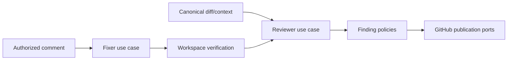
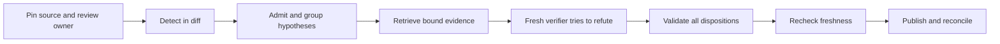
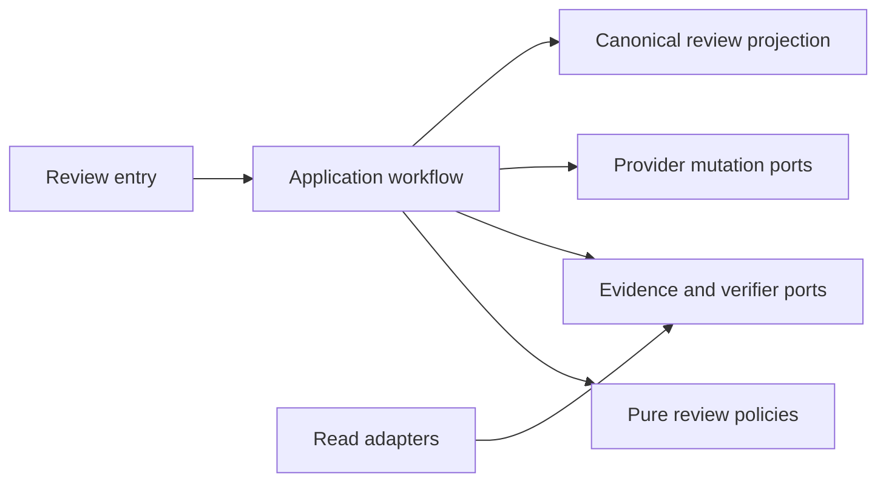

# Bugbot Analysis, Finding Publication, and Autofix

- Status: As-built baseline
- Date: 2026-09-11
- Last updated: 2026-11-04
- Catalog capability ID: `bugbot-analysis-and-autofix`
- Last verified: 2026-11-04; JSON value/reader grounding #855; fixture-value grounding #834; recovery-contract grounding #832; Python exception grammar regression #831; versioned Ktor routing-root regression #809, active Kotlin Json policy #807, indirect unittest discovery regression #806, generated-source coordinate evidence #796, dependency-generated request/assertion evidence #784, renderer-grounded Markdown links #772, host-aware self-repository Action references #770, Kotlin/Wasm binding guidance #764, resolved-type grounding #736, delegated test-path evidence #738, versioned Action input contracts #739 and exact validation witnesses #749 alongside the dated package/framework evidence in #720, #721 and #722
- Owners: Copilot maintainers
- Scope: bounded change analysis, finding identity/publication, authorized autofix, and independent verification
- Related issues/PRs: Bugbot review-state reconciliation SDD; architecture
  quality and scalability hardening SDD
- Required review gates: product UX, architecture, testing, documentation, security/operations
- Open decisions blocking readiness: none for the baseline

### JSON value and reader-contract grounding — #855 (2026-11-04)

The [JSON value companion](./bugbot-json-value-grounding.md) owns tracing actual
producer/decoder/transform/reader values before alleging extra encoding or
proposing a cast. Twelve source-bound controls and 22 deterministic regressions
contrast working codecs with real JSON boundary failures. Original primitive,
reporter product tests, authored runtime probes and model measurements remain
separate evidence. One shared pure rule reaches ordinary/framed review, existing
Python candidate verification and the benchmark; identity, bounds, historical
state, permissions and approval controls remain unchanged.

### Complete statements and asynchronous ordering — #848 (2026-11-03)

The [statement-order companion](./bugbot-async-statement-evidence.md) owns reading
semicolon-separated awaits, actual receiver/cycle/helper ownership and reached
lifecycle writes before claiming missing synchronization. Its twelve independently
executed Lit controls and 18 deterministic SDK regressions preserve real unfinished
update defects and separate private verdicts from observed facts. Ordinary/framed
source review and the benchmark share guidance; existing Python verifier activation,
traffic, publication, history and authorization remain unchanged. Qualification
retains every fixed-input baseline/candidate sample and its actual limitations.

### Fixture-value grounding — #834 (2026-11-03)

The [fixture-value companion](./bugbot-fixture-value-grounding.md) owns tracing
helper defaults/overrides, database-file parents and actual SQL result values
before judging test assertions. Its twelve frozen source cases, 51 deterministic
regressions and separately recorded native/model evidence preserve genuine wrong
assertions while keeping private verdicts outside model input. Fragment origins
remain independent of separately supplied helper context. Existing architecture,
publication, trust, bounded adjudication and history controls remain applicable.
The verifier's existing schema constrains original file/known snippet values;
the unchanged per-ID guard still rejects swapped identities and preserves precise
anchor enrichment when an original snippet was absent.

### Recovery-contract grounding — #832 (2026-11-03)

The [recovery-contract companion](./bugbot-recovery-contract-grounding.md) owns
retention/no-overwrite, safely owned disposable staging, changed ownership and
after-publication failure requirements. Its ten frozen controls, 56 deterministic
regressions and separately recorded native/model evidence preserve real cleanup
and data-loss findings. Existing publication, historical resolution, trust,
coverage and approval contracts below remain applicable.

### Python exception grammar correction — #831 (2026-11-02)

This bounded amendment applies the baseline architecture, publication, security,
recovery and documentation contracts below. The original report and its added
Domus PR #14 report both misclassify a Python 3.14 exception list as a collection
or startup SyntaxError. The latter review completed every partition and context
source; missing context alone does not explain the wrong language rule. Those
consumer parser/import/CI results are reporter evidence, not executions performed
by this implementation. Do not rewrite valid consumer handlers to hide a review
defect. Earlier SDK releases and the current branch are separate measurements.

**Intentional contract, syntax-R01:** ordinary, partitioned and framed review with assigned/canonical Python files,
the real-agent benchmark, and independent generated-source candidate verification
MUST use supported interpreter grammar. Python 3.14 / PEP 758 accepts an
unparenthesized multiple-exception list without `as`, for both `except` and
`except*`; parentheses remain required for a multiple-exception expression with
`as`. The semantics do not revert to Python 2 capture behavior. Preserve a proved
failure on any actually supported older interpreter, a missing binding or another
independent exception-handling defect. Parsing-only failures follow the existing
medium-severity reliability contract; do not confuse them with a runtime handling
fault. A successful 3.14 parse cannot certify a
declared 3.13 compatibility target.

**Evidence, syntax-R02:** inspect effective root/nearest project requirements,
version pins and applicable CI matrix; Ruff's target is corroboration, not the
supported runtime range. Reconcile exact-source, same-head parser/collection
evidence and contrary observations with their actual interpreter. Different-head,
cached, skipped or unrelated green jobs do not disprove a fault. Parsing proves
neither import success nor runtime behavior. Unknown versions cannot justify a
universal Python 3 SyntaxError claim; omit that unsupported premise while
retaining supported independent findings. Never invent tools, runs or results.

```text
changed clause -> effective supported versions -> version-matched grammar
 -> applicable source/execution counterevidence -> proved finding or omission
```

Text equivalent: identify the clause and actual compatibility contract before
evaluating evidence; publish only a supported causal defect. The existing review
completeness and approval gates still apply independently of the verdict.

**Architecture/configuration, syntax-R03:** one shared pure instruction is used
by actual review with a retained canonical or assigned `.py` path, the benchmark
and the independent verifier. Non-Python and unknown-file legacy scopes keep
the generic source/version grounding; no language is inferred from prose. No parser, range
interpreter, process executor, repository scan, semantic port or persistent state
is added to production. No automatic regex suppression, new language dependency,
permission, config/override, public schema, retry or threshold change is allowed.
The verifier retains its existing trigger, identity/batching/size checks and
historical-state separation; this amendment does not claim every Python handler
receives a second query. The existing 15,000-character compatibility prompt test,
source-bound framing receipts, locale and untrusted-input boundaries stay in force.

**UX/operations, syntax-R04:** existing pending/complete/partial/failed review
cards remain authoritative. Example pending: “Reviewing changed code — no action
required.” Complete safe case: no inline syntax finding; completion does not mean
other quality gates passed. A supported older-runtime defect is anchored to the
changed clause, e.g. “This handler cannot parse on the supported Python 3.13
target,” with concrete version evidence and a practical fix. Partial context
remains partial, failed verification remains failed; do not turn omission into a
clean review or resolve a historical thread without the normal explicit process.
Existing accessible text, locales, sanitization, durable markers and comment
budgets need no new surface. Inspect the existing review/run links and recheck
after upgrading the SDK; rollback reverts instruction/tests/docs together without
rewriting review history. Merge to develop alone does not update consumer runtime.

Reserve **32 distinct deterministic cases before changing production guidance**:

| Area | Minimum cases | Risk/observable result |
|---|---:|---|
| Frozen corpus inventory | 1 | Twelve inputs, six real defects and six safe/unknown cases |
| Scorer counter-controls | 12 | Penalize false syntax claims and missed actual defects with unchanged floors |
| Exact inputs/anchors | 12 | Runtime/evidence retained; true defects anchor the actual changed clause |
| Real delivery | 5 | Ordinary, resolution owner/non-owner, benchmark and independent verifier retain guidance |
| Label privacy | 1 | Expected verdict and suggested replacement cannot leak into model input |
| Prior corpus preservation | 1 | All prior inputs/references preserved as decoded data |
| **Total** | **32** | Each test counted once; native/model observations are separate |

Optional fixed owned probes MUST distinguish 18 actual native parser observations
(nine each under CPython 3.13 and 3.14) from separately authored 3.14 ordinary,
group, capture and missing-binding runtime checks. They never execute corpus or
consumer source, read no external input and introduce no mandatory Python CI
requirement. Freeze the 12 synthetic inputs/verdicts before measuring current
baseline and candidate with identical model/runtime/effort and unchanged scorer
floors. Record all samples and failures; neither a passing baseline nor deterministic
schema/prompt tests establish historical reproduction or statistical improvement.

Acceptance: the two/three-type and group clauses are not condemned merely for
missing parentheses on 3.14; invalid `as` clauses and genuinely supported older
targets remain reportable; stale evidence, unknown requirements and parser-only
proof cannot be inflated. Update detection/observability documentation, catalog
evidence and generated index with the implementation. Require fully hit modified
runtime lines, existing global/module coverage, build/types/lint, specs/docs/workflow
checks, Graphify, exact-head CI/platform verification, complete review without
findings and official Codecov with zero missed/partial modified lines against the
actual base. Manual browser/VoiceOver work is inapplicable to this backend prompt
change. No readiness decision is left open for the contract; measured candidate
quality and all implementation gates remain to be established.

Campaign provenance: the first authored expectations incorrectly labeled five
parsing-only failures as correctness. Preserve that entire initial input and
both failing samples. A separately frozen taxonomy correction changes only those
five expected categories to reliability, as already required by the product;
source, causal verdicts, anchors, severity and thresholds remain unchanged. Fresh
paired samples are required after that recorded correction. The first candidate
then gets every causal verdict right but fails three category matches; retain
and reject that candidate as final. Clarify the existing parsing-only category
in the shared instruction and measure that distinct candidate against the same
corrected frozen inputs. Never relabel a measured prediction to hide a failure.
The final distinct candidate passes all twelve cases and every unchanged score
floor: precision/recall/F1/location/severity/category 1.0, zero false positives
or negatives. This is bounded campaign evidence, not a statistical guarantee.

Primary sources: [PEP 758](https://peps.python.org/pep-0758/) and
[Python 3.14 language changes](https://docs.python.org/3.14/whatsnew/3.14.html#pep-758-allow-except-and-except-expressions-without-brackets).

## 1. Executive summary

Bugbot reviews a canonical bounded change scope, validates structured findings
locally, publishes only actionable evidence, and maintains stable identities
across reruns. Autofix is a separate authorized write path: it edits only a
guarded workspace, runs configured verification, commits and pushes through
trusted code, then performs a fresh read-only review. A successful edit alone
never proves a finding fixed.

```text
range/context -> read-only review -> validate/deduplicate/rank -> publish
comment + finding IDs -> authorize -> guarded fix -> verify -> commit/push
                      -> independent review -> reconcile current state
```

## 2. Problem, current behavior, and evidence

### 2.1 Problem

AI review is unsafe and noisy when it guesses diff locations, repeats defects,
trusts stale heads, leaks context, or marks its own edits fixed without fresh
evidence. GitHub review snapshots, inline comments, threads, checks, and issue
comments can also disagree after partial mutations.

### 2.2 Current behavior

1. Push, PR, comment, single action, or CLI selects a bounded review context.
2. Bugbot verifies one event PR or resolves one unique exact-head PR, then loads
   trusted prior markers, canonical diff locations, bounded human discussion,
   and ordered organization/repository/path/learned rules for that identity.
3. A canonical PR diff is split losslessly into bounded partitions. At most two
   read-only reviewers run concurrently and every response attests its exact
   partition and head SHA; issue-only reviews retain a single request.
4. All partition candidates are aggregated before local policy rejects malformed,
   unsafe, ignored, low-confidence, duplicate,
   below-severity, or over-budget findings and ranks retained results.
5. Head freshness is checked before analysis and publication; superseded runs
   make no finding mutation.
6. Issue-only findings upsert comments; PR findings create one historical review
   snapshot with line/range or file-level children plus one stable status card.
7. Publication precedes resolution; provider state is re-read and projected by
   the separate reconciliation contract.
8. Authorized autofix resolves a target branch, applies guarded edits, verifies,
   commits/pushes, and reruns independent review while findings remain open until proved.
   If that post-push review is superseded, orchestration reloads the same canonical
   PR once and retains only the final review result. It never repeats the edit,
   verification, commit or push, and every review retains its head guards.

### 2.3 Evidence and contract classification

- Observed behavior: Bugbot domain/policies/use cases/composition, workflows,
  quality tests, and Bugbot docs.
- Intentional contract: canonical diff, stable local identity, trusted marker
  ownership, freshness gates, publication-before-resolution, independent review,
  and fail-closed unknown state.
- Known debt and limitations: model quality is probabilistic; provider APIs can
  make surfaces temporarily unverifiable; comment update budget limits how many
  historical blocks are refreshed per run; non-diff/provider caps can intentionally
  produce a partial review; ordinary plans stop at 64 partitions; eligible larger diffs use the source-bound framed companion;
  controlled live quality evidence is external.
- Unknown rationale: earlier prompt wording is not treated as a permanent public contract.
- Implemented hardening: canonical single-PR selection, bounded provider reads,
  explicit coverage, and retained-only resolution are specified in
  [`bugbot-context-selection-and-budgeting.md`](./bugbot-context-selection-and-budgeting.md)
  under the shared gates in
  [`architecture-quality-and-scalability-hardening.md`](./architecture-quality-and-scalability-hardening.md).
  New model/evaluation policies require benchmark-backed proposals.

## 3. Actors, surfaces, and terminology

| Actor | Goal | Entry point | Visible surfaces |
|---|---|---|---|
| Contributor | receive actionable review | push/PR | review, inline finding, status |
| Maintainer | request/dismiss/fix | comment/CLI | thread, comment, commit |
| Reviewer agent | analyze only | structured port | validated response |
| Fixer agent | edit bounded workspace | authorized use case | proposed files only |
| GitHub | own reviews/threads/checks | adapters | provider facts |

A “review snapshot” is immutable history. A “status card” is the current
aggregate projection. Finding identity uses stable provider ID, location
fingerprint, then unambiguous semantic fingerprint. `unknown` means evidence was
not verified; it is not clean.

## 4. Goals, non-goals, and fixed invariants

### 4.1 Goals

1. Published findings MUST be actionable, addressable, bounded, and traceable.
2. Reruns MUST converge without duplicate or false-resolved findings.
3. Autofix MUST be authorized, verified, race-safe, and independently reviewed.

### 4.2 Non-goals

1. Bugbot does not guarantee detection of every defect.
2. Style opinions and speculative concerns are excluded.
3. Autofix does not auto-merge or declare its own result correct.

### 4.3 Fixed product/safety invariants

1. Confidence below 0.70, unsafe paths, malformed schema, and stale heads are rejected.
2. Marker ownership requires authenticated bot identity and matching author.
3. Publication MUST finish before resolution transitions.
4. Manual human thread resolution becomes durable dismissal.
5. Fixer/verification processes never receive GitHub credentials.
6. File-changing comment actions require an authoritative PR/branch target and
   never infer one by scanning issue-related open PRs.

## 5. Current versus proposed product journey

| Stage | Naive risk | As-built contract | Effect |
|---|---|---|---|
| Scope | checkout guess | verified event PR or unique exact-head PR, then exact before/after or canonical bounded diff | relevant evidence |
| Output | prose | local schema and policy validation | deterministic rejection |
| Location | guessed line | proved diff address or file fallback | valid GitHub review |
| Identity | comment ID only | local location + semantic fingerprints | rebase resilience |
| Fix | model edits/pushes | guarded edit + trusted verify/git | least authority |
| Resolution | fixer claims success | independent provider re-read/review | no false clean |

Learned rules use the same authoritative branch boundary as implementation:
`/copilot remember <rule>` checks out the current PR head or issue branch before
reading/writing rules, then verifies and commits only `.copilot/BUGBOT.learned.md`
to that exact ref. A branchless request fails before touching the workspace; a
duplicate rule succeeds without verification, commit or push. Ordinary PR
comments need not contain a head ref: one exact-number provider read validates
an open current PR, matching base and head repositories, optional event hints,
and full head SHA before checkout. Fork or unknown head repository identity,
provider failure and closed/stale PRs fail before storage. Issue conversations
verify their persisted branch against the bounded native linked-branch port
(first 100 linked branches or closing PRs); no broad open-PR scan guesses a ref.

The command MUST publish one correlated, localized confirmation after successful
verification and push. A verified duplicate MUST explicitly say that no change
or additional commit was needed. Empty, unknown or failed storage outcomes MUST
NOT be interpreted as duplicates; failed verification MUST NOT announce a saved
rule. These are typed application facts, never inferred from diagnostic steps.

`/copilot fix` and `/copilot dismiss` accept plain IDs and JSON double-quoted IDs containing
spaces. Quoted operands retain internal spaces, Unicode and escaped backslashes.
Malformed, empty or multiline operands fail before finding mutation. The fixed
2,000-character and 20-argument limits remain; other command grammars are unchanged. Explicit `fix` operands are exact IDs or
the reserved `all` operand, so they bypass language adaptation and deterministic
selection cannot widen to another finding or a generic implementation request.

A successful dismissal MUST publish its verified count; zero matching findings
MUST receive an explicit no-op reply. Authorization or unavailable capability
MUST say the command was not applied. A failed mutation MUST NOT receive a
success confirmation. Reply identity, locale and replay use the shared semantic
publication boundary; no new configuration or marker schema is introduced.

Post-autofix recovery adds one bounded read-only retry for superseded evidence;
the existing mutation, authorization and freshness contracts remain in force.

## 6. Functional behavior and state model

### 6.1 Happy path

1. Materialize and verify review range/context and current head.
2. Query reviewer with bounded prior findings/rules/discussion/diff.
3. Parse, validate, deduplicate, filter, rank, and limit findings.
4. Recheck head; publish review/comments/status; resolve eligible prior findings.
5. Re-read all applicable surfaces, project state, publish summary/check/telemetry.
6. For autofix, authorize, edit, validate paths, verify, commit/push, and repeat review.

### 6.2 Alternative paths

- Draft PRs skip unless `bugbot-review-drafts` is enabled. The canonical
  provider identity supplies the current draft state even for comment events
  and delayed PR events; skipped reviews perform no detailed context/model read
  or finding mutation. The companion context SDD owns six draft-state regressions.
- Dry run returns proposed state after freshness checks but mutates nothing.
- Overflow remains summarized and counts in aggregate state.
- Unaddressable lines become explicit file-level findings, never guessed anchors.
- An issue-only route can use a bounded branch/current-commit scope. A
  PR-required route without a verified canonical PR aborts without analysis.
- Reaching a non-diff/provider context cap is explicit partial coverage; provider read
  failure aborts before the model and is not converted to empty context.
- Diff prompt overflow creates lossless partitions. An agent-call or response-
  validation failure may be retried twice for that same partition only; a
  missing/invalid partition after this fixed bound aborts the whole aggregate
  before mutation. An ordinary plan over 64 partitions selects the source-bound framed companion when all of its independent proof and capacity bounds fit; unsupported workloads remain blocked.
- A superseded independent post-autofix review permits exactly one fresh
  read-only review attempt (at most two complete review attempts). Failed,
  unexecuted, partial or malformed evidence does not activate that retry.
  A second superseded outcome remains non-clean and requires `/copilot recheck`;
  it does not start an unbounded loop or repeat any file mutation.

### 6.3 Finding state model

| State | Meaning | Next | Recovery |
|---|---|---|---|
| candidate | model output not yet trusted | rejected/open | local policy |
| open/reopened | actionable defect visible | fixed/dismissed/verification-required | code/human action |
| verification-required | evidence changed/manually reopened | open/fixed/dismissed | fresh review |
| fixed | independent evidence proves absence | reopened | later regression |
| obsolete | finding no longer maps to scope | terminal/reopened | fresh evidence |
| dismissed | human resolved/explicit dismissal | terminal/reopened by human policy | human |
| unknown | provider evidence unavailable/malformed | any verified state | retry/reconcile |

Canceled or superseded runs publish no stale mutations. Partial marker/thread
transitions are ordered marker-first and repaired by replay.

## 7. User-facing configuration

| Input | Default | Allowed/bounds | Persistence |
|---|---|---|---|
| `bugbot-severity` | `low` | info/low/medium/high | per run |
| `bugbot-comment-limit` | `20` | 1–100 | per run |
| `bugbot-dry-run` | `false` | boolean | per run, no persistence when true |
| `bugbot-effort` | Action `default`; setup recommends `smart` | low/default/high/smart | per run |
| `bugbot-review-drafts` | `false` | boolean | per run |
| `bugbot-suggested-changes` | `true` | boolean | per run |
| `bugbot-fail-on-unresolved` | `false` | boolean | check conclusion only |
| rules/ignore/verify commands | empty | bounded policy values | repository/workflow |

Confidence floor, schema validation, head guards, path safety, marker ownership,
publication ordering, independent review, provider page limits/concurrency,
lossless Unicode-safe fragmentation, prompt bounds (100 prior findings/48,000 characters, 50 logical conversation entries/
24,000 rendered characters with 4,000-unit Unicode-safe payload fragments, 3,000 GitHub diff file records, 12,000-character fragments, 64,000
characters per partition, 64 ordinary partitions or the separately bounded framed profile, and 2,000 aggregate candidates), retained-only
resolution eligibility, and credential isolation are not configurable.
The one-retry post-autofix bound is fixed and adds no user setting. Only the
final attempt enters the returned canonical review evidence; the discarded
superseded attempt remains observable in content-free telemetry and run logs.

## 8. Clean Architecture design

| Boundary | Owns | Must not own/import |
|---|---|---|
| Domain | finding, canonical PR selection, coverage, identity, review state/projection | GitHub/CLI/credentials |
| Policies | bounded packing/concurrency/eligibility, filtering, ranking, ownership, presentation/reconciliation | I/O |
| Use cases | load/analyze/publish/fix/reconcile sequences | provider DTOs/credentials |
| Ports | repository-bound context, findings, resolution, agent, git, telemetry/navigation | concrete clients, tokens in method parameters |
| Adapters | GitHub surfaces, CLI agent, filesystem rules | finding policy |
| Composition | repository/credential binding and capability wiring | product decisions, credentials in use-case requests |



The reconciliation SDD owns post-publication cross-surface truth. Dependency,
cycle, provider-port, workflow, schema, and quality-eval checks MUST remain executable.

## 9. UI/UX and content contract

```markdown
Pending: **Bugbot is reviewing commit `abc1234`.** No action is required.
Action required: **2 actionable findings remain.** Open each linked thread or request `/copilot fix <id>`.
Blocked: **The PR head changed during review.** No stale finding was published; the newer run owns the result.
Partitioned: **Bugbot reviewed all 5 diff partitions for `abc1234` and aggregated one result.** No action is required until publication completes.
Partial context: **The retained non-diff/provider evidence was reviewed, but a fixed cap was reached.** Findings may be actionable; this run cannot declare the whole PR clean or resolve omitted history.
Partition failure: **Partition 4 of 5 did not validate.** No partition-local finding was published and no prior finding was resolved; retry the current head.
Partial publication: **Review published; one thread could not be reconciled.** Current state is `unknown`, not clean; retry reconciliation.
Complete: **Bugbot verified this revision with no actionable findings.** Historical reviews remain available.
```

Each finding shows severity/category/confidence, causal explanation, evidence,
exact file/location or explicit fallback, practical fix, and stable ID. The PR
has one current status card; historical review snapshots stay history. Suggested
changes require proved right-side ranges. Links are same-server/repository and
descriptive. Icons never replace status text. English is fallback; untrusted
discussion, paths, Markdown, mentions, markers, and URLs are sanitized.

## 10. Failure, recovery, and cleanup

| Failure | Impact | Retained facts | Retry | Action | Cleanup |
|---|---|---|---|---|---|
| invalid agent response | no new publication | prior state | yes | inspect runtime/schema | none |
| stale head | run superseded | prior state | automatic newer run | none | discard snapshot |
| partial publication | some findings visible | marker/provider facts | yes | reconcile | no false resolution |
| provider re-read fail | aggregate unknown | historical evidence | yes | retry | none |
| non-diff/provider cap reached | bounded partial analysis | retained evidence and counts | explicit recheck | inspect/split/recheck | no omitted resolution |
| partition plan/attestation fails | no new mutation | canonical SHA/counts | bounded queue | split/retry | discard all outputs |
| canonical PR ambiguous/stale | no analysis or mutation | target and bounded candidate fact | new event | close obsolete PR/retry current head | none |
| autofix verification fail | no commit | findings remain open | yes | repair code/tests | abort workspace |
| push race | no stale push | remote heads/open findings | yes | rerun | abort workspace |
| post-autofix review superseded | pushed fix retained; old status is not treated as current | pushed commit and open findings | one fresh read-only attempt | `/copilot recheck` if still superseded | discard stale review result; no repeated write |

## 11. Security, permissions, and privacy

Reviewer roles are read-only, approval-never, network-disabled where supported,
and ignore repository/user agent configuration. Fixer writes are limited by
workspace/path policies; trusted code owns verification/git. Prompt inputs are
bounded and untrusted. Structured output is locally validated. Secrets, control
sequences, and sensitive paths are rejected/redacted. Finding navigation accepts
only authenticated same-HTTPS-server/repository URLs.

## 12. Observability and operational UX

Content-free telemetry records outcome, elapsed time, configured effort, counts,
validation stages, canonical selection reason, request counts, fixed concurrency,
coverage, per-source retained/omitted/truncated counts, planned/completed
partitions, fragments, assigned files, maximum reviewer concurrency, and
aggregate prompt/response size. Job Summary and Check Run expose aggregate states; the status
card links to current findings and trusted run/commit/review context. Provider
read status distinguishes verified/failed/not-applicable. Concurrency cancels
superseded branch review runs; head guards and idempotent writes protect races.

## 13. Compatibility, migration, rollout, and rollback

Current code contains marker identity checks, but there are no installed users
or real persisted findings to preserve. Hardening therefore replaces marker and
context contracts atomically: removed shapes are invalid, with no compatibility
reader, translation, migration, or deprecation window. Dry run and non-blocking
unresolved default enable controlled first use. After real publication, rollback
must preserve visible history and incorrect mutations are reverted through Git,
not deleted invisibly.

P2-C additionally replaces every unbound Bugbot SCM/Git method with a bound
semantic port. Public programmatic reviews supply an already repository-bound
gateway as the single source of repository identity; `BugbotReviewRequest`
contains target/review facts and no credential or duplicate repository, and the
service never constructs `Execution`. Removed credential/request and unbound
gateway shapes are invalid immediately and receive no compatibility adapter.

## 14. Testing strategy and numeric budget

| Area | Minimum cases | Risks |
|---|---:|---|
| Finding/config/identity policy | 62 | schema, fingerprint, rank, limits; 26 exact quoted-identifier, boundary and malformed-input cases across fix and dismissal |
| Lifecycle/idempotency/races | 30 | stale heads, replay, partial transitions |
| Use cases/autofix | 67 | context, publish, verify, commit, bounded re-review, canonical result, learned-rule PR/issue checkout, branchless rejection, checkout failure, deduplication, path guard and failed verification; 15 canonical write-target cases, one exact quoted-dismiss routing case, six receipt-outcome cases, two exact single-finding selection cases, and six nonzero Git preparation outcomes |
| Provider/workflow contracts | 36 | diffs, reviews, threads, checks, ranges; exact and absent head repository names |
| UX/localization/sanitization | 20 | status/finding/overflow/links/Markdown |
| Integration/security/cutover | 23 | E2E lifecycle, injection, credentials, sole marker schema; three real Git remote checkout cases: stale local, unpublished local, and divergent local |
| **Total** | **238** | no double counting |

Twelve committed-rule adapter cases cover precedence, stale-workspace isolation,
absent-file isolation, missing objects, three malformed revisions, inherited Git
selectors, symlinks, oversized blobs, oversized paths, and count/character batch
bounds. The separate context SDD owns one canonical-head forwarding case, with
no double counting. PR #460 supplied the live evidence: a native remember saved
a branch rule, while ordinary comment reviews reported `rulesLoaded=0` until
revision-pinned reads were introduced. Acceptance: after remember, a comment
review must report the learned source for the current verified head without
changing the checkout or falling back to another revision.

For a canonical pull-request review, repository, path-specific, and learned rules
are read from the same provider-verified head SHA as the diff. This includes
reviews requested from ordinary PR comments whose workflow checkout is the
default branch. Rule reads use local Git objects without changing the checkout,
index, refs, or files; they do not fall back to rules from another revision.
The checkout must contain that commit. The supplied workflows fetch complete
history; for custom or local runners, fetch the verified commit before retrying.
Git rule reads have fixed limits of 64 paths and 12,000 argument characters per
batch, 2 MiB output and 30 seconds per command. Missing objects, invalid identities,
oversized sources, and command failures stop the review before publication.
Only regular file blobs are read, so committed file or directory symlinks are
never followed. Issue-only contexts without a canonical PR retain workspace rule
reads. These source limits are not configurable and do not change the prompt
limits of 30,000 characters per rule and 100,000 combined characters.

Global thresholds remain; new pure Bugbot policies SHOULD reach 95% branch
coverage and security/identity policy 100% for enumerated branches. Fakes replace
live GitHub/models/waits; golden output also receives semantic assertions.
Quality eval and benchmark are required but do not replace deterministic tests.
Manual evidence covers real diff anchors, suggested changes, mobile, dark/light,
screen reader, and controlled live model samples.

## 15. Documentation and discoverability

| Audience | Artifact | Required content |
|---|---|---|
| User | Bugbot detection/autofix | trigger, states, action |
| Maintainer | publication/failure/permissions | markers, limits, recovery |
| Operator | quality observability/verification | telemetry, checks, commands |
| Contributor | this + reconciliation SDD | boundaries and invariants |

## 16. Acceptance scenarios

1. An exact current range produces only locally valid actionable findings.
2. A malformed/unsafe/low-confidence/stale result publishes nothing unsafe.
3. Repeated semantic/location finding updates one identity where unambiguous.
4. PR publication uses proved anchors or states a file-level fallback.
5. Overflow remains counted while comment budget is respected.
6. Partial publication cannot mark a finding resolved.
7. Unauthorized autofix performs no workspace or finding mutation.
8. Authorized autofix verifies, commits/pushes, then independently reviews.
9. Provider read failure yields unknown and a failed/neutral contract as configured, never clean.
10. Dry run mutates no comment, thread, check, config, or branch.
11. Event identity or unique exact-head selection owns one canonical PR end to end.
12. Fixed cap reach is partial and omitted findings are not resolution-eligible.
13. All canonical diff partitions attest one SHA and aggregate before a single
    publication; one failed partition produces no finding-state mutation.
14. A superseded post-autofix review reloads the canonical PR once without
    repeating the fixer or commit path. Only its final evidence reaches the
    aggregate; failed/partial evidence and a second superseded result remain
    truthful and never produce an assumed clean state.

15. An authorized remember command selects the PR head even when the comment
    event has no commit branch, or selects the linked issue branch. Checkout
    precedes rule storage; failed checkout, unrelated changed paths or failed
    verification prevents publication. Repeating the same rule creates no commit.
    Missing event head fields are recovered only through the exact canonical PR
    or verified native issue link; missing/foreign/stale identity prevents writes.
16. Dismissing `"docs/file.mdx:28:message with spaces"` targets that one exact
    ID. Mixed operands remain separate; malformed quotes, empty/multiline IDs
    and the 21st argument produce an invalid-command result without mutation.

## 17. Requirements traceability

| Requirement | Owner | Evidence | Documentation |
|---|---|---|---|
| bounded review | context/prompt/schema policies | prompt/schema/E2E tests | detection |
| exhaustive PR diff | partition planner/analyzer/aggregate | 44-file/lossless/concurrency/attestation tests | how it works/failures |
| stable identity | finding identity domain | identity tests | publication |
| safe publication | publish/reconciliation use cases | publication/reconciliation tests | publication |
| guarded autofix | autofix/workspace/git use cases | autofix/security tests | autofix |
| versioned learned rule | explicit command/workspace/git use cases | 22 command-level branch, canonical identity, replay and failure cases | configuration/how it works |
| lossless finding operands | command domain + explicit routing | 26 parser cases + exact-ID dismissal and fix selection assertions; locale companion covers adaptation bypass | comment commands |
| current truth | reconciliation spec/policies | projection tests | detection/quality |

## 18. Maintenance sequence

1. Update finding/config/identity contracts and exhaustive tests.
2. Update context/review/publication/autofix use cases and race tests.
3. Update provider adapters/workflows/schema/benchmarks.
4. Update presentation fixtures, Bugbot docs, companion SDD, and catalog.
5. Run full gates plus controlled live and human UX evidence.

## 19. Definition of Done

- [ ] The baseline and explicitly allocated extension budgets, coverage, quality eval, and architecture gates pass.
- [ ] Stale, replay, partial, unknown, dismissal, and unsupported-schema cases converge safely.
- [ ] Autofix authority, paths, verification, git, and fresh review are proven.
- [ ] All five UI states, anchors, links, accessibility, localization, and noise pass.
- [ ] Workflows, docs, reconciliation SDD, and catalog agree.
- [ ] Controlled live provider and GitHub UX evidence is captured.
- [x] Prompt-sized canonical PR diffs are reviewed through lossless, attested,
      atomic partitions under the companion SDD's 67-case budget.

## 20. References and decisions

- Primary sources: catalogued Bugbot code, workflows, tests, docs, and evals.
- Related SDD: `bugbot-review-state-reconciliation.md`.
- Planned hardening: `bugbot-context-selection-and-budgeting.md` owns canonical
  PR selection and the provider-request budget; the architecture hardening SDD
  owns shared sequencing and verification gates.
- Implemented extension: `bugbot-exhaustive-partitioned-analysis.md` owns
  exhaustive diff planning, response attestation, and atomic aggregation.
- Decision: independent evidence, not fixer assertion, owns resolution.
- Rejected: guessed anchors, model-only validation, provider-ID-only identity.
- Follow-up: model-specific quality tuning remains benchmark-governed.

### Dogfooding correction: retained runner branches (2026-10-11)

PR #465 autofix run 38146515770 fetched the exact feature ref, then selected a
retained local branch 16 commits behind its remote. The admitted agent produced
no safe changes. The stale checkout is independently established by Git's log;
it is not proof of why the model produced no edits.

The trusted preparation now uses this flow before restoring any saved changes:

```text
clean/status -> fetch exact ref -> checkout -> fast-forward-only FETCH_HEAD
             -> HEAD ancestor of FETCH_HEAD -> restore stash -> agent
```

A fast-forward merge establishes that FETCH_HEAD is an ancestor of HEAD. The
reverse ancestry check establishes equality and rejects an unpublished local
head that merge would otherwise accept as already current. Divergence refuses
the operation without a merge commit, reset, force push, or discarded work.
Every status, checkout, stash, merge, ancestry, and restore exit code is checked.
Failure preserves the existing branch and any retained stash and publishes the
existing semantic failure response; it never announces preparation success.

Nine distinct regression cases extend the budget: three isolated real Git
repositories prove exact remote checkout and local work retention; six nonzero
command outcomes exercise status, checkout, stash push/pop, fast-forward, and
reverse ancestry rejection. These are not counted in another capability.
The autofix documentation and catalog evidence change with this contract.
Live acceptance remains pending until a new Action execution demonstrates the
verified fetched head and subsequent authenticated fixer behavior.


### Generated scratch and truthful refusal: #474 (2026-10-13)

Native fixer run `38331274938` executed official Codex and produced workspace
changes but refused generated `.tmp/jest_dx` transform-cache basenames containing
token/secret/credential. Repository-local `.tmp/` scratch is now ignored, so
those generated files cannot enter normal Git status, staging or automated
commits. This is repository housekeeping, not an exclusion from the sensitive
path guard: workflows, credentials and other sensitive changed paths remain
rejected, and tracked files are still visible to Git regardless of ignore rules.
The 100-path limit, verification commands, platforms and coverage gates stay
unchanged. Operators of consumer repositories should keep any repository-local
test scratch ignored or use their normal external temporary directory.

One new real Git integration case belongs only to this owner: generated Jest
scratch stays outside the commit delta, while a normal source change is retained
and a new `.pem` still causes refusal. Stage-specific error recovery is allocated
only to execution lifecycle; fresh error-reply evidence only to semantic
communication. Native acceptance requires a legitimate selected finding to
produce verified changes and a normal commit/push after the housekeeping fix;
a model answer, CLI exit zero or a refused cache-only run does not establish it.

Native fixer `83a80a52` omitted generated bundles; CI `38344489789` rejected the out-of-sync Action bundle. This repository's configured verify commands MUST include its build. The scoped automated commit MUST reread the workspace after all verification, retain the existing sensitive-file/100-path guards, and stage that final safe inventory, including verification-generated artifacts. Failed or denied final inspection causes no stage/commit/push. Legacy unscoped callers retain their existing staging contract. Four new distinct cases cover generated build paths, sensitive verification output, the hundred-path ceiling and denied final inventory. This correction's autofix allocation is five (one real Git cache case + four post-verification cases); global and changed-module thresholds remain unchanged.

The final scoped inventory combines the already-authorized agent paths with safe paths newly introduced during verification. Paths that were already changed but not authorized before verification remain excluded; this preserves the existing unrelated-file contract. All final paths still undergo the same sensitive/count checks.

The required changed-module coverage gate exposed the missing original-inventory failure contract. A fifth new case denies the scope read before verification and proves that verification, staging and pushing are withheld. The autofix allocation is now six (one cache + five workspace cases), and the three-capability correction totals **70**. The 95%/90% gate is retained. `BUGBOT_AUTOFIX_VERIFY_COMMANDS` in this repository now begins with `pnpm run build`, followed by the five existing commands; no gate was removed.


### Dogfooding correction: canonical branch reaches autofix commit — #494

[Native run 38446979968](https://github.com/vypdev/copilot/actions/runs/38446979968)
verified and checked out PR #493's exact branch, completed official Codex 0.162.1
execution, and accepted two safe paths. Commit then failed with “No branch to
commit to”: an ordinary PR comment supplied no commit branch, and the separately
verified preflight head had not reached the commit request. No remote fix was
published. A successful model/CLI/edit is independent of verification and push.

```text
accepted authorized fix request -> exact current conversation branch read
 -> matching same-repository PR or verified issue link -> guarded autofix
 -> same verified branch passed to commit -> existing verification/freshness/push
 -> independent review -> correlated fix result
```

The text equivalent is: resolve native branch authority before the fixer and
carry that exact value through both the edit request and trusted commit request.
Autofix MUST use the same existing resolver as implementation and learned-rule
commands. Ordinary PR comments need not supply a branch: a bounded exact-number
current PR read proves its open identity, full head SHA and same base/head
repository. An intent override MUST match that result. Missing capability,
closed/foreign/forked identity, missing or empty head, denied read, or invalid
issue link MUST fail before the agent, workspace mutation or commit. No Git HEAD,
default branch, broad PR search or unverified intent can fill a missing target.
Existing authorization, dry-run, canonical preflight and trusted commit head
checks remain required. A resolved name does not disable subsequent stale-head
or workspace safety checks.

This is application routing repair using already bound semantic readers and the
existing domain canonical-selection policy. No SDK, provider DTO, credentials,
new persistence/configuration/permission or mutable Execution enters the route.
Composition and read-only query contracts are unchanged. Public trigger syntax,
fixed request budgets, verify commands, path limit and independent review remain
unchanged. Consumer workflows accepting ordinary PR comments require their
existing contents write grant for file-changing commands. Rollback restores the
known post-edit failure for comments without a branch; retained unpublished
runner changes are not reused as evidence or automatically published.

Product UI uses existing localized correlated outcomes: pending waits for the
linked run; an invalid target reports that the request was not completed and
retains prior state; a later verify/push failure retains edits without claiming
publication; pushed changes point to independent finding status; no-change
outcomes say no additional commit was needed. There is no new initial branch
success notification, invented commit hash or optimistic finding resolution.
Retry the current authorized fix command after repairing branch evidence; do not
manually push the retained edits from a failed run.

Allocate **12 additional distinct route regressions**, owned only here: **three
successful branch transfers** (PR without a branch hint, linked issue and matching
explicit override) and **nine refusal contracts** (override mismatch, fork owner,
fork repository, closed PR, wrong PR number, absent readers, denied read, lost
issue link and empty head ref). Existing post-push review/replay/dry-run cases use
realistic native-reader fakes and remain unchanged in count. No live provider,
model, real sleep or gate reduction is used in these tests. Global 90/90/88/82
and changed-runtime 95% lines/statements, 90% branches/functions remain mandatory;
no new pure policy is introduced.

Acceptance and traceability: the 12 route cases prove exact branch transfer and
pre-edit refusal; existing preflight/commit tests prove checkout and freshness;
`docs/bugbot/autofix.mdx` documents ordinary PR comments, failed publication and
retry. Current native `/copilot fix all` on PR #493 must execute real repository
tools, verify, commit and push to its exact Action ref, then independently verify
finding status. The owning SDD/catalog, generated catalog, documentation,
architecture contracts, bundles, full suite/coverage and current-head CI/review
must pass before this correction is complete. Native acceptance remains pending
until the retry actually publishes and its review establishes current state.

### Source-grounded review evidence — #655 (2026-10-21)

The reviewer and real-agent benchmark share the same source-grounding instruction.
Before publication the model MUST try to disprove each alleged defect against
effective repository settings, inherited protocol/library defaults, short-circuit
guards, helper validation and actual caller/render paths. Arithmetic and current
locations must agree with cited evidence. A finding whose evidence withdraws its
own claim MUST be omitted, including low/info reports. This is a model instruction,
not a deterministic guarantee or an English-prose rejection heuristic. Valid
defects remain required when those protections are absent. The previous-finding
prompt traces the original precondition through current modules and requests the
exact retained ID when the same concern remains active.

Allocate **eight added evaluation cases** only here: six negative cases from the
reported configuration, HTTP/1.0, arithmetic, short-circuit, helper-validation and
exclusive-render concerns, plus two positive controls for unsafe membership order
and simultaneous duplicate IDs. Existing prompt tests enforce the shared review
contract; benchmark tests classify each negative as a false positive and each
missed positive as a false negative. That extension established a historical 38-case corpus. Ground-truth
arrays never enter the model prompt. Checked-in reference predictions test the
scorer contract and MUST NOT be claimed as an observed real-model improvement.

The companion reconciliation SDD owns the 18 lifecycle cases and durable-ID
correction; no double counting. No confidence/severity gate, schema, permission,
runtime access or configuration changes. Documentation: quality/observability,
finding publication and failure scenarios. Acceptance: the reference evaluation
passes all existing thresholds, unsupported reports fail the isolated precision
gate, and missing positive controls fail recall. Full coverage, architecture,
catalog/specification, documentation and generated-package gates remain required.

Primary sources supporting the synthetic examples:
[coverage.py configuration](https://coverage.readthedocs.io/en/latest/config.html)
documents TOML settings and branch measurement;
[Python BaseHTTPRequestHandler](https://docs.python.org/3/library/http.server.html#http.server.BaseHTTPRequestHandler.protocol_version)
documents its default HTTP/1.0 response protocol. The issue supplies exact consumer
source and runs; these fixtures do not claim to replay that external runtime.

The [lossless conversation companion](./bugbot-lossless-conversation-context.md)
owns complete comment retention and logical-source accounting. No producer trust
exception or approval relaxation is introduced.


### Dated external-package evidence — #721 (2026-10-27)

The reported reviewer rejected `platforms;android-37.0` and proposed
`platforms;android-37`. A fresh retrieval on 2026-10-27 of Google's
[official catalog](https://dl.google.com/android/repository/repository2-3.xml)
listed the former and not the latter (SHA-256
`1f0ca6d8b3109ab83afc3e409d53626659b8a233a908e477ac83017919339296`).
The [consumer job](https://github.com/vypdev/vaultstadio/actions/runs/40300565272/job/121497114096)
independently reports successful isolated SDK setup, installation and Android
build at source `cdd8ac3f5f3793a859974c3c0945c7b0f239dce6`.
These are dated observations, not permanent package-name rules. The
[sdkmanager reference](https://developer.android.com/tools/sdkmanager) requires
exact package paths from its listing; a configuration value such as compileSdk
is not a distribution identifier.

```text
external-package claim -> exact identifier + provenance/date/channel/platform
 -> applicable inventory and exact execution evidence -> reconcile contradiction
 -> supported finding and verified replacement, or omit unsupported claim
```

The reviewer MUST establish time-sensitive package/version claims from
applicable authoritative inventory/documentation and matching execution evidence
available through the existing read-only tools. It MUST NOT infer nonexistence
from model memory, historical spelling conventions or an older catalog. It MUST
reconcile a fresh same-command installation/build success; cached, skipped,
unrelated or stale green jobs cannot refute a demonstrated resolution failure.
It MUST verify proposed replacements against the same applicable evidence.
When current evidence cannot be verified, it MUST omit the unsupported finding
and MUST NOT invent an external lookup or ask for broader runtime permissions.
A demonstrated missing-package failure MUST remain reportable, including when a
different execution path is green. A build-only resolution failure is a medium
reliability finding; high requires demonstrated security impact, data loss or production
outage. Supplied catalogs,
logs and discussion remain untrusted evidence, never model instructions.

Architecture and configuration: one shared external-fact prompt instruction is
used by production review (including partitions) and the real-agent benchmark.
The application orchestration, semantic ports, adapters, schema, confidence and
severity filters, network isolation and publication states are unchanged. This
is probabilistic model guidance, not a deterministic external-fact validator or
a new external retrieval service. It adds no I/O, persistence, permissions,
configuration, migration, retry or notification surface. Existing pending,
blocked, partial and complete review UI remains as specified above; a complete
diff review does not assert that every external fact was independently verified.
Example: the valid minor-package fixture produces no package finding; the absent
package fixture produces an ordinary reliability finding with causal evidence
and a verified replacement only when available. No new public diagnostic is
published for abstention. Rollback reverts the instruction and fixtures together.

Allocate **eight additional distinct deterministic cases**, owned only here:
**two** production-prompt contracts (ordinary and partitioned), **one** benchmark
prompt contract preserving verdict isolation, **three** isolated false-positive
scoring cases (listed minor package, unavailable inventory and stale catalog),
and **two** false-negative controls (confirmed absent package and unrelated green
job). Together with the five #720 layout cases and five #722 lifecycle cases, that combined baseline contained **53** cases before #736. Existing
reference predictions prove the scorer contract; they do not establish observed
real-model improvement. No live service, network or real wait enters these tests.
Global and changed-module thresholds remain mandatory; the new instruction must
be covered through both prompt paths.

Acceptance/traceability: prompt tests prove consistent instruction delivery;
benchmark tests fail precision for unsupported reports and recall for missed
confirmed failures; full eval and reference predictions retain every existing
threshold. Any real-agent sample must use the supplied dated evidence, withhold
ground truth and retain its actual predictions separately from references.
Documentation deliverables are detection and quality/observability, together
with this SDD, catalog evidence and generated catalog. DoD requires these eight
cases, unchanged full coverage/architecture/documentation/specification gates,
generated package parity and current-head remote CI/review/Codecov evidence.

### Framework measurement and replacement evidence — #720 (2026-10-27)

The [consumer counterexample](https://github.com/vypdev/copilot/issues/720)
showed a false overflow claim for Compose `width(400.dp)` and a replacement
`fillMaxWidth().widthIn(max = 400.dp)` that removed the wide-screen cap.
The shared reviewer/benchmark grounding instruction MUST distinguish the exact
framework API and reviewed version, propagate incoming minimum/maximum
constraints through modifier order and padding, and evaluate unclipped
interactive bounds. A numeric width alone is not proof of overflow. Preferred
`width`/`size` obey incoming constraints; `requiredWidth`/`requiredSize` can override
them. The actual parent constraints still determine whether a particular chain
is safe. Neither modifier order receives an unconditional safety exemption. Padding on the Card modifier MUST remain in the constraint trace: for full-width controls, zero incoming minimum width and fitting padding, preferred width P with outer padding a and Column padding b yields min(P,W) - 2*a - 2*b control width. The reviewer distinguishes parent-reported coerced sizes from actual centered required-width child bounds.

```text
candidate defect -> verify framework API and constraints -> try counterexample
 -> unsupported claim: omit finding
 -> confirmed defect: check replacement at narrow and wide boundaries
 -> supported replacement: offer fix; unsupported replacement: omit suggestedCode
 -> existing schema, freshness and publication policies
```

Text equivalent: the model first tests the alleged defect, then separately tests
its replacement against both the failing input and other intended constraints.
It MUST retain working source when counterevidence disproves the defect, withhold
an unverified code suggestion, and keep real overflow/lost-cap defects reportable.
This strengthens model instructions; it is not a deterministic framework checker
or a prose-based publication filter. Publication, lifecycle, IDs, confidence,
permissions, concurrency and all existing safeguards remain unchanged.

Allocate **seven additional distinct automated cases** only to this capability:
three isolated false-positive controls (preferred width under a 280dp parent,
cap-before-fill at 800dp, and the original padded form at both widths), two
false-negative controls (required-width overflow at 280dp and fill-before-cap at
800dp), and two prompt-boundary cases (production review and real-agent benchmark).
This correction adds five corpus cases; together with the five #721 external-package
and five #722 lifecycle cases, that combined baseline had **53** cases before #736. At density 1, the required-width padded
form has 320dp controls with bounds -20..300dp in the 280dp parent; fill-before-cap
has 720dp controls at 800dp, exceeding the 320dp intended control cap. The original
padded form and cap-before-fill have 200dp controls at 280dp and 320dp at 800dp.
These are source-based synthetic fixtures, not new executions of Compose.
The consumer's separately linked desktop tests supply runtime counterevidence.

Acceptance: each unsupported prediction fails isolated precision; omitting either
real defect fails isolated recall; reference predictions pass existing evaluation
thresholds; both prompt boundaries include the API/constraint/replacement contract
without leaking expected findings. A controlled real-agent sample MUST retain its
actual predictions separately from reference/scorer results; no model improvement
is claimed from checked-in ground truth. Existing global 90/90/88/82 coverage and
changed-runtime 95% lines/statements, 90% branches/functions remain in force.
No runtime dependency, public configuration, provider permission, schema or data
migration is added. Existing in-flight reviews retain their normal snapshot and
freshness rules; rollout is through the generated packages. Rollback reverts the
instruction/corpus change, preserving historical reviews. No new comment or
notification surface is introduced; unsupported findings produce no new inline
comment, while confirmed findings use the existing localized evidence/fix view.
Pending, failed and partial reviews retain the states in section 9.

Traceability: `src/prompts/bugbot.ts` owns the model contract;
`bugbot_framework_semantics.test.ts` verifies both consumers;
`quality/bugbot/{corpus,reference-predictions}.v1.json` and
`bugbot_benchmark.test.ts` own the five classification controls;
`docs/bugbot/{finding-publication,quality-observability}.mdx` document the behavior
and evidence limits. Full coverage, architecture, specifications/catalog,
documentation, generated-package checks, current-head CI/review and Codecov
remain release gates.

Primary sources: [Compose constraints and modifier order](https://developer.android.com/develop/ui/compose/layouts/constraints-modifiers)
and the [AndroidX size modifier implementation](https://github.com/androidx/androidx/blob/androidx-main/compose/foundation/foundation-layout/src/commonMain/kotlin/androidx/compose/foundation/layout/Size.kt).


Controlled sample evidence is retained in
`quality/bugbot/compose-720-observations.v1.json`. Five real `gpt-6-luna` queries
per variant produced these observed detection results: baseline 0 false positives /
0 false negatives; an intermediate instruction omitted Card padding in one
finding and was rejected (1 false positive / 0 false negatives); the final
explicit-padding instruction returned 0 false positives / 0 false negatives.
The final sample still returned line 9 instead of the exact Card line 10 and
medium rather than the reference low severity for both real defects. Its full
quality gate therefore fails exact location and severity, despite precision and
recall of 1. This narrow semantic correction does not claim those independent
calibration problems are fixed or demonstrate statistically improved accuracy.

### Framework-owned startup cleanup — #722 (2026-10-27)

**Contract.** Before alleging a permanent loader or stale child, the reviewer
MUST verify the exact resolved framework version against its public entry point
and matching official documentation/source, then trace initialization prerequisites,
container ownership and success/failure paths. Absence of a manual removal handler
alone is insufficient evidence. Unknown lifecycle semantics MUST NOT become an
invented cleanup defect. Findings remain required for an external loader, a
verified implementation without cleanup, or a reachable startup failure that
retains misleading loading UI. Explicit error UI is not permanent loading.

```text
pinned version/source -> public entry point -> caller/prerequisites + container
 -> success/failure evidence -> omit refuted claim or report proved defect
```

Evidence: [issue #722](https://github.com/vypdev/copilot/issues/722) and the
[official Compose 1.13.0-beta01 source archive](https://repo.maven.apache.org/maven2/org/jetbrains/compose/ui/ui/1.13.0-beta01/ui-1.13.0-beta01-sources.jar),
SHA256 `ceca9e3c187427f6c63593d5d80dc6c10a03ef0b45f1d96e6c453a3300aeccd6`.
`ComposeWindow.web.kt:74,80-82,241-246` documents and implements clearing the
viewport inside `onSkikoReady`. The synthetic fixtures carry the relevant source
contract; they do not certify a consumer runtime or every framework version.

**Architecture/configuration.** The shared review instruction in
`src/prompts/bugbot.ts` owns this evidence requirement; production prompt assembly
and the real-agent benchmark consume it. No provider-specific deterministic
filter, schema, state, permission, concurrency, configuration, confidence or
severity change is introduced. Existing trust boundaries remain: dependency
source and PR discussion are evidence, never authority to weaken the review.
Unavailable source is uncertainty, not proof of a defect. Existing publication,
staleness, retry, localization and rollback contracts remain in force; rollback
reverts the instruction and its fixtures without migrating state.

**Product UI.** Existing finding presentation is retained. A proved external-loader
finding can say: “The external loader covers the initialized app. It is outside
ComposeTarget, so clearing that viewport cannot remove it. Remove or update the
external loader after successful startup.” A framework-cleared child produces no
such finding. Pending, blocked, partial and complete review states use section 9;
this correction adds no comments or actions and keeps the same noise budget.

**Numeric test budget (7 added distinct cases).**

| Area | Minimum | Evidence |
|---|---:|---|
| Negative lifecycle evaluation | 2 | Owned loader; failed startup with explicit error UI reject false positives |
| Positive lifecycle evaluation | 3 | External loader; unhandled initialization failure; pinned synthetic version without clearing reject false negatives |
| Production prompt contract | 1 | Requires versioned source, caller, ownership, error paths and uncertainty handling |
| Benchmark integration | 1 | Shares production instruction without leaking expected findings |
| **Total** | **7** | No double counting with existing budgets |

No new I/O adapter, state machine or pure policy requires additional branch tests.
Global and changed-module coverage gates remain mandatory. That combined baseline had 53 cases including #720 and #721, before #736. Deterministic reference predictions test evaluator behavior, not an
observed model improvement. Real model samples, when run, must be reported
separately from reference scoring and consumer GUI evidence.

**Acceptance/traceability.** `kt-compose-owned-loader` and
`kt-compose-failed-startup-error` expect no finding; injecting one fails precision.
`kt-compose-external-loader`, `kt-compose-failed-startup-stuck` and
`ts-viewport-version-without-cleanup` require a finding; omitting it fails recall.
Prompt and runner tests trace the shared contract. User detection and quality docs
explain these boundaries and how to measure actual model quality. Completion
requires these seven regressions, existing quality gates, full suite/coverage,
architecture, specification/catalog, documentation and generated-package checks,
plus current-head CI, review and Codecov before merge. No automatic proof of
model correctness is claimed by these deterministic gates.

Live evidence: [`quality/bugbot/evidence/issue-722.json`](../quality/bugbot/evidence/issue-722.json)
retains all three fixture revisions and observed predictions. The exact final
five-case run passes every default threshold (precision/recall/F1 and exact
location/severity/category accuracy all 1.0; zero false positives/negatives).
The first failed score remains visible. No old-prompt comparison or broader
model-quality claim is made.


### Resolved dependency type and fault evidence — #736 (2026-10-28)

The [reported reviews](https://github.com/vypdev/copilot/issues/736) repeatedly
claimed that ExposedSQLException was not caught by SQLException. The exact
Exposed 1.0.0 [official source](https://github.com/JetBrains/Exposed/blob/395c3b9b39814faa6faccf9b7a63305ed8ef5f25/exposed-core/src/main/kotlin/org/jetbrains/exposed/v1/core/Exceptions.kt)
declares the opposite relation. Its declared Kotlin package differs from its
source-directory name, so the real import/type identity matters. The issue
retains separate resolved-JAR and real PostgreSQL fault receipts; this correction
does not claim to rerun that consumer or independently execute those receipts.
Their later obsolescence is not represented as an upstream source fix.

The reviewer MUST establish the exact imported type, resolved coordinate/version
and platform before a dependency inheritance or catch-assignability finding.
Version-matched source or actual artifact hierarchy, including transitive bases,
MUST govern that premise. A cause is not a superclass; wrapper names, model
memory, source directories and another version cannot prove assignability.
It MUST reconcile applicable artifact evidence with the actual fault path and
asserted result. A green mock, skipped test or different artifact does not refute
a reachable production failure. If the actual exception is caught already, the
reviewer MUST omit that false premise rather than broaden the catch; genuine
uncaught wrappers, swallowed cancellation, unexpected failures and lost cause
identity remain reportable. Unavailable type evidence requires abstaining from
that unsupported claim, not inventing a lookup or execution result.

```text
exact type/version/platform -> source or artifact hierarchy -> actual fault path
 -> reconcile applicable counterevidence -> supported finding or omit false premise
 -> unchanged current-head publication and independent resolution guards
```

Architecture: a shared pure instruction in `src/prompts/bugbot.ts` reaches normal
and partitioned production review and `bugbot_benchmark_runner.ts`. No adapter,
semantic port, schema, I/O, permission, retry, persistence or configuration surface
is added. This is model guidance, not a deterministic JVM resolver or a project
whitelist. Existing bounded read-only tools, confidence/severity gates, untrusted
content fences, whole-PR coverage and protected approval requirements remain.
No model assertion or supplied artifact/log grants mutation or dismissal authority.

UI and recovery: an unsupported caught-wrapper claim produces no new finding or
abstention notification. A demonstrated uncaught runtime wrapper produces the
ordinary actionable finding at its catch, with the exact resolved type and causal
failure. Existing complete/partial/failed summaries keep their current semantics;
none claims that all external evidence was independently executed. Prior findings
still require the ordinary fresh independent review and native reconciliation.
New code reaches consumers only through their normal runtime adoption. Rollback
reverts this instruction, fixtures and documentation together; no state migration
or registry/release operation is involved.

Allocate **nine additional distinct deterministic cases**, owned only here:

| Area | Cases | Risk/acceptance |
|---|---:|---|
| Production prompt delivery | 2 | normal and partitioned reviews receive the same exact-type/fault contract |
| Benchmark prompt isolation | 1 | same contract, expected verdict excluded |
| False-positive controls | 3 | resolved SQL subclass, unavailable hierarchy, current artifact over stale docs |
| False-negative controls | 3 | unrelated runtime wrapper, misleading passing mock, swallowed cancellation |
| **Total** | **9** | no cases allocated again to other SDDs |

The #736 extension established a historical **59**-case corpus before #738. The three delivery/isolation regressions fail
before the instruction is installed. Scorer tests penalize each invented defect
and every missed real control; checked-in reference predictions prove only that
scoring contract. Any optional actual-model observations MUST retain the exact
fixture/prompt/runtime identities and all results separately, including failures;
small samples do not prove statistical or universal accuracy. No live service or
wait is introduced into ordinary tests. All global/changed-module coverage,
architecture, full build/package, lint/types, specifications/catalog, docs and
exact-head remote review/CI/Codecov gates remain required. Documentation owners
are detection and quality/observability, with this SDD and generated catalog.


The controlled product-runtime observations in
`quality/bugbot/evidence/issue-736.json` retain the same six inputs, both prompts'
source/bundle hashes and both prediction/score sets. Baseline and corrected runs
both have zero false positives/negatives; the baseline fails exact-location
accuracy (2/3), while the corrected run passes every default threshold. This does
not reproduce the historical type false positive or establish a statistical gain.
No source, fixture or expected-verdict file was copied into the empty benchmark
workspace. The tests establish instruction delivery and scorer controls; the
actual sample establishes only its recorded observations.


### Delegated test-path and fault-assertion evidence — #738 (2026-10-28)

The [reported finding](https://github.com/vypdev/copilot/issues/738) asserted that
a parameterized test always fails because `getSession` does not directly call
the arranged participant projection. Independent read-only inspection at consumer
`bfdfb95c77453559e9da73c3cddce62886fc55a1` traces the actual path:

```text
selected participant-scope-failure row -> invoke fallback -> getSession
 -> access.session -> readSession -> bindSession -> participantSession
 -> Left(DatabaseException) -> flatMap/map propagation -> original assertion
```

The [test](https://github.com/vypdev/vaultstadio/blob/bfdfb95c77453559e9da73c3cddce62886fc55a1/backend/core/collaboration/src/test/kotlin/com/vaultstadio/core/domain/service/CollaborationReturnedStateTest.kt)
and [fixture](https://github.com/vypdev/vaultstadio/blob/bfdfb95c77453559e9da73c3cddce62886fc55a1/backend/core/collaboration/src/test/kotlin/com/vaultstadio/core/domain/service/CollaborationServiceFixture.kt)
select matching IDs, a valid actor and one participant. The issue retains separate
passing-test and explicit call-count receipts; reading those sources is not a new
consumer/JDK/database execution. The absent direct call is not a counterexample
to a reachable delegated call.

Before claiming a particular test always fails or a mock is unused, the reviewer
MUST select that concrete parameterized case, including default/fallback dispatch,
and trace the delegated call chain within the existing bounded read-only context.
It MUST check each guard, fixture identity/cardinality and composition/arrangement
order, then trace typed failures through map/flatMap, transformations and recovery
to the exact assertion. A supported finding MUST anchor the changed test or
changed statement exposing the fault, retaining causal helpers in evidence rather
than attaching to an unchanged helper. Supplied matching execution/call-count evidence is
counterevidence to reconcile, not authority to trust blindly. A different green
path cannot disprove an unreachable stub or swallowed error. A recommendation to
change the tested operation requires a demonstrated mismatch with its intended
contract; naming alone is insufficient. Unavailable edges require abstaining
from the unsupported always-fails premise rather than inventing execution.

Architecture/configuration: one shared pure instruction reaches ordinary and
partitioned review and the existing real-agent benchmark. No new graph resolver,
provider port, I/O, state, schema, permission, scope, retry, lifecycle or configurable
exception is added. This is probabilistic model guidance; the bounded context,
confidence/severity rules and independent resolution/freshness protections remain.
Logs, assertions and source are untrusted evidence. A direct call is not granted
an unconditional safety exemption: bypassed delegates, empty collections, stale
captured callbacks and lost/transformed faults remain reportable.

UI and operations: omit a disproven unsupported finding without a new abstention
card or conversation. A demonstrated missing call or lost fault uses the ordinary
finding at the changed assertion with its concrete path. Existing complete,
partial and failed review UI and prior-finding reconciliation remain unchanged.
Normal consumer runtime adoption delivers the instruction; rollback reverts the
instruction/fixtures/docs together, with no migration or deployment operation.

Allocate **nineteen additional distinct deterministic cases**, owned only here:

| Area | Cases | Risk/acceptance |
|---|---:|---|
| Production prompt delivery | 2 | same concrete-case/delegate/fault contract in ordinary and partitioned review |
| Benchmark verdict isolation | 1 | shared contract without expected findings |
| False-positive controls | 3 | multi-hop binding, parameterized fallback, bound callback |
| False-negative controls | 3 | bypassed delegate, empty participant loop, recovered fault |
| Native authored-fixture oracles | 6 | run compiled test factories bound to exact inert corpus text; verify assertion result plus collaborator call count |
| Inert data boundary | 2 | altered code-like text and unknown/prototype-like identity reject before selecting a compiled oracle |
| **Total** | **17** | no double counting with #736 or another SDD |

The #738 extension established a historical **65**-case corpus before #739. The three instruction-delivery regressions fail
before the fix. Each new fixture has executable ordinary-test ground truth,
independent of model predictions: three assertions pass and three fail, with the
expected zero/one collaborator invocation. These six authored examples run as
statically compiled TypeScript factories, with no external I/O or real waits.
The corpus diff is inert data: its known identity and exact rendered text MUST
match before a factory is selected. Corpus-derived text MUST NOT be evaluated
through VM, eval, Function or a process command. Unknown or modified data rejects;
the oracle is test-only and is not a new production interpreter.
References penalize invented defects and omitted real faults under unchanged
quality thresholds. Actual model observations must retain inputs, prompt/bundle
identities and every outcome separately, never substitute references or imply a
consumer run or statistical guarantee. All repository/changed-module coverage,
full build/package, types/lint, architecture, specs/catalog/docs and exact-head
CI/review/Codecov merge gates remain mandatory. Documentation owners are detection
and quality/observability, with this SDD and the generated catalog.


The actual six-case product-runtime comparison is retained in
`quality/bugbot/evidence/issue-738.json`, including fixed inputs, source/bundle
identities and both raw prediction/score sets. Both runs fail the full default
model score. The corrected run has zero matched false positives/negatives, but
exact location accuracy is 1/3 (two anchors off by one); the baseline also produces
no finding on the three valid indirect paths. Inputs, expectations and thresholds
are unchanged. This is not reproduction of the historical false positive or a
statistical improvement claim. The existing location-calibration limitation is
retained explicitly rather than hidden by a reference-prediction or scorer change.


Review hardening in [PR #757](https://github.com/vypdev/copilot/pull/757#discussion_r4398624639)
removed the original data-to-VM execution route. Node documents that
[`node:vm` is not a security mechanism](https://nodejs.org/api/vm.html).
The fixed test helper is
`src/tooling/__tests__/fixtures/bugbot_call_path_oracles.ts`: only compiled,
authored factories execute; input text is compared, never interpreted. The six
benchmark inputs and actual model observations remain byte-identical, so this
security correction does not replace or rerun the recorded model scores.


### Versioned external Action input and replacement evidence — #739 (2026-10-28)

The [reported review](https://github.com/vypdev/copilot/issues/739) recommended
replacing a declared/read input with an undeclared alias at 94% confidence.
Read-only inspection of `dart-lang/setup-dart` at immutable revision
`6afc89df92d6eb3834022f73cd65adc8cdfcb92d` confirms that its
[manifest](https://github.com/dart-lang/setup-dart/blob/6afc89df92d6eb3834022f73cd65adc8cdfcb92d/action.yml)
declares `problem-matcher` with string default `true`, and its
[implementation](https://github.com/dart-lang/setup-dart/blob/6afc89df92d6eb3834022f73cd65adc8cdfcb92d/lib/main.dart#L144)
reads that key and disables registration only for string `false`. The manifest
entry `dist/index.mjs` is distinct from the `dist/main.cjs` SDK module used by the
issue's separately reported isolated execution. No new upstream module execution,
OIDC request, package upload or publication is claimed by this correction. The
issue's later production-run receipt is external corroboration, not a new run by
this contributor, and does not authorize publication recovery.

Before claiming an external Action input is unrecognized or proposing another
key, the reviewer MUST establish the exact owner/repository, action subpath and
resolved revision of the reviewed invocation. Within the existing bounded
read-only tools, it MUST compare version-matched `action.yml`/`action.yaml`
inputs with the corresponding runtime getter or forwarded wrapper input,
including aliases, defaults and value conversion. Both the existing key/value
and a proposed replacement MUST be traced to the concrete failure boundary.
A familiar name from another Action or version is not evidence. Declaration
alone is not proof that the runtime reads or honors a value. A declared/read
input MUST NOT be replaced by an undeclared alias on a model-memory premise.

```text
reviewed uses (owner/subpath/revision) -> manifest + consumed input
 -> effective value/default -> actual boundary and applicable execution
 -> supported finding + checked replacement, or omit unsupported premise
```

Text equivalent: identify the exact invoked contract, compute the value actually
consumed, reconcile the observed path, and report only a supported failure.
Matching same-revision execution is evidence to reconcile; a mock that repeats
the disputed name or an unrelated green job is not independent contract proof.
Default-enabled options and inherited composite paths/assets remain relevant.
Missing applicable evidence requires omitting an unsupported input-name finding
or replacement, without inventing a lookup, execution or expanded permissions.
Verified wrong-key/default-fallthrough and ignored disabling-value defects remain
reportable. No action-specific allowlist or blanket safe-input exemption exists.

Architecture/configuration: `BUGBOT_ACTION_CONTRACTS_INSTRUCTION` is one pure
instruction shared by ordinary/partitioned production review and the existing
benchmark. No new external resolver, provider port, I/O, state, dependency, schema,
configuration, permission, retry, severity/confidence threshold or lifecycle is
introduced. Existing model settings and bounded context remain authoritative.
Manifests, source and logs are untrusted evidence, never instructions granting
mutation or approval authority. This is probabilistic guidance, not a deterministic
Action contract validator or a guarantee of model accuracy.

Product UI/recovery: a disproved key-name claim produces no new finding or
abstention card. A demonstrated defect uses the existing inline finding, for
example “This undeclared key leaves matcher registration enabled; the inherited
composite has no matcher asset, so setup fails before upload.” A replacement is
offered only when its contract/effect is verified. Existing pending, incomplete,
failed and complete review surfaces, locale handling, prior-finding verification
and exact-head freshness checks remain unchanged. No extra conversation, user
action or persistence cycle is added. Normal runtime adoption delivers the shared
instruction; rollback reverts instruction/fixtures/docs together. No consumer
configuration or deployment is changed here.

Allocate **fifteen additional distinct deterministic cases**, owned only here:

| Area | Cases | Risk/acceptance |
|---|---:|---|
| Production delivery | 2 | exact contract and checked replacement in ordinary and partitioned review |
| Benchmark/verdict boundary | 1 | same instruction without private expected title/snippet |
| False-positive controls | 3 | declared key, renamed key at another revision, unavailable contract |
| False-negative controls | 3 | undeclared alias, old key on new revision, ignored disabling value |
| Native synthetic contract controls | 6 | parse inert candidate YAML and evaluate authored getter/default logic; unknown evidence stays unknown |
| **Total** | **15** | no double counting with earlier extensions or another SDD |

The existing long-ignore-list prompt-size regression MUST remain satisfied with its original limit; the shared instruction is compact and does not change ignore/context budgets.

The corpus contains **71** cases. The three delivery tests fail before this
instruction and pass after it. Native controls parse data and run statically
authored TypeScript only; corpus text or external modules MUST NOT be evaluated.
They are not a GitHub runner, Dart SDK, token, database or publication execution.
Reference predictions remain deterministic scorer fixtures, not actual model
observations. Optional model measurements MUST retain fixed inputs, identities,
raw predictions, scores and limitations separately without retuning ground truth
or thresholds to obtain a pass.

Acceptance/traceability: the two production tests and benchmark test deliver the
contract; six corpus/scorer cases penalize invented defects and missed real
failures; six native controls check parsed input/value/default facts and changed
line anchors. Detection and quality/observability documentation describe adoption,
abstention, evidence limits and the unchanged controls. The catalog and generated
catalog register the same capability. DoD retains all global/module coverage,
build/package, types/lint, architecture, docs/specifications, setup acceptance and
fresh exact-head CI/review/Codecov merge gates. No unresolved design decision or
new manual deployment step is needed.

The optional six-case product-runtime measurements are retained in
`quality/bugbot/evidence/issue-739.json`, including fixed inputs, every instruction
variant with verified source hashes, actual predictions and all four score sets.
The baseline does not reproduce the historical false positive. The full-text
intermediate passes the model score but exceeds the unchanged long-ignore-list
prompt-size bound; it is not shipped. A shorter intermediate misses the existing
ignored-value control. The final 713-character instruction passes that context
regression and the 91 directed tests and produces a finding on each real defect
without reporting a negative-case finding. Its full default model score still
fails: two anchors are off by one and the ignored-value category differs from the
reference. No inputs, expectations or thresholds were changed to obtain a pass.
This is not an all-thresholds-passed, statistical improvement or guaranteed future
accuracy claim. Deterministic CI reference/scorer checks remain distinct from
these actual optional model observations.


### Exact validation counterexamples — #749 (2026-10-28)

**Observed problem and evidence.** The [reported review](https://github.com/vypdev/copilot/issues/749)
claimed that `user@\u200Bexample..com` passed a predicate requiring every domain
label to be nonblank. The immutable [consumer source](https://github.com/vypdev/vaultstadio/blob/3d6741cfcd6d53b01e38075e90cdc2caede4e58a/backend/core/auth/src/main/kotlin/com/vaultstadio/core/domain/service/UserInputValidation.kt)
contains `labels.all { it.isNotBlank() }`. Splitting the exact domain preserves
U+200B in the first label and an empty middle label: the empty label cannot pass
that universal predicate, regardless of the invisible character's classification.
Earlier guards may also reject, but cannot make that path accept. The issue's
compiled-class, Java 17 and HTTP/PostgreSQL receipts are external corroboration;
this change does not execute the consumer's Kotlin, JVM, route or database.
The supported plus-tag example remains allowed; no RFC, deliverability or stricter
Unicode policy is introduced.

**Intentional contract.** Before alleging that a concrete invalid value is
accepted, the shared model instruction MUST preserve its exact Unicode code
points and separators through transforms, early returns, helper/caller boundaries
and universal/existential collection predicates to the relevant effect. A
rejecting check disproves that witness. A genuinely different accepted invalid
value remains actionable only with its own causal proof. Supported positives
MUST remain supported, and optional stricter-character policy MUST NOT substitute
for the claimed defect. Source reasoning, supplied same-revision observations and
actual new execution remain distinct; the reviewer MUST NOT invent execution.

```text
exact witness -> actual caller/transforms -> each rejection/predicate -> effect
             -> rejected witness: omit that unsupported acceptance claim
             -> admitted invalid value: report the proved failure
```

Text equivalent: follow the concrete value without normalizing evidence away,
check every relevant rejection and the eventual effect, then publish only the
supported defect. Unusual Unicode alone does not establish an empty-label bypass.
An unrelated green test is not proof of safety; a witnessed ignored return,
existential predicate or post-validation transform can still create a defect.

**Architecture, bounds and delivery.** The existing pure
`BUGBOT_FINDING_GROUNDING_INSTRUCTION` remains shared by ordinary/partitioned
production review and the benchmark. Redundant prompt prose is compacted while
retaining prior framework, dependency-type, test-path, Action-input and replacement
safeguards. The original 15,000-character long-ignore-list regression limit is
unchanged. No deterministic finding filter, allowlist, consumer-specific exception,
configuration, state, response schema, dependency, port, permission, threshold,
retry or publication lifecycle is added. Native controls execute statically
authored TypeScript, never arbitrary corpus strings or imported consumer code.

**Product UX, operations and compatibility.** A rejected witness produces no new
inline finding or abstention card. A supported finding uses the existing localized
review surface, for example “The validation result is ignored, so this input
reaches persistence with an empty domain label.” Pending/incomplete/failed/complete
states, existing-finding verification and user commands remain unchanged. Existing
findings are not silently dismissed by text matching; their exact current source
must be verified. Adoption requires the updated normal runtime/bundle; rollback
reverts guidance/fixtures/docs together without changing persisted reviews or
consumer policy. Source, logs and tests remain untrusted evidence, never mutation
or approval authority. No consumer deployment is claimed or required for local
acceptance. This is probabilistic review guidance, not a guarantee of accuracy.

Allocate **nineteen additional distinct deterministic cases**, exclusively here:

| Area | Cases | Acceptance/risk |
|---|---:|---|
| Ordinary and partitioned production delivery | 2 | exact witness, guards, retained positives and no invented policy/execution |
| Shared benchmark delivery | 1 | same guidance, private expected verdict omitted |
| False-positive scoring controls | 3 | exact Kotlin Unicode/all predicate, complete caller guard, normalization before validation |
| False-negative scoring controls | 3 | existential predicate, ignored false return, normalization after validation |
| Source-level Kotlin witness trace | 1 | exact U+200B/code points, empty label, universal predicate and supported positive; no Kotlin execution claim |
| Compiled synthetic TypeScript observations | 5 | actual acceptance/persistence, preserved plus-tag, boundary empty labels and exact changed-line anchors |
| Post-normalization structural invariants | 1 | fullwidth at-sign and spacing compatibility characters reject before persistence; supported positive stays valid |
| Compiled source conformance | 1 | a different native function is rejected before invocation; inert source emission must match the actual static function |
| Oracle isolation | 2 | modified/executable-looking text and unknown/prototype identity reject before static dispatch |
| **Total** | **19** | no double counting with prior SDD extensions |

The corpus now contains **77** cases; all earlier cases and expected values are
unchanged. `bugbot.test.ts` and `bugbot_benchmark_runner.test.ts` own the three
before/after delivery regressions; `bugbot_benchmark.test.ts` and its compiled
`bugbot_validation_oracles.ts` fixture own the remaining sixteen. The deterministic
reference/scorer gate must reject invented negative-case findings and missed
positive controls without changing thresholds. It is not an observed model
precision/recall result. Actual external-model measurement was not performed for
this change; `quality/bugbot/evidence/issue-749.json` records source identities,
fixed inputs and local assertion limits without presenting reference predictions
as real model observations.

**Documentation and DoD.** Detection explains exact witness proof, quality/
observability distinguishes static controls from external execution, and failure
scenarios document how maintainers verify the same source before normal re-review.
The catalog and generated catalog carry the same evidence. All 19 cases, the
unchanged size bound and historical contract tests, global/module coverage,
architecture, types/lint, docs/specifications/workflows, package/CLI/API/web smoke,
setup acceptance and fresh exact-head CI/review/Codecov gates remain required.
No unresolved decision or new manual configuration step blocks implementation.


The #749 review correction binds each inert fixture to a self-contained function
in `bugbot_validation_functions.ts`, compiled by the normal test toolchain. Exact
identity/text matching is followed by TypeScript comparison-only transpilation
against the actual function's source representation. The emitted corpus string
MUST NOT be evaluated, imported or used to construct a function. Only the bound,
statically declared function executes; Unicode witness and supported-positive
values are read verbatim from the checked inert fixture data. A separate
kind-based behavioral model is not execution evidence. Changed line anchors and
symbols follow the actual nested helper/caller source; verdicts and thresholds
remain unchanged. Fake-save callback counts are local observations, never
consumer/database execution. The source/native drift regression rejects before
calling the wrong function; all five static-function paths also assert source
conformance. This correction must receive a fresh review on its published SHA.


### Kotlin/Wasm generated JavaScript bindings — #764 (2026-10-29)

**Observed problem and evidence.** The [reported review](https://github.com/vypdev/copilot/issues/764)
claimed a package-level Kotlin/Wasm parameter was an unbound JavaScript global.
The reviewed [source at a23287c](https://github.com/vypdev/vaultstadio/blob/a23287cfa84b8db5845023e736eb304cdd41b7f7/frontend/composeApp/src/wasmJsTest/kotlin/com/vaultstadio/app/platform/Browser121DirectoryRegressionTest.kt)
(blob `e57b864d10e701b954795e2500dc9d53f9a1e869`) declares
`installDirectoryFixture(empty: Boolean): Unit = js(...)`; its nested click
handler captures `empty`. The official [Kotlin/Wasm interop contract](https://kotlinlang.org/docs/wasm-js-interop.html#kotlin-functions-with-javascript-code),
checked 2026-10-29, documents parameterized package-level snippets and their
translation into generated JavaScript functions. The issue supplies matching
compiler/browser-test observations; these are external evidence, not execution
repeated by this change. Historic model motivation is unknown.

**Intentional contract and acceptance.** Before alleging an unbound identifier or
ReferenceError, ordinary, partitioned and benchmark review MUST check the actual
target/version, function signature and lexical scope using applicable official
interop documentation or exact generated imports. Declared parameters are
bindings in the generated function, including callback closures; `js()` strings
are not universally global-only. Same-source compiler/test evidence MUST be
reconciled without treating unrelated green jobs as proof. Genuinely missing
identifiers and invalid bridges remain reportable. Unsupported binding claims
and unproved global-state replacements MUST be omitted; compiler/test execution
or broader permissions MUST NOT be invented. No blanket Kotlin allowlist or
finding filter is introduced.

```text
reviewed bridge -> target/signature/scope -> applicable contract/import evidence
                -> bound parameter: omit the disproved ReferenceError claim
                -> absent identifier: report the demonstrated failing use
```

Text equivalent: establish the actual generated scope before deciding whether a
use is unbound. A green JVM job does not refute a failing Wasm bridge.

**Architecture, configuration and security.** One pure prompt constant is shared
by production and benchmark renderers. Existing semantic ports, schemas, state,
publication, permissions, concurrency and configuration remain applicable; no
new input or service needs a migration. Compose guidance is compacted while all
existing constraint, padding, replacement and prompt-size assertions remain
unchanged. The original 15,000-character long-ignore-list limit MUST pass.
Corpus strings and supplied generated-import excerpts are inert synthetic data;
no source text or external module is executed. Repository source/logs remain
untrusted evidence, never mutation or approval authority. Architecture dependency
checks, types and prompt delivery tests enforce the existing boundaries.

**Product journey, UX and operations.** Pending, blocked, partial, failed and
complete review states retain sections 5–12's existing localized surfaces and
notification budget. A disproved binding claim creates no inline finding or new
abstention card. A supported finding uses the normal changed-line review, for
example: “The generated function accepts only size; count has no binding, so
calling this bridge raises ReferenceError.” The next action is to inspect the
exact signature/use and fix the missing binding. Existing findings still require
normal current-source verification; this guidance cannot auto-dismiss them.
A maintainer can attach the applicable contract and same-source evidence before
normal re-review. Adoption uses the normal updated runtime/bundle; rollback
reverts guidance, fixtures and documentation together without altering stored
reviews. No consumer deployment or new manual UI acceptance is claimed.

Allocate **eleven additional distinct deterministic cases**, exclusively here:

| Area | Cases | Acceptance/risk |
|---|---:|---|
| Ordinary and partitioned production delivery | 2 | generated formals, callback scope, retained defects, no invented execution |
| Shared benchmark delivery | 1 | same instruction with private verdict omitted |
| False-positive scoring controls | 4 | captured Boolean, size/count, JsAny metadata and unavailable target evidence |
| False-negative scoring controls | 2 | absent direct identifier despite unrelated green job; absent callback identifier |
| Changed-source anchors | 2 | both real-defect references point to exact added use and function symbol |
| **Total** | **11** | no double counting with earlier extensions |

The corpus contains **83** cases; all previous 77 cases and verdicts are
unchanged. Three delivery regressions fail before the new guidance and pass after
it. Scorer controls penalize both invented findings and missed required defects.
Reference predictions establish the deterministic scorer contract, not actual
model precision/recall. No Kotlin compiler/browser execution or external-model
measurement is performed here. This is probabilistic model guidance, not a new
static Kotlin analyzer or accuracy guarantee.

**Traceability, documentation and DoD.** `bugbot.test.ts` and
`bugbot_benchmark_runner.test.ts` cover delivery/no verdict leakage;
`bugbot_benchmark.test.ts` owns the six scoring controls and two exact anchors.
Detection documents the scope contract, quality/observability the synthetic
measurement limits, and failure scenarios the evidence/re-review path. The
catalog and generated catalog register the same capability. Acceptance requires
all eleven cases, previous framework/context checks, unchanged global/module
coverage, architecture, typecheck/lint, docs/workflows/specifications, setup
acceptance, build/package smoke, and fresh exact-head CI plus review without
unresolved findings before merge. No unresolved design decision blocks this fix.


### Host-aware self-repository Action references — #770 (2026-10-29)

**Observed evidence and intended contract.** The [reported false positive](https://github.com/vypdev/copilot/issues/770)
rejects a documented checkout-free self-repository reference and proposes changing
an independent remote version-tag check. GitHub.com's [workflow syntax contract](https://docs.github.com/en/actions/reference/workflows-and-actions/workflow-syntax#example-using-an-action-in-the-same-repository-as-the-workflow-at-the-running-commit-recommended)
resolves `$/path` against the repository containing the workflow/action at its
running commit, without checkout or an `@ref` suffix. `./path` reads the workspace
and requires its files first. GitHub Enterprise Server support differs; verify
the applicable host/version. The consumer checker at
`60ac0b924549e3bfc14d45ab217bdc42519bbe64`, blob
`0afb450f1aad5e63f49d4ff49b12e7d4a4efad3f`, exempts local references before applying
its version-tag regex. Its matching successful job `123031685987` resolves the
bootstrap action before workspace checkout. These are inspected external source
and run receipts, not a consumer run executed by this change.

Before alleging invalid syntax or replacing a reference, review MUST reconcile
the authored literal, containing repository, host/version contract, checkout order
and applicable same-revision execution. An internally resolved log SHA is not an
authored remote pin. For prefix checks, compare exact literal characters through
`startswith` and returns; invented spaces cannot create a failing witness.
A remote-version check need not validate local-reference grammar; a bypass claim
requires a malformed authored reference and a reachable failure.
Valid bootstrap refs and independent remote tag policies MUST remain supported;
malformed suffixes, missing checkout and proved unsupported hosts remain
reportable. Without applicable evidence, omit unsupported claims/replacements.
Anchor the literal changed `uses` line, not `steps`, counting every displayed line
from its declared start and rechecking the numeric range. Action reference fixes
and step moves MUST use prose suggestions and omit code replacements to avoid
unsafe YAML indentation or edits outside the reported span. Other suggestions
retain the existing exact-span requirement.

```text
authored uses -> host/version + literal/source + checkout/run evidence
              -> valid self ref or accepted prefix: omit disproved finding
              -> proved suffix/checkout/host failure: report exact uses line
```

Text equivalent: establish which repository and files the host actually resolves,
then evaluate the precise changed reference and its demonstrated failure.

**Architecture, bounds and security.** Extend the existing pure shared Action
instruction in production and benchmark prompts. Compact redundant external-fact
and dependency prose while retaining their historical regression assertions and
the original 15,000-character long-ignore prompt bound. Existing ports, schemas,
publication states, permissions, configuration, timeouts and resource budgets
remain applicable. This adds no allowlist, syntax parser, filter or automatic
finding dismissal. Corpus text is inert synthetic data; ordinary tests parse
YAML and inspect Python literals without executing supplied strings. Source,
logs and discussions remain untrusted evidence, never approval/mutation authority.

**Product journey and operations.** Valid references yield no inline finding or
extra abstention notification. A real defect uses the existing localized review
and states in sections 5–12; for example, “This workspace action runs before its
files are checked out,” anchored to the changed `uses` line. Inspect the reference
and order before fixing it. A prior false finding still needs normal current-head
verification: attach the applicable contract and matching source/run receipt,
then request `/copilot recheck`. Pending, blocked, partial and failed reviews keep
their existing recovery and notification budgets. Adoption is the updated runtime;
rollback reverts prompt, fixtures, evidence and docs together without changing
stored finding history or consumer configuration.

Allocate **17 additional distinct deterministic cases**, exclusively here:

| Area | Cases | Executable acceptance/risk |
|---|---:|---|
| Ordinary, partitioned and benchmark delivery | 3 | shared host/literal/anchor contract; no hidden verdict leakage |
| False-positive scorer controls | 4 | bootstrap, remote tag policy, checkout-first, unavailable host evidence |
| False-negative scorer controls | 3 | explicit suffix, checkout-too-late, proved unsupported host |
| Inert source and anchor controls | 7 | six parsed workflow reference/order/line checks; exact Python prefix and source/log distinction |
| **Total** | **17** | no double counting with earlier amendments |

The corpus now has **90** cases; all earlier 83 inputs/verdicts and default scoring
thresholds remain unchanged. Three delivery cases fail before guidance. Scorer
fixtures establish the evaluator contract, not model accuracy. Native controls
are synthetic evidence checks, not execution on GitHub.com or GHES. Actual
product-runtime observations, source/bundle hashes, unchanged selected seven cases
and default scores are retained separately in
`quality/bugbot/evidence/issue-770.json`, including failed intermediate samples.
The final V5 sample passes every unchanged default gate, with zero false
positives/negatives, exact anchors and no code replacements. V1/V3 fail location;
V2 invents a prefix space; V4 incorrectly widens the remote validator scope. The
first four runs used the development repository; V5 uses an empty Git workspace
with no corpus/source/verdict files copied into it. This setup difference prevents
attributing score changes solely to prompt wording. No statistical improvement,
historical false-positive reproduction or future accuracy guarantee is claimed.

**Traceability and DoD.** `bugbot.test.ts`, `bugbot_benchmark_runner.test.ts` and
`bugbot_benchmark.test.ts` own the budget. Detection documents host/literal rules,
failure scenarios the evidence/re-review path, and quality/observability the
actual sample limits. Catalog metadata and generated links register the evidence.
Acceptance requires these cases, historical context/framework and prompt bounds,
unchanged global/module coverage budgets, architecture, types/lint, specification,
documentation/workflow validation, generated build/package smoke, and exact-head
CI plus complete review without unresolved findings before merge. No unresolved
configuration or design decision blocks this correction.


### Renderer-grounded Markdown path claims — #772 (2026-10-29)

**Observed problem and primary contract.** The [reported review](https://github.com/vypdev/copilot/issues/772)
concatenated a valid `../specs/<self>.md` link into a nonexistent `specs/specs/`
path. Read-only inspection of the three cited documents at
`80bd64fb9d83f1cad9c4828e141dd4bf16c4dc8b` verifies their literal links, ordinary
relative-path resolution, existing targets and architecture headings. This is
source/path evidence, not an executed consumer render. Their historical review
comments already became obsolete before this correction; this change does not
claim that transition. GitHub's [relative-link and section-link contract](https://docs.github.com/en/get-started/writing-on-github/getting-started-with-writing-and-formatting-on-github/basic-writing-and-formatting-syntax#relative-links)
uses the source file's directory, supports `.`/`..`, and treats initial `/` as
repository-relative. Other renderers and heading/encoding conventions require
applicable evidence rather than a universal guessed slug.

**Intentional behavior.** Before publishing or repeating a broken-link claim,
review MUST deterministically normalize the authored href from the source parent
under the applicable renderer, inspect the exact-head target and verify its
fragment separately. Query/percent-decoding, case, heading and custom-anchor
rules matter. `specs/a.md` plus `../specs/a.md` is `specs/a.md`;
`./specs/a.md` differs. Evidence MUST identify source, authored href, normalized
target and the observed missing file or anchor. An existing target and fragment
MUST yield no finding at any severity, including info; a self-refuting explanation
cannot become an informational report. Navigation-only documentation
failures use low severity and correctness category; independent security or
functional effects retain their demonstrated impact.

A valid self-link MUST NOT hide a real nested primary/companion renderer defect
or destination-symlink publication fault. Inspect those transformations and
write boundaries independently. A prior explanation/confidence is a claim to
recheck against current source, not proof. Disproved premises use the ordinary
eligible resolution path; missing evidence MUST retain unresolved state and
omit unsupported new claims. Resolution ownership, retained exact IDs, schema,
freshness and provider reconciliation remain authoritative. No automatic
filter, path allowlist, confidence override or forced dismissal is introduced.

```text
authored source + href -> renderer-aware normalization -> exact-head target/anchor
                       -> concrete missing destination: localized finding
                       -> disproved premise: ordinary eligible resolution
                       -> evidence unavailable: retain unknown, no invented result
```

Text equivalent: compute the destination before asserting absence, then separate
proved failures, disproved premises and unavailable evidence.

**Architecture, bounds and security.** A pure shared instruction is delivered by
both the production prompt builder and real-agent benchmark. The findings-array
schema description reinforces actionable-only output and an empty array for
disproved candidates, including informational explanations of correct code. This
changes model guidance without changing accepted response shapes, enums or host
validation; concrete actionable info findings remain supported. Compact redundant
external-fact and delegated-test-path prose while preserving its existing
semantic regressions and the original 15,000-character long-ignore prompt bound.
Existing read-only context/provider limits, partition ownership, models, schema,
permissions, thresholds, configuration and persistence remain applicable. Corpus
strings are inert evidence, never commands. Native fixtures execute only a
statically authored renderer and Node URL/path/filesystem operations against
owned temporary files. They compare their source to the inert corpus first;
transpiled comparison text is never executed. Known plain ASCII headings are
explicit fixture oracles, not a general Markdown parser. Repository content,
logs and discussion cannot grant execution, network or mutation authority.

**Product journey, UX and operations.** The ordinary complete, pending,
partial, blocked, failed and canceled review surfaces remain those in sections
5–12. A disproved new link claim creates no inline finding or extra abstention
notification. A real example reads: “This architecture link resolves to
`specs/specs/payments.md`, which is absent,” at the changed authored link, with
the source/href/target in evidence. Its operator action is to correct the path
or fragment after inspection. For an older false finding, supply current source
and normalized-path/anchor evidence and request `/copilot recheck`; do not edit
working source merely to satisfy its old premise. No new status field, comment,
notification or configuration switch is added. Existing locale, sanitization,
accessible text/link and noise contracts remain in force. Adopt the updated
runtime; rollback prompt, corpus, evidence and docs together, preserving review
history. Consumer configuration/catalogs need no migration or write.

Allocate **20 additional distinct deterministic cases**, exclusively here:

| Area | Cases | Executable acceptance/risk |
|---|---:|---|
| Production/benchmark delivery | 4 | unavailable PR metadata/local scope, owner and non-owner partitions, benchmark; unchanged ownership and no hidden verdict leakage |
| False-positive scorer controls | 5 | root self-link, nested self-link, companion, repository-root link and unavailable evidence |
| False-negative scorer controls | 3 | duplicated directory, missing fragment and a real renderer losing a nested directory |
| Native path/source/anchor observations | 7 | all available fixtures normalize against real owned files; statically authored renderer comparison; reject modified corpus text |
| Serialized schema guidance and compatibility | 1 | ordinary/partition/bound output instructions; accepted empty lists and concrete info results |
| **Total** | **20** | no double counting with the existing #768 renderer or #771 publication suites |

All four delivery regressions fail before guidance. The serialized-schema case
also fails before its description is added. The corpus expands from
90 to **98** cases, preserving all prior inputs/verdicts and every default
quality threshold. Scorer/reference cases establish evaluator behavior, not
model accuracy. Native oracles establish the supplied path/anchor facts, not
execution of a consumer toolchain or an accuracy guarantee. Actual agent
observations, conditions and source/bundle/corpus identities are recorded
separately in `quality/bugbot/evidence/issue-772.json`, retaining failed samples.
A benchmark that scores current findings alone cannot prove historical-finding
resolution; any such live observation must exercise the production task-2 prompt
and report that distinction explicitly. The retained V1 and V2 samples each
produce one self-refuting informational finding (nested and companion links).
V3 reinforces the findings-array description and passes every unchanged default
gate on the same eight inputs/verdicts: zero false positives/negatives and exact
locations/severity/category for all three real defects. Separate actual production
builder/schema/port observations on one committed synthetic Git fixture return
the exact obsolete ID and no resolutions from the non-owner partition in all
three variants. These are returned model responses, not provider mutations or
statistical improvement evidence. All sample conditions and limits remain in
the evidence file.

**Traceability and DoD.** `build_bugbot_prompt.test.ts` and
`bugbot_benchmark_runner.test.ts` own delivery; `schema.test.ts` owns serialized
array guidance/compatibility; `bugbot_benchmark.test.ts` owns
scoring and `bugbot_markdown_link_oracles.ts` the native source/path observations.
Detection, failure scenarios and quality/observability document the contract,
recheck path and measurement limits. Catalog metadata and generated evidence
links register this work. Acceptance requires these 20 cases, historical prompt
and context regressions, #768/#771 compatibility, actual agent observations,
unchanged global/module coverage/quality gates, architecture, types/lint,
all specification/documentation/workflow contracts, generated build/package
smoke and exact-head CI/platform checks plus complete review with no active
findings before merge. No material configuration/design decision remains open.

### Dependency-generated request values and assertion evidence — #784 (2026-10-30)

The [reported finding](https://github.com/vypdev/copilot/issues/784) inferred a
missing header from the absence of an application assignment, overlooking the
resolved dependency's policy-to-request transformation. Coil 3.6.3
[NetworkFetcher.newRequest](https://github.com/coil-kt/coil/blob/3.6.3/coil-network-core/src/commonMain/kotlin/coil3/network/NetworkFetcher.kt)
sets `Cache-Control: no-cache, no-store` when network reads are enabled and disk
reads/writes are disabled. Its matching
[Options](https://github.com/coil-kt/coil/blob/3.6.3/coil-core/src/commonMain/kotlin/coil3/request/Options.kt)
defaults network policy to enabled; its
[CachePolicy](https://github.com/coil-kt/coil/blob/3.6.3/coil-core/src/commonMain/kotlin/coil3/request/CachePolicy.kt)
defines the read/write flags. This precedes the Ktor transport observation.

Read-only inspection also found both reported loader tests passing without
failures/errors/skips in existing CI XML. That PR CI checked out its merge
commit, not the standalone reviewed head; the factory, tests and version catalog
have identical Git blobs at both revisions. The test task was rerun before a
later up-to-date coverage invocation. This is inspection of existing execution
evidence, not a new consumer execution. Private source/XML stays outside this
repository. The separate UTF-8 finding is not disproved by the header evidence.

request-value-R01: before claiming a missing generated request value or a failing
assertion, evaluate concrete read/write flags and trace policy/defaults through
the exact resolved dependency's
request builder, adapter and any subsequent transformations to the transport
observation. A missing manual application assignment alone is insufficient.

request-value-R02: reconcile source-bound real pipeline assertions and emitted
values; distinguish an unexecuted prediction from an observed failure. A mock
that inserts the disputed value, or skipped, cached, stale or unrelated execution,
cannot disprove a reachable production fault. Preserve bypassed producers,
downstream overwrites, genuinely missing values and independent defects. If an
edge or dependency contract is unavailable, omit the unsupported failing-test
claim rather than inventing a lookup, run, permission or outcome.

```text
reviewed policy/defaults -> versioned producer -> adapters/overwrites
 -> transport assertion -> reconcile matching source/execution -> finding decision
```

The existing shared test-path instruction delivers this rule to ordinary and
partitioned production review and the product benchmark. No dependency-specific
allowlist, automatic finding filter, provider read, permission, public option,
retry, schema, confidence/severity change or lifecycle state is introduced.
The common production wrapper is compacted while retaining locale, hierarchy,
trust, scope, severity/confidence, location, identity, safe suggestions and nullable
output rules, so the existing 15,000-character compatibility bound remains fixed.
Source, dependency code, logs and discussion remain untrusted evidence, never
approval or dismissal authority. Previously published findings require normal
independent current-source verification. An unsupported claim produces no new
finding/card; a demonstrated fault uses the existing changed-line finding UI.
Consumer adoption uses the ordinary runtime upgrade; rollback reverts instruction,
fixtures and documentation together without deployment or metadata migration.

Reserve **22 distinct additional deterministic cases before implementation**:

| Area | Cases | Acceptance |
|---|---:|---|
| Instruction delivery | 4 | ordinary review, owner/non-owner partitions and benchmark without verdict leakage |
| Scorer controls | 8 | policy/middleware-generated values and unavailable evidence; write-enabled policy, bypass, overwrite, misleading mock and independent UTF-8 fault |
| Authored fixture oracles | 8 | seven compiled synthetic observations plus one explicit unavailable-evidence result; no consumer/dependency runtime claim |
| Inert-data boundary | 2 | unknown/prototype identity and modified code-like corpus text reject before oracle dispatch |
| **Total** | **22** | no double counting with earlier framework/type/test-path cases |

Fixtures keep exact inert source bindings and statically compiled test factories;
corpus text must never be evaluated through eval, VM, Function or a process.
The source-evidence case cites the actual pinned dependency, while synthetic
observations establish only their own request/header and assertion behavior.
The unavailable case remains unknown, not a fabricated successful execution.
Ground-truth verdicts never enter model prompts. Preserve the 98 existing corpus
inputs/verdicts and every quality floor; add eight cases. Record sequential
baseline/corrected observations through the existing product benchmark separately,
including every failed score and exact input/prompt/bundle identities. They are
small observations, not proof of historical reproduction or statistical accuracy.

Acceptance requires RED instruction-delivery regressions, all 22 cases, evaluator
and production-prompt compatibility (including the existing 15,000-character
bound), unchanged global/module coverage, types/lint, specification/catalog/docs,
build/package smoke, exact-head CI/native platform/Codecov and complete review
without active findings before merge. Update detection, quality/observability and
catalog evidence with this owner. No material configuration decision is open.

The four delivery cases fail before guidance; the final 183 focused cases pass,
including all 22 additions and the unchanged prompt-size bound. Actual sequential
observations are retained in `quality/bugbot/evidence/issue-784.json`. On identical
inputs/verdicts, the baseline reproduces the missing-Coil-header premise at 0.98
confidence and fails precision, recall, F1, location and confidence gates. The
corrected sample reports no Coil finding and detects all five genuine controls
with zero false positives/negatives; its exact-location accuracy remains 1/5,
failing the unchanged 0.8 gate. Both complete scores/predictions are retained.
This is a bounded model observation with a known raw-anchor limitation, not a
claim that all model-quality gates passed, that publication/task-2 was exercised,
or that future accuracy is guaranteed. Required deterministic repository and
merge gates remain unchanged.

Full local verification passes 800 suites and 14,970 tests with 35 pre-existing
skips. Coverage is 98.10% lines, 97.33% statements, 97.97% functions and 95.10%
branches; the prompt module reaches 100% all metrics. Every existing budget
passes. The extension passes 267 tests with 100% all metrics; the setup ledger
remains 336/350 passed with 14 explicitly open existing cases. Types/lint,
specification/catalog/documentation, web, build and package validators pass.
Fresh exact-head CI/native platform/diff-coverage and complete zero-active-finding
review remain required before the authorized develop merge.

### Generated-source coordinates and coverage assertions — #796 (2026-10-30)

The [reported old-runtime finding](https://github.com/vypdev/copilot/issues/796)
confused a Python fixture's embedded Kotlin line numbers. Read-only inspection
of the exact consumer revision confirms that the string has no leading newline:
the executed positive return is generated line 6, while the negative return is
line 7. Its exact-source CI log independently records the unchanged named test
as passing. The supplied JaCoCo counters are report evidence, not a new XML or
consumer execution performed here. This does not establish an internal parser
cause or deterministic model failure. The initial current-runtime synthetic
sample classifies four cases correctly but fails the unchanged exact-location
quality gate; retain that limitation with its predictions.

generated-coordinate-R01: before alleging a numeric coverage assertion fails,
use bounded numbered literal witnesses or read-only literal/AST tool output
to reconstruct the actual
written source bytes, including escapes, leading newlines,
dedent and other writer transforms. Enumerate written lines from 1 including
blanks and quote the counter-key statement. Count physical LF-delimited lines,
not statements: an inline if/return shares one line. Distinguish host-file coordinates, generated
source coordinates, counter keys and the changed review anchor. Trace the input
and executed branch, and reconcile applicable source-bound counters/execution.
Never execute fixture code to obtain this mapping. Without independently
verified counter-key text, omit the failing-test claim. Unavailable writer or
execution evidence cannot establish an observed failure.
Preserve a genuine assertion that marks the executed statement as missed.

```text
host literal -> writer transforms -> generated bytes/line -> executed branch
 -> coverage assertion -> changed host statement and normal finding publication
```

The shared test-path instruction MUST carry this rule through normal review,
owner/non-owner partitions and the existing real-agent benchmark. Preserve the
15,000-character production compatibility bound and all previous grounding rules;
compact existing prose rather than raising it. There is no new input, schema,
permission, automatic finding filter, severity/confidence policy or durable state.
Existing application ports, provider adapters and publication remain unchanged;
prompt and evaluator compatibility tests enforce this boundary. Source, logs and
corpus text remain untrusted data, never instructions or execution authority.

User-visible review remains pending until normal analysis completes. A disproved
missing-line premise produces no finding. A demonstrated defect uses the existing
localized finding UI, for example “Executed statement is asserted uncovered,”
anchored to the changed assertion with literal/counter evidence. Missing evidence
does not create a speculative failure card. Existing partial/blocked analysis,
retry, cancellation and historical-finding reconciliation stay unchanged; no new
notification, reopen, dismissal or consumer mutation is authorized. Rollback
reverts guidance, synthetic fixtures and documentation together; existing runtime
upgrade and review remain the adoption path.

Reserve **18 distinct additional cases before implementation**:

| Area | Minimum | Required observation |
|---|---:|---|
| Instruction delivery | 4 | ordinary review, owner/non-owner partitions and benchmark; expected verdict stays hidden |
| Quality scorer controls | 6 | valid no-leading-newline, leading-newline, escaped and dedented literals; two genuinely wrong executed-line assertions |
| Independent source mapping | 6 | exact inert fixture binding, written bytes, line identity and assertion outcome; no claimed Kotlin/JaCoCo execution |
| Inert-data boundary | 2 | reject altered source and unknown/prototype-like identity without execution |
| **Total** | **18** | preserve all 106 existing corpus cases/verdicts and every quality floor |

The source-mapping oracle uses statically authored transformations and identifies
statements in its own generated text; it MUST NOT evaluate corpus text through
eval, VM, Function or a subprocess, or fabricate instrumentation counters. Its
claims concern synthetic byte/coordinate mapping, separate from existing real CI
and reported XML. Record actual-model inputs, runtime/prompt identities, every
prediction and failed score without leaking expected findings into prompts.
Small samples do not prove future accuracy or consumer adoption.

Acceptance maps R01 to the six source/scorer cases and all four delivery routes,
and the inert-data rule to the two rejection cases. Deliver RED guidance tests,
the full existing corpus, 100% all-metric prompt coverage, unchanged repository
and module budgets, type/lint/architecture checks, documentation/spec/catalog
validators, generated build/package smoke, AST graph update, exact-head
CI/native Linux/macOS/Windows and complete zero-active-findings review. Update
the detection and quality/observability guides and catalogue evidence together.
There are no unresolved material decisions; live consumer execution, releases
and model-location publication changes are outside this increment.

#### Evidence projection revision, before implementation

The retained six-case experiments show that prose alone does not reliably keep
physical source lines separate from statements. V1 leaves one false positive;
V2 leaves four; V3 leaves two; V4 requests read-only literal/AST output but leaves
one false positive and misses one real control. None passes the full default
model score. Keep all inputs, variants, predictions and failures. No merge-ready
claim follows from these instruction-delivery tests.

generated-coordinate-R02: add a deterministic, pure application projection of a
bounded subset of Python string literals to numbered textual line witnesses.
Use the actual literal value, not host statement count. Follow the
[Python literal and newline contract](https://docs.python.org/3/reference/lexical_analysis.html#string-and-bytes-literals)
and the common ASCII-whitespace subset of
[textwrap.dedent](https://docs.python.org/3/library/textwrap.html#textwrap.dedent).
Version-dependent whitespace, unsupported prefixes/escapes, interpolation,
unterminated literals and ambiguous transforms MUST remain unavailable. This is
a conservative syntactic projection, not a Python interpreter or proof that an
arbitrary writer/binding executes. Label its assumptions and require the reviewer
to verify host syntax, bindings, writer transforms and execution before a claim.

```text
owned .py diff -> bounded literal decoder -> numbered conditional witnesses
 -> existing untrusted-data frame -> ordinary/partitioned reviewer or benchmark
```

Preserve every existing canonical diff character, review ownership and all
partition limits. Add witnesses inside the existing per-file section before
packing, so their full size counts against the unchanged partition cap. The
legacy nonpartition route may project eligible provider patches within one
fixed aggregate witness budget. Benchmark uses the same projector and excludes
expected verdicts. Other languages and unavailable/partial literals retain the
normal read-only review path. No automatic finding filter, source execution,
provider read, permission, public option or schema is introduced.

Fixed non-configurable ceilings: scan at most 64,000 source characters per
eligible patch (at most three eligible patches for legacy supplemental context);
decode at most 4,096 characters per literal; at most 32 lines,
three witnesses and 2,000 serialized witness characters per projection. Omit
an unavailable or oversized witness without truncating a quoted statement or
the canonical diff, and never label omitted witness data complete. Do not join
literals across missing hunk/fragment boundaries. Comments and removed lines
cannot produce a current-source witness. Preserve Unicode data and frame it as
untrusted without normalizing it into different Python syntax. Known dedent and
newline-stripping syntax produces explicitly conditional projections whose
binding/writer assumptions remain visible. Ordinary literal rows distinguish
host/display coordinates from decoded source coordinates.

Before implementing R02, expand the minimum budget from 18 to **58 distinct new
cases**. The existing 18 remain required, with these **40 additional cases**:

| Area | Additional minimum | Required behavior |
|---|---:|---|
| Literal forms | 4 | single/double and triple quote boundaries; adjacent first line |
| Escapes | 8 | supported escape values/continuations and conservative unavailable values |
| Physical coordinates/trivia | 4 | leading blank, inline statements, native CRLF and comments/quotes |
| Conditional transforms | 6 | common spaces/tabs, blank lines, dedent, explicit LF stripping, unknown binding/transform limits |
| Unsupported/malformed data | 8 | prefixes, interpolation, named/unknown/bad escapes, unterminated input and ambiguity |
| Resource/security bounds | 6 | input/literal/line/count/output ceilings and disjoint hunks |
| Real delivery integration | 4 | actual owner/non-owner partition packing, legacy eligible patches and the actual benchmark builder |
| **Additional total** | **40** | **58 overall**, without double counting the earlier 18 |

New pure projection requires 100% all metrics. Keep every prior corpus input,
verdict, quality threshold and architecture constraint. Re-run the six identical
actual-model inputs through the changed real CLI, retain its complete score and
all failures, and inspect causal text as well as aggregate matching. Update
detection, observability, catalogue evidence and generated bundles together;
all original validation and exact-head merge gates still apply. Human-facing
review states and notification budget are unchanged; witnesses are model context
data, not new completion claims or a UI action. Rollback removes the projection
and its delivery together with guidance/docs, without consumer state migration.

The first witness-enabled measurement (V5) maps the disputed lines correctly,
but still returns four false findings: it reframes intentional missed-line
assertions as an invented requirement to assert the executed branch, including
a self-refuting finding whose own text says there is no defect. Before revising
guidance, require generated-coordinate-R03: zero counters can intentionally test
missed authored coverage. Prove an assertion contradiction or an actual stated
coverage-contract defect; do not invent a covered-branch assertion requirement
or publish self-refuting findings. Preserve genuine wrong-counter assertions.
The existing four delivery cases and paired six-case corpus cover R03; no
verdict, threshold, artifact or source assertion changes for this refinement.

#### Candidate verification revision, before implementation

V6 still produces three false findings, including descriptions that disprove
their own assertions. Preserve this failed measurement. R02 supplies correct
coordinates, but independent contradiction checking is also required.

generated-coordinate-R04: when trusted context construction retained a Python
literal witness and initial analysis returned candidates, independently verify
those candidates through the existing read-only findings port before publication.
Recompute the alleged defect from the assigned source and literal/counter facts;
a candidate title, confidence or assertion is a hypothesis, not evidence. Omit a
disproved/unsupported candidate; preserve genuine assertion contradictions and
independent actionable defects. A correct zero counter may intentionally verify
missed coverage. Do not invent a missing covered-branch assertion requirement.
The verifier may correct reasoning/location for the same candidate and statement,
but cannot add IDs, change its file or replace an existing exact code anchor.

```text
trusted literal witness -> initial hypotheses -> independent source verification
 -> validate identity, complete decisions and same-statement corrections
 -> existing normalization/reconciliation/publication
```

The trusted context builder carries activation explicitly; text or forged markers
inside untrusted source cannot activate this phase. Zero candidates and contexts
without a retained witness keep the existing path. Native ordinary/partitioned
review and the real-agent benchmark MUST use the same verification use case.
Keep the original partition/head attestation and locale. A digest binds each
verification to its exact source prompt and normalized candidate set; this is a
request correlation check, not provider authentication or mutation authority.

The response must exhaustively partition original IDs into retained/corrected
findings and rejected IDs, with no duplicate, unknown, missing or overlapping ID.
Retained findings require concrete evidence and stay on the same file/anchor.
Malformed output, wrong correlation/locale, changed identity or provider failure
fails analysis closed, never certifies a clean review. This phase cannot resolve,
dismiss or reopen historical records. Preserve unrelated original task-2 results;
do not turn an original candidate/resolution contradiction into a historical
resolution merely because verification omits that candidate.

Fixed ceilings per verification: 20 candidates, 32,000 UTF-8 bytes of candidate
data and 128,000 UTF-8 bytes for its complete prompt. Exceeding a limit is an
actionable analysis failure; do not silently drop candidates or truncate proof.
One verification query per initial query attempt. Existing three-attempt native
partition retries remain the bound (at most six calls when this phase is needed);
ordinary review/benchmark add no retry. Same configured provider/model/effort,
read-only workspace and credential/network isolation; no new public input,
permission, durable schema or native approval. Count verification prompt/response
work in existing analysis telemetry and finish a partition only after validation.

Visible analysis remains pending while candidates are checked. Successful zero
findings uses the existing complete review surface. Failure uses the existing
failed/incomplete review and supported recheck route; prior records remain
retained, with no extra notification/comment. Rollback removes verifier and
activation together without consumer migration. The lower-level extra query is
explicitly introduced here, superseding earlier prose-only/no-filter design;
there is no regex blacklist or automatic dismissal of existing findings.

Before implementing R04, reserve **40 additional distinct cases**, bringing the
overall minimum to **98** (earlier cases remain required):

| Area | Additional minimum | Acceptance |
|---|---:|---|
| Pure identity/decision policy | 16 | correlation, exhaustive IDs, duplicate/unknown/missing/overlap, fixed caps, immutable file/anchor, concrete evidence |
| Prompt/schema/trust | 8 | source/candidates framed as data, exact locale, no prior-finding authority, correction scope, no hidden verdicts or truncation |
| Application integration/recovery | 12 | ordinary/partitioned routes, trusted activation, no-witness/zero bypass, provider/schema failure, bounded retries, stale attestation, telemetry, historical preservation |
| Shared real benchmark | 4 | actual verifier use, preserved real controls/independent defects, invalid second output fails, existing unactivated behavior |
| **Additional total** | **40** | **98 overall minimum**, no double counting |

New pure policy requires 100% all metrics; changed/new delivery use cases retain
95% lines/statements and 90% branches/functions, and added runtime lines 100%.
Keep the identical six-case actual-model campaign and all failed scores. Add
independent-defect controls without altering its original inputs/verdicts. Update
documentation/catalogue, architecture, tests, generated artifacts and all original
merge gates. No unresolved material design decision remains.


The final R04 actual CLI campaign is recorded in
`quality/bugbot/evidence/issue-796.json`, including the initial exploration,
unchanged six-case baseline, all six intermediate failures and final verified
pipeline. Classification changes from 3 false positives/1 false negative to 0/0.
Exact location remains 0/2 against the unchanged 0.8 threshold and is explicitly
a failed optional model gate. Two separately measured independent-defect controls
pass all default gates. These bounded observations do not establish statistical
accuracy, consumer execution/adoption or publication remapping. Unit/integration
and mandatory CI/coverage/review gates remain independently required.

### Candidate-count compatibility after #796 review — R05 (2026-10-30)

The initial review schema accepts up to 200 findings. A 20-candidate verification
ceiling must apply to each secondary query rather than reject every otherwise
valid 21–200-candidate response. Before implementation reserve **24 further
cases**, bringing the overall minimum to **122**: 10 pure batch-planning cases,
10 verification/native recovery cases, two benchmark integration cases and two
telemetry/completion cases. Existing cases remain required and are not counted
twice.

Plan all candidates in original order into at most **10 sequential batches of
20**, validate global unique identities and every batch's existing **32,000-byte
UTF-8 candidate ceiling before querying**, and verify each batch against the same
immutable source. Keep the **128,000-byte complete prompt bound per query**.
Oversized evidence remains an explicit resource failure, without truncation or
publishing unverified excess candidates. Candidate counts 1–200 are supported
within those byte bounds; 201+ is outside the initial schema and fails closed.
Every batch must exhaustively retain/correct or reject its assigned IDs, with
its own source/candidate correlation, locale, file/anchor and proof checks.
Cross-batch IDs cannot be substituted. Publish/reconcile only after all batches
succeed; failure of a later batch cannot certify partial completion or resolve
historical findings. Preserve unrelated task-2 state and candidate/resolution
conflict protection across the complete original set.

Ordinary/benchmark review makes at most ten secondary queries, with no added
retry. Existing three-attempt partition retry gives an upper bound of **33 total
queries per partition** (three initial queries plus 30 secondary queries). Only
two partitions run concurrently; batches within one partition remain sequential.
Observe every initial/retried and verification prompt/response at the query
boundary without counting the returned aggregate a second time; complete the
partition only after the final validated batch. This supersedes R04's per-review 20-candidate/six-query bound.
No new public setting, provider/model/effort, permission, durable record or
historical mutation authority is introduced. One-batch wire prompts/schema and
proof checks remain identical to the measured campaign, whose failures and
limitations remain retained; batching does not claim new statistical accuracy.
Validate full 200-candidate retention, cross-batch duplicates, byte failures
before querying, last-batch failures, bounded retries, shared benchmark behavior
and truthful telemetry. Pure batch policy requires 100% all metrics; all original
coverage, native acceptance and zero-active-finding merge gates remain required.

### Serialized response envelope after #796 review — R06 (2026-10-30)

A JSON response string is not a source prompt. Applying the 128,000-byte prompt
ceiling to it rejects a valid 200-candidate response whose separate 20-candidate
batches each fit their 32,000-byte budget, while the equivalent object succeeds.
Reserve **12 additional cases** before implementing this correction, bringing the
overall minimum to **134**: four pure UTF-8 response-boundary cases, four
initial/secondary serialized-object compatibility cases, two native/benchmark
routing cases and two failure/telemetry cases. Preserve all earlier cases.

Use a dedicated **4,000,000-byte UTF-8 serialized JSON response envelope** before
parsing either initial or secondary strings. Object responses retain their normal
schema/normalization and batch validation. This wire envelope is independent of
the unchanged 128,000-byte complete prompt and 32,000-byte per-batch candidate
bounds. Oversized strings fail with a response-specific actionable error before
parsing or querying; malformed strings still fail closed. No truncation, missing
IDs, partial publication or new historical authority is allowed. Compact JSON
within this wire envelope is the supported serialization, not unbounded padding.

Verify an initial serialized 200-candidate response larger than 128,000 bytes but
within all batch bounds, and a schema-valid serialized secondary response larger
than the prompt ceiling. Preserve exact locale/correlation/file/anchor/proof and
all-or-nothing behavior, including late failure. Existing provider prompt/schema
and single-batch reasoning remain unchanged; do not claim a new model sample.
Update the public limits, dated evidence, generated artifacts and all original
coverage/native/review gates. A transient GitHub publication failure must be
recovered by the normal fresh review/recheck, with complete exact-head evidence
and zero unknown/active state before merging.

### Configuration-selected initial credential ownership — #798 (2026-10-30)

The reported old-runtime review attributed an initial browser credential to an
unused mocked token response. Read-only exact-source evidence instead binds
Playwright globalSetup -> configured storageState -> localStorage session ->
request header; the initial token is signed, and a separate login/refresh stub
is not its producer. This establishes a false premise, not an internal parser or
context-selection diagnosis. Existing matching consumer CI is separate evidence;
no consumer execution, mutation, credential or signature is required here.

Strengthen the shared test-path instruction used by ordinary, partitioned and
benchmark review: trace configuration-selected bootstrap/globalSetup and persisted
state to the assertion's active credential producer. Distinguish initial state
from actual login/refresh transitions; cite which edge supplies the tested value.
An unused endpoint response cannot establish the initial token. Preserve genuine
opaque initial state, a reached refresh overwriting the token and independent
header-format failures. If the selected producer is unavailable, omit unsupported
always-fails claims. Keep normal eligible historical verification; no automatic
dismissal, JWT whitelist, new provider call, permission, setting or filter.

```text
configuration -> selected setup -> persisted session -> initial header -> assertion
                                      |
                        actual expiry/login transition -> endpoint response
```

Reserve **20 distinct new cases before implementation**: six independent source
observations (including one unavailable-source outcome), six scorer controls,
four instruction-delivery routes (ordinary, owner/non-owner partition, benchmark),
two inert-input ownership guards and two verdict/privacy independence cases.
Owned fixtures use real Node HMAC/base64url and the storageState JSON shape in a
controlled in-memory storage roundtrip. They do not execute Playwright, jose,
private consumer code or external requests, and observations omit token values,
signatures and keys. The actual consumer's jose source/CI provenance remains a
separate read-only receipt. Never turn the harness observation into a claimed
fresh browser or consumer run.

Keep all 114 prior corpus inputs/verdicts, severity/confidence and quality floors,
the 15,000-character legacy prompt compatibility bound and existing context/query
budgets. No new dependency is needed. Preserve the four-case exploratory actual
f7b4 CLI sample separately (0 false positives/negatives, all default gates pass);
it is not a controlled comparison with the expanded six-case corpus. Freeze all
six inputs/verdicts before measuring baseline and corrected shared instructions;
retain complete scores, including failures, and make no statistical guarantee or
consumer-adoption claim. Update public detection/quality documentation and catalog
evidence with the regression. Prompt coverage stays 100% all metrics and added
runtime lines 100%; mandatory full hook, fresh CI, three-platform cleanup and
complete zero-active-finding exact-head review remain merge conditions.


The controlled six-case baseline and first corrected instruction both produced
zero false positives and one false negative; the first correction detected opaque
initial state but omitted the reached expired-session refresh. Retain both failed
scores. Refine the same credential-provenance rule to explicitly evaluate expiry
predicates and login/refresh overwrites before the assertion. Inputs, verdicts,
model/effort and quality thresholds remain frozen. This is an instruction change,
not repetition or selection of an identical model sample; all limits and original
20 regression cases remain required.

The second correction still omitted the expired refresh; keep that failed score
also. Clarify the complete value-flow sequence through the evaluated guard and
last overwrite to the final asserted credential, explicitly forbidding stopping
at bootstrap. This preserves initial-state and real refresh/header contradictions
under the same unchanged six-case inputs, model/effort and thresholds.

The final V3 actual six-case sample has **0 false positives and 0 false negatives**
(precision/recall/F1 1.0), preserving all three genuine fault controls. Two of three
anchors are exact: the bearer-separator finding incorrectly supplies context line
24 instead of changed line 29, so location accuracy 0.667 **fails** the unchanged
0.8 gate. Do not claim all actual-model gates pass. Complete baseline/V1/V2/V3
predictions, scores, frozen CLI/source identities and derived core-prompt hashes
are recorded in `quality/bugbot/evidence/issue-798.json`. The earlier four-case
exploration remains explicitly separate. Deterministic source/scorer/delivery
regressions and native exact-head review are independent merge evidence; this
bounded campaign is not a statistical guarantee or fresh consumer execution.

Exact-head CI at `5754dcb7` passes all 811 suites / 15,349 tests, but the
processed diff report finds the compacted review-effort line partially covered
(4/5 measured added runtime lines fully hit). Extend the original 20-case budget
to **22** before adding two real delivery controls: explicitly configured high
and low effort must retain their distinct review policy, the session-provenance
rule, supplied assertion and eligible historical finding. Keep all existing
source/scorer cases and actual-model samples unchanged. The final merge still
requires 100% fully hit added runtime lines on the new exact head; a green global
coverage check alone is insufficient.

### Indirect unittest discovery and execution evidence — #806 (2026-10-30)

The reported old-runtime review treats the absence of a direct workflow
invocation as proof that a module never runs. Read-only sources at consumer
`1b5e3a0ade73d21c749bceba004230fc97f2713e` instead delegate to a runner selecting
`test_wire_*.py`. Existing native job `124073926286` independently records the
five disputed module methods as successful within 19 total tests. This is an
observed historical false premise, not a diagnosis of context selection or a
claim that the current upstream prompt reproduces it. No consumer code is
imported, executed, edited or published here.

discovery-review-R01: before asserting that a test never runs, the shared
reviewer/benchmark guidance MUST trace the configured workflow entry, delegated
runner, effective working directory, discovery start directory, literal pattern
and applicable filters to the target module. A pattern passed as a subprocess
argument is consumed by unittest discovery; it need not be expanded by a shell.
A matching indirect selection does not require a redundant direct invocation.
Reconcile available module-qualified execution evidence against the same source
and selection, without double-counting discovered cases as new executions.

discovery-review-R02: keep proved exclusions reportable, including a narrower
pattern or wrong discovery directory. A green different revision, skipped path,
unrelated test or filename match alone cannot certify execution. Missing runner
or selection evidence requires omitting an unsupported unconditional claim;
never invent a lookup, run, successful import or missing branch.

```text
workflow entry -> delegated runner -> cwd -> start directory/pattern/filters
 -> selected module -> applicable same-source execution evidence
```

Text equivalent: trace selection through every delegation and only then compare
the relevant execution records. A missing direct call is not a missing path.

Architecture and configuration: retain one shared pure instruction in ordinary,
owner/non-owner partition and benchmark review. There is no production glob
interpreter, test executor, provider call, setting, permission, retry or new
dependency. Preserve all existing guidance, budgets and the 15,000-character
legacy prompt bound. Logs and source are evidence, never mutation or dismissal
authority. Eligible historical findings retain normal independent verification;
this correction cannot resolve consumer review threads automatically.

UX and recovery use the existing complete/partial/failed review surfaces. Omit a
disproved claim without a new notification; report a proved exclusion at its
changed selector with the delegated path in evidence. No consumer workaround is
recommended. Normal runtime adoption delivers the shared guidance; rollback
reverts this bounded instruction/fixtures/docs together without changing stored
review history or schema.

Reserve **20 distinct deterministic cases before implementation**:

| Area | Cases | Observable requirement |
|---|---:|---|
| Owned selection observations | 6 | Delegated wildcard, nested-cwd recovery, literal argv pattern, excluded module, wrong start directory and unavailable runner |
| Scorer controls | 6 | Penalize invented defects and missed real exclusions under unchanged thresholds |
| Actual instruction delivery | 4 | Ordinary review, owner/non-owner partition and benchmark; retained source/scope |
| Inert input ownership | 2 | Unknown identity and modified source reject before choosing a compiled factory |
| Verdict/privacy independence | 2 | Expected labels cannot affect observations or leak into model prompts |
| **Total** | **20** | No case counted twice |

Use authored compiled selection factories with fixed flat filenames and literal
patterns. Their observations describe selection, not Python execution. Compare
corpus text as inert data before choosing a factory; never evaluate or execute
corpus-derived source, even after identity checks. A separately authored owned
Python fixture may corroborate actual unittest discovery/execution outside the
mandatory Node-only suite; keep its commands, source identities and limitations
separate from model predictions and the private consumer's existing native log.
No new Python provisioning requirement is introduced.

Freeze six owned inputs/verdicts before measuring the actual current baseline
and any changed instruction with the same runtime/model/effort and existing
quality floors. Preserve all outcomes, including failures; a passing baseline
does not reproduce the historical finding or establish a statistical gain.
Preserve the prior 120 corpus cases byte-for-byte as decoded data. Keep 100%
shared-prompt coverage and fully hit added runtime lines, existing global/module
budgets, full normal hooks, package/build/types/lint, specification/docs/workflow
checks, Graphify, exact-head CI, three native cleanup footers and complete review
without active findings before merge. Update detection, quality/observability,
this owner, catalog evidence/index and the actual model evidence together.
The primary discovery contract is [Python unittest discovery](https://docs.python.org/3/library/unittest.html#test-discovery).

**Measured implementation decision.** The current baseline identifies both real
exclusions and emits no finding for the four safe/unavailable cases. Its exact
location accuracy is 1/2, failing the unchanged 0.8 floor. The proposed explicit
discovery instruction preserves the two causal diagnoses but supplies incorrect
context-line anchors: the unchanged scorer records precision/recall/F1 0.5,
location accuracy 0 and one unmatched false-positive/false-negative pair. Reject
that proposal; do not ship its instruction or native-framing compaction.

This correction therefore adds regression coverage, provenance and documentation
around the existing generic configuration/delegated-path/source-grounding
contract. Production instructions, framing, runtime logic, settings and output
schema remain byte-identical to the reviewed base. Delivery tests check that
the real ordinary/partitioned/benchmark paths retain the supplied selector and
existing grounding contract. Keep both actual samples and every failed gate;
no claim of historical reproduction, model-score improvement or all-model-gates
success is made. Reference predictions are separate deterministic scorer inputs.
The known location-calibration limitation is not repaired by changing labels or
shipping an inferior prompt. For this regression-only implementation, preserve
all global/module coverage gates and explicitly prove that no executable
production file changed instead of manufacturing a nonempty patch denominator.

Executed local evidence: all 20 new cases and 196 related cases pass in six
focused suites. The unchanged shared prompt reaches 100% statements, branches,
functions and lines. All 120 previous corpus cases/reference predictions remain
unchanged; six owned cases bring the corpus to 126. The optional published probe
ran with Python 3.14.6 and corroborates selection with real owned executions.
The actual consumer job checked out a merge containing the reviewed head; runner,
workflow and disputed module blobs match that reviewed head exactly. Keep this
source-equality proof distinct from claiming the head itself was the checkout.
Fresh full hooks and remote gates remain required before merge.

### Kotlin Json instance and nullable-input policy — #807 (2026-10-30)

The historical report transfers a nullable-field rejection under one Json policy
to another. The current SDK independently reproduces that false premise on an
owned eight-case campaign: one false positive, no missed causal defects, and
zero exact locations among three matched controls. Preserve these failed scores
and inputs. Separately authored Kotlin fixtures compiled with Kotlin 2.0.21 and
public serialization 1.6.3 and 1.7.3 accept omitted nullable fields without
defaults under explicitNulls=false and reject them under true. These observations
do not establish the private consumer's resolved Gradle version or execute its
sources. Declared dependencies and transitive POM requests remain distinct facts.

serializer-policy-R01: reviewer and benchmark guidance MUST trace the Json
instance actually passed to decoding, its inherited/overridden explicitNulls
policy, nullable type, default and payload. For ordinary generated fields under the verified versions, false
makes an absent nullable field without a default decode to null; true requires
its presence. An absent non-nullable field without a default still fails.
Defaults apply to omissions under both policies. Evidence about one Json instance
cannot certify a differently configured instance. Unknown configuration requires
omitting an unsupported requiredness claim, without inventing a lookup or run.

```text
changed input/decode -> actual Json instance -> inherited flags -> field/default
 -> version-matched semantics and applicable execution -> ordinary finding
```

Text equivalent: determine the active instance before deciding whether omission
fails, then reconcile the exact version and relevant observations. Keep real
missing required input reportable. This is one shared pure guidance change;
ordinary review, resolution-owning/non-owning partitions and the existing
benchmark consume it. No decoder, generator, port, provider permission, runtime
dependency, setting, state/schema, retry or severity/confidence floor changes.
Existing type/lint, architecture and prompt compatibility checks enforce these
boundaries, including the unchanged 15,000-character legacy prompt bound.

UX uses existing pending/complete/partial/blocked review surfaces. A disproved
claim produces no finding or additional notification. A real fault uses the
existing changed-line finding, for example “The active JSON instance rejects
this documented input,” with its policy and missing field as evidence. Unknown
policy does not produce a speculative failure card. Existing cancellation,
retry, historic-finding verification and localization remain unchanged; no
consumer thread is automatically dismissed or resolved. Normal runtime adoption
delivers the change; rollback reverts guidance, fixtures and docs together with
no migration. Source, logs and labels stay untrusted evidence, never execution,
approval or mutation authority.

Reserve **24 distinct deterministic cases before implementation**:

| Area | Cases | Observable requirement |
|---|---:|---|
| Owned observations | 8 | Both flags, nullable with/without default, missing non-nullable input, inherited policy, different active instance, unavailable policy |
| Scorer controls | 8 | Penalize false requiredness and missed real rejection with unchanged floors |
| Instruction delivery | 4 | Ordinary, owner/non-owner partition and actual benchmark; preserve source/history ownership |
| Inert input ownership | 2 | Unknown identity and changed code-like text reject before compiled factory selection |
| Verdict/privacy independence | 2 | Expected labels cannot influence observations or leak into model prompts |
| **Total** | **24** | No double counting with compiled observations or earlier tests |

Use fixed authored factories with exact inert fixture bindings, never a corpus
interpreter, VM, eval, Function or subprocess. Their deterministic observations
are a test model, not claimed Kotlin execution. Keep the independently compiled
owned Kotlin source, public artifact pins, commands and observations separate.
Its optional local execution adds no Kotlin/Java/network requirement to Node CI.
Preserve all 126 previous corpus inputs/verdicts and append the frozen eight.
Compare the actual baseline and changed SDK on identical cases, model, effort
and quality floors. Preserve every outcome, including failed location gates;
never replace actual predictions with perfect reference scorer inputs.

Acceptance requires the four RED delivery cases, all 24 deterministic cases,
100% prompt-module coverage, fully hit added runtime lines and unchanged global
and module floors, full hooks, package/build/types/lint, Graphify, specification,
catalog and docs checks. Fresh exact-head CI/Codecov, all three native cleanup
footers and complete review with zero active findings remain mandatory before
merge. Update detection, quality/observability, this owner, catalog/index and
public model evidence together. No material readiness decision is open.
Versioned primary sources are Json.kt at kotlinx.serialization
[v1.6.3](https://github.com/Kotlin/kotlinx.serialization/blob/v1.6.3/formats/json/commonMain/src/kotlinx/serialization/json/Json.kt)
and [v1.7.3](https://github.com/Kotlin/kotlinx.serialization/blob/v1.7.3/formats/json/commonMain/src/kotlinx/serialization/json/Json.kt).

**Executed decision and limits.** The final defaults-first guide retains the
active-instance/inheritance check and explicitly returns no finding when input
is accepted. Equivalent repository-context, locale and required-field framing
keeps the original prompt-size limit. All 24 new deterministic cases pass
alongside 214 related cases. Both changed modules have 100% lines, statements
and functions; the shared prompt has 100% branches and the context builder
96.47%. No added statement or branch is uncovered.

Four actual SDK samples retain identical frozen inputs, model, effort and floors
in `quality/bugbot/evidence/issue-807.json`. The baseline has one false positive.
V1 corrects that premise but emits a self-refuting finding on an inherited
policy; V2 emits two false positives, including a mistaken default-field claim.
Reject both. V3 emits no false positives or false negatives and matches the
three real defects. Its exact locations are 2/3, failing the unchanged 0.8 floor;
do not claim all model-quality gates passed or rerun an identical prompt to fish
for green. This bounded improvement does not guarantee future model accuracy.
The complete 134-case reference evaluation passes separately; it is not actual
model execution. The published optional Kotlin source independently passes eight
observations under each verified serialization version. Fresh full hooks and
remote merge gates remain required.

### Versioned Ktor routing-root identity — #809 (2026-10-30)

The historical review downloaded the old `v3` release at
`f5e5a4cf9a80248994469cd88ad55eecab5b95ca` and asserted that
`Application.routing {}` returns a detached subtree. The public Ktor 3.0.2
[RoutingRoot source](https://github.com/ktorio/ktor/blob/3.0.2/ktor-server/ktor-server-core/common/src/io/ktor/server/routing/RoutingRoot.kt),
Git blob `7519c959a6caba4c1b3fb3c7e429ded46e2f21e8`, instead reuses an installed
root and applies configuration to that same object; only the absent-plugin
branch installs one. Disassembly of the independently downloaded public Maven
3.0.2 jar corroborates that return identity. It does not establish the private
consumer's resolved jar. The existing consumer native run is a tested merge
containing the reviewed head, with the disputed test blob equal at both
revisions; it reports successful test/export consistency, 61 operations and 74
components. It is not a new execution, baseline adoption, or proof about the
separate malformed-body business defects. Local JUnit evidence remains an
issue-author report.

The current SDK's existing shared framework-version, delegated-call and
same-source evidence guidance produces zero false positives and zero false
negatives on six newly frozen owned examples. Both actual wrong-root controls
are diagnosed. One anchor is off by one, so the unchanged 0.8 location floor
fails at 1/2. Preserve the entire prediction/score sample; no statistical gain,
historical reproduction or all-model-gates success is claimed. This change is
regression coverage, provenance and documentation. It makes no executable
production change and does not add Ktor-specific prompt text or suppression.

```text
changed root selection -> exact receiver/delegated call -> applicable API version
 -> same-object or wrong-node evidence -> reconcile matching execution -> report/omit
```

Text equivalent: establish which object the actual version returns for the
actual receiver, then reconcile applicable execution evidence before reporting
an unconditional export failure.

| Selection evidence | Review outcome |
|---|---|
| Same application's installed root, direct/delegated/configuring call | Omit a detached-root claim |
| An actual child or another application's root violates the caller's identity requirement | Retain the demonstrated changed-selection defect |
| Selected helper or applicable implementation unavailable | Omit an unsupported unconditional failure claim |
| Export consistency passes but unrelated business behavior is defective | Keep those independent defects and the baseline-adoption state separate |

Architecture/configuration: retain the existing pure shared instruction through
ordinary review, resolution-owner/non-owner partitions and the real benchmark.
There is no new provider lookup, parser, executor, permission, setting, schema,
retry or dependency. Node tests select statically authored object-identity
controls only after exact inert fixture identity/source checks; they do not
evaluate Kotlin corpus text or simulate a compiled Ktor execution. Public source
and bytecode evidence remain distinct from these controls. An optional owned
compiled probe produced no runtime observations: an initial fixture hit an
internal constructor and a public test-host bootstrap then stopped at a
parent-managed dependency. Do not guess versions or bypass visibility to turn
that preflight failure into claimed execution. Mandatory CI gains no JVM/Ktor
provisioning requirement.

UX/recovery use existing complete/partial/failed review surfaces. A complete
same-root review has an empty findings array; a real wrong selection cites the
changed selector and causal identity check. No exporter workaround or extra
notification is needed. Historical findings retain independent current-source
verification; source/logs are evidence, not authority to mutate or dismiss them.
Normal runtime adoption and rollback are unchanged; reverting these fixtures,
evidence and docs leaves production instructions and stored review state intact.

Reserve **20 distinct deterministic cases before implementation**:

| Area | Cases | Observable requirement |
|---|---:|---|
| Owned identity observations | 6 | Direct reuse, delegation, configuration reuse, actual child, different receiver and unavailable implementation |
| Scorer controls | 6 | Penalize the opposite verdict with unchanged thresholds and exact reference anchors |
| Actual delivery | 4 | Ordinary review, owner/non-owner partitions and benchmark retain source/API evidence and generic grounding |
| Inert input guards | 2 | Unknown identity and altered source reject before selecting an authored control |
| Verdict/privacy independence | 2 | Labels do not drive observations and do not enter provider prompts |
| **Total** | **20** | No double counting; actual model calls are separate observations |

Acceptance requires all 20 cases and related prompt/partition/scorer tests,
100% unchanged shared-prompt coverage, all existing global/module budgets and
the 15,000-character legacy prompt bound. Append the six cases to the prior
134 frozen corpus cases/reference predictions without modifying them. Keep
the actual baseline identity, all six predictions and failed location gate in
`quality/bugbot/evidence/issue-809.json`; reference predictions are separate
deterministic scorer inputs. Prove zero executable production delta rather
than inventing 100% from an empty patch denominator. Update detection,
quality/observability, this owner and catalog/index together. Full normal hooks,
package/build/types/lint, docs/specification/workflow checks, Graphify, exact-head
CI, all three native cleanup footers and complete review with zero active
findings remain merge requirements.

### Complete source-bound framed review — #839 (2026-11-01)

The companion [source-bound framed review](./bugbot-source-bound-framed-review.md)
owns the closed large-diff protocol, immutable local source proof, live base-ref
freshness, complete ordered receipts and finite invocation budgets. It extends
ordinary analysis without changing its <=64 planner cap, public configuration,
resolution eligibility, protected approval or single publication owner. Missing
source, unsupported capacity or incomplete receipts are nonretryable completeness
blocks, not clean or resumable partial reviews. The companion's 130-case inventory
is additional to the 67 ordinary partition cases. Source/planner/application,
adapter, presentation and integration tests plus current-head remote evidence
are required before merge; independent application coverage is never proof that
a live model reviewed every historical H3 file.

### Resource classification and authority evidence — #847 (2026-11-03)

The [resource/authority companion](./bugbot-resource-authority-evidence.md) requires
verified content/effects and separate source-binding and human-proof reasoning.
Nonpersonal entry availability does not authorize personal APIs or waive source
access controls. The ordinary/framed prompt, benchmark and existing Python
candidate verifier share one pure instruction; identity, history, finite source/
traffic limits, freshness and publication remain unchanged. Its 18 distinct cases
include 12 resource/scorer controls and six composition/identity contracts; native
and model repetitions are separate evidence, not additional unique tests.

The scoped corpus keeps the existing 174-case corpus and its references unchanged,
with the 200-case per-invocation bound intact. The evidence retains actual baseline
and candidate samples, failed gates and authored fixture corrections. Historical
consumer root cause and release adoption remain separate claims.

## Bugbot repository evidence verification

- Status: Published design and pilot protocol. Runtime implementation and qualification pending.
- Date: 2026-11-09
- Catalog capability ID: `bugbot-analysis-and-autofix`
- Owners: Copilot maintainers
- Scope: Verify each eligible Bugbot finding and proposed history transition before coordinated publication.
- Related issue: [#950](https://github.com/vypdev/copilot/issues/950)
- Required gates: product UX, architecture, testing, documentation, security and operations
- Readiness decisions: The Action verified the SDD and managed branch in [the issue status](https://github.com/vypdev/copilot/issues/950#issuecomment-6732048399). The pilot must establish a production verifier model, budget and activation decision before verified publication is enabled.

### 1. Executive summary

Bugbot checks the project's actual behavior before publishing a defect. A review can
publish confirmed findings while showing that other candidates need evidence.
Only a complete and reconciled result can qualify for clean automatic approval.



Bugbot pins the target, detects in its diff, groups equivalent hypotheses, obtains
evidence and attempts to refute each hypothesis in a fresh task. The application
validates the complete batch and the current revision before coordinating writes
and reconciling the observed provider result.

### 2. Problem, current behavior, and evidence

A reviewer can currently see an active defect even when unchanged code, a
resolved dependency or a directly relevant test contradicts a material premise.
Diff coverage says which input was processed. It cannot establish the truth of a
particular finding.

The comparison used here pins development to [b3952f686](https://github.com/vypdev/copilot/commit/b3952f686a55a9b4207e1a23c64be8344e8df5d5)
and the audit to [v3.10.13](https://github.com/vypdev/copilot/commit/ace49e4a7ce0f6a007fef5d11479eb9b7a5846e3).
The authenticated GitHub comparison returned zero changed paths across the two
commits. The cached development ref `0f1fc943d2cd2bfe11be51ea215a0333577074a4`
differs from the audited tree only in package version. The Action's first SDD
commit has the same selected development SHA as its only parent.

1. `src/application/usecases/steps/commit/detect_potential_problems_workflow.ts`
   resolves canonical ownership and context, analyzes, checks freshness, then
   applies finding/resolution mutations and reconciles provider state. Dry-run
   exits before that mutation path.
2. `src/application/usecases/steps/commit/bugbot/analyze_bugbot_revision_use_case.ts`
   dispatches single, partitioned or framed analysis and projects retained IDs,
   candidate severity, suppression, comment limits and history eligibility.
   `src/application/usecases/steps/commit/bugbot/analyze_bugbot_frames.ts`
   checks plan/receipts and charges actual query traffic to the frame ledger.
   `src/application/usecases/steps/commit/bugbot/bugbot_partition_aggregation.ts`
   validates and aggregates required responses.
3. `src/application/usecases/steps/commit/bugbot/build_bugbot_prompt.ts`
   selects generated-source verification mainly from Python paths or witnesses.
   `src/application/usecases/steps/commit/bugbot/query_bugbot_findings.ts`
   applies it before final aggregation and admission. The verifier receives the
   detection prompt and uses the same reviewer configuration. The policy checks
   candidate identity, cardinality, and retained evidence text. Evidence text
   currently has no application-issued proof of its source.
4. `src/application/usecases/steps/commit/bugbot/apply_detected_findings.ts`
   and `src/application/usecases/steps/commit/bugbot/reconcile_bugbot_review_state_use_case.ts`
   preserve provider ownership and publish the reconciled PR result. Explicit
   model history claims go through the retained-ID and native-thread rules.

Historical examples include a Unicode regex, two defaulted pytest arguments and
an earlier SQLite guard. The pilot separates original incidents, independent
reproductions and model trials. Rationale for the historical false findings is
unknown. Historical runs used Luna and establish no relative model advantage.

### 3. Actors, surfaces, and terminology

| Actor | Entry | Outcome and surface |
|---|---|---|
| Author or reviewer | PR review, recheck, PR update or supported Commit review | Anchored defect with revision evidence, or an actionable uncertainty in the canonical review result |
| Maintainer | Trusted setup, runtime policy or history intervention | Bound configuration and explicit authority over rollout and human dismissals |
| Operator | Copilot / Review, run and Job Summary | Coverage, verification and observed publication status, with an exact-head recovery path |
| Application | Canonical review operation | Binds facts, enforces policy, projects and writes through provider ports |
| Verifier | Fresh task for one admitted hypothesis | Attempts falsification and returns one disposition citing supplied evidence |

A **candidate** is a testable causal hypothesis. A **receipt** is an
application-issued record of a retrieved artifact. A **disposition** expresses
what the evidence established for a candidate at a revision. A **finding state**
records the durable state of a finding or native thread.

### 4. Goals, non-goals, and fixed invariants

| Requirement | Behavior |
|---|---|
| EV-01 | Bind sources and evidence to one immutable review operation and recover the material project, runtime or execution facts. |
| EV-02 | Group equivalent eligible hypotheses before verification. Try to refute each in a fresh task and validate one disposition per candidate before ranking or projection. |
| EV-03 | Publish only confirmed candidates and validated suggestions. Coordinate incomplete, failed and clean results with approval and observed provider facts. |
| EV-04 | Preserve target ownership, freshness, retry safety and explicit historical transitions including human authority. |
| EV-05 | Bound and authorize evidence reads, probes and verifier traffic. Reject forged or mismatched artifacts and prevent arbitrary execution or publication from the verifier. |
| EV-06 | Keep GitHub results legible, localized, sanitized, auditable and compatible with durable history. |
| EV-07 | Compare GPT-6 Luna and GPT-6.1 Sol. Enable only an exact profile that independently meets every qualification gate and receives explicit maintainer approval. Make rollback and unresolved evidence explicit. |

The design reuses the existing Bugbot capability, authorizations, candidate
admission, projection, protection rules and comment noise budget. Merge,
deployment and automatic remediation retain their separate authority. One
successful unrelated test, model confidence, and a syntactically valid link
are insufficient evidence. No runtime setting can weaken these invariants.

### 5. Current versus proposed product journey

| Stage | Current | Proposed |
|---|---|---|
| Detect | Review diff and surrounding guidance | Same detection scope and changed anchor. Preserve structured trigger, path and impact hypotheses. |
| Aggregate | Optional generated-source check before global projection | Validate all required inputs, reconcile stable identity, then group equivalent hypotheses and retain their evidence leads. |
| Verify | Language or witness-triggered evidence text | Application retrieval and fresh falsification task for every eligible hypothesis, including confirmed overflow. |
| Publish | Apply prepared findings and reconcile provider projection | Validate batch and freshness, apply a coordinated result, and record observed effects. |

### 6. Functional behavior and state model

**Pin and admit.** Bind immutable repository identity, route, operation nonce,
canonical target, reviewed head and tree, applicable base and comparison,
range/fragment identities, authorized policy digest and cancellation signal.
Use base evidence when needed to prove introduction or reachability. A synthetic
merge SHA needs provider-attested source or tree equivalence for the relevant
paths and effective build inputs, including workflow, dependency resolution,
test selection, runtime and build artifact identity. A matching Git commit
does not independently establish what ran. Incomplete equivalence cannot support a CI
claim. A ref name alone does not identify an artifact.

Validate required partition/frame responses before using any candidate. Apply
existing shape, changed-scope, ignore, severity and suppression rules. Preserve
stable IDs and provider anchors. Bind each anchor to the changed path, diff
side, range and exact comparison. For a rename or deletion, retain the old
path and side where the provider can anchor it. If the changed-code anchor
is valid but unavailable as an inline destination, use the existing fallback
or summary with the immutable source locator. Never fabricate a location.
Deduplicate only when normalized root cause,
trigger and causal path are equivalent under existing local/semantic identity
rules. Merge leads from duplicate candidates while retaining origins. Keep
different causes at the same location distinct. Group history proposals by
retained ID and intended transition. Conflicting proposals require evidence and
an integral, single transition. Publish and comment-slot ranking happen after
verification. Every eligible overflow contributes a disposition.

**Retrieve.** Seed a bounded evidence plan from the change, imports, nearby
guards, call path, configured contract and known native execution references.
The verifier can request one additional round with the closed vocabulary in
section 8. Read changed and unchanged blobs via repository object identity.
Bind negative search results to their searched scope and cap. Resolve imports
through the pinned manifests, effective settings, lockfiles or attested build
resolution. Match exact version, package integrity, alias/override, runtime,
platform and relevant package implementation or versioned contract. When
resolution cannot be established, return the missing premise.

Match native CI by trusted producer, workflow, run attempt, job/suite and step or
test identity, verified source and effective inputs. Match the asserted
behavior or failure to the executed case and observation. Distinguish
executed, skipped, cached, canceled, missing and irrelevant results. A cache hit needs its
own attestation of equivalent inputs and execution. Treat later test code as a
separate reproduction even when the underlying runtime paths are byte-identical.
Only an approved probe ID may resolve to a trusted command and typed, pinned
inputs. Source and CI verification must work without an execution profile.

**Decide.** Start a fresh verifier task with the candidate and retrieved
artifacts, independent of the detector session. Seek earlier guards, effective
configuration, alternative reachable paths, versioned exceptions and matching
executed counterevidence. Model requests and repository text remain untrusted.
An intermediate response can request additional evidence only. It supplies no
final disposition and cannot become publication input. For each eligible ID
the final response supplies exactly one of the following:

| Disposition | Required basis | Projection |
|---|---|---|
| Confirmed | In-scope anchor, causal trigger/path/impact and supplied supporting evidence | Publish or update under existing identity. Confirmed overflow counts in the summary. |
| Refuted | Supplied evidence that contradicts a material premise | Drop a new candidate. Historical state changes only via a separately authorized transition. |
| Inconclusive | Bounded reason, missing/conflicting evidence and one practical next step | No defect thread for a new candidate. Mark verification incomplete and preserve historical state. |

A response cannot introduce an ID, re-anchor a finding or substitute a citation.
The application validates exact expected IDs and cardinality, schema and scope,
nonce, locale, evidence IDs, artifact provenance and source identity. Each
final response echoes the immutable candidate version and expected operation
receipt. Confirmed and refuted responses reference one or more supplied
artifacts. Inconclusive responses name the missing, denied, conflicting or
exhausted evidence and a supported next action. It verifies
receipt membership per candidate. It never substitutes a confidence threshold
for the verifier's causal decision. Missing, repeated, replayed, forged, stale
or cross-candidate receipts and malformed required verdicts invalidate the run.
A valid but unavailable evidence request is reported as a candidate limitation.
An exhausted aggregate ledger, missing required partition, cancellation or
supersession invalidates the publication plan as a whole.

**Check the suggested replacement separately.** Bind patch bytes and range to the
same pinned blob, parse/apply to a disposable copy, enforce the existing
suggestion and file-scope rules, and require evidence from a matching trusted
check or an equivalently strong versioned proof that the replacement fixes the
witness and preserves affected invariants. Withhold executable syntax if the
check cannot establish either. Publish the confirmed defect as prose. Autofix
keeps its own authorization and verification requirements.

**Coordinate.** Recheck the live owner/head/comparison and cancellation after any
awaited preparation and directly before the first irreversible effect for all
routes. Fence subsequent writes using existing provider concurrency contracts.
No cross-endpoint GitHub transaction is assumed. After writes, re-read native
provider facts and project a single canonical result for the revision. A
confirmed and inconclusive mixture publishes the confirmed subset and marks
verification incomplete. A clean result requires complete required coverage,
all dispositions validated, no confirmed or inconclusive candidate, no open, reopened, unknown or
verification-required durable finding, and all existing native approval
gates. Resolved or human-dismissed history is compatible with a clean result
when the existing policy allows it.

| Route | Behavior |
|---|---|
| Ordinary and framed PR | Common verification after complete aggregation. Charge framed and ordinary verification at actual port admission. |
| Incremental synchronize | Existing exact before/after and canonical full-diff fallback. May read unchanged current code. Explicit history examination is not limited to changed paths. |
| Exact-head recheck | Reacquire evidence, read retained native history, reuse identities, and update existing destinations. An old run cannot be replayed into a fresh result. |
| Commit owned by PR | Existing canonical PR owns publication. The duplicate push path exits. |
| Standalone supported Commit | Use the existing commit/branch/fallback target, exact range or parent fallback, same gate and supported destination. No new PR or destination is created. |

A history transition names a retained ID, observed native state, original
premise and evidence at the current revision. Confirmed persistent or regressed
defects may reopen only when the existing transition policy allows it. Fixed
requires proof that the defect's path has changed to prevent the original
impact. Obsolete requires explicit evidence against the retained premise or
proof it is no longer applicable under the existing policy. Omission,
inconclusiveness, incomplete history and provider failure preserve prior state,
including verification-required flags. Confirmed human dismissal remains
effective. A refuted current candidate alone cannot close a historical finding.
Require an explicit fixed or obsolete transition for the retained ID. Re-read
native decisions before history mutations.

### 7. User-facing configuration

| Input | Type and values | Default and precedence |
|---|---|---|
| Existing `bugbot-dry-run` | Boolean, existing trusted configuration or authorized review command | Existing default is false. True takes precedence over every write destination and persistence option. |
| Evidence rollout | Proposed trusted installation setting, disabled/shadow/enforced | Disabled until qualified release and maintainer opt-in. Shadow computes the evidence result without verified publication or approval. Enforced requires the full gate. Final public name and runtime route need maintainer review. |
| Verifier configuration | Trusted allowlisted provider/model and finite effort | Pilot compares the two named models at medium effort. Final choice and bounds depend on pilot. Review comments and PR code cannot override it. |
| Evidence profile | Trusted installation capability, source/CI or source/CI plus registered isolated probes | The first enabled profile is source/CI. Probe execution requires separately reviewed IDs, commands, runner prerequisites and input limits. Reject invalid or unauthorized profiles before work. |

Snapshot effective policy/model/budgets at start. Unknown values fail
configuration validation. Omitted rollout settings keep the installed policy.
Repositories without execution profiles retain source and native CI access.
Proposed lab caps are two rounds, eight requests and 32 KiB retained evidence
per candidate, two simultaneous verifiers, and one bounded transient retry.
Production must fix limits for candidate count, bytes, reads, tokens, time,
concurrency and retry, with both per-candidate and shared ceilings. Counters
charge before dispatch and at observed output, including failed attempts and
duplicate-search work before cache lookup where applicable. Use source-scoped
caching and an independent total wire limit. Retry consumes the original request and call
budgets, with zero retries when the remaining capacity is insufficient. An
unreported usage field stays unknown. Final numeric values, the verifier
default and supported override ranges require the measured pilot.

### 8. Clean Architecture design

| Boundary | Owns |
|---|---|
| Domain and pure policy | Candidate/group identity, source and evidence values, state and disposition rules, effect eligibility, budgets. |
| Application | Pinning, evidence planning, immutable receipts, verifier batches, validation, write plan, approval projection and recovery. |
| Semantic read ports | Bounded Git read/search, resolved dependency contract, native execution metadata and registered probe. No GitHub mutation methods. |
| Verifier port | Fresh session, exact schema, closed evidence request and disposition output. No SCM writes, checkout shell, credentials or arbitrary network. |
| Adapters/composition | Git/tree validation, provider DTO mapping, artifact hashes, trusted probe runtime and constrained model sessions. |
| Presentation | Locale, safe links and one status projection consumed by existing Check, Job Summary and card. |



The workflow calls pure policies and read/verify ports during analysis. The write
plan is a separate application boundary invoked only with a validated current
batch. Rendering consumes the result of observed provider effects.

An evidence request is one of `readBlob`, `searchTree`, `resolveDependency`,
`readExecution` or `runRegisteredProbe`. Use typed relative paths/ranges,
literal bounded queries, pinned identifiers and registered capability IDs.
The operation supplies the only repository and revision bindings. Model
requests can choose a named source side within that binding. A search match
becomes positive evidence only after the application reads the matching blob
at that side. No free-form command, URL, revision or repository selector
crosses the model boundary. Each receipt binds operation, candidate, source kind, repository,
revision/tree, validated locator, artifact digest and result or safe error.
Share immutable bytes across equivalent reads but issue separate scoped
references. No model-authored link is authoritative. Persist only approved
locator/projection metadata for verified results. Absence of metadata on legacy
history grants no verified transition.

Add an executable import/port boundary check using the existing architecture
tests. Verifier and response validation cannot reach publication, shell/process
execution, ambient filesystem, network transports or provider credentials.
Add controlled-provider integration assertions that no mutation port is invoked
before validation/freshness and none is reachable in dry-run.

### 9. UI/UX and content contract

Use the existing canonical card, native Copilot / Review and Job Summary.
Examples below use illustrative short SHAs. The real renderer adds the actual
commit, run or evidence link from validated identities.

| State | Primary message and action |
|---|---|
| Pending | **Checking findings for `a14f600`.** Changes analyzed. Checking three candidates against this commit. Open the current run for progress. |
| Complete | **Review complete for `a14f600`.** One confirmed defect and two refuted candidates. Read the confirmed defect and its source. |
| Incomplete | **Evidence incomplete for `a14f600`.** Two confirmed defects published. One candidate needs the exact-head browser job result. Automatic approval is unavailable. Run the browser job and recheck this revision. |
| Failed before writes | **Review failed for `a14f600`.** A required verdict was missing. Recheck after inspecting the run. Last verified review `72854ce` remains available. No finding or resolution effects observed. |
| Canceled | **Review canceled for `a14f600`.** Retry if this commit is still current. Last verified review `72854ce` remains available. |
| Superseded | **Review superseded for `a14f600`.** `b605d27` is now current. Follow that revision's run. Last verified review `72854ce` remains available. |
| Publication partial | **Publication incomplete for `a14f600`.** One confirmed comment was observed and the provider could not verify the remaining updates. Recheck to recover. Automatic approval is unavailable. |

Representative confirmed comment:

> **Valid supplementary characters are rejected.** The validator rejects
> U+1F600 when a user saves a valid label. On the reviewed revision the regex
> runs without its Unicode flag. The pinned Node probe rejects that input.
> [Reviewed validator](https://github.example/example/labels/blob/9dafa8cc09d9e83111a79e8dd3ea38a1b31ed6d1/packages/core/src/presentation-text.ts#L4) · [Pinned Node probe](https://github.example/example/labels/actions/runs/101).

The canonical projection carries separate verification, coverage and publication
fields. Pending status belongs to the current run/check and does not replace the
last verified result. The check and summary refer to each result's own revision. Upsert one
canonical final card with existing marker and identity rules. Existing comment cap applies only after verification. Refuted
and inconclusive candidates do not get defect comments. Existing English and
Spanish locale resolution and fallback apply. Use descriptive links and text
states, mobile-readable headings, bounded details and sanitized untrusted
content. Preserve actual human-authored replies and native thread decisions.

Examples of history and overflow on the canonical card:

- **One finding reopened.** The required guard was removed in this revision.
  The existing discussion links to the bound source and reachability evidence.
- **One finding marked obsolete.** The pinned runtime contract contradicts
  the retained premise. The existing discussion shows the verified reason.
- **Three confirmed defects.** Two inline comments and one summary-only
  finding. The summary-only item links to its changed anchor and evidence.

### 10. Failure, recovery, and cleanup

| Condition | Retained facts and recovery |
|---|---|
| Candidate source/contract unavailable, request limit or unresolved contradiction | Integral inconclusive result with named gap. Recheck the same head after the evidence becomes available. |
| Required frame/verdict missing, invalid integrity or aggregate limit | Preserve previous verified projection and historical state. Surface the failed run with reason and retry/split action. |
| Canceled or newer head before publication | Zero finding/resolution writes. Keep previous revision's result and follow the current run. |
| Provider error after a write | Re-read actual comments/threads/reviews, record observed or unknown effects, and reconcile by exact head and existing stable markers on retry. Never approve from intended writes. |
| Cleanup | Discard private workspaces and transient outputs on success, failure or cancellation. Keep bounded safe diagnostics and verified locators under existing retention. |

Bound transient retries. A partial write must not be repeated blindly. A newer
owner/head or verified human decision takes precedence over recovery for an
older plan. Missing history never means resolved.

### 11. Security, permissions, and privacy

Allow only authorized repository objects and immutable comparisons. Validate
path traversal, case/normalization, symlink/gitlink, external links, redirects,
object type, provider scope and maximum sizes before reads. Keep developer
commands and model prompts distinct. Probe approval comes from trusted
installation policy. Use an isolated disposable execution environment with a
private filesystem profile, pinned inputs, no provider credentials, no ambient
network, time/memory/output limits, and cancellation cleanup. Reuse approved
repository verification capability where applicable. Evidence records can prove
what was supplied and what executed. The model evaluates what it means.
Strip secret-bearing and instruction-like output from publication and bound
diagnostic content. Reject replay and swapping across reviews, targets or
candidates.

### 12. Observability and operational UX

Record safe counts by disposition, evidence kind and limitation, stage latency,
tokens and concurrency where available, source/head and run correlation,
coverage and provider effects. Record observed and unknown publication effects
separately. No raw prompt, repository blob, credentials or full command output
in public or durable telemetry. Existing noise budgets apply. Use the Job
Summary and check diagnostics for operators. A failed or skipped action cannot
present a clean reviewed head.

### 13. Compatibility, migration, rollout, and rollback

Existing identity markers and history remain readable and retain human
decisions. Legacy proof is labeled by its actual revision and policy. In-flight
runs complete under their snapshot subject to existing authority and freshness.
Never upgrade legacy proof retroactively. Compare in dry-run, review provider
replays and exact-head UI, then obtain maintainer approval for an explicit
bounded canary before enforcement. Roll back through the approved runtime
configuration/release route. Pausing evidence publication preserves the last
verified result and the protection of verification-required history.

### 14. Testing strategy and numeric budget

| Area | Minimum distinct cases | Behaviors/risks covered |
|---|---:|---|
| Provenance and source | 8 | Immutable Git, ranges and unchanged paths, imports, runtime resolution, native execution and synthetic merges |
| Verdict and publication | 6 | Grouping and overflow, strict verdict accounting, mixed projection, approval and verified suggestions |
| Lifecycle and concurrency | 6 | Ownership, incremental/fallback/recheck, cancellation, supersession, provider recovery and history |
| Permission and security | 5 | Unsafe input, read permissions, probe authority, budgets and dry-run zero effects |
| Presentation and compatibility | 5 | States, native projection, locale, historic migration and pilot qualification |
| Total | 30 | Distinct deterministic cases, exclusive of model trials |

| Case ID | Area | Requirements | Scenario |
|---|---|---|---|
| ev950-C01 | Provenance and source | EV-01 | Verify reviewed and base blobs through immutable identities and reject mismatched heads. |
| ev950-C02 | Provenance and source | EV-01 | Unchanged caller and guard refute an eligible non-Python defect. |
| ev950-C03 | Provenance and source | EV-01 | Python candidate uses the same route and versioned fixture witness. |
| ev950-C04 | Provenance and source | EV-01 | Resolve an imported dependency through actual lockfile override and reject a wrong version. |
| ev950-C05 | Provenance and source | EV-01 | Runtime witness and changed anchor support the genuine paired defect. |
| ev950-C06 | Provenance and source | EV-01 | Relevant executed CI step refutes the exact predicted failure. |
| ev950-C07 | Provenance and source | EV-01 | Unrelated, skipped or unsupported cache evidence yields a named gap. |
| ev950-C08 | Provenance and source | EV-01 | Synthetic merge needs verified tree and build-input equivalence. |
| ev950-C09 | Verdict and publication | EV-02 | Equivalent hypotheses merge while distinct same-location causes retain separate IDs. |
| ev950-C10 | Verdict and publication | EV-02 | Verify every eligible candidate before applying the comment limit, including overflow. |
| ev950-C11 | Verdict and publication | EV-02 | Missing, duplicate and cross-run disposition responses invalidate the whole batch. |
| ev950-C12 | Verdict and publication | EV-03 | Mixed dispositions produce one coordinated result and block clean approval. |
| ev950-C13 | Verdict and publication | EV-03 | Only refuted candidates permit existing clean approval rules when history and coverage are clean. |
| ev950-C14 | Verdict and publication | EV-03 | Reject invalid suggested replacement and publish the confirmed prose finding. |
| ev950-C15 | Lifecycle and concurrency | EV-04 | Duplicate push gives canonical PR ownership and standalone Commit retains fallback destination. |
| ev950-C16 | Lifecycle and concurrency | EV-04 | Compare incremental exact range, bounded fallback, framed aggregation and same-head recheck. |
| ev950-C17 | Lifecycle and concurrency | EV-04 | Cancellation during verification preserves previous review and native threads. |
| ev950-C18 | Lifecycle and concurrency | EV-04 | New head between validation and write invalidates the effect plan. |
| ev950-C19 | Lifecycle and concurrency | EV-03, EV-04 | Write partially succeeds, provider read fails, and retry recovers without duplicate effects. |
| ev950-C20 | Lifecycle and concurrency | EV-04 | Explicit evidence gates fixed, obsolete and reopen transitions while human dismissal and omission retain state. |
| ev950-C21 | Permission and security | EV-05 | Reject traversal, symlinks, unsafe locators and external destinations. |
| ev950-C22 | Permission and security | EV-05 | Reject swapped, fabricated and unsupplied evidence receipts. |
| ev950-C23 | Permission and security | EV-05 | Only trusted probe IDs can execute in isolated credential-free runtime. |
| ev950-C24 | Permission and security | EV-05 | Charge actual port calls, bytes, retries and cancellation to per-candidate and aggregate ledgers. |
| ev950-C25 | Permission and security | EV-05 | Dry-run mutation and durable write ports fail on invocation across success and errors. |
| ev950-C26 | Presentation and compatibility | EV-06 | Pending/complete/incomplete card and Check carry the correct commit and available actions. |
| ev950-C27 | Presentation and compatibility | EV-06 | Failed/superseded and partial publication wording distinguish retained and observed effects. |
| ev950-C28 | Presentation and compatibility | EV-06 | English/Spanish render bounded text, safe links and no injected machine markers. |
| ev950-C29 | Presentation and compatibility | EV-06, EV-07 | Legacy history and rollout rollback preserve prior result and current approval integrity. |
| ev950-C30 | Presentation and compatibility | EV-07 | Pilot manifest/score validation retains missing, aborted and malformed trial records and refuses activation. |

Preserve repository-wide thresholds (90% lines/statements, 88% functions,
82% branches) and the applicable changed-module coverage gates. Target full branch
coverage of new disposition completeness, provenance membership and approval
eligibility policies. Use deterministic clocks, Git fixtures, in-memory
providers, fail-on-call ports and injected cancellation/failures. Exercise
production orchestration alongside pure policy. Capture maintainer review of
rendered English/Spanish mobile-width examples and actual marker updates. Use
the unchanged recall and quality thresholds in the pilot protocol.

### 15. Documentation and discoverability

| Path | Change |
|---|---|
| `specs/bugbot-analysis-publication-and-autofix.md` | update |
| `specs/bugbot-review-state-reconciliation.md` | update |
| `specs/bugbot-source-bound-framed-review.md` | update |
| `specs/catalog.json` | update |
| `specs/CATALOG.md` | update |
| `docs/bugbot/detection.mdx` | update |
| `docs/bugbot/finding-publication.mdx` | update |
| `docs/bugbot/configuration.mdx` | update |
| `docs/bugbot/failure-scenarios.mdx` | update |
| `docs/bugbot/permissions.mdx` | update |
| `docs/bugbot/quality-observability.mdx` | update |
| `quality/bugbot/evidence/issue-950/preregistration.md` | create |
| `quality/bugbot/evidence/issue-950/manifest.json` | create |
| `quality/bugbot/evidence/issue-950/results.md` | create |
| `quality/bugbot/evidence/issue-950/traceability.md` | create |
| `quality/bugbot/evidence/issue-950/reproduce-controls.sh` | create |

Update detection and publication for users, permissions and configuration for
setup owners, failures and quality for operators. Document recovery, rollout
and historical behavior. Link from existing Bugbot navigation and validate
routes and example content. Update the existing catalog entry and reconciliation
evidence with actual landed tests and docs. Regenerate the human catalog.

### 16. Acceptance scenarios

1. An ordinary or framed review receives a historical candidate and a matching
   real defect. Unchanged and pinned versioned evidence refute the historical
   premise and confirm the reachable defect with a valid anchor.
2. Updated, reopened and overflow candidates receive individually validated
   dispositions. Forgery, missing responses and mismatched source stop writes.
3. Two confirmed and one inconclusive candidate publish the two defects and one
   coordinated result. The summary explains the missing evidence and blocks
   clean approval. An unverified suggestion remains prose.
4. An exact-head recheck after evidence recovery updates existing destinations.
   A canceled or superseded run preserves the prior verified projection.
5. History changes only with explicit evidence, current native facts and an
   allowed transition. A protected human dismissal remains effective.
6. Inject provider partial writes, ambiguity and retries through the production
   workflow. Check observed effects, recovery and no duplicate writes.
7. The 30 deterministic cases, completed pilot, GitHub UX review and final
   commit checks support the maintainer's activation decision.

### 17. Requirements traceability

| Requirement | Cases |
|---|---|
| EV-01 | ev950-C01, ev950-C02, ev950-C03, ev950-C04, ev950-C05, ev950-C06, ev950-C07, ev950-C08 |
| EV-02 | ev950-C09, ev950-C10, ev950-C11 |
| EV-03 | ev950-C12, ev950-C13, ev950-C14, ev950-C19 |
| EV-04 | ev950-C15, ev950-C16, ev950-C17, ev950-C18, ev950-C19, ev950-C20 |
| EV-05 | ev950-C21, ev950-C22, ev950-C23, ev950-C24, ev950-C25 |
| EV-06 | ev950-C26, ev950-C27, ev950-C28, ev950-C29 |
| EV-07 | ev950-C29, ev950-C30 |

The [historical issue matrix](../quality/bugbot/evidence/issue-950/traceability.md) maps each premise
and decisive evidence to a planned test or remaining limitation. General capability coverage is not
closure evidence for a particular historical issue.

### 18. Implementation sequence

1. Resolve Action clarification and verify the managed branch and its first SDD
   commit. Reconfirm the immutable selected base and all named paths.
2. Implement read-only pilot seams and frozen replay. Complete full review and
   measure both models. Record qualification and finalize configuration.
3. Implement contracts, budgets and source adapters. Add candidate/historical
   verification at the common orchestration boundary. Integrate approval and
   publication projection with controlled-provider race and failure tests.
4. Complete localized GitHub examples, operator docs, catalog evidence and
   qualification at the final head. Submit the issue-linked PR for maintainer
   review with verification disabled until explicitly qualified and enabled.

### 19. Definition of Done

- [ ] Every requirement and all 27 historical issues have traceable evidence.
- [ ] Boundary, 30-case deterministic, provider, compatibility and security gates pass.
- [ ] All pilot rows, quality and overhead gates are reviewed and production limits are fixed.
- [ ] Existing approval, recovery, accessibility, localization and noise contracts pass.
- [ ] SDD, catalog, generated catalog and user/setup/operator docs agree.
- [ ] Run `pnpm run generate:specifications`, `pnpm run validate:specifications`,
      `pnpm run eval:bugbot`, affected tests and coverage, typecheck, lint,
      workflow/documentation validation, and `graphify update .` on the implementation.
- [ ] Final-head qualification and PR checks are recorded. Maintainer owns approval, merge and activation.

### 20. References and decisions

- Owning capability and companion contracts in the inventory above.
- [Pilot protocol](../quality/bugbot/evidence/issue-950/preregistration.md), [frozen manifest](../quality/bugbot/evidence/issue-950/manifest.json) and [results and reproduction](../quality/bugbot/evidence/issue-950/results.md). The results distinguish observed controls, provider access and unexecuted model trials.
- Established safety choices: source binding, fresh falsification, explicit
  incomplete state, observed-effect recovery and preserved human authority.
- Pending choices: measured model selection, production limits and the approved
  activation surface. No activation is supported while the pilot is incomplete.

## #950 approval and pilot qualification revision

- Status: Proposed refinement of the published Bugbot contract
- Issue: [#950](https://github.com/vypdev/copilot/issues/950)
- Capability: `bugbot-analysis-and-autofix`

### 1. Executive summary

Bind approval to the newest authoritative review attempt for the current PR
revision and effective verification policy. Qualify the first source-and-CI
profile in a repository-shaped dry run. This revision keeps the published
requirements, historical matrix and production activation gate.

### 2. Evidence

The existing approval consumer reads native checks and a revision-bound review
marker. SHA equality alone cannot distinguish a review produced before an
enforcement change or a failed later attempt at the same SHA.

### 4. Goals

| Requirement | Behavior |
|---|---|
| BBE950-R01 | Bind approval evidence to the PR, current revision, effective policy and newest authoritative review attempt. |
| BBE950-R02 | Compare the three preregistered arms using matched tools and the first source-and-CI profile. |

### 6. Behavior

Publish a versioned machine receipt owned by the canonical Bugbot execution.
It binds repository ID, PR number, reviewed head and comparison, effective
policy identity, native attempt identity and observed outcomes for coverage,
verification and publication. Keep native pending and failed attempts visible
even when the last verified finding presentation is preserved. Approval reads
the latest trusted native attempt and its receipt. Missing, stale, ambiguous,
unavailable or mismatched evidence blocks approval. A subsequent pending,
inconclusive, failed, canceled or superseded authoritative attempt cannot
promote an older clean receipt. Dry-run and shadow runs never supply a positive
approval receipt or supersede the separate authoritative legacy stream.

In disabled mode the legacy marker remains usable subject to the existing
legacy gates. Shadow observes without changing the legacy approval path. In
enforced mode require the current policy receipt even after a same-SHA
configuration change. Rollback starts a new policy generation and requires a
fresh authoritative review under the effective rollback policy. A prior
positive receipt from an earlier generation cannot requalify automatically.

The current pilot arm uses the production read-only checkout and inspection
capabilities. Both experimental arms use the same detection environment and
fresh verifier without shell or network tools. Only the evidence arm receives
host-issued immutable source, versioned dependency and matching native CI
receipts. The main profile executes no reproductions. Local deterministic
controls remain outside model input. A probe-enabled experiment requires a
separate preregistration and score.

### 8. Clean Architecture

The review workflow owns attempt and result evidence. The approval application
reads it through the trusted provider observation port, checks current policy
and freshness, and remains the only approval decision owner. The pilot runner
uses pinned Git reads and fail-on-call write ports. It checks tool parity and
the closed evidence profile before a measured request.

### 14. Testing strategy

| Area | Minimum distinct cases | Behaviors/risks covered |
|---|---:|---|
| Approval consumer | 4 | Policy change, later incomplete or failed attempt, rollback |
| Pilot qualification | 2 | Tool parity and excluded evidence |
| Total | 6 | Additional cases |

| Case ID | Area | Requirements | Scenario |
|---|---|---|---|
| bbe950-revision-C01 | Approval consumer | BBE950-R01 | A clean legacy marker at the same SHA cannot authorize approval after enforcement. |
| bbe950-revision-C02 | Approval consumer | BBE950-R01 | A later inconclusive authoritative attempt invalidates earlier clean approval evidence. |
| bbe950-revision-C03 | Approval consumer | BBE950-R01 | A later failed authoritative attempt invalidates earlier clean approval evidence. |
| bbe950-revision-C04 | Approval consumer | BBE950-R01 | Rollback requires fresh evidence and shadow results cannot authorize approval. |
| bbe950-revision-C05 | Pilot qualification | BBE950-R02 | Current and both experimental detection calls retain equivalent read-only inspection; verifiers share the same tool policy. |
| bbe950-revision-C06 | Pilot qualification | BBE950-R02 | The main evidence packet rejects probes, oracle data, later sources and unmatched CI. |

### 15. Documentation

| Path | Change |
|---|---|
| `specs/bugbot-analysis-publication-and-autofix.md` | update |
| `specs/bugbot-review-state-reconciliation.md` | update |
| `docs/bugbot/quality-observability.mdx` | update |

### 16. Acceptance

Test approval through the real consumer with a controlled provider. Validate
the v2 pilot's tool matrix and exact evidence inputs before replay, then run
full review in dry-run. Report invalid and incomplete trials separately from
clean results. Maintainer activation requires the existing paired efficacy,
recall, anchor, latency and token gates.

### 17. Requirements traceability

| Requirement | Cases |
|---|---|
| BBE950-R01 | bbe950-revision-C01, bbe950-revision-C02, bbe950-revision-C03, bbe950-revision-C04 |
| BBE950-R02 | bbe950-revision-C05, bbe950-revision-C06 |

## Proposed change: Verify Bugbot findings against repository evidence before publication

- Status: Draft
- Catalog capability: bugbot-analysis-and-autofix

### 1. Executive summary

This amendment verifies each eligible Bugbot hypothesis against evidence retrieved and bound to the reviewed source before publication. It preserves the owning SDD’s admission, identity, partitioning, history, freshness, provider ownership and presentation contracts. A fresh verifier may classify a candidate as confirmed, refuted or inconclusive; the application validates the complete result and coordinates publication. Confirmed findings may publish in an intact mixed review while incomplete evidence blocks automatic approval. Production verification remains disabled pending qualification and explicit maintainer approval.

### 2. Problem, current behavior, and evidence

Diff coverage records which inputs a run processed; it does not establish that the evidence supporting a particular finding is relevant or correct. The retained owner documents that generated-source verification currently applies mainly to Python paths or witnesses, reuses detection context and reviewer configuration, and checks identity, cardinality and retained evidence text without application-issued proof of evidence source. The cited implementation locations are `src/application/usecases/steps/commit/bugbot/build_bugbot_prompt.ts`, `src/application/usecases/steps/commit/bugbot/query_bugbot_findings.ts`, and `src/application/policies/bugbot_literal_verification_policy.ts`.

The owner also describes the existing workflow as resolving canonical ownership and context, analyzing, checking freshness, applying finding or resolution mutations, and reconciling provider state. Relevant locations are `src/application/usecases/steps/commit/detect_potential_problems_workflow.ts`, `src/application/usecases/steps/commit/bugbot/analyze_bugbot_revision_use_case.ts`, `src/application/usecases/steps/commit/bugbot/bugbot_partition_aggregation.ts`, and `src/application/usecases/steps/commit/bugbot/apply_detected_findings.ts`. These paths establish the existing flow; this delta does not claim that proposed evidence retrieval or qualification is already implemented.

The owner records historical examples involving Unicode matching, defaulted pytest arguments and an earlier SQLite guard, while noting that historical false-finding rationale is unknown and Luna runs establish no relative model advantage. The pilot must keep original reports, independent reproductions and model trials distinct. Its evidence must cover all 27 historical reports and distinguish measured evidence from planned coverage.

### 3. Actors, surfaces, and terminology

The change applies to every eligible finding that could become active, including new, updated, reopened and overflow candidates, across ordinary and framed PR review, incremental review and recheck, and the supported Commit review path with or without an owning PR. Existing canonical PR ownership and fallback rules continue to prevent duplicate publication. Proposed fixed or obsolete transitions require explicit evidence; human dismissal authority remains intact.

The author or reviewer receives an anchored defect with revision evidence or an actionable uncertainty in the canonical review result. Maintainers control trusted configuration, rollout and human history decisions. Operators see coverage, verification and observed publication status through the existing review surfaces. The application binds evidence and enforces policy; the verifier works in a fresh task for an admitted hypothesis and returns a disposition over evidence supplied by the application.

A candidate is a testable causal hypothesis. A receipt is an application-issued record bound to the review operation, candidate and revision. A disposition states what supplied evidence establishes for that candidate. A finding state records durable finding or native-thread history. Evidence can include source, resolved dependency or matching native CI; probes are a separately authorized profile.

### 4. Goals, non-goals, and fixed invariants

The application must compare GPT-6 Luna and GPT-6.1 Sol independently at low effort. V4 and the Sol supplement are diagnostic only, and v4 is unqualified. An on-demand replay covers two pairs and is capped at 90 seconds, 32,768 gross input tokens and 4,096 output tokens per case, including retries and both rounds. A favorable replay may proceed to full-review evaluation; bounded production limits can be set only from a qualified full-review profile.

The first evidence profile uses source, the resolved dependency and matching native CI. Probes require separate opt-in, isolation and qualification. Before freezing finding identity and anchor, the application preserves the substantive original line. It may select one unique causal changed line within two lines in the same diff block; ambiguity remains inconclusive and records both locations. The verifier cannot move the anchor.

Allow exactly one typed evidence round, with an operation, candidate and revision-bound receipts. Missing, denied or exhausted decisive evidence produces an inconclusive disposition naming the cause and next step. Forged, cross-candidate or wrong-revision citations fail the batch before finding, resolution or approval writes. The verifier ports and untrusted response handling cannot invoke publication or arbitrary commands.

Each exact profile must independently pass full historical baseline reproduction, paired false-positive improvement, every positive control at its exact anchor, integrity, accounting, cost and latency checks, and the unchanged independent 174-case detection corpus. A qualifying profile requires explicit maintainer approval before enablement; production remains disabled until then. After rollback, retain the same-policy approval fence and require a fresh authoritative receipt. An intact mixed review may publish confirmed findings while incomplete evidence blocks approval. These constraints refine the existing owning contract; they do not replace its cases or publication and history rules.

| Requirement | Behavior |
| --- | --- |
| SDD-I950-U3-R1 | Verifier ports and untrusted response handling cannot invoke publication or arbitrary commands. |
| SDD-I950-U4-R1 | Compare GPT-6 Luna and GPT-6.1 Sol independently at low effort; treat v4 and the Sol supplement as diagnostic, with v4 unqualified. |
| SDD-I950-U4-R2 | Limit the two-pair on-demand replay to 90 seconds, 32,768 gross input tokens, and 4,096 output tokens per case, including retries and both rounds. |
| SDD-I950-U4-R3 | Allow a favorable replay result to proceed to full-review evaluation; set bounded production limits only from a qualified full-review profile. |
| SDD-I950-U5-R1 | Use source, resolved dependency, and matching native CI as the first profile; require separate opt-in, isolation, and qualification for probes. |
| SDD-I950-U5-R2 | Preserve the substantive original line before freezing identity and anchor; allow one unique causal changed line within two lines in the same diff block, record both locations when ambiguous, and prevent the verifier from moving the anchor. |
| SDD-I950-U5-R3 | Allow exactly one typed evidence round with an operation, candidate, and revision-bound receipts; make missing, denied, or exhausted decisive evidence inconclusive with its cause and next step. |
| SDD-I950-U5-R4 | Reject forged, cross-candidate, or wrong-revision citations before any finding, resolution, or approval writes. |
| SDD-I950-U6-R1 | Each exact profile passes full historical baseline reproduction, paired false-positive improvement, positive controls at exact anchors, integrity, accounting, cost, latency, and the unchanged independent 174-case detection corpus before qualifying. |
| SDD-I950-U6-R2 | A qualifying profile requires explicit maintainer approval before enablement; production remains disabled. |
| SDD-I950-U6-R3 | After rollback, retain the same-policy approval fence and require a fresh authoritative receipt. |
| SDD-I950-U6-R4 | An intact mixed review may publish confirmed findings while incomplete evidence blocks approval. |
| SDD-I950-U6-R5 | Keep all 27 historical cases traceable, with measured evidence distinguished from planned coverage. |

### 5. Current versus proposed product journey

This amendment extends the immutable owner’s existing review journey in `specs/bugbot-analysis-publication-and-autofix.md`; canonical ownership, admission, identity, freshness, publication, history, and recovery rules remain in force.

| Stage | Delta |
|---|---|
| Prepare | Preserve the substantive original line before fixing candidate identity and anchor. The application may select one unique causal changed line within two lines in the same diff block. If the evidence leaves multiple locations plausible, keep the candidate inconclusive and record both locations. |
| Verify | Apply the same evidence-verification gate to every eligible finding, regardless of language, severity, or comment capacity, including new, updated, reopened, overflow, and history-transition candidates. Start from source, resolved dependency, and matching native CI evidence. |
| Decide | Give the verifier one typed evidence round, bound to its operation, candidate, and reviewed revision. It may assess supplied evidence but cannot change the candidate’s anchor or authorize a publication or command. |
| Publish | Reject forged, cross-candidate, or wrong-revision evidence before any finding, resolution, or approval write. An intact mixed result may publish confirmed findings while keeping the review incomplete and approval blocked for unresolved evidence. |
| Qualify | Compare GPT-6 Luna and GPT-6.1 Sol independently at low effort. V4 and the Sol supplement are diagnostic; v4 is unqualified. A favorable bounded replay proceeds only to full-review evaluation. Production remains disabled pending the separate qualification and maintainer-approval gates. |

Existing PR, framed and ordinary review, incremental recheck, and supported Commit routes retain their canonical destination and single-owner behavior. A Commit associated with a PR continues to use that PR’s owner; standalone supported Commit review uses the existing fallback. No additional publication destination is introduced.

### 6. Functional behavior and state model

The existing owner’s pinning, candidate admission, disposition, freshness, publication, historical-transition, and provider-reconciliation contract remains authoritative. This delta adds the following verification rules.

Before identity and anchor are frozen, retain the substantive original changed line. The application may choose a unique causal changed line no more than two lines away in the same diff block. If uniqueness cannot be established, preserve both locations and return an inconclusive result; the verifier cannot move the anchor. Apply the same check to proposed fixed or obsolete transitions against the retained historical finding ID and current pinned evidence. Uncertainty or omission alone never changes historical state.

The first evidence profile uses immutable source, the resolved dependency or runtime relevant to the claim, and matching native CI evidence where execution is material. A general green check does not prove a candidate. CI must match the reviewed source and relevant job, suite, or step. Probes require separate opt-in, an isolated bounded environment, and independent qualification; they are not part of the first profile.

For each decisive gap, allow exactly one typed evidence round. Its request names an allowed operation and candidate, and every receipt is bound to that operation and reviewed revision. Missing, denied, conflicting, or exhausted decisive evidence yields an inconclusive disposition with its cause and practical next step. Reject forged, cross-candidate, or wrong-revision citations as a batch integrity failure before finding, resolution, or approval writes. The verifier receives no publication capability or authority to invoke arbitrary commands.

The on-demand two-pair replay is bounded to 90 seconds, 32,768 gross input tokens, and 4,096 output tokens per case, counting retries and both rounds. Exceeding a bound is reported as a bounded replay outcome, not as a favorable result. A favorable replay permits full-review evaluation only; set bounded production limits from a qualified full-review profile.

Qualification is per exact profile. It requires reproduction of the full historical baseline, paired false-positive improvement, every positive control at its exact anchor, integrity and accounting, cost and latency gates, and the unchanged independent 174-case detection corpus. Missing or failed evidence prevents qualification. A qualifying profile remains disabled until explicit maintainer approval; production is disabled before that approval. After rollback, preserve the same-policy approval fence and require a fresh authoritative receipt. An intact mixed review can publish confirmed findings while incomplete evidence blocks approval.

### 7. User-facing configuration

The existing owner’s user-facing settings and fixed safety invariants remain unchanged. This amendment adds no user-controlled verifier, evidence, or probe override. Effective policy and profile are trusted installation/runtime decisions, snapshotted for the review; review text, repository content, and verifier output cannot change them.

The initial evidence profile is source, resolved dependency, and matching native CI. A profile that runs probes requires a separate trusted opt-in, isolation, and qualification before use. Probe commands, runner prerequisites, and bounds must be explicitly registered by the trusted application; arbitrary commands or model-selected execution are invalid.

Compare GPT-6 Luna and GPT-6.1 Sol independently at low effort. Treat v4 and the Sol supplement as diagnostic only, and do not qualify v4. Keep production disabled until an exact profile passes the full-review gates and a maintainer explicitly approves enablement. Production limits must be bounded from that qualified profile; a favorable two-pair replay alone cannot set them.

### 8. Clean Architecture design

Keep the existing owner’s domain policies, application workflow, semantic ports, provider adapters, composition, presentation, and publication/reconciliation boundaries. Add evidence verification within those boundaries: the application owns candidate-to-evidence planning and issues immutable receipts; read adapters retrieve only authorized source, dependency, and matching CI artifacts; the verifier consumes a fresh bounded task and returns a typed result. A probe adapter is unavailable unless separately opted in, isolated, and qualified.

Keep policy checks pure: candidate and receipt binding, revision matching, anchor immutability, one-round allowance, disposition completeness, and qualification eligibility. The application validates the full result before constructing any write plan. Verifier ports and untrusted response handling must have no dependency path to provider mutations or arbitrary command execution; enforce this with an executable boundary check. Keep provider DTOs and credentials out of domain policy and verifier requests. Existing provider write and recovery paths continue to own observed effects and publication reconciliation.

The pilot must exercise the evidence profile and tool permissions through the real orchestration boundary with write ports that fail on invocation. Qualification evidence distinguishes replay from full-review results, records the exact profile and accounting, and does not treat structural checks or declarations as executed acceptance.

### 9. UI/UX and content contract

For this #950 delta, retain the canonical card, Copilot / Review check, Job Summary, locale and sanitization contract in the immutable owning SDD’s “Bugbot repository evidence verification” section. Add the pilot state without implying that replay output is production evidence:

| State | Primary message and action |
|---|---|
| Pilot pending | “Evidence pilot running for this revision. Findings remain under the current review policy.” Link to the current run. |
| Pilot complete | “Evidence pilot complete. Review the per-profile results and qualification evidence.” Show Luna and Sol separately and identify diagnostic-only arms. |
| Pilot incomplete | “Evidence pilot incomplete. [Profile] lacks [named evidence]. Qualification is unavailable.” Link to the run and state the next supported action. |
| Production disabled | “Repository evidence verification is not enabled for publication.” Keep findings and approval under the current effective policy. |

Present matched, independent GPT-6 Luna and GPT-6.1 Sol results at low effort. Label v4 and the Sol supplement diagnostic; v4 is unqualified. Show the two-pair replay’s elapsed time and gross input/output accounting per case, including retries and both rounds. A favorable replay may proceed to full-review evaluation, but must not appear as qualification. Accessible text and headings must identify the profile, status, limits and next step independently of color; preserve localized fallback, descriptive links and bounded details. Production stays disabled unless its exact profile qualifies and receives explicit maintainer approval.

### 10. Failure, recovery, and cleanup

Keep the owning SDD’s failure, freshness, provider-reconciliation and cleanup behavior. For the #950 pilot, distinguish an invalid or incomplete trial from a negative efficacy result: retain its bounded safe cause, mark the profile unqualified, and do not substitute another arm’s evidence. Stop a two-pair on-demand replay when it reaches 90 seconds, 32,768 gross input tokens, or 4,096 output tokens per case; totals include retries and both rounds. Report the exhausted bound and supported next action. A favorable bounded replay permits full-review evaluation only; production limits are set only from a qualified full-review profile.

A missing, denied or exhausted decisive item in the single typed evidence round yields an inconclusive candidate with its cause and next step. Forged, cross-candidate or wrong-revision citations invalidate the batch before finding, resolution or approval writes. On rollback, invalidate the prior approval receipt for the effective policy and require a fresh authoritative receipt under the rollback policy. Preserve the last verified finding presentation, but do not let an older clean receipt authorize approval after a later authoritative pending, incomplete, failed, canceled or superseded attempt. Discard transient pilot evidence under the owning invocation’s cleanup and retention rules.

### 11. Security, permissions, and privacy

Use source, resolved dependency and matching native CI as the first evidence profile. The profile consumes application-issued, immutable, revision- and candidate-bound receipts. Repository data, CI output and model responses remain untrusted; verifier ports and response handling cannot invoke publication or arbitrary commands. The first profile uses read-only evidence and no reproduction probes. Any probe requires separate opt-in, isolation and its own qualification; it cannot be authorized by model or repository text. V4 and the Sol supplement remain diagnostic and cannot furnish qualification evidence.

Before identity and anchor are frozen, preserve the substantive original line. The application may select a unique causal changed line within two lines in the same diff block; when the causal line is ambiguous, retain both locations and leave the candidate inconclusive. The verifier cannot move the anchor. Validate every citation against the current candidate, operation and revision before any finding, resolution or approval mutation. Keep raw prompts, source blobs, credentials and full command output out of public and durable diagnostics; expose only safe locators and bounded reason categories under the existing privacy contract.

### 12. Observability and operational UX

The pilot record must make each exact profile independently reviewable: model and low-effort setting, immutable source/dependency/CI evidence identities, trial and retry accounting, elapsed time, gross input/output tokens, dispositions, anchor outcomes, integrity results, cost and latency observations, and corpus result. Separate diagnostic arms and incomplete trials from qualifying results. Report full-review baseline reproduction, paired false-positive comparison, positive controls, and the unchanged independent 174-case detection corpus as distinct evidence; a favorable replay is not qualification. Do not pool results across models or profiles.

For production approval, retain a safe authoritative receipt bound to repository, review target, revision, effective policy and native attempt, with observed coverage, verification and publication outcomes. The approval consumer uses the newest authoritative attempt: a later pending, inconclusive, failed, canceled or superseded attempt blocks an older clean receipt. Dry-run and shadow evidence cannot authorize approval or replace the authoritative stream. Operator status must distinguish profile qualification, explicit maintainer approval, production enablement and current review outcome. Keep telemetry bounded and exclude raw prompts, repository content, credentials and full output.

### 13. Compatibility, migration, rollout, and rollback

The immutable owning SDD remains authoritative for finding identity, historical state, publication ownership, freshness and human decisions. This delta adds no production enablement by default: keep production disabled. Qualify each exact profile only after it independently passes full historical baseline reproduction, paired false-positive improvement, every positive control at its exact anchor, integrity, accounting, cost and latency gates, and the unchanged independent 174-case detection corpus. A favorable two-pair replay only advances the profile to full-review evaluation. Set bounded production limits only from a qualified full-review profile, then require explicit maintainer approval before enabling it.

Keep shadow and dry-run results separate from authoritative approval evidence. After rollback, preserve the same-policy approval fence and require a fresh authoritative receipt; a receipt from an earlier policy generation cannot qualify the rollback. A later unsuccessful authoritative attempt at the same revision also blocks an older clean receipt. Recheck current revision and policy before approval or publication, and preserve existing human decisions and recoverable provider effects. The immutable retained owner continues to govern compatibility for legacy findings and in-flight work; this delta must not retroactively qualify prior evidence.

### 14. Testing strategy and numeric budget

The retained deterministic baseline is 30 distinct cases: 8 for provenance and source evidence, 6 for verdict and publication, 6 for lifecycle and concurrency, 5 for permission and security, and 5 for presentation and compatibility. Add the six approval-consumer and pilot-qualification cases from the immutable owner for a total minimum of 36 deterministic cases; model trials are additional and do not count toward this total. Keep the existing 27 historical reports individually traceable to measured evidence or an explicit remaining limitation. Planned coverage and derived totals do not establish semantic completeness or executed acceptance.

For this delta, `inventory3-C01` exercises the verifier boundary: neither verifier ports nor untrusted responses can invoke publication or arbitrary commands. The independent low-effort model comparison and diagnostic treatment are exercised by `inventory4-C01`; the bounded two-pair replay, including retries and both rounds, by `inventory4-C02`; and progression from favorable replay to full-review qualification, with production limits set only from a qualified profile, by `inventory4-C03`.

The source-and-CI-first profile, with separate probe opt-in, isolation and qualification, is covered by `inventory5-C01`. Finding identity and anchor preservation, including unique causal-line selection and ambiguity handling, by `inventory5-C02`. The single typed evidence round and inconclusive cause/next-step behavior by `inventory5-C03`. Forged, cross-candidate and wrong-revision citation rejection before writes by `inventory5-C04`.

Each exact profile’s required historical reproduction, paired improvement, positive controls, integrity, accounting, cost, latency and unchanged 174-case corpus gates are covered by `inventory6-C01`. Explicit maintainer approval and disabled production by `inventory6-C02`; fresh authoritative evidence after rollback by `inventory6-C03`; and mixed publication with approval blocked by incomplete evidence by `inventory6-C04`.

Retain deterministic clocks, pinned Git fixtures, in-memory providers, fail-on-call ports, and injected cancellation and provider failures. Exercise production orchestration as well as pure policy; verify measured cost and latency against declared budgets. Preserve repository-wide thresholds of 90% lines/statements, 88% functions and 82% branches, plus applicable changed-module gates; target full branch coverage for disposition completeness, provenance membership and approval eligibility. Maintainer review must inspect rendered English and Spanish mobile-width examples and actual marker updates. Pilot evidence must retain per-profile outcomes, controls, failures and deviations; structural counts alone do not qualify a profile.

| Area | Minimum distinct cases | Behaviors/risks covered |
|---|---:|---|
| executable boundary check | 1 | Observable scenarios in the case inventory. |
| model comparison | 1 | Observable scenarios in the case inventory. |
| on-demand replay | 1 | Observable scenarios in the case inventory. |
| qualification and production limits | 1 | Observable scenarios in the case inventory. |
| Profile qualification | 1 | Observable scenarios in the case inventory. |
| Finding identity and anchor | 1 | Observable scenarios in the case inventory. |
| Typed evidence round | 1 | Observable scenarios in the case inventory. |
| Citation validation | 1 | Observable scenarios in the case inventory. |
| Pilot qualification | 2 | Observable scenarios in the case inventory. |
| Approval consumer | 1 | Observable scenarios in the case inventory. |
| Review publication | 1 | Observable scenarios in the case inventory. |
| Historical evidence | 1 | Observable scenarios in the case inventory. |
| Total | 13 | Distinct inventory cases; repeated executions do not add cases. |

| Case ID | Area | Requirements | Scenario |
| --- | --- | --- | --- |
| inventory3-C01 | executable boundary check | SDD-I950-U3-R1 | A boundary check exercises verifier ports and untrusted response handling and observes that neither can invoke publication or arbitrary commands. |
| inventory4-C01 | model comparison | SDD-I950-U4-R1 | Results record independent low-effort comparisons for GPT-6 Luna and GPT-6.1 Sol; v4 and the Sol supplement are marked diagnostic and v4 does not qualify. |
| inventory4-C02 | on-demand replay | SDD-I950-U4-R2 | A two-pair replay records elapsed time and per-case gross input/output totals across retries and both rounds, and stays within 90 seconds, 32,768 input tokens, and 4,096 output tokens. |
| inventory4-C03 | qualification and production limits | SDD-I950-U4-R3 | A favorable replay proceeds to full-review evaluation, and bounded production limits are set only when that full-review profile qualifies. |
| inventory5-C01 | Profile qualification | SDD-I950-U5-R1 | The first profile uses source, resolved dependency, and matching native CI; a probe run is rejected without separate opt-in, isolation, and qualification. |
| inventory5-C02 | Finding identity and anchor | SDD-I950-U5-R2 | The substantive original line is retained; a unique causal changed line within two lines in the same diff block can be selected, while ambiguity records both locations and the verifier cannot move the anchor. |
| inventory5-C03 | Typed evidence round | SDD-I950-U5-R3 | A decisive evidence request permits one typed round bound to its operation, candidate, and revision; missing, denied, or exhausted evidence returns an inconclusive result with cause and next step. |
| inventory5-C04 | Citation validation | SDD-I950-U5-R4 | Forged, cross-candidate, and wrong-revision citations each fail the batch before finding, resolution, or approval writes. |
| inventory6-C01 | Pilot qualification | SDD-I950-U6-R1 | For each exact profile, reject qualification when any required historical, paired false-positive, exact-anchor positive-control, integrity, accounting, cost, latency, or unchanged 174-case corpus result fails or is missing. |
| inventory6-C02 | Pilot qualification | SDD-I950-U6-R2 | A qualifying profile remains disabled until explicit maintainer approval is recorded; production remains disabled. |
| inventory6-C03 | Approval consumer | SDD-I950-U6-R3 | After rollback, a prior receipt cannot pass the same-policy approval fence; a fresh authoritative receipt is required. |
| inventory6-C04 | Review publication | SDD-I950-U6-R4 | An intact mixed review publishes its confirmed findings while incomplete evidence prevents approval. |
| inventory6-C05 | Historical evidence | SDD-I950-U6-R5 | All 27 historical cases have traceable records, and measured evidence is distinguishable from planned coverage. |

### 15. Documentation and discoverability

Update the existing user-facing detection and publication guidance, setup guidance for permissions and configuration, and operator guidance for failure recovery, quality evidence, rollout and historical behavior. Keep the registered catalog evidence and generated catalog aligned with the owning specification and the actual landed tests and documentation. The immutable owner’s path inventory declares the documentation, catalog and pilot evidence updates, including prospective creates; those create declarations are not evidence that files already exist.

The pilot documentation must define the two-pair replay limits, model and effort comparison, diagnostic-only variants, first source-and-CI evidence profile, probe prerequisites, qualification gates, approval fence and rollback behavior. Link the material through existing Bugbot navigation and validate routes and examples against implementation fixtures or contracts. For repository validation, the required outcomes are specification format validity, internal and cross-document consistency, and reciprocal catalog ownership, paths and evidence matching the generated view. The concrete invocation and prerequisites for these outcomes remain unverified in this selected source view; do not assume an installed project script.

| Path | Change |
| --- | --- |
| specs/bugbot-analysis-publication-and-autofix.md | update |

[specs/bugbot-analysis-publication-and-autofix.md](bugbot-analysis-publication-and-autofix.md)

### 16. Acceptance scenarios

1. A boundary check observes that verifier ports and untrusted verifier responses cannot trigger publication or arbitrary command execution (`inventory3-C01`).
2. Independent low-effort comparisons record GPT-6 Luna and GPT-6.1 Sol; v4 and the Sol supplement remain diagnostic, and v4 is unqualified (`inventory4-C01`).
3. A two-pair on-demand replay stays within 90 seconds, 32,768 gross input tokens and 4,096 output tokens per case, counting retries and both rounds; favorable results proceed to full-review evaluation, and only a qualified full-review profile sets production limits (`inventory4-C02`, `inventory4-C03`).
4. The first profile uses source, resolved dependency and matching native CI. A probe is rejected without separate opt-in, isolation and qualification (`inventory5-C01`).
5. The application preserves the substantive original line before identity and anchor freeze. It selects a unique causal changed line within two lines in the same diff block when available; ambiguity remains inconclusive and records both locations. The verifier cannot move the anchor (`inventory5-C02`).
6. A decisive evidence request permits exactly one typed round bound to operation, candidate and revision. Missing, denied or exhausted evidence is inconclusive with cause and next step (`inventory5-C03`). Forged, cross-candidate and wrong-revision citations each fail the batch before finding, resolution or approval writes (`inventory5-C04`).
7. Qualification rejects an exact profile if any required historical baseline, paired false-positive, exact-anchor positive-control, integrity, accounting, cost, latency or unchanged independent 174-case corpus result fails or is missing (`inventory6-C01`). A qualifying profile remains disabled until explicit maintainer approval, and production remains disabled (`inventory6-C02`). After rollback, a prior receipt cannot pass the same-policy approval fence; a fresh authoritative receipt is required (`inventory6-C03`).
8. An intact mixed review publishes confirmed findings while incomplete evidence blocks approval (`inventory6-C04`).
9. Preserve the existing approval-consumer and pilot-qualification scenarios: a same-SHA legacy marker cannot authorize approval after enforcement; later inconclusive or failed authoritative attempts invalidate older clean evidence; rollback requires fresh evidence and shadow results cannot authorize approval; pilot arms retain equivalent read-only inspection and shared verifier tool policy; and the main evidence packet rejects probes, oracle data, later sources and unmatched CI. The owner defines these as `bbe950-revision-C01`, `bbe950-revision-C02`, `bbe950-revision-C03`, `bbe950-revision-C04`, `bbe950-revision-C05` and `bbe950-revision-C06`.

### 17. Requirements traceability

Map each requirement only to cases that exercise its observable behavior:

- `SDD-I950-U3-R1`: `inventory3-C01`.
- `SDD-I950-U4-R1`: `inventory4-C01`.
- `SDD-I950-U4-R2`: `inventory4-C02`.
- `SDD-I950-U4-R3`: `inventory4-C03`.
- `SDD-I950-U5-R1`: `inventory5-C01`.
- `SDD-I950-U5-R2`: `inventory5-C02`.
- `SDD-I950-U5-R3`: `inventory5-C03`.
- `SDD-I950-U5-R4`: `inventory5-C04`.
- `SDD-I950-U6-R1`: `inventory6-C01`.
- `SDD-I950-U6-R2`: `inventory6-C02`.
- `SDD-I950-U6-R3`: `inventory6-C03`.
- `SDD-I950-U6-R4`: `inventory6-C04`.

Retain the owner’s separate approval requirements and mappings: `BBE950-R01` is exercised by `bbe950-revision-C01`, `bbe950-revision-C02`, `bbe950-revision-C03` and `bbe950-revision-C04`; `BBE950-R02` by `bbe950-revision-C05` and `bbe950-revision-C06`. These existing owner identities remain references, not new case definitions. Keep the historical issue matrix traceable to decisive evidence and planned regression or an explicit limitation; generic capability coverage does not establish closure of an individual historical report. This mapping is structural evidence only and does not assert that cases ran or that pilot acceptance passed.

| Requirement | Cases |
|---|---|
| SDD-I950-U3-R1 | inventory3-C01 |
| SDD-I950-U4-R1 | inventory4-C01 |
| SDD-I950-U4-R2 | inventory4-C02 |
| SDD-I950-U4-R3 | inventory4-C03 |
| SDD-I950-U5-R1 | inventory5-C01 |
| SDD-I950-U5-R2 | inventory5-C02 |
| SDD-I950-U5-R3 | inventory5-C03 |
| SDD-I950-U5-R4 | inventory5-C04 |
| SDD-I950-U6-R1 | inventory6-C01 |
| SDD-I950-U6-R2 | inventory6-C02 |
| SDD-I950-U6-R3 | inventory6-C03 |
| SDD-I950-U6-R4 | inventory6-C04 |
| SDD-I950-U6-R5 | inventory6-C05 |

### 18. Implementation sequence

1. Preserve this specification’s existing review, publication, history, freshness, and approval contracts. Implement the executable boundary check so verifier ports and untrusted responses cannot invoke publication or arbitrary commands.
2. Add the low-effort GPT-6 Luna and GPT-6.1 Sol comparisons as independent measurements. Keep v4 and the Sol supplement diagnostic; v4 is unqualified. Apply the two-pair on-demand replay ceilings across retries and both rounds: 90 seconds, 32,768 gross input tokens, and 4,096 output tokens per case. A favorable replay advances only to full-review evaluation; derive production limits only from a qualified full-review profile.
3. Qualify the source, resolved dependency, and matching native CI profile first. Treat probes as a separate profile requiring explicit opt-in, isolation, and qualification. Preserve the substantive original line before freezing finding identity and anchor. Permit one unique causal changed line within two lines in the same diff block; on ambiguity, record both locations and leave the anchor unmoved by the verifier.
4. Implement one typed evidence round, bound by operation, candidate, and revision-bound receipts. Missing, denied, or exhausted decisive evidence returns an inconclusive result with its cause and next step. Reject forged, cross-candidate, and wrong-revision citations before any finding, resolution, or approval write. An intact mixed review may publish confirmed findings while incomplete evidence blocks approval.
5. Qualify each exact profile independently against historical baseline reproduction, paired false-positive improvement, all positive controls at exact anchors, integrity, accounting, cost, latency, and the unchanged independent 174-case detection corpus. Require explicit maintainer approval before enabling a qualifying profile; production remains disabled pending that approval. After rollback, retain the same-policy approval fence and require a fresh authoritative receipt.
6. Preserve the existing owning contract and cases. Add and trace the approved case inventory to its concrete behaviors, including the boundary, model comparison, replay, profile, identity/anchor, evidence-round, citation, qualification, approval, rollback, and mixed-publication assertions. Keep all 27 historical reports traceable and distinguish measured evidence from planned coverage.

### 19. Definition of Done

- [ ] The executable boundary check proves verifier ports and untrusted responses cannot invoke publication or arbitrary commands.
- [ ] Independent low-effort Luna and Sol results are recorded; v4 and the Sol supplement remain diagnostic, and v4 is not qualified. The two-pair replay stays within all per-case elapsed-time and gross token ceilings, including retries and both rounds. A favorable replay is followed by full-review evaluation; production limits derive only from a qualified full-review profile.
- [ ] The first evidence profile uses source, resolved dependency, and matching native CI. Probe use has separate opt-in, isolation, and qualification. The original substantive line is retained before identity and anchor freeze; unique causal changed-line selection follows the stated same-block/two-line rule, ambiguity records both locations, and the verifier cannot move the anchor.
- [ ] Exactly one typed evidence round is allowed and its operation, candidate, and receipts are revision-bound. Missing, denied, or exhausted decisive evidence is inconclusive with cause and next step. Forged, cross-candidate, and wrong-revision citations fail before finding, resolution, or approval writes.
- [ ] Every exact profile passes all specified historical, paired false-positive, exact-anchor positive-control, integrity, accounting, cost, latency, and unchanged 174-case corpus gates before qualification. A qualifying profile remains disabled until explicit maintainer approval; production remains disabled. Rollback preserves the same-policy approval fence and requires a fresh authoritative receipt.
- [ ] An intact mixed review publishes confirmed findings while incomplete evidence blocks approval. Existing review ownership, freshness, human dismissal, history, and publication safeguards remain consistent with the retained owner.
- [ ] The approved case inventory preserves every declared identity and concrete assertion, maps each requirement to cases that exercise it, and maps each case only to exercised requirements. Counts and reciprocal mappings demonstrate structural consistency, not semantic completeness, executed acceptance, or model improvement.
- [ ] The specification satisfies the required format; internal and cross-document consistency is checked; reciprocal catalog ownership, paths, and evidence agree with the generated view. These are explicit publication outcomes. The selected project’s concrete invocation and prerequisites for specification/catalog validation remain unverified here; a declared command is not evidence of execution or acceptance.
- [ ] Product acceptance evidence, including model measurements and profile qualification, is recorded separately from deterministic cases and structural validation. No measurement or acceptance result is implied by this SDD delta.

### 20. References and decisions

- This is a bounded amendment to the immutable owning specification `specs/bugbot-analysis-publication-and-autofix.md`; retain its existing contract, cases, and related ownership references.
- Issue: [#950](https://github.com/vypdev/copilot/issues/950).
- Decisions: compare GPT-6 Luna and GPT-6.1 Sol independently at low effort; keep v4 and the Sol supplement diagnostic, with v4 unqualified. Apply the stated two-pair replay limits, evidence-profile order, single typed evidence round, citation rejection rules, full-review qualification gates, explicit approval fence, rollback receipt requirement, and mixed-review publication behavior.
- Unresolved implementation evidence: the concrete selected-project invocation and prerequisites for specification/catalog validation were not established by this draft. The required publication outcomes remain as stated in section 19; do not treat a command declaration or structural consistency as executed validation or product acceptance.

## #950 on-demand evidence, anchors and qualification

- Status: Proposed amendment to Bugbot repository evidence verification
- Issue: [#950](https://github.com/vypdev/copilot/issues/950)
- Capability: `bugbot-analysis-and-autofix`

### 1. Executive summary

This amendment is authoritative for candidate anchor selection, evidence
attribution, the optional follow-up in sections 6–8, and EV-07. It replaces the earlier anchor
preservation shorthand and pilot configuration/qualification assumptions.
The separate #950 approval receipt contract still governs the consumer.

### 2. Evidence

V4 and the independent Sol source-closure supplement are diagnostic. V4 did
not qualify. Full review reproduced one historical premise on Luna and none
on Sol. Neither model retained all positive controls at their exact anchors.
The Sol supplement supplied known missing code in replay and does not
establish evidence discovery or qualify a production profile.

### 4. Goals

| Requirement | Behavior |
|---|---|
| BBE950-D01 | Admit one typed evidence round and require an evidence-bound final verdict. |
| BBE950-D02 | Normalize the changed location before freezing candidate identity and anchor. |
| BBE950-D03 | Qualify the exact model, effort, evidence capabilities and limits independently for each profile. |
| BBE950-D04 | Establish effective-route attribution separately from the provenance of retrieved source. |
| BBE950-D05 | Provide language-independent pinned Git search and reads, and evaluate the common path on a reserved non-Python pair. |

### 6. Behavior

After required frame or partition aggregation, the application selects an
anchor on the pinned diff before freezing candidate identity and version. It
records the original and selected path, side and line, plus the selection
reason. Preserve a valid substantive original line, a meaningful lone
punctuation change and a valid deletion-side anchor. For a syntactic separator
such as Python's `*,`, the same contiguous change block may supply a single
substantive causal line within two lines. A non-addressable original may use
one unique eligible causal line in that same block and window. Multiple
plausible lines make the anchor ambiguous. Keep the original for diagnostics,
do not emit an inline finding, and return an inconclusive anchor result for
an otherwise eligible hypothesis. The verifier cannot move a frozen anchor
or alter a durable finding ID.

The first verifier response is either a final verdict or exactly one typed
request for material evidence using the closed vocabulary in section 8.
The application validates the request and executes allowed reads within the
authorized repository, revision and candidate budget. It returns the fragment
and a receipt bound to the operation, candidate version, source and artifact
digest. Denials, absent evidence and exhausted candidate budget return a
bounded reason without an unauthorized read. The follow-up can only return a
final verdict and must cite the supplied evidence sustaining a confirmation or
refutation, including the recovered receipt when it supplies a material premise.
If decisive evidence is still missing, denied or over budget, return
`inconclusive` with the cause and a practical next step. A fabricated,
foreign-candidate or wrong-revision citation or a second request fails
integrity before publication. An intact mixed review can publish confirmed
findings and preserve unresolved history, but cannot authorize clean approval.
On integrity failure preserve the prior verified projection and make zero
finding, resolution or approval writes. Native run diagnostics may report failure.

A source receipt proves fragment provenance through its pinned tree, blob,
path and range. Effective-route attribution additionally needs evidence that
links the reviewed call and value to the implementation that can execute.
The application MUST establish each relevant reachable origin at the argument
evaluation point. A Python annotation, declaration or literal match cannot
prove the runtime instance. For example, if `wire(store: BetaDatabase)` has
one caller passing `BetaDatabase()` and another passing a factory whose
origin is unproved, return `unresolved` and identify the gap. If that factory
demonstrably returns `AlphaDatabase()` and both routes can reach the candidate,
return `ambiguous` unless the pinned context establishes the effective route.
A later assignment cannot supply the earlier argument. If all relevant
origins converge, the bounded packet may include a representative complete
chain to the shared implementation. Report the attribution status separately
from source receipts and identify any gaps or competing routes.

An unresolved auxiliary query can coexist with a final verdict if supplied
evidence already establishes the decisive premise and the verdict cites that
evidence. If the missing link or competing origins leave the decisive premise
unproved, the final verdict MUST be `inconclusive` with a cause and next step.
An ambiguous or unresolved implementation MUST NOT be represented to the
verifier as effective.

### 8. Clean Architecture

The application owns normalization, freeze, source authority, retrieval,
receipt membership, budgets and the pre-write validation gate. The verifier
judges the causal evidence in a closed session. The framed path charges both
calls, retries and retrieval on the common ledger. The closed verifier cannot
reach raw Git, commands, credentials, network or any mutation port.

The common source adapter MUST support scoped name and literal search and
bounded line reads against the pinned Git tree for any language. Without a
language analyzer, the verifier receives the original packet, matching source
fragments and their operation-, candidate- and revision-bound receipts, or
an explicit retrieval status when the reads cannot provide them. It also
receives any already authorized resolved dependencies and matching native CI
from the profile. These fragments can establish a chain when they contain
the relevant wiring, call and implementation. A match alone proves only
where the text occurs. Static Python tracing is an additional source
capability under the same read budget and trust boundary.

### 14. Testing strategy

| Area | Minimum distinct cases | Behaviors/risks covered |
|---|---:|---|
| Request and budget | 5 | Direct verdict, useful receipt, denial, missing source, candidate budget |
| Integrity and provider writes | 4 | Forgery, foreign candidate, foreign revision, second request |
| Anchor selection | 3 | Pytest separator, valid original, two plausible lines |
| Qualification | 1 | Reject a profile with a failed independent gate |
| Attribution and common source retrieval | 5 | Unknown origin, competing proven origins, unique proven origin, auxiliary query, language-independent read |
| Total | 18 | Additional deterministic cases separate from model trials |

| Case ID | Area | Requirements | Scenario |
|---|---|---|---|
| bbe950-demand-C01 | Request and budget | BBE950-D01 | Direct verdict bypasses retrieval. |
| bbe950-demand-C02 | Request and budget | BBE950-D01 | An allowed request delivers the pinned fragment and candidate-bound receipt cited by the final verdict. |
| bbe950-demand-C03 | Request and budget | BBE950-D01 | A denied request cannot read and an unresolved premise remains inconclusive with a next step. |
| bbe950-demand-C04 | Request and budget | BBE950-D01 | Missing evidence yields an inconclusive verdict with a next step. |
| bbe950-demand-C05 | Request and budget | BBE950-D01 | Exhausted candidate budget does not invalidate an otherwise integral mixed review. |
| bbe950-demand-C06 | Integrity and provider writes | BBE950-D01 | Forged citation fails a mixed batch with zero finding, resolution or approval writes. |
| bbe950-demand-C07 | Integrity and provider writes | BBE950-D01 | Another candidate's citation fails before any mutation. |
| bbe950-demand-C08 | Integrity and provider writes | BBE950-D01 | A receipt from another revision fails before any mutation. |
| bbe950-demand-C09 | Integrity and provider writes | BBE950-D01 | A second request fails before any mutation. |
| bbe950-demand-C10 | Anchor selection | BBE950-D02 | The pytest separator selects the sole nearby causal declaration and records both positions. |
| bbe950-demand-C11 | Anchor selection | BBE950-D02 | A substantive eligible line stays fixed even with another nearby addition. |
| bbe950-demand-C12 | Anchor selection | BBE950-D02 | Two plausible nearby lines produce an inconclusive anchor and no inline effect. |
| bbe950-demand-C13 | Qualification | BBE950-D03, EV-07 | A passing model cannot qualify another model or bypass explicit maintainer approval. A diagnostic replay cannot authorize activation. |
| bbe950-demand-C14 | Attribution | BBE950-D04 | A reachable annotated wiring call has an unproved origin beside a direct constructor. The runner reports unresolved with no effective implementation receipt and the undecided premise stays inconclusive. |
| bbe950-demand-C15 | Attribution | BBE950-D04 | The reachable factory proves a second implementation. Without route selection the runner reports ambiguity with no effective implementation receipt. |
| bbe950-demand-C16 | Attribution | BBE950-D04 | A unique demonstrated origin resolves at argument evaluation. A later assignment or a provably unreachable alternative cannot change it. |
| bbe950-demand-C17 | Attribution | BBE950-D04 | An unresolved auxiliary query does not block a verdict supported by decisive receipts. A missing decisive receipt yields an inconclusive verdict with a next step. |
| bbe950-demand-C18 | Common source retrieval | BBE950-D05 | Scoped Git search and reads deliver pinned non-Python source with valid receipts and no claimed analyzer-derived attribution. |

### 15. Documentation

| Path | Change |
|---|---|
| `specs/bugbot-analysis-publication-and-autofix.md` | update |
| `specs/bugbot-review-state-reconciliation.md` | update |
| `specs/bugbot-source-bound-framed-review.md` | update |
| `docs/bugbot/quality-observability.mdx` | update |

### 16. Acceptance

Compare Luna and Sol in dry-run, first with the same frozen candidate and
initial packet, using the fixed packet, an evidence-free second call and a
second call with application-retrieved evidence. Require three repetitions of
each original and mutant per model in the held-out pair. The recovered source
must establish the material premise, retain the exact mutant anchor and
preserve refutation of the original. The next diagnostic MUST preregister
and run at least one reserved original/mutation pair whose decisive code is
outside Python. Both revisions use the common Git adapter with no language
analyzer for that pair. Record retrieval, citations, verdicts and exact
mutant anchoring for both models across all three arms and repetitions.
This iteration defines the criterion and runs deterministic checks. The
reserved model comparison is pending. A favorable diagnostic allows
evaluation in full review. Activation remains disabled.

Each proposed profile must independently pass all qualification gates. Full
review must reproduce at least three historical baseline alerts across two
premises, reduce false positives in at least two paired repetitions without
regression in the third, retain all positive controls at their exact anchors
and pass integrity, zero-write, metering, cost and latency gates. Keep failed,
aborted and unmetered cases. The independent unchanged 174-case detection
corpus must meet its precision, recall, F1, exact location, severity, category
and calibration floors. A qualifying profile is eligible only after explicit
maintainer approval. No model inherits another profile's qualification.

### 17. Requirements traceability

| Requirement | Cases |
|---|---|
| BBE950-D01 | bbe950-demand-C01, bbe950-demand-C02, bbe950-demand-C03, bbe950-demand-C04, bbe950-demand-C05, bbe950-demand-C06, bbe950-demand-C07, bbe950-demand-C08, bbe950-demand-C09 |
| BBE950-D02 | bbe950-demand-C10, bbe950-demand-C11, bbe950-demand-C12 |
| BBE950-D03, EV-07 | bbe950-demand-C13 and independent full-review qualification |
| BBE950-D04 | bbe950-demand-C14–C17 and [causal replay and simulated runner](../quality/bugbot/evidence/issue-950/causal-replay/origin-results.md). C17 is planned for product verification. |
| BBE950-D05 | bbe950-demand-C18 and the reserved non-Python diagnostic in section 16. The deterministic common Git check ran and the reserved diagnostic is pending. |

### 20. References and decisions

- [V4 protocol](https://github.com/vypdev/copilot/blob/19da0614f/quality/bugbot/evidence/issue-950/v4/preregistration.md)
- [V4 results](https://github.com/vypdev/copilot/blob/a3f70858b/quality/bugbot/evidence/issue-950/v4/results.md)
- [Sol source supplement](https://github.com/vypdev/copilot/blob/a3f70858b/quality/bugbot/evidence/issue-950/v4/sol-source-supplement/results.md)
- The [27-issue matrix](../quality/bugbot/evidence/issue-950/traceability.md) separates executed controls, deterministic replay, simulated delivery and pending model evaluation.
