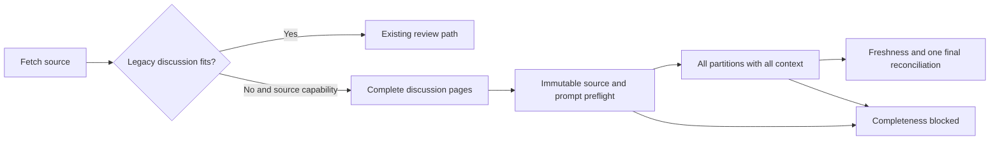

# Bugbot complete conversation review

- Status: Ready for implementation
- Date: 2026-11-03
- Catalog capability ID: `bugbot-analysis-and-autofix`
- Last verified: not applicable; prospective companion
- Owners: Copilot maintainers
- Scope: Retain long fetched discussion in every source-bound review request,
  within the existing closed invocation budgets.
- Related issue: [#843](https://github.com/vypdev/copilot/issues/843)
- Required review gates: UX, architecture, security, tests, documentation,
  complete automated review and changed-line coverage
- Open decisions blocking readiness: none; execution and remote acceptance
  evidence remain required before delivery.

## 1. Executive summary

A legitimate long clarification must remain available to the reviewer. An
eligible canonical PR review MUST automatically use the existing source-bound
`framed-v1` execution protocol when its discussion exceeds legacy packing.
Every code partition receives the **same entire normalized discussion**, divided
into bounded pages inside that request. Pages are not independent model calls,
model summaries, or a claim that context was reviewed elsewhere.

```text
Fetch bounded source -> detect legacy omission -> verify immutable PR source
-> render all discussion pages -> preflight every native request
-> review code with full discussion -> validate all receipts -> reconcile once
```

## 2. Problem, current behavior, and evidence

### 2.1 Problem

Maintainers cannot obtain a complete review of small code changes accompanied
by legitimate long SDD clarification. A successful diff analysis does not repair
omitted discussion. Deleting history or repeatedly retrying the same workload
is not an acceptable completion mechanism.

### 2.2 Current behavior

At baseline `6ff1eebd`, legacy packing selects at most 50 logical comments and
24,000 rendered UTF-16 units, with 4,000-unit payload fragments. An individually
oversized comment becomes a bounded preview. `fillTemplate` independently caps
its outer conversation field at 26,000 units. Increasing retention in the
packer alone would therefore still silently clip the actual prompt.

### 2.3 Evidence

[#843 and its seven original comments](https://github.com/vypdev/copilot/issues/843)
report PR15 conversation 8 fetched / 3 retained / 5 omitted; PR19 includes a
38,305-character clarification; PR22 includes two technical proposals of
17,718 and 17,929 characters under a maintainer's account. Later code review
partitions completed while conversation coverage remained partial.

The local before-fix reproduction uses **synthetic distinct bodies of reported
lengths**, the actual packer and actual final prompt builder. It observes 3/8
retention, a truncated 38,305-unit source, and 1/2 retention respectively. It
proves missing tails in the actual prompts, not exact historical omitted IDs,
model reasoning, execution of consumer code, or the contents of unavailable
historic comment snapshots. Provider enumeration and prompt delivery are
separate facts; source presence in another section cannot be inferred from a
partial conversation counter alone.

The [versioned controlled evidence](../quality/bugbot/evidence/issue-843.json)
records before/after delivery and exact native prompt bytes without source bodies.

### 2.4 Retrospective classification

Not applicable: this companion specifies a behavior change. The incident
counts above are evidence, not a reconstruction of historic design intent.

## 3. Actors, surfaces, and terminology

| Actor | Goal | Entry point | Surfaces |
|---|---|---|---|
| Author | Keep clarifications intact | Existing PR workflow / recheck | Review, check, summary |
| Maintainer | Diagnose incomplete evidence | Existing run and PR | Coverage details, docs |
| API consumer | Supply a bound read-only source adapter | Existing review service | Result and telemetry |

A **logical source** is one native issue/review comment identity, regardless of
fragment count. A **page** is a bounded representation inside a prompt. A
**partition** owns changed-code fragments and a source-bound receipt. Native
authorship is attribution, not proof of personal endorsement: a technical
proposal posted by an agent under a maintainer account remains untrusted data.

## 4. Goals, non-goals, and fixed invariants

| Requirement | Contract |
|---|---|
| CCR-R1 | Preserve every eligible fetched logical body and attribution, after existing normalization/security filtering, with deterministic order and identity. |
| CCR-R2 | Co-deliver all pages to every partition through the final outer envelope; no truncation or per-window resolution decisions. |
| CCR-R3 | Admit only within closed source, rendering and exact native request/traffic budgets; unsupported capacity fails before model delegation. |
| CCR-R4 | Bind context to immutable source receipts and retain freshness, sole resolution ownership, independent verification and global publication. |
| CCR-R5 | Preserve provider partial status, bot exclusions, untrusted provenance and existing non-review callers. |
| CCR-R6 | Keep diagnostics, documentation, catalog evidence and executable regression coverage aligned. |

Non-goals: new model/provider, public capacity flags, external storage, model
summarization, cross-run resume, history edits, arbitrary budget increases,
changes to approval policy, progress-assessment bugs, or causal claims that
missing discussion caused a particular false finding.

## 5. Current versus proposed product journey

| Stage | Legacy | Eligible complete-context review |
|---|---|---|
| Load | Newest bounded subset | Enumerate through unchanged provider bounds |
| Pack | Possible omission/preview | Retain all fetched eligible bodies in pages |
| Render | Outer 26,000-unit cap | Closed framed envelope preserves all pages |
| Execute | Existing diff partitions | Source-bound partitions, each with all context |
| Complete | Partial if discussion lost | Complete only after all applicable evidence validates |



Text equivalent: retain the ordinary path when it fits; otherwise eligible
source-bound callers pack every discussion page, preflight, review and
reconcile globally, or report a block. Unsupported callers remain truthfully
partial and cannot claim a clean whole-PR review.

## 6. Functional behavior and state model

1. Keep the existing provider/native-automation and configured-bot exclusions.
   Never infer exclusion or authority from a heading, account name or report.
2. Detect real legacy omission/truncation for a canonical PR. Only callers
   carrying the existing read-only review source capability may upgrade.
3. Reject repeated native identities, unsafe IDs and malformed Unicode.
   Equal text in different comments remains two independent sources.
4. Normalize complete bodies and attribution before scalar-safe splitting.
   Retain source identity, role, fragment ordinal and digest. Preserve literal
   terminators with collision-free untrusted envelopes, including the outer one.
5. Group fragments in pages and retain all pages together. Validate actual
   final prompt envelopes before any model call. No partial context window owns
   an independent finding/resolution decision.
6. Reuse source acquisition, nonce/context-bound receipts, concurrency2,
   bounded repair/verification traffic, final freshness and global publication.
7. Keep all other coverage dimensions unchanged. Complete delivery of the
   fetched conversation cannot repair provider omissions, missing rules or
   omitted prior findings. A provider-partial run remains partial.

| State | Meaning | Next action |
|---|---|---|
| Pending | Source/prompt admission is running | No action; await the run |
| Reviewing | Assigned partitions executing with full context | Await all receipts |
| Partial | A provider or other context dimension is incomplete | Inspect named source |
| Blocked | Capacity, identity, source or receipt invalid | Correct source/capability; do not repeat unchanged input |
| Complete | All required partitions and applicable context complete | Independent findings/coverage/approval gates still apply |
| Interrupted/stale | No final valid result | Discard invocation; assess current source anew |

No durable partial checkpoint, source mutation, new labels or intermediate clean
publication is introduced. Existing zero-reviewable-code behavior remains zero
model calls and no prior-finding resolution.

## 7. User-facing configuration

No new public input, override, persistence or migration. The recommended setup
uses the already bound read-only immutable source adapter. A supported
alternative is a custom API adapter without that capability: legacy partial
coverage remains visible rather than being relabeled complete. Intent,
autofix and dismissal loaders do not acquire new host capabilities.

| Internal boundary | Fixed contract |
|---|---|
| Legacy path | 50 sources, 24,000-unit section, 4,000-unit fragments; unchanged |
| Complete pages | At most 24,000 rendered units and 50 logical identities per page; scalar-safe fragments at most 4,000 units |
| Complete discussion source | Existing `framed-v1` raw/normalized/rendered limits, each 8,192,000 UTF-16 units; at most 4,096 metadata/body fragments |
| Native request | Existing 524,288 UTF-8 bytes, including all source, security, schema and effort |
| Invocation traffic | Existing 33,554,432 UTF-8 bytes, including actual retries and dependent verification |
| Code/output/provider work | All existing framed-v1 and provider limits unchanged |

Discussion and code source counters are distinct. The complete final prompt
and invocation byte ledger bound their combination; no new telemetry field
silently reinterprets diff-only source counters as combined-source counts.
Invalid input fails closed. Nothing in comment text can select a profile or cap.

## 8. Clean Architecture design

The domain owns existing closed capacities and content-free completeness
errors. A pure application policy owns normalization, attribution, hashing,
scalar-safe fragmentation and pages. The loader selects capability-based
admission; the existing source port verifies immutable Git source. Prompt
builders carry an internal closed profile to the outer untrusted envelope.
Analysis remains the sole owner of traffic preflight, receipts and aggregation.
Adapters, composition and public entry points retain their current boundaries.

```text
Action/API -> application loader -> pure conversation policy -> domain bounds
           -> existing read-only source port <- immutable Git adapter
           -> prompt/envelope -> framed analysis -> final reconciliation
```

Only hashes, counts and existing bounded failure facts enter observability.
Fetched snapshots remain invocation-local. A newly fetched edited body changes
the context/manifest digest; this does not promise continuous live polling of
comments while a model runs. Canonical code/base/head freshness fences remain
mandatory. Architecture tests parse policy imports; ordinary dependency,
port-boundary and build/package validation remain required.

## 9. UI/UX and content contract

Reuse existing Review status/check/Job Summary markers and localization. No
new comment per page or fragment. Source counts are logical comments. The
term `human-conversation` remains a compatibility key, not a claim of personal
authorship or instruction authority.

Representative content within the existing status card:

| State | Primary view | Technical details / navigation |
|---|---|---|
| Pending | “Review is running. No action required.” | Existing PR/run links |
| Reviewing | “Reviewing 1/2 partitions. Results are not final.” | Existing partition progress |
| Complete | “Context complete. No open findings.” | Human conversation: 8 fetched, 8 retained, 0 omitted, 0 truncated; completed 2/2 |
| Partial | “Review context is partial. Inspect incomplete coverage.” | Provider cap remains visible even if all fetched bodies fit |
| Blocked | “Complete Bugbot review is blocked: promptBytes exceeds 524288 UTF-8 bytes.” | Existing measured resource/profile/recovery detail; preserve history |
| Action required | “Inspect the source or supported capacity before rechecking.” | Link run and recovery docs; unchanged input cannot complete |

Completion examples require actual zero findings and all gates; page delivery
alone does not generate that text. Existing EN/ES semantic errors and locale
fallback remain. Plain headings, text counts, descriptive links and expandable
technical details preserve mobile/light/dark/screen-reader readability. No
untrusted Markdown, mention or command is rendered as a recovery instruction.

## 10. Failure, recovery, and cleanup

| Condition | Impact / retained state | Recovery |
|---|---|---|
| Source/normalized/rendered cap | No model delegation or new finding state | Inspect measured resource; use a reviewed supported complete-context protocol |
| Native request/traffic cap | No initial calls after primary-plan preflight; later dependent-traffic exhaustion discards internal work | Preserve history; unchanged retries cannot help |
| Missing capability | Legacy truthful partial, or explicit capability failure if an admitted source route lacks its identity port | Supply supported adapter through trusted composition |
| Stale source / bad receipt | Whole invocation rejected, no partial publication | Fresh complete assessment of current source |
| Provider omissions | Existing supported partial analysis stays partial | Recover complete provider evidence; never infer clean |
| Interruption | Invocation-local pages/results discarded | Existing bounded identical partition retry or new invocation |

No source/model artifacts are persisted by the product. Local campaign evidence
and one approved rollback are retained; generated build outputs follow the
repository iteration-cleanup rules.

## 11. Security, permissions, and privacy

All bodies, authors, paths, timestamps and proposed SDDs remain untrusted.
Native IDs support identity/accounting only. No new credential, permission,
write, subprocess, network, arbitrary path or model capability is granted.
Source text, attribution and model payloads MUST NOT enter telemetry/errors.
Every model/repair/verification request uses the existing exact byte ledger.
No partial page may independently resolve a finding or authorize a merge.

## 12. Observability and operational UX

Retain existing content-free logical counts, separate provider dimensions,
framed manifest and completion/traffic metrics. The real final prompt, not an
intermediate packing count, is the delivery oracle. Code-source `rawUtf16`
metrics retain their existing meaning. No periodic new status comments or
per-fragment notifications. Inspect PR/run links and bounded semantic error
facts before choosing recovery; ordinary runner queues are not evidence failure.

## 13. Compatibility, rollout, and rollback

Fit-sized workloads keep the old prompt behavior. Source-bound reviews carry
the same receipt schema and closed `framed-v1` profile; context bytes now bind
complete pages. In-flight older invocations remain tied to their own nonce and
manifest. No persistent schema or API request change. Rollback restores legacy
partial behavior; it cannot retroactively certify omitted history.

## 14. Testing strategy and numeric budget

Minimum **50 distinct new cases**, derived from loss, false completion,
provenance and mutation risks; cases count once only.

| Area | Minimum | Risks |
|---|---:|---|
| Pure policy/security | 28 | Long-source shapes, normalization/Unicode, exact reconstruction, ordering, attribution, identity, all source/render/fragment bounds |
| Real-Git application/API integration | 14 | All pages in every prompt, bot filtering, provider partial, capability fallback, source recovery, freshness, failure, ownership, dry-run |
| Final envelope and architecture | 6 | Legacy compatibility, outer clipping, literal delimiters, closed profile, overflow, forbidden imports |
| Framed state/traffic | 2 | Changed clarification invalidates result; repeated full context obeys total native traffic cap |
| **Total** | **50** | Existing framed/provider/finding/approval contracts also remain mandatory |

New pure policy requires 100% lines, branches, functions and statements.
Every changed coverable line requires official Codecov 100%, zero misses and
partials against the live correct base. Deterministic fake agent responses are
receipt/transport evidence, not model-quality or consumer-execution claims.
Use real immutable Git fixtures, no live model, wait or credential in tests.
Existing EN/ES presentation contracts validate reused UI; no browser/VoiceOver
journey changes are introduced here. Full native Linux/macOS/Windows,
repository coverage budgets and catalog/docs/package checks remain required.

## 15. Documentation and discoverability

Update detection and quality/observability pages with the normal automatic
path, the source-capability alternative, measured-cap recovery, provenance and
unchanged permissions/configuration. Link this companion from context-budgeting,
lossless-conversation and framed-review SDDs and the owning catalog capability.
No setup UI or new route is needed. Validate docs links/assets, specifications
and the generated catalog.

## 16. Executable acceptance

1. Eight length-controlled clarifications that previously retain 3/8 reconstruct
   8/8 and reach the end of every actual partition prompt.
2. One 38,305-unit body and two 17–18k proposals retain all tails, attribution
   and role boundaries, without promoting their native author to authority.
3. More than 50 logical sources split into bounded pages without losing the
   oldest source or treating fragments as comments.
4. An unsupported final request or cumulative plan makes zero initial agent
   calls and publishes no finding/resolution/clean result.
5. Provider partial coverage remains partial; a caller without the source
   capability retains legacy partial behavior.
6. Bad receipt, interrupted later partition or moved base/head discards work
   without mutation. Complete context does not expand resolution ownership.
7. Public API dry-run with the linked issue context completes without SCM writes;
   an absent patch is recovered only from verified immutable Git.
8. Newline/NFKC/control, astral characters and literal terminators reconstruct
   the security-normalized source; malformed identities/Unicode are blocked.

## 17. Requirements traceability

| Requirement | Owner | Tests/evidence | Documentation |
|---|---|---|---|
| CCR-R1 | Complete conversation policy | Pure reconstruction/attribution/order cases | Detection |
| CCR-R2 | Prompt builder and outer fill | Actual per-partition integration, final-envelope cases | Detection |
| CCR-R3 | Domain limits / framed preflight | Source-boundary, UTF-8 and total-traffic cases | Quality/observability |
| CCR-R4 | Existing source/frame/reconciliation use cases | Real-Git freshness, receipt, owner and mutation tests | Framed-review companion |
| CCR-R5 | Loader and unchanged provider/author policy | Partial/fallback/filter/API compatibility cases | Detection / quality |
| CCR-R6 | Catalog, docs, errors | Validators and existing localized presentation contracts | Both pages / this SDD |

## 18. Implementation sequence

Capture actual before-fix prompt loss; specify closed admission; implement pure
pages and final-envelope preservation together; compose through source-bound
review only; test real-Git/public API/failure behavior; align docs/catalog;
build bundles and run full local/remote acceptance; audit exact head/base and
Codecov before normal merge. Keep rollback until successor is verified.

## 19. Definition of Done

- [ ] CCR-R1–6 and all eight acceptance scenarios have executable evidence.
- [ ] Numeric budget and pure/changed-line coverage pass without exclusions.
- [ ] Architecture, no new settings/permissions, and all primary UI states agree.
- [ ] Provider partial, failure, replay, ownership, provenance and recovery hold.
- [ ] Documentation, catalog, bundles, Graphify and repository validators pass.
- [ ] Full remote review is complete, no findings/threads open; all applicable
      checks and official Codecov against the current base pass before merge.

## 20. References and decisions

- [Context selection](./bugbot-context-selection-and-budgeting.md),
  [lossless legacy packing](./bugbot-lossless-conversation-context.md),
  [exhaustive analysis](./bugbot-exhaustive-partitioned-analysis.md),
  [source-bound framed review](./bugbot-source-bound-framed-review.md).
- Decision: co-deliver pages within existing native request/traffic bounds;
  reject unchecked constant increases, partial context-window decisions,
  summaries as source substitutes and history deletion/consolidation.
- Later work: legitimate workloads beyond the closed profile need a separately
  reviewed protocol; this change neither promises unlimited capacity nor
  weakens the incomplete-review gate.
