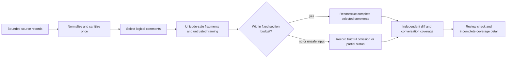
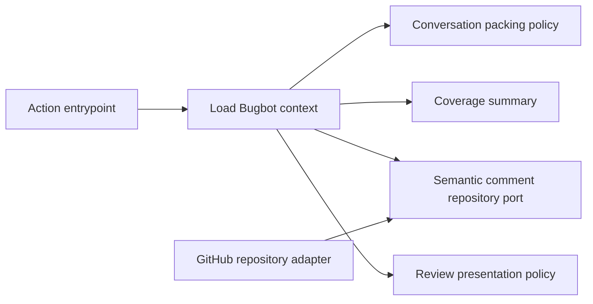

# Lossless Bugbot Conversation Context

- Status: Draft
- Date: 2026-10-26
- Catalog capability ID: `bugbot-analysis-and-autofix`
- Last verified: not applicable
- Owners: Copilot maintainers
- Scope: Preserve complete sanitized review conversation comments within the existing bounded context while retaining truthful completeness reporting and existing safety gates.
- Related issues/PRs: [Issue #724](https://github.com/vypdev/copilot/issues/724); [PR #719](https://github.com/vypdev/copilot/pull/719)
- Required review gates: product UX, architecture, testing, documentation, security/operations
- Open decisions blocking readiness: none

> Prospective companion specification. It adds a focused conversation-fragment contract to the existing Bugbot capability. It does not replace or repeat its owning specifications.

## 1. Executive summary

Bugbot currently treats a logical review comment that exceeds the 4,000-character item limit as truncated. That can make overall review context partial even when diff analysis completed. The proposed change fragments the complete normalized and sanitized comment into bounded prompt fragments, wraps each fragment using existing untrusted-content framing, and reconstructs each selected logical comment exactly. Fragmentation does not create extra comments or increase any source, item, or total context limit.

The recommended behavior is generic lossless packing for selected comments, including both generated User-account reports and ordinary human comments. No new report verification, producer allowlist, login-based trust, or heading-based trust is introduced. If a comment or other source cannot be fully retained within existing limits, coverage remains honestly partial. Full diff analysis and review-context completeness remain separately visible.

```text
Fetch bounded sources -> normalize and sanitize each logical comment -> select up to 50 -> fragment and safely frame -> pack within 24,000 characters -> report source completeness and diff completeness independently
```

## 2. Problem, current behavior, and evidence

### 2.1 Problem

A reviewer or operator can see a partial review and a blocked lifecycle despite all diff-analysis partitions completing, because an oversized conversation item was truncated. This obscures which input is incomplete and can make a complete code analysis look incomplete. The correction must preserve the original evidence and provenance, retain genuine human discussion when it fits the established total budget, and avoid treating user-controlled report content or identity claims as trusted instructions.

### 2.2 Current behavior

1. The repository fetches and selects bounded review-conversation sources, retaining source identity and existing provider limits.
2. `bugbot_review_context.ts` normalizes NFKC, CRLF, and outer whitespace, then excludes existing provider-classified automated authors and configured Copilot-bot authors.
3. Remaining entries are limited to `MAX_CONVERSATION_ITEM_LENGTH=4000`; an oversized item is truncated.
4. `load_bugbot_context_use_case.ts` derives human-conversation partial status from omitted or truncated logical comment counts. `summarizeBugbotCoverage` combines source completeness.
5. On PR #719, the Codecov comment is attributed by GitHub as account type User and is 5,959 characters. The reported run completed 9/9 partitions with zero candidate or published findings, while conversation status was partial, `truncatedItems=1`, and `limitReached=true`.

Steps 1–4 describe the supplied repository evidence. The issue report and telemetry are the concrete incident evidence; the proposed behavior is not current behavior.

### 2.3 Evidence

- Code/workflow/documentation references: `src/application/usecases/steps/commit/bugbot/bugbot_review_context.ts`; `src/application/usecases/steps/commit/bugbot/load_bugbot_context_use_case.ts`; `src/domain/bugbot/context.ts`; `src/domain/security/untrusted_content.ts`; `src/application/policies/bugbot_diff_partition_policy.ts`; `src/application/policies/bugbot_review_presentation_policy.ts`; `src/data/repository/issue/bugbot_issue_comment_query_repository.ts`; `src/application/usecases/steps/commit/bugbot/bugbot_context_request.ts`.
- Incidents or concrete examples: [Issue #724](https://github.com/vypdev/copilot/issues/724), [PR #719](https://github.com/vypdev/copilot/pull/719), and [the generated Codecov comment](https://github.com/vypdev/copilot/pull/719#issuecomment-6412438827). Reported telemetry: 9/9 partitions completed; open=0; verification-required=0; one truncated conversation item; review outcome partial.
- External primary sources: GitHub’s issue, pull request, comment, and Action run linked above.
- Unknowns: The historical reason for the 4,000-character item cap is not established by supplied evidence. This proposal preserves that per-fragment cap and all existing total/provider limits.

### 2.4 Retrospective classification (as-built baselines only)

Not applicable: this is a prospective companion and does not reconstruct an implemented baseline. Current behavior and verified facts are recorded in 2.2 and 2.3.

## 3. Actors, surfaces, and terminology

| Actor | Goal | Entry point | Visible surfaces |
|---|---|---|---|
| Pull request author | Understand whether review inputs and diff analysis are complete | Pull request workflow | Copilot / Review check, Job Summary, PR comments |
| Reviewer | Inspect findings and understand partial coverage | Review result | PR review and incomplete-coverage detail |
| Operator | Diagnose omitted or malformed conversation input | Action run | Job Summary, bounded telemetry, logs |
| Maintainer | Preserve boundaries and validate implementation | Repository change | SDD, tests, catalog, contributor documentation |

**Logical comment** means one source comment, counted once regardless of its internal fragments. **Fragment** means a prompt representation containing at most 4,000 UTF-16 code units from the complete sanitized logical comment. **Conversation section** means the fully rendered bounded prompt section, including wrappers, separators, and any omission notice. **Source completeness** means whether all applicable source material was fetched and retained under existing limits. **Diff completeness** means whether the bounded diff analysis completed. Neither completeness fact implies the other.

GitHub owns source identity and original comment content. The application owns normalized/sanitized prompt copies, selection, packing, and truthful coverage counts. All comment body text is untrusted data, including generated reports, headings, markers, usernames, and delimiter-like text.

## 4. Goals

| Requirement | Behavior |
|---|---|
| LCC-1 | Retain the complete normalized and sanitized payload of each selected logical comment when it fits the existing section and source limits, using fragments no longer than 4,000 UTF-16 code units. |
| LCC-2 | Preserve normalization and security framing, exact ordered reconstruction, and source provenance; never split a valid surrogate pair or independently normalize fragments. |
| LCC-3 | Keep fixed conversation caps, source/provider limits, selection order, and logical-comment accounting unchanged; make omitted or malformed input truthfully partial. |
| LCC-4 | Keep provider-classified automated-author and configured Copilot-bot exclusions unchanged; introduce no new trusted-producer classification or identity/heading/marker trust. |
| LCC-5 | Report diff-analysis completeness independently from conversation/source completeness, preserving existing incomplete-coverage and guarded-approval behavior. |
| LCC-6 | Add executable policy, integration, security, and UX regressions; update the catalog and user/operator documentation in the same implementation change. |

### 4.1 Goals

1. Meet LCC-1 and LCC-2: eliminate avoidable per-comment truncation while keeping untrusted content safe and reconstructable.
2. Meet LCC-3 and LCC-5: preserve truthful counts and independent completeness signals under exhaustion or incomplete inputs.
3. Meet LCC-4 and LCC-6: retain existing trust and approval boundaries and make the behavior reviewable through tests and documentation.

### 4.2 Non-goals

1. Verify generated reports, introduce producer allowlists, or trust authors based on configurable logins, headings, or markers.
2. Increase the 24,000-character conversation section cap, 50-comment cap, provider/page limits, or the 4,000-character fragment limit.
3. Edit, delete, ignore, or replace GitHub source comments, or project a status-only substitute for a report.
4. Change diff partitioning, findings, protected-path policy, human-approval requirements, or extension-branch behavior.

### 4.3 Fixed product/safety invariants

1. All GitHub comment content remains untrusted, regardless of author account type or apparent automation.
2. A complete diff result cannot make incomplete conversation input complete, resolve missing evidence, or authorize guarded approval.
3. A complete comment reconstructed from fragments counts once and has no truncation record. Omitted or incompletely retained source content remains partial.

## 5. Current versus proposed product journey

| Stage | Current | Proposed | User/operator effect |
|---|---|---|---|
| Fetch and select | Bounded sources, existing provider and selection rules | Unchanged | Same comments and provenance are eligible |
| Normalize and frame | Normalize and sanitize, then truncate oversized remaining entries | Normalize and sanitize once, then fragment and frame each selected entry | Complete sanitized comments fit where the total budget permits |
| Pack | Truncation can count as incomplete | Pack complete logical comments and their wrappers within the same 24,000-character section cap | No per-item truncation solely due to the 4,000-unit fragment limit |
| Summarize | Any truncation or omission contributes to partial context | Fully reconstructed comments count once; actual omissions and unsafe malformed input remain partial | Honest source coverage without conflating completed diff analysis |
| Present | Partial result may obscure that diff partitions completed | Show diff and conversation completeness independently, with incomplete-coverage details | Reviewer can see what completed and what needs inspection |



Text equivalent: bounded source records -> normalize and sanitize -> select comments -> fragment and pack under fixed limits -> record complete or partial source coverage -> present that independently from diff completeness.

## 6. Functional behavior and state model

### 6.1 Happy path

1. The existing repository adapter fetches source records under current provider/page limits and preserves source IDs, author metadata, and source category.
2. The application applies current source selection and native automated-author filtering. No new identity or content-based trust rule is added.
3. The review-context builder normalizes and sanitizes each selected body once using existing behavior, then produces ordered fragments of at most 4,000 UTF-16 code units.
4. Fragment boundaries move backward when necessary to keep a valid surrogate pair together. Concatenating payload fragments reconstructs the sanitized logical comment exactly.
5. Existing untrusted-content framing wraps fragment payloads so delimiter-like input remains data. The complete rendered section, including wrappers, separators, and omission notice, remains at most 24,000 characters.
6. The loader counts selected/fetched/retained/omitted/truncated logical comments once each and sets conversation completeness from actual omissions or incomplete source retention.
7. Presentation reports diff and conversation status independently and retains existing guarded-approval behavior.

### 6.2 Alternative paths

- If the total section or 50-logical-comment limit is reached, preserve bounded source-category and aggregate omission counts; do not invent IDs or raw text for omitted comments.
- Fully reconstructed comments have `truncatedItems=0`. For affected retained comments, keep existing bounded IDs (`issue:<numeric-id>` or `review:<provider-id>`, at most 160 characters each). Existing presentation displays at most 50 source IDs.
- If source content is omitted or only partially retained, report partial context and `limitReached` truthfully. Never claim clean or complete, resolve missing evidence, or authorize approval.
- If malformed or unpaired surrogate input cannot be safely represented, fail safely before claiming complete review. Do not silently discard content or fabricate replacement evidence.
- A valid surrogate pair at a proposed boundary is retained intact by moving the boundary; that adjustment is not truncation.

### 6.3 State machine

| State | Entered when | User-visible meaning | Allowed next states | Recovery/owner |
|---|---|---|---|---|
| Complete conversation | Selected logical comments reconstruct fully within limits | Conversation source is complete for retained scope | Review complete or diff-partial | Application coverage summary |
| Partial conversation | Any applicable source is omitted, truncated, or unsafe | Review context is incomplete; inspect listed coverage | Retry on a later run or remain partial | Loader and presentation |
| Diff partial | A required diff partition is incomplete | Code analysis is incomplete independently of conversation | Retry or remain partial | Existing partition completion policy |
| Review complete | Required diff and applicable context are complete | Review result is complete for the run | New run on new revision | Existing workflow lifecycle |

Duplicate or out-of-order events continue to follow existing operation and revision handling. Fragment packing is a deterministic per-run representation; source records are never mutated. Cancellation and retry do not change an already emitted run’s packing facts.

## 7. User-facing configuration

No new user-facing configuration is introduced.

| Input | Type | Recommended default | Allowed values/range | Scope/persistence |
|---|---|---|---|---|
| Conversation section cap | Existing fixed internal bound | 24,000 characters, including wrappers, separators, and omission notice | Fixed; not configurable by this change | Per analysis run |
| Retained logical comments | Existing fixed internal bound | At most 50 | Fixed; not configurable by this change | Per analysis run |
| Fragment length | Internal representation bound | At most 4,000 UTF-16 code units per fragment | 1–4,000, with safe boundary adjustment | Per analysis run; fragments are not persisted |

Validation rejects unsafe fragment boundaries and malformed surrogate input from a complete result. Existing source/page/provider limits and current normalization/security policies remain authoritative. No precedence, migration, or alternative configuration is applicable because no configuration surface changes. The limits, author filtering, and approval gates are intentionally not configurable by this proposal.

## 8. Clean Architecture

### 8.1 Responsibilities and dependency direction

| Layer/boundary | Owns | Must not own/import |
|---|---|---|
| Domain/pure policy | Coverage invariants and pure fragment/packing decisions where appropriate | GitHub DTOs, SDKs, workflow APIs |
| Application | Orchestrates selection, safe prompt representation, and context completeness | Concrete SDK/process concerns |
| Adapters/data | Fetches and maps issue/review comments with source identity and provider limits | Product trust or packing policy |
| Infrastructure/composition | Wires existing repository, security, and application boundaries | Business decisions |
| Entrypoints | Adapts Action events and invokes existing workflow | Duplicate selection or packing orchestration |
| Presentation | Renders separate diff and conversation facts using existing presentation policy | Source mutation or coverage decisions |



Text equivalent: the Action entrypoint calls the application loader; pure packing and domain coverage decisions operate on semantic inputs; the GitHub adapter supplies source records; presentation renders the resulting independent coverage facts.

### 8.2 Contracts, state, and trust boundaries

- Pure decisions: split a sanitized string safely, frame fragments, and pack complete logical comments under the fixed rendered-section cap; expose deterministic counts and affected retained IDs.
- Application contracts: retain logical source identity and author/source provenance across fragments; count comments rather than fragments; make packing immutable for one run.
- Semantic ports: continue using existing comment-source repository contracts; fragments are internal prompt representation, not provider records.
- Durable state/schema ownership: no new durable state or external schema. Per-run context and telemetry carry logical counts and existing bounded IDs.
- Concurrency/idempotency strategy: deterministic per-run packing over immutable fetched records; no comment writes or new cross-run state.
- Trusted and untrusted inputs: provider metadata establishes source facts only. Comment bodies, author names, headings, markers, and embedded instructions are untrusted. Existing configured Copilot-bot exclusion remains unchanged.
- Provider error mapping: existing adapter/provider errors retain current behavior. Unsafe malformed text must not be converted into a complete result.

### 8.3 Executable architecture constraints

The pure packing policy must not import provider, SDK, filesystem, or workflow modules. Application code must depend on semantic source contracts, not provider DTOs. Add or extend an architecture test that rejects forbidden dependency directions and verifies the packing policy is composed through the existing loader. Contract tests must assert fragment reconstruction, cap accounting, and logical-comment counts from structured outputs rather than matching prose.

## 9. UI/UX and content contract

### 9.1 Information hierarchy

1. State whether the diff analysis completed and whether conversation context is complete.
2. State completed partition/finding facts.
3. Explain the consequence and next transition.
4. Give the reviewer the incomplete-coverage details or explicitly say no action is needed.
5. Link to the PR and Action run.
6. Put bounded source IDs and technical counts in expandable details.

### 9.2 Representative primary view

```markdown
<!-- existing stable check/comment markers remain unchanged -->

# 🔎 Copilot / Review

> **Current status:** Diff analysis completed; review context is partial.
>
> **Action required:** Inspect Incomplete coverage before treating this review as complete.

## Progress

- [x] Diff analysis completed (9/9 partitions)
- [x] No open findings reported
- [ ] Conversation context complete (one or more source items omitted or incomplete)

## What happens next

The code analysis completed, but the review remains partial because discussion context is incomplete. Missing conversation evidence is not treated as clean or resolved.

## Links

[Pull request #719](https://github.com/vypdev/copilot/pull/719) · [Action run](https://github.com/vypdev/copilot/actions/runs/40335249668)

<details>
<summary>Incomplete coverage and technical details</summary>

Diff: complete. Human conversation: partial. Inspect the listed bounded source IDs and counts in this run.

</details>
```

Required state variants retain existing localized messages and presentation policy:

- **Pending/no action:** “Review is running. No action is required while analysis is in progress.” Show completed partition progress and the run link.
- **Action required:** “Review context is partial. Inspect Incomplete coverage before treating this review as complete.” Show independent diff and conversation states.
- **Blocked or failed before irreversible effects:** “Review could not complete. Cause: required source or analysis input is unavailable. Retry the workflow after checking the run details. No review result was published.” Retain run correlation and existing state.
- **Partially successful:** “Diff analysis completed; review context is partial. Inspect Incomplete coverage.” Retain findings and completed partition facts; do not imply an already completed analysis failed.
- **Completed:** “Review completed with no findings” only when required diff and context sources are complete; link to the PR and run.

### 9.3 Issue, PR, and comment behavior

- Deterministic titles and purpose: preserve existing Copilot / Review check and comment titles and stable markers.
- What merge/close/retry will do: existing lifecycle behavior remains; a new run may recompute context, while merge does not repair missing evidence from the completed run.
- Durable marker and idempotent update policy: unchanged existing marker and update behavior; no new comments per fragment.
- Comment/notification budget: no fragment-level comments or notifications; existing workflow comment budget remains unchanged.
- Labels and checks as supplemental state: the check must reflect partial context even if diff analysis is complete; labels do not override it.
- Direct links and navigation: link to the PR, run, and existing incomplete-coverage details where available.

### 9.4 Accessibility, localization, and responsive behavior

Reuse existing locales, localized partial-status/check strings, and fallback behavior. Do not add public configuration or locale messages solely for internal fragments. The diagram’s textual equivalent is provided in section 5. Keep headings semantic, tables readable on narrow screens, links descriptive, and status understandable without color or emoji. Preserve existing untrusted Markdown, mention, command, marker, and URL sanitization; framing must make delimiter-like comment text remain data.

## 10. Failure, recovery, and cleanup

| Failure/partial state | User impact | Retained facts | Automatic retry | Required action | Cleanup |
|---|---|---|---|---|---|
| Total rendered-section cap reached | Conversation is partial | Fetched/retained/omitted logical counts, source category, `limitReached` | Existing bounded retry behavior only | Inspect incomplete coverage or rerun after source changes | No source edits; discard per-run prompt representation normally |
| 50-comment limit reached | Some comments are omitted | Aggregate omitted count and source category; no fabricated IDs or raw text | No special retry | Inspect coverage details | No persistent fragment data |
| Malformed/unpaired surrogate input | Complete review cannot be claimed | Safe bounded source identity and failure/partial state | Existing workflow policy | Inspect source and rerun when corrected | Do not rewrite GitHub source |
| Existing provider failure or incomplete diff partition | Review remains partial independently of conversation | Existing provider/partition evidence and correlation | Existing retry policy | Follow current Action run guidance | Existing cleanup policy |

Errors follow impact -> cause -> action -> retained state. A completed diff analysis remains reported as completed if only conversation retention is incomplete.

## 11. Security, permissions, and privacy

1. Preserve current least-privilege GitHub permissions and read-only source behavior; this change adds no write permission.
2. Treat all comment content as untrusted. Use existing `createUntrustedContent`, control-character removal, and safe/verbatim rendering rules. Literal terminators and delimiters in source text must remain data.
3. Do not log or persist raw comment bodies or fragment payloads. Keep existing bounded source IDs, counts, and sanitized diagnostics.
4. Do not infer trust from account login, account type, heading, marker, or claimed workflow provenance. Existing provider-classified automated-author and configured Copilot-bot exclusions remain as-is.
5. Malformed Unicode must not be silently replaced or dropped before a complete result is claimed. Fragmentation must not split a valid surrogate pair.

## 12. Observability and operational UX

- User-facing state: report `diff` and `human-conversation` completeness separately with existing localized coverage and partial-result presentation.
- Job Summary/operator evidence: retain fetched, retained, omitted, and truncated logical-comment counts; `limitReached`; bounded affected retained source IDs; and completed partition counts. A reconstructed comment has no truncation count.
- Logs, metrics, and correlation: use existing run correlation and bounded telemetry. Fragments are internal representation and are not counted as source comments.
- Pending external dependency versus workflow failure: preserve existing provider pending/failure distinctions; packing does not mask provider errors.
- Rate-limit/retry behavior: unchanged provider limits and retries.
- Noise/comment budget: no new comment per fragment and no increase in notifications.

## 13. Compatibility, migration, rollout, and rollback

- Existing in-flight operations/data: no persisted representation changes; an in-flight run uses its existing immutable fetched records and current code version.
- Schema/configuration migration: none; no public setting or durable schema is introduced.
- Deprecated behavior and compatibility window: per-comment truncation caused solely by the fragment limit is removed when the complete comment fits the section budget. True omissions remain partial.
- Rollout stages/feature flag if needed: no new flag is required; ship with the Action implementation after tests and documentation are updated.
- Rollback and irreversible effects: reverting restores prior per-item truncation behavior. GitHub source records and already published findings are not changed by packing.

## 14. Testing strategy

The minimum budget is 13 new distinct executable cases. Existing selection and diff-partition inventories remain unchanged and are referenced through `specs/bugbot-context-selection-and-budgeting.md` and `specs/bugbot-analysis-publication-and-autofix.md`; they are not recounted here. Every inventory row is one case in one exact budget area. New pure packing policy branches require 100% branch coverage; all changed lines require 100% coverage. Existing repository-wide thresholds remain in force.

| Area | Minimum distinct cases | Behaviors/risks covered |
|---|---:|---|
| Domain/configuration/pure planning | 4 | Observable scenarios in the case inventory. |
| State/application/idempotency/races | 3 | Observable scenarios in the case inventory. |
| Adapters/provider contracts | 1 | Observable scenarios in the case inventory. |
| UI/UX/localization/sanitization | 2 | Observable scenarios in the case inventory. |
| Integration/security/migration | 2 | Observable scenarios in the case inventory. |
| Workflows/setup/schema | 1 | Observable scenarios in the case inventory. |
| Total | 13 | Distinct inventory cases; repeated executions do not add cases. |

| Case ID | Area | Requirements | Scenario |
|---|---|---|---|
| bugbot-analysis-and-autofix-C01 | Domain/configuration/pure planning | LCC-1,LCC-2 | A 5,959-character sanitized User-account report is split into fragments no longer than 4,000 UTF-16 code units and concatenates exactly to the original sanitized body. |
| bugbot-analysis-and-autofix-C02 | Domain/configuration/pure planning | LCC-1,LCC-2 | A valid surrogate pair at the fragment boundary is kept intact by moving the boundary; all fragments remain within the cap and reconstruct exactly. |
| bugbot-analysis-and-autofix-C03 | Domain/configuration/pure planning | LCC-2,LCC-4 | Normalization and sanitization run once before fragmentation; fragments are not independently normalized and no author or heading trust is added. |
| bugbot-analysis-and-autofix-C04 | Domain/configuration/pure planning | LCC-2,LCC-3 | An unpaired surrogate fails safely and cannot produce a complete conversation result or fabricated replacement evidence. |
| bugbot-analysis-and-autofix-C05 | State/application/idempotency/races | LCC-1,LCC-3 | Several complete comments are packed newest-first for selection and rendered chronologically, while each logical comment is counted once. |
| bugbot-analysis-and-autofix-C06 | State/application/idempotency/races | LCC-1,LCC-3 | A selected comment’s wrappers, separators, and payload fit exactly within the rendered 24,000-character cap. |
| bugbot-analysis-and-autofix-C07 | State/application/idempotency/races | LCC-3,LCC-5 | Exhausting the 50-comment limit reports aggregate omitted count and source category without invented IDs or raw text. |
| bugbot-analysis-and-autofix-C08 | Adapters/provider contracts | LCC-3,LCC-4 | Existing provider author metadata and source IDs survive repository mapping and existing automated-author filtering remains unchanged. |
| bugbot-analysis-and-autofix-C09 | UI/UX/localization/sanitization | LCC-2,LCC-4 | A comment containing literal untrusted-content terminator text remains data inside safe framing and ordered fragments reconstruct it exactly. |
| bugbot-analysis-and-autofix-C10 | UI/UX/localization/sanitization | LCC-2,LCC-4 | Spoofed Codecov heading, marker, or claimed automation in an unknown User comment grants no new trust and the content remains untrusted. |
| bugbot-analysis-and-autofix-C11 | Integration/security/migration | LCC-3,LCC-5 | The loader reports a fully reconstructed comment as one retained logical item with zero truncated items and complete conversation status when no other limit is hit. |
| bugbot-analysis-and-autofix-C12 | Integration/security/migration | LCC-3,LCC-5,LCC-6 | Mixed complete human and automation-filtered inputs preserve provenance and counts; real omissions keep conversation partial while complete diff status remains independently complete and guarded approval is denied. |
| bugbot-analysis-and-autofix-C13 | Workflows/setup/schema | LCC-5,LCC-6 | An incomplete diff/analysis source remains partial despite complete conversation packing, and the check and documentation direct the reviewer to incomplete coverage. |

Use deterministic source fakes and IDs; no real waits, live GitHub services, or network dependencies. Add structured contract assertions for telemetry and presentation semantics, not prose-only greps. Run targeted existing tests in `bugbot_review_context.test.ts`, `load_bugbot_context_use_case.test.ts`, `untrusted_content.test.ts`, `context.test.ts`, repository query tests, lifecycle integration, and approval tests, plus new packing-policy tests. Required commands include `pnpm run build`, `pnpm run typecheck`, `pnpm test -- --runInBand --runTestsByPath <existing paths>`, `pnpm run test:coverage`, `pnpm run lint`, `pnpm run validate:specifications`, and `pnpm run validate:documentation`. Manual UX evidence must confirm the partial state communicates completed diff analysis and incomplete discussion context on a narrow view without relying on color.

## 15. Documentation and discoverability

| Path | Change |
|---|---|
| `specs/bugbot-lossless-conversation-context.md` | create |
| `specs/bugbot-context-selection-and-budgeting.md` | reference |
| `specs/bugbot-analysis-publication-and-autofix.md` | reference |
| `specs/catalog.json` | update |
| `specs/CATALOG.md` | update |
| `src/application/usecases/steps/commit/bugbot/bugbot_review_context.ts` | update |
| `src/application/usecases/steps/commit/bugbot/load_bugbot_context_use_case.ts` | update |
| `src/domain/bugbot/context.ts` | update |
| `src/application/policies/bugbot_conversation_packing_policy.ts` | create |
| `src/application/usecases/steps/commit/bugbot/__tests__/bugbot_review_context.test.ts` | update |
| `src/application/usecases/steps/commit/bugbot/__tests__/load_bugbot_context_use_case.test.ts` | update |
| `src/application/policies/__tests__/bugbot_conversation_packing_policy.test.ts` | create |
| `src/domain/security/__tests__/untrusted_content.test.ts` | update |
| `src/domain/bugbot/__tests__/context.test.ts` | update |
| `src/data/repository/issue/__tests__/bugbot_issue_comment_query_repository.test.ts` | reference |
| `src/data/repository/pull_request/__tests__/bugbot_pull_request_repository.test.ts` | reference |
| `src/application/usecases/steps/commit/bugbot/__tests__/reconcile_bugbot_review_state_integration.test.ts` | update |
| `src/domain/__tests__/pull_request_approval.test.ts` | update |
| `docs/bugbot/how-it-works.mdx` | update |
| `docs/bugbot/detection.mdx` | update |
| `docs/bugbot/failure-scenarios.mdx` | update |
| `docs/bugbot/quality-observability.mdx` | update |
| `docs/bugbot/permissions.mdx` | reference |
| `docs/pull-requests/guarded-approval.mdx` | reference |

| Audience | Artifact/page | Required content | Validation/navigation |
|---|---|---|---|
| User/reviewer | `docs/bugbot/detection.mdx` | Complete versus partial conversation context, independent diff status, and where to inspect coverage | Link from existing Bugbot documentation; validate documentation routes |
| Operator | `docs/bugbot/failure-scenarios.mdx` and `docs/bugbot/quality-observability.mdx` | Logical counts, limits, partial recovery, bounded IDs, and interpretation of completed partitions | Keep examples aligned with telemetry contract tests |
| Setup/security owner | `docs/bugbot/permissions.mdx` | Existing read permissions and unchanged trust/filtering policy | Link to existing permissions guidance |
| Contributor | `docs/bugbot/how-it-works.mdx` and this companion SDD | Selection, normalize-once, fragmentation, framing, packing, and architecture boundaries | Specification and documentation validation |
| Approval reviewer | `docs/pull-requests/guarded-approval.mdx` | Existing incomplete-coverage and protected-path approval requirements remain in force | Link from partial review guidance |

No migration or configuration reference is needed because there is no configuration or durable schema change. No new public locale message is required; reuse existing localized partial-status content.

## 16. Acceptance

1. Given a selected 5,959-character Codecov comment attributed to a User account, when the sanitized comment fits the existing total section budget, then all payload content is represented by ordered fragments of at most 4,000 UTF-16 code units and reconstructs exactly, without classifying it as trusted automation.
2. Given a genuine human comment under the same conditions, when packing runs, then it receives the same complete retention behavior and remains untrusted conversation input.
3. Given a comment from a real provider-classified Bot, when existing filtering runs, then current automated-author exclusion behavior is unchanged; no new classification rule is inferred from its body.
4. Given an unknown User comment with a spoofed report heading or marker, when packing runs, then the heading or marker grants no trust and the body remains safely framed as untrusted data.
5. Given literal framing terminator text in a comment, when fragments are rendered, then it remains data and concatenated payloads equal the complete sanitized comment.
6. Given a valid surrogate pair at a 4,000-unit boundary, when fragments are formed, then the boundary moves to preserve the pair and exact reconstruction; given an unpaired surrogate, then the system cannot claim complete context.
7. Given a selected comment fully reconstructed from fragments, when coverage is summarized, then it counts once with `truncatedItems=0`.
8. Given total-section or 50-comment exhaustion, when coverage is summarized, then omitted and truncated logical counts, source category, `limitReached`, and bounded retained IDs are truthful; omitted comments receive no fabricated IDs or raw text.
9. Given mixed human and automation-filtered source records, when context is loaded, then provenance and logical counts remain correct and fragment count does not inflate comment count.
10. Given complete diff analysis but genuinely incomplete conversation input, when the check is rendered, then diff is shown complete, conversation is shown partial, the reviewer is directed to Incomplete coverage, and approval remains guarded.
11. Given incomplete diff or analysis input but complete conversation packing, when the review is summarized, then overall review remains partial because diff completeness is independently incomplete.
12. Given the partial result on a narrow screen, when reviewed without color or emoji, then state, completed work, next action, and links remain understandable.
13. Given implementation completion, when specification and documentation validation run, then the companion and catalog evidence are discoverable and all new cases map to requirements.

## 17. Requirements traceability

| Requirement | Cases |
|---|---|
| LCC-1 | bugbot-analysis-and-autofix-C01, bugbot-analysis-and-autofix-C02, bugbot-analysis-and-autofix-C05, bugbot-analysis-and-autofix-C06 |
| LCC-2 | bugbot-analysis-and-autofix-C01, bugbot-analysis-and-autofix-C02, bugbot-analysis-and-autofix-C03, bugbot-analysis-and-autofix-C04, bugbot-analysis-and-autofix-C09, bugbot-analysis-and-autofix-C10 |
| LCC-3 | bugbot-analysis-and-autofix-C04, bugbot-analysis-and-autofix-C05, bugbot-analysis-and-autofix-C06, bugbot-analysis-and-autofix-C07, bugbot-analysis-and-autofix-C08, bugbot-analysis-and-autofix-C11, bugbot-analysis-and-autofix-C12 |
| LCC-4 | bugbot-analysis-and-autofix-C03, bugbot-analysis-and-autofix-C08, bugbot-analysis-and-autofix-C09, bugbot-analysis-and-autofix-C10 |
| LCC-5 | bugbot-analysis-and-autofix-C07, bugbot-analysis-and-autofix-C11, bugbot-analysis-and-autofix-C12, bugbot-analysis-and-autofix-C13 |
| LCC-6 | bugbot-analysis-and-autofix-C12, bugbot-analysis-and-autofix-C13 |

The referenced baseline specifications retain their existing selection cases and partition cases unchanged; this companion defines only the 13 new cases listed in section 14.

## 18. Implementation sequence

1. Add the pure fragment and packing contract and architecture constraints, preserving existing limits.
2. Implement Unicode-safe boundaries and existing untrusted framing, with policy tests for exact reconstruction and malformed input.
3. Integrate packing into the existing conversation builder and loader; preserve logical counts and source provenance.
4. Verify independent coverage summaries, presentation, and guarded approval with focused integration tests.
5. Update user/operator documentation, catalog evidence, and generated catalog view alongside the implementation.
6. Run coverage, build, typecheck, lint, specification and documentation validation; provide manual narrow-view UX evidence.

## 19. Definition of Done

- [ ] Every LCC requirement has an acceptance scenario and reciprocal case traceability.
- [ ] Packing and application boundaries follow the existing Clean Architecture layers and automated dependency constraints.
- [ ] The 13-case minimum budget passes; changed lines and new pure-policy branches have 100% coverage.
- [ ] Existing 24,000-character, 50-logical-comment, provider/page, and 4,000-unit fragment bounds are preserved.
- [ ] Complete logical comments reconstruct exactly; real omissions and malformed inputs remain honestly partial.
- [ ] Diff and conversation completeness remain independently visible; guarded approval and protected-path requirements remain unchanged.
- [ ] UI states, safe framing, localization reuse, and manual narrow-view review pass.
- [ ] User, operator, security, contributor, and approval documentation is complete and discoverable.
- [ ] No source comment is edited, deleted, or replaced, and no fragment-level notification is emitted.
- [ ] `specs/catalog.json` evidence and generated `specs/CATALOG.md` are current; `pnpm run validate:specifications` and `pnpm run validate:documentation` pass.
- [ ] No readiness-blocking decision remains unresolved.

## 20. References and decisions

- Primary sources: [Issue #724](https://github.com/vypdev/copilot/issues/724); [PR #719](https://github.com/vypdev/copilot/pull/719); [generated Codecov comment](https://github.com/vypdev/copilot/pull/719#issuecomment-6412438827); [Action job](https://github.com/vypdev/copilot/actions/runs/40335249668/job/121614957420).
- Related specs/ADRs/issues/PRs: `specs/bugbot-context-selection-and-budgeting.md`; `specs/bugbot-analysis-publication-and-autofix.md`; capability `bugbot-analysis-and-autofix`.
- Decisions: use a focused companion SDD; generic lossless fragmentation, not producer verification; preserve all existing bounds, source identity, newest-first selection, chronological rendering, filtering, untrusted framing, truthful partial counts, and approval gates. The 5,959-character report fits the existing total budget and is retained whole when the remaining budget permits.
- Follow-up work explicitly outside this spec: extension-branch work; increasing context budgets; changing Codecov evidence; changing finding, diff, protected-path, or guarded-approval policy.