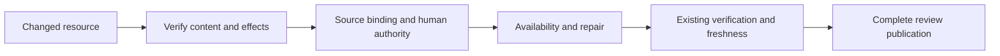

# Bugbot Resource Classification and Authority Evidence

- Status: Implemented contract — release adoption pending; required merge gates below
- Date: 2026-11-03
- Catalog capability ID: bugbot-analysis-and-autofix
- Last verified: 2026-11-03 (local source/tests; remote acceptance belongs to PR checks)
- Owners: Copilot maintainers
- Scope: Separate resource content, mandatory source binding and human authority in review evidence.
- Related issue: https://github.com/vypdev/copilot/issues/847
- Review gates: architecture, security, testing, documentation and existing GitHub UX
- Open design decisions: none; execution, coverage and review remain explicit gates.

## 1. Executive summary

Review what a resource actually returns or changes before judging its proof requirements. A source-bound static document can intentionally load without a live identity provider; it grants no personal API authority. Preserve actual source-access, disclosure, token and write defects.

```text
resource + selected contract -> content/effects + source gates
 -> human proof + intended availability -> existing verification/publication
```

Text equivalent: establish the resource, its separate access controls and availability before proposing a repair. Guidance is neither an authorization decision nor a finding filter.

## 2. Problem, current behavior, and evidence

The report concerns Domus PR15 at `54159084e3fe8b9e3541830d05e1b24f07f14dac`. Its source-bound document intentionally lacks a human lookup; personal APIs independently require proof. The reported replacement would prevent safe entry during identity failure. The issue and all comments were read; referenced immutable source Git blobs were verified. No consumer code was executed here.

The approved baseline is SDK `cd6a4da2e39c6faccbb4010380ce386e4249ac20`, merged as `2b4a3e7537c83141c0e1724f83c75dc3eac9b7c7`. Three valid controlled trials produce no alerts on 18 safe observations, but omit one source-access fault and one availability fault. Another availability category mismatch contributes a scorer miss. Default aggregate recall fails. This does not reproduce or explain the historical false positive; conversation truncation is not assumed causal.

An initial authored diff had an invalid empty-function preimage. All original trials remain evidence. The corrected presentation adds whole callbacks, preserving actual source, outcomes, binary verdicts and anchors. A private source-access reference category was corrected to security, retaining medium severity; original scores remain retained. The approved prompt constructor verifies 12 byte-identical reviewer prompts under that private correction. See [evidence and limitations](../quality/bugbot/evidence/issue-847.json).

Retrospective classification is not applicable: this is a prospective correction, not a justification of historical behavior.

## 3. Actors, surfaces, and terminology

Maintainers inspect findings, native threads, checks and summaries. The reviewer reasons over immutable evidence; the existing verifier adjudicates candidate hypotheses. Source binding restricts the requesting transport/session. Human proof and authorization govern personal facts/effects. Nonpersonal means verified output/effects lack personal facts, effective grants and authentication credentials; a declaration alone proves nothing.

## 4. Goals, non-goals, and fixed invariants

| Requirement | Behavior |
|---|---|
| G-01 | MUST verify classification against actual emitted content, headers and effects. |
| G-02 | MUST preserve required source/peer/prefix/session gates independently of human proof. |
| G-03 | MUST preserve protected disclosure, effective authority issuance and personal/privileged writes that violate the actual proof contract; permitted nonpersonal bookkeeping remains valid. |
| G-04 | MUST trace intended availability and actual initialization/error paths before alleging unusable UI or adding proof dependencies. |
| G-05 | MUST share guidance across source review, benchmark and existing Python verification without changing identity, history or limits. |
| G-06 | MUST preserve private references, honest evidence, documentation and complete review/coverage gates. |

The guidance expresses these proof obligations; model quality is measured against the unchanged explicit floors, not a guarantee that every model draw is correct.

No global authentication suppression, nonpersonal allowlist, automatic resolution, new lookup/execution permission, schema or capacity setting. Severity follows the demonstrated consequence. Source restrictions remain access controls even on nonpersonal resources.

## 5. Current versus proposed product journey

Previously an absent proof call could dominate the hypothesis. Verify content and separate gates, reconcile source-bound evidence, then report the concrete violation or omit the disproved claim.



Text equivalent: establish the reached output/effect and separate gates, check availability, then use the unchanged verified publication flow.

## 6. Functional behavior and state model

| Evidence | Required result |
|---|---|
| Source-bound static shell; denied/unavailable human; personal APIs reject | No missing-human-proof finding on the shell alone |
| Untrusted source reaches a handler without its required binding | Keep concrete access-control defect |
| Static label hides personal facts or an effective grant | Keep proved security finding |
| Personal read/write bypasses current proof | Keep security finding; shell success authorizes nothing |
| Added identity prerequisite blocks intended entry during outage | Keep proved availability/reliability fault |
| Personal preview explicitly requires proof | Preserve its proof requirement |
| Required causal evidence unavailable | Omit unsupported new claim; invent no guard or execution |

Pending, duplicate, superseded, canceled, failed, partial-publication and replay states retain the owning contract. A candidate decision never certifies complete review. Historical findings require eligible explicit current-source adjudication.

## 7. User-facing configuration

No new setting or migration. Existing model/effort, locale, ignore, source and publication configuration retains validation, precedence and operation snapshots. Recommended: current settings with complete source. Supported alternative: select this bounded quality cohort with existing `--corpus`.

Twelve resource cases are separate from the existing 174-case corpus; the 200-case invocation limit is unchanged. Source completeness, permissions, identity, history and coverage cannot be weakened.

## 8. Clean Architecture design

The pure `src/prompts/bugbot_resource_authority.ts` instruction has no IO, filter or authorization logic. Ordinary/framed source prompts, the benchmark and existing Python verifier consume it. Application coverage/freshness/eligibility and provider adapters retain their responsibilities. No new semantic port, provider dependency or mutation path.

Empty-source legacy compatibility stays unchanged. Existing envelopes account for actual prompt/traffic costs and fail closed at finite bounds; no limit is raised or source silently truncated. Type/dependency/port checks and six composition/identity contracts enforce the boundary.

The fixed optional Python/SQLite probe is contributor test infrastructure, not an Action prerequisite. Its explicit `.gitattributes` entry preserves the exact LF execution bytes on Windows as well as other platforms. Mandatory Node tests check coupled source/observations, scorer controls and actual prompt/port delivery; they are not fresh Python executions.

## 9. UI/UX and content contract

Existing surfaces remain the UI. Representative content:

- Pending: “Reviewing changed code. No action required.”
- Proved defect: “Document returns household data before identity verification”, followed by the changed operation, reached disclosure and safe repair direction.
- Action: inspect the linked effect and source/proof contract before accepting a replacement.
- Incomplete: “Review incomplete. Inspect the linked run and recheck the complete source.”
- Partial publication: existing retained-facts/recovery card; successful writes are not rollback permission.
- Complete safe source: normal completed review without an unsupported authentication claim.

No new card, command, locale, label or notification. Existing localized headings/outputLocale, accessible plain text, sanitization, descriptive links and bounded status upserts remain. Technical detail follows the user consequence. New browser/human UX acceptance is not applicable to this SDK reasoning change.

## 10. Failure, recovery, and cleanup

Missing/malformed/stale producer or verification evidence keeps existing failure and no-clean-result behavior. A rejected candidate is not a historical dismissal. Rechecks retain normal eligibility and source freshness; there is no new retry loop.

Preserve frozen inputs, all trials/scores, fixture corrections, source/runtime identities and the approved rollback. Remove only owned inactive intermediates after retaining evidence. Unknown causes remain unknown.

## 11. Security, permissions, and privacy

Source, contracts, observations and model output are untrusted evidence, never authority for execution, credentials, network expansion, mutation or suppression. Source binding alone grants no human authority; nonpersonal classification never exempts a mandatory source gate.

The probe executes only fixed authored source with fictional identities and in-memory SQLite closed per scenario. Model workspaces are fresh empty Git roots without source/reference files or owner data. The reviewer executes no corpus or consumer code.

## 12. Observability and operational UX

Existing telemetry retains coverage, partitions, verification, finding counts and outcomes. Fixed execution, model predictions, references and consumer reports remain distinct. All three planned trials contribute; preserve individual failures without selected-best runs or changed thresholds.

The original false positive is not reproduced by the current controlled baseline. Samples do not guarantee population accuracy. The final three trials pass default aggregate thresholds with no unsupported safe-case findings. One protected write is omitted and one source-access finding overrated in the first trial; the other two pass individually. All retained locations are exact. Earlier candidate failures remain retained; no all-draws-passed or statistical improvement claim. No raw provider-stdin or personal-data logging is introduced.

## 13. Compatibility, migration, rollout, and rollback

Markers, schemas, configuration and verifier response contracts remain compatible. This changes reasoning text only; no stored-state migration. Existing findings need normal current-source verification.

Merge to develop does not update master/v3 installations. Managed patch adoption follows the bugs-first sequence. Retain the prior reviewed SDK rollback; never rewrite reviews or undo successful SCM effects.

## 14. Testing strategy and numeric budget

| Area | Minimum distinct cases | Behaviors/risks covered |
|---|---:|---|
| Policy | 12 | Denial/outage, source binding, personal preview, disclosure/grant/read/write and availability |
| Application | 6 | Ordinary/framed/legacy delivery, private references, retained defect and correlated rejection |
| Total | 18 | Each parameterized scenario counts once |

Fixed-probe/model scenarios overlap the 12 fixture cases; repeated trials are 36 observations, not 36 new tests. The Python probe is optional contributor evidence. All repository thresholds remain; the new pure module and every modified coverable line MUST measure 100% with no Codecov partials against the actual base. No exclusion or quality floor changes.

Run full Jest/extension coverage, existing identity/framed/history/locale/port/workflow checks, build/package and native Linux/macOS/Windows. Complete exact-head review and official modified-line coverage remain merge gates. No new human browser test is required.

## 15. Documentation and discoverability

| Audience | Artifact | Required content |
|---|---|---|
| Reviewer/user | docs/bugbot/detection.mdx | Resource, separate gates, actual effects and availability |
| Quality contributor | docs/bugbot/quality-observability.mdx | Scoped corpus, fixed probe, actual samples and limitations |
| Maintainer | Owning SDD/catalog | Shared guidance and executable evidence |
| Operator | Existing recovery/recheck docs | Freshness, incomplete evidence, history and adoption |

No new setup route or setting. Validate docs/navigation, specifications/catalog and generated CATALOG together. Examples cannot imply fresh consumer execution or installation adoption.

## 16. Acceptance scenarios

| Case ID | Area | Requirements | Scenario |
|---|---|---|---|
| bugbot-resource-authority-C01 | Policy | G-01, G-02, G-04 | Directory outage preserves static shell; personal API503. |
| bugbot-resource-authority-C02 | Policy | G-01, G-02, G-03 | Unknown human gets no personal facts/grants/writes. |
| bugbot-resource-authority-C03 | Policy | G-01, G-02, G-03 | Revoked human receives only static presentation. |
| bugbot-resource-authority-C04 | Policy | G-01, G-02, G-03 | Mismatched human receives no personal authority. |
| bugbot-resource-authority-C05 | Policy | G-02 | Missing source cookie rejects shell and personal paths. |
| bugbot-resource-authority-C06 | Policy | G-01, G-03 | Personal preview retains required human proof. |
| bugbot-resource-authority-C07 | Policy | G-01, G-03 | Static label cannot hide household disclosure. |
| bugbot-resource-authority-C08 | Policy | G-01, G-03 | Source binding cannot issue an unproved grant/token. |
| bugbot-resource-authority-C09 | Policy | G-03 | Unproved personal read remains actionable. |
| bugbot-resource-authority-C10 | Policy | G-03 | Unproved command remains actionable. |
| bugbot-resource-authority-C11 | Policy | G-04 | Added proof blocks intended entry during outage. |
| bugbot-resource-authority-C12 | Policy | G-02 | Static delivery retains mandatory source access control. |
| bugbot-resource-authority-C13 | Application | G-05 | Ordinary source review gets shared instruction/evidence. |
| bugbot-resource-authority-C14 | Application | G-05 | Framed review gets the same contract. |
| bugbot-resource-authority-C15 | Application | G-05 | Empty-source legacy compatibility budget remains. |
| bugbot-resource-authority-C16 | Application | G-06 | Private references change no prompt; input reconstructs exactly. |
| bugbot-resource-authority-C17 | Application | G-03, G-05 | Explicit real disclosure retains candidate identity. |
| bugbot-resource-authority-C18 | Application | G-05 | Correlated rejection gains no history-resolution authority. |

## 17. Requirements traceability

| Requirement | Cases |
|---|---|
| G-01 | bugbot-resource-authority-C01, bugbot-resource-authority-C02, bugbot-resource-authority-C03, bugbot-resource-authority-C04, bugbot-resource-authority-C06, bugbot-resource-authority-C07, bugbot-resource-authority-C08 |
| G-02 | bugbot-resource-authority-C01, bugbot-resource-authority-C02, bugbot-resource-authority-C03, bugbot-resource-authority-C04, bugbot-resource-authority-C05, bugbot-resource-authority-C12 |
| G-03 | bugbot-resource-authority-C02, bugbot-resource-authority-C03, bugbot-resource-authority-C04, bugbot-resource-authority-C06, bugbot-resource-authority-C07, bugbot-resource-authority-C08, bugbot-resource-authority-C09, bugbot-resource-authority-C10, bugbot-resource-authority-C17 |
| G-04 | bugbot-resource-authority-C01, bugbot-resource-authority-C11 |
| G-05 | bugbot-resource-authority-C13, bugbot-resource-authority-C14, bugbot-resource-authority-C15, bugbot-resource-authority-C17, bugbot-resource-authority-C18 |
| G-06 | bugbot-resource-authority-C16 |

Shared builders/verifier own the six composition contracts. The named 18-case Jest suite and versioned corpus/evidence support the cases; detection and quality docs explain the corresponding user contract.

## 18. Implementation sequence

1. Preserve reports, immutable context, probes, all baseline trials and corrections.
2. Share pure instruction across existing consumers and deliver 18 regressions.
3. Measure three candidate trials with identical input/settings; retain failures.
4. Align owner/catalog/docs/evidence and normal generated bundles.
5. Run full quality/build/package/native checks, Graphify, complete review and official exact-base/head Codecov.
6. Ordinary authorized merge after all gates; retain minimum SDK/rollback and clean owned intermediates.

## 19. Definition of Done

- [ ] Six requirements and 18 distinct cases have executed evidence.
- [ ] Guidance reaches all routes without a filter, new authority or boundary inversion.
- [ ] Fixture corrections, fixed/model/reference/consumer evidence remain distinct and reproducible.
- [ ] All trials and default score failures are reported honestly.
- [ ] Settings, permissions, limits, state/history and approval controls remain intact.
- [ ] Owner/catalog, docs, generated CATALOG and validators pass.
- [ ] Types, lint, full coverage, builds/package/workflows and Graphify pass.
- [ ] Exact-head native platforms and complete review leave no open findings/threads.
- [ ] Official changed-line coverage is 100% with zero misses/partials against the live base.
- [ ] Rollout limits/current rollback are retained; owned inactive intermediates are cleaned.
- [ ] No design decision blocks readiness.

## 20. References and decisions

- [Issue847](https://github.com/vypdev/copilot/issues/847) and complete comment history.
- [Original source contract](https://github.com/vypdev/domus/blob/54159084e3fe8b9e3541830d05e1b24f07f14dac/specs/household-entry-interface.md).
- [General access-control terminology](https://cwe.mitre.org/data/definitions/284.html), not a consumer vulnerability mapping.
- [Owning Bugbot SDD](./bugbot-analysis-publication-and-autofix.md), [framed review](./bugbot-source-bound-framed-review.md), [fixture grounding](./bugbot-fixture-value-grounding.md).
- Preserve intended availability and each actual access boundary. Reject blanket suppression, new execution/lookup powers, raised limits, weakened scores and omission-based resolution. Historical internal cause remains unknown.
