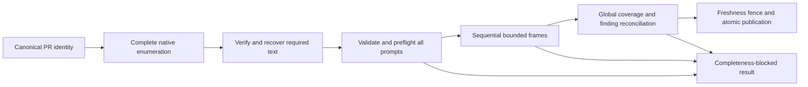
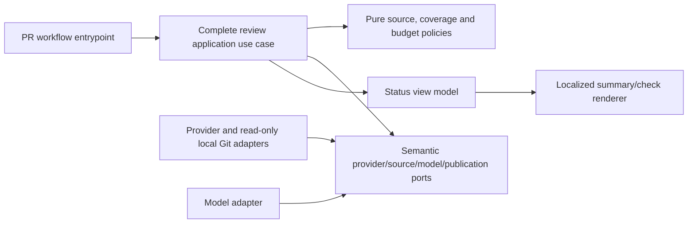

# Bugbot Source-Bound Framed Review

- Status: Ready for implementation
- Date: 2026-11-01
- Catalog capability ID: `bugbot-analysis-and-autofix`
- Last verified: not applicable (prospective companion)
- Owners: Copilot maintainers
- Scope: Define an opt-in-by-workload, bounded, source-bound framed-v1 protocol for complete Bugbot review when a valid PR diff exceeds the existing planning envelope.
- Related issues/PRs: [Issue #839](https://github.com/vypdev/copilot/issues/839); [related issue #838](https://github.com/vypdev/copilot/issues/838); [issue #763](https://github.com/vypdev/copilot/issues/763); [reproduction PR #837](https://github.com/vypdev/copilot/pull/837); [review run](https://github.com/vypdev/copilot/actions/runs/41266073083)
- Required review gates: product UX, architecture, testing, documentation, security/operations
- Open decisions blocking readiness: none from the authorized product decisions; implementation validation and remote merge gates remain open; this status records design readiness, not completed delivery.

## 1. Executive summary

A complete, unusually large pull request diff must be reviewable without silently dropping files, weakening finding verification, or treating partial work as clean. The recommended behavior is to retain the current path for up to 64 partitions and select a closed, internal framed-v1 profile for larger eligible workloads. The framed profile divides a fully verified source manifest into bounded sequential frames, executes each frame under finite limits, and reconciles findings only after every required source fragment and partition has valid coverage and the canonical PR identity is still current.

Capacity exhaustion and incomplete evidence produce a nonretryable completeness-blocked result that reports the resource, measured count, limit, and unit, plus a supported operator action. No partial findings, resolution updates, or clean approval may be published. The protocol keeps source manifests, frame receipts, and model results in memory for one invocation and discards them on completion, failure, interruption, or supersession.

```text
Canonical PR identity -> complete native source enumeration -> bounded local recovery if needed -> whole-plan preflight -> sequential frames -> complete global validation -> freshness fence -> one atomic reconciliation/publication
```

## 2. Problem, current behavior, and evidence

### 2.1 Problem

A maintainer attempting a coherent complete extension milestone cannot receive the mandatory automated review when its canonical diff exceeds Bugbot's fixed raw-input or 64-partition planning envelope. The current guard correctly stops before a partial review, but its remediation advises splitting the PR. Splitting can disrupt a coherent change and does not provide a supported complete-review route. Any extension must preserve full file and fragment coverage, finding verification and approval controls.

### 2.2 Current behavior

1. Bugbot loads the canonical PR diff and builds a review plan before reviewer/model calls.
2. The planner rejects an input exceeding the fixed 64-partition or raw-input envelope; the observed path made zero prompt and response characters and published no review.
3. The reported remediation is to split the pull request and retry.
4. The current error was classified as `workflow.failed` and retryable even though repeating the identical deterministic over-cap input cannot succeed.

These are supplied issue facts. These incident facts describe the pre-fix baseline. The following contract guides #839; the implementation receipt below distinguishes local observations from remote acceptance.

### 2.3 Evidence

- Code/workflow/documentation references: existing capability catalog lists `specs/bugbot-analysis-publication-and-autofix.md`, `specs/bugbot-context-selection-and-budgeting.md`, `specs/bugbot-exhaustive-partitioned-analysis.md`, `specs/bugbot-lossless-conversation-context.md`, Bugbot source and test paths, and `docs/bugbot/` pages. These are current source locations, not proof of future implementation or framework support.
- Incident: public [PR #837](https://github.com/vypdev/copilot/pull/837), issue #704, exact head `5869c60f98524c5824d73f5b53e5e367f9fd5f27` against base `19154b3275e6e5533ff471fae0f2602d85ab51ca`; run `41266073083`, job `124729032527`.
- Native inventory: nine pages, 887 unique paths, 52,467 additions and 442 deletions. Three provider patches were absent and remain completeness/workspace concerns; they are not assumed reviewed.
- Exact planner evidence: 4,611,089 raw UTF-16 code units exceeded `MAX_REVIEW_DIFF_RAW_INPUT_LENGTH` of 4,096,000 (64,000 x 64). UTF-8 size was 4,621,294 bytes. A complete native file-page JSON snapshot had SHA-256 `736ef17c0b938512405afeb3b565eca3d36627271d87256e3bf982f35dcf16e3`.
- Run telemetry: context-preflight/context only, zero prompt/response characters, outcome failed. Independent application CI/local coverage does not substitute for the missing review.
- External primary sources: not applicable; the contract is grounded in supplied repository and issue evidence.
- Unknowns: exact implementation choices and actual runtime/framework support for the proposed protocol remain to be established during implementation. Three absent provider patches require the specified verified local recovery path or a blocked result.

### 2.4 Retrospective classification (as-built baselines only)

Not applicable: this is a prospective companion, not an as-built baseline. No implemented baseline is reconstructed.

## 3. Actors, surfaces, and terminology

| Actor | Goal | Entry point | Visible surfaces |
|---|---|---|---|
| PR author | Obtain a complete review and understand a block | Pull request workflow | PR review, check, Job Summary |
| Maintainer/operator | Recover source availability or correct scope | Workflow run and PR | Job Summary, logs, linked PR/run |
| Bugbot | Analyze every assigned source fragment | Existing Bugbot workflow | Internal plan/receipts and final finding publication |
| Reviewer | Confirm safe boundaries and evidence | Specification and pull request | Companion and owning SDDs, tests, docs |

Terms: **native enumeration** is the provider's complete ordered listing of changed PR files. **Required source** is every non-ignored change that must be analyzed, including verified recovered patches. **Raw UTF-16** is validated provider/recovered patch text before normalization; **normalized UTF-16** is sanitized/normalized text measured independently; **rendered** counts include wrappers and headers. **Fragment** is a scalar-safe ordered slice of one source. **Partition** is one bounded reviewer assignment. **Frame** is one sequential group of at most 64 partitions. **Completeness-blocked** means review evidence is insufficient or exceeds a deterministic bound; it is not a clean result. The provider owns PR identity and native file facts; trusted local Git owns object-derived recovery facts; application policies own coverage and reconciliation decisions.

## 4. Goals

### 4.1 Goals

The following requirements are normative; each requirement has executable acceptance cases in section 14 and reciprocal traceability in section 17.

| Requirement | Behavior |
|---|---|
| BFR-R01 | Select the closed framed-v1 profile by workload, retaining the existing <=64-partition path and public configuration. |
| BFR-R02 | Validate every provider value, then independently bound non-ignored raw and normalized UTF-16 input before rendering. |
| BFR-R03 | Assign every required path and sanitized character exactly once with scalar-safe ordered fragments and explicit coverage. |
| BFR-R04 | Require complete native enumeration and recover absent required text patches from verified immutable local Git objects before review. |
| BFR-R05 | Bind manifest, assignments and receipts to immutable PR source identity, effective context, protocol and invocation nonce. |
| BFR-R06 | Preflight all final prompts; execute at most two sequential64-part frames with global concurrency2. |
| BFR-R07 | Accept only a complete ordered set of schema-valid source-bound receipts; publish one globally reconciled result. |
| BFR-R08 | Enforce independent per-response and global output/count/byte limits before retaining results. |
| BFR-R09 | Retry only the identical failed partition at most3 times; discard all work on whole-run failure or interruption. |
| BFR-R10 | Fence source acquisition, planning, frames and publication with canonical identity; missing facts never establish freshness. |
| BFR-R11 | Keep one global resolution owner, explicit retained eligible finding IDs, dismissal reverification and existing approval controls. |
| BFR-R12 | Use a narrow trusted-host read-only source port; retain no durable source/model checkpoint or new credentials/permissions. |
| BFR-R13 | Render bounded localized completeness-blocked diagnostics with resource, measured count, limit, unit and supported recovery. |
| BFR-R14 | Keep owning SDDs, catalog, operator/user documentation, bundles and executable evidence aligned. |
| BFR-R15 | Demonstrate realistic complete H3 review and adversarial late-frame failures; require current-head checks and full changed-line coverage. |

### 4.2 Non-goals

1. Addressing the separate GitHub compare 300-file inventory ceiling in #838.
2. Changing SDD drafting behavior in #763.
3. Raising a global constant, adding ignore-pattern workarounds, weakening review/approval, or splitting as the only supported remedy.
4. Durable cross-run resume, source/model checkpoints, public capacity flags, new credentials, or deployment changes.
5. Treating missing patches, workspace inspection, model assertions, or independent application tests as proof of complete review.

### 4.3 Fixed product/safety invariants

1. Complete source and exact fragment/partition/frame coverage are prerequisites to any reconciliation or publication.
2. A deterministic capacity or evidence failure is nonretryable for the same input and never clean.
3. No partial SCM writes, intermediate clean state, per-frame publication, or omission-based finding resolution.
4. All existing ownership, dismissal, protected approval, source coverage, and current-head controls remain in force.

## 5. Current versus proposed product journey

| Stage | Current | Proposed | User/operator effect |
|---|---|---|---|
| Planning | Fixed raw and 64-partition limits reject over-cap input | Keep legacy path through 64; select bounded framed-v1 above it | Supported route for eligible large diffs |
| Source | Missing provider patches are not review evidence | Verify complete enumeration and recover eligible missing text from pinned local Git objects | Missing/unavailable evidence is explicit and blocked |
| Execution | No review starts after planning rejection | Preflight all prompts; run at most two sequential frames, with bounded partition calls | Progress does not imply completion |
| Result | Deterministic limit can look like retryable workflow failure | Show measured resource/limit/unit and supported action; classify completeness-blocked | Operator knows whether correcting source/scope can help |
| Publication | No result for the rejected run | Reconcile once only after full coverage and final freshness check | No partial finding or clean approval |



Text equivalent: verify PR identity, enumerate and verify all required source, preflight every prompt, execute bounded frames, then either validate and publish one complete result or report a block without partial publication.

## 6. Functional behavior and state model

### 6.1 Happy path

1. The existing workflow verifies the canonical open PR, repository identity, base/head ownership and immutable SHAs before acquisition.
2. The source adapter obtains complete native file enumeration. Missing required text patches are recovered only through the trusted-host local Git port under section 8.2 bounds.
3. Pure planning validates values, applies configured existing ignores, measures raw and normalized UTF-16 separately, fragments scalar-safely, and proves exact path/character coverage.
4. The planner selects legacy review at <=64 partitions or closed framed-v1 at 65–128 partitions, subject to all independent limits. It builds every final prompt and preflights per-prompt and aggregate UTF-8 byte limits before any reviewer call.
5. The application runs no more than two frames, each up to 64 partitions, sequentially; global model concurrency remains two. Completed valid frame results remain in memory only during this invocation.
6. The application validates ordered frame/partition identities, receipts, fragment coverage, output limits, global finding and resolution ownership, then rereads canonical identity.
7. Existing global normalization, verification, deduplication, severity/comment limits, retained-finding reconciliation, and atomic publication run once. Existing post-publication head fencing remains.

### 6.2 Alternative paths

- Exactly 64 partitions use the established path. Partition 65 selects framed-v1; 129 blocks before model calls.
- Eligible absent patches may be recovered from available immutable local Git objects. Missing objects require Action-managed synchronization/object preparation and a fresh complete workflow run.
- Operators may correct source identity or unavailable objects, or remove genuinely unrelated work through normal PR scope review. They may not repeat identical unsupported input as recovery.
- Any nonregular, binary, ambiguous, mismatched, unavailable, over-cap or otherwise unverifiable required source blocks the entire review.

### 6.3 State machine

| State | Entered when | User-visible meaning | Allowed next states | Recovery/owner |
|---|---|---|---|---|
| Identity verified | Canonical PR facts read successfully | Review source is being established | Enumerating, blocked | Workflow/application |
| Enumerating | Native file pages are read | Checking complete changed-file set | Recovering, planning, blocked | Provider adapter |
| Recovering | Required patches absent and local objects may supply them | Verifying immutable source objects | Planning, blocked | Trusted-host Git adapter |
| Planning | Inputs validate and fit finite source limits | Building exact coverage and prompts | Preflight, blocked | Pure policies/application |
| Preflight | All prompts are built | Checking prompt budgets before calls | Reviewing, blocked | Application |
| Reviewing | Valid frame calls are executing | Review is in progress; not yet complete | Reviewing, reconciling, blocked | Application/model port |
| Reconciling | All receipts and coverage validate | One global result is being checked | Published, blocked | Application/policies |
| Published | Final identity and existing gates pass | Complete review result is published | Terminal | Existing publication owner |
| Completeness-blocked | Bound, source, identity or receipt invariant fails | No complete review; no clean result | Terminal | Operator corrects source/objects/scope and starts a fresh run |
| Interrupted | Whole invocation cannot complete | No review certified; in-memory evidence discarded | Terminal | Fresh run reconstructs full source |

Duplicate, stale, out-of-order, corrupt, missing, foreign, replayed or canceled evidence invalidates the complete in-memory result. A completed frame cannot be resumed in another workflow run.

## 7. User-facing configuration

| Input | Type | Recommended default | Allowed values/range | Scope/persistence |
|---|---|---|---|---|
| Framed review profile | Internal closed profile selector | `framed-v1` selected by eligible workload | Only implementation-owned `legacy-v1` or `framed-v1`; no user-supplied capacity value | Operation snapshot; not public configuration |
| Existing ignore rules | Existing configuration type | Existing repository/workflow value | Existing validation and precedence; no new ignore patterns are introduced by this proposal | Snapshot and digest-bound for invocation |
| Source identity | Provider facts | Canonical open PR base/head and owners | Must be complete and verified; no user override | Immutable invocation identity |

Validation rejects unknown protocol/profile, malformed source values, unsafe paths, invalid counts, invalid Unicode, and inconsistent configuration before model calls. Configuration precedence and existing ignore semantics remain owned by existing Bugbot contracts; the effective configuration is digested into the manifest. This proposal adds no migration or public setting. A future profile requires a separately approved capacity decision. Safety bounds, full coverage, concurrency ceiling, freshness, and approval gates are not configurable.

Recommended example: leave existing configuration unchanged; an eligible 887-file workload is routed internally to framed-v1. Meaningful alternative: an ordinary <=64-partition review continues on the legacy path. No configuration example may imply that ignoring required source is a capacity workaround.

## 8. Clean Architecture

### 8.1 Responsibilities and dependency direction

| Layer/boundary | Owns | Must not own/import |
|---|---|---|
| Domain/pure policy | Closed profile selection, limits, Unicode-safe fragmentation, coverage validation, receipt identity, output budgets | Provider DTOs, SDKs, process or workflow APIs |
| Application | Complete review orchestration, identity fences, frame sequencing, retry ledger, global reconciliation boundary | Concrete provider SDK, shell/process execution, presentation rendering |
| Adapters/data | Map native pages and verified local Git objects into semantic source values; map provider errors | Product profile selection or publication policy |
| Infrastructure/composition | Wire existing workflow, provider/model and trusted-host read-only Git implementations | Business decisions or relaxed bounds |
| Entrypoints | Adapt existing PR workflow event and invoke the application once | Duplicate planning, retry, or publication orchestration |
| Presentation | Render bounded status, diagnostics and links from an immutable view model | Source reads, model calls, state transitions, SCM mutation |



Text equivalent: the workflow invokes an application use case; pure policies decide bounds and coverage; provider, Git, model, and publication adapters implement semantic ports; presentation renders the result without changing it.

### 8.2 Contracts, state, and trust boundaries

- Pure decisions: profile selection; validation and separate raw/normalized UTF-16 accounting; exact source/fragment coverage; prompt and output budgets; receipt/schema identity; global finding/resolution limits.
- Application contracts: immutable invocation identity, manifest, ordered frame/partition assignments, bounded receipts, and terminal result. The application owns sequencing, freshness rereads, retry policy, reconciliation, and the single publication boundary.
- Semantic ports: complete native PR file enumeration; canonical PR identity read; read-only verified local Git source reads; reviewer partition execution; existing global finding reconciliation/publication. Ports expose domain values, not SDK/process DTOs.
- Durable state/schema ownership: none for manifests, patches, receipts, findings, or resumable sessions. In-memory invocation state is discarded on success, failure, interruption, or supersession. Existing ordinary redacted telemetry retains its existing policy.
- Concurrency/idempotency strategy: at most two model calls globally, across retries; frames are sequential; only the identical failed partition assignment may retry, at most three attempts. Publication remains the existing atomic/idempotent owner and occurs only after global validation.
- Trusted/untrusted inputs: issue, PR, comments, provider pages, patches, model output, and repository source are untrusted data. Validate provider records before filtering. Never use model assertions or workspace inspection as source completeness evidence.
- Provider error mapping: deterministic capacity/invalid/incomplete evidence maps to nonretryable completeness-blocked with resource, observed count, limit, unit, supported action, and retained-state facts. Transient provider/model failures remain distinct workflow failures and cannot certify a review.
- Local source recovery: a narrow trusted-host read-only Git port pins canonical base/head SHAs and requires a unique merge-base and available commit/tree/blob objects. It verifies literal safe paths, regular text object identity/content and exact change metadata, deriving hunks with fixed argv while external diff, textconv, filters, hooks, and network are disabled. Every required side is verified, including complete provider patches: independent immutable changed-path enumeration closes page omissions/ABA mixes, regular modes and all unique old/new blobs are checked, UTF-8/BOM and object hashes are verified, and the native patch must reconstruct those exact texts. Absent, truncated or mismatching patches are recovered. Paths are at most 1,024 UTF-8 bytes. Tree reads batch at most 16 paths / 12,000 argument characters, commands time out at 30 seconds, and lazy fetch is disabled. Limits: 64 recovered files; 2 MiB UTF-8 per recovered patch; 8 MiB recovered patch bytes globally; 4 MiB per regular text blob; 32 MiB total unique verified old/new blob bytes; 256 local Git read operations. Recovered text also counts against every applicable source/rendering limit. Binary, nonregular, ambiguous merge-base, unavailable, mismatched, or over-cap evidence blocks. Existing Action-managed synchronization/object preparation is the path when objects are absent.
- Framed profile bounds: at most 2 sequential frames x 64 partitions (128 global); 1,000 distinct assigned paths subject to complete native enumeration; 4,096 fragments; 8,192,000 raw UTF-16 code units; independently 8,192,000 normalized UTF-16 code units; each fragment <=12,000 UTF-16 units; each rendered partition <=64,000 UTF-16 units including wrappers/headers; complete rendered diff <=8,192,000 UTF-16 units; each final prompt <=512 KiB UTF-8 and aggregate prompt traffic including retries and auxiliary verification <=32 MiB UTF-8; each primary or auxiliary model response <=4 MiB UTF-8. Maximum model concurrency is 2. Per response: 200 findings. Retained resolution claims: 500, and only from the single global resolution owner. Global findings: 2,000. Serialized retained result payload across frames: <=16 MiB UTF-8.
- Freshness binding: protocol/profile, fresh invocation nonce, repository identity, canonical open PR number and base/head repository ownership/ref identity, immutable base/head SHAs (including a separately read live base-ref tip rather than trusting cached PR base.sha), unique merge-base SHA, ordered complete source manifest digest (path/status/counts and source-content digests), ordered fragment coverage, and effective review context/configuration digest. Verify provider identity before source acquisition, after planning, between frames, immediately before reconciliation/publication, and recheck after any awaited localization immediately before mutation, and retain a post-publication identity check. The framed path has at most 41 canonical/context/freshness provider requests before ordinary transport retries; the ordinary context bound is unchanged. Failed identity reads are unverified. Any identity, source, assignment, context, nonce, or profile change invalidates the entire result.

### 8.3 Executable architecture constraints

Automated checks MUST enforce dependency direction and absence of cycles; domain policies must not import provider, process, or presentation modules; application ports must not expose provider DTOs; only the trusted-host adapter may perform fixed-argv local Git reads and its test contract must demonstrate disabled external diff/textconv/filter/hook/network behavior; publication must have one application call site after complete validation; schemas must reject missing/foreign identity fields; workflow contract checks must assert permissions and entrypoint wiring without broadening permissions. Run the repository specification validator and relevant dependency, schema, and workflow contract checks before readiness. These are proposed checks, not evidence that they already exist.

## 9. UI/UX and content contract

### 9.1 Information hierarchy

The first visible result states whether review is complete, what completed, what happens next, whether action is needed, and links to the PR and run. Technical counts and resource limits follow in a collapsed detail section. A framed progress state never implies a certified result.

### 9.2 Representative primary view

```markdown
<!-- stable machine marker: copilot-bugbot-review -->

# Bugbot complete review

> **Current status:** Review blocked; no complete review was published.
>
> **Action required:** Make the required Git objects available through the normal Action-managed preparation path, then start a fresh run.

## Progress

- [x] PR identity and native file list checked
- [x] 61 required patches recovered and verified
- [ ] Complete review and finding reconciliation

## What happens next

This run did not certify the pull request as clean. No findings or resolution updates from this run were published. A fresh run must review the complete current source.

## Links

[Open pull request](https://github.com/vypdev/copilot/pull/837) · [Inspect workflow run](https://github.com/vypdev/copilot/actions/runs/41266073083)

<details>
<summary>Technical details</summary>

Completeness blocked: local Git object unavailable (1 required object). No patch content or credentials are shown. Prepare the objects with the existing Action-managed synchronization path; identical reruns cannot recover missing objects.
</details>
```

Concrete primary-state variants:

**Pending/no action:** “Bugbot is reviewing the complete pull request. Source planning is complete; frame 1 of 2 is running. No action is required. No findings are final until all frames and freshness checks pass.” Link the PR and run.

**Action required:** “Bugbot could not verify all required source because a pinned Git object is unavailable. No complete review was published. Use the existing Action-managed object preparation path, then start a fresh run.” Link the PR, run, and operator documentation.

**Blocked before irreversible effects:** “Complete review blocked: rendered partition size was 64,001 UTF-16 units; limit 64,000. No model review or publication started. Correct the source/scope through normal PR review or use a separately approved future profile; repeating this input will not help.” Include observed resource, measured count, limit, unit and links.

**Partially complete after internal work:** “Review execution stopped after frame 1. The completed frame was discarded with this invocation; no findings or resolutions were published. A fresh run must review the full current source.” Do not expose internal partial findings as a result.

**Completed:** “Bugbot completed a source-bound review of the current pull request. All required files and fragments were covered and findings were reconciled. [Finding summary or ‘No findings met publication criteria.’]” Link to PR and run; distinguish complete review from approval policy.

### 9.3 Issue, PR, and comment behavior

- Deterministic title: `Bugbot complete review`; blocked check/summary title: `Bugbot review blocked`.
- A merge/close does not resume or certify an incomplete run. A fresh workflow reconstructs the entire current source. Retrying a transient identical partition is bounded as specified; deterministic capacity is not retryable.
- Reuse the existing stable marker and idempotent summary/check update behavior where present; do not create per-frame comments. One final global result is published atomically by the existing owner. Comment/notification budget remains the existing publication budget, with at most one updated review summary per invocation.
- Checks and labels are supplemental state, not proof that all files were reviewed. Provide descriptive PR and workflow-run links; no invented artifact link.

### 9.4 Accessibility, localization, and responsive behavior

Use the existing supported locale source and fallback behavior; translate the impact, cause, action, retained-state facts, resource name, observed count, limit, and unit together. Use textual progress and status, not color alone. Keep headings semantic, tables short or details collapsed, and links descriptive. Narrow/mobile views must show status and action before technical details; light/dark themes must preserve contrast. Escape untrusted source, model text, mentions, commands, Markdown, HTML markers, and URLs; diagnostics never include rejected patch content, credentials, or raw provider messages. Mermaid has the adjacent textual equivalent above.

## 10. Failure, recovery, and cleanup

| Failure/partial state | User impact | Retained facts | Automatic retry | Required action | Cleanup |
|---|---|---|---|---|---|
| Raw/normalized/fragment/partition/frame/prompt/output capacity exceeded | Complete review unavailable; never clean | Bounded resource, count, limit and unit | No | Correct source identity or genuinely unrelated scope through normal PR review; a future separately approved profile is separate work | Discard invocation memory |
| Native enumeration incomplete or required patch absent and unrecoverable | Coverage cannot be certified | Safe counts/IDs and object-preparation reason | No | Use Action-managed synchronization/object preparation, then fresh run | Discard source and plan |
| Invalid, binary, nonregular, ambiguous or mismatched object | Required source is unverifiable | Sanitized reason and safe path identifier if allowed | No | Correct source/object availability or scope; fresh run | Discard all in-memory data |
| Transient provider/model failure for partition | No complete result yet | Safe operation/partition identity and attempt count | Up to 3 attempts for identical failed assignment only | Fresh run after whole-run interruption | Stop queued work; drain bounded in-flight calls; discard invocation on whole-run interruption |
| Stale/changed/missing PR identity or manifest | Results are no longer current | Safe mismatch category | No | Start a fresh run for current PR identity | Discard all results; no reconciliation |
| Duplicate/missing/corrupt/replayed/out-of-order receipt | Completeness invalid | Safe protocol/receipt error category | No substitution; retry only if it is the same failed partition under retry rules | Fresh run after terminal failure | Discard all results; no writes |
| Complete validated review | Review result available | Existing durable findings/review state | Not applicable | Inspect linked PR/run | In-memory manifests and receipts discarded |

Errors follow impact -> cause -> action -> retained state. A transient failure is not reported as a deterministic limit. A successful internal frame is not described as partial publication or a successful review.

## 11. Security, permissions, and privacy

1. Reuse existing workflow permissions and authorization; add no credentials, secrets, storage permissions, or public capacity flags.
2. Treat provider values, repository source, issue/PR text, and model outputs as untrusted. Validate before filtering; use a narrow read-only local Git port with literal safe paths, fixed arguments and external execution features disabled.
3. Never log rejected source, patches, finding prose from incomplete runs, credentials, or resumable model sessions. Manifests, patches, receipts and model results remain in memory for one invocation only and are discarded on every terminal path. Existing redacted counts/IDs/timing telemetry retains its current policy.
4. Bind receipts and assignments to nonce, source, context, profile, and ordered coverage; reject duplicates, replay, substitutions and stale identity. Model assertions cannot attest completeness.
5. No workflow artifact, cache, repository comment/file, or other durable store may contain source/model checkpoints. No per-frame SCM write is permitted.

## 12. Observability and operational UX

- User-facing state: pending, completeness-blocked, transient workflow failure, or complete; never represent incomplete as clean.
- Job Summary/operator evidence: invocation status, safe PR/run links, profile, verified enumeration and coverage counts, frame progress, resource identifier, measured count/limit/unit, terminal reason, and supported action. Do not expose source text.
- Logs/metrics/correlation: ordinary redacted counts, safe identifiers, timing and outcome under existing retention. Distinguish UTF-16 code units from UTF-8 bytes, raw from normalized/rendered, and fragment/partition/frame budgets. Do not report a capacity block as ordinary retryable provider failure.
- Pending external dependency versus workflow failure: unavailable pinned Git objects are completeness-blocked with Action-managed preparation guidance; transient API/model failures remain workflow failures; neither yields a clean review.
- Rate-limit/retry behavior: at most two concurrent model calls globally and three attempts for the same failed partition. No whole-run resume or identical retry for deterministic exhaustion.
- Noise/comment budget: no frame-level comments; one existing global publication/update per invocation.

## 13. Compatibility, migration, rollout, and rollback

- Existing in-flight and ordinary <=64-partition reviews retain the established path and controls. Issue-only behavior remains compatible.
- No durable schema or public configuration migration is introduced. Unknown protocol/profile values fail closed.
- The profile is internal and selected by workload. Rollout requires normal reviewed implementation, full acceptance evidence, current-head review and existing checks; this draft authorizes no release or deployment.
- Rollback disables framed-v1 selection through reviewed implementation control and returns eligible over-cap workloads to a clear completeness-blocked result. Do not silently increase legacy limits or publish partial output. Existing already-published results follow existing reconciliation and rollback policy.

## 14. Testing strategy

The budget is a minimum of 130 distinct new executable cases, derived from independent source, protocol, recovery, freshness, output, UX, and integration risks. The existing 67 owner cases remain separate and are not counted here. The 130 cases below are planned acceptance inventory, not executed tests.

| Area | Minimum distinct cases | Behaviors/risks covered |
|---|---:|---|
| Planning/protocol | 48 | Observable scenarios in the case inventory. |
| Source adapters | 30 | Observable scenarios in the case inventory. |
| Frame execution | 24 | Observable scenarios in the case inventory. |
| Freshness | 12 | Observable scenarios in the case inventory. |
| UX/errors | 8 | Observable scenarios in the case inventory. |
| Integration/compatibility | 8 | Observable scenarios in the case inventory. |
| Total | 130 | Distinct inventory cases; repeated executions do not add cases. |

Repository-wide thresholds remain in force. New pure planning/coverage policies SHOULD meet 100% modified executable-line coverage without partials and branch coverage sufficient to cover every independent bound and fail-closed path. Changed modules must meet the repository's full current-head coverage gates. Use deterministic clocks, nonces, IDs, and provider/model/Git fakes; no real waits or live services. Table-driven rows count only when each listed case has a distinct assertion and execution. Include replay/race, adapter, workflow permission/schema, golden UI plus semantic assertions, and security tests. Architecture and workflow checks parse contracts rather than grep prose. Manual UX evidence must show narrow/mobile readability and understandable action/status in the supported locale/fallback. The realistic 887-file case must demonstrate complete simulated review, not claim that the historical run was reviewed.

| Case ID | Area | Requirements | Scenario |
|---|---|---|---|
| bugbot-framed-C001 | Planning/protocol | BFR-R01, BFR-R02 | Raw input at 8192000 UTF-16 units is admitted when every other budget fits. |
| bugbot-framed-C002 | Planning/protocol | BFR-R01, BFR-R02 | Raw input one unit over its cap blocks before normalization or model calls. |
| bugbot-framed-C003 | Planning/protocol | BFR-R02 | Normalized input exactly at its independent cap is admitted. |
| bugbot-framed-C004 | Planning/protocol | BFR-R02 | NFKC expansion one unit over normalized cap blocks before rendering. |
| bugbot-framed-C005 | Planning/protocol | BFR-R02 | UTF-8 bytes and UTF-16 units are measured separately on astral text. |
| bugbot-framed-C006 | Planning/protocol | BFR-R02 | Valid ignored paths consume no source-plan payload budget. |
| bugbot-framed-C007 | Planning/protocol | BFR-R02 | Malformed ignored records fail before ignore filtering. |
| bugbot-framed-C008 | Planning/protocol | BFR-R02 | Isolated high surrogate fails without forwarding source content. |
| bugbot-framed-C009 | Planning/protocol | BFR-R02 | Isolated low surrogate fails without forwarding source content. |
| bugbot-framed-C010 | Planning/protocol | BFR-R02 | Non-string patch, path or status fails as invalid source. |
| bugbot-framed-C011 | Planning/protocol | BFR-R02 | Unsafe, negative or non-finite change counts fail as invalid source. |
| bugbot-framed-C012 | Planning/protocol | BFR-R02, BFR-R03 | Duplicate native path records cannot satisfy distinct-file coverage. |
| bugbot-framed-C013 | Planning/protocol | BFR-R03 | Empty or missing patch is never certified as a reviewed placeholder. |
| bugbot-framed-C014 | Planning/protocol | BFR-R03 | Exact 12000-unit fragment boundary preserves every sanitized character. |
| bugbot-framed-C015 | Planning/protocol | BFR-R03 | A fragment hard boundary moves before an astral surrogate pair. |
| bugbot-framed-C016 | Planning/protocol | BFR-R03 | Newline splitting preserves ordered concatenation without overlap. |
| bugbot-framed-C017 | Planning/protocol | BFR-R03 | Delimiter-like patch content remains inert and verbatim after sanitization. |
| bugbot-framed-C018 | Planning/protocol | BFR-R03 | Control removal and normalization have distinct raw/normalized accounting. |
| bugbot-framed-C019 | Planning/protocol | BFR-R01, BFR-R03 | Exactly 4096 fragments fit when all other profile bounds fit. |
| bugbot-framed-C020 | Planning/protocol | BFR-R01, BFR-R03 | Fragment 4097 blocks before any reviewer query. |
| bugbot-framed-C021 | Planning/protocol | BFR-R01, BFR-R03 | Exactly 1000 unique assigned paths fit only with complete native enumeration. |
| bugbot-framed-C022 | Planning/protocol | BFR-R01, BFR-R03 | Assigned path 1001 blocks without an omitted-path clean result. |
| bugbot-framed-C023 | Planning/protocol | BFR-R01, BFR-R03 | Rendered partition at 64000 units is admitted. |
| bugbot-framed-C024 | Planning/protocol | BFR-R01, BFR-R03 | Rendered partition at 64001 units blocks, including wrappers and headers. |
| bugbot-framed-C025 | Planning/protocol | BFR-R01, BFR-R03 | Rendered diff aggregate at 8192000 units is admitted. |
| bugbot-framed-C026 | Planning/protocol | BFR-R01, BFR-R03 | Rendered diff aggregate one unit over its independent cap blocks. |
| bugbot-framed-C027 | Planning/protocol | BFR-R01, BFR-R06 | Exactly 64 ordinary partitions retain the established ordinary path. |
| bugbot-framed-C028 | Planning/protocol | BFR-R01, BFR-R06 | Partition 65 selects the framed profile instead of weakening the legacy cap. |
| bugbot-framed-C029 | Planning/protocol | BFR-R01, BFR-R06 | Exactly 128 framed partitions produce two 64-part frames. |
| bugbot-framed-C030 | Planning/protocol | BFR-R01, BFR-R06 | Partition 129 blocks before a reviewer query. |
| bugbot-framed-C031 | Planning/protocol | BFR-R01, BFR-R06 | A valid final partial frame preserves global ordinals and ownership. |
| bugbot-framed-C032 | Planning/protocol | BFR-R01, BFR-R06 | A third frame is rejected independently of model output. |
| bugbot-framed-C033 | Planning/protocol | BFR-R05 | Identical source in a new invocation has a different nonce-bound identity. |
| bugbot-framed-C034 | Planning/protocol | BFR-R05 | Changing the base SHA changes manifest and assignment identity. |
| bugbot-framed-C035 | Planning/protocol | BFR-R05 | Changing the head SHA changes manifest and assignment identity. |
| bugbot-framed-C036 | Planning/protocol | BFR-R05 | Changing the merge-base changes manifest and assignment identity. |
| bugbot-framed-C037 | Planning/protocol | BFR-R05 | Changing a source path/status/count/content digest invalidates the manifest. |
| bugbot-framed-C038 | Planning/protocol | BFR-R05 | Changing the effective rules/configuration/context digest invalidates receipts. |
| bugbot-framed-C039 | Planning/protocol | BFR-R05 | Changing repository or canonical PR identity invalidates receipts. |
| bugbot-framed-C040 | Planning/protocol | BFR-R05 | Unknown protocol/profile is rejected before querying. |
| bugbot-framed-C041 | Planning/protocol | BFR-R03, BFR-R05 | Mutated fragment offset, digest, order or body fails independent coverage validation. |
| bugbot-framed-C042 | Planning/protocol | BFR-R03, BFR-R05 | A gap or overlap in one source path cannot pass whole-plan coverage. |
| bugbot-framed-C043 | Planning/protocol | BFR-R06 | Final prompt exactly 512KiB UTF-8 fits before any model call. |
| bugbot-framed-C044 | Planning/protocol | BFR-R06 | One oversized late prompt blocks all reviewer calls during complete preflight. |
| bugbot-framed-C045 | Planning/protocol | BFR-R06 | Total prepared prompts exactly 32MiB UTF-8 fit. |
| bugbot-framed-C046 | Planning/protocol | BFR-R06 | Total prepared prompts one byte over 32MiB blocks all reviewer calls. |
| bugbot-framed-C047 | Planning/protocol | BFR-R03, BFR-R07 | A deleted-file assignment retains LEFT-side changed locations. |
| bugbot-framed-C048 | Planning/protocol | BFR-R01, BFR-R15 | The exact 887-file source with recovered patches fits the chosen complete profile. |
| bugbot-framed-C049 | Source adapters | BFR-R04 | All native file pages are retained in canonical provider order. |
| bugbot-framed-C050 | Source adapters | BFR-R04 | A native enumeration cap remains incomplete even if observed counts fit. |
| bugbot-framed-C051 | Source adapters | BFR-R04 | Missing required provider page fails rather than masquerading as empty diff. |
| bugbot-framed-C052 | Source adapters | BFR-R04, BFR-R05 | Pinned base/head are verified before immutable object recovery. |
| bugbot-framed-C053 | Source adapters | BFR-R04 | A unique merge-base is required and recorded. |
| bugbot-framed-C054 | Source adapters | BFR-R04 | Ambiguous merge-bases block without choosing one by array order. |
| bugbot-framed-C055 | Source adapters | BFR-R04 | Missing commit/tree/blob objects block with object-preparation recovery. |
| bugbot-framed-C056 | Source adapters | BFR-R04, BFR-R12 | A promisor missing object cannot trigger a hidden network fetch. |
| bugbot-framed-C057 | Source adapters | BFR-R04 | An absent added-text patch is recovered with exact change metadata. |
| bugbot-framed-C058 | Source adapters | BFR-R04 | An absent modified-text patch is recovered with exact change metadata. |
| bugbot-framed-C059 | Source adapters | BFR-R04 | An absent removed-text patch is recovered with exact change metadata. |
| bugbot-framed-C060 | Source adapters | BFR-R04 | Recovered hunk metadata inconsistent with native change counts blocks. |
| bugbot-framed-C061 | Source adapters | BFR-R04 | A nonregular or symlink object is rejected without following its target. |
| bugbot-framed-C062 | Source adapters | BFR-R04 | Binary/NUL source is explicitly completeness-blocked. |
| bugbot-framed-C063 | Source adapters | BFR-R04 | Invalid UTF-8 blob bytes are rejected without replacement decoding. |
| bugbot-framed-C064 | Source adapters | BFR-R04 | A mismatched Git blob object hash invalidates recovery. |
| bugbot-framed-C065 | Source adapters | BFR-R04, BFR-R12 | Literal path metacharacters cannot expand scope or execute a command. |
| bugbot-framed-C066 | Source adapters | BFR-R04, BFR-R12 | External diff/textconv/filter/hook configuration is never executed. |
| bugbot-framed-C067 | Source adapters | BFR-R04 | Exactly 64 missing patch files fit the independent recovery count budget. |
| bugbot-framed-C068 | Source adapters | BFR-R04 | Missing patch 65 blocks before any model query. |
| bugbot-framed-C069 | Source adapters | BFR-R04 | Recovered patch exactly 2MiB UTF-8 fits. |
| bugbot-framed-C070 | Source adapters | BFR-R04 | Recovered patch one byte over 2MiB blocks. |
| bugbot-framed-C071 | Source adapters | BFR-R04 | Recovered patch aggregate exactly 8MiB UTF-8 fits. |
| bugbot-framed-C072 | Source adapters | BFR-R04 | Recovered patch aggregate one byte over 8MiB blocks. |
| bugbot-framed-C073 | Source adapters | BFR-R04 | Regular text blob exactly 4MiB fits its independent bound. |
| bugbot-framed-C074 | Source adapters | BFR-R04 | Regular text blob one byte over 4MiB blocks. |
| bugbot-framed-C075 | Source adapters | BFR-R04 | Recovered old/new blob bytes exactly 32MiB fit. |
| bugbot-framed-C076 | Source adapters | BFR-R04 | Recovered blob bytes one byte over 32MiB block. |
| bugbot-framed-C077 | Source adapters | BFR-R04 | Local Git read operation 256 fits the shared source ledger. |
| bugbot-framed-C078 | Source adapters | BFR-R04 | Local Git read operation 257 blocks without source or model publication. |
| bugbot-framed-C079 | Frame execution | BFR-R06 | The first frame completes before any partition of the second frame starts. |
| bugbot-framed-C080 | Frame execution | BFR-R06 | At most 2 reviewer calls run globally, including retries. |
| bugbot-framed-C081 | Frame execution | BFR-R07 | Out-of-order completion inside a frame preserves canonical ordered collection. |
| bugbot-framed-C082 | Frame execution | BFR-R07 | A missing partition response blocks the entire result. |
| bugbot-framed-C083 | Frame execution | BFR-R07 | A duplicate partition response blocks the entire result. |
| bugbot-framed-C084 | Frame execution | BFR-R07 | A foreign frame receipt cannot substitute for the assigned frame. |
| bugbot-framed-C085 | Frame execution | BFR-R05, BFR-R07 | A replayed prior-invocation receipt is rejected. |
| bugbot-framed-C086 | Frame execution | BFR-R07 | A corrupt manifest or fragment-coverage attestation is rejected. |
| bugbot-framed-C087 | Frame execution | BFR-R07 | Assignment singleton schemas reject hostile wrong-identity examples. |
| bugbot-framed-C088 | Frame execution | BFR-R07 | A missing required attestation field fails closed. |
| bugbot-framed-C089 | Frame execution | BFR-R08 | Exactly 200 findings in one response are admitted under global bounds. |
| bugbot-framed-C090 | Frame execution | BFR-R08 | Finding 201 in one response blocks before retaining that response. |
| bugbot-framed-C091 | Frame execution | BFR-R08 | Exactly 2000 findings across frames fit the global cap. |
| bugbot-framed-C092 | Frame execution | BFR-R08 | Finding 2001 in the late frame blocks all publication. |
| bugbot-framed-C093 | Frame execution | BFR-R08 | Retained result payload exactly 16MiB UTF-8 fits. |
| bugbot-framed-C094 | Frame execution | BFR-R08 | Retained result payload one byte over 16MiB blocks all publication. |
| bugbot-framed-C095 | Frame execution | BFR-R09 | A transient partition failure retries its identical prompt and schema. |
| bugbot-framed-C096 | Frame execution | BFR-R09 | Invalid attestation retries only its identical assignment. |
| bugbot-framed-C097 | Frame execution | BFR-R09 | A third unusable attempt exhausts without partial findings or resolution. |
| bugbot-framed-C098 | Frame execution | BFR-R09 | A failed frame stops queued work and drains bounded in-flight calls. |
| bugbot-framed-C099 | Frame execution | BFR-R09, BFR-R12 | A whole-run interruption retains no resumable source/model checkpoint. |
| bugbot-framed-C100 | Frame execution | BFR-R11 | Only the global first partition may return retained resolution claims. |
| bugbot-framed-C101 | Frame execution | BFR-R08, BFR-R11 | Exactly 500 owner resolution claims fit; a 501st claim blocks globally. |
| bugbot-framed-C102 | Frame execution | BFR-R07, BFR-R11 | A non-owner resolution claim blocks even when its finding ID is real. |
| bugbot-framed-C103 | Freshness | BFR-R10 | A base change after source acquisition invalidates the whole plan. |
| bugbot-framed-C104 | Freshness | BFR-R10 | A head change after planning prevents first-frame execution. |
| bugbot-framed-C105 | Freshness | BFR-R10 | A base change between frames prevents the later frame and publication. |
| bugbot-framed-C106 | Freshness | BFR-R10 | A head change immediately before publication discards all output. |
| bugbot-framed-C107 | Freshness | BFR-R10 | A PR closure before publication prevents reconciliation. |
| bugbot-framed-C108 | Freshness | BFR-R10 | A changed base repository ownership prevents publication. |
| bugbot-framed-C109 | Freshness | BFR-R10 | A changed head repository ownership prevents publication. |
| bugbot-framed-C110 | Freshness | BFR-R10 | A retargeted base ref invalidates source identity. |
| bugbot-framed-C111 | Freshness | BFR-R10 | A retargeted head ref invalidates source identity. |
| bugbot-framed-C112 | Freshness | BFR-R10 | A missing or failed identity read never establishes freshness. |
| bugbot-framed-C113 | Freshness | BFR-R05, BFR-R10 | Mutated source/context manifest between frames invalidates all receipts. |
| bugbot-framed-C114 | Freshness | BFR-R10 | The established post-publication head fence remains in force. |
| bugbot-framed-C115 | UX/errors | BFR-R13 | Capacity failure shows resource, measured count, limit and correct unit. |
| bugbot-framed-C116 | UX/errors | BFR-R13 | Capacity exhaustion is nonretryable and does not suggest identical reruns. |
| bugbot-framed-C117 | UX/errors | BFR-R13 | Missing objects explain Action-owned preparation and retained finding state. |
| bugbot-framed-C118 | UX/errors | BFR-R13 | Malformed/incomplete evidence never renders a whole-PR clean result. |
| bugbot-framed-C119 | UX/errors | BFR-R13 | Transient provider/model failure remains distinct from deterministic capacity. |
| bugbot-framed-C120 | UX/errors | BFR-R12, BFR-R13 | Hostile rejected source and credential-like text never enter diagnostics. |
| bugbot-framed-C121 | UX/errors | BFR-R13 | Locale fallback preserves truthful impact, action and retained-state content. |
| bugbot-framed-C122 | UX/errors | BFR-R13 | Narrow Markdown views retain descriptive PR/run links and readable actions. |
| bugbot-framed-C123 | Integration/compatibility | BFR-R07, BFR-R15 | A realistic 887-file complete fixture reaches one atomic publication. |
| bugbot-framed-C124 | Integration/compatibility | BFR-R07, BFR-R15 | A defect introduced only in the final frame reaches global normalization. |
| bugbot-framed-C125 | Integration/compatibility | BFR-R07, BFR-R15 | Corrupting the final fragment prevents every SCM mutation. |
| bugbot-framed-C126 | Integration/compatibility | BFR-R11, BFR-R15 | Omitted prior findings never resolve; protected renewed dismissals remain protected. |
| bugbot-framed-C127 | Integration/compatibility | BFR-R01, BFR-R15 | Ordinary 64-part and issue-only behavior remain compatible. |
| bugbot-framed-C128 | Integration/compatibility | BFR-R07, BFR-R12 | Dry-run validates the whole framed review without SCM writes. |
| bugbot-framed-C129 | Integration/compatibility | BFR-R14 | Catalog, companion, owning SDD links, docs and generated bundles validate together. |
| bugbot-framed-C130 | Integration/compatibility | BFR-R11, BFR-R15 | Current-head complete review, checks, approval and 100% modified-line coverage remain mandatory. |

## 15. Documentation and discoverability

Documentation is part of the implementation. Update the existing owning SDD links and catalog metadata only through their normal reviewed catalog change; the listed existing files are immutable-base evidence, not claims that proposed edits exist. Add user and operator guidance for profile selection by workload, bounds and units, blocked/transient distinction, missing-object preparation, fresh-run behavior, and the fact that partial frames are never certified. Add contributor architecture/source-port contracts and synchronize fixtures/examples with implementation. Validate routes, links, generated bundle and catalog together.

| Path | Change |
|---|---|
| `specs/bugbot-source-bound-framed-review.md` | create |
| `specs/catalog.json` | update |
| `specs/CATALOG.md` | update |
| `specs/bugbot-analysis-publication-and-autofix.md` | update |
| `specs/bugbot-context-selection-and-budgeting.md` | reference |
| `specs/bugbot-exhaustive-partitioned-analysis.md` | reference |
| `specs/bugbot-lossless-conversation-context.md` | reference |
| `docs/bugbot/how-it-works.mdx` | update |
| `docs/bugbot/failure-scenarios.mdx` | update |
| `docs/bugbot/quality-observability.mdx` | update |
| `docs/bugbot/permissions.mdx` | update |
| `docs/bugbot/configuration.mdx` | update |
| `docs/security-operations/operations/error-reference.mdx` | update |

## 16. Acceptance

These are planned, executable acceptance scenarios; none is represented as an executed test.

1. Given a complete eligible source with 65 through 128 partitions and every independent budget satisfied, when Bugbot plans and executes it, then all source coverage is reviewed through sequential frames and exactly one globally reconciled result may be published after a final identity reread.
2. Given the exact 887-file fixture, including absent provider patches, when pinned local Git objects verify and the complete workload fits all stated limits, then the full simulated review completes with exact coverage; if any required patch cannot be verified, no reviewer call or clean result is produced.
3. Given any independent bound at its exact limit, when all other limits fit, then the workload is admitted; given one unit/item over that bound, then it is completeness-blocked before the relevant irreversible effect, with the correct measured unit and no partial publication.
4. Given a missing, duplicate, corrupt, foreign, stale, replayed, out-of-order, or incomplete frame/partition/fragment receipt, when global validation runs, then the entire invocation is discarded and no finding, resolution, or approval is published.
5. Given a transient failed partition, when retries occur, then only the identical assignment is attempted at most three times; given whole-run interruption, then all in-memory state is discarded and a later run rebuilds the complete current source.
6. Given a changed/missing base, head, repository ownership, PR state/ref, merge-base, source/context digest, nonce, or profile, when any required freshness fence runs, then the result is invalidated and cannot reconcile or publish.
7. Given late-frame findings or retained previous findings, when global reconciliation occurs, then late findings enter global normalization, only the single authorized owner may explicitly adjudicate eligible retained IDs, omission never resolves, and protected dismissals/approval controls remain enforced.
8. Given malformed or hostile source/model text, when validation or rendering occurs, then content is escaped or rejected without leaking rejected source or credentials; the user sees impact, cause, action, retained state, correct units, and descriptive PR/run links in supported locale/fallback and narrow views.
9. Given ordinary <=64-partition and issue-only workflows, when they run, then existing behavior remains compatible; a dry run validates the complete framed contract without SCM writes.
10. Given implementation readiness review, when architecture, documentation, catalog, generated artifacts, current-head review, checks, and coverage are evaluated, then all 130 planned cases and full changed executable-line coverage without partials are evidenced before the companion can be marked ready.

## 17. Requirements traceability

| Requirement | Cases |
|---|---|
| BFR-R01 | bugbot-framed-C001, bugbot-framed-C002, bugbot-framed-C019, bugbot-framed-C020, bugbot-framed-C021, bugbot-framed-C022, bugbot-framed-C023, bugbot-framed-C024, bugbot-framed-C025, bugbot-framed-C026, bugbot-framed-C027, bugbot-framed-C028, bugbot-framed-C029, bugbot-framed-C030, bugbot-framed-C031, bugbot-framed-C032, bugbot-framed-C048, bugbot-framed-C127 |
| BFR-R02 | bugbot-framed-C001, bugbot-framed-C002, bugbot-framed-C003, bugbot-framed-C004, bugbot-framed-C005, bugbot-framed-C006, bugbot-framed-C007, bugbot-framed-C008, bugbot-framed-C009, bugbot-framed-C010, bugbot-framed-C011, bugbot-framed-C012 |
| BFR-R03 | bugbot-framed-C012, bugbot-framed-C013, bugbot-framed-C014, bugbot-framed-C015, bugbot-framed-C016, bugbot-framed-C017, bugbot-framed-C018, bugbot-framed-C019, bugbot-framed-C020, bugbot-framed-C021, bugbot-framed-C022, bugbot-framed-C023, bugbot-framed-C024, bugbot-framed-C025, bugbot-framed-C026, bugbot-framed-C041, bugbot-framed-C042, bugbot-framed-C047 |
| BFR-R04 | bugbot-framed-C049, bugbot-framed-C050, bugbot-framed-C051, bugbot-framed-C052, bugbot-framed-C053, bugbot-framed-C054, bugbot-framed-C055, bugbot-framed-C056, bugbot-framed-C057, bugbot-framed-C058, bugbot-framed-C059, bugbot-framed-C060, bugbot-framed-C061, bugbot-framed-C062, bugbot-framed-C063, bugbot-framed-C064, bugbot-framed-C065, bugbot-framed-C066, bugbot-framed-C067, bugbot-framed-C068, bugbot-framed-C069, bugbot-framed-C070, bugbot-framed-C071, bugbot-framed-C072, bugbot-framed-C073, bugbot-framed-C074, bugbot-framed-C075, bugbot-framed-C076, bugbot-framed-C077, bugbot-framed-C078 |
| BFR-R05 | bugbot-framed-C033, bugbot-framed-C034, bugbot-framed-C035, bugbot-framed-C036, bugbot-framed-C037, bugbot-framed-C038, bugbot-framed-C039, bugbot-framed-C040, bugbot-framed-C041, bugbot-framed-C042, bugbot-framed-C052, bugbot-framed-C085, bugbot-framed-C113 |
| BFR-R06 | bugbot-framed-C027, bugbot-framed-C028, bugbot-framed-C029, bugbot-framed-C030, bugbot-framed-C031, bugbot-framed-C032, bugbot-framed-C043, bugbot-framed-C044, bugbot-framed-C045, bugbot-framed-C046, bugbot-framed-C079, bugbot-framed-C080 |
| BFR-R07 | bugbot-framed-C047, bugbot-framed-C081, bugbot-framed-C082, bugbot-framed-C083, bugbot-framed-C084, bugbot-framed-C085, bugbot-framed-C086, bugbot-framed-C087, bugbot-framed-C088, bugbot-framed-C102, bugbot-framed-C123, bugbot-framed-C124, bugbot-framed-C125, bugbot-framed-C128 |
| BFR-R08 | bugbot-framed-C089, bugbot-framed-C090, bugbot-framed-C091, bugbot-framed-C092, bugbot-framed-C093, bugbot-framed-C094, bugbot-framed-C101 |
| BFR-R09 | bugbot-framed-C095, bugbot-framed-C096, bugbot-framed-C097, bugbot-framed-C098, bugbot-framed-C099 |
| BFR-R10 | bugbot-framed-C103, bugbot-framed-C104, bugbot-framed-C105, bugbot-framed-C106, bugbot-framed-C107, bugbot-framed-C108, bugbot-framed-C109, bugbot-framed-C110, bugbot-framed-C111, bugbot-framed-C112, bugbot-framed-C113, bugbot-framed-C114 |
| BFR-R11 | bugbot-framed-C100, bugbot-framed-C101, bugbot-framed-C102, bugbot-framed-C126, bugbot-framed-C130 |
| BFR-R12 | bugbot-framed-C056, bugbot-framed-C065, bugbot-framed-C066, bugbot-framed-C099, bugbot-framed-C120, bugbot-framed-C128 |
| BFR-R13 | bugbot-framed-C115, bugbot-framed-C116, bugbot-framed-C117, bugbot-framed-C118, bugbot-framed-C119, bugbot-framed-C120, bugbot-framed-C121, bugbot-framed-C122 |
| BFR-R14 | bugbot-framed-C129 |
| BFR-R15 | bugbot-framed-C048, bugbot-framed-C123, bugbot-framed-C124, bugbot-framed-C125, bugbot-framed-C126, bugbot-framed-C127, bugbot-framed-C130 |

## 18. Implementation sequence

1. Add immutable contracts, closed profile/limit definitions, source-port contract, schema, and executable architecture/workflow checks.
2. Implement pure validation, separate accounting, scalar-safe fragmentation, manifest binding, exact coverage, and independent budget policies with boundary tests.
3. Implement complete source acquisition, bounded verified local Git recovery, invocation freshness fences, frame sequencing, bounded retry, and in-memory cleanup.
4. Integrate frame receipts with existing global finding verification, retained-resolution owner, approval controls, and one publication boundary; prove failure paths cause no SCM writes.
5. Implement localized status view models and summaries for pending, blocked, interrupted, transient failure, and complete states; review narrow/mobile rendering.
6. Update owning specifications, catalog, user/operator/contributor documentation, fixtures, route links, and generated bundles in the same reviewed change.
7. Demonstrate all 130 acceptance cases, the realistic complete fixture, current-head review, existing approval/check gates, and 100% modified executable-line coverage without partials. No release or deployment is part of this specification.

## 19. Definition of Done

- [ ] Every BFR requirement has executable acceptance and reciprocal traceability.
- [ ] Architecture boundaries and fixed-argv read-only source recovery are implemented and automatically enforced.
- [ ] The numeric 130-case minimum, allocation table, coverage requirements, and changed-line coverage pass.
- [ ] Every independent source, prompt, frame, response, findings, resolution, and retained-payload bound has exact/one-over evidence.
- [ ] Primary pending, action-required, blocked, interrupted/partial-internal, transient-failure, and completed UI states are reviewed.
- [ ] Accessibility, localization/fallback, responsive behavior, sanitization, and noise budgets pass.
- [ ] User, setup, operator, and contributor documentation is discoverable and synchronized.
- [ ] Freshness, replay, retries, cleanup, source recovery, permissions, and no-partial-publication behavior pass.
- [ ] Required generated artifacts and repository validation commands pass, including `pnpm run validate:specifications`.
- [ ] `specs/catalog.json` evidence and `specs/CATALOG.md` are current; owning SDD links are reviewed.
- [ ] Current-head complete review, existing checks/approval, and 100% modified executable-line coverage without partials are satisfied.
- [ ] No readiness-blocking decision remains unresolved. Draft status remains until implementation and review evidence exist.

## 20. References and decisions

- Primary sources: supplied immutable catalog at `4bde132daa964f0959eaf4584e6800669670e36c`; issue #839 and linked reproduction run/PR; exact planner count and snapshot evidence stated in section 2.3.
- Related specs: the capability's four existing owners listed in section 15. The new companion does not own itself as an existing specification.
- Decisions: use `specs/bugbot-source-bound-framed-review.md` as a companion under `bugbot-analysis-and-autofix`; retain the 46,285-byte owning SDD as baseline; select closed internal framed-v1 by eligible workload; do not change public configuration or legacy limit; use no durable cross-run checkpoint; recover missing patches only from verified immutable local Git objects; require complete source-bound receipts and freshness fences; publish only one complete globally reconciled result.
- Rejected alternatives: remove the guard, increase a global constant, configure ignores to hide required work, rerun identical unsupported input, approve incomplete review, or treat model/workspace assertions as source evidence.
- Follow-up explicitly outside this spec: #838's separate compare inventory ceiling, #763's SDD drafting behavior, any future capacity profile, release, deployment, or protected approval exemption.
### Implementation receipt — #839

Local code implements the closed domain profile, pure source/identity/receipt and
manifest policies, semantic source port, trusted read-only Git adapter, canonical
live-ref adapter, application frame engine and existing publication integration.
Content-free telemetry exposes frame completion and measured source/byte work.
New source/protocol tests are catalogued alongside unchanged legacy regressions.
The real 887-file owned Git fixture covers a late-frame finding and zero-write
failure/dry-run paths. It is a deterministic integration test, not a new model
accuracy measurement or a completed historical H3 review.

Remote checks, complete native review, Codecov against the current base and the
head-specific protected-path decision remain pending. No delivery/merge gate is
marked complete by the design-ready status or this local implementation note.

Local verification on 2026-11-01: 835 Jest suites / 16,144 passed tests (35
preexisting skips), all configured coverage budgets, 267 extension tests with
100% measured coverage, and 504/504 changed executable lines with no partial
branches against `4bde132daa964f0959eaf4584e6800669670e36c`. The pure framed
protocol and frame engine have enforced 100% module metrics; the Git adapter
retains the 95/90 module budget. Seven changed interface/type-only modules have
no executable statements, verified with the TypeScript AST. Remote Codecov and
review remain independent pending gates.
