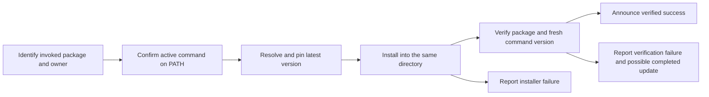
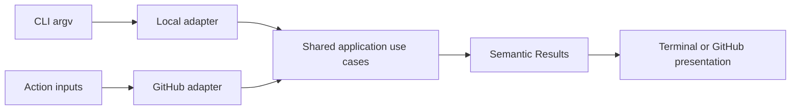

# CLI and Single-Action Execution

- Status: As-built baseline
- Date: 2026-10-19
- Owners: Copilot maintainers
- Scope: the published `copilot` CLI, local action adapter, and bounded GitHub Action single-action dispatch
- Related issues/PRs: setup, execution lifecycle, Bugbot, and release orchestration SDDs; [active-installation upgrade #600](https://github.com/vypdev/copilot/issues/600)
- Required review gates: product UX, architecture, testing, documentation, security/operations
- Open decisions blocking readiness: none for the baseline

## 1. Executive summary

Copilot exposes two explicit operator interfaces over the same application core:
the published `copilot` CLI for local/setup/diagnostic/quality tasks, and the
GitHub Action `single-action` input for bounded workflow operations. CLI commands
validate repository context and options before building a local `Execution`;
single actions validate an exact domain catalog and required issue/version/comment/
operation fields before dispatch. Internal durable deployment actions are
workflow-owned and are not general automation primitives.

```text
CLI argv/env -> command policy -> local execution adapter -> shared use case -> text/JSON
workflow inputs -> SingleAction domain -> shared route -> one bounded use case -> GitHub result
```

## 2. Problem, current behavior, and evidence

### 2.1 Problem

Maintainers need local commands and workflow-callable operations without two
independent business implementations. Loose string dispatch, implicit repository
targets, or exposing internal continuation actions would create unsafe and
unmaintainable interfaces.

### 2.2 Current behavior

1. The package exposes `copilot` and the Action bundle on Node 24+.
2. Command registry installs `think`, `do`, progress, recommendation, detection,
   Bugbot eval/analytics/benchmark, setup, upgrade, doctor, and reconcile commands.
3. Repository-dependent commands validate current Git worktree/origin and input;
   setup/doctor use the separate setup contract.
4. Local actions build the same `Execution` model and call `mainRun`, then render
   text or command-specific JSON where supported.
5. `SingleAction` accepts only the exact `ACTIONS` catalog and validates whether
   an issue is required or the operation is issue-free.
6. Single-action workflow dispatch selects one use case; exceptions become a
   failed `Result`, and agent-backed actions honor members-only authorization.
7. Durable deployment continuation/publication/failure actions require operation
   identity and remain workflow-owned.
8. CLI update checks are bounded/advisory. Explicit upgrade identifies the running
   npm/pnpm installation, installs into its existing directory, and verifies both
   package metadata and a fresh effective command before success.
9. Think returns a semantic `direct-answer`: GitHub uses the shared correlated
   reply publisher, while local execution renders it under a repository-locale
   label and performs no GitHub comment mutation.

### 2.3 Evidence and contract classification

- Observed behavior: CLI program/registry/commands, local Action adapters, action
  type/single-action domain, dispatch workflow, package exports, tests, and docs.
- Intentional contract: shared application core, strict command/action catalogs,
  validated inputs, semantic results, explicit internal operation boundary, and no legacy aliases.
- Known debt and limitations: command output schemas are not uniform across all
  older commands; some local operations still require GitHub PAT/agent environment;
  no shell-completion contract exists. Windows setup fixtures and Git Bash service
  health are observed, but Windows agent provisioning/execution is not yet proven;
  PR #403 fails during Codex provisioning and issue #404 tracks the runtime gate.
- Unknown rationale: historic command names are current compatibility, not proof
  of ideal information architecture.
- Proposed improvements: uniform versioned JSON output or shell completion needs a separate spec.

## 3. Actors, surfaces, and terminology

| Actor | Goal | Entry point | Surface |
|---|---|---|---|
| Developer | analyze/change locally | `copilot <command>` | terminal/files |
| Setup owner | install/diagnose | setup/doctor/reconcile | plan/report/backups |
| Workflow author | invoke bounded operation | `single-action` | Actions result/comment |
| Release workflow | resume durable operation | internal single action | control center/summary |

“CLI command” is a public executable subcommand. “Single action” is a domain
value passed through `action.yml`. “Workflow-owned” means a generated workflow,
not a user-facing generic primitive, owns required sequencing and identity.

## 4. Goals, non-goals, and fixed invariants

### 4.1 Goals

1. Every public entry MUST validate before invoking shared application behavior.
2. A single-action value MUST dispatch to at most one use case.
3. Human and JSON output MUST truthfully distinguish success, skip, failure, and partial state.

### 4.2 Non-goals

1. The CLI is not an arbitrary GitHub Actions runner.
2. `copilot do` has no single-action equivalent and does not imply GitHub authority.
3. Internal deployment actions are not supported for direct ad-hoc use.

### 4.3 Fixed product/safety invariants

1. Unknown commands/actions and invalid issue/version/mode/operation IDs fail or no-op visibly.
2. Tokens and credentials MUST not be embedded in config/output/command examples.
3. CLI and Action adapters MUST not duplicate domain orchestration.
4. A result error MUST produce a failing Action/CLI status where the command contract requires it.

## 5. Current versus proposed product journey

| Stage | Fragmented risk | As-built contract | Effect |
|---|---|---|---|
| Entry | ad-hoc scripts | registered commands/action values | discoverability |
| Validation | deep runtime errors | command/domain policies | early feedback |
| Execution | separate implementations | shared Execution/use cases | consistency |
| Internal ops | publicly callable stages | workflow-owned identity | safe sequencing |
| Output | logs only | results + text/JSON/summary | automation and humans |

No legacy command alias layer exists. The current as-built Think contract fixes
its former implicit issue-`#1` probe: `--issue` is optional context, not a hidden
prerequisite.

## 6. Functional behavior and state model

### 6.1 Happy path

1. Parse a registered command or exact single-action value.
2. Resolve repository, credentials, options, and required target fields.
3. Build provider-neutral execution configuration.
4. Invoke one shared application use case.
5. Render bounded output and set the correct process/Action conclusion.

### 6.2 Alternative paths

- `--version`, help, update check, and upgrade can run outside a target repository.
- Setup dry-run needs no token; doctor is remote read-only; reconcile is local read-only unless `--apply`.
- `think_action`, initial setup, release creation/publication, inactivity, and
  branch observer are issue-free only where the domain explicitly allows it.
- Local Think always runs from the addressed-request shape. Without `--issue`,
  it skips issue-description lookup and prints the answer locally; with
  `--issue`, that exact description is optional prompt context.
- `publish_issue_comment` owns its create/replace/append presentation.
- `copilot do` may modify the local workspace but does not commit/push through a single action.

### 6.3 State model

| State | Meaning | Next | Recovery |
|---|---|---|---|
| parsing | entry/options read | invalid/resolving | use help |
| invalid | contract rejected | terminal | correct exact field |
| resolving | repo/config/credentials loading | executing/failed | fix context |
| executing | one use case running | complete/skipped/failed/partial | inspect output |
| skipped | valid but prerequisites absent/policy no-op | terminal | satisfy named prerequisite |
| partial | irreversible substep succeeded | retry/recover | follow retained-state guidance |
| complete | result rendered/status correct | terminal | none |

Repeated read-only commands are safe. Mutation replay follows the owned feature's
idempotency contract and durable operation ID where applicable.

### 6.4 Active-installation upgrade contract (#600)

The intentional upgrade contract fixes the observed defect where an npm-owned
command unconditionally updated pnpm and reported success while remaining old.
`copilot upgrade` MUST identify its running package from the invoked executable,
match its canonical package root to an npm global prefix or pnpm global root,
and confirm that the effective command on `PATH` belongs to that installation.
An unknown, source-linked, unavailable-manager, or shadowed installation MUST
fail before any installation rather than create/update a different global copy.

The selected manager MUST resolve the latest published version, install that
exact version in the identified prefix/global and bin directories, then reread
the logical package path without a module cache and execute the effective
`copilot --version` in a fresh process. Success MUST require both versions to
equal the selected version and the resolved command to retain its installation
identity. This includes an already-current installation. npm and pnpm global
copies MUST coexist without changing the other copy or the shell configuration.



The sequence is identify, confirm, select, install, verify, then announce.
Any failure prevents success output and produces a nonzero exit. A completed
install is retained if verification fails; no hidden rollback or second-manager
fallback is attempted. Retrying repeats discovery and verification safely.
A fresh process observes `PATH`, not a parent shell's aliases, functions, or
cached command lookup; recovery guidance includes refreshing the shell cache or
opening a new terminal.

## 7. User-facing configuration

| Surface | Recommended default | Bounds | Precedence/persistence |
|---|---|---|---|
| CLI repository | current worktree/origin | valid GitHub repo where required | argv → env → defaults |
| token | hidden prompt or protected environment | valid PAT | memory only |
| output | `text` | text/json where documented | invocation only |
| debug | false | boolean | invocation only |
| `single-action` | empty | exact `ACTIONS` value | workflow run |
| issue/version/title/changelog/message | empty | action-specific required values | workflow run |
| local Think issue | empty | positive safe integer when supplied | invocation only; description context, never publication target |
| comment mode | inferred create/replace | create/replace/append | workflow run |
| operation ID | empty | exact durable ID for internal continuation | stored operation + run |
| upgrade manager/location | automatic from running package | npm global prefix or pnpm global root/bin; no override flag | invocation snapshot of argv/PATH and manager discovery; no persisted config |

Command and action catalogs, required-field matrix, deployment ownership,
repository resolution, token redaction, and one-handler dispatch are not configurable.
Upgrade ownership matching, exact target-version pinning, effective-version
verification, and preserving the other installation are also non-configurable.

## 8. Clean Architecture design

| Boundary | Owns | Must not own/import |
|---|---|---|
| Domain | action catalog and validity | commander/core/GitHub |
| CLI/action policies | argv/input validation and presentation selection | feature orchestration |
| Application | single-action dispatch and shared use cases | terminal/provider DTOs |
| Ports | repository, GitHub, agent, output capabilities | concrete clients |
| Adapters | Commander, local config, GitHub Action inputs/output | product decisions |
| Composition | local/GitHub dependency wiring | duplicate handler logic |



CLI entrypoint, composition, architecture, workflow, package, and specification
catalog tests MUST enforce these boundaries and exported artifacts.

`UpgradeCliUseCase` delegates to the semantic `CliUpgradePort`, which returns
immutable verified version/manager/executable evidence. `ActiveCliUpgradeAdapter`
owns filesystem identity, package-manager invocation, and fresh process probes;
the command presenter announces success only after receiving that evidence.
Application/port code MUST NOT import filesystem/process or package-manager
adapters. Existing architecture tests and TypeScript checks enforce the boundary.

## 9. UI/UX and content contract

```markdown
Pending: **Running `detect-potential-problems` for issue #42.** No action is required.
Action required: **`--issue` must be a positive number.** Run `copilot ... --help`.
Blocked: **No GitHub repository was found at this worktree origin.** No remote action ran.
Partial: **Package/release step succeeded, but follow-up publication failed.** Inspect retained IDs before retrying.
Complete: **Command completed successfully.** Text/JSON contains the same semantic result.
Think: **Answer:** Use `repository-locale` to select the default message language.
```

Upgrade content examples (versions are illustrative):

```text
Pending: Updating the active @vypdev/copilot installation and verifying "copilot --version"...
Blocked: The running Copilot installation differs from the command on PATH. Fix PATH or invoke its active command, then retry. No installation was changed.
Failed: The npm upgrade did not complete. Check its output and the active installation's permissions before retrying.
Partial/action required: The installer completed, but the effective Copilot version could not be verified. Check "copilot --version" and PATH, refresh your shell command cache or open a new terminal, then retry. The installation may already be updated.
Complete: Copilot 3.8.0 was upgraded successfully via npm. "copilot --version" verified.
```

Help lists required flags, defaults, side effects, credential source, and examples.
Errors start with impact and one recovery action; debug adds sanitized detail.
JSON MUST be machine-readable without ANSI/prose contamination. Text is the
default and English fallback. Repository-aware labels use the complete resolved
repository-locale catalog; commands, flags, and machine keys remain English.
Local single-action text MUST summarize completed, skipped, and failed result
counts and MUST NOT replay `Result.steps` or reminder prose. Semantic answers
and code-specific error recovery remain visible; only the reminder count is
shown when operational reminders exist.
Terminal output must wrap/read at narrow widths;
icons are supplemental. Secret values and raw provider responses are never shown.

## 10. Failure, recovery, and cleanup

| Failure | Impact | Retained facts | Retry | Action | Cleanup |
|---|---|---|---|---|---|
| parse/input | no use case | argv/config | yes | use help | none |
| repo/token | no remote mutation | local workspace | yes | fix root/origin/token | none |
| agent/provider | command capability fails | bounded logs | yes | fix runtime/auth | terminate process |
| feature failure | route-specific | Result payload | route-specific | follow message | feature-owned |
| internal op mismatch | no continuation | durable operation unchanged | only exact retry | use workflow/control center | none |
| output render | operation may be complete | semantic Result | yes | use alternate output/log | no hidden rollback |
| upgrade discovery/registry | no install | existing copies and PATH | yes | restore original manager/PATH or registry access | none |
| upgrade verification | install may have completed; command is unverified | updated package retained | yes | inspect version/PATH and refresh shell | no rollback or duplicate install |

## 11. Security, permissions, and privacy

CLI arguments and environment are untrusted; tokens should use hidden prompt or
protected environment, never examples/process args where avoidable. Command
overrides are audited. Local `do` authority is the user's workspace authority;
GitHub single actions additionally use actor/token/operation guards. JSON/text
rendering redacts secrets/control sequences. Internal deployment actions reject
forged or stale operation IDs.
Upgrade commands pass the fixed package identity, a validated registry version,
and explicit installation locations as separate process arguments. Raw provider
exceptions MUST NOT appear in the command's failure message. The current user's
package-manager permissions apply; upgrade does not request elevated privileges
or GitHub credentials. A package executable escaping its package root is rejected.

## 12. Observability and operational UX

Semantic `Result` exposes ID, executed/success, steps, errors, reminders, and
bounded payload. CLI exit code, Action conclusion, Job Summary, comments, and
JSON convey the same outcome. Debug is opt-in and redacted. Update-check failure
does not block normal commands; explicit upgrade reports its own result. Internal
deployment actions delegate status to the durable release control center.

## 13. Compatibility, migration, rollout, and rollback

Unknown/retired action values are not aliased. Removing or renaming a public CLI
command/action requires explicit migration and docs; internal deployment stages
may change only with workflow/action version coordination. Package smoke tests
verify exports, shebang, Node version, and installed invocation. Rollback pins a
prior major/patch or restores workflows; irreversible feature effects remain visible.

Implementation evidence as of 2026-09-15: local Think no longer checks whether
issue `#1` exists when `--issue` is omitted. Its application use case owns only
description-query and agent-query ports and returns immutable `direct-answer`
data. GitHub publication is source-correlated by the shared reply reconciler;
the CLI renders the same semantic answer locally using English-default,
reviewed-Spanish, arbitrary dynamic, or atomic-English-fallback catalog labels.
Repository-aware local failures now use the same code-specific descriptor
catalog as GitHub completion and Job Summaries: labels and recovery guidance use
the effective repository locale, while error codes and references remain stable
machine values and producer exception prose is omitted. Argument parsing and
other failures before a repository profile can be resolved remain English by
default.

## 14. Testing strategy and numeric budget

| Area | Minimum cases | Risks |
|---|---:|---|
| Command/action/input policy | 28 | catalog, required fields, bounds, precedence |
| Dispatch/state/idempotency | 20 | one handler, skips, errors, durable IDs |
| Local/GitHub adapters | 18 | repo/env/input/result mapping |
| Package/workflow/setup contracts | 16 | exports, CLI, Action, internal ownership |
| Text/JSON UX/sanitization | 14 | help, parity, ANSI, secrets, wrapping |
| Integration/security/migration | 14 | installed smoke, forged IDs, compatibility |
| Active-installation upgrade | 24 | 17 adapter/discovery/version cases, 5 CLI presentation cases, 2 use-case cases; includes real temporary npm/pnpm process fixtures |
| **Total** | **134** | no double counting; upgrade cases reserved exclusively in their row |

Global thresholds remain; action/input/command policies SHOULD reach 100% branch
coverage. Tests use fake GitHub/agents/processes and temporary worktrees, with no
live services. Package build/npm smoke is required. Manual evidence covers
installed CLI help/text/JSON, narrow terminal, Action dispatch, and error recovery.
The upgrade fixtures MUST restrict `PATH` to temporary managers, avoid network
and real global installs, and cover npm-first and pnpm-first coexistence, pinned
prefix/bin arguments, ineffective installer success, stale/failed version probes,
changed command resolution, unsupported/linked packages, invalid version metadata,
missing managers, idempotent current versions, and delayed/failed success output.
Global coverage thresholds remain in force for the changed adapter and presenter.

## 15. Documentation and discoverability

| Audience | Artifact | Required content |
|---|---|---|
| CLI user | workflow & CLI | install, prerequisites, commands/options |
| Workflow author | available/config/examples | action catalog/required matrix |
| Operator | troubleshooting/upgrade | exits, recovery, compatibility |
| Contributor | this SDD/architecture | shared-core boundaries |
| Upgrade user/operator | how-to-use, workflow & CLI, upgrade/rollback | active npm/pnpm ownership, verification, coexistence, partial success and shell/PATH recovery |

## 16. Acceptance scenarios

1. Every registered CLI command appears in help/docs and validates required options.
2. Unknown CLI/single action performs no feature mutation and exits visibly.
3. A valid single action dispatches exactly one use case.
4. Issue-required/issue-free actions enforce the documented matrix.
5. Internal deployment action with absent/wrong operation ID cannot continue.
6. Local and GitHub entrypoints return equivalent semantic Results for shared behavior.
7. Text and JSON truthfully distinguish skipped, partial, failed, and complete.
8. Tokens/provider output/control sequences are absent from public output.
9. Published package smoke verifies CLI and Action/API artifacts.
10. `copilot think -q <question>` runs without probing issue `#1`, prints one
    localized answer, and performs no GitHub comment mutation; `--issue 42`
    loads only issue `#42` as optional context.
11. A repository-aware local single action renders a localized semantic outcome
    and contains none of its internal step or reminder strings.
12. Given npm 3.3.1 first on `PATH` and pnpm 3.7.0 also installed, upgrading
    changes only npm's package in its original prefix and verifies the effective
    command against the selected version before success; pnpm-first is symmetric.
13. Given a zero installer exit but stale package metadata or effective command,
    upgrade fails without success output and preserves any completed update.
14. Given an unknown/linked package, unavailable manager, shadowed command, or
    invalid registry version, no global install runs and recovery is actionable.
15. Given an already-current package, upgrade succeeds only after the same fresh
    package/command verification. Failed probes, changed command identity, and
    package bins escaping their root cannot produce verified success.

## 17. Requirements traceability

| Requirement | Owner | Evidence | Documentation |
|---|---|---|---|
| public command catalog | command registry/CLI | CLI program tests | workflow & CLI |
| action catalog/validation | action types/SingleAction | model tests | available actions |
| shared dispatch | local adapter/single workflow | local/single-action tests | architecture |
| durable internal boundary | deployment use case | orchestration/workflow tests | deployment docs |
| package/output contract | build/render/package scripts | smoke/output tests | install/build docs |
| semantic Think output | Think workflow/shared publisher/local renderer | request, use-case, completion, CLI output tests | comment commands and workflow & CLI |
| active upgrade ownership and pinned mutation | active upgrade adapter | coexistence, prefix/bin, unsupported and registry tests | how-to-use and workflow & CLI |
| verified upgrade success and retained partial state | upgrade port/use case/presenter | package/command mismatch, failed probes, pending and failure output tests | workflow & CLI and upgrade/rollback |

## 18. Maintenance sequence

1. Update command/action contracts and exhaustive policy tests.
2. Update shared use cases/dispatch and result tests.
3. Update CLI/Action adapters, package/workflow checks, and security cases.
4. Update help, examples, docs, catalog, and migration notes.
5. Build/package/smoke and run full automated/human UX validation.

## 19. Definition of Done

- [ ] The 134-case budget (including 24 dedicated upgrade cases), coverage, architecture, package, and workflow gates pass.
- [ ] Command/action catalogs, dispatch, required fields, skips, partial state, and durable identity agree.
- [ ] Text/JSON/Action conclusions and all five UI states are accessible and sanitized.
- [ ] Installed package/CLI/API/Action smoke evidence passes on supported runtime.
- [ ] Documentation/help/examples/catalog are complete with no legacy aliases.
- [ ] Human CLI and Action recovery UX evidence is captured.

## 20. References and decisions

- Primary sources: catalogued CLI/single-action code, tests, package, and docs.
- Related SDDs: execution lifecycle; setup; Bugbot; release orchestration.
- Decision: two adapters over one application core; exact catalogs; internal stages workflow-owned.
- Rejected: arbitrary string dispatch, duplicate business logic, legacy action aliases.
- Follow-up: versioned uniform JSON output and shell completion are outside this baseline.
- Upgrade provider contracts: [npm global layout](https://docs.npmjs.com/cli/v11/configuring-npm/folders/), [npm install](https://docs.npmjs.com/cli/v11/commands/npm-install/), [pnpm root](https://pnpm.io/cli/root), [pnpm add](https://pnpm.io/cli/add).
