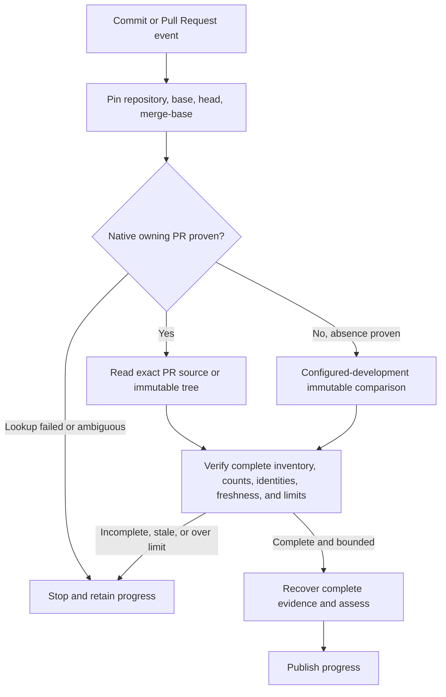
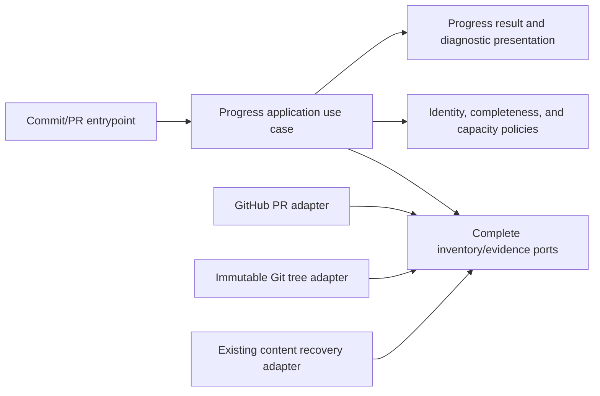

# Complete Progress Assessment for Comparisons Beyond the 300-File Inventory Ceiling

- Status: Draft
- Date: 2026-11-01
- Catalog capability ID: `github-communication-experience`
- Last verified: not applicable (prospective companion)
- Owners: Copilot maintainers
- Scope: Complete, bounded, immutable changed-file evidence for Commit and Pull Request progress assessment when GitHub compare omits files beyond its 300-file response ceiling.
- Related issues/PRs: [Issue #838](https://github.com/vypdev/copilot/issues/838); [PR #837](https://github.com/vypdev/copilot/pull/837); closed issues #547, #726, #773
- Required review gates: product UX, architecture, testing, documentation, security/operations
- Open decisions blocking readiness: None in the supplied answers. Implementation must select a bounded source strategy and define explicit finite versioned accounting limits before this Draft can become Ready for implementation.

> Start with the repository standard in [`README.md`](./README.md). Remove this note when the spec is ready. Mark a non-applicable section explicitly and give a reason instead of silently deleting the concern.

## 1. Executive summary

Commit and Pull Request progress assessment must use a complete inventory of changed files even when GitHub compare returns only its first 300 entries. For the reproduced coherent 887-file text workload, assessment must succeed with complete bounded evidence. A larger or unsupported workload must stop before model assessment and publication, retain existing progress, and report a precise nonretryable count/limit diagnostic. No route may silently assess a partial inventory or weaken extension scope, review, coverage, approval, or other merge gates.

The implementation may use a bounded, read-only source chosen during implementation. Its inventory must be independently bound to pinned base, head, and merge-base Git objects and, where an open owning PR exists, that exact native PR. Paginated PR files alone are insufficient. A complete immutable-tree source may be used if it proves the same facts. If no owning PR exists, retain the configured-development comparison route with immutable ref/preimage fences; transport failure must not be mistaken for PR absence. Full larger inventories may use a bounded alternative immutable route without a PR. If completeness cannot be proven, fail closed.

```text
Commit or Pull Request event -> pin comparison identity -> acquire and verify complete bounded inventory and evidence -> assess once -> publish progress; otherwise retain prior progress and report a nonretryable capacity/completeness result
```

This is a prospective companion to the existing progress recovery contract; it does not replace or restate that contract. The catalog identifies current locations such as `src/data/repository/progress_diff_repository.ts` and `src/application/usecases/actions/check_progress_workflow.ts`; those paths are evidence locations, not proof that a proposed source strategy or protocol is implemented.

## 2. Problem, current behavior, and evidence

### 2.1 Problem

Commit and Pull Request users cannot receive a complete progress assessment for a coherent change larger than the GitHub compare inventory ceiling. Treating this known completeness boundary as a retryable provider outage encourages identical retries and obscures the actual capacity problem. Assessing only the returned 300 files would produce an unsound result. The requested behavior is successful assessment of the reproduced 887-file workload under explicit finite per-run capacity, with an honest, nonretryable outcome for workloads that exceed supported capacity.

### 2.2 Current behavior

1. The reported Commit run selected owning PR #837 and the correct pinned base and head.
2. Native PR metadata and the local three-dot delta agree on 887 files, 52,467 additions, and 442 deletions. The exact GitHub compare response pins base and merge-base, reports 61 commits, and returns exactly 300 files.
3. The catalog locates the current guard in `src/data/repository/progress_diff_repository.ts`: data with `files.length >= MAX_COMPARISON_FILES` (300) is rejected. The reported `unavailable()` default maps this deterministic completeness boundary to `provider.unavailable`.
4. The progress flow therefore retains existing state and does not call the progress model, but presents a retryable provider diagnostic before assessment.

These are issue-provided and catalog-provided facts about the reported run and source locations. They do not establish remote review, coverage, or merge-gate results.

### 2.3 Evidence

- Code/workflow/documentation references: `src/data/repository/progress_diff_repository.ts`, `src/application/usecases/actions/check_progress_workflow.ts`, `src/application/usecases/actions/check_progress_use_case.ts`, `src/application/ports/progress_comparison_source_ports.ts`, `src/data/repository/progress_comparison_source_repository.ts`, `src/application/policies/progress_comparison_source_policy.ts`, and `src/data/repository/immutable_progress_content_repository.ts` are current catalog locations. Existing owner: `specs/immutable-progress-content-recovery.md`.
- Incident: [Issue #838](https://github.com/vypdev/copilot/issues/838), [PR #837](https://github.com/vypdev/copilot/pull/837), [run](https://github.com/vypdev/copilot/actions/runs/41266033747), [job](https://github.com/vypdev/copilot/actions/runs/41266033747/job/124728915314). Exact head `5869c60f98524c5824d73f5b53e5e367f9fd5f27`; develop base `19154b3275e6e5533ff471fae0f2602d85ab51ca`.
- External primary sources: GitHub compare and pull request files APIs and Git object semantics are relevant implementation references. Their current guarantees and limits must be verified during implementation; this spec does not assume API completeness beyond the reported evidence.
- Unknowns: the implementation’s selected complete source, exact finite total inventory/evidence accounting limits, and user-facing wording/locale fixtures remain to be implemented and validated. They are bounded by requirements here, not readiness blockers requiring a product decision.

### 2.4 Retrospective classification (as-built baselines only)

Not applicable: this is a prospective companion and reconstructs no implemented baseline.

## 3. Actors, surfaces, and terminology

| Actor | Goal | Entry point | Visible surfaces |
|---|---|---|---|
| Commit user | Get a trustworthy assessment of the committed change | Commit Action | Check/job summary and retained progress state |
| Pull Request author/reviewer | Understand whether progress was assessed and what evidence was used | Pull Request Action | PR progress surface, check/job summary |
| Operator/maintainer | Diagnose incomplete source, capacity exhaustion, or provider failure | Action run | Job summary and sanitized logs |
| Progress workflow | Assess only complete, bounded evidence for the pinned comparison | Commit/PR orchestration | Model request and progress publication |

**Complete inventory** means every changed path for the pinned base/head/merge-base delta, uniquely identified and reconciled with authoritative counts. **Evidence** means the immutable path/object data and any recovered patch/content required by the retained progress recovery contract. **Owning PR** means the single native open PR whose repository, base, and head identify the comparison. **Unsupported capacity** means a deterministic configured/versioned finite bound was exceeded; it is not a transient provider outage. **Retained progress** means the last successfully published progress remains unchanged when current evidence cannot be fully established.

Git objects and native repository metadata own comparison identity. The exact native PR owns PR association facts. A provider response does not own completeness merely because it is syntactically valid. The application owns the decision to assess or stop; the model does not decide whether inventory is complete.

## 4. Goals

| Requirement | Behavior |
|---|---|
| INV-01 | The reproduced coherent 887-file text workload MUST receive a successful assessment from complete evidence within explicit finite per-run capacities. |
| INV-02 | The system MUST establish complete unique inventory and reconcile native counts before assessment; a partial inventory MUST never reach the model or publication. |
| INV-03 | Every inventory and evidence item MUST be bound to pinned base, head, and merge-base Git objects; when an owning PR exists, all PR-derived pages MUST be bound to that one exact native PR and identity. |
| INV-04 | A PR-file pagination strategy MUST prove page completion, unique paths/object identities, native count agreement, source freshness, and unambiguous ownership. A complete immutable-tree route MAY provide equivalent proof. |
| INV-05 | The configured-development route MUST remain supported when native absence of an owning PR is proven, using immutable ref/preimage fences. Transport failure MUST NOT be interpreted as absence. |
| INV-06 | Every source, byte/unit, receipt, frame, part, and runtime prompt allocation MUST be complete and bounded. Existing per-blob/frame/part/runtime-prompt ceilings and the immutable progress recovery contract MUST be preserved. |
| INV-07 | Missing, duplicate, reordered/inconsistent, stale, moved, foreign, ambiguous, or failed mid-page evidence MUST prevent assessment and progress publication; no partial progress may be published. |
| INV-08 | Deterministic capacity/completeness failures MUST be nonretryable and state the observed count, applicable limit/reason, next action, and retained progress. Transient transport/provider failures remain distinguishable. |
| INV-09 | Generated paths, renames, removals, and complete patch recovery MUST preserve established evidence handling and extension scope. |
| INV-10 | Existing review, coverage, approval, and applicable check requirements MUST remain unchanged; this work MUST NOT exempt or weaken a gate. |
| INV-11 | Per-request and per-run resource limits MUST be independent, explicit, finite, versioned, and observable; exhausting any limit MUST fail closed. |
| INV-12 | The new companion MUST be registered under `github-communication-experience`, reference the existing owning specs, and preserve their ownership and case IDs. |

### 4.1 Non-goals

1. Changing Bugbot review capacity (#839), provider-wide quotas, or GitHub’s API limits.
2. Removing the 300-file guard without a complete evidence proof, raising it as a constant-only change, splitting coherent work to evade assessment, or assessing only the first 300 files.
3. Replacing or copying `specs/immutable-progress-content-recovery.md` or changing its retained contracts.
4. Changing extension scope, approval policy, review requirements, Codecov policy, or merge protections.
5. Releasing, deploying, or creating protected approval exemptions.

### 4.2 Fixed product/safety invariants

1. Completeness is a prerequisite to model invocation and publication.
2. Any identity, count, page, source, or resource-limit uncertainty fails closed and retains previously published progress.
3. A proven absence of an owning PR is distinct from lookup failure.
4. No retry instruction may be shown for deterministic unsupported capacity or completeness.

## 5. Current versus proposed product journey

| Stage | Current | Proposed | User/operator effect |
|---|---|---|---|
| Comparison source | Compare response capped at 300 files | Bounded complete source tied to pinned objects and exact native PR where present | Large supported changes can be assessed completely |
| Completeness | `>= 300` rejected through generic unavailable path | Independent completeness/count/identity proof | No partial assessment; diagnostic identifies actual boundary |
| Progress assessment | No model call on reported workload | Model call only after complete evidence preflight | 887-file coherent workload receives assessment |
| Failure | Generic retryable provider message | Nonretryable capacity/completeness message with count, limit, and retained-state fact | User does not repeat an identical ineffective retry |



Text equivalent: event -> pin comparison identity -> select a proven source route -> verify full bounded inventory and evidence -> assess and publish, or stop with prior progress retained.

## 6. Functional behavior and state model

### 6.1 Happy path

1. Entrypoint supplies repository and event context; application pins immutable base, head, and merge-base identities.
2. Source policy resolves exactly one owning PR or proves native absence. A failed lookup is an error, not absence.
3. The adapter reads a complete inventory from the selected bounded route. PR pagination, if selected, stays on the exact PR and pinned base/head; every page is checked for consistency, completeness, unique path/object identity, count agreement, and freshness. A complete immutable-tree route may avoid PR pagination if it proves equivalent identity and inventory facts.
4. Application preflight accounts for all paths and evidence units under versioned finite per-request and per-run limits. It applies the existing generated metadata and patch recovery rules.
5. Only the complete immutable evidence set is passed to progress assessment. On successful assessment, the existing publication workflow applies its normal freshness and idempotency rules.
6. For 887 files, configured capacities MUST permit the complete text workload and the full approved extension scope; limits may not be tuned by dropping paths or controls.

### 6.2 Alternative paths

- Proven no-open-PR: use the configured-development comparison route with immutable refs and preimage fences. A bounded immutable route may support a larger inventory without a PR.
- Unsupported count or evidence units: stop before model invocation; report observed count, limit, reason, and that existing progress remains. Do not retry automatically.
- Transport/provider failure: retain progress, identify a transient source failure, and allow only bounded retry under existing retry policy.
- Any moved base/head/merge-base, foreign/mixed/ambiguous PR, incomplete page set, duplicate/missing item, count mismatch, or mid-page failure: discard the in-flight inventory and publish no partial progress.

### 6.3 State machine

| State | Entered when | User-visible meaning | Allowed next states | Recovery/owner |
|---|---|---|---|---|
| Identity pinned | Base/head/merge-base captured | Comparing this exact change | Source resolved, blocked | Application; restart on new event identity |
| Source resolved | Exact owning PR proven or native absence proven | Source route is known | Inventory verified, failed | Source policy and adapter |
| Inventory verified | Complete unique inventory reconciles counts and identities | Evidence is safe to assess | Evidence complete, unsupported | Completeness policy |
| Evidence complete | All evidence recovered within limits | Assessment may start | Assessed, provider failure | Recovery repository/application |
| Assessed | Model returned valid result | Result is ready for normal publication checks | Published, stale | Existing progress workflow |
| Unsupported/blocked | Proof failed or deterministic limit exceeded | No new assessment; prior progress retained | New event/identity only | User/operator inspects diagnostic |
| Published | Normal publication succeeded | Current progress reflects assessed evidence | New event | Existing publication owner |

Duplicate events with the same pinned identity MUST be idempotent. Out-of-order responses and stale source results MUST be rejected. Cancellation or resource exhaustion before publication MUST discard provisional evidence. There is no partial-progress state for an incomplete inventory.

## 7. User-facing configuration

| Input | Type | Recommended default | Allowed values/range | Scope/persistence |
|---|---|---|---|---|
| Inventory/evidence capacity profile | Versioned internal policy, not user override | Explicit profile that supports the reproduced 887-file text workload and current evidence ceilings | Finite validated profiles; exact per-request and per-run path/byte/unit/receipt limits are implementation decisions recorded with the protocol version | Snapshot once per run; not persisted as mutable run state |
| Inventory source strategy | Internal enum/policy | Select a complete bounded route supported by available trusted evidence | Exact owning-PR pages, immutable-tree route, or configured-development immutable route when absence is proven | Selected and pinned for the operation |

Users cannot configure arbitrary refs, repositories, URLs, page tokens, or secrets, nor disable completeness, identity fences, limits, retained-state behavior, or review/coverage gates. The implementation must document exact numeric limits and migration behavior before readiness. Invalid, unknown, or unsupported profile versions fail closed. An in-flight run uses one snapshot and does not reread limits mid-operation. Recommended configuration supports 887 files; a meaningful alternative is a smaller finite profile that reports unsupported capacity for larger work while preserving ordinary supported comparisons.

## 8. Clean Architecture

### 8.1 Responsibilities and dependency direction

| Layer/boundary | Owns | Must not own/import |
|---|---|---|
| Domain/pure policy | Comparison identity, inventory completeness, uniqueness/count reconciliation, capacity decisions, diagnostic classification | GitHub SDK DTOs, network, process state |
| Application | Pin identity, choose route through semantic ports, preflight complete evidence, invoke assessment only after proof, preserve publication ordering | Concrete SDK/process concerns or provider pagination details |
| Adapters/data | Read native PR metadata/pages or immutable Git evidence; normalize and verify provider responses; classify transport errors | Product policy or authority to declare an incomplete source complete |
| Infrastructure/composition | Bind source adapters and recovery ports, wire progress workflow | Business decisions or hidden fallback to partial evidence |
| Entrypoints | Adapt Commit/PR event and trusted repository context | Duplicated inventory orchestration |
| Presentation | Render status, observed counts/limits, action, retained-state fact, and technical evidence | Mutations, source selection, or assessment decisions |



Text equivalent: entrypoints call the application; pure policies decide completeness and capacity; semantic ports obtain evidence; provider adapters implement those ports; presentation renders outcomes after the application decides.

### 8.2 Contracts, state, and trust boundaries

- Pure decisions: immutable comparison identity equality; unique complete path set; native count reconciliation; source route eligibility; finite capacity and failure classification.
- Application contracts: immutable request containing repository identity, pinned base/head/merge-base, operation context, and versioned capacity snapshot; immutable result distinguishing complete evidence, deterministic unsupported, stale/mismatch, and transient provider failure.
- Semantic ports: resolve native owning PR or proven absence; retrieve complete inventory pages or immutable tree inventory; retrieve immutable object/patch evidence; report authoritative counts and source identity. No provider DTO crosses into domain/application policy.
- Durable state/schema ownership: this companion introduces no new durable progress schema. Existing progress publication owns durable progress. Provisional inventory/evidence is run-scoped and discarded on failure.
- Concurrency/idempotency: bind all reads to one identity; reject stale responses; duplicate same-identity requests use existing idempotent publication semantics; independent runs have independent resource budgets.
- Trusted and untrusted inputs: event payload, provider DTOs, page contents, paths, comments, PR text, and model response are untrusted. Repository identity and verified Git object IDs are validated before use. No text selects a different PR or ref.
- Provider error mapping: not-found is absence only when native lookup semantics prove it; transport/auth/rate-limit/server failures remain provider failures. Count/identity/completeness/capacity failures are deterministic and nonretryable.

### 8.3 Executable architecture constraints

Automated checks MUST enforce dependency direction and forbid domain/application imports of GitHub SDK or process APIs. Contract tests MUST parse normalized source identity, page tokens, native counts, and unique path/object IDs. Workflow tests MUST prove model invocation and publication cannot occur before the complete-evidence result. Composition tests MUST prove every configured route binds a complete inventory port and cannot fall back to the first 300 files. Extend existing repository architecture and workflow contract checks in the repository’s established layout; do not impose a new `src/` root or `.test.ts` naming convention.

## 9. UI/UX and content contract

### 9.1 Information hierarchy

1. Whether progress was assessed.
2. Completed inventory/evidence facts and exact comparison identity in technical detail.
3. What happens next and whether human action is required.
4. Impact on existing progress.
5. Direct links to the run, PR, comparison, and relevant documentation.
6. Sanitized provider and capacity diagnostics in collapsed details.

### 9.2 Representative primary view

Successful assessment:

```markdown
# ✅ Commit progress assessed

> **Current status:** Progress was assessed from the complete 887-file comparison.
>
> **Action required:** No action required.

## Progress

- [x] Complete changed-file inventory verified
- [x] Evidence recovered within this run's limits
- [x] Progress assessment completed

## What happens next

The existing progress view reflects this assessment.

## Links

[Pull request #837](https://github.com/vypdev/copilot/pull/837) · [Action run](https://github.com/vypdev/copilot/actions/runs/41266033747)

<details>
<summary>Technical details</summary>

Base `19154b3`; head `5869c60`; 887 unique files; inventory and evidence protocol version and sanitized source receipt.
</details>
```

Pending/no action: “Progress assessment is waiting for the complete comparison source. Existing progress remains available. No action is required while the bounded source request is running.” Include run link and a concise state summary.

Action required: “Progress was not assessed: the complete inventory contains 1,250 files, above this run’s limit of 1,000. Existing progress was retained. Reduce the change only when that reflects the intended work, or ask a maintainer to review the supported capacity profile.” The values are illustrative; rendered diagnostics must use actual configured limits and must not encourage splitting coherent work merely to evade assessment.

Blocked before irreversible effects: “Progress was not assessed because page 3 did not match the pinned PR/base/head identity. No partial result was published; existing progress was retained. Rerun after the source is stable.” Include the PR/run links and sanitized reason.

Partially successful after an irreversible effect: this inventory flow has no progress-publication effect before complete assessment. If an existing downstream publication partially succeeds after a valid assessment, use the existing publication contract and state exactly what completed; this companion MUST NOT relabel that success as a failed assessment.

Completed: use the successful mockup above. Every state must use plain text status and action; icons are supplementary.

### 9.3 Issue, PR, and comment behavior

- Deterministic purpose: report progress-assessment status for the pinned comparison; do not create a new issue or PR for capacity outcomes.
- Retry: only transient provider failures may receive bounded retry guidance. Deterministic count, completeness, identity, or capacity failures are nonretryable for the same inputs.
- Durable marker/update: use existing progress markers and idempotent update policy; do not create a second progress card for repeated identical events.
- Comment/notification budget: update the existing progress surface where applicable; no new comment per page or per retry. One summary per operation at most, subject to existing publication policy.
- Labels/checks: supplemental state only; no check exemption or merge-gate change.
- Navigation: provide descriptive links to owning PR, comparison, Action run, and troubleshooting documentation. Do not expose raw page tokens or credentials.

### 9.4 Accessibility, localization, and responsive behavior

Use the existing repository locale resolution and English fallback. Translate user-facing status, cause, action, retained-state, and count/limit labels through the message catalog. Diagrams have the textual equivalent above. Tables remain short and readable on narrow displays; use headings and descriptive links, not color alone. Sanitize paths and provider strings before Markdown rendering; escape HTML/markers and suppress mentions, commands, and unsafe URLs. Technical details may include validated abbreviated Git IDs and counts, never secrets or untrusted executable markup.

## 10. Failure, recovery, and cleanup

| Failure/partial state | User impact | Retained facts | Automatic retry | Required action | Cleanup |
|---|---|---|---|---|---|
| More than supported paths/units | No assessment | Prior progress, observed count, versioned limit | No | Inspect capacity diagnostic; maintainer evaluates profile | Discard provisional evidence |
| Mid-page transport failure | No assessment | Prior progress and pinned identity | Bounded under transient policy | Retry only after transient source recovery | Discard partial pages before retry |
| Page missing, duplicate, reordered inconsistently, or count mismatch | No assessment | Prior progress and sanitized mismatch reason | No for same source snapshot | Stabilize source or inspect PR metadata | Discard all provisional inventory |
| Base/head/merge-base moved | No assessment for stale request | Prior progress and original identity | No; new event may start new identity | Allow new event to pin current identity | Discard stale evidence |
| Foreign or ambiguous PR | No assessment | Prior progress and source identity | No | Maintainer resolves ownership/source facts | Discard mixed source data |
| PR lookup transport/auth failure | No assessment | Prior progress; lookup failure | Bounded transient retry | Restore provider access | Do not select no-PR route |
| Proven no open PR | Continue configured-development route | Pinned refs/preimage fences | Not applicable | None if route complete | Normal run cleanup |
| Evidence patch unavailable or incomplete | No assessment | Prior progress and object identity | Follow existing recovery contract only | Restore/retrieve immutable evidence | Discard incomplete set |
| Model/provider failure after complete preflight | No new progress | Prior progress and complete receipt | Existing bounded provider policy | Retry if classified transient | Release run-scoped evidence |

All user errors follow impact -> cause -> action -> retained state. No partial evidence is published or persisted as completed progress. Cleanup removes run-scoped pages, blobs, receipts, and temporary files on success, failure, cancellation, or limit exhaustion according to existing repository handling.

## 11. Security, permissions, and privacy

1. Use least-privilege read access for native PR metadata and Git objects; preserve existing workflow permissions and require no write permission for inventory acquisition.
2. Treat event payloads and provider pages as untrusted. Bind each source response to repository, PR number, base/head, merge-base, and pinned object identities; reject foreign or ambiguous data.
3. Do not log credentials, page tokens, private file contents, or raw untrusted markup. Log sanitized counts, failure class, protocol version, and correlation/run identity.
4. Enforce finite independent per-request and per-run resource budgets to constrain abuse and accidental exhaustion. Reject replayed or stale page responses and never let a model response certify inventory completeness.

## 12. Observability and operational UX

- User-facing state: assessed, waiting on a bounded source, transient source failure, deterministic unsupported capacity, or stale/inconsistent evidence; always state retained progress.
- Job Summary/operator evidence: pinned abbreviated identities, source route, native and observed counts, page count, protocol/capacity profile versions, complete/incomplete outcome, and whether the model was invoked. Never show raw tokens or contents.
- Logs/metrics/correlation: structured sanitized reason codes for provider failure, count mismatch, stale identity, duplicate/missing path, capacity exhaustion, and successful complete assessment; correlate to Action run and operation identity.
- External dependency: classify provider transport/auth/rate limits separately from deterministic completeness/capacity failures.
- Retry behavior: bounded retry only for transient source/provider errors; no identical retry for deterministic failures.
- Noise budget: one operation summary and existing idempotent progress update; no per-page comments or repeated diagnostics.

## 13. Compatibility, migration, rollout, and rollback

- Existing in-flight runs retain their pinned identity and current versioned capacity snapshot; they are never upgraded mid-run.
- No durable progress schema change is expected. If implementation adds a receipt or protocol field, version it, validate unknown versions as unsupported, and provide a migration/expiry plan before readiness.
- Keep ordinary complete comparisons supported and preserve current immutable progress content recovery behavior and case IDs.
- Roll out through the normal Action-owned branch and review gates. Do not use a feature flag to bypass completeness; any staged profile must support the 887-file acceptance workload before enabling the behavior for this issue.
- Rollback may restore the prior conservative stop behavior, but must report a precise nonretryable completeness/capacity outcome. It must not publish partial assessments or weaken external gates.

## 14. Testing strategy

The minimum regression campaign is 96 additional distinct executable cases across the areas below. This is a floor derived from source identity, pagination, accounting, recovery, publication ordering, user diagnostics, and compatibility risks. Existing owning-contract cases remain owned by `specs/immutable-progress-content-recovery.md` and are not recounted here; in particular, retain the existing complete-content recovery and per-blob/frame/part/runtime-prompt ceilings. No planned acceptance case below is represented as already executed.

| Area | Minimum distinct cases | Behaviors/risks covered |
|---|---:|---|
| Domain/configuration/pure planning | 20 | Observable scenarios in the case inventory. |
| State/application/idempotency/races | 18 | Observable scenarios in the case inventory. |
| Application use cases | 10 | Observable scenarios in the case inventory. |
| Adapters/provider contracts | 16 | Observable scenarios in the case inventory. |
| Workflows/setup/schema | 10 | Observable scenarios in the case inventory. |
| UI/UX/localization/sanitization | 10 | Observable scenarios in the case inventory. |
| Integration/security/migration | 12 | Observable scenarios in the case inventory. |
| Total | 96 | Distinct inventory cases; repeated executions do not add cases. |

| Case ID | Area | Requirements | Scenario |
|---|---|---|---|
| github-communication-experience-change-C01 | Domain/configuration/pure planning | INV-01, INV-02 | A complete 299-file inventory is accepted when counts and identities reconcile. |
| github-communication-experience-change-C02 | Domain/configuration/pure planning | INV-01, INV-02 | A complete 300-file inventory is accepted only after completeness proof. |
| github-communication-experience-change-C03 | Domain/configuration/pure planning | INV-01, INV-02 | A complete 301-file inventory is accepted from a supported complete source. |
| github-communication-experience-change-C04 | Domain/configuration/pure planning | INV-01, INV-06 | The reproduced 887-file text inventory fits the specified supported profile. |
| github-communication-experience-change-C05 | Domain/configuration/pure planning | INV-02, INV-08 | A count above the path limit returns deterministic unsupported capacity. |
| github-communication-experience-change-C06 | Domain/configuration/pure planning | INV-02, INV-08 | Byte/unit accounting exactly at its limit is accepted when complete. |
| github-communication-experience-change-C07 | Domain/configuration/pure planning | INV-02, INV-08 | Byte/unit accounting one unit above its limit is rejected. |
| github-communication-experience-change-C08 | Domain/configuration/pure planning | INV-06, INV-11 | Independent per-request and per-run budgets reject exhaustion at the correct scope. |
| github-communication-experience-change-C09 | Domain/configuration/pure planning | INV-02, INV-07 | Duplicate normalized paths invalidate inventory completeness. |
| github-communication-experience-change-C10 | Domain/configuration/pure planning | INV-02, INV-07 | Missing one expected path invalidates inventory completeness. |
| github-communication-experience-change-C11 | Domain/configuration/pure planning | INV-02, INV-04 | Reordered pages with stable identities remain valid when ordering is not contractual. |
| github-communication-experience-change-C12 | Domain/configuration/pure planning | INV-02, INV-07 | Inconsistent page sequence or repeated page receipt is rejected. |
| github-communication-experience-change-C13 | Domain/configuration/pure planning | INV-02, INV-04 | Native file count equal to unique inventory count passes reconciliation. |
| github-communication-experience-change-C14 | Domain/configuration/pure planning | INV-02, INV-07 | Native count greater than returned unique inventory is rejected. |
| github-communication-experience-change-C15 | Domain/configuration/pure planning | INV-02, INV-07 | Native count less than returned unique inventory is rejected. |
| github-communication-experience-change-C16 | Domain/configuration/pure planning | INV-03, INV-07 | Inventory tied to a moved head is stale and rejected. |
| github-communication-experience-change-C17 | Domain/configuration/pure planning | INV-03, INV-07 | Inventory tied to a moved base is stale and rejected. |
| github-communication-experience-change-C18 | Domain/configuration/pure planning | INV-03, INV-07 | Inventory tied to a different merge-base is stale and rejected. |
| github-communication-experience-change-C19 | Domain/configuration/pure planning | INV-04, INV-07 | A path/object identity disagreement is rejected. |
| github-communication-experience-change-C20 | Domain/configuration/pure planning | INV-11 | Unknown capacity profile version fails closed. |
| github-communication-experience-change-C21 | State/application/idempotency/races | INV-02, INV-07 | A mid-page failure discards all provisional pages and preserves prior progress. |
| github-communication-experience-change-C22 | State/application/idempotency/races | INV-03, INV-07 | Head movement between pages prevents inventory completion. |
| github-communication-experience-change-C23 | State/application/idempotency/races | INV-03, INV-07 | Base movement between pages prevents inventory completion. |
| github-communication-experience-change-C24 | State/application/idempotency/races | INV-03, INV-07 | Merge-base movement between pages prevents inventory completion. |
| github-communication-experience-change-C25 | State/application/idempotency/races | INV-04, INV-07 | A page from a foreign PR is rejected before assessment. |
| github-communication-experience-change-C26 | State/application/idempotency/races | INV-04, INV-07 | Mixed page sources from two PRs are rejected. |
| github-communication-experience-change-C27 | State/application/idempotency/races | INV-04, INV-07 | Two candidate owning PRs produce an ambiguous-source stop. |
| github-communication-experience-change-C28 | State/application/idempotency/races | INV-05, INV-07 | Provider lookup failure is not treated as no open PR. |
| github-communication-experience-change-C29 | State/application/idempotency/races | INV-05 | Proven absence of open PR selects configured-development comparison. |
| github-communication-experience-change-C30 | State/application/idempotency/races | INV-05, INV-07 | Duplicate event for the same pinned identity does not publish duplicate progress. |
| github-communication-experience-change-C31 | State/application/idempotency/races | INV-03, INV-07 | Out-of-order older page response cannot replace newer pinned evidence. |
| github-communication-experience-change-C32 | State/application/idempotency/races | INV-07 | Cancellation before completion publishes no progress and releases provisional data. |
| github-communication-experience-change-C33 | State/application/idempotency/races | INV-11 | Concurrent requests each obey their independent request and run limits. |
| github-communication-experience-change-C34 | State/application/idempotency/races | INV-07, INV-10 | A prior successful progress state remains byte-for-byte unchanged on incomplete evidence. |
| github-communication-experience-change-C35 | State/application/idempotency/races | INV-07 | A late completion after a failure cannot publish partial or stale progress. |
| github-communication-experience-change-C36 | State/application/idempotency/races | INV-06, INV-07 | Evidence resource exhaustion during recovery discards the full provisional set. |
| github-communication-experience-change-C37 | State/application/idempotency/races | INV-02, INV-07 | Model invocation count remains zero when any page is missing. |
| github-communication-experience-change-C38 | State/application/idempotency/races | INV-02, INV-07 | Publication count remains zero when any evidence item is incomplete. |
| github-communication-experience-change-C39 | Application use cases | INV-01, INV-02 | Complete 887-file evidence reaches assessment once and yields a progress result. |
| github-communication-experience-change-C40 | Application use cases | INV-02, INV-07 | Incomplete inventory exits before model invocation. |
| github-communication-experience-change-C41 | Application use cases | INV-03, INV-04 | Application passes pinned repository, PR, base, head, and merge-base to source port. |
| github-communication-experience-change-C42 | Application use cases | INV-05 | No-PR route proceeds only after native absence is proven. |
| github-communication-experience-change-C43 | Application use cases | INV-06, INV-11 | Application snapshots one versioned capacity profile per run. |
| github-communication-experience-change-C44 | Application use cases | INV-08 | Deterministic capacity result maps to nonretryable outcome. |
| github-communication-experience-change-C45 | Application use cases | INV-08 | Transient provider result remains separately retryable under bounded policy. |
| github-communication-experience-change-C46 | Application use cases | INV-03, INV-07 | Freshness check rejects evidence after source identity changes. |
| github-communication-experience-change-C47 | Application use cases | INV-02, INV-10 | Successful assessment still passes existing publication authorization/freshness policy. |
| github-communication-experience-change-C48 | Application use cases | INV-07 | Application returns retained-state outcome without mutating prior progress on failure. |
| github-communication-experience-change-C49 | Adapters/provider contracts | INV-04 | PR adapter traverses every required page for the exact PR. |
| github-communication-experience-change-C50 | Adapters/provider contracts | INV-04, INV-07 | PR adapter rejects a page whose PR number differs. |
| github-communication-experience-change-C51 | Adapters/provider contracts | INV-03, INV-07 | PR adapter rejects changed base/head metadata between pages. |
| github-communication-experience-change-C52 | Adapters/provider contracts | INV-04, INV-07 | Repeated page token or repeated response is detected and rejected. |
| github-communication-experience-change-C53 | Adapters/provider contracts | INV-04 | Adapter normalizes rename records while retaining old and new path identity. |
| github-communication-experience-change-C54 | Adapters/provider contracts | INV-04, INV-06 | Adapter preserves removal records and immutable preimage identity. |
| github-communication-experience-change-C55 | Adapters/provider contracts | INV-09 | Generated metadata paths retain established handling in full inventory. |
| github-communication-experience-change-C56 | Adapters/provider contracts | INV-06, INV-09 | Missing patch is recovered completely through the existing immutable recovery route. |
| github-communication-experience-change-C57 | Adapters/provider contracts | INV-06 | Per-blob limit is enforced while inventory remains otherwise complete. |
| github-communication-experience-change-C58 | Adapters/provider contracts | INV-06 | Existing frame and part limits remain enforced on recovered content. |
| github-communication-experience-change-C59 | Adapters/provider contracts | INV-06 | Runtime prompt ceiling remains enforced after complete recovery. |
| github-communication-experience-change-C60 | Adapters/provider contracts | INV-07, INV-08 | Provider rate-limit failure maps to transient provider diagnostic, not capacity. |
| github-communication-experience-change-C61 | Adapters/provider contracts | INV-07, INV-08 | Authentication or transport failure is not mapped to PR absence. |
| github-communication-experience-change-C62 | Adapters/provider contracts | INV-04, INV-07 | Immutable tree adapter enumerates all paths at pinned objects. |
| github-communication-experience-change-C63 | Adapters/provider contracts | INV-03, INV-07 | Immutable tree adapter rejects an object not reachable from pinned comparison identity. |
| github-communication-experience-change-C64 | Adapters/provider contracts | INV-02, INV-04 | Adapter receipt reconciles complete unique inventory with authoritative native count. |
| github-communication-experience-change-C65 | Workflows/setup/schema | INV-02, INV-10 | Commit workflow requires complete-evidence outcome before progress assessment. |
| github-communication-experience-change-C66 | Workflows/setup/schema | INV-02, INV-10 | Pull Request workflow requires complete-evidence outcome before progress assessment. |
| github-communication-experience-change-C67 | Workflows/setup/schema | INV-07 | Mid-page failure workflow retains progress and publishes no partial result. |
| github-communication-experience-change-C68 | Workflows/setup/schema | INV-05 | No-open-PR workflow uses configured-development route with immutable fences. |
| github-communication-experience-change-C69 | Workflows/setup/schema | INV-08 | Unsupported-capacity workflow emits no retry request. |
| github-communication-experience-change-C70 | Workflows/setup/schema | INV-10 | Workflow permissions remain read-only for inventory acquisition. |
| github-communication-experience-change-C71 | Workflows/setup/schema | INV-11 | Workflow configuration rejects missing or non-finite capacity fields. |
| github-communication-experience-change-C72 | Workflows/setup/schema | INV-11 | Workflow configuration rejects incompatible profile/version combination. |
| github-communication-experience-change-C73 | Workflows/setup/schema | INV-10 | Existing review and coverage gate contracts remain present and unchanged. |
| github-communication-experience-change-C74 | Workflows/setup/schema | INV-12 | Catalog contract registers this companion under the selected capability. |
| github-communication-experience-change-C75 | UI/UX/localization/sanitization | INV-08 | Pending state explains source verification and says whether action is needed. |
| github-communication-experience-change-C76 | UI/UX/localization/sanitization | INV-08 | Deterministic capacity state shows observed count, limit, cause, action, retained progress. |
| github-communication-experience-change-C77 | UI/UX/localization/sanitization | INV-07 | Stale identity state explains no assessment and links to the run and PR. |
| github-communication-experience-change-C78 | UI/UX/localization/sanitization | INV-01 | Completed state states full inventory count and successful assessment. |
| github-communication-experience-change-C79 | UI/UX/localization/sanitization | INV-08 | Transient provider state gives bounded retry action and retained-state fact. |
| github-communication-experience-change-C80 | UI/UX/localization/sanitization | INV-08 | Locale fallback renders all required diagnostic facts in English. |
| github-communication-experience-change-C81 | UI/UX/localization/sanitization | INV-07 | Malicious path Markdown, HTML, mention, and command text is escaped or suppressed. |
| github-communication-experience-change-C82 | UI/UX/localization/sanitization | INV-12 | Rendered links are descriptive and point to the exact owning PR and run. |
| github-communication-experience-change-C83 | UI/UX/localization/sanitization | INV-12 | Narrow viewport content retains readable headings, tables, and action text. |
| github-communication-experience-change-C84 | UI/UX/localization/sanitization | INV-08 | Diagnostic has one primary status/action and no contradictory retry wording. |
| github-communication-experience-change-C85 | Integration/security/migration | INV-01, INV-02, INV-03 | End-to-end Commit assessment succeeds for pinned 887-file workload. |
| github-communication-experience-change-C86 | Integration/security/migration | INV-04 | End-to-end paginated PR source proves complete inventory over 300 files. |
| github-communication-experience-change-C87 | Integration/security/migration | INV-05 | End-to-end no-PR comparison succeeds using immutable configured refs. |
| github-communication-experience-change-C88 | Integration/security/migration | INV-07, INV-10 | End-to-end incomplete source preserves progress and invokes neither model nor publisher. |
| github-communication-experience-change-C89 | Integration/security/migration | INV-06, INV-09 | End-to-end rename/removal/generated paths retain complete patch evidence. |
| github-communication-experience-change-C90 | Integration/security/migration | INV-11 | End-to-end per-run exhaustion yields deterministic bounded diagnostic. |
| github-communication-experience-change-C91 | Integration/security/migration | INV-03, INV-07 | Forged foreign source identity cannot influence assessment or publication. |
| github-communication-experience-change-C92 | Integration/security/migration | INV-07 | Replayed stale page receipt is rejected without state mutation. |
| github-communication-experience-change-C93 | Integration/security/migration | INV-11 | Concurrent-run resource accounting prevents one run consuming another's allocation. |
| github-communication-experience-change-C94 | Integration/security/migration | INV-10 | Current-head required review, applicable checks, approval, and coverage gates remain required. |
| github-communication-experience-change-C95 | Integration/security/migration | INV-12 | Protocol-version migration rejects unknown version while retaining prior progress. |
| github-communication-experience-change-C96 | Integration/security/migration | INV-12 | Rollback restores conservative stop with precise nonretryable outcome and no partial publication. |

Coverage requirements: preserve repository-wide thresholds and require 100% coverage of modified executable lines without partials in Codecov before merge, as required by the supplied issue context. New pure completeness, identity, and capacity policies require 100% branch coverage. Changed modules require full statement/branch coverage for new logic. Use deterministic clocks, IDs, and fakes; no real waits or live services. Table-driven rows count only when they are distinct behaviors listed above. Contract tests parse normalized data and workflow structure, not prose grep. Golden Markdown fixtures are paired with semantic assertions for status, action, retained state, and links. Human evidence must review readability on narrow/mobile layouts and localized rendered output. The reported 5,183-test local verification is context only, not evidence that this proposed campaign has run; remote progress, review, and Codecov gates remain separate.

## 15. Documentation and discoverability

| Path | Change |
|---|---|
| `specs/complete-progress-comparison-inventory.md` | create |
| `specs/immutable-progress-content-recovery.md` | reference |
| `specs/catalog.json` | update |
| `specs/CATALOG.md` | update |
| `docs/single-actions/available-actions.mdx` | update |
| `docs/security-operations/operations/error-reference.mdx` | update |
| `docs/security-operations/operations/troubleshooting.mdx` | update |
| `docs/development/architecture.mdx` | update |
| `docs/development/testing.mdx` | update |
| `docs/development/specifications.mdx` | reference |
| `src/data/repository/__tests__/immutable_progress_content_repository.test.ts` | reference |

The new documentation must explain the normal complete-source path, finite capacity profile and version, no-owning-PR route, exact nonretryable diagnostic, transient provider distinction, troubleshooting, permissions, and rollback. Update the Action error reference and operator troubleshooting with count/limit/retained-state examples. Contributor documentation must describe semantic ports, adapter contracts, and executable boundary checks. Keep examples aligned with fixtures. Catalog generation and `pnpm run validate:specifications` are required during implementation. Existing recovery documentation remains the owner of immutable content recovery; it is referenced, not duplicated.

## 16. Acceptance

1. Given the pinned PR #837 comparison with a coherent 887-file text delta, when Commit progress runs under the supported finite profile, then it verifies every unique path and required evidence, invokes assessment once, and publishes a complete result.
2. Given a complete 299-, 300-, or 301-file comparison, when native counts and identities reconcile, then the inventory is accepted independent of the former response ceiling.
3. Given the exact owning PR and multiple pages, when pages are complete and bound to the same repository, PR, base, head, and merge-base, then the adapter returns one complete inventory receipt.
4. Given a missing, duplicate, reordered-inconsistent, foreign, mixed, stale, or count-mismatched page, when preflight runs, then it invokes no model, publishes no progress, and retains prior progress.
5. Given transport failure during PR lookup, when source resolution fails, then the system reports provider failure and does not select the no-PR route.
6. Given native proof that no open owning PR exists, when configured-development comparison runs, then it uses immutable ref/preimage fences; a supported larger immutable route may also succeed without a PR.
7. Given a count or evidence unit beyond a finite limit, when preflight runs, then the diagnostic is nonretryable and names observed count, limit/reason, next action, and retained progress.
8. Given rename, removal, generated paths, or omitted patch data, when complete evidence is assembled, then established metadata handling and complete patch recovery are preserved.
9. Given transient rate limit or transport failure, when retry policy applies, then only bounded retry is offered and deterministic capacity errors are never classified as provider unavailable.
10. Given an incomplete source or resource exhaustion, when the operation ends, then prior progress remains unchanged and no partial progress is visible.
11. Given malicious provider path text or markup, when diagnostics render in supported locales and narrow layouts, then it is sanitized, readable, and includes a textual status/action.
12. Given implementation reaches merge review, then all current-head review, applicable checks, approval rules, and 100% modified executable lines without partials in Codecov remain required; this acceptance does not claim those gates have passed.

## 17. Requirements traceability

| Requirement | Cases |
|---|---|
| INV-01 | github-communication-experience-change-C01, github-communication-experience-change-C02, github-communication-experience-change-C03, github-communication-experience-change-C04, github-communication-experience-change-C39, github-communication-experience-change-C78, github-communication-experience-change-C85 |
| INV-02 | github-communication-experience-change-C01, github-communication-experience-change-C02, github-communication-experience-change-C03, github-communication-experience-change-C05, github-communication-experience-change-C06, github-communication-experience-change-C07, github-communication-experience-change-C09, github-communication-experience-change-C10, github-communication-experience-change-C11, github-communication-experience-change-C12, github-communication-experience-change-C13, github-communication-experience-change-C14, github-communication-experience-change-C15, github-communication-experience-change-C21, github-communication-experience-change-C37, github-communication-experience-change-C38, github-communication-experience-change-C39, github-communication-experience-change-C40, github-communication-experience-change-C47, github-communication-experience-change-C64, github-communication-experience-change-C65, github-communication-experience-change-C66, github-communication-experience-change-C85 |
| INV-03 | github-communication-experience-change-C16, github-communication-experience-change-C17, github-communication-experience-change-C18, github-communication-experience-change-C22, github-communication-experience-change-C23, github-communication-experience-change-C24, github-communication-experience-change-C31, github-communication-experience-change-C41, github-communication-experience-change-C46, github-communication-experience-change-C51, github-communication-experience-change-C63, github-communication-experience-change-C85, github-communication-experience-change-C91 |
| INV-04 | github-communication-experience-change-C11, github-communication-experience-change-C13, github-communication-experience-change-C19, github-communication-experience-change-C25, github-communication-experience-change-C26, github-communication-experience-change-C27, github-communication-experience-change-C41, github-communication-experience-change-C49, github-communication-experience-change-C50, github-communication-experience-change-C52, github-communication-experience-change-C53, github-communication-experience-change-C54, github-communication-experience-change-C62, github-communication-experience-change-C64, github-communication-experience-change-C86 |
| INV-05 | github-communication-experience-change-C28, github-communication-experience-change-C29, github-communication-experience-change-C30, github-communication-experience-change-C42, github-communication-experience-change-C68, github-communication-experience-change-C87 |
| INV-06 | github-communication-experience-change-C04, github-communication-experience-change-C08, github-communication-experience-change-C36, github-communication-experience-change-C43, github-communication-experience-change-C54, github-communication-experience-change-C56, github-communication-experience-change-C57, github-communication-experience-change-C58, github-communication-experience-change-C59, github-communication-experience-change-C89 |
| INV-07 | github-communication-experience-change-C09, github-communication-experience-change-C10, github-communication-experience-change-C12, github-communication-experience-change-C14, github-communication-experience-change-C15, github-communication-experience-change-C16, github-communication-experience-change-C17, github-communication-experience-change-C18, github-communication-experience-change-C19, github-communication-experience-change-C21, github-communication-experience-change-C22, github-communication-experience-change-C23, github-communication-experience-change-C24, github-communication-experience-change-C25, github-communication-experience-change-C26, github-communication-experience-change-C27, github-communication-experience-change-C28, github-communication-experience-change-C30, github-communication-experience-change-C31, github-communication-experience-change-C32, github-communication-experience-change-C34, github-communication-experience-change-C35, github-communication-experience-change-C36, github-communication-experience-change-C37, github-communication-experience-change-C38, github-communication-experience-change-C40, github-communication-experience-change-C46, github-communication-experience-change-C48, github-communication-experience-change-C50, github-communication-experience-change-C51, github-communication-experience-change-C52, github-communication-experience-change-C60, github-communication-experience-change-C61, github-communication-experience-change-C62, github-communication-experience-change-C63, github-communication-experience-change-C67, github-communication-experience-change-C77, github-communication-experience-change-C81, github-communication-experience-change-C88, github-communication-experience-change-C91, github-communication-experience-change-C92 |
| INV-08 | github-communication-experience-change-C05, github-communication-experience-change-C06, github-communication-experience-change-C07, github-communication-experience-change-C44, github-communication-experience-change-C45, github-communication-experience-change-C60, github-communication-experience-change-C61, github-communication-experience-change-C69, github-communication-experience-change-C75, github-communication-experience-change-C76, github-communication-experience-change-C79, github-communication-experience-change-C80, github-communication-experience-change-C84 |
| INV-09 | github-communication-experience-change-C55, github-communication-experience-change-C56, github-communication-experience-change-C89 |
| INV-10 | github-communication-experience-change-C34, github-communication-experience-change-C47, github-communication-experience-change-C65, github-communication-experience-change-C66, github-communication-experience-change-C70, github-communication-experience-change-C73, github-communication-experience-change-C88, github-communication-experience-change-C94 |
| INV-11 | github-communication-experience-change-C08, github-communication-experience-change-C20, github-communication-experience-change-C33, github-communication-experience-change-C43, github-communication-experience-change-C71, github-communication-experience-change-C72, github-communication-experience-change-C90, github-communication-experience-change-C93 |
| INV-12 | github-communication-experience-change-C74, github-communication-experience-change-C82, github-communication-experience-change-C83, github-communication-experience-change-C95, github-communication-experience-change-C96 |

The inventory in section 14 is the source of the reciprocal requirement mapping. Every listed ID is a proposed executable case, not executed evidence. Retained recovery-contract tests remain owned and numbered by the existing owning specification and are not duplicated in this companion’s budget.

## 18. Implementation sequence

1. Record exact finite per-request and per-run path/byte/unit/receipt limits, profile version, and accounting semantics; verify that they support the 887-file text workload while preserving existing per-blob/frame/part/runtime-prompt ceilings.
2. Define immutable identity and normalized complete-inventory/evidence contracts, source receipts, and diagnostic variants; add dependency and schema checks.
3. Implement pure identity, completeness, count reconciliation, and capacity policies with the allocated tests.
4. Implement source adapters for the selected bounded strategy; if using PR pages, enforce exact owner and all page/source fences. Preserve configured-development route on proven absence.
5. Bind adapters through existing progress composition and ensure application preflight precedes model invocation and publication.
6. Add user-facing diagnostic/localization fixtures, summaries, links, and operational metrics.
7. Update documentation and catalog evidence; run specification validation and generated catalog checks.
8. Complete integration/security tests, manual UX evidence, full-current-head review, all applicable checks, and required Codecov coverage before merge.

## 19. Definition of Done

- [ ] Every normative requirement has acceptance and traceability.
- [ ] The 887-file coherent text workload succeeds with complete evidence under explicit finite per-run capacities.
- [ ] Architecture boundaries are implemented and automatically enforced.
- [ ] Numeric test budget and all listed cases pass; new pure policy branch coverage is 100%.
- [ ] All modified executable lines have 100% Codecov coverage without partials; required repository thresholds also pass.
- [ ] Configuration defaults, exact limits, validation, versioning, operation snapshot, and migration are documented.
- [ ] Pending, action-required, blocked, partial-success, and completed UX states are reviewed; incomplete evidence never publishes partial progress.
- [ ] Accessibility, localization, responsive behavior, sanitization, and noise budgets pass.
- [ ] User, operator, and contributor documentation is discoverable and examples match fixtures.
- [ ] Failure, retryability, idempotency, stale-source rejection, resource limits, security, and cleanup pass.
- [ ] Current-head review, applicable checks, approval, and coverage gates remain intact and pass through normal repository workflow.
- [ ] Required generated artifacts and repository validation commands pass.
- [ ] `specs/catalog.json` evidence and `specs/CATALOG.md` are current and `pnpm run validate:specifications` passes.
- [ ] No readiness-blocking decision remains unresolved.

## 20. References and decisions

- Primary sources: [Issue #838](https://github.com/vypdev/copilot/issues/838); [PR #837](https://github.com/vypdev/copilot/pull/837); [Action run](https://github.com/vypdev/copilot/actions/runs/41266033747); [job](https://github.com/vypdev/copilot/actions/runs/41266033747/job/124728915314).
- Related owning specifications: `specs/immutable-progress-content-recovery.md`, plus existing progress comparison source and evidence protocols registered in capability `github-communication-experience`.
- Decisions: companion at `specs/complete-progress-comparison-inventory.md`; implementation may select a bounded read-only complete source; PR pagination alone is insufficient without full identity/count/completeness proof; 887-file assessment must succeed; no-PR route remains supported when absence is proven; deterministic unsupported outcomes are nonretryable and retain progress.
- Rejected alternatives: remove the 300-file guard; assess the first 300 files; raise a constant without proving completeness; split coherent work to evade assessment; mistake transport failure for PR absence; exempt a check or weaken review/coverage/approval controls.
- Follow-up outside this spec: #839 Bugbot review capacity; release/deployment; protected approval exemptions.
