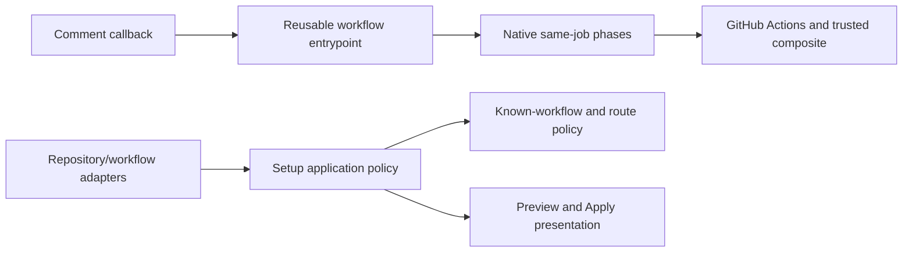

# Copilot Comment Workflow Coordinator

- Status: Draft
- Date: 2026-10-22
- Catalog capability ID: setup-and-doctor
- Last verified: not applicable
- Owners: Copilot maintainers
- Scope: Centralize native issue-comment and pull-request-review-comment verification coordination in one versioned Copilot reusable workflow and specify safe consumer setup migration.
- Related issues/PRs: [Issue #662](https://github.com/vypdev/copilot/issues/662); related delivered work #647/#652 and #656/#657; dependent release #661 (3.10.0).
- Required review gates: product UX, architecture, testing, documentation, security/operations
- Open decisions blocking readiness: none

## 1. Executive summary

This companion specification defines one Copilot-owned reusable workflow for the complete native verification lifecycle used by issue-comment and pull-request-review-comment callbacks. Repository callbacks and setup templates call one versioned workflow instead of copying twenty setup/continue pairs and cleanup steps. The reusable workflow owns one job, so the existing native per-step timeout and same-job candidate environment remain intact.

The safety rule is that only admitted, trusted verification work may reach the worker, and continuations verify the existing candidate without rerunning the agent or business operation. Secrets remain explicit and narrowly scoped; project setup receives no provider credentials or PAT inputs.

```text
Comment callback -> versioned Copilot reusable workflow -> same-job Copilot Action and trusted dependency setup -> continuation and guarded publication -> reverse native post cleanup
```

## 2. Problem, current behavior, and evidence

### 2.1 Problem

Repository maintainers and Copilot maintainers must review and upgrade duplicated callback orchestration. The native dependency setup has twenty statically declared setup/continue pairs plus final cleanup, adding 579 lines to each distributed callback and duplicating those lines in source workflows. A generated composite coordinator cannot preserve the native per-step timeout because GitHub rejects `timeout-minutes` within composite steps.

### 2.2 Current behavior

1. Issue-comment and pull-request-review-comment callbacks admit events using existing bot, fork, and eligibility gates.
2. A native Copilot Action step runs with explicitly supplied configuration and credentials.
3. Native setup/continue steps prepare dependencies, preserve candidate identity, and wait for worker readiness.
4. Verification and publication guards run without rerunning the agent or business operation.
5. Native post actions clean up setup state in reverse order.

The issue identifies these as current behavior and requires their preservation. Exact implementation-level names and current card text must be confirmed from the owning specifications and workflow evidence during implementation.

### 2.3 Evidence

- Code/workflow/documentation references: current comment callbacks and setup templates are catalogued under `setup-and-doctor`; existing setup owner is `specs/setup-runner-profiles-and-installation-parity.md`. The existing native verification owner remains `specs/repository-verification-setup-hooks.md` under `branch-synchronization`; implementation must retain that ownership and add a cross-reference. Catalog paths establish current locations only, not future runtime support.
- Incidents or concrete examples: twenty statically declared setup/continue pairs plus cleanup; 579 added lines per distributed comment callback.
- External primary sources: [GitHub runner action schema](https://github.com/actions/runner/blob/main/src/Runner.Worker/action_yaml.json); [same-repository self-reference announcement](https://github.blog/changelog/2026-07-30-reference-same-repository-actions-with-self-repository-syntax/).
- Unknowns: none block this design. Exact supported GitHub.com/runner/action-policy conditions must be documented and validated against the platform at implementation time.

### 2.4 Retrospective classification (as-built baselines only)

Not applicable: this is a prospective specification, not a reconstruction of an implemented baseline.

## 3. Actors, surfaces, and terminology

| Actor | Goal | Entry point | Visible surfaces |
|---|---|---|---|
| Repository maintainer | Install and upgrade compact comment callbacks safely | Setup or workflow maintenance | Workflow files, checks, setup preview and Apply |
| Comment author | Receive existing verification behavior | Issue or review comment | Existing result cards and linked run |
| Copilot operator | Diagnose a failed or incomplete verification | Workflow run | Job Summary, logs, issue/PR state |
| Copilot maintainer | Own central coordination and compatibility | Reusable workflow release | Versioned workflow, tests, docs, release notes |

A **callback** is the repository-owned workflow triggered by a supported comment event. The **coordinator** is the Copilot reusable workflow that owns all native lifecycle phases in one job. **Candidate** means the existing admitted worker/candidate identity and environment; it is carried through continuation rather than recreated. **Trusted project setup** is the repository-owned composite dependency action. **Source callback** means a callback in Copilot itself and uses an exact same-commit self-repository workflow reference. **Installed callback** means a consumer callback and uses `vypdev/copilot/.github/workflows/copilot_comment_runtime.yml@v3`.

## 4. Goals

### 4.1 Goals

1. Reduce each source and setup comment callback to at most 35 lines while centralizing all native phases in one reusable workflow.
2. Preserve existing admission, verification, publication, result-card, timeout, identity, credential, and cleanup behavior.
3. Let setup preview and Apply show the same runner route and safely recognize known reusable callers during configuration maintenance.
4. Provide actionable, reviewed migration for custom bootstrap steps without silently deleting them.

### 4.2 Non-goals

1. Replacing the repository-owned dependency action with a non-composite action.
2. Dispatching candidate setup to another job or rerunning the agent/business operation to continue verification.
3. Removing time limits or changing verification/publication semantics.
4. Publishing minor release #661 as part of this specification; it remains dependent on this work and its final-head review/checks.

### 4.3 Fixed product/safety invariants

1. Preserve admission and bot/fork gates, Variable and Secret semantics, twenty setup boundaries, five-minute native setup cancellation, 300-second worker readiness, and 120-minute job budget.
2. Preserve candidate identity, trusted-main Action pinning, credential-free verifier profiles, one-use continuations, and reverse native post cleanup.
3. Keep named Secrets explicit; provider credentials are scoped to the initial Copilot step. Preserve the Cursor provider condition at both the caller Secret grant and the initial Action environment. No unrestricted secrets inheritance and no provider credential/PAT inputs to project setup.
4. Unknown inputs, unsupported source identity, malformed runner JSON, and dependent expressions fail closed.
5. Do not drop custom bootstrap steps. Require reviewed migration with a concrete recovery path.
6. Require GitHub.com same-repository self-reference support and runner 2.336.0 or newer; the inspected source runner is 2.337.0. Repository Actions policy must allow the required references.

## 5. Current versus proposed product journey

| Stage | Current | Proposed | User/operator effect |
|---|---|---|---|
| Callback maintenance | Setup/continue orchestration is copied into callbacks and source workflows | Callback calls one versioned coordinator | Smaller review surface and centralized upgrades |
| Native job execution | Native phases run in callback job | Reusable workflow owns one job and all native phases | Per-step timeout and candidate environment remain available |
| Setup migration | Existing routes and custom bootstrap need to be recognized | Preview and Apply expose the same route; known reusable callers are recognized; custom steps require reviewed migration | No inferred runner access or silent loss of bootstrap |
| Upgrade | Consumers carry duplicated orchestration | Installed callback pins `@v3`; source callback uses exact same-commit self reference | Coordinator upgrades are explicit and reviewable |


Text equivalent: comment callback -> one-job reusable coordinator -> same-commit Copilot Action and trusted setup in the same job -> guarded continuation/publication -> reverse native cleanup.

## 6. Functional behavior and state model

### 6.1 Happy path

1. The callback applies the existing event admission and bot/fork gates, then calls the coordinator with only supported named inputs and explicit named Secrets.
2. Source callbacks reference the workflow at the exact same-commit self repository revision. Installed callbacks reference `vypdev/copilot/.github/workflows/copilot_comment_runtime.yml@v3`.
3. The coordinator resolves supported runner routing and executes one job containing the Copilot Action, trusted project composite setup, continuation, verifier/publication guards, and native post cleanup.
4. Continuation consumes the one-use token and existing candidate identity; it does not rerun the agent or business operation.
5. Existing result cards and publication behavior remain unchanged.

### 6.2 Alternative paths

- Disabled, read-only, dry-run, and no-op modes retain their current behavior and do not gain side effects through centralization.
- Existing scalar, label, and group runner routes are retained or explicitly replaced during migration; preview and Apply display the same route.
- Unsupported runner configuration or callback identity fails closed with actionable recovery guidance.
- GitHub.com/runner/Actions-policy prerequisites not met: the callback cannot execute the coordinator; report a clear setup/operator error and link to prerequisites and remediation.
- Custom bootstrap steps: migration pauses for review and provides a documented recovery path; no step is silently discarded.

### 6.3 State machine

| State | Entered when | User-visible meaning | Allowed next states | Recovery/owner |
|---|---|---|---|---|
| Not admitted | Existing gates reject event | No verification run is started | Terminal | Existing callback behavior |
| Admitted | Event passes existing gates | Verification is starting | Running, failed | Coordinator/operator |
| Running | Native setup and worker proceed | Existing verification is in progress | Verifying, failed, canceled | Coordinator/operator |
| Verifying | One-use continuation resumes existing candidate | Existing candidate is checked | Published, failed, canceled | Coordinator/operator |
| Published | Existing publication guard allows result | Existing result is available | Terminal | Existing publication behavior |
| Failed/canceled | Guard, timeout, platform, or execution failure | Verification did not complete or was blocked | Retry only under existing policy | Operator uses run diagnostics and recovery docs |

Duplicate and stale events remain subject to existing admission and one-use continuation semantics. Canceled setup runs retain native post cleanup. No continuation re-executes the agent/business operation.

## 7. User-facing configuration

| Input | Type | Recommended default | Allowed values/range | Scope/persistence |
|---|---|---|---|---|
| Installed coordinator ref | Workflow reference | `v3` | Reviewed supported version tags | Callback source, committed and upgraded explicitly |
| Source coordinator ref | Workflow reference | Exact same-commit self-repository reference | Exact caller commit only | Source workflow invocation |
| Runner route | Existing scalar/label/group route representation | Preserve configured route | Valid existing route values; malformed JSON and dependent expressions rejected | Repository setup configuration |
| Coordinator secrets | Named Secret bindings | Existing explicit named bindings | Only supported named Secrets | Passed to coordinator; provider credential scope remains initial Copilot step |
| Job budget | Fixed duration | 120 minutes | Not configurable by consumer | Coordinator job |
| Native setup timeout | Fixed duration | 5 minutes per native setup step | Not configurable by consumer | Coordinator step |
| Worker readiness | Fixed duration | 300 seconds | Not configurable by consumer | Coordinator wait |

Validation MUST reject unknown workflow inputs, malformed runner JSON, dependent expressions, and unsupported source identity. Route handling MUST preserve existing valid scalar/label/group semantics. Configuration preview and Apply MUST expose identical effective routing. Recommended configuration uses the installed `@v3` reference and existing validated route; the source-workflow alternative uses the exact same-commit self reference. Correctness limits, gates, credential scope, and timeout budgets are not configurable. Existing Variable and Secret behavior is preserved; operation-time snapshot/reread behavior must match the current owning contract. Cursor's existing default/role provider condition MUST be evaluated before granting the Secret to the coordinator as well as before placing it in the initial Action environment.

## 8. Clean Architecture

### 8.1 Responsibilities and dependency direction

| Layer/boundary | Owns | Must not own/import |
|---|---|---|
| Domain/pure policy | Known workflow identity, input allowlist, route recognition and validation decisions | GitHub SDK or workflow runtime DTOs |
| Application | Setup preview/Apply and maintenance decisions; immutable semantic inputs/outputs | Concrete runner or GitHub process concerns |
| Adapters/data | Mapping repository configuration and workflow facts into semantic contracts | Product policy or inferred permissions |
| Infrastructure/composition | Reusable workflow wiring, native steps, secrets mapping, runner execution | Decisions that weaken invariant gates |
| Entrypoints | Compact event callback, existing admission and coordinator invocation | Duplicated orchestration |
| Presentation | Setup preview/Apply route display and actionable migration guidance | Mutations or runner-route inference |



### 8.2 Contracts, state, and trust boundaries

- Pure decisions: accepted coordinator identity/version, known reusable caller recognition, supported inputs, and valid runner-route shape.
- Application contracts: setup preview and Apply expose the same effective route and migration outcome; unsupported facts produce explicit errors.
- Semantic ports: read workflow identity/configuration and apply only validated setup changes.
- Durable state/schema ownership: existing repository Variables, Secrets, workflow files, and continuation state retain their existing owners and schemas.
- Concurrency/idempotency strategy: preserve existing admission, one-use continuation, candidate identity, and publication guards.
- Trusted and untrusted inputs: issue/comment payloads, repository configuration, expressions, and workflow inputs are untrusted until validated; only supported named values cross the coordinator boundary.
- Provider error mapping: distinguish unsupported platform/reference/policy from workflow execution failure and provide actionable setup/operator recovery.

### 8.3 Executable architecture constraints

A pure known-workflow contract MUST target 100% branch coverage. Automated checks MUST parse workflow YAML and verify one-job native ownership, allowed inputs/Secrets, source and installed reference forms, timeout placement, callback line limits, setup route parity, and absence of unrestricted secrets inheritance or credential/PAT setup inputs. Dependency/contract checks MUST ensure pure policy does not import provider SDKs and setup presentation does not mutate configuration.

## 9. UI/UX and content contract

### 9.1 Information hierarchy

Existing result cards remain unchanged and continue to show current status, completed facts, next transition, action requirement, impact, and inspectable links before technical details. Setup migration guidance leads with the route that will be applied and any human action required.

### 9.2 Representative primary view

The coordinator does not introduce a new issue/review card. Existing cards are normative and must be preserved byte/semantically as established by the verification owner. Setup preview should communicate the concrete effective route and migration decision:

```markdown
## Comment workflow setup preview

**Current status:** Ready to apply the Copilot comment workflow update.

**Runner route:** `labels: [self-hosted, linux]`

**Action required:** Review the listed custom bootstrap migration before applying.

## Changes

- [x] The callback will call Copilot's comment coordinator at `v3`.
- [x] The configured runner route is preserved in preview and Apply.
- [ ] Custom bootstrap step requires maintainer review.

## What happens next

Apply the reviewed workflow update, then inspect the first run's checks and Job Summary.
```

Variants: pending/no action reports that no run is required; action required links to migration review; blocked/failed identifies impact, cause, action, retained configuration and run link; partially complete states which setup files changed and which remain untouched; completed links to the applied workflow and verification run. No new comment or notification is emitted solely for coordinator adoption.

### 9.3 Issue, PR, and comment behavior

- Deterministic titles and purpose: preserve the existing result-card titles and purposes exactly.
- What merge/close/retry will do: preserve current callback semantics; rerun/retry follows existing admission and does not resume by rerunning the agent through the continuation path.
- Durable marker and idempotent update policy: retain existing markers and one-use continuation policy.
- Comment/notification budget: no additional comments or notifications due to centralization.
- Labels and checks as supplemental state: preserve existing checks and publication guards.
- Direct links and navigation: existing issue/PR and workflow-run links remain descriptive and usable.

### 9.4 Accessibility, localization, and responsive behavior

Preserve the existing locale and fallback contract of result cards. New setup guidance uses plain text, descriptive links, semantic headings and short lists; it remains readable on narrow screens and in light/dark themes. Escape untrusted values and do not render configuration as executable Markdown, mentions, HTML markers, commands, or arbitrary URLs. Diagrams have adjacent text equivalents.

## 10. Failure, recovery, and cleanup

| Failure/partial state | User impact | Retained facts | Automatic retry | Required action | Cleanup |
|---|---|---|---|---|---|
| Unsupported ref, runner, or Actions policy | Callback cannot start coordinator | Existing configuration and callback remain | No | Meet documented GitHub.com, runner 2.336.0+, and policy prerequisites | No setup state created |
| Unknown input or malformed route JSON | Setup/run fails closed | Original configuration retained | No | Correct supported input/route; inspect preview | No inferred permissions/routes |
| Setup step times out | Verification cannot continue | Candidate and prior facts remain subject to existing semantics | Existing policy only | Inspect failed step and retry through supported entrypoint | Native reverse post cleanup |
| Worker readiness exceeds 300 seconds | Verification is blocked | Candidate identity retained where existing runtime permits | Existing policy only | Inspect run and use documented recovery | Native cleanup |
| Job reaches 120-minute budget | Job is canceled | Completed facts and logs retained | Existing policy only | Inspect timeout location before retry | Native post cleanup runs where platform permits |
| Custom bootstrap migration is unreviewed | Setup Apply is blocked | Existing workflow/configuration retained | No | Review migration and apply explicitly | No silent deletion |
| Publication guard rejects result | No result is published | Verification evidence retained | No automatic publication retry beyond current contract | Follow existing operator guidance | Setup cleanup completes |

Errors follow impact -> cause -> action -> retained state and must not claim successful prior effects failed.

## 11. Security, permissions, and privacy

1. Preserve existing event admission, bot/fork gates, and least-privilege permissions. Coordinator permissions must be explicit and no broader than the existing native callback contract.
2. Treat workflow inputs, event data, repository configuration, route JSON, and expressions as untrusted. Reject unknown or ambiguous values; never infer runner access.
3. Named Secrets remain explicit. Do not use unrestricted secrets inheritance. Provider credentials are scoped to the initial Copilot step and must not be passed to project setup.
4. Preserve trusted-main Action pinning, candidate identity, credential-free verifier profiles, one-use continuations, and guarded publication. Logs and summaries must not expose Secret values or sensitive environment data.

## 12. Observability and operational UX

- User-facing state: existing cards and checks remain the source of verification outcome.
- Job Summary/operator evidence: identify callback type, coordinator version/ref, admitted phase, setup/continuation outcome, verifier/publication guard outcome, and cleanup status without secret values.
- Logs, metrics, and correlation: preserve existing run/event/candidate correlation identifiers and sanitize untrusted fields.
- Pending external dependency versus workflow failure: distinguish platform prerequisite/reference rejection from native step failure.
- Rate-limit/retry behavior: preserve existing provider retry behavior and bounds.
- Noise/comment budget: centralization adds no comments or notifications.

## 13. Compatibility, migration, rollout, and rollback

Source callbacks use the exact same-commit self-repository workflow reference. Installed callbacks use `vypdev/copilot/.github/workflows/copilot_comment_runtime.yml@v3`. The coordinator uses GitHub's self-repository Action reference so an exact caller SHA cannot drift to another Action version. Require GitHub.com support, runner 2.336.0 or later, and compatible Actions policy; document these prerequisites and how to upgrade the pinned workflow ref.

Migration MUST preserve source-only jobs and consumer Action bytes and auxiliary assets. Setup MUST retain or explicitly replace existing scalar/label/group routes, display the same route in preview and Apply, and recognize known reusable callers during maintenance. Unknown inputs, unsupported source identity, malformed runner JSON, and dependent expressions fail closed. Custom bootstrap steps require reviewed migration and actionable recovery. Rollout follows the Action-managed issue branch and reviewed PR lifecycle; do not create, rename, or force-push managed branches manually. Keep unrelated release-review changes out absent concrete dependency. Release 3.10.0 remains unpublished until this dependency and its final-head checks/review are complete. Rollback restores the prior callback workflow and configuration while preserving existing candidate and result facts; no irreversible effect is introduced by the coordinator itself.

## 14. Testing strategy and numeric budget

Minimum additional risk-derived floor: 40 distinct cases shared once across both capabilities; do not double count a case because both callback types use it.

| Area | Minimum distinct cases | Behaviors/risks covered |
|---|---:|---|
| Workflow/security mutations | 16 | Admission/bot/fork gates; explicit secrets; no inherit-all; credential scope; trusted pin; timeouts; one job; same-job candidate; continuation; cleanup; publication guards; input rejection |
| Routing/migration/idempotency | 12 | Scalar/label/group routes; preview/Apply parity; known caller recognition; malformed JSON; dependent expressions; custom bootstrap review; source-only jobs; assets/bytes; replay and one-use semantics |
| Configuration inspection/identity/credential scope | 12 | Known workflow contract; supported source identity; installed ref; unknown input; unsupported runner/platform/policy; Variable/Secret semantics; credential boundary; failure recovery |
| **Total** | **40** | No double counting |

Repository coverage gates remain in force. Changed modules meet existing thresholds; new pure known-workflow policy targets 100% branch coverage. Tests parse workflow structure rather than grep prose, and cover both callback entrypoints against shared coordinator contracts. Use deterministic fixtures and fakes without real waits or live services. Preserve and extend golden result-card fixtures with semantic assertions. Manual UX evidence reviews setup preview/Apply parity and existing result cards at narrow width and light/dark themes. Full implementation validation includes all repository validators, full coverage, package/build smoke, and real native acceptance on Linux, Windows, and macOS.

## 15. Documentation and discoverability

| Audience | Artifact/page | Required content | Validation/navigation |
|---|---|---|---|
| User | `docs/issues/comment-commands.mdx` | Existing result behavior and run links remain unchanged | Documentation link/contract checks |
| Setup owner | `docs/setup-web.mdx`, `docs/configuration.mdx`, `docs/configuration-checklist.mdx` | Coordinator installation, route preview/Apply parity, supported inputs and secrets | Fixtures and documentation validators |
| Operator | `docs/security-operations/operations/verification.mdx`, `docs/security-operations/operations/troubleshooting.mdx` | Prerequisites, failure states, timeout/cleanup, recovery | Operator decision-tree review |
| Contributor | `docs/development/architecture.mdx`, `specs/copilot-comment-workflow-coordinator.md`, both existing owning specs | Boundaries, workflow contracts, pinned-ref upgrades, migration | Architecture and specification validation |

Update user/operator/upgrade documentation, tests, generated bundles, catalog evidence, and `specs/CATALOG.md` together. Document GitHub.com, runner 2.336.0+, Actions-policy prerequisites and pinned-ref upgrades. Cross-reference the branch-synchronization verification SDD without changing its ownership. Keep examples synchronized with contract fixtures.

## 16. Acceptance scenarios

1. Given an admitted issue-comment event, when its callback invokes the installed coordinator, then the existing result and publication behavior completes through one job with the same candidate and cleanup semantics.
2. Given a source callback, when it invokes the coordinator, then the workflow reference resolves to the exact same commit and the Action reference cannot drift.
3. Given a setup with a scalar, label, or group route, when preview and Apply run, then both show and apply the same route.
4. Given malformed runner JSON, dependent expressions, an unknown input, or unsupported source identity, when setup or workflow validation occurs, then it fails closed and gives actionable recovery without inferring permissions.
5. Given a worker continuation, when verification resumes, then the one-use continuation verifies the existing candidate and does not rerun the agent or business operation.
6. Given a native setup timeout, worker readiness timeout, or job timeout, when the run stops, then the configured five-minute, 300-second, and 120-minute limits apply and reverse native post cleanup runs where supported.
7. Given provider Secrets, when the coordinator runs, then named Secrets are explicit, Cursor's provider condition applies before the call and the initial step, provider credentials reach only the initial Copilot step, and project setup receives no provider/PAT input. All four source/distributed comment callback variants MUST reject an unconditional Cursor Secret grant even if the initial environment remains gated.
8. Given custom bootstrap steps, when setup migration is previewed, then Apply requires reviewed migration and presents actionable recovery without silently dropping steps.
9. Given disabled, read-only, dry-run, or no-op configuration, when the callback executes, then existing semantics and user-facing cards are retained.
10. Given GitHub.com or runner/Actions-policy prerequisites are unmet, when the callback is invoked, then failure is clear and points to prerequisite remediation.
11. Given the documentation and generated bundles are updated, when repository validation runs, then specification/catalog, workflow, coverage, package/build, and cross-platform native acceptance gates are satisfied.

## 17. Requirements traceability

| Requirement | Policy/use case/adapter/presentation | Test or evidence | Documentation |
|---|---|---|---|
| Central coordinator and one-job native lifecycle | Workflow composition | Workflow structure contracts; 16 workflow/security cases | Architecture and verification docs |
| Exact source and installed references | Entrypoint/workflow adapter | Ref identity contract cases | Upgrade guide |
| Preserve route and migration behavior | Setup policy and preview/Apply | 12 routing/migration/idempotency cases | Setup/configuration docs |
| Credential and trust boundaries | Workflow inputs and Secret mapping | 12 identity/credential cases plus security mutations | Security credentials and operations docs |
| Existing behavior and result cards | Existing verification owner and presentation | Golden and semantic compatibility assertions | Comment commands and verification docs |
| Platform prerequisites and recovery | Infrastructure/operator guidance | Platform/ref failure contracts | Troubleshooting and upgrade docs |

## 18. Implementation sequence

1. Record workflow input/Secret contracts, supported source identity, runner route rules, and architecture checks.
2. Implement pure known-workflow/input/route policy and achieve full branch coverage.
3. Update setup preview/Apply and configuration maintenance recognition with migration outcomes.
4. Implement the central reusable workflow with all native phases and contract tests.
5. Migrate source and setup callbacks, preserving source-only jobs, Action bytes/assets, and custom bootstrap through reviewed migration.
6. Update both owning specifications by cross-reference/change, catalog evidence, generated bundles, user/operator/upgrade docs, and fixtures together.
7. Run repository validators, full coverage, package/build smoke, and real native acceptance on Linux, Windows, and macOS; obtain review and final-head checks before release dependency proceeds.

## 19. Definition of Done

- [ ] Source and setup comment callbacks are each at most 35 lines and one central workflow owns all native phases.
- [ ] Existing admission, bot/fork gates, Variable/Secret semantics, time limits, candidate identity, pinning, verifier profiles, continuation, publication, cards, and cleanup are preserved.
- [ ] No unrestricted secrets inheritance or provider/PAT inputs to project setup; named Secret scope is verified.
- [ ] Setup preview and Apply expose identical routes; known callers are recognized; malformed/unknown/ambiguous inputs fail closed.
- [ ] Custom bootstrap steps have reviewed migration and actionable recovery; source-only jobs, consumer Action bytes, and auxiliary assets are preserved.
- [ ] GitHub.com, runner, Actions-policy prerequisites and pinned-ref upgrades are documented.
- [ ] Numeric 40-case budget passes, existing coverage gates remain, and new pure known-workflow contract has full branch coverage.
- [ ] Linux, Windows, and macOS native acceptance, repository validators, full coverage, and package/build smoke pass.
- [ ] User/setup/operator/contributor and upgrade documentation, owning-spec cross-references, generated bundles, catalog evidence, and `specs/CATALOG.md` are current; `pnpm run validate:specifications` passes.
- [ ] Existing result cards pass UX review; failure, migration, security, cleanup, and accessibility requirements are satisfied.
- [ ] Final-head checks and review are complete before dependent release #661 is published.
- [ ] No readiness-blocking decision remains unresolved.

## 20. References and decisions

- Primary sources: [GitHub runner action schema](https://github.com/actions/runner/blob/main/src/Runner.Worker/action_yaml.json); [GitHub same-repository self-reference announcement](https://github.blog/changelog/2026-07-30-reference-same-repository-actions-with-self-repository-syntax/).
- Related specs/ADRs/issues/PRs: [Issue #662](https://github.com/vypdev/copilot/issues/662); existing setup owner `specs/setup-runner-profiles-and-installation-parity.md` under `setup-and-doctor`; existing verification owner `specs/repository-verification-setup-hooks.md` under `branch-synchronization`; #647/#652 and #656/#657; dependent release #661.
- Decisions and rejected alternatives: one reusable workflow owns the complete job; generated orchestration in every consumer rejected for duplication/review cost; composite coordinator rejected because it cannot preserve native per-step cancellation; another candidate setup job rejected because it breaks same-job worker/candidate environment; removing time limits is outside scope. Maintainer approved a concise new companion at `specs/copilot-comment-workflow-coordinator.md` under `setup-and-doctor`.
- Follow-up work explicitly outside this spec: publishing release #661 before this issue's implementation and final-head checks/review; unrelated release-review corrections without a concrete dependency.
