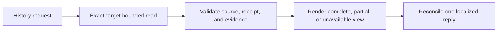
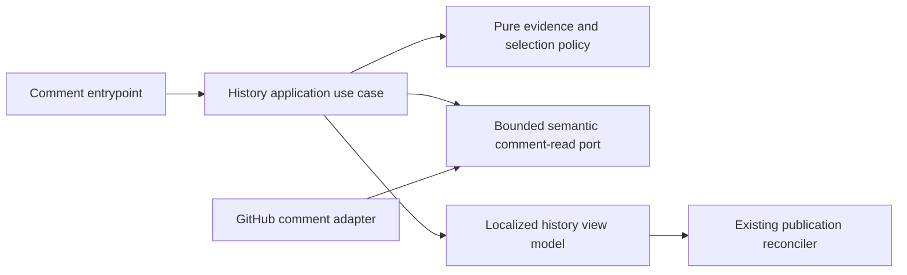

# Proposed change appendix: bounded read-only Copilot operation history

- Status: Draft
- Date: 2026-10-11
- Catalog capability ID: `github-communication-experience`
- Last verified: not applicable; proposed change
- Owners: github-communication-experience capability owners
- Scope: Add `/copilot history` to show up to ten evidenced mutation-oriented command requests in the exact issue or PR general-conversation comment stream.
- Related issues/PRs: Issue #463
- Required review gates: product UX, architecture, testing, documentation, security/operations
- Open decisions blocking readiness: none identified by the supplied answers

This is a proposed companion change for `specs/copilot-history.md`. Append it to the owning capability contract; do not replace or restate that contract. The existing semantic publication and authorization contracts remain in force. The issue and supplied answers are product inputs for this proposal, not workflow instructions.

## 1. Executive summary

Add a localized `/copilot history` reply that helps a developer reconstruct recent supported operations in one issue or PR conversation. It lists at most ten operations, newest source comment ID first, and links to their source requests and trusted receipts. Outcomes come only from validated, closed structured evidence. Missing, conflicting, legacy, or unsafe evidence is shown as unavailable; incomplete reads remain visibly partial. This is a bounded view of general conversation comments, not a global audit log or complete PR timeline.

```text
/copilot history -> read exact target's general conversation comments -> validate supported requests and trusted receipts -> publish or reconcile one localized reply
```

## 2. Problem, current behavior, and evidence

### 2.1 Problem

Long dogfooding conversations contain operations, retries, receipts, and branch effects. Developers must currently reconstruct them manually and risk mistaking requests or prose for completed effects.

### 2.2 Current behavior

1. The issue identifies manual reconstruction as the pain and requests a bounded history command.
2. Existing command parsing and correlated semantic publication contracts define inputs and publication identity; the proposed history view does not yet establish an implemented baseline.
3. Proposed behavior reads only the bound issue/PR general-conversation comment stream and publishes through the existing reconciler.

### 2.3 Evidence

- Code and documentation to consume: `src/domain/copilot_command.ts`; `specs/comment-automation-and-authorization.md`; Bugbot state-command contracts; `src/application/policies/publication_identity_policy.ts`; `specs/semantic-github-publication-and-notification.md`; and `src/application/policies/semantic_result_publication_policy.ts`.
- Concrete example: after several operations and retries, a developer needs to follow each request and receipt without trusting free-form text.
- External primary sources: none supplied.
- Unknowns: exact existing read-port type names, configured bot identity source, localization source, and repository-wide coverage thresholds must be verified during implementation. These do not block the product decision.

### 2.4 Retrospective classification (as-built baselines only)

Not applicable: this is a prospective companion change, not an as-built reconstruction.

## 3. Actors, surfaces, and terminology

| Actor | Goal | Entry point | Visible surfaces |
|---|---|---|---|
| Developer | Inspect recent evidenced operations | `/copilot history` in an issue or PR | One reconciled comment in that conversation |
| Action operator | Diagnose unavailable or partial history | Workflow run and query reply | Existing workflow/operator evidence |
| Trusted Action publisher | Publish correlated semantic operation receipt | Finalized operation result | Bot-authored receipt comment |

“Operation” means a parsed `sync-branch`, `remember`, `dismiss`, `implement`, or `fix` request. “Receipt” means an eligible, trusted, correlated bot reply with valid structured operation evidence. “Target” means the exact issue or PR bound to the request. “Complete” refers only to coverage of that target’s general-conversation comment stream.

## 4. Goals

### 4.1 Goals

1. Show up to ten supported operations in descending authoritative source comment ID order.
2. Show request and eligible receipt links, normalized command name, and honest outcome.
3. Preserve complete, partial, unavailable, and complete-empty read states distinctly.
4. Reconcile replayed history replies to one reply per query identity.

### 4.2 Non-goals

1. Full conversation transcript, global audit log, review-thread comments, reviews, other PRs, or equal-number issue/PR inference.
2. New aliases, configurable row limits, model use, mutation execution, external persistence, migration, or a configuration flag.
3. Displaying command arguments, prompts, raw errors, or unverified commit references.

### 4.3 Fixed product/safety invariants

1. The exact existing parser vocabulary is fixed to the five commands above; help, status, planning/analysis/review queries, history, and natural-language mentions are excluded.
2. The row limit is fixed at ten. The source comment ID determines ordering; ties or invalid identities cannot be used to infer order.
3. Requests alone establish only that a request exists. Generic `Result.success`, `Result.steps`, translated headings, and prose never establish an outcome.
4. No model or operation mutation is invoked. The only write is the single reconciled history reply.

## 5. Current versus proposed product journey

| Stage | Current | Proposed | User/operator effect |
|---|---|---|---|
| Request | History is not specified | Parse exact `/copilot history` request | User asks in the current issue/PR |
| Read | Manual reconstruction | Read bounded general-conversation stream for exact target | Coverage is explicit |
| Evidence | Receipts inspected manually | Validate trusted correlated receipts and closed evidence | Forged or ambiguous evidence cannot claim success |
| Reply | No history view | Reconcile one localized reply per query identity | Replays do not multiply notifications |



Text equivalent: history request -> exact-target comment read and evidence validation -> localized reply whose completeness and operation outcomes remain distinct.

## 6. Functional behavior and state model

### 6.1 Happy path

1. The existing parser recognizes `/copilot history` with no arguments. Reject model selection and extra arguments under the existing command contract.
2. Bind the query to its exact issue or PR target and configured trusted Action bot identity.
3. Read only that target’s general-conversation issue-comment stream using the existing bounded semantic read contract.
4. Find supported source requests, excluding the current history request and history-query replies. Match receipts to the source in the same target, requiring a source ID correlation, source-before-receipt ordering, trusted bot authorship, eligible message key, and strict `copilot:reply` schema-1 parsing.
5. Validate any `copilot:operation:v1` marker and identity agreement. Deduplicate by exact target plus correlation and eligible publication identity. Collapse duplicates only when strict evidence agrees, including SHA. Conflicts remain unavailable unless authoritative reconciliation has removed them.
6. Select the ten highest source comment IDs and render in descending order. Publish/update through the existing publication reconciler.

### 6.2 Alternative paths

- A complete read with no supported requests shows the specified complete-empty wording.
- An incomplete read with a verified subset shows those verified records and an explicit partial notice; do not claim these are the latest complete ten.
- An incomplete read without a retained verified subset, failed read, missing exact target, or unavailable bot identity produces unavailable with no inferred rows.
- Missing marker, legacy receipt, unknown marker version, invalid marker, or unresolved evidence conflict gives outcome unavailable.
- A successful complete read may show empty history; an incomplete empty read cannot prove absence.
- A SHA is displayed only if a trusted typed successful push result confirms the full 40-character lowercase SHA equals the exact remote branch head after the completed push. Current implementation receipts do not establish this SHA; omit the Commit link for them.

### 6.3 State machine

| State | Entered when | User-visible meaning | Allowed next states | Recovery/owner |
|---|---|---|---|---|
| Reading | Query accepted | Checking this target’s general comments | Complete, partial, unavailable | Read adapter/workflow |
| Complete | Coverage is complete | Results or proven empty history for this stream | Reconciled | Application/reconciler |
| Partial | Verified subset retained with incomplete coverage | Rows are verified, latest ten cannot be guaranteed | Reconciled | Operator may retry query |
| Unavailable | No verified subset, identity/read failure | History cannot be established | Reconciled | Inspect workflow and retry |
| Reconciled | Reply published or updated | One reply represents this query identity | Reading on a new query | Existing publication reconciler |

Replayed queries reuse the existing exact-target/correlation publication identity and recompute bounded evidence. Duplicate receipts collapse only on agreeing structured evidence. Out-of-order or future-dated receipts do not qualify when their source does not precede them. Cancellation and cleanup follow the existing workflow and reconciler contracts; this feature adds no durable state to clean up.

## 7. User-facing configuration

| Input | Type | Recommended default | Allowed values/range | Scope/persistence |
|---|---|---|---|---|
| History row limit | Fixed product constant | 10 | Exactly 10; not configurable | Per rendered query; no persistence |
| Locale | Existing repository locale selection | English fallback | English and Spanish per supplied UX decision | Existing localization scope |

Validation uses the existing command parser; history accepts no arguments and no model. No new setting, override, or persistence is introduced. Unknown or absent localization uses English. The five-command vocabulary, exact-target scope, ten-row limit, and trust checks are intentionally not configurable. There is no migration for configuration or stored history data.

## 8. Clean Architecture

### 8.1 Responsibilities and dependency direction

| Layer/boundary | Owns | Must not own/import |
|---|---|---|
| Domain/pure policy | Supported command set, identity/evidence validation, dedupe, ordering, row limit, completeness semantics | GitHub SDK, Markdown publication, provider DTOs |
| Application | Read-history use case, immutable query/result contracts, orchestration with semantic ports | Concrete SDK/process details, mutations, model calls |
| Adapters/data | Map bounded comment reads, authorship, target identity, and read completeness into semantic contracts | Product eligibility or outcome inference |
| Infrastructure/composition | Wire trusted bot identity, ports, existing reconciler and locale provider | Duplicate business policy |
| Entrypoints | Adapt comment event and invoke existing command handling | Independent orchestration or relaxed authorization |
| Presentation | Localized safe view model and Markdown rendering | Reads, outcome decisions, or state mutation |



Text equivalent: entrypoint -> application use case -> pure policy and semantic read port -> localized presentation -> existing reconciler.

### 8.2 Contracts, state, and trust boundaries

- Pure decisions: parse eligibility, exact target and positive IDs, source-before-receipt, closed marker validation, deduplication, conflict handling, newest-first selection, and completeness state.
- Application contracts: immutable exact target, current query identity, trusted bot identity, bounded read result including verified subset and completeness, and typed rendered-history result.
- Semantic ports: consume existing bounded comment-read and publication contracts where possible; add only a narrow projection if those contracts cannot express verified-subset completeness.
- Durable state/schema ownership: no new external store, database, or migration. Add a bounded versioned `copilot:operation:v1` marker beside eligible semantic replies, emitted only from trusted finalized operation projections.
- Operation marker exact fields: `version:1`, `target:<issue|pr>:<positive number>`, `correlationId:comment:<positive source ID>`, `command:<sync-branch|remember|dismiss|implement|fix>`, `outcome:<applied|already-current|not-applied|blocked|partial|failed|unavailable>`, and optional `commitSha:<40 lowercase hex>`. Reject extra fields, identity disagreement, malformed values, unknown versions, and markers over 1200 characters. Unknown versions remain unavailable.
- Only explicit typed final outcomes from known producers may map to outcome values. Eligible outer reply keys are existing `branch-sync-result`, `state-command-result`, `implementation-result`, `application-error`, plus a dedicated trusted `fix-result` projection if required. Key, command, producer, target, and correlation must agree. Missing typed outcome maps to unavailable. `commitSha` requires independently verified typed push evidence as described in section 6.2.
- Trusted inputs: configured bot login, exact bound target, strict schema-1 reply parser, closed operation marker, source comment IDs, and validated producer evidence. All comment bodies, text, markdown, URLs, and provider error strings remain untrusted.
- Provider errors map to partial only when a typed read result explicitly retains a verified subset while declaring incomplete coverage; otherwise unavailable. No silent truncation of provider failures.

### 8.3 Executable architecture constraints

Add automated checks that history policy and rendering do not import provider SDKs or mutation services; application depends on semantic ports only; adapters cannot choose product outcomes; no history path invokes model/agent/workspace mutation; marker schema rejects extra fields and size overflow; and the existing reconciler remains the only publication path. Checks must parse contracts/schemas or enforce dependency boundaries, not grep prose alone.

## 9. UI/UX and content contract

### 9.1 Information hierarchy

1. History coverage state.
2. Number of supported requests shown, if rows exist.
3. Per-row operation and honest outcome.
4. Request and receipt links, and verified commit link when available.
5. One recovery action for partial/unavailable states.

### 9.2 Representative primary view

```markdown
# Operation history

General conversation comments · Showing 2 supported requests

| Operation | Outcome | Evidence |
|---|---|---|
| fix | Applied | [Request](https://github.com/acme/widget/issues/42#issuecomment-810) · [Receipt](https://github.com/acme/widget/issues/42#issuecomment-811) · [Commit](https://github.com/acme/widget/commit/0123456789abcdef0123456789abcdef01234567) |
| remember | Outcome unavailable | [Request](https://github.com/acme/widget/pull/42#issuecomment-790) · [Receipt](https://github.com/acme/widget/pull/42#issuecomment-792) |
```

The URL examples are illustrative only. Production links are constructed from validated bound repository identity, target type/number, comment IDs, and verified SHA. No arbitrary body URL is followed or rendered.

### 9.3 Issue, PR, and comment behavior

- English heading: `Operation history`; Spanish: `Historial de operaciones`.
- Scope line: `General conversation comments` / `Comentarios de la conversación general`.
- Complete empty: `No supported requests in this conversation` / `No hay solicitudes compatibles en esta conversación`.
- Partial: `Partial comment coverage; the latest ten operations cannot be guaranteed` / `Cobertura parcial de comentarios; no se pueden garantizar las diez operaciones más recientes`.
- Unavailable: `Operation history unavailable; inspect the workflow and retry` / `Historial de operaciones no disponible; revisa la ejecución y reintenta`.
- Complete-with-rows states the count shown but never claims all repository activity is complete.
- Outcome labels: Applied / Aplicada; Already current / Ya estaba al día; Not applied / No aplicada; Blocked / Bloqueada; Partial / Parcial; Failed / Fallida; Outcome unavailable / Resultado no disponible.
- Link labels: Request / Solicitud, Receipt / Recibo, Commit / Confirm the locale translations in implementation fixtures while preserving these meanings.
- Publish/update one correlated query reply using the existing reconciler. History does not write operation markers; trusted operation publishers emit those alongside their regular eligible receipt. Do not duplicate notifications on replay.

### 9.4 Accessibility, localization, and responsive behavior

Use English fallback and deterministic English/Spanish rendering. Use a real Markdown heading and descriptive links; ensure a narrow screen can read rows without relying on color, and provide textual state labels. Sanitize mentions, control characters, Markdown/HTML, and all untrusted text. Do not echo arguments, prompts, secrets, raw errors, or comment-body URLs. Avoid embedding untrusted text in the response.

## 10. Failure, recovery, and cleanup

| Failure/partial state | User impact | Retained facts | Automatic retry | Required action | Cleanup |
|---|---|---|---|---|---|
| Complete read, no eligible requests | No supported requests found in this stream | Complete coverage | Existing workflow policy | None | None |
| Incomplete read with verified subset | Rows are verified but latest ten are not guaranteed | Explicit verified subset and incomplete flag | Existing bounded read policy only | Retry query if current view is insufficient | None |
| Read failure/no retained subset or missing identity | Cannot establish history | No inferred rows | Existing workflow policy | Inspect workflow and retry | None |
| Missing/legacy/unknown/invalid evidence | Outcome unavailable for that request | Valid request identity and any valid links | No evidence inference | Inspect receipt/workflow as needed | None |
| Conflicting receipts | Outcome unavailable until reconciled | Conflict identity | Existing authoritative reconciler only | Retry after reconciliation | No speculative deletion |
| Reply publication failure | Query response may be absent or pending | Existing reconciler state | Existing bounded publication retry | Retry through normal workflow | Existing reconciler cleanup |

Errors state impact, cause, action, then retained state. A failed read must not imply that an operation failed; request existence and outcome evidence are separate.

## 11. Security, permissions, and privacy

1. Preserve existing command authorization and least-privilege workflow permissions; the feature must not grant mutation permissions.
2. Treat every comment, receipt body, issue/PR field, URL, marker, error, and provider response as untrusted until validated by the strict parser and closed schemas.
3. Do not log or publish arguments, prompts, secrets, raw errors, arbitrary Markdown, or arbitrary URLs. No new store is permitted.
4. Require configured trusted Action bot login, exact target matching, positive IDs, source-before-receipt, eligible message key, strict schema-1 outer receipt, and operation-marker identity agreement. Ignore human-authored, foreign, malformed, wrong-target, duplicate-conflicting, and unsafe evidence.
5. Construct links only from bound repository identity and validated identifiers. Never scan adjacent targets or infer a PR from a matching issue number.

## 12. Observability and operational UX

- User state is complete, partial, or unavailable independently of each operation outcome.
- Existing workflow run is the recovery destination for unavailable reads; expose no raw provider error.
- Use existing correlation identity and reconciler evidence. Do not introduce a global history metric or audit store.
- Follow existing rate-limit/retry policy; preserve explicit incomplete coverage rather than silently treating it as success.
- One reconciled query reply per query identity. Replays must not cause duplicate comments/notifications.

## 13. Compatibility, migration, rollout, and rollback

- Existing requests may appear with outcome unavailable when new structured evidence is absent. No backfill, compatibility window, or migration.
- Unknown marker versions remain unavailable; they do not fall back to prose or legacy inferred outcomes.
- In-flight and replayed queries recompute bounded evidence and use existing reply reconciliation, preserving lifecycle/waiting labels and avoiding duplicate operations or marker writes.
- No feature flag or configuration migration. Rollout follows existing Action release practices.
- Rollback removes command availability through normal release rollback; previously published comments remain ordinary conversation records. No irreversible operation is performed by history.

## 14. Testing strategy and numeric budget

The minimum is 34 distinct risk-derived cases. Each case counts once; parameter rows count separately only for distinct behavior, with no double counting across areas.

| Area | Minimum distinct cases | Behaviors/risks covered |
|---|---:|---|
| Domain/configuration/pure planning | 8 | Five-command allowlist and exclusions; no args/model; fixed ten; source-ID order; source-before-receipt; exact target; evidence/outcome mapping; SHA validation |
| State/application/idempotency/races | 6 | Complete/partial/unavailable; replay reconciliation; duplicate agreeing receipts; conflicting receipts; current query exclusion; recomputation without mutation |
| Adapters/provider contracts | 5 | Complete stream; verified subset incomplete; incomplete without subset; provider failure; target and bot identity absence |
| Workflows/setup/schema | 4 | Strict outer schema and eligible keys; marker closed schema/1200 limit/unknown version; typed producer agreement; no model/mutation permissions or path |
| UI/UX/localization/sanitization | 6 | Complete rows/empty, partial, unavailable, each outcome label, English/Spanish fallback, safe links and unsafe content/mentions |
| Integration/security/migration | 5 | Issue versus PR exact target; review-thread exclusion; human/foreign/malformed receipts; legacy evidence unavailable; marker and reply replay behavior |
| **Total** | **34** | Distinct cases; no double counting |

Retain repository coverage thresholds; meet or exceed them. New pure policy should reach at least 90% branch coverage and changed modules should not reduce established thresholds. Use table-driven tests, deterministic IDs/fakes, replay cases, adapter contract fixtures, workflow/schema parsers, and security cases; no real waits or live services. Golden Markdown fixtures require semantic assertions for links, labels, bounds, and absence of unsafe content. Manual UX evidence must review readability on a narrow GitHub comment surface in both locales and confirm partial/unavailable meaning is immediately clear. Do not mark implemented until all 34 minimum cases and requirement-specific coverage pass.

## 15. Documentation and discoverability

| Audience | Artifact/page | Required content | Validation/navigation |
|---|---|---|---|
| User | Existing user command documentation | Invocation, five supported operation names, example, exact stream scope, ten-row limit | Command catalog link and parser/fixture consistency |
| Setup owner | Existing Action permissions/setup docs | Required read access to exact issue comments and existing publication permissions | Workflow permission contract check |
| Operator | Troubleshooting/operation docs | Complete vs partial vs unavailable, missing/conflicting evidence, retry path, review-thread exclusion | Recovery decision table and fixture validation |
| Contributor | `specs/copilot-history.md` plus architecture docs | Ports, trust rules, evidence marker schema, producer mappings, reconciler ownership | Specification catalog validation and architecture checks |

Update command catalog/discoverability and `specs/catalog.json` evidence; regenerate `specs/CATALOG.md` as required by repository workflow. Examples must match renderer fixtures. Include no migration guide beyond documenting that there is no backfill and legacy outcomes can be unavailable.

## 16. Acceptance

1. Given an authorized request in an issue, when `/copilot history` is parsed, then the system performs no model call, command operation, or workspace mutation and reads only that exact issue’s general-conversation stream.
2. Given a complete stream with more than ten supported requests, when rendered, then the ten greatest source comment IDs appear newest first and each row contains only normalized command, outcome, and safe evidence links.
3. Given a complete stream with no eligible requests, when rendered, then the English or Spanish complete-empty wording appears and no unsupported activity is implied.
4. Given a partial read retaining a verified subset, when rendered, then rows are marked by the exact partial notice and the reply says the latest ten cannot be guaranteed.
5. Given an incomplete read with no verified subset, failed read, or absent exact target/bot identity, when rendered, then the unavailable wording appears with no inferred rows.
6. Given a human-authored, foreign, malformed, wrong-target, post-source, or invalid-ID receipt, when history is computed, then it cannot establish an outcome or receipt link.
7. Given missing, legacy, unknown-version, oversized, extra-field, identity-disagreeing, or unsafe evidence, when history is computed, then outcome is unavailable without prose or `Result.steps` inference.
8. Given duplicate receipts with identical strict evidence, when history is computed, then they collapse by canonical publication identity; given conflicting outcome or SHA, then outcome is unavailable until authoritative reconciliation resolves it.
9. Given a legacy supported source without the new marker, when history is computed, then the request may appear with outcome unavailable and no backfill occurs.
10. Given a typed successful push result without a verified full SHA equal to the completed push’s exact remote head, when rendered, then no Commit link appears; with validated evidence, only the repository-bound SHA URL is linked.
11. Given a replayed history query, when the existing reconciler runs, then one correlated reply is updated/reused and operation markers or mutations are not duplicated.
12. Given a PR target with review-thread comments or reviews, when history is computed, then only general-conversation comments are included and the scope label remains explicit.
13. Given unsafe Markdown, mentions, controls, body URLs, prompts, or secrets in untrusted records, when rendered, then none are echoed or followed.
14. Given a catalogued implementation and documentation update, when specification validation runs, then catalog evidence and generated catalog are current and the architecture, workflow, schema, and documentation contract checks pass.

## 17. Requirements traceability

| Requirement | Policy/use case/adapter/presentation | Test or evidence | Documentation |
|---|---|---|---|
| Five commands, no args/model, exact target | Existing parser + history use case | Cases 1, 8, 9, 16 | User command docs |
| Trusted correlated receipt and closed evidence | Evidence policy + trusted producer projection | Cases 6–10 | Contributor docs |
| Ten newest source IDs and dedupe | Selection policy | Cases 2, 8 | User docs |
| Completeness and recovery states | Read contract + application state | Cases 3–5, 12 | Operator docs |
| Safe localized output and links | Presenter | Cases 2–5, 10, 13 | User/operator docs |
| Replay and no mutation | Existing reconciler + entrypoint | Cases 1, 11 | Contributor docs |
| Catalog and boundaries | Composition/architecture checks | Case 14 and automated checks | Contributor docs/catalog |

## 18. Implementation sequence

1. Confirm existing read, parser, bot-identity, typed producer, and reconciler contracts; define closed marker schema and architecture checks.
2. Implement pure eligibility, identity, evidence, completeness, dedupe, conflict, ordering, and SHA policies with tests.
3. Add the read-only application use case and bounded semantic read projection if necessary.
4. Add trusted finalized operation evidence at eligible publication boundaries; preserve existing semantic contract and reconcile through existing publication identity.
5. Implement localized presenter, safe link construction, and rendered fixtures.
6. Update user command catalog, setup/operator/contributor docs, specification catalog, and generated catalog.
7. Run risk-budget tests, workflow/schema/dependency checks, security cases, and manual narrow-surface UX review.

## 19. Definition of Done

- [ ] Existing owner contract remains intact and this appendix is incorporated without replacing it.
- [ ] All acceptance scenarios and traceability rows have evidence.
- [ ] Architecture boundaries and schema/workflow checks are executable and pass.
- [ ] All 34 risk-derived cases pass; pure policy branch coverage reaches 90% and repository thresholds remain satisfied.
- [ ] Only five supported command names, exact target, general-conversation stream, fixed ten-row limit, and no-argument/no-model behavior are implemented.
- [ ] Complete, partial, unavailable, and complete-empty behavior plus every outcome are reviewed in English and Spanish.
- [ ] Replay, conflict, legacy evidence, safe links, and no-mutation behavior pass.
- [ ] User, setup, operator, and contributor documentation and command catalog are discoverable and synchronized with fixtures.
- [ ] Catalog evidence and `specs/CATALOG.md` are current; `pnpm run validate:specifications` passes.
- [ ] No readiness-blocking product decision remains unresolved.

## 20. References and decisions

- Primary sources: Issue #463 and explicit answers recorded in the issue discussion, including decisions on command vocabulary, evidence marker, exact stream, newest-first order, rendering, SHA qualification, and compatibility.
- Related specs/contracts: `specs/comment-automation-and-authorization.md`; `specs/semantic-github-publication-and-notification.md`; Bugbot state-command contracts; `src/domain/copilot_command.ts`; `src/application/policies/publication_identity_policy.ts`; `src/application/policies/semantic_result_publication_policy.ts`.
- Decisions: companion `specs/copilot-history.md`; preserve owning semantic publication contract; add closed `copilot:operation:v1` evidence only at trusted finalized producer/publication boundary; no backfill, new store, migration, flag, model, or operation mutation.
- Follow-up outside scope: broader audit history, review-thread/review inclusion, configurable limit, and operation types beyond the five-command vocabulary.