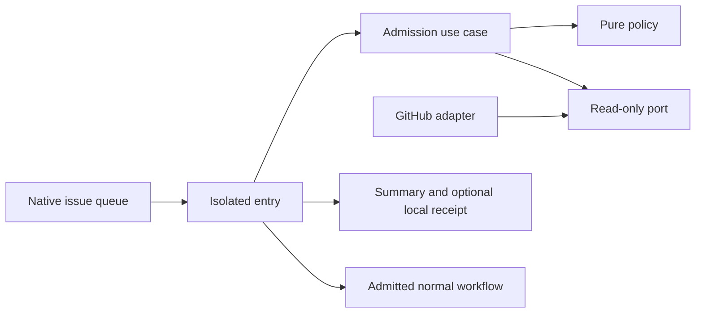

# Safe early issue admission and reconciliation coalescing

- Status: Implemented; remote PR validation required
- Date: 2026-10-28
- Catalog capability ID: execution-lifecycle
- Owners: Copilot maintainers
- Scope: reduce complete issue runner allocations without replacing meaningful lifecycle intent
- Related issues/PRs: [#730](https://github.com/vypdev/copilot/issues/730)
- Required review gates: product UX, architecture, testing, documentation, security/operations
- Open decisions blocking readiness: none; remote acceptance remains required

## 1. Executive summary

The installed Issue workflow MUST admit events on a small hosted job before
allocating the selected work runner. A native per-issue queue retains pending
intent and never cancels active work. Only an unstarted, open issue's equivalent
label reconciliation MAY reuse a proven successful receipt. Unknown evidence
MUST retain the normal guarded pipeline.

```text
Issue event -> native per-issue queue -> identity/state inspection
              -> internal or proven duplicate: Summary, no full work runner
              -> meaningful/unproven: normal pipeline -> unchanged success receipt
```

## 2. Problem, current behavior, and evidence

Issue #730 records 13 distinct consumer executions after two forms, with 11
queued and two running. One run waited 211 seconds before obtaining a runner;
its waiting time is distinct from execution time. Individual payload action
types were not retained. The report establishes repeated allocations, not a
specific race, outage or infinite loop. Existing runtime actor admission occurs
before agent preparation but after a full runner job has already been allocated.
An unset/stale `COPILOT_BOT_LOGIN` cannot provide authoritative early identity.

GitHub documents separate opened and initial label deliveries, single-pending
replacement by default, and `queue: max` preserving up to 100 pending runs.
This is a prospective correction, not a claim of consumer rollout or measured
live queue improvement. Prior historical motivation is unknown.

## 3. Actors, surfaces, and terminology

Maintainers generate meaningful issue events; the product credential owns
internal mutations. The native workflow/run/artifact APIs own execution facts.
The preflight subaction owns read-only admission and a local receipt file;
the existing Action owns permissions, issue lifecycle and repository effects.
“Receipt” means an opaque digest artifact from completed successful work, not
an authorization grant or claim that a branch/build was verified.

## 4. Goals, non-goals, and fixed invariants

- MUST filter real product-account events before work-runner allocation even
  when the bot-login Variable is absent. Bot-authored native closure remains runnable.
- MUST preserve opened, start addition/removal, deploy, body/title edits,
  reopened, closed, assignment and independent issue behavior.
- MUST NOT cancel running jobs or replace pending lifecycle events.
- MUST NOT infer success from missing, canceled, failed, foreign or stale evidence.
- MUST keep runtime authorization, admission, branch/SDD, deployment and result gates.
- Non-goals: exactly-once GitHub delivery, eliminating every workflow record,
  optimizing started issue work, live consumer adoption or altering application CI.

## 5. Current versus proposed journey

| Stage | Before | After | Operator meaning |
|---|---|---|---|
| Event burst | one full runner per delivery | hosted inspection first | work pool sees admitted jobs only |
| Bot metadata | Variable gate or full runtime discard | authenticated identity discard | configuration absence creates no recursion cost in work pool |
| Pending intent | workflow predecessor polling on runners | native per-issue queue | independent issues do not wait behind each other |
| Stable duplicate | full reconciliation again | success receipt may cover queued equivalent state | no new product mutation |
| Missing proof | full runtime | full runtime | correctness takes precedence over optimization |

Text equivalent: queue, inspect, skip only proven redundant work; otherwise run
all normal guards and preserve recovery. Lightweight jobs still consume hosted
capacity; the design does not claim zero allocations.

## 6. Functional behavior and state model

The inspect entry MUST authenticate the actual product account. An internal
ordinary event returns `self-event`; a closed event remains admitted. Meaningful
non-label actions and start/deploy label changes always enter the full pipeline.
Only `labeled`/`unlabeled` reconciliation of an open issue without `in-progress`,
release or hotfix intent is a candidate. Provider state uncertainty means execute.

The digest binds native issue ID/number, title, body, state, updated timestamp,
author, label/assignee sets, milestone, native type and lock; repository/actor,
product account, executing workflow SHA, bundle, fail-closed bootstrap and both action manifests,
snapshot of Variables referenced by the full work step and matching deploy/release/hotfix labels. Set order and login case are
canonical; issue text is neither truncated nor persisted in receipts.

A receipt MUST match that digest and be produced by the same native workflow ID,
path, issues event, head SHA and original actor. Its run MUST be earlier and
completed successfully. Its artifact MUST have been created strictly AFTER the
current event's run was dispatched: later deliberate requests cannot be hidden
by old success. Manual attempts after the first never coalesce. Native ISO timestamps and typed actor logins are required: missing fields are
never coerced into a legitimate account name. Native run and artifact facts,
not filenames alone, establish authority. At most three matching
artifact candidates are inspected; uncertainty retains work.

The shared description persistence boundary MUST return the exact rendered body
without a provider update when it is byte-identical to the freshly read native
body. Changed content still uses the existing error/permission boundary. This
prevents configuration no-ops from generating another admission edit.

After successful full work, the record step rereads identity/state with the same
code and configuration. A changed digest produces no receipt. Failed/canceled
work cannot reach the success-only record/upload steps or provide completed
success provenance. A successful provider operation followed by partial failure
therefore retains the existing full recovery path.

| State | Next | Human action |
|---|---|---|
| hosted inspection queued | native issue queue | normally none |
| self event / covered pending duplicate | Summary, full job skipped | none |
| meaningful / unproven | full guarded pipeline | normally none |
| identity invalid | blocked before full work | repair product credential, rerun |
| full work failed/partial | existing failure evidence, no usable receipt | existing recovery |
| full work succeeded but state changed | no receipt | subsequent event reconciles latest state |

## 7. User-facing configuration

Recommended setup retains fixed hosted `ubuntu-latest` inspection (5 minutes)
and the operator-selected full work runner. Per-issue native concurrency is
`copilot-issue-${{ github.repository }}-${{ github.event.issue.number }}` with
`cancel-in-progress: false`, `queue: max`. GitHub caps this at 100 pending runs;
excess runs can be canceled by GitHub. Inspect Actions and re-run the relevant
intent after capacity returns; no unbounded queue or ordering promise is made.

The isolated `issue-admission` subaction accepts only modes `inspect`/`record`,
existing product `token`, effective Variables snapshot (maximum 1 MiB UTF-8), deploy label,
locale, matching release/hotfix label aliases and an exact 64-hex receipt key. It returns closed reasons, execute flag,
opaque key and private receipt path/name. No issue text or credential is output.
The generated snapshot serializes each referenced Variable with `toJSON` before
formatting an ordered JSON array. Structural validation derives the same list
from work-step inputs/environment and job placement/environment, rejects dynamic
lookup, and prevents a new effective Variable from escaping the snapshot.
Unrelated repository Variables are not forwarded or exposed in admission inputs.
English/Spanish regional locales use English fallback. Deployment, release and hotfix labels must
match the full Action; the generated defaults are deploy/release/hotfix. Receipts retain one day and are an optimization only.

There is no bypass input, sleep/debounce duration, user-controlled command,
provider-write credential, schema migration or new durable issue field. Custom
legacy workflows remain supported through their existing runtime fence, but do
not gain early coalescing until reviewed workflow/runtime adoption.

## 8. Clean Architecture design

Pure policy projects eligible reconciliation identity and fixed presentation.
The execution use case coordinates identity, native state and receipt queries
through `IssueEventAdmissionPort`. A repository-bound provider adapter selects
native fields and checks run/artifact authority; infrastructure owns SDK clients,
hashing, bundle/manifests, files and environment. The isolated entry routes before
normal execution, projects closed outputs and writes the Summary/local file.
A packaged bootstrap MUST reject missing/unknown modes before loading the root
bundle and MUST discard the normal JSON input-override channel. Metadata
`required: true` alone does not enforce this boundary. The root entry MUST
require the bootstrap-owned process flag and read its mode directly; a private
mode key in an ordinary JSON input map MUST NOT redirect normal work. Reserved label comparison
is conservative across case variants.
No agent, mainRun, completion, issue mutation or conversation publication port
is reachable from the subaction.



Text equivalent: native serialization protects the whole workflow; a thin entry
calls pure policy/read ports and either reports a skip or permits normal work.
The normal runtime recognizes the exact pinned workflow-level per-issue native
contract. Missing/malformed/custom proof retains predecessor polling. Unlike
cancelable PR analysis lanes, issue lanes require `queue: max` and literal false
cancellation. Reusable/current-job mismatches do not grant a bypass. Source-level
architecture, native coordination tests, cycle checks and structural workflow
validation enforce boundaries.

## 9. UI/UX and content contract

The native jobs are `Admit issue event` and `Copilot - Issue`. Inspect emits one
Job Summary and zero conversation comments/checks/cards. Example primary views:

```markdown
## Issue event admission
Event admitted. The normal pipeline will verify permissions and reconcile the issue.
No action is required. Failed or partial work retains the normal pipeline and cannot produce a reusable receipt.
```

- Pending: Actions shows the issue workflow waiting; running work is retained.
- Internal: “Internal event skipped: the product account generated it. No work runner was allocated.”
- Covered: “State already reconciled by a successful execution of this workflow. The work runner was skipped.”
- Unproven: normal pipeline admitted; no success is inferred from receipt lookup failure.
- Action required: sanitized identity/configuration failure links to the native run.
- Partial: normal failure Summary remains; receipt absence does not claim rollback.
- Complete: normal lifecycle evidence plus optional artifact; no new issue card.

EN/ES regional fallback, textual headings and short paragraphs support narrow,
light/dark and screen-reader views. Native Actions provides issue/run navigation;
technical reason/digest outputs contain no title, body, raw exception or token.

## 10. Failure, recovery, and cleanup

Identity failure blocks inspection without full mutation. Optional native-state
or receipt uncertainty retains full authoritative runtime checks. Receipt record
or upload failure is best effort and preserves successful core work, with no
usable proof created. Changed state/code/account/configuration never reuses a
receipt. Manual rerun executes full work. Partial effects remain owned by the
existing operation state and cannot be erased/canceled by this optimization.
One-day artifact retention expires naturally; no remote deletion or new cleanup
permission is added. Private temp files are runner-owned and disposable.

## 11. Security, permissions, and privacy

Hosted inspection has `contents: read` and `actions: read` on automatic
GITHUB_TOKEN; the latter is scoped only to native receipt/run reads. The product
PAT retains existing identity/issue reads and normal full-work authority. No PAT
scope or full-job permission is broadened. No agent API key reaches inspection.
Native issue content is untrusted data: selected fields are hashed, never executed,
rendered or logged. Receipts contain only a schema and opaque name. Foreign
workflow artifacts, actor mismatches, old code, attempts and failed runs fail
closed with respect to skipping work.

## 12. Observability and operational UX

Closed reasons are self-event, lifecycle-event, reconciliation-needed and
already-reconciled. Each is visible in the native Summary/log; a skipped full job
is intentional, not proof of full verification. Compare complete work allocations
separately from hosted preflight records and queue time separately from runtime.
No polling loop, timer, model call or repeated issue notification is added.

## 13. Compatibility, migration, rollout, and rollback

New generated workflows require a matching runtime containing the isolated
`issue-admission/action.yml` path. Upgrade the runtime reference first, then apply
reviewed workflow changes through setup. An older release lacks the subaction and
fails before admitting a full job, rather than interpreting an unknown root input
as ordinary automation. No consumer was modified or live queue result claimed.
Legacy/custom workflows remain conservative. Review GitHub provider support for
`queue: max` before adopting on enterprise installations. Rollback restores the
previous reviewed workflow/runtime together; receipts then have no consumer and
expire. Existing issue configuration and branch/SDD ownership are unchanged.

## 14. Testing strategy and numeric budget

Minimum **120 distinct cases**, counted once per test/meaningful parameter row:

| Area | Minimum | Risk |
|---|---:|---|
| Pure/application identity and transitions | 40 | closed/start/deploy/actor/state/configuration equivalence |
| Native provider authority and failures | 48 | receipt/run provenance, partial/stale/foreign/malformed responses |
| Workflows/setup/native coordination | 16 | before-runner gate, no cancellation/replacement, roles and least privilege |
| Entrypoint/integration/replay | 12 | isolated route, receipt file privacy, duplicate allocation reduction and recovery |
| Presentation/locales | 4 | four closed states, EN/ES/regional/fallback |
| **Total** | **120** | Deterministic fakes; no real waits or external writes |

Repository global/module budgets remain mandatory. New pure policy MUST have
100% in all four metrics; changed/new executable patch lines and branches MUST
be covered. Before/after fixtures MUST show seven stable representative events
needing five full allocations instead of seven while preserving opened, start,
reopen and independent issue intent. Failed/partial runs, provider uncertainty,
manual reruns and later requests MUST remain fully executable. Local tests do
not prove live runner/consumer rollout; remote CI, review and Codecov remain gates.

## 15. Documentation and discoverability

Issue workflow setup describes the normal queue/admission journey, fixed hosted
role and matching runtime prerequisite. Troubleshooting explains skipped work,
artifact absence, queue saturation and manual recovery. Execution admission SDD
links this contract. Catalog evidence, test ledger, generated catalogs, package
manifest and setup-runner contracts change together. No new doc route is needed.

## 16. Acceptance scenarios

1. A real product metadata event is discarded before full work, including absent bot-login Variable.
2. Product closure and human open/start/reopen/close/edit/assignment retain normal behavior.
3. Stable initial routing duplicates already queued during successful work can reuse its exact receipt.
4. Missing proof, a different issue/state/actor/account/configuration/code or a later request executes normally.
5. Failed/canceled/partial source work cannot cover another event; a manual retry is not coalesced.
6. A concurrent state change prevents receipt publication; source-only hashes never expose native text.
7. Native issue lanes retain up to GitHub's 100 pending runs without active cancellation, independent issue groups progress.
8. EN/ES/fallback Summaries, structural guard mutation tests, package/subaction shipping and legacy fallback pass.

## 17. Requirements traceability

| Requirement | Owner | Evidence | Documentation |
|---|---|---|---|
| Exact equivalence and no lost intent | policy/use case | issue_event_admission_workflow tests | workflow setup |
| Successful queued-work proof only | provider adapter | issue_event_admission_repository tests | troubleshooting |
| Isolated boundary/no agent keys | entry/composition/workflow | action tests and structural guard | workflow setup |
| Native per-issue safety | coordination policy | native policy/query tests | execution SDD |
| Visible skips/privacy/locales | pure Summary | locale and file tests | troubleshooting |

## 18. Implementation sequence

1. Establish evidence and safe equivalence contract.
2. Implement pure policy, read ports, bounded native adapter and isolated entry.
3. Generate two-job workflows, native coordination recognition and structural guards.
4. Add duplicate/replay/race/privacy/identity/locale/package tests and docs together.
5. Update Graphify, run full frozen-source validation/coverage/hooks and publish normally.
6. Require exact-head remote CI/review/Codecov before integration; adopt consumers separately.

## 19. Definition of Done

- [x] 120-case budget and all normative acceptance scenarios pass.
- [x] No active/pending lifecycle cancellation, authorization bypass or product/full-job permission widening.
- [x] Pure/changed-module and full global/setup/extension coverage budgets pass.
- [x] Isolated bundled subaction, normal Action, CLI/API/web/package validation pass.
- [x] Documentation, catalog, ledger, Graphify and structural architecture/workflow checks pass.
- [ ] Exact-head remote checks, no findings and full Codecov modified-line coverage pass.
- [x] Rollout prerequisites and unverified live consumer scope remain explicit.

## 20. References and decisions

- [Native concurrency and queue limits](https://docs.github.com/en/actions/how-tos/write-workflows/choose-when-workflows-run/control-workflow-concurrency)
- [Issue initial-label deliveries and workflow syntax](https://docs.github.com/en/actions/reference/workflows-and-actions/workflow-syntax)
- [Required metadata does not enforce missing inputs](https://docs.github.com/en/actions/reference/workflows-and-actions/metadata-syntax#inputsinput_idrequired)
- [Node Action script resolution](https://github.com/actions/runner/blob/main/src/Runner.Worker/Handlers/NodeScriptActionHandler.cs)
- [Execution lifecycle](./execution-admission-queue-and-publication.md)
- [Managed issue lifecycle](./managed-issue-and-branch-lifecycle.md)
- Rejected: cancel-in-progress, single-pending replacement, timestamp-only debounce,
  trusting a bot-login Variable as identity, body/label-only success claims,
  issue configuration receipts, remote write scopes, or skipping unproven recovery.
