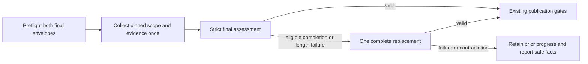
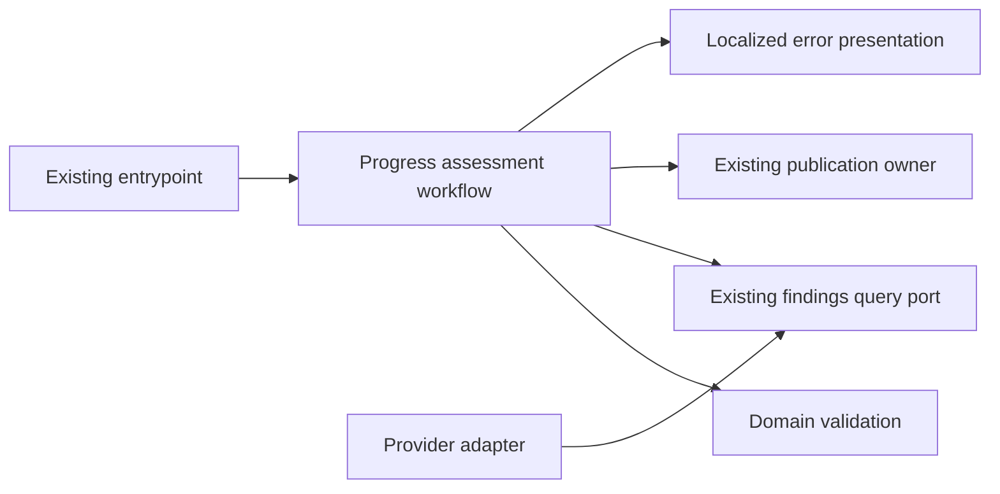

# Final Progress Assessment Recovery

- Status: Published #932 baseline; issue #937 operational generation update in validation
- Date: 2026-11-08
- Catalog capability ID: github-communication-experience
- Last verified: 2026-11-08 (#932 published; #937 local closed-policy and controlled live-provider qualification complete; native consumer and remote acceptance pending)
- Owners: Copilot maintainers
- Scope: Complete bounded semantic assessment for compact inventories and one shared replacement for a completion contradiction or attributable narrative length rejection.
- Related issues/PRs: https://github.com/vypdev/copilot/issues/853; https://github.com/vypdev/copilot/issues/932; https://github.com/vypdev/copilot/issues/937
- Required review gates: product UX, architecture, testing, documentation, security/operations
- Open decisions blocking design: none. Historical #853: the Action verified first SDD commit 828a68284f4687acf7350950f553ba501926454b on the linked issue branch. Issue #932 uses the Action-created branch at base `2ecac44850af23c60bc937d52a3f995b0960bfac`; local validation and independent remote acceptance remain pending.

> The Action published and verified this companion before implementation. Publication establishes the branch prerequisite, not implemented behavior or executed acceptance. Its owning capability already has the specifications `specs/immutable-progress-content-recovery.md`, `specs/complete-progress-comparison-inventory.md`, and `specs/progress-scope-source-ownership.md`. The listed contracts retain their baseline ownership; this companion specifies the bounded final-assessment correction.

## 1. Executive summary

A final progress estimate may pass its ordinary checks but contradict the completion rule: it reports 100% while requirements remain unfinished, or reports another percentage while all requirements are supported. The host must continue rejecting that result and retaining prior progress. This proposal allows exactly one complete final reassessment using the same pinned evidence, scope, schema, provider, and model settings. The replacement is subject to all original validation and publication gates. It cannot repair source evidence, discard uncertainty, or establish that verification, review, or approval passed.

Issue #932 extends that same single allowance to a completed native `summary` or `remaining` length failure that carries closed measurements and can be bound to the current request, requirement, original source anchor, field bound and locale. Length and completion failures share one replacement per acceptance batch: any second failure is terminal. Source classification and accepted comparison parts are not repeated. Generic schema errors and provider-thrown completion lookalikes remain ineligible.

```text
pin evidence and scope -> collect once -> validate final estimate
                                      | valid -> existing publication gates
                                      | eligible completion or length failure -> one complete same-source reassessment
                                                                   | valid -> existing publication gates
                                                                   | invalid -> retain previous progress; report closed facts
```

Text equivalent: a valid result follows the existing publication path; an otherwise valid completion contradiction or attributable completed field-length failure can trigger the shared replacement, and every other outcome retains existing failure behavior.

## 2. Problem, current behavior, and evidence

### 2.1 Problem

The historical #853 incident concerned final completion contradictions after complete evidence collection. Its bounded completion recovery is already published. Issue #932 concerns a different current boundary: native acceptance-field length rejection escapes before that controller, forcing maintainers to repeat source classification and complete comparison collection. Exact rejected prose and lengths remain unknown. Recovery must preserve strict rejection and prior progress while allowing one attributable complete-batch correction.

### 2.2 Historical #853 baseline

1. The progress workflow collects scope, evidence, and parts under existing limits and freshness checks.
2. The host strictly validates the final response, including the equivalence between completion percentage and requirement statuses.
3. A contradiction is rejected, prior progress is retained, and the operation fails. There is no automatic replacement.

These are the supplied current-behavior facts. The proposed recovery is prospective; the issue does not establish that any particular contradictory direction or count occurred.

### 2.3 Evidence

- Historical authoring inputs are preserved verbatim in `specs/evidence/issue-853-authoring-body.txt` and `specs/evidence/issue-853-clarification-6574242311.txt`. `specs/evidence/issue-853-authoring-inputs.json` records their native origins, timestamps, SHA-256 hashes and original-to-published case IDs. The published seven requirements and forty cases remain normative. Concise issue/comment links replace duplicated drafting input; they do not remove acceptance or increase any processing bound.
- At candidate `256bffac6`, native Commit classified 101 required/uncertain lines from the duplicated authoring body, exceeding the unchanged 32-clause limit. Review completed all three source partitions with zero findings but omitted one of four human conversation entries under the unchanged 24,000-character budget. The production packing policy confirms that replacing only the archived historical clarification with its linked summary retains 4/4 entries, without omissions or truncation; the concise issue has 24 nonempty human lines, preserving all seven requirements and every case through the canonical SDD.
- Candidate `4a6d35371` passed Commit, complete review, correct-base Codecov 87/87 without misses/partials, CI, Linux and macOS. Hosted Windows failed nine real-Git integration tests solely on Jest's 5-second unit default, including observed 5.3–6.0-second cases. Tests that create native repositories now explicitly use this suite's existing 30-second native budget; pure units keep their default, the existing large-workload 120-second cases stay explicit, and every integrity assertion and production Git deadline remains unchanged. A fresh full Windows run is required; the timeout diagnosis does not establish acceptance.

- Code/workflow/documentation references: the immutable catalog at `9abb7882652bbc680781a22fd8bb397eb6169731` lists the current scope parser, final progress workflow, assessment/capacity policies, response diagnostics, and related tests. The catalog lists owning specifications `specs/immutable-progress-content-recovery.md`, `specs/complete-progress-comparison-inventory.md`, and `specs/progress-scope-source-ownership.md`.
- Incidents or concrete examples: issue #853 reports Commit runs 41414634366 (two attempts) and 41418428579, PR #852, heads `3ecade3154f25a11bb3a8107dc1cd3d4185dfd3c` and `dca6114af8cf92eadf35e2a217479c90e61347ef`, and base `9d3915729c96ec93c6e064d3321ba54c790170eb`. Reported error: `progress-completion-mismatch` at `$.progress`; prior state retained; `agent.failed`.
- External primary sources: not applicable; this is a repository workflow change.
- Unknowns: exact rejected counts and percentages, and implementation/acceptance results. The Action selected base 9abb7882652bbc680781a22fd8bb397eb6169731 and verified first SDD commit 828a68284f4687acf7350950f553ba501926454b on bugfix/853-final-progress-completion-mismatch-repeatedly-blocks-valid-fixes-without-bounded-recovery.

### 2.4 Issue #932 published baseline and new evidence

The published 3.10.10 runtime at `50a42bf11981dbe9b1130fefa9b61eb71a3bb992` already includes completion recovery and #925's complete-inventory allocation. Domus issue 23 / PR 29 still fails before completion parsing: run 42339180009 attempts 4, 5 and 6 report `schema-string-long` on `$.requirements[0].summary`, then `remaining`, then `remaining`, bound to R11/L11. Attempt 6 logs independently verify that published runtime, ten source-classification batches, seventeen comparison parts and failure in acceptance batch 1 of 5. The pinned comparison is base `5b7bdcdee3a9e98d6669bfd34ce750ae30a8c775`, head `fbb4cfd1d8160e63a6b4d62e4ac118fb2f946a0c`.

The native adapter throws a typed schema rejection before `queryProgressAssessment` reaches its parse-only completion catch. The #932 implementation adds a distinct query boundary for eligible completed length failures. Two deterministic native-policy regressions reproduced the original immediate abort for R11/L11, summary and remaining, before runtime edits. Their synthetic Unicode prose is not a replay of the unavailable rejected model output: actual rejected lengths and prose remain unknown. Native batch/citation, mixed failure, freshness and late-batch tests provide separate preservation evidence.

Primary evidence: https://github.com/vypdev/copilot/issues/932 and https://github.com/vypdev/domus/actions/runs/42339180009/attempts/6. No consumer code, acceptance scope or installation settings change in this correction.

### 2.5 Published recovery and live qualification gap — issue #937

The #932 implementation passed its independent gates, merged as #933, and was
published in 3.10.11 at `0bb87c4290306255907370ff93cbe4ec5358693b` through #934/#935.
Those gates established the recovery protocol and preservation controls; they
did not establish live consumer acceptance. Domus attempts 7, 8 and 9 used that
actual published runtime, completed classification and all 17 comparison parts,
then exhausted the replacement at R11/L11 remaining: 61/54, 50/40 and 43/35
Unicode points. No rejected prose is available or reconstructed.

The historical deterministic fixture remains at head `2a35e2a3`, with 157 paths,
16 parts and a fixed 108-line classification. The current original consumer
head is `fbb4cfd1d8160e63a6b4d62e4ac118fb2f946a0c`, base
`5b7bdcdee3a9e98d6669bfd34ce750ae30a8c775`, with 175 paths and 17 parts. Its human
issue digest remains `f5c01613456235e349179026a023ad992b3d95fc427568f27c8f7e31fbf8b2d0`.
The read-only 2026-11-08 native source campaign selected 169 required and 131
context lines, making six acceptance batches with a 32-point hard allocation.
This is a genuine new classification, not a reconstruction of attempts 7–9.

Controlled acceptance with the intact 3.10.11 evaluator and those exact accepted
comparison facts again exhausted at R11/L11 summary 33/32. A fresh comparison
control independently failed 44/32. A native-pattern-only candidate passed all
169 outcomes but its subsequent content audit found unfinished phrases. It is
not operational acceptance. Both the bound-only and writing-margin variants were rejected after content
audit found unfinished words. The selected correction uses closed semantic
assessment codes and complete host-owned labels; no host truncation or wider
allocation is permitted. The selected closed-fact candidate passed the controlled real-provider assessment for all 169 requirements in six new calls without replacement, against 27 exact frozen valid source receipts. The host rendered 3929 summary and 2697 remaining Unicode points inside the original limits. There were zero real writes; the two fake mutation calls represent one simulated semantic publication. Complete host-owned labels replace model prose by construction, with every semantic code mapped explicitly in the tests. This is not a native consumer Check: that remains separate required evidence. #920's generic Bugbot unusable-output failure is a
separate observed boundary; its cause must not be inferred from these length facts.

## 3. Actors, surfaces, and terminology

| Actor | Goal | Entry point | Visible surfaces |
|---|---|---|---|
| Issue author | Supply a stable progress scope | Issue and source comparison | Existing issue, progress card |
| Configured model | Return estimates for host validation | Existing progress query | No direct publication authority |
| Host workflow | Validate facts and enforce bounded recovery | Commit progress workflow | CLI/API error, Check, Job Summary, progress card |
| Maintainer | Understand failure and choose a fresh replay | Failed run | Run, Check, Summary, documentation |

A **completion contradiction** is a fully validated response whose percentage alone violates the completion equivalence. The host owns scope, requirement counts, evidence, and freshness facts. The model’s counts are observations of that response, not execution or approval evidence. A **replacement** is one new complete final query against the same pinned inputs, never a partial replay.

## 4. Goals

### 4.1 Goals and requirements

| Requirement | Behavior |
|---|---|
| FPR-01 | Preserve strict scope, schema, evidence, uncertainty, freshness, and publication acceptance; retain previous progress until the final result passes all gates. |
| FPR-02 | Permit one shared complete replacement for an otherwise valid completion contradiction or eligible host-bound completed field-length failure, using the same evidence, scope, schema, provider, and model settings. |
| FPR-03 | Bind recovery to host-validated closed facts; preserve provider and unrelated error categories; never treat a provider-thrown completion lookalike or generic failure as an eligible host result. |
| FPR-04 | Preflight both complete final envelopes before any query, within existing capacities and without truncation or omitted evidence. |
| FPR-05 | Expose closed numeric completion facts or closed measured length facts with host-verified R/L anchors through compatible localized existing surfaces. |
| FPR-06 | Deliver the complete-workload regression and independent coverage evidence required by the owning contracts. |
| FPR-07 | Keep documentation, authority boundaries, and independent delivery gates explicit and executable. |
| FPR-08 | Generate closed semantic facts for compact inventories and eligible length recovery; render complete bounded labels and retain every original hard allocation, receipt, scope and semantic gate. |
| FPR-09 | Report exhausted acceptance-length generation as blocked and non-retryable for that attempt; expose admitted counts/allocation and avoid recommending indefinite unchanged full-comparison repeats. |

### 4.2 Non-goals

1. Fixing per-part length failures addressed by #830 or extension H3 work related to #704/#837.
2. Changing scope, evidence acquisition, source ownership, approval, verification, or publication policy.
3. Adding configurable retries, provider/model overrides, larger limits, a new permission, release, deployment, or branch override.

### 4.3 Fixed product/safety invariants

1. Reject both contradictory directions; never round, normalize, infer completion, discard uncertainty, or alter source evidence.
2. Make at most one additional complete final query. No third query, cached rejected payload, partial progress publication, or automatic write replay is allowed.
3. Preserve existing freshness, complete-part/receipt, independent verification/review/approval, capacity, and prior-progress gates. Model claims cannot satisfy host gates.

## 5. Current versus proposed product journey

For #932, the current column is the published 3.10.10 runtime; section 2 retains the historical #853 baseline separately.

| Stage | Current | Proposed | User/operator effect |
|---|---|---|---|
| Preflight | Original and completion-correction envelopes are reserved | Reserve the original and worst of completion/length correction envelopes before any query | Capacity failure makes zero model calls |
| Final assessment | Strict native and host validation; eligible completion contradiction may recover | Same query and strict validation | Valid ordinary results are unchanged |
| Eligible completion or length failure | Completion has one replacement; native length aborts immediately | Both kinds share one complete reassessment from the same pinned source | One bounded read-only query may occur without recollecting evidence |
| Replacement outcome | Completion replacement validates fully or terminates | Valid result returns to original gates; any second failure terminates | At most two acceptance queries per batch; no provisional publication |
| Publication | Existing freshness and publication owners | Unchanged | Existing card and native links remain authoritative |



Text equivalent: preflight, collect once, validate; either publish through existing gates, make one eligible replacement and revalidate, or stop while retaining prior progress.

## 6. Functional behavior and state model

### 6.1 Happy path

1. The existing workflow snapshots host-owned scope, source identities, locale, schema, provider, model settings, and original final request.
2. Before any model query, the capacity owner verifies the original and worst-case complete replacement envelopes.
3. The workflow collects scope and all evidence once. Multi-batch assessments request closed semantic codes, decode them to the canonical host DTO, and validate all original receipts, prose bounds and semantic rules. Ordinary single-batch assessments keep their narrative request.
4. A valid response proceeds once through the existing freshness and publication owners.

### 6.2 Alternative paths

- A fully validated completion contradiction may trigger one complete replacement. The fixed reviewed footer may contain only host-validated numeric facts; rejected model prose is not carried forward.
- A valid replacement returns to the existing publication gates. A second contradiction terminates with its own closed numeric facts.
- An attributable completed `summary`/`remaining` length rejection may spend the same allowance using a new complete batch. Its closed metadata must match the immutable current schema, assigned requirement, original source and locale; response array order does not establish identity.
- Every other schema, locale, scope, evidence, capacity, provider, process, timeout, and cancellation failure retains its existing identity and does not allocate recovery. A provider-thrown completion lookalike is not host parser output.
- A moved head/base/target, changed issue body, or closed source fails existing freshness checks and prevents publication.

### 6.3 State machine

| State | Entered when | User-visible meaning | Allowed next states | Recovery/owner |
|---|---|---|---|---|
| Preflight | Invocation begins | Checking complete request capacity | Collecting, failed | Existing capacity policy |
| Collecting | All final envelopes fit | Gathering pinned evidence | Final, failed | Existing evidence workflow |
| Final | Complete evidence is ready | Validating final estimate | Accepted, replacing, failed | Final assessment workflow |
| Replacing | Host bound an eligible completed failure | One bounded reassessment is running | Accepted, exhausted, failed | Narrow application workflow |
| Accepted | Complete result and freshness gates pass | Existing progress may publish | Published, publication failure | Existing publication owner |
| Exhausted | Replacement also has an eligible completion or length failure | Prior progress remains | Terminal | Closed diagnostic; corrected-build qualification for length exhaustion |
| Failed | Any unrelated failure or stale source | Existing failure behavior applies | Terminal | Existing error owner |

Each invocation starts fresh; no retry allowance or rejected payload is replayed. Cancellation and partial publication retain current workflow semantics. Publication is not represented as a multi-call transaction: actual partial effects keep their existing classification.

## 7. User-facing configuration

| Input | Type | Recommended default | Allowed values/range | Scope/persistence |
|---|---|---|---|---|
| Recovery allowance | Fixed policy | One eligible replacement | Exactly 0 for unrelated failures, exactly 1 for eligible contradiction | Per invocation; not user-configurable |
| Provider/model/effort | Existing configuration | Existing configured values | Existing validated values only | Snapshot for the invocation |
| Locale | Existing locale input | Existing precedence, default en-US | Existing supported locales and whole-message fallback | Existing operation snapshot |

There is no new configuration, migration, or persistence. The original final request is snapshotted. Optional undefined fields remain absent/undefined. A meaningful alternative is the existing es-ES locale, which changes language but not validation or recovery. Recovery count, capacity, evidence, and approval gates are intentionally not configurable.

Issue #937 adds no configuration. The host prefers the closed fact format for
multi-batch compact inventories and can use it for the one eligible narrative
length replacement. A native row contains its original ID, citations when
present, and one enumerated assessment. Root locale/progress and receipt
identities are unchanged. Each code fixes status/evidence and a remaining action
as one coherent fact; there is no independent prose or redundant state pair to
contradict it. The host renders complete fixed labels (at most nine Unicode
points), then validates them against the ORIGINAL allocation and existing
semantic parser. No overlong original result becomes accepted.

| Code | Status/evidence | Summary/action |
|---|---|---|
| supported | supported / source-only | In source / none |
| partial | missing / source-only | Partial / Implement |
| missing | missing / source-only | Missing / Implement |
| contradictory | missing / contradictory | Missing / Implement |
| source-unverified | verification-unknown / source-only | In source / Verify |
| partial-unverified | verification-unknown / source-only | Partial / Verify |
| execution-unverified | verification-unknown / external-unverified | Unclear / Verify |
| evidence-unavailable | verification-unknown / unavailable | Unclear / Get proof |
| evidence-contradictory | verification-unknown / contradictory | Unclear / Clarify |
| scope-unclear | verification-unknown / unavailable | Unclear / Clarify |

Uncertain original scope MUST use scope-unclear. English and regional Spanish
use whole fixed label catalogs; unsupported host label locales use the English
fallback. The wire contains identifiers, not human sentences, and still echoes
the exact requested outputLocale. No dynamic translation call or wider budget
is introduced. A compatible prose contract must have the known status/evidence
enums, text minimum one, maximum 9–800 and no additional prose constraint. Tiny
or custom contracts retain the existing bounded text path. Existing native
provider projection is unchanged.

Before any source query, preflight reserves the original, legacy correction,
closed initial and worst closed replacement prompt/schema envelopes, including
256 bytes of closed hint. Model prose never enters that hint. The original
120-call/30-minute attempt ledger, 32-entry batch, 256-requirement inventory,
512-KiB prompt and both 8,000-point publication fields remain fixed. Length and
completion recovery still share one replacement; no third query or write replay.
Exhaustion changes only that length error's retryability. Other provider errors
retain their own classification.

## 8. Clean Architecture

### 8.1 Responsibilities and dependency direction

| Layer/boundary | Owns | Must not own/import |
|---|---|---|
| Domain/pure policy | Closed diagnostic validation, numeric bounds, immutable facts, completion equivalence | Provider SDKs, processes, GitHub mutation |
| Application | Narrow workflow that distinguishes host parse output from provider calls and spends at most one recovery allowance | Concrete SDK/process concerns or publication capability |
| Adapters/data | Existing response parsing, provider/process mapping, DTO conversion | Recovery or product policy |
| Infrastructure/composition | Existing port bindings and entrypoint wiring | Business decisions |
| Entrypoints | Event and operation input adaptation | Duplicated orchestration |
| Presentation | Closed localized view models and rendering on existing surfaces | State mutation or publication decisions |



### 8.2 Contracts, state, and trust boundaries

- Pure decisions: a host-created typed mismatch is eligible only after all checks other than completion equivalence pass. Binding checks counts against the current nonempty scope.
- Application contracts: a narrow `query_progress_assessment_workflow` uses the existing query port. Query execution remains outside the parse-only completion catch. A separate query-failure boundary admits only closed attributable completed length failures; unrelated failures use the existing rejection mapper. Each evaluation returns a valid result, a completion mismatch, or a bound length outcome.
- Semantic ports: reuse existing findings query and publication/freshness ports; add no provider-specific DTO to domain or application contracts.
- Durable state/schema ownership: no new durable state or public acceptance schema. The internal closed-fact wire is separate from the original host schema. Previous progress remains owned by the existing publication/state owner.
- Concurrency/idempotency: reuse existing source freshness and publication idempotency; do not repeat writes automatically.
- Trusted and untrusted inputs: scope, source identities, and numeric bounds are host-owned. Model responses, including counts, are untrusted until complete validation; they never attest execution, review, or approval.
- Provider error mapping: unrelated provider errors preserve identity. Provider-thrown typed lookalikes cannot enter the parser-only recovery path.

Snapshot a structured clone of original options/schema/configuration and freeze only that clone. Preserve the exact prompt, evidence identities, and pinned scope. A narrative completion replacement changes only the reviewed footer and closed validated facts. An eligible narrative length replacement may additionally use the finite wire plan; a proactive compact assessment stays on that same finite wire for its one correction. The complete host acceptance schema, source, options and configuration remain unchanged. Preserve existing per-query timeout/cancellation and native outer deadline; add no deadline field or budget reset.

### 8.2.1 Complete capacity and numeric contract

Before the first scope/model query, reserve the complete fixed recovery footer plus a worst-case 256-byte closed numeric hint in the reserved-scope, single and final request envelopes and aggregate budget. Closed key/scalar normalization and the executable maximum-hint test establish that bound; reserve padding is capacity accounting only and MUST NOT be sent to the provider. Preflight every late part and both complete final envelopes before admitting the first request. Preserve the existing 512 KiB runtime prompt limit, 384000-byte aggregate ceiling, 64000-byte scope limit, 32 required/uncertain and 32 excluded clauses, 1024-byte dynamic framing reserve, adaptive per-fact maximum of 800 Unicode points, and both complete 8000-point published projections including citations/separators. Preserve the immutable profile limits: 1024 paths, 4096 units, 512 units per part, 16 recovery frames, 16 MiB total recovered source, 2048 reads and 200000 tree entries. Unsupported whole input fails before queries; never clip, omit units, recollect source or raise capacities.

Reserve the worst of the original narrative, complete completion-correction, field-length-correction, initial closed-fact and closed-fact-correction envelopes, including each actual schema before the first query. Each closed hint fits 256 UTF-8 bytes; padding is never queried. The active batched-progress contract owns larger complete inventories, the 32-entry acceptance batches and the complete-inventory text allocation. Recovery preserves each batch's exact existing schema limit, including an allocation below 800, and the global query/time ledger. No third acceptance query or new configurable retry is added.

The five facts are reportedProgress, requirementCount, supportedCount, missingCount and unknownCount. Counts come from exact current-scope entries only after all entry and full-projection checks pass. A typed mismatch preserves the existing safe direct-parser rejection and privately freezes those facts; a per-parse scope identity can prevent cross-scope reuse. Only a genuine completion contradiction enters the parse-only catch. The separate native-length boundary requires a private captured-schema identity, exact complete-batch receipt/citation schema validation with only summary/remaining length checks deferred, exact-once assigned IDs and application binding to original R/L anchors and locale. No rejected prose survives. Query execution remains outside the parse-only completion catch, including replacement queries. A second contradiction reports its own counts and correlation, without retaining either rejected payload across awaits.

AgentQueryOptions has no absolute assessment deadline. Keep existing per-admitted-query timeout/cancellation and the native outer workflow deadline unchanged; no invented deadline port, override or native budget reset. At most one additional bounded read is admitted.

### 8.3 Executable architecture constraints

Automated architecture and contract checks MUST ensure the recovery helper has no publication capability, domain/policy imports no provider/framework modules, and only the host parser can create the eligible mismatch outcome. Existing module, port, dependency, raw-error logging, schema, and workflow guards remain required.

## 9. UI/UX and content contract

### 9.1 Information hierarchy

1. Current assessment state.
2. Completed pinned evidence and retained progress facts.
3. Whether one reassessment is running or exhausted.
4. One operator action, or explicit statement that none is needed while running.
5. Impact and existing run/comparison links.
6. Sanitized technical facts and correlation.

### 9.2 Representative primary view

The following numeric values are illustrative, not incident facts:

```markdown
# Progress assessment

> **Current status:** One inconsistent final estimate was rejected. A complete reassessment is running.
>
> **Action required:** None while this read-only query runs.

## Progress

Previous progress is retained until the complete estimate passes validation.

## What happens next

The replacement uses the same pinned comparison and all existing publication checks.

## Links

[Inspect the Commit run](https://github.com/vypdev/copilot/actions/runs/41418428579) · [Inspect the comparison](https://github.com/vypdev/copilot/compare/9d3915729c96ec93c6e064d3321ba54c790170eb...dca6114af8cf92eadf35e2a217479c90e61347ef)

<details>
<summary>Technical details</summary>

Field `$.progress`; reported 70%; requirements: 2 total, 2 supported, 0 missing, 0 unknown. Illustrative correlation: 11111111-1111-4111-8111-111111111111.
</details>
```

Pending/no action: “Assessing the complete pinned comparison. Previous progress is retained until final validation.” Link the current run and comparison.

Action required/exhausted: “Progress was not published after one replacement. Inspect the final percentage and requirement counts, then start a fresh complete assessment. Previous progress is retained.” Link the failed run and current comparison.

Blocked before effects: “The complete request does not fit existing limits, so no model query ran. Reduce the source scope through the normal issue workflow and start a fresh assessment.” Retain prior progress and link the run.

Partial publication: “The assessment passed validation, but publication did not complete. Inspect the run and current progress before deciding whether to retry.” State only confirmed effects and preserve the existing partial-effect classification.

Completed: use the existing completion card, native links, and verified progress facts after all gates pass.

Length recovery uses one fixed running message: “A progress acceptance fact exceeded its unchanged response limit. Requesting one complete replacement for the same pinned batch; previous progress is retained.” Terminal impact states that progress was not published. Its action names only phase assessment, verified R11/L11, the schema field and observed/maximum Unicode counts, then marks the exhausted length attempt non-retryable and asks for qualification of a corrected Copilot build before one fresh assessment; unchanged comparisons must not loop automatically. These IDs/counts are illustrative, not incident measurements. English and regional Spanish use the same closed registry and terminal correlation; unsupported locales fall back to English. No additional comment, interactive control, permission or configuration is introduced.

Source-part generation has a separate owner:
[bounded partition recovery](./progress-partition-response-recovery.md). Domus
run 42437017801 failed its framed-v1 source-part bound before final assessment,
so the closed final protocol alone did not qualify that consumer. The companion
adds exact JSON-byte planning and the existing one shared size replacement,
without spending or resetting final recovery. Controlled qualification regenerated
all 217 source units and 169 requirements with zero real writes; native
current-head consumer acceptance remains a separate required gate. Its source-ID
admission audit is covered by companion size-C22, not counted again here.

### 9.3 Issue, PR, and comment behavior

No new issue, PR, comment, label, Check, or card is created. Recovery adds at most one fixed bounded log message; one admission log separately reports the complete requirement count, batch count and hard fact allocation. Existing durable markers, titles, links, idempotent updates, labels, and Checks remain unchanged. Merge, close, or fresh replay retains existing behavior; replay recollects complete evidence.

### 9.4 Accessibility, localization, and responsive behavior

Use existing locale precedence, en-US default, es-ES support, and whole-message fallback for unsupported locales. Every status is textual; numeric facts are readable without color. Content must remain understandable in narrow layouts, light/dark themes, screen readers, and existing heading/link conventions. Render only reviewed fixed templates and closed numeric facts or verified R/L/field identifiers; never render model prose, arbitrary Markdown, commands, mentions, or URLs.

## 10. Failure, recovery, and cleanup

| Failure/partial state | User impact | Retained facts | Automatic retry | Required action | Cleanup |
|---|---|---|---|---|---|
| Initial unrelated validation/provider failure | Existing failure behavior | Previous progress; existing safe diagnostic | No recovery query | Follow existing error guidance | Remove ephemeral failed outcome |
| Preflight capacity failure | Assessment does not start | Prior progress and capacity facts | No | Adjust scope through normal workflow | No query artifacts |
| First eligible completion or length failure | One extra bounded read-only query | Pinned evidence and prior progress | Exactly one complete replacement | None while it runs | Discard rejected payload |
| Second eligible failure | No new progress published | Prior progress and terminal completion counts or verified length facts | No third query | Inspect run; start a fresh full assessment when appropriate | Discard ephemeral rejected result |
| Replacement provider failure/cancellation | Existing provider/cancellation classification | Prior progress | No third query | Follow existing guidance | Preserve existing cancellation cleanup |
| Stale source during replacement | No obsolete estimate publishes | Prior progress and freshness facts | No | Rerun complete assessment | Discard provisional work |
| Publication failure after validation | Possible existing partial effects | Actual observed publication state | No automatic write replay | Inspect current progress and run | Existing publication cleanup only |

Errors follow impact, cause, action, retained-state order. A terminal exhaustion error keeps code `agent.failed` and uses recovery ID `progress-completion-recovery-exhausted`, with exactly the five numeric fields in section 11. A terminal length failure instead uses `progress-assessment-length-invalid` with exactly `requirementId`, `sourceLineId`, `field`, `maximum` and `observed`; maximum is the unchanged schema allocation (1–800), observed is a safe integer greater than maximum, measured in Unicode points. Both kinds share the allowance and the terminal failure owns its own diagnostic/correlation. Direct parser callers retain `progress-result-contract-invalid` and its current five-field recovery shape.

## 11. Security, permissions, and privacy

1. Add no credential, network authority, write capability, or permission.
2. Accept completion recovery only from host parser output after all other response checks pass. The #932 length path additionally accepts only a typed completed-output carrier with closed native measurements, bound by the application to the current schema, requirement, source and locale. Generic errors and provider-thrown completion lookalikes do not allocate recovery.
3. Completion diagnostic properties are exactly `reportedProgress` (finite 0–100), `requirementCount` (integer 1–32), and `supportedCount`, `missingCount`, `unknownCount` (integers 0–32) summing exactly to total and demonstrating the contradiction. Extra/missing keys, foreign scope totals, and malformed values fail closed.
4. Do not expose raw response, unverified IDs or paths, private prose, stack, provider output, or arbitrary keys. Length exhaustion may expose only its closed field, host-verified requirement/source IDs, unchanged maximum and observed Unicode-point count. Intermediate logs use fixed constant text and never log caught or derived error values.
5. Model approval, review, test, verification, or coverage claims cannot satisfy host gates or authorize mutation.

## 12. Observability and operational UX

Retain existing progress state and emit at most one fixed recovery log message plus the closed admission counts below. Public terminal JSON and localized CLI, Check, and Summary use the closed error registry, retained-state statement, and same terminal correlation reference. Numeric facts describe a model observation, not a success metric. Queue delay remains distinct from typed completed-output failure. Add no telemetry payload, rejected-output retention, extra comments, or hidden provider retry. Existing run links and head/base context remain inspectable.

Before comparison queries, one fixed admission log additionally gives the actual
requirement count, batch count and hard per-text Unicode allocation. It contains
no model prose. Terminal length exhaustion reports `Retryable: No`; its one
operator action is to validate a corrected Copilot build against the pinned
source before one fresh full assessment. It MUST NOT recommend automatic
unchanged comparison loops. English and Spanish retain the same closed facts.

## 13. Compatibility, migration, rollout, and rollback

The companion [part-response recovery contract](./progress-partition-response-recovery.md)
owns a separate single replacement for each attributable overlong part. Those
queries finish before this final controller starts. A final reassessment never
repeats accepted part queries or source reads; an exhausted part never enters
the final stage. Three additional composition cases belong to that companion's
budget and do not replace this specification's 85 cases.

Canonical valid complete and partial DTOs remain accepted identically. Multi-batch native requests now use finite assessment codes; eligible narrative length replacements may adopt the same wire. The native wire is internal, while the published host shape and hard bounds remain unchanged. Direct parser rejection and unrelated errors preserve current codes and recovery shapes. Preserve completion exhaustion and add only the closed length exhaustion identifier. No stored-state or in-flight comparison migration is required. Adopt a reviewed runtime only through its supported path; merging `develop` alone does not change the currently observed master-pinned issue-comment runtime. Release and deployment are outside this correction. Implementation starts only after the Action-verified first SDD and linked branch, now recorded above. Rollback restores immediate rejection and retains previous progress; remove helper, diagnostic, and localized copy together without rewriting published state.

## 14. Testing strategy

The minimum is 85 distinct executable cases: the 40 original completion cases, the 20 #932 length-recovery cases C165–C184, five #937 operational cases C185–C189, and twenty closed-fact cases C190–C209. The original cases remain normative. All 25 #937 identifiers have executed assertions; full local and independent remote gate evidence remains separately required. Existing owner budgets, platform/extension cases, module/port/architecture guards, and real publication fixtures remain mandatory. New pure-policy statements, branches, functions, and lines require 100%; modified coverable lines require official correct-base Codecov 100% with zero misses or partials. Use deterministic fakes and native adapter fixtures, no real sleeps or live credentials. Golden output must be paired with semantic assertions; manual UX evidence must cover narrow, light/dark, and screen-reader readability. Independent CI, Codecov, review, and approval evidence cannot be supplied by the model or by case links.

| Area | Minimum distinct cases | Behaviors/risks covered |
|---|---:|---|
| Domain/configuration/pure planning | 28 | Original cases plus C172, C175, C176, C177, C185, C190, C194, C195, C197–C200, C203–C205, C208 and C209. |
| State/application/idempotency/races | 13 | Original cases plus C168, C169, C170, C173 and C189. |
| Adapters and provider contracts | 7 | Original cases plus C171, C174, C206 and C207. |
| Workflows, permissions, schemas, and setup contracts | 11 | Original cases plus C167, C178, C181. |
| Integration/end-to-end and compatibility/migration | 9 | Original cases plus C165, C166, C179, C180 and C188. |
| Presentation states, links, localization, accessibility, and sanitization | 17 | Original cases plus C182–C184, C186, C187, C191–C193, C196, C201 and C202. |
| Total | 85 | Distinct inventory cases; repeated executions do not add cases. |

| Case ID | Area | Requirements | Scenario |
|---|---|---|---|
| github-communication-experience-change-C125 | Domain/configuration/pure planning | FPR-01, FPR-03, FPR-05 | All-supported facts with reported 70 produce only closed current mismatch counts. |
| github-communication-experience-change-C126 | Domain/configuration/pure planning | FPR-01, FPR-03, FPR-05 | Reported 100 with a missing requirement yields exact mismatched counts. |
| github-communication-experience-change-C127 | Domain/configuration/pure planning | FPR-01, FPR-03 | Reported 100 with host-uncertain requirements preserves unknown status and cannot promote it. |
| github-communication-experience-change-C128 | Domain/configuration/pure planning | FPR-03, FPR-05 | Reported 99.9 with all supported retains the decimal and is not rounded into completion. |
| github-communication-experience-change-C129 | Domain/configuration/pure planning | FPR-03 | Valid count boundaries 1 and 32 bind to the current nonempty scope. |
| github-communication-experience-change-C130 | Domain/configuration/pure planning | FPR-03, FPR-05 | Nonfinite or out-of-range percentages cannot create a diagnostic or authorize recovery. |
| github-communication-experience-change-C131 | Domain/configuration/pure planning | FPR-03, FPR-05 | Negative, fractional, or excessive count fields are rejected without echoing data. |
| github-communication-experience-change-C132 | Domain/configuration/pure planning | FPR-03 | Counts that do not sum exactly to requirementCount are rejected. |
| github-communication-experience-change-C133 | Domain/configuration/pure planning | FPR-03 | A count total from another scope cannot authorize recovery for the current assessment. |
| github-communication-experience-change-C134 | Domain/configuration/pure planning | FPR-03, FPR-05 | Extra or missing diagnostic properties fail closed and never reach public output. |
| github-communication-experience-change-C135 | Domain/configuration/pure planning | FPR-01, FPR-03 | Consistent complete and incomplete results are never classified as completion mismatches. |
| github-communication-experience-change-C136 | State/application/idempotency/races | FPR-01, FPR-02 | An initially valid final assessment uses one final query and no replacement. |
| github-communication-experience-change-C137 | State/application/idempotency/races | FPR-02, FPR-03 | A contradictory incomplete estimate recovers through one complete same-schema replacement. |
| github-communication-experience-change-C138 | State/application/idempotency/races | FPR-01, FPR-02 | A false 100 recovers to a valid partial estimate while required uncertainty remains unknown. |
| github-communication-experience-change-C139 | State/application/idempotency/races | FPR-02, FPR-05 | A second contradiction reports its own counts; no third request or partial progress follows. |
| github-communication-experience-change-C140 | State/application/idempotency/races | FPR-02, FPR-03 | Captured schema, configuration, and options cannot mutate across the awaited replacement. |
| github-communication-experience-change-C141 | State/application/idempotency/races | FPR-02 | A fresh same-head invocation starts fresh; no rejected payload or allowance is replayed. |
| github-communication-experience-change-C142 | State/application/idempotency/races | FPR-03 | A replacement provider failure keeps its original category without a third call. |
| github-communication-experience-change-C143 | State/application/idempotency/races | FPR-03 | Replacement cancellation keeps its classification and leaves progress unchanged. |
| github-communication-experience-change-C144 | Adapters and provider contracts | FPR-03 | A provider-thrown typed lookalike bypasses the parse-only recovery catch. |
| github-communication-experience-change-C145 | Adapters and provider contracts | FPR-01, FPR-03 | Incomplete JSON and ineligible native schema failures keep existing rejection and do not start recovery. |
| github-communication-experience-change-C146 | Adapters and provider contracts | FPR-01, FPR-03 | Locale and status/evidence failures cannot masquerade as a validated completion mismatch. |
| github-communication-experience-change-C147 | Workflows, permissions, schemas, and setup contracts | FPR-01, FPR-02 | A recovered final result publishes once only after every complete part and receipt validates. |
| github-communication-experience-change-C148 | Workflows, permissions, schemas, and setup contracts | FPR-01, FPR-02 | A moved source head during replacement prevents progress publication. |
| github-communication-experience-change-C149 | Workflows, permissions, schemas, and setup contracts | FPR-01, FPR-02 | A changed base or native PR target during replacement prevents publication. |
| github-communication-experience-change-C150 | Workflows, permissions, schemas, and setup contracts | FPR-01, FPR-02 | A changed issue body or closed source during replacement preserves old progress. |
| github-communication-experience-change-C151 | Workflows, permissions, schemas, and setup contracts | FPR-01, FPR-02 | Late recovery failure after earlier parts succeeded discards provisional work and retains old labels. |
| github-communication-experience-change-C152 | Workflows, permissions, schemas, and setup contracts | FPR-01 | Publication failure keeps actual partial-effect classification and never automatically repeats writes. |
| github-communication-experience-change-C153 | Workflows, permissions, schemas, and setup contracts | FPR-02, FPR-06 | The real 887-path, 952-unit fixture retains every receipt and source read count through replacement. |
| github-communication-experience-change-C154 | Workflows, permissions, schemas, and setup contracts | FPR-01, FPR-07 | Extra model approval, verification, or Codecov claims are rejected by the exact schema without mutation. |
| github-communication-experience-change-C155 | Integration/end-to-end and compatibility/migration | FPR-04 | An original envelope that fits but whose worst replacement does not fit causes zero model calls. |
| github-communication-experience-change-C156 | Integration/end-to-end and compatibility/migration | FPR-04 | All complete final and late-part envelopes are checked before the first scope request. |
| github-communication-experience-change-C157 | Integration/end-to-end and compatibility/migration | FPR-04 | The bounded numeric hint fits its reserved envelope; reserve padding is never sent to a provider. |
| github-communication-experience-change-C158 | Integration/end-to-end and compatibility/migration | FPR-01, FPR-04 | Existing aggregate, scope, fact, and citation limits remain enforced without truncation or omitted units. |
| github-communication-experience-change-C159 | Presentation states, links, localization, accessibility, and sanitization | FPR-05 | Terminal English output gives exact numeric facts, action, and retained progress without rejected prose. |
| github-communication-experience-change-C160 | Presentation states, links, localization, accessibility, and sanitization | FPR-05 | API JSON preserves closed numeric facts and rejects malformed metadata without data echo. |
| github-communication-experience-change-C161 | Presentation states, links, localization, accessibility, and sanitization | FPR-05 | Terminal, API, Check, and Summary reuse terminal correlation and error code. |
| github-communication-experience-change-C162 | Presentation states, links, localization, accessibility, and sanitization | FPR-05 | Spanish regional reuse and unsupported-locale fallback preserve the same semantic facts. |
| github-communication-experience-change-C163 | Presentation states, links, localization, accessibility, and sanitization | FPR-02, FPR-05 | Intermediate recovery logs are fixed and bounded, with no caught values or extra comments. |
| github-communication-experience-change-C164 | Presentation states, links, localization, accessibility, and sanitization | FPR-05, FPR-07 | The documented exhaustion example round-trips through the real normalizer, renderer, and catalog owner. |
| github-communication-experience-change-C165 | Integration/end-to-end and compatibility/migration | FPR-01, FPR-02 | A native overlong summary is replaced by one complete closed-fact result that satisfies the original host schema. |
| github-communication-experience-change-C166 | Integration/end-to-end and compatibility/migration | FPR-01, FPR-02 | A native overlong remaining field is replaced without promoting a genuinely missing or uncertain requirement. |
| github-communication-experience-change-C167 | Workflows, permissions, schemas, and setup contracts | FPR-01, FPR-02, FPR-06 | The original 108-case multipart inventory, IDs and citations survive one coded completion correction with no repeated classification or source/comparison reads and one publication. |
| github-communication-experience-change-C168 | State/application/idempotency/races | FPR-02, FPR-05 | A second bound length failure exhausts the allowance with its own safe measurements and no third query. |
| github-communication-experience-change-C169 | State/application/idempotency/races | FPR-01, FPR-02 | Length followed by completion contradiction cannot allocate another replacement. |
| github-communication-experience-change-C170 | State/application/idempotency/races | FPR-01, FPR-02 | Completion contradiction followed by length failure cannot allocate another replacement. |
| github-communication-experience-change-C171 | Adapters and provider contracts | FPR-01, FPR-03 | Infrastructure failure or cancellation on either query preserves its category and publishes nothing. |
| github-communication-experience-change-C172 | Domain/configuration/pure planning | FPR-01, FPR-03 | Foreign requirement, source, schema limit, phase or locale cannot authorize a length replacement. |
| github-communication-experience-change-C173 | State/application/idempotency/races | FPR-02, FPR-03 | Caller mutation cannot change captured schema, configuration, scope, source or locale during recovery. |
| github-communication-experience-change-C174 | Adapters and provider contracts | FPR-01, FPR-03 | Reordered returned entries bind by admitted requirement identity rather than host array position. |
| github-communication-experience-change-C175 | Domain/configuration/pure planning | FPR-03, FPR-05 | Native closed metadata counts Unicode points and the unchanged current maximum without retaining rejected prose. |
| github-communication-experience-change-C176 | Domain/configuration/pure planning | FPR-03, FPR-05 | Extra, missing, malformed or mutated length metadata fails closed without echoing data. |
| github-communication-experience-change-C177 | Domain/configuration/pure planning | FPR-04 | The maximum closed length hint fits 256 bytes and reserve padding is not queried. |
| github-communication-experience-change-C178 | Workflows, permissions, schemas, and setup contracts | FPR-01, FPR-04 | An oversized complete correction envelope rejects before any scope/model request without clipping evidence. |
| github-communication-experience-change-C179 | Integration/end-to-end and compatibility/migration | FPR-01, FPR-02 | Head, base or PR target drift during length replacement prevents publication. |
| github-communication-experience-change-C180 | Integration/end-to-end and compatibility/migration | FPR-01, FPR-02 | Changed or closed human source during length replacement prevents publication. |
| github-communication-experience-change-C181 | Workflows, permissions, schemas, and setup contracts | FPR-01, FPR-02 | Coded completion exhaustion in a later acceptance batch discards provisional work and retains all previous progress. |
| github-communication-experience-change-C182 | Presentation states, links, localization, accessibility, and sanitization | FPR-05 | English, Spanish, fallback and JSON expose the same closed length facts and terminal correlation. |
| github-communication-experience-change-C183 | Presentation states, links, localization, accessibility, and sanitization | FPR-02, FPR-05 | One fixed intermediate length-recovery message and the replacement prompt exclude rejected prose and commands. |
| github-communication-experience-change-C184 | Presentation states, links, localization, accessibility, and sanitization | FPR-01, FPR-05, FPR-07 | The documented length exhaustion round-trips through the real error registry while original completion diagnostics remain compatible. |

The C165–C184 requirement assignments above are reciprocal additions to section 17's existing FPR traceability; no original case is removed or renumbered.

Issue #937 adds five distinct cases; the closed-fact policy adds C190–C209 below. The rejected native-pattern variant
does not contribute acceptance cases or a provider-projection change.

| Case ID | Area | Requirements | Scenario |
|---|---|---|---|
| github-communication-experience-change-C185 | Domain/configuration/pure planning | FPR-01, FPR-05, FPR-09 | Exhaustion is non-retryable with identical closed facts while generic provider errors retain retryability. |
| github-communication-experience-change-C186 | Presentation | FPR-05, FPR-09 | English stops unchanged automatic repeats and names corrected-build qualification. |
| github-communication-experience-change-C187 | Presentation | FPR-05, FPR-09 | Spanish gives the same bounded action and closed identities. |
| github-communication-experience-change-C188 | Integration | FPR-01, FPR-06, FPR-08, FPR-09 | Current original Domus immutable objects, 169-source classification, all 17 parts and six batches pass closed-wire/schema/receipt checks and one eligible publication; the admission log reports exact counts/allocation. |
| github-communication-experience-change-C189 | State/application/races | FPR-01, FPR-07, FPR-08 | Moving the exact head after all 169 outcomes still causes zero publication attempts. |

In the 108-requirement multipart fixture, C167 and C181 retain their original identities and preservation assertions. Their injected final failure is now a coded completion contradiction because proactive finite wire requests cannot contain overlong narrative fields. C165/C166 still exercise actual narrative length to coded correction; C168 retains the tiny legacy-schema double-length terminal control and C170 completion-to-length exhaustion. The companion single-batch native C167 still starts with a genuine narrative length rejection and verifies the complete coded replacement. The capacity integration similarly injects a foreign code on that replacement to prove terminal rejection with no third call, rather than generating a prose field forbidden by the finite wire. This adaptation does not delete a case or weaken native validation.

| Case ID | Area | Requirements | Scenario |
|---|---|---|---|
| github-communication-experience-change-C190 | Domain/configuration/pure planning | FPR-08, FPR-03 | Keeps the original full acceptance schema and binds a separate finite native shape. |
| github-communication-experience-change-C191 | Presentation | FPR-08, FPR-03, FPR-05 | Host labels satisfy the original nine-point allocation without trimming or generative prose. |
| github-communication-experience-change-C192 | Presentation | FPR-08, FPR-03, FPR-05 | Spanish and regional Spanish render the same complete bounded labels. |
| github-communication-experience-change-C193 | Presentation | FPR-08, FPR-03, FPR-05 | Unsupported host label locales use one English catalog while wire locale metadata stays exact. |
| github-communication-experience-change-C194 | Domain/configuration/pure planning | FPR-08, FPR-03 | Supported source outcomes retain null remaining and the original completion invariant. |
| github-communication-experience-change-C195 | Domain/configuration/pure planning | FPR-08, FPR-03 | Missing outcomes remain missing with an implementation action. |
| github-communication-experience-change-C196 | Presentation | FPR-08, FPR-03, FPR-05 | Foreign state codes fail closed without leaking the returned value. |
| github-communication-experience-change-C197 | Domain/configuration/pure planning | FPR-08, FPR-03, FPR-05 | Redundant status/evidence/prose cannot override the single coherent assessment. |
| github-communication-experience-change-C198 | Domain/configuration/pure planning | FPR-08, FPR-03 | Uncertain original scope requires clarification and cannot become supported. |
| github-communication-experience-change-C199 | Domain/configuration/pure planning | FPR-08, FPR-03 | Original IDs bind independently of returned array order. |
| github-communication-experience-change-C200 | Domain/configuration/pure planning | FPR-08, FPR-03 | Foreign, duplicate and omitted requirement identities reject the whole batch. |
| github-communication-experience-change-C201 | Presentation | FPR-08, FPR-03, FPR-05 | Prose smuggling and unknown response fields cannot enter the closed projection. |
| github-communication-experience-change-C202 | Presentation | FPR-08, FPR-03, FPR-05 | Wrong locale metadata is rejected before facts render. |
| github-communication-experience-change-C203 | Domain/configuration/pure planning | FPR-08, FPR-03 | Unsupported tiny, malformed and widened bounds retain the original protocol. |
| github-communication-experience-change-C204 | Domain/configuration/pure planning | FPR-08, FPR-03 | Extra original prose constraints cannot be bypassed by using code facts. |
| github-communication-experience-change-C205 | Domain/configuration/pure planning | FPR-08, FPR-03 | Incompatible and incomplete schema shapes do not acquire a compact wire plan. |
| github-communication-experience-change-C206 | Adapters and provider contracts | FPR-08, FPR-03 | Complete receipt metadata and citation dictionaries survive native schema projection. |
| github-communication-experience-change-C207 | Adapters and provider contracts | FPR-08, FPR-03 | Decoder changes only the code representation and preserves pinned metadata/citations for host validation. |
| github-communication-experience-change-C208 | Domain/configuration/pure planning | FPR-08, FPR-03, FPR-05, FPR-04 | Closed replacement prompts preserve complete source and reject arbitrary recovery data. |
| github-communication-experience-change-C209 | Domain/configuration/pure planning | FPR-08, FPR-03, FPR-04 | Original and worst closed hints are finite, reserved padding never becomes a model request. |

C188/C189 use deterministic assessment codes and do not certify live-provider
content or native consumer acceptance. Controlled provider qualifications must
record source IDs/digests, original evidence-generation calls, reused valid
receipts, newly admitted calls, Unicode sizes, semantic audit and zero real
writes separately. Reusing a different attempt's receipts as current authority
is forbidden. No rejected response prose is retained.


## 15. Documentation and discoverability

Documentation is part of delivery. The existing execution contract must explain the normal path and bounded reassessment; branch-management guidance must explain retained progress, exhaustion, and fresh replay; the error reference must document closed fields, correlation, compatibility, and partial effects. Validate examples through the actual normalizer, renderer, and catalog owner. Verify catalog and documentation paths at the Action-selected base before implementation. The original #853 paths below retain their historical change types; #932 paths and updates are appended. Paths establish traceability, not executed acceptance.

| Path | Change |
|---|---|
| `specs/final-progress-completion-recovery.md` | create |
| `specs/evidence/issue-853-authoring-body.txt` | create |
| `specs/evidence/issue-853-clarification-6574242311.txt` | create |
| `specs/evidence/issue-853-authoring-inputs.json` | create |
| `src/domain/progress_completion_diagnostic.ts` | create |
| `src/application/errors/progress_completion_mismatch.ts` | create |
| `src/application/policies/progress_completion_recovery_policy.ts` | create |
| `src/application/usecases/actions/query_progress_assessment_workflow.ts` | create |
| `src/domain/__tests__/progress_completion_diagnostic.test.ts` | create |
| `src/application/policies/__tests__/progress_completion_recovery_policy.test.ts` | create |
| `src/application/usecases/actions/__tests__/query_progress_assessment_workflow.test.ts` | create |
| `src/application/usecases/actions/__tests__/progress_completion_recovery.integration.test.ts` | create |
| `src/application/policies/__tests__/progress_completion_recovery_presentation.test.ts` | create |
| `src/application/policies/progress_scope_policy.ts` | update |
| `src/application/policies/progress_prompt_capacity_policy.ts` | update |
| `src/application/usecases/actions/progress_analysis_workflow.ts` | update |
| `src/data/model/application_error.ts` | update |
| `src/application/policies/application_error_message_catalog.ts` | update |
| `src/application/policies/application_error_presentation_policy.ts` | reference |
| `src/application/usecases/actions/__tests__/progress_result_rejection.integration.test.ts` | update |
| `src/infrastructure/filesystem/__tests__/bugbot_git_review_source_adapter.test.ts` | update |
| `scripts/coverage-budgets.json` | update |
| `specs/catalog.json` | update |
| `specs/CATALOG.md` | update |
| `docs/agents/execution-contract.mdx` | update |
| `docs/issues/branch-management.mdx` | update |
| `docs/security-operations/operations/error-reference.mdx` | update |
| `src/application/usecases/actions/__tests__/fixtures/complete_inventory_workflow_fixture.ts` | reference |

Issue #932 additions:

| Path | Change |
|---|---|
| `src/domain/progress_assessment_length_failure.ts` | create for #932 |
| `src/data/repository/progress_assessment_length_failure.ts` | create for #932 |
| `src/application/policies/progress_assessment_length_policy.ts` | create for #932 |
| `src/application/usecases/actions/__tests__/progress_assessment_length_recovery.test.ts` | create for #932 |
| `src/application/policies/__tests__/progress_assessment_length_policy.test.ts` | create for #932 |
| `src/application/policies/__tests__/progress_assessment_length_presentation.test.ts` | create for #932 |
| `src/data/repository/__tests__/progress_assessment_length_failure.test.ts` | create for #932 |
| `src/data/repository/progress_agent_response_policy.ts` | update for #932 |
| `src/application/usecases/actions/__tests__/progress_batches.integration.test.ts` | update for #932 |
| `src/architecture/github_communication_test_budget.json` | update for #932 |

Issue #937 additions (all new sources are owned by this specification):

| Path | Change |
|---|---|
| `src/application/policies/progress_compact_assessment_policy.ts` | create finite semantic plan, strict decoder, bounded labels and prompt reserve |
| `src/application/policies/__tests__/progress_compact_assessment_policy.test.ts` | create C190–C209 |
| `src/application/usecases/actions/__tests__/progress_native_generation.integration.test.ts` | create C188/C189 |
| `src/application/usecases/actions/__tests__/fixtures/domus-29-native-937.json.gz.hex` | create current public immutable fixture, independently dated classification |
| `src/application/usecases/actions/__tests__/fixtures/progress_assessment_wire_fixture.ts` | create deterministic test-only wire producer |
| `src/application/usecases/actions/progress_batch_workflow.ts` | update proactive finite wire, full receipt projection, admission counts |
| `src/domain/progress_response_diagnostic.ts` | update safe assessment-code field whitelist |

## 16. Acceptance

1. Given an initially valid final response, when the complete assessment runs, then it uses one final query and proceeds unchanged through existing publication gates.
2. Given either otherwise valid completion contradiction, when final validation rejects it, then exactly one complete same-source replacement may run and must pass the full original validation.
3. Given uncertainty in the scope, when a replacement reports complete progress, then uncertainty remains and the result cannot be promoted to complete.
4. Given a second contradiction or unrelated replacement failure, when it terminates, then no third request or partial progress is published and previous progress remains with only closed facts exposed.
5. Given malformed output, locale/evidence failure, a provider-thrown lookalike, timeout, or cancellation, when the final query fails, then completion recovery is not allocated and existing failure classification remains.
6. Given a replacement envelope that exceeds a current limit, when preflight runs, then no scope or model query occurs; no evidence is clipped or omitted.
7. Given head, base, target, body, or source closure changes during replacement, when freshness is checked, then obsolete progress is not published.
8. Given publication fails after validation, when any partial effect exists, then its actual classification is preserved and no write is automatically repeated.
9. Given a fresh same-head invocation, when it begins, then it recollects complete evidence and has a fresh single-replacement allowance.
10. Given English, Spanish, or unsupported locale output, when diagnostics render, then the same numeric facts, correlation, retained-state meaning, and safe action are available without raw rejected prose.
11. Given the exhaustion documentation example, when checked through the real normalizer and renderer, then it matches the closed catalog contract.

Issue #932 local evidence: two genuine native-policy RED regressions reproduced summary/remaining aborts before implementation. All C165–C184 identifiers have executed assertions, including the archived complete 108-requirement Domus inventory, exact citations, shared mixed-failure budget, foreign receipts, source drift and late-batch no-publication controls. The fresh authorized full root run passed 912 suites / 18,198 tests with 35 pre-existing skips; all coverage budgets passed. Root coverage measured 97.55% statements, 95.55% branches, 98.18% functions and 98.26% lines. All three new pure runtime modules and the modified assessment workflow measured 100% across all four metrics. The setup ledger retains its 14 pre-existing explicitly open human cases (336/350 passed). Build, typed-package/CLI/local-web smoke, typecheck, lint, specifications, documentation and workflow contracts passed. Extension coverage passed 385 suites / 5,289 tests at 100% statements, branches, functions and lines. Normal hooks, official correct-base Codecov and current-head remote review/CI remain pending. The actual latest Domus rejected prose and lengths remain unavailable; fixture success does not certify consumer acceptance.

Historical #853 verification (not #932 acceptance): the 40 case identities are implemented in the five new test modules in section 15. Full local verification passed 849 suites / 16,368 tests, with 35 pre-existing skips, plus 267 extension tests at 100% of all metrics. All coverage budgets and the setup ledger passed, with its 14 pre-existing human acceptance items still explicitly open. The four new runtime modules measured 100% statements, branches, functions and lines. Four genuine native-adapter contradiction/publication regressions failed before the runtime change and passed afterward. Typecheck, lint, specifications, guidance, documentation assets/contracts and workflow contracts also passed. Remote CI, full review, official correct-base Codecov and protected-path approval remain independent pending gates.

12. Given an attributable completed native summary/remaining overflow, when the current request identity, other schema fields, receipts, citations, assigned IDs, R/L anchor and locale validate, then one complete replacement may run, optionally using finite wire codes; its canonical DTO must satisfy the unchanged original host schema. A second length or completion failure is terminal.
13. Given any foreign receipt/schema/source or incomplete batch, when a native length rejection occurs, then no length recovery is allocated; prior progress and existing rejection remain.

## 17. Requirements traceability

| Requirement | Cases |
|---|---|
| FPR-01 | github-communication-experience-change-C125, github-communication-experience-change-C126, github-communication-experience-change-C127, github-communication-experience-change-C135, github-communication-experience-change-C136, github-communication-experience-change-C138, github-communication-experience-change-C145, github-communication-experience-change-C146, github-communication-experience-change-C147, github-communication-experience-change-C148, github-communication-experience-change-C149, github-communication-experience-change-C150, github-communication-experience-change-C151, github-communication-experience-change-C152, github-communication-experience-change-C154, github-communication-experience-change-C158, github-communication-experience-change-C165, github-communication-experience-change-C166, github-communication-experience-change-C167, github-communication-experience-change-C169, github-communication-experience-change-C170, github-communication-experience-change-C171, github-communication-experience-change-C172, github-communication-experience-change-C174, github-communication-experience-change-C178, github-communication-experience-change-C179, github-communication-experience-change-C180, github-communication-experience-change-C181, github-communication-experience-change-C184 |
| FPR-02 | github-communication-experience-change-C136, github-communication-experience-change-C137, github-communication-experience-change-C138, github-communication-experience-change-C139, github-communication-experience-change-C140, github-communication-experience-change-C141, github-communication-experience-change-C147, github-communication-experience-change-C148, github-communication-experience-change-C149, github-communication-experience-change-C150, github-communication-experience-change-C151, github-communication-experience-change-C153, github-communication-experience-change-C163, github-communication-experience-change-C165, github-communication-experience-change-C166, github-communication-experience-change-C167, github-communication-experience-change-C168, github-communication-experience-change-C169, github-communication-experience-change-C170, github-communication-experience-change-C173, github-communication-experience-change-C179, github-communication-experience-change-C180, github-communication-experience-change-C181, github-communication-experience-change-C183 |
| FPR-03 | github-communication-experience-change-C125, github-communication-experience-change-C126, github-communication-experience-change-C127, github-communication-experience-change-C128, github-communication-experience-change-C129, github-communication-experience-change-C130, github-communication-experience-change-C131, github-communication-experience-change-C132, github-communication-experience-change-C133, github-communication-experience-change-C134, github-communication-experience-change-C135, github-communication-experience-change-C137, github-communication-experience-change-C140, github-communication-experience-change-C142, github-communication-experience-change-C143, github-communication-experience-change-C144, github-communication-experience-change-C145, github-communication-experience-change-C146, github-communication-experience-change-C171, github-communication-experience-change-C172, github-communication-experience-change-C173, github-communication-experience-change-C174, github-communication-experience-change-C175, github-communication-experience-change-C176 |
| FPR-04 | github-communication-experience-change-C155, github-communication-experience-change-C156, github-communication-experience-change-C157, github-communication-experience-change-C158, github-communication-experience-change-C177, github-communication-experience-change-C178 |
| FPR-05 | github-communication-experience-change-C125, github-communication-experience-change-C126, github-communication-experience-change-C128, github-communication-experience-change-C130, github-communication-experience-change-C131, github-communication-experience-change-C134, github-communication-experience-change-C139, github-communication-experience-change-C159, github-communication-experience-change-C160, github-communication-experience-change-C161, github-communication-experience-change-C162, github-communication-experience-change-C163, github-communication-experience-change-C164, github-communication-experience-change-C168, github-communication-experience-change-C175, github-communication-experience-change-C176, github-communication-experience-change-C182, github-communication-experience-change-C183, github-communication-experience-change-C184 |
| FPR-06 | github-communication-experience-change-C153, github-communication-experience-change-C167 |
| FPR-07 | github-communication-experience-change-C154, github-communication-experience-change-C164, github-communication-experience-change-C184 |

Issue #937 reciprocal traceability:

| Requirement | Cases/evidence | Documentation |
|---|---|---|
| FPR-01 | C185, C188, C189 and all original preservation cases | Execution contract, branch-management guide |
| FPR-05 | C185, C186, C187 | Error reference and closed JSON example |
| FPR-06 | C188; original/current fixtures remain distinct | This specification section 2.5 |
| FPR-07 | C189; independent current-head gates | Branch-management guide |
| FPR-08 | C188, C189, C190–C209; controlled provider qualification and complete label audit | Closed-fact policy, execution contract and section 7.1 |
| FPR-03 | C190–C209 | This specification and original scope/receipt policies |
| FPR-04 | C208, C209 | Complete native/host capacity preflight |
| FPR-05 | C191–C193, C196, C197, C201, C202, C208 | Closed labels, privacy, locale and recovery guidance |
| FPR-09 | C185, C186, C187, C188 | English/Spanish error catalog, error reference, branch-management guide |

## 18. Implementation sequence

1. Verify the Action-selected base, linked branch, catalog evidence, and first SDD publication through the normal Action gate.
2. Add native workflow regressions through existing ports and record genuine failing behavior before implementation.
3. Add the closed domain facts and safe typed mismatch, then the parse-only orchestration and complete envelope accounting.
4. Add provider, freshness, publication, security, and localized presentation cases.
5. Synchronize documentation, catalog metadata, generated index, and contract fixtures.
6. Run repository validation, full existing and new verification, coverage, and architecture checks; review current-head findings and official correct-base Codecov evidence.
7. Obtain any required specific human protected-path decision for the final SHA. Keep #830 and H3 separate, with their own fresh Action-owned synchronization and gates.

## 19. Definition of Done

The historical checklist below records implementation checkpoints. #932 completed
its independent gates and was published in 3.10.11; that did not certify live
consumer acceptance. #937 requires all 85 owner cases, 100% changed pure policy
coverage, full root/extension verification and normal hooks, generated/validated
catalog/docs, complete current-head review with zero findings, green CI on all
three platforms and official correct-base Codecov with no misses or partials.
Operational qualification additionally requires complete coherent provider facts
for the original consumer scope and a successful native consumer Check using an
explicit reviewed candidate SHA, with every original publication fence. A
protocol-only pass, output clipped by a decoder, or deterministic fixture is not
completion. These #937 gates remain pending until independently recorded.


- [x] Every FPR requirement has acceptance and reciprocal case traceability.
- [x] All 40 case identities have executed assertions; the four incident regressions have native-adapter RED evidence. Additional preservation, security and capacity cases passed without a claim that every such case failed on the baseline.
- [x] Architecture boundaries and parser-only recovery authority are implemented and automatically enforced.
- [x] Original and replacement envelope preflight, numeric bounds, freshness, complete-source receipts, and existing publication gates pass without truncation or omitted evidence.
- [x] Valid responses and direct parser rejection remain compatible; unrelated failures retain their identity.
- [ ] English, Spanish, fallback, pending, blocked, exhausted, partial-publication, and completed surfaces meet content and accessibility requirements; required human UX evidence is recorded.
- [ ] New pure-policy coverage is 100%; modified coverable lines have official correct-base Codecov 100% with zero misses or partials; existing repository thresholds also pass.
- [x] User, operator, contributor, recovery, compatibility, and rollback documentation is discoverable and contract-checked.
- [ ] Required type, lint, full root/extension coverage, budget/ledger, specification/catalog generation and validation, documentation/routes/workflow, build/package smoke, Graphify, and normal hook checks pass.
- [x] `specs/catalog.json` and `specs/CATALOG.md` contain truthful evidence, and `pnpm run validate:specifications` passes.
- [ ] Current head/base, applicable CI/platform/Commit controls, complete semantic review, and any required specific human decision are verified independently.
- [x] No release, tag, deployment, extra permission, or unauthorized write is part of acceptance.
- [ ] No readiness-blocking decision remains unresolved. First publication, structural consistency, planned cases, a build, or model claims do not establish implementation or readiness.

## 20. References and decisions

- Primary sources: https://github.com/vypdev/copilot/issues/853; immutable catalog evidence at `9abb7882652bbc680781a22fd8bb397eb6169731`.
- Related specs/ADRs/issues/PRs: `specs/immutable-progress-content-recovery.md`, `specs/complete-progress-comparison-inventory.md`, and `specs/progress-scope-source-ownership.md`; prerequisite #833/#830 and extension H3 #704 remain separate.
- Decisions and rejected alternatives: exactly one replacement rather than a general retry; closed counts rather than raw output; retain strict parsing rather than normalize percentages; unchanged model/configuration/limits/permissions; no new absolute deadline port; no automatic write replay. Reject forcing 100 from previous statuses, dropping uncertain requirements or sources, accepting provider errors as completed output, increasing capacities, adding a third query, caching partial evidence, weakening approval, or treating model claims as execution proof.
- Follow-up work explicitly outside this spec: broader progress-planning improvements, #830 partition-length recovery, extension implementation, release and deployment. This spec includes implementation and its full CI/coverage/review acceptance; adoption into the master-pinned runtime is a separately reviewed operator transition. The reported parser/graph consistency at `3e7ceea` and catalog snapshot `9abb7882` establishes planning consistency only, not implementation or acceptance.
