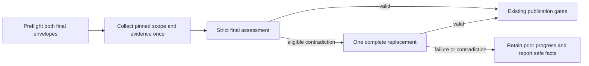
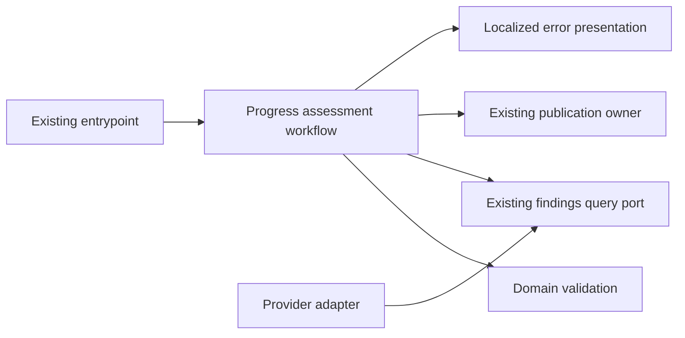

# Final Progress Completion Recovery

- Status: Implementation under validation; remote acceptance pending
- Date: 2026-11-02
- Catalog capability ID: github-communication-experience
- Last verified: 2026-11-02 (local targeted assertions; remote acceptance pending)
- Owners: Copilot maintainers
- Scope: Define one bounded complete replacement for a narrowly validated contradiction in a final progress assessment.
- Related issues/PRs: https://github.com/vypdev/copilot/issues/853
- Required review gates: product UX, architecture, testing, documentation, security/operations
- Open decisions blocking design: none. The Action verified first SDD commit 828a68284f4687acf7350950f553ba501926454b on the linked issue branch. Implementation is undergoing local validation; independent remote acceptance and protected-path review remain pending.

> The Action published and verified this companion before implementation. Publication establishes the branch prerequisite, not implemented behavior or executed acceptance. Its owning capability already has the specifications `specs/immutable-progress-content-recovery.md`, `specs/complete-progress-comparison-inventory.md`, and `specs/progress-scope-source-ownership.md`. The listed contracts retain their baseline ownership; this companion specifies the bounded final-assessment correction.

## 1. Executive summary

A final progress estimate may pass its ordinary checks but contradict the completion rule: it reports 100% while requirements remain unfinished, or reports another percentage while all requirements are supported. The host must continue rejecting that result and retaining prior progress. This proposal allows exactly one complete final reassessment using the same pinned evidence, scope, schema, provider, and model settings. The replacement is subject to all original validation and publication gates. It cannot repair source evidence, discard uncertainty, or establish that verification, review, or approval passed.

```text
pin evidence and scope -> collect once -> validate final estimate
                                      | valid -> existing publication gates
                                      | completion contradiction -> one complete same-source reassessment
                                                                   | valid -> existing publication gates
                                                                   | invalid -> retain previous progress; report closed facts
```

Text equivalent: a valid result follows the existing publication path; only an otherwise valid completion contradiction can trigger one replacement, and every other outcome retains existing failure behavior.

## 2. Problem, current behavior, and evidence

### 2.1 Problem

Maintainers reviewing Commit runs cannot recover from a final progress-completion contradiction even when the complete scope and evidence have already been collected. A prompt clarification alone did not resolve the reported incident. The failure blocks valid fixes, while the actual rejected percentages and requirement counts are unknown. Recovery must be bounded and must not weaken strict rejection or publish provisional progress.

### 2.2 Current behavior

1. The progress workflow collects scope, evidence, and parts under existing limits and freshness checks.
2. The host strictly validates the final response, including the equivalence between completion percentage and requirement statuses.
3. A contradiction is rejected, prior progress is retained, and the operation fails. There is no automatic replacement.

These are the supplied current-behavior facts. The proposed recovery is prospective; the issue does not establish that any particular contradictory direction or count occurred.

### 2.3 Evidence

- Historical authoring inputs are preserved verbatim in `specs/evidence/issue-853-authoring-body.txt` and `specs/evidence/issue-853-clarification-6574242311.txt`. `specs/evidence/issue-853-authoring-inputs.json` records their native origins, timestamps, SHA-256 hashes and original-to-published case IDs. The published seven requirements and forty cases remain normative. Concise issue/comment links replace duplicated drafting input; they do not remove acceptance or increase any processing bound.
- At candidate `256bffac6`, native Commit classified 101 required/uncertain lines from the duplicated authoring body, exceeding the unchanged 32-clause limit. Review completed all three source partitions with zero findings but omitted one of four human conversation entries under the unchanged 24,000-character budget. The production packing policy confirms that replacing only the archived historical clarification with its linked summary retains 4/4 entries, without omissions or truncation; the concise issue has 24 nonempty human lines, preserving all seven requirements and every case through the canonical SDD.
- Candidate `4a6d35371` passed Commit, complete review, correct-base Codecov 87/87 without misses/partials, CI, Linux and macOS. Hosted Windows failed nine real-Git integration tests solely on Jest's 5-second unit default, including observed 5.3–6.0-second cases. Tests that create native repositories now explicitly use this suite's existing 30-second native budget; pure units keep their default, the existing large-workload 120-second cases stay explicit, and every integrity assertion and production Git deadline remains unchanged. A fresh full Windows run is required; the timeout diagnosis does not establish acceptance.

- Code/workflow/documentation references: the immutable catalog at `9abb7882652bbc680781a22fd8bb397eb6169731` lists the current scope parser, final progress workflow, assessment/capacity policies, response diagnostics, and related tests. The catalog lists owning specifications `specs/immutable-progress-content-recovery.md`, `specs/complete-progress-comparison-inventory.md`, and `specs/progress-scope-source-ownership.md`.
- Incidents or concrete examples: issue #853 reports Commit runs 41414634366 (two attempts) and 41418428579, PR #852, heads `3ecade3154f25a11bb3a8107dc1cd3d4185dfd3c` and `dca6114af8cf92eadf35e2a217479c90e61347ef`, and base `9d3915729c96ec93c6e064d3321ba54c790170eb`. Reported error: `progress-completion-mismatch` at `$.progress`; prior state retained; `agent.failed`.
- External primary sources: not applicable; this is a repository workflow change.
- Unknowns: exact rejected counts and percentages, and implementation/acceptance results. The Action selected base 9abb7882652bbc680781a22fd8bb397eb6169731 and verified first SDD commit 828a68284f4687acf7350950f553ba501926454b on bugfix/853-final-progress-completion-mismatch-repeatedly-blocks-valid-fixes-without-bounded-recovery.

### 2.4 Retrospective classification (as-built baselines only)

Not applicable: this is a prospective specification and does not reconstruct an implemented baseline.

## 3. Actors, surfaces, and terminology

| Actor | Goal | Entry point | Visible surfaces |
|---|---|---|---|
| Issue author | Supply a stable progress scope | Issue and source comparison | Existing issue, progress card |
| Configured model | Return estimates for host validation | Existing progress query | No direct publication authority |
| Host workflow | Validate facts and enforce bounded recovery | Commit progress workflow | CLI/API error, Check, Job Summary, progress card |
| Maintainer | Understand failure and choose a fresh replay | Failed run | Run, Check, Summary, documentation |

A **completion contradiction** is a fully validated response whose percentage alone violates the completion equivalence. The host owns scope, requirement counts, evidence, and freshness facts. The model’s counts are observations of that response, not execution or approval evidence. A **replacement** is one new complete final query against the same pinned inputs, never a partial replay.

## 4. Goals

### 4.1 Goals and requirements

| Requirement | Behavior |
|---|---|
| FPR-01 | Preserve strict scope, schema, evidence, uncertainty, freshness, and publication acceptance; retain previous progress until the final result passes all gates. |
| FPR-02 | Permit exactly one complete replacement for an otherwise valid completion contradiction, using the same evidence, scope, schema, provider, and model settings. |
| FPR-03 | Bind recovery to host-validated closed facts; preserve provider and unrelated error categories; never allow provider-thrown lookalikes to allocate recovery. |
| FPR-04 | Preflight both complete final envelopes before any query, within existing capacities and without truncation or omitted evidence. |
| FPR-05 | Expose only closed numeric terminal facts through compatible parser rejection and localized existing surfaces. |
| FPR-06 | Deliver the complete-workload regression and independent coverage evidence required by the owning contracts. |
| FPR-07 | Keep documentation, authority boundaries, and independent delivery gates explicit and executable. |

### 4.2 Non-goals

1. Fixing per-part length failures addressed by #830 or extension H3 work related to #704/#837.
2. Changing scope, evidence acquisition, source ownership, approval, verification, or publication policy.
3. Adding configurable retries, provider/model overrides, larger limits, a new permission, release, deployment, or branch override.

### 4.3 Fixed product/safety invariants

1. Reject both contradictory directions; never round, normalize, infer completion, discard uncertainty, or alter source evidence.
2. Make at most one additional complete final query. No third query, cached rejected payload, partial progress publication, or automatic write replay is allowed.
3. Preserve existing freshness, complete-part/receipt, independent verification/review/approval, capacity, and prior-progress gates. Model claims cannot satisfy host gates.

## 5. Current versus proposed product journey

| Stage | Current | Proposed | User/operator effect |
|---|---|---|---|
| Preflight | Existing requests are checked under current rules | Check original and complete replacement envelopes before any query | Capacity failure makes zero model calls |
| Final assessment | One final query; contradiction is rejected | Same query and strict validation | Valid ordinary results are unchanged |
| Eligible contradiction | Terminal failure, previous progress retained | One complete reassessment from the same pinned source | One bounded read-only query may occur |
| Replacement outcome | Not applicable | Valid result returns to original gates; another contradiction or unrelated failure terminates | No provisional publication; inspect closed facts and run correlation |
| Publication | Existing freshness and publication owners | Unchanged | Existing card and native links remain authoritative |



Text equivalent: preflight, collect once, validate; either publish through existing gates, make one eligible replacement and revalidate, or stop while retaining prior progress.

## 6. Functional behavior and state model

### 6.1 Happy path

1. The existing workflow snapshots host-owned scope, source identities, locale, schema, provider, model settings, and original final request.
2. Before any model query, the capacity owner verifies the original and worst-case complete replacement envelopes.
3. The workflow collects scope and all evidence once, then validates the complete final response using existing rules.
4. A valid response proceeds once through the existing freshness and publication owners.

### 6.2 Alternative paths

- A fully validated completion contradiction may trigger one complete replacement. The fixed reviewed footer may contain only host-validated numeric facts; rejected model prose is not carried forward.
- A valid replacement returns to the existing publication gates. A second contradiction terminates with its own closed numeric facts.
- Schema, locale, scope, evidence, capacity, provider, process, timeout, and cancellation failures retain their existing identities and do not allocate recovery. A provider-thrown typed lookalike is not host parser output.
- A moved head/base/target, changed issue body, or closed source fails existing freshness checks and prevents publication.

### 6.3 State machine

| State | Entered when | User-visible meaning | Allowed next states | Recovery/owner |
|---|---|---|---|---|
| Preflight | Invocation begins | Checking complete request capacity | Collecting, failed | Existing capacity policy |
| Collecting | All final envelopes fit | Gathering pinned evidence | Final, failed | Existing evidence workflow |
| Final | Complete evidence is ready | Validating final estimate | Accepted, replacing, failed | Final assessment workflow |
| Replacing | Host classified eligible contradiction | One bounded reassessment is running | Accepted, exhausted, failed | Narrow application workflow |
| Accepted | Complete result and freshness gates pass | Existing progress may publish | Published, publication failure | Existing publication owner |
| Exhausted | Replacement also contradicts completion | Prior progress remains | Terminal | Closed diagnostic and operator replay |
| Failed | Any unrelated failure or stale source | Existing failure behavior applies | Terminal | Existing error owner |

Each invocation starts fresh; no retry allowance or rejected payload is replayed. Cancellation and partial publication retain current workflow semantics. Publication is not represented as a multi-call transaction: actual partial effects keep their existing classification.

## 7. User-facing configuration

| Input | Type | Recommended default | Allowed values/range | Scope/persistence |
|---|---|---|---|---|
| Recovery allowance | Fixed policy | One eligible replacement | Exactly 0 for unrelated failures, exactly 1 for eligible contradiction | Per invocation; not user-configurable |
| Provider/model/effort | Existing configuration | Existing configured values | Existing validated values only | Snapshot for the invocation |
| Locale | Existing locale input | Existing precedence, default en-US | Existing supported locales and whole-message fallback | Existing operation snapshot |

There is no new configuration, migration, or persistence. The original final request is snapshotted. Optional undefined fields remain absent/undefined. A meaningful alternative is the existing es-ES locale, which changes language but not validation or recovery. Recovery count, capacity, evidence, and approval gates are intentionally not configurable.

## 8. Clean Architecture

### 8.1 Responsibilities and dependency direction

| Layer/boundary | Owns | Must not own/import |
|---|---|---|
| Domain/pure policy | Closed diagnostic validation, numeric bounds, immutable facts, completion equivalence | Provider SDKs, processes, GitHub mutation |
| Application | Narrow workflow that distinguishes host parse output from provider calls and spends at most one recovery allowance | Concrete SDK/process concerns or publication capability |
| Adapters/data | Existing response parsing, provider/process mapping, DTO conversion | Recovery or product policy |
| Infrastructure/composition | Existing port bindings and entrypoint wiring | Business decisions |
| Entrypoints | Event and operation input adaptation | Duplicated orchestration |
| Presentation | Closed localized view models and rendering on existing surfaces | State mutation or publication decisions |



### 8.2 Contracts, state, and trust boundaries

- Pure decisions: a host-created typed mismatch is eligible only after all checks other than completion equivalence pass. Binding checks counts against the current nonempty scope.
- Application contracts: a narrow `query_progress_assessment_workflow` uses the existing query port and result workflow. Query execution occurs outside the parse-only catch. The owner evaluates once and returns either a normalized valid result or a closed mismatch outcome.
- Semantic ports: reuse existing findings query and publication/freshness ports; add no provider-specific DTO to domain or application contracts.
- Durable state/schema ownership: no new durable state or schema. Previous progress remains owned by the existing publication/state owner.
- Concurrency/idempotency: reuse existing source freshness and publication idempotency; do not repeat writes automatically.
- Trusted and untrusted inputs: scope, source identities, and numeric bounds are host-owned. Model responses, including counts, are untrusted until complete validation; they never attest execution, review, or approval.
- Provider error mapping: unrelated provider errors preserve identity. Provider-thrown typed lookalikes cannot enter the parser-only recovery path.

Snapshot a structured clone of original options/schema/configuration and freeze only that clone. Preserve the exact prompt, evidence identities, and pinned scope. Replacement changes only a fixed reviewed footer and validated numeric data. Preserve existing per-query timeout/cancellation and native outer deadline; add no deadline field or budget reset.

### 8.2.1 Complete capacity and numeric contract

Before the first scope/model query, reserve the complete fixed recovery footer plus a worst-case 256-byte closed numeric hint in the reserved-scope, single and final request envelopes and aggregate budget. Closed key/scalar normalization and the executable maximum-hint test establish that bound; reserve padding is capacity accounting only and MUST NOT be sent to the provider. Preflight every late part and both complete final envelopes before admitting the first request. Preserve the existing 512 KiB runtime prompt limit, 384000-byte aggregate ceiling, 64000-byte scope limit, 32 required/uncertain and 32 excluded clauses, 1024-byte dynamic framing reserve, adaptive per-fact maximum of 800 Unicode points, and both complete 8000-point published projections including citations/separators. Preserve the immutable profile limits: 1024 paths, 4096 units, 512 units per part, 16 recovery frames, 16 MiB total recovered source, 2048 reads and 200000 tree entries. Unsupported whole input fails before queries; never clip, omit units, recollect source or raise capacities.

The five facts are reportedProgress, requirementCount, supportedCount, missingCount and unknownCount. Counts come from exact current-scope entries only after all entry and full-projection checks pass. A typed mismatch preserves the existing safe direct-parser rejection and privately freezes those facts; a per-parse scope identity can prevent cross-scope reuse. Only a genuine completion contradiction may be recovered. Query execution remains outside the parse-only catch, including replacement queries. A second contradiction reports its own counts and correlation, without retaining either rejected payload across awaits.

AgentQueryOptions has no absolute assessment deadline. Keep existing per-admitted-query timeout/cancellation and the native outer workflow deadline unchanged; no invented deadline port, override or native budget reset. At most one additional bounded read is admitted.

### 8.3 Executable architecture constraints

Automated architecture and contract checks MUST ensure the recovery helper has no publication capability, domain/policy imports no provider/framework modules, and only the host parser can create the eligible mismatch outcome. Existing module, port, dependency, raw-error logging, schema, and workflow guards remain required.

## 9. UI/UX and content contract

### 9.1 Information hierarchy

1. Current assessment state.
2. Completed pinned evidence and retained progress facts.
3. Whether one reassessment is running or exhausted.
4. One operator action, or explicit statement that none is needed while running.
5. Impact and existing run/comparison links.
6. Sanitized technical facts and correlation.

### 9.2 Representative primary view

The following numeric values are illustrative, not incident facts:

```markdown
# Progress assessment

> **Current status:** One inconsistent final estimate was rejected. A complete reassessment is running.
>
> **Action required:** None while this read-only query runs.

## Progress

Previous progress is retained until the complete estimate passes validation.

## What happens next

The replacement uses the same pinned comparison and all existing publication checks.

## Links

[Inspect the Commit run](https://github.com/vypdev/copilot/actions/runs/41418428579) · [Inspect the comparison](https://github.com/vypdev/copilot/compare/9d3915729c96ec93c6e064d3321ba54c790170eb...dca6114af8cf92eadf35e2a217479c90e61347ef)

<details>
<summary>Technical details</summary>

Field `$.progress`; reported 70%; requirements: 2 total, 2 supported, 0 missing, 0 unknown. Illustrative correlation: 11111111-1111-4111-8111-111111111111.
</details>
```

Pending/no action: “Assessing the complete pinned comparison. Previous progress is retained until final validation.” Link the current run and comparison.

Action required/exhausted: “Progress was not published after one replacement. Inspect the final percentage and requirement counts, then start a fresh complete assessment. Previous progress is retained.” Link the failed run and current comparison.

Blocked before effects: “The complete request does not fit existing limits, so no model query ran. Reduce the source scope through the normal issue workflow and start a fresh assessment.” Retain prior progress and link the run.

Partial publication: “The assessment passed validation, but publication did not complete. Inspect the run and current progress before deciding whether to retry.” State only confirmed effects and preserve the existing partial-effect classification.

Completed: use the existing completion card, native links, and verified progress facts after all gates pass.

### 9.3 Issue, PR, and comment behavior

No new issue, PR, comment, label, Check, or card is created. Recovery adds at most one fixed bounded log message. Existing durable markers, titles, links, idempotent updates, labels, and Checks remain unchanged. Merge, close, or fresh replay retains existing behavior; replay recollects complete evidence.

### 9.4 Accessibility, localization, and responsive behavior

Use existing locale precedence, en-US default, es-ES support, and whole-message fallback for unsupported locales. Every status is textual; numeric facts are readable without color. Content must remain understandable in narrow layouts, light/dark themes, screen readers, and existing heading/link conventions. Render only reviewed fixed templates and closed numeric facts; never render model prose, arbitrary Markdown, commands, mentions, or URLs.

## 10. Failure, recovery, and cleanup

| Failure/partial state | User impact | Retained facts | Automatic retry | Required action | Cleanup |
|---|---|---|---|---|---|
| Initial unrelated validation/provider failure | Existing failure behavior | Previous progress; existing safe diagnostic | No recovery query | Follow existing error guidance | Remove ephemeral failed outcome |
| Preflight capacity failure | Assessment does not start | Prior progress and capacity facts | No | Adjust scope through normal workflow | No query artifacts |
| First eligible contradiction | One extra bounded read-only query | Pinned evidence and prior progress | Exactly one complete replacement | None while it runs | Discard rejected payload |
| Second contradiction | No new progress published | Prior progress and second response’s closed counts | No third query | Inspect run; start a fresh full assessment when appropriate | Discard ephemeral rejected result |
| Replacement provider failure/cancellation | Existing provider/cancellation classification | Prior progress | No third query | Follow existing guidance | Preserve existing cancellation cleanup |
| Stale source during replacement | No obsolete estimate publishes | Prior progress and freshness facts | No | Rerun complete assessment | Discard provisional work |
| Publication failure after validation | Possible existing partial effects | Actual observed publication state | No automatic write replay | Inspect current progress and run | Existing publication cleanup only |

Errors follow impact, cause, action, retained-state order. A terminal exhaustion error keeps code `agent.failed` and uses recovery ID `progress-completion-recovery-exhausted`, with exactly the five numeric fields in section 11. Direct parser callers retain `progress-result-contract-invalid` and its current five-field recovery shape.

## 11. Security, permissions, and privacy

1. Add no credential, network authority, write capability, or permission.
2. Accept recovery only from host parser output after all other response checks pass; do not trust provider-thrown lookalikes.
3. Public diagnostic properties are exactly `reportedProgress` (finite 0–100), `requirementCount` (integer 1–32), and `supportedCount`, `missingCount`, `unknownCount` (integers 0–32) summing exactly to total and demonstrating the contradiction. Extra/missing keys, foreign scope totals, and malformed values fail closed.
4. Do not expose raw response, IDs, paths, private prose, stack, provider output, or arbitrary keys. Fixed phase/field names come from reviewed templates. Intermediate logs use fixed constant text and never log caught or derived error values.
5. Model approval, review, test, verification, or coverage claims cannot satisfy host gates or authorize mutation.

## 12. Observability and operational UX

Retain existing progress state and emit at most one fixed recovery log message. Public terminal JSON and localized CLI, Check, and Summary use the closed error registry, retained-state statement, and same terminal correlation reference. Numeric facts describe a model observation, not a success metric. Queue delay remains distinct from typed completed-output failure. Add no telemetry payload, rejected-output retention, extra comments, or hidden provider retry. Existing run links and head/base context remain inspectable.

## 13. Compatibility, migration, rollout, and rollback

The companion [part-response recovery contract](./progress-partition-response-recovery.md)
owns a separate single replacement for each attributable overlong part. Those
queries finish before this final controller starts. A final reassessment never
repeats accepted part queries or source reads; an exhausted part never enters
the final stage. Three additional composition cases belong to that companion's
budget and do not replace this specification's 40 cases.

Valid complete and partial responses remain accepted identically. Direct parser rejection and unrelated errors preserve current codes and recovery shapes. Add only the closed exhaustion identifier. No stored-state or in-flight comparison migration is required. Adopt a reviewed runtime only through its supported path; merging `develop` alone does not change the currently observed master-pinned issue-comment runtime. Release and deployment are outside this correction. Implementation starts only after the Action-verified first SDD and linked branch, now recorded above. Rollback restores immediate rejection and retains previous progress; remove helper, diagnostic, and localized copy together without rewriting published state.

## 14. Testing strategy

The minimum is 40 distinct new executable cases. Each inventory row is one case; no case is asserted as already executed. Existing owner budgets, platform/extension cases, module/port/architecture guards, and real publication fixtures remain mandatory. New pure-policy statements, branches, functions, and lines require 100%; modified coverable lines require official correct-base Codecov 100% with zero misses or partials. Use deterministic fakes and native adapter fixtures, no real sleeps or live credentials. Golden output must be paired with semantic assertions; manual UX evidence must cover narrow, light/dark, and screen-reader readability. Independent CI, Codecov, review, and approval evidence cannot be supplied by the model or by case links.

| Area | Minimum distinct cases | Behaviors/risks covered |
|---|---:|---|
| Domain/configuration/pure planning | 11 | Observable scenarios in the case inventory. |
| State/application/idempotency/races | 8 | Observable scenarios in the case inventory. |
| Adapters and provider contracts | 3 | Observable scenarios in the case inventory. |
| Workflows, permissions, schemas, and setup contracts | 8 | Observable scenarios in the case inventory. |
| Integration/end-to-end and compatibility/migration | 4 | Observable scenarios in the case inventory. |
| Presentation states, links, localization, accessibility, and sanitization | 6 | Observable scenarios in the case inventory. |
| Total | 40 | Distinct inventory cases; repeated executions do not add cases. |

| Case ID | Area | Requirements | Scenario |
|---|---|---|---|
| github-communication-experience-change-C125 | Domain/configuration/pure planning | FPR-01, FPR-03, FPR-05 | All-supported facts with reported 70 produce only closed current mismatch counts. |
| github-communication-experience-change-C126 | Domain/configuration/pure planning | FPR-01, FPR-03, FPR-05 | Reported 100 with a missing requirement yields exact mismatched counts. |
| github-communication-experience-change-C127 | Domain/configuration/pure planning | FPR-01, FPR-03 | Reported 100 with host-uncertain requirements preserves unknown status and cannot promote it. |
| github-communication-experience-change-C128 | Domain/configuration/pure planning | FPR-03, FPR-05 | Reported 99.9 with all supported retains the decimal and is not rounded into completion. |
| github-communication-experience-change-C129 | Domain/configuration/pure planning | FPR-03 | Valid count boundaries 1 and 32 bind to the current nonempty scope. |
| github-communication-experience-change-C130 | Domain/configuration/pure planning | FPR-03, FPR-05 | Nonfinite or out-of-range percentages cannot create a diagnostic or authorize recovery. |
| github-communication-experience-change-C131 | Domain/configuration/pure planning | FPR-03, FPR-05 | Negative, fractional, or excessive count fields are rejected without echoing data. |
| github-communication-experience-change-C132 | Domain/configuration/pure planning | FPR-03 | Counts that do not sum exactly to requirementCount are rejected. |
| github-communication-experience-change-C133 | Domain/configuration/pure planning | FPR-03 | A count total from another scope cannot authorize recovery for the current assessment. |
| github-communication-experience-change-C134 | Domain/configuration/pure planning | FPR-03, FPR-05 | Extra or missing diagnostic properties fail closed and never reach public output. |
| github-communication-experience-change-C135 | Domain/configuration/pure planning | FPR-01, FPR-03 | Consistent complete and incomplete results are never classified as completion mismatches. |
| github-communication-experience-change-C136 | State/application/idempotency/races | FPR-01, FPR-02 | An initially valid final assessment uses one final query and no replacement. |
| github-communication-experience-change-C137 | State/application/idempotency/races | FPR-02, FPR-03 | A contradictory incomplete estimate recovers through one complete same-schema replacement. |
| github-communication-experience-change-C138 | State/application/idempotency/races | FPR-01, FPR-02 | A false 100 recovers to a valid partial estimate while required uncertainty remains unknown. |
| github-communication-experience-change-C139 | State/application/idempotency/races | FPR-02, FPR-05 | A second contradiction reports its own counts; no third request or partial progress follows. |
| github-communication-experience-change-C140 | State/application/idempotency/races | FPR-02, FPR-03 | Captured schema, configuration, and options cannot mutate across the awaited replacement. |
| github-communication-experience-change-C141 | State/application/idempotency/races | FPR-02 | A fresh same-head invocation starts fresh; no rejected payload or allowance is replayed. |
| github-communication-experience-change-C142 | State/application/idempotency/races | FPR-03 | A replacement provider failure keeps its original category without a third call. |
| github-communication-experience-change-C143 | State/application/idempotency/races | FPR-03 | Replacement cancellation keeps its classification and leaves progress unchanged. |
| github-communication-experience-change-C144 | Adapters and provider contracts | FPR-03 | A provider-thrown typed lookalike bypasses the parse-only recovery catch. |
| github-communication-experience-change-C145 | Adapters and provider contracts | FPR-01, FPR-03 | Incomplete JSON and native schema failures keep existing rejection and do not start recovery. |
| github-communication-experience-change-C146 | Adapters and provider contracts | FPR-01, FPR-03 | Locale and status/evidence failures cannot masquerade as a validated completion mismatch. |
| github-communication-experience-change-C147 | Workflows, permissions, schemas, and setup contracts | FPR-01, FPR-02 | A recovered final result publishes once only after every complete part and receipt validates. |
| github-communication-experience-change-C148 | Workflows, permissions, schemas, and setup contracts | FPR-01, FPR-02 | A moved source head during replacement prevents progress publication. |
| github-communication-experience-change-C149 | Workflows, permissions, schemas, and setup contracts | FPR-01, FPR-02 | A changed base or native PR target during replacement prevents publication. |
| github-communication-experience-change-C150 | Workflows, permissions, schemas, and setup contracts | FPR-01, FPR-02 | A changed issue body or closed source during replacement preserves old progress. |
| github-communication-experience-change-C151 | Workflows, permissions, schemas, and setup contracts | FPR-01, FPR-02 | Late recovery failure after earlier parts succeeded discards provisional work and retains old labels. |
| github-communication-experience-change-C152 | Workflows, permissions, schemas, and setup contracts | FPR-01 | Publication failure keeps actual partial-effect classification and never automatically repeats writes. |
| github-communication-experience-change-C153 | Workflows, permissions, schemas, and setup contracts | FPR-02, FPR-06 | The real 887-path, 952-unit fixture retains every receipt and source read count through replacement. |
| github-communication-experience-change-C154 | Workflows, permissions, schemas, and setup contracts | FPR-01, FPR-07 | Extra model approval, verification, or Codecov claims are rejected by the exact schema without mutation. |
| github-communication-experience-change-C155 | Integration/end-to-end and compatibility/migration | FPR-04 | An original envelope that fits but whose worst replacement does not fit causes zero model calls. |
| github-communication-experience-change-C156 | Integration/end-to-end and compatibility/migration | FPR-04 | All complete final and late-part envelopes are checked before the first scope request. |
| github-communication-experience-change-C157 | Integration/end-to-end and compatibility/migration | FPR-04 | The bounded numeric hint fits its reserved envelope; reserve padding is never sent to a provider. |
| github-communication-experience-change-C158 | Integration/end-to-end and compatibility/migration | FPR-01, FPR-04 | Existing aggregate, scope, fact, and citation limits remain enforced without truncation or omitted units. |
| github-communication-experience-change-C159 | Presentation states, links, localization, accessibility, and sanitization | FPR-05 | Terminal English output gives exact numeric facts, action, and retained progress without rejected prose. |
| github-communication-experience-change-C160 | Presentation states, links, localization, accessibility, and sanitization | FPR-05 | API JSON preserves closed numeric facts and rejects malformed metadata without data echo. |
| github-communication-experience-change-C161 | Presentation states, links, localization, accessibility, and sanitization | FPR-05 | Terminal, API, Check, and Summary reuse terminal correlation and error code. |
| github-communication-experience-change-C162 | Presentation states, links, localization, accessibility, and sanitization | FPR-05 | Spanish regional reuse and unsupported-locale fallback preserve the same semantic facts. |
| github-communication-experience-change-C163 | Presentation states, links, localization, accessibility, and sanitization | FPR-02, FPR-05 | Intermediate recovery logs are fixed and bounded, with no caught values or extra comments. |
| github-communication-experience-change-C164 | Presentation states, links, localization, accessibility, and sanitization | FPR-05, FPR-07 | The documented exhaustion example round-trips through the real normalizer, renderer, and catalog owner. |

## 15. Documentation and discoverability

Documentation is part of delivery. The existing execution contract must explain the normal path and bounded reassessment; branch-management guidance must explain retained progress, exhaustion, and fresh replay; the error reference must document closed fields, correlation, compatibility, and partial effects. Validate examples through the actual normalizer, renderer, and catalog owner. Verify catalog and documentation paths at the Action-selected base before implementation. Proposed implementation paths below are future work, not evidence of existing files.

| Path | Change |
|---|---|
| `specs/final-progress-completion-recovery.md` | create |
| `specs/evidence/issue-853-authoring-body.txt` | create |
| `specs/evidence/issue-853-clarification-6574242311.txt` | create |
| `specs/evidence/issue-853-authoring-inputs.json` | create |
| `src/domain/progress_completion_diagnostic.ts` | create |
| `src/application/errors/progress_completion_mismatch.ts` | create |
| `src/application/policies/progress_completion_recovery_policy.ts` | create |
| `src/application/usecases/actions/query_progress_assessment_workflow.ts` | create |
| `src/domain/__tests__/progress_completion_diagnostic.test.ts` | create |
| `src/application/policies/__tests__/progress_completion_recovery_policy.test.ts` | create |
| `src/application/usecases/actions/__tests__/query_progress_assessment_workflow.test.ts` | create |
| `src/application/usecases/actions/__tests__/progress_completion_recovery.integration.test.ts` | create |
| `src/application/policies/__tests__/progress_completion_recovery_presentation.test.ts` | create |
| `src/application/policies/progress_scope_policy.ts` | update |
| `src/application/policies/progress_prompt_capacity_policy.ts` | update |
| `src/application/usecases/actions/progress_analysis_workflow.ts` | update |
| `src/data/model/application_error.ts` | update |
| `src/application/policies/application_error_message_catalog.ts` | update |
| `src/application/policies/application_error_presentation_policy.ts` | reference |
| `src/application/usecases/actions/__tests__/progress_result_rejection.integration.test.ts` | update |
| `src/infrastructure/filesystem/__tests__/bugbot_git_review_source_adapter.test.ts` | update |
| `scripts/coverage-budgets.json` | update |
| `specs/catalog.json` | update |
| `specs/CATALOG.md` | update |
| `docs/agents/execution-contract.mdx` | update |
| `docs/issues/branch-management.mdx` | update |
| `docs/security-operations/operations/error-reference.mdx` | update |
| `src/application/usecases/actions/__tests__/fixtures/complete_inventory_workflow_fixture.ts` | reference |

## 16. Acceptance

1. Given an initially valid final response, when the complete assessment runs, then it uses one final query and proceeds unchanged through existing publication gates.
2. Given either otherwise valid completion contradiction, when final validation rejects it, then exactly one complete same-source replacement may run and must pass the full original validation.
3. Given uncertainty in the scope, when a replacement reports complete progress, then uncertainty remains and the result cannot be promoted to complete.
4. Given a second contradiction or unrelated replacement failure, when it terminates, then no third request or partial progress is published and previous progress remains with only closed facts exposed.
5. Given malformed output, locale/evidence failure, a provider-thrown lookalike, timeout, or cancellation, when the final query fails, then completion recovery is not allocated and existing failure classification remains.
6. Given a replacement envelope that exceeds a current limit, when preflight runs, then no scope or model query occurs; no evidence is clipped or omitted.
7. Given head, base, target, body, or source closure changes during replacement, when freshness is checked, then obsolete progress is not published.
8. Given publication fails after validation, when any partial effect exists, then its actual classification is preserved and no write is automatically repeated.
9. Given a fresh same-head invocation, when it begins, then it recollects complete evidence and has a fresh single-replacement allowance.
10. Given English, Spanish, or unsupported locale output, when diagnostics render, then the same numeric facts, correlation, retained-state meaning, and safe action are available without raw rejected prose.
11. Given the exhaustion documentation example, when checked through the real normalizer and renderer, then it matches the closed catalog contract.

The 40 case identities are implemented in the five new test modules in section 15. Full local verification passed 849 suites / 16,368 tests, with 35 pre-existing skips, plus 267 extension tests at 100% of all metrics. All coverage budgets and the setup ledger passed, with its 14 pre-existing human acceptance items still explicitly open. The four new runtime modules measured 100% statements, branches, functions and lines. Four genuine native-adapter contradiction/publication regressions failed before the runtime change and passed afterward. Typecheck, lint, specifications, guidance, documentation assets/contracts and workflow contracts also passed. Remote CI, full review, official correct-base Codecov and protected-path approval remain independent pending gates.

## 17. Requirements traceability

| Requirement | Cases |
|---|---|
| FPR-01 | github-communication-experience-change-C125, github-communication-experience-change-C126, github-communication-experience-change-C127, github-communication-experience-change-C135, github-communication-experience-change-C136, github-communication-experience-change-C138, github-communication-experience-change-C145, github-communication-experience-change-C146, github-communication-experience-change-C147, github-communication-experience-change-C148, github-communication-experience-change-C149, github-communication-experience-change-C150, github-communication-experience-change-C151, github-communication-experience-change-C152, github-communication-experience-change-C154, github-communication-experience-change-C158 |
| FPR-02 | github-communication-experience-change-C136, github-communication-experience-change-C137, github-communication-experience-change-C138, github-communication-experience-change-C139, github-communication-experience-change-C140, github-communication-experience-change-C141, github-communication-experience-change-C147, github-communication-experience-change-C148, github-communication-experience-change-C149, github-communication-experience-change-C150, github-communication-experience-change-C151, github-communication-experience-change-C153, github-communication-experience-change-C163 |
| FPR-03 | github-communication-experience-change-C125, github-communication-experience-change-C126, github-communication-experience-change-C127, github-communication-experience-change-C128, github-communication-experience-change-C129, github-communication-experience-change-C130, github-communication-experience-change-C131, github-communication-experience-change-C132, github-communication-experience-change-C133, github-communication-experience-change-C134, github-communication-experience-change-C135, github-communication-experience-change-C137, github-communication-experience-change-C140, github-communication-experience-change-C142, github-communication-experience-change-C143, github-communication-experience-change-C144, github-communication-experience-change-C145, github-communication-experience-change-C146 |
| FPR-04 | github-communication-experience-change-C155, github-communication-experience-change-C156, github-communication-experience-change-C157, github-communication-experience-change-C158 |
| FPR-05 | github-communication-experience-change-C125, github-communication-experience-change-C126, github-communication-experience-change-C128, github-communication-experience-change-C130, github-communication-experience-change-C131, github-communication-experience-change-C134, github-communication-experience-change-C139, github-communication-experience-change-C159, github-communication-experience-change-C160, github-communication-experience-change-C161, github-communication-experience-change-C162, github-communication-experience-change-C163, github-communication-experience-change-C164 |
| FPR-06 | github-communication-experience-change-C153 |
| FPR-07 | github-communication-experience-change-C154, github-communication-experience-change-C164 |

## 18. Implementation sequence

1. Verify the Action-selected base, linked branch, catalog evidence, and first SDD publication through the normal Action gate.
2. Add native workflow regressions through existing ports and record genuine failing behavior before implementation.
3. Add the closed domain facts and safe typed mismatch, then the parse-only orchestration and complete envelope accounting.
4. Add provider, freshness, publication, security, and localized presentation cases.
5. Synchronize documentation, catalog metadata, generated index, and contract fixtures.
6. Run repository validation, full existing and new verification, coverage, and architecture checks; review current-head findings and official correct-base Codecov evidence.
7. Obtain any required specific human protected-path decision for the final SHA. Keep #830 and H3 separate, with their own fresh Action-owned synchronization and gates.

## 19. Definition of Done

- [x] Every FPR requirement has acceptance and reciprocal case traceability.
- [x] All 40 case identities have executed assertions; the four incident regressions have native-adapter RED evidence. Additional preservation, security and capacity cases passed without a claim that every such case failed on the baseline.
- [x] Architecture boundaries and parser-only recovery authority are implemented and automatically enforced.
- [x] Original and replacement envelope preflight, numeric bounds, freshness, complete-source receipts, and existing publication gates pass without truncation or omitted evidence.
- [x] Valid responses and direct parser rejection remain compatible; unrelated failures retain their identity.
- [ ] English, Spanish, fallback, pending, blocked, exhausted, partial-publication, and completed surfaces meet content and accessibility requirements; required human UX evidence is recorded.
- [ ] New pure-policy coverage is 100%; modified coverable lines have official correct-base Codecov 100% with zero misses or partials; existing repository thresholds also pass.
- [x] User, operator, contributor, recovery, compatibility, and rollback documentation is discoverable and contract-checked.
- [ ] Required type, lint, full root/extension coverage, budget/ledger, specification/catalog generation and validation, documentation/routes/workflow, build/package smoke, Graphify, and normal hook checks pass.
- [x] `specs/catalog.json` and `specs/CATALOG.md` contain truthful evidence, and `pnpm run validate:specifications` passes.
- [ ] Current head/base, applicable CI/platform/Commit controls, complete semantic review, and any required specific human decision are verified independently.
- [x] No release, tag, deployment, extra permission, or unauthorized write is part of acceptance.
- [ ] No readiness-blocking decision remains unresolved. First publication, structural consistency, planned cases, a build, or model claims do not establish implementation or readiness.

## 20. References and decisions

- Primary sources: https://github.com/vypdev/copilot/issues/853; immutable catalog evidence at `9abb7882652bbc680781a22fd8bb397eb6169731`.
- Related specs/ADRs/issues/PRs: `specs/immutable-progress-content-recovery.md`, `specs/complete-progress-comparison-inventory.md`, and `specs/progress-scope-source-ownership.md`; prerequisite #833/#830 and extension H3 #704 remain separate.
- Decisions and rejected alternatives: exactly one replacement rather than a general retry; closed counts rather than raw output; retain strict parsing rather than normalize percentages; unchanged model/configuration/limits/permissions; no new absolute deadline port; no automatic write replay. Reject forcing 100 from previous statuses, dropping uncertain requirements or sources, accepting provider errors as completed output, increasing capacities, adding a third query, caching partial evidence, weakening approval, or treating model claims as execution proof.
- Follow-up work explicitly outside this spec: broader progress-planning improvements, #830 partition-length recovery, extension implementation, release and deployment. This spec includes implementation and its full CI/coverage/review acceptance; adoption into the master-pinned runtime is a separately reviewed operator transition. The reported parser/graph consistency at `3e7ceea` and catalog snapshot `9abb7882` establishes planning consistency only, not implementation or acceptance.
