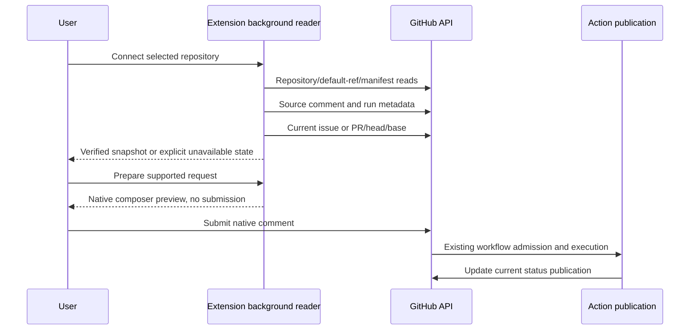
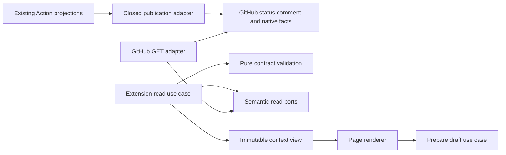

# GitHub Browser Extension — Action Integration Contract

- Status: Ready for review — proposed producer and client contract, not implemented
- Date: 2026-10-25
- Catalog capability ID: `github-browser-extension`
- Last verified: 2026-10-25, source/contract review only
- Owners: Copilot maintainers; Action producer and extension reader have separate release responsibility
- Scope: Discover and read trustworthy current Action snapshots and prepare supported native GitHub drafts.
- Related issues/PRs: [#694](https://github.com/vypdev/copilot/issues/694)
- Required review gates: product UX, architecture, testing, documentation, security/operations
- Open decisions blocking design readiness: None. Producer implementation and compatible release are prerequisites for connected mode.

## 1. Executive summary

The Action will publish a small versioned projection in its existing current
status publication. A reviewed configuration file on the repository's default
branch identifies the producer and capabilities. The extension reads these
through GitHub's API; it never turns a browser visit into a status comment or an
Action run. Standalone features work before producer support ships.

```text
Repository opt-in → trusted-default configuration → bounded source lookup
 → validate producer/target/run/schema → reread native identity
 → render timestamped assessment → optionally prepare native draft
```

The assessment is information at an observed revision, not a merge authorization
or an independent replacement for native branch protection. [Product](github-browser-extension.md)
owns its presentation and [platforms](github-browser-extension-platforms-and-delivery.md)
owns credentials, browser isolation and packaging.

## 2. Problem, current behavior, and evidence

Existing status, SDD and Bugbot publications contain useful facts, but internal
markers are not a declared external API. Recreating their meaning with DOM
selectors or check-name matching would lose provenance, completeness and
revision fencing. Current read status also publishes a reply when invoked as a
comment command; the extension needs passive reads instead.

Observed implementation boundaries:
- `src/application/usecases/read_copilot_status_workflow.ts`: combines native
  completion, SDD and PR readiness through read ports.
- `src/application/ports/pull_request_status_read_ports.ts`: read policy,
  revision and evidence, without approval submission.
- `src/application/policies/status_command_policy.ts` and
  `sdd_status_policy.ts`: public presentation projections, not transport schemas.
- `src/application/policies/bugbot_review_ownership_policy.ts`: existing trusted
  author filtering; a browser reader additionally checks numeric identity.
- [Exact-revision readiness](guarded-pull-request-approval-status.md),
  [SDD readiness](pre-branch-sdd-status-readiness.md),
  [finding reconciliation](bugbot-review-state-reconciliation.md),
  [comment authorization](comment-automation-and-authorization.md),
  [publication](semantic-github-publication-and-notification.md).

Prospective classification: not applicable to as-built reconstruction. The new
manifest/envelope and source pointer below are proposed additions. No current
Action version is claimed to implement them.

## 3. Actors, surfaces, and terminology

| Actor | Owns | Surface |
|---|---|---|
| Maintainer | Reviewed producer configuration and repository connection eligibility | Default-branch configuration and PR review |
| Action | Authoritative projections, monotonic publication and authorization | Existing status card, checks, run/summary |
| Extension | Validation, freshness, cache and personal presentation | Context/findings panel and options |
| User | Optional read credential and native submission | Extension connection page and GitHub composer |
| GitHub | Repository/PR/run identities and access policy | REST/native UI |

`source` is an API-verified publication; `locator` is only an untrusted hint to
find it. `generation` orders producer snapshots; `pageGeneration` orders local
navigation. `assessment` is a timestamped Action report; `native` facts are fresh
GitHub reads. `unavailable` differs from `pending` and `not-applicable`.

## 4. Goals, non-goals, and fixed invariants

- **I1 — Discovery:** read an explicit default-branch manifest; absence or denied
  access disables connected capabilities without disabling standalone ones.
- **I2 — Schema:** accept only bounded versioned contracts with compatible
  capabilities; malformed/future-major data cannot become success.
- **I3 — Provenance:** verify author ID, repository, conversation, run/attempt,
  workflow source and source-comment identity before projecting connected facts.
- **I4 — Ownership:** preserve native state, lifecycle/activity/waiting dimensions,
  SDD/finding semantics, completeness and historical distinction.
- **I5 — Freshness:** fence head/base/public configuration/native state and discard superseded
  generations, stale/foreign results and out-of-order responses.
- **I6 — Bounded reads:** centralized request/caching/rate-limit policy creates no
  repository mutation, command comment or agent invocation.
- **I7 — Authentication:** optional user-owned read connection with exact origin,
  selected repository bounds and session-only credential handling under D4.
- **I8 — Drafts:** known commands and authoritative target contexts only; user
  submission and all Action execution checks remain separate.
- **I9 — Untrusted input:** validate/sanitize URLs, strings, counts, messages and
  locators; never execute remote content or accept arbitrary HTTP commands.
- **I10 — Producer compatibility:** additive publication with explicit version
  rollout, idempotency, partial-publication recovery and existing noise budgets.

Normative tables refine I1–I10. The complete product additionally includes the closed operation and full-command contracts in §11.3 and I8 below. Non-goals: arbitrary API writes, new merge policy,
token provisioning service, realtime push server, browser-side AI, or reusing bot
credentials. A trusted snapshot cannot grant user permissions or bypass checks.

## 5. Current versus proposed journey

| Stage | Current | Proposed |
|---|---|---|
| Discover | Infer presence from visible comments/labels | I1 reviewed manifest and explicit user opt-in |
| Read | Human compares multiple sources | I3/I5 validated projection plus source links |
| Missing evidence | Easy to confuse with zero/ready | Independent unavailable/partial fields |
| Request | Remember command vocabulary and event restrictions | I8 exact-context draft preview |
| Execute | Existing parser/auth/verification/publication | Same Action contract after native submission |



Text equivalent: user opts in, reader validates default configuration/source and
native identity, renders a snapshot, user prepares then submits a request, and
the existing Action workflow publishes its result.

## 6. Functional behavior and state model

### 6.1 Manifest and passive transport

Proposed path: `.copilot/browser-extension.json` on the canonical default branch.
The reader resolves repository numeric identity/default branch, pins its commit,
then reads the file at that commit. Candidate/PR branch files cannot configure
trust. A default-ref/policy change invalidates cache and is fenced again before
showing complete evidence. A denied read is unavailable, not proof of absence.

```json
{
  "schemaVersion": 1,
  "enabled": true,
  "repositoryId": 1,
  "producerActorId": 2,
  "workflowPaths": [".github/workflows/copilot_issue.yml", ".github/workflows/copilot_pull_request.yml", ".github/workflows/copilot_issue_comment.yml"],
  "capabilities": ["context.v1", "findings.v1", "command-drafts.v1"],
  "statusSchemaMajor": 1,
  "publication": "current-status-comment"
}
```

IDs 1/2 are illustrative, not this repository's real IDs. The manifest is at most
8 KiB, has no unknown v1 keys, ≤8 exact workflow paths and ≤16 well-formed capability
tokens (unsupported tokens are ignored, never executed). IDs are positive safe integers. Paths are reviewed repository-relative
workflow paths, with no traversal/wildcards/URLs; no credential can be included.
The example workflow list is illustrative: a real manifest must name every
reviewed installed route that publishes the shared status, including push or
review-thread routes when enabled. A missing route is never trusted by name
similarity. Producer rollout validates its actual workflow inventory against the
reviewed manifest; optional routes are added only when installed and enabled.
Missing capability hides just its feature. `enabled:false` stops connected reads
after configuration validation; no remote toggle may override a personal pause.

The Action adds a closed machine envelope to the *existing* current status card,
not a new comment per refresh. Proposed hidden format:

```text
<!-- copilot:browser-status schema="1" encoding="base64url" payload="BASE64URL_OF_UTF8_JSON" -->
```

The marker is framing, never evidence by itself. Decode ≤24 KiB, reject duplicate
markers/JSON keys, invalid UTF-8 or excessive nesting (maximum 8). Total comment
publication is bounded to 60 KiB UTF-8 including its human content. Escaping and
base64url framing prevent comment/HTML terminators in untrusted text. A SHA-256
digest is for consistency/idempotency, not a signature or trust substitute.

For efficient location, a new optional `browserStatus` source pointer in the
existing Action-owned conversation configuration may carry `{schemaVersion:1,
commentId:123}`. The pointer is **untrusted**: resolve it through the canonical
conversation comment API, then verify I3–I5. If absent, consider API-validated
comment IDs already visible on the page, then a bounded scan of at most three
100-comment pages (first and latest pages, following actual pagination links).
If the search cannot prove completeness, label discovery partial and never claim
no producer or latest aggregate state from an arbitrary subset. Offer Open
native status; do not scan the whole repository on a page load. Inconsistent
multiple canonical cards are unavailable until producer reconciliation, not a
"pick newest prose" heuristic. The pointer does not itself certify latest state.

### 6.2 Snapshot contract

Representative **structural** example; timestamps, IDs, digests and revisions are
illustrative and become stale outside a matching test clock/fixture.

```json
{
  "schemaVersion": 1,
  "capabilities": ["context.v1", "findings.v1", "command-drafts.v1"],
  "identity": {"repositoryId": 1, "kind": "pull-request", "number": 158, "headSha": "aaaaaaaaaaaaaaaaaaaaaaaaaaaaaaaaaaaaaaaa", "baseSha": "bbbbbbbbbbbbbbbbbbbbbbbbbbbbbbbbbbbbbbbb"},
  "producer": {"actorId": 2, "runId": 300, "attempt": 1, "workflowPath": ".github/workflows/copilot_pull_request.yml", "sourceCommit": "cccccccccccccccccccccccccccccccccccccccc", "actionVersion": "3.0.0", "configurationDigest": "dddddddddddddddddddddddddddddddddddddddddddddddddddddddddddddddd"},
  "publication": {"commentId": 123, "generation": 7, "observedAt": "2026-10-25T10:42:00Z", "outcome": "complete"},
  "native": {"state": "open", "merged": false},
  "lifecycle": {"phase": "changes-requested", "activity": "idle", "waitingFor": "pr-author"},
  "assessment": {"state": "blocked", "policyDigest": "eeeeeeeeeeeeeeeeeeeeeeeeeeeeeeeeeeeeeeeeeeeeeeeeeeeeeeeeeeeeeeee", "coverage": "complete", "currentFindingCount": 1, "nextAction": "inspect-findings"},
  "links": [{"kind": "issue", "number": 142}, {"kind": "run", "id": 300}],
  "branch": {"state": "verified", "repositoryId": 1, "ref": "feature/142-example", "commitSha": "aaaaaaaaaaaaaaaaaaaaaaaaaaaaaaaaaaaaaaaa"},
  "sdd": {"state": "ready", "path": "specs/example.md", "commitSha": "ffffffffffffffffffffffffffffffffffffffff", "pendingQuestionIds": []},
  "findings": {"complete": true, "total": 1, "items": [{"id": "F-1", "reviewCommentId": 456, "reviewId": 789, "path": "src/example.ts", "line": 12, "severity": "high", "state": "open", "headSha": "aaaaaaaaaaaaaaaaaaaaaaaaaaaaaaaaaaaaaaaa", "summary": "Validate the input before processing it."}]},
  "commands": [{"name": "status", "context": "conversation"}, {"name": "analyze", "context": "conversation"}, {"name": "fix", "context": "review-thread", "findingId": "F-1", "reviewCommentId": 456}]
}
```

Every SHA field in v1 uses the repository's supported full SHA-1 representation,
40 lowercase hexadecimal characters. Unsupported repository hash algorithms
produce incompatible, not truncation. A policy/configuration digest is exactly
64 lowercase hex. Invalid SHA variants belong in negative fixtures, not in a
successful projection.

Contract field rules:

| Field | Closed contract / bound / ownership |
|---|---|
| identity | Exact repo ID, issue/PR kind and positive number; PR requires head/base, issue forbids invented PR identity |
| producer | Expected actor ID, positive run ID/attempt, allowed workflow path, full source commit and bounded semver (≤64 chars); config digest binds reviewed manifest bytes |
| publication | API comment ID, positive generation ≤2^53−1, RFC3339 UTC time; outcome complete/partial/failed/pending/canceled |
| native | Native issue open/closed + reason, or PR open/closed + merged boolean; reread from GitHub, never trusted solely from payload |
| lifecycle | Phase: planned/specifying/working/reviewing/changes-requested/ready/verified/blocked/unknown; activity idle/processing/unknown; waitingFor none/maintainer/issue-author/pr-author/unknown |
| assessment | State not-applicable/unavailable/pending/blocked/satisfied; coverage complete/partial/unknown; finding count null or integer 0…10,000; policy digest required for satisfied PR assessment |
| links | ≤12 typed issue/PR numbers or run IDs; render URL from canonical GitHub identity, not arbitrary supplied HTML/URLs |
| branch | Null or verified/pending/unavailable/not-applicable, exact repository ID, safe ref ≤256 chars and full commit when verified; an issue never invents a ref from its title |
| sdd | not-required/awaiting-answers/revision-pending/ready/invalid/unavailable; safe specs path ≤300 chars, proven commit where ready; ≤8 question IDs Q1–Q8 |
| findings | ≤100 items within byte cap; total null or 0…10,000; complete false when truncated; stable ID ≤128 chars, path ≤300, summary ≤300; state open/reopened/verification-required/fixed/dismissed/obsolete/unknown |
| commands | ≤16 known name/context tuples; context conversation/review-thread only; exact finding/comment IDs required for mutations; does not assert current actor authorization |

The normative structural schemas are [manifest v1](browser-extension/manifest-v1.schema.json)
and [status v1](browser-extension/status-v1.schema.json). Structural illustrations:
[manifest](browser-extension/examples/manifest-v1.json),
[PR](browser-extension/examples/status-pr-v1.json),
[issue](browser-extension/examples/status-issue-v1.json) and
[invalid head — expected rejection](browser-extension/examples/status-invalid-head-v1.json).
Positive and negative examples are validated as specification artifacts, not
running producer proof.
The schemas fix required/optional/null fields; this document adds semantic and
trust checks that JSON Schema alone cannot express.

All v1 objects reject unknown keys; future additions require a schema/capability
revision and mixed-version fixtures. Unknown enum values make that projection
unavailable; never map them to success. Optional nullable fields are explicit in
the normative JSON Schema. ID uniqueness, counts versus items, UTF-8 byte cap,
relation consistency and enum invariants need semantic checks beyond JSON Schema.
In particular: `complete:true` implies `total === items.length`; a satisfied
assessment requires complete current evidence and matching policy/revision.

### 6.3 Provenance and native identity

I3 pipeline, in order:
1. Canonical repo read and explicit numeric repository opt-in; pin default ref and
   validate manifest at that immutable commit.
2. Fetch source via GitHub API; ensure comment belongs to exact conversation and
   repo, has manifest producer numeric user ID, and exactly one valid envelope.
3. Match envelope repo/kind/number/comment ID and configuration digest. Read the
   run/attempt: repo, configured workflow path, source commit, native event and expected publication boundary
   must match. PR run associations, where present, must include the exact PR.
   Issue-event run metadata does not expose an authoritative issue number: bind
   that target through the API-verified source comment/conversation and trusted
   producer, and do not pretend the run title proves issue association. A user comment with
   copied marker or login is insufficient. Do not infer authority from check name.
4. Running run can prove pending only. Completion requires successful completed
   producer run/attempt; a payload cannot self-certify successful publication.
5. Re-read native conversation and, for PR, head/base; verify same-repo associations
   and current public source configuration. Preserve the exact assessed policy
   identity; if its current live identity cannot be read, show policy verification
   as unknown rather than independently certifying it. Read failure is unavailable.
6. Commit the view only if pageGeneration, credential/account epoch, settings
   version, source generation and final identities still match.

For issue linkage: the Action producer uses its existing authoritative native
association query and publishes the complete result. The browser verifies the
reported objects through canonical GET reads and identifies the relationship as
an Action observation, not a fresh independent closure/linkage certificate. It
does not guess closing associations from REST timeline text, titles or numbers. Zero linked PRs is
not applicable. Multiple links show a chooser/links and require a PR-specific
view. Neither same number nor branch naming creates a link. Fork PRs may display
base-repository facts and verified review links, but the product does not prepare write
commands against a foreign head repository. Unresolved permissions stay unknown.

### 6.4 State ownership, completeness and freshness

Native close/merge wins over historical phase/progress. Durable phase,
temporary processing and human waiting are independent. SDD ready requires the
existing immutable publication proof; a branch name or published phase alone
does not prove readiness. Finding thread resolution alone does not mean fixed;
preserve the Action's fixed/dismissed/obsolete/verification-required semantics.

Freshness defaults are fixed safety bounds: collected API facts ≤60 seconds old;
source observation age ≤120 seconds for a current running assessment. Future
timestamps >30 seconds beyond collection clock are invalid; a large clock skew
produces unavailable with clock guidance. Older completed assessments are shown
as historical until a normal Action update; **Refresh only rereads**, never
triggers work to manufacture fresh evidence. Completion is always phrased as
`Latest known Action assessment for this revision, observed at T`; it does not
promise that reviews/checks cannot change later at the same SHA.

The browser does not request repository administration or Variables access to
recompute live approval policy. A policy digest in the source describes the
**assessed** policy. When current hidden policy inputs cannot be verified, render
`Action assessment completed at T; current policy verification unavailable`, not
`current policy satisfied` or `ready to merge`. Independently current native facts
and matching-revision findings may remain visible. Branch protection and the
existing trusted Action observer remain authoritative. A public policy/config
identity change that is observed always invalidates the assessment. This is a
fixed trust limitation, not permission to assume missing policy is unchanged.

An observed PR head/base or manifest/policy change immediately clears the
current aggregate; changed revision also clears current finding counts. Late responses, generation regression and canceled collection
cannot restore it. Per-field provenance is retained in technical detail;
partial success preserves independently validated native/SDD facts while clearing
the aggregate assessment. States prioritize unresolved identity/unavailable,
then proven blocker, pending, then satisfied snapshot. A terminal native state
has its own explicit historical presentation.

## 7. User-facing configuration

The manifest values in §6.1 are repository-reviewed public configuration; personal
connection and preferences are separate. `enabled` defaults false if the manifest
is absent. Exactly one producer actor and the listed workflow paths are trusted
in v1. An unsupported manifest version requires operator upgrade/disable, never
a user override that accepts unverified evidence. Repository configuration
cannot request credentials, arbitrary URLs or automatically enable a browser.

Recommended: public tokenless native browsing, then explicit connected opt-in
with session-only selected-repository read access if needed. Alternative:
remain standalone when organizational access is unavailable. Polling, byte caps,
URL allowlists, trust/freshness and no-submission limits are fixed, not sliders.

## 8. Clean Architecture design

| Boundary | Responsibility | Forbidden dependency/capability |
|---|---|---|
| Existing Action domain/application | Existing policy/evidence decisions; closed transport projection | Browser DOM/API types |
| Proposed Action publisher adapter | Encode/upsert envelope with existing status result | New policy/approval decisions or extra runs |
| Shared contract module | Types, schema, parser, pure validation | Node/GitHub SDK, DOM, credentials, side effects |
| Extension use cases | Discover/read/fence/cache and DraftRequest | Direct provider URLs or mutation SDK |
| Extension adapters | GitHub read endpoints, native composer, session storage | Arbitrary command/fetch gateway |
| Presentation | Immutable view model, text and links | Token, raw provider DTOs, authorization mutation |



Text equivalent: existing Action decisions feed a publisher; a semantic GitHub
reader validates them through pure contracts and builds a view; drafting is a
separate use case with no submission capability.

Proposed physical placement is in the platform companion. Future executable
checks parse imports/bundles, forbid Node/runtime imports in the shared/browser
modules, validate manifest/schema/golden fixtures and reject mutating HTTP
methods in the extension GitHub adapter. Opaque IDs and immutable inputs cross
ports; raw tokens/provider clients cannot cross into view models or DOM.

## 9. UI/UX and content contract

Use product §9 variants and source/time semantics. Additional connection copy:

```text
Connect repository
Read context for this selected repository during this browser session.
No write permission is required. Requests are submitted separately in GitHub.
[Continue to connection settings] [Keep standalone features]

Access unavailable
The selected credential cannot read the current status source.
Current readiness is unknown; your view preferences still work.
[Check selected repository access] [Open native GitHub]

Publication incomplete
The branch was verified. The latest status publication could not finish.
No complete assessment is shown. [Inspect producer run]
```

Run IDs/head digests appear only in details. Safe typed links derive host/repo
from canonical identity; absent/malformed target produces plain unavailable text.
No diagram, color, hidden marker or badge alone communicates success.

## 10. Failure, recovery, and cleanup

### 10.1 Request budget and caching (I6)

The evidence-reader background adapter is GET-only; optional writes use a different closed port under §11.3, never this read adapter or a model endpoint. Maximum two
requests in flight across the extension, one coalesced refresh per target. One
refresh is ≤12 GETs and ≤1 MiB decoded response data, with at most three comment
pages; limit overrun yields partial. Deduplicate tabs by account/repo/target and
manifest/source generation. Cache responses/ETags in protected session state;
no private evidence on disk or sync. Canonical identity read TTL is 60 seconds,
manifest revalidation 5 minutes unless an observed source/ref change invalidates it.

Automatic refreshing is off in tokenless mode; at most 30 GETs/hour across all
anonymous targets, leaving margin within GitHub's published unauthenticated
limit. Connected authenticated mode: at most one refresh/60 seconds for the
foreground pending target, 120 GETs/hour/repository and 600/hour/account across
tabs, counting 304 responses too. Completed/hidden/paused/offline pages do not
poll. Manual Refresh obeys a 10-second per-target cooldown and the same budgets.
Tokenless public reads use no cookie/session scraping and gracefully exhaust.

Rate-limit headers/Retry-After override schedules. Secondary limit/429/503 use
bounded delays of 60, 120 and 300 seconds with deterministic jitter injected in
tests; no unbounded retry or tight polling. A rate-limited session pauses related
targets until reset and shows the next permitted time. Browser suspension does
not need an alarm permission for ordinary page reads: resume/user activity schedules the next permitted
read from protected session timestamps. Missing/restarted state starts paused
until native identity is re-established.

### 10.1.1 Explicit bounded background attention

Ordinary hidden pages do not poll. An independently enabled alert monitor may use a browser alarm for at most five explicitly selected canonical targets, with optional alarms and, only for a supported OS channel, notifications grants. Chrome/Firefox can deliver basic OS notifications; Safari delivers toolbar/center attention items and never requests the unsupported notifications permission. The user chooses an available channel explicitly; denied/revoked grants stop that mode without silently changing channels. Default off; interval 5 minutes, allowed 5–60 minutes. One coalesced alarm per browser profile, at most six GET requests/wake and the same existing per-repository/account/concurrency/byte ceilings; overload rotates/defers targets and is visible. It never posts a command, invokes a model or expands to every repository.

Revalidate current identity, grants, repository pause, source freshness and target on each wake. Persist only nonsecret scheduling preferences; private queued evidence/dedupe keys remain protected session data. Respect quiet hours and at most three alerts/10 minutes, 20/day. Browser/device sleep and alarm delivery can delay execution; never promise exact delivery or rely on cross-browser alarm persistence. Reconcile the one configured alarm after worker wake, clear it on disable and require reconnect before private monitoring after session loss. Partial/stale/unknown results generate an availability explanation, not a guessed transition alert. The seven explicit monitor cases in the catalog cover these boundaries.

### 10.2 Failures and effects

| Condition | Retained facts | Automatic behavior | User/operator action |
|---|---|---|---|
| 401/revoked token | Personal preferences only | Clear credential/private caches; stop reads | Reconnect intentionally |
| 403/404 private/masked | Public native view only | Mark denied/unknown, no broad fallback | Check selected repository/org access |
| Truncated pagination/oversize | Independently verified facts | Partial; no ready/zero aggregate | Open native sources |
| Head/base/ref/policy moved | Historical snapshot labeled | Discard current generation | Refresh current identity |
| Run pending/canceled/failed | Native facts and matching run link | Pending/failed/canceled, never complete | Inspect run; normal GitHub retry if desired |
| Card/pointer mismatch | Native state | Unavailable source | Maintainer reconciles existing card |
| Partial producer write | Successful source facts with time | No duplicate browser repair | Action replay reconciles publication |
| Offline/suspension | Session cache marked stale | Cancel work; bounded resume | Native browsing; reconnect if session lost |

## 11. Security, permissions, and privacy

### 11.1 Resolved authentication choice

The complete product supports unauthenticated public reads and an **optional user-owned
fine-grained PAT** for selected repositories with Metadata, Contents, Issues,
Pull requests and Actions **read** permissions as needed by the endpoint
inventory. This read profile requests no write, organization administration, workflow-write, Secrets or
bot workflow PAT; §11.3 defines the separately enabled optional write role. Connection UI explains why each read permission
is needed and allows remaining standalone. A credential lacking an optional read
capability makes that projection unavailable; it is not silently replaced with
a broader token type. Do not assume fine-grained PAT supports every Checks,
Projects, outside-collaborator or multi-organization scenario. The context panel uses the
Action projection, not a requirement to independently call Checks APIs.

Create the token in GitHub's native token settings; the extension neither creates
nor revokes it. Paste only in a trusted extension-origin connection view; never
in the page panel. Verify account via the authenticated native user read and
target access through the allowlisted endpoints. One active account/credential
per explicit operation; the local center supports at most five named session identities partitioned by host/user/role. Switching the active identity invalidates private evidence and requires a fresh target check.
Organization approval/SSO restrictions remain explicit unavailable states.

Default storage is `storage.session`, not local/sync: content scripts have no
credential read message and default session exposure remains disabled; set
trusted-context access level where supported, without assuming Firefox provides
that API. Session is cleared on browser restart, disable/uninstall, disconnect
or detected revocation. D4 defines epochs/private browsing and suspension tests.
No browser connection has a remember-token option. Browser storage is not advertised as an
encrypted credential vault.

OAuth app device flow was evaluated: it avoids an embedded secret but private
repository scopes are broader and introduces app registration/support. GitHub
App authentication offers selected permissions but requires installation/expiry
and refresh lifecycle. Defer both to a separately reviewed authentication slice;
no generic callback server or embedded client secret is introduced. PAT entry
is the selected portable least-privilege connection, with guided creation, clear role/scope verification and revocation help. User onboarding makes it understandable and optional. The complete product also supports independently enabled selected write-role sessions for the closed operations below; a read session never silently escalates.

### 11.2 Endpoint and trust boundary inventory

| Need | Allowed read family | Permission / constraint |
|---|---|---|
| Canonical identity/default ref | repository, branches/ref, commit metadata | Metadata/Contents read, exact repo and ref |
| Manifest | Contents at pinned commit | Contents read, fixed path ≤8 KiB |
| Source/status | issue/PR identity and exact conversation comments | Issues or Pull requests read; ≤3 pages/known comment |
| PR linkage/current revision | canonical pull and supported native association | Pull requests/Issues read; deny unknown association |
| Run/attempt/workflow source | Actions run/attempt metadata | Actions/Contents read; exact allowed workflow |
| Finding destination | exact PR review/review-comment metadata | Pull requests read; exact repo/PR/comment |
| User identity/capability hint | authenticated user and repository permissions | No repository-admin request; absent permission stays unknown |

Each semantic request binds numeric repo and conversation to the sender's current
tab epoch. No `{url,method,body}` message exists. HTTPS exact GitHub/API origins
only; reject redirects to another origin before forwarding credentials. Do not
follow source-supplied URLs or retrieve raw artifacts/logs by default. All remote
text is bounded text, not `innerHTML`, selector input, executable code or command
template. Diagnostics redact tokens and private identifiers unless user explicitly
previews a minimal export under D6. No browsing history/code/drafts leave the
browser through extension-owned telemetry.

### 11.3 Closed optional GitHub operations and setup separation

The complete product includes explicit regular-label/assignee triage and selected run retry/cancel controls. These are not status reads or native command drafts. They use a separately selected user-owned write-role session and a closed semantic operation union; the read-role token is never silently promoted. Default off; grants are selected-repository Issues write or Actions write only as needed. Owner/maintain/push hints and provider authorization are both checked; neither a snapshot nor a browser feature grants authority.

| Operation | Exact resource family | Required preflight/result |
|---|---|---|
| Add/remove regular labels | POST/DELETE canonical issue labels | Exact repo/object, current labels, selected delta and read-back; installed lifecycle/deploy labels excluded from this generic editor |
| Add/remove assignees | POST/DELETE canonical issue assignees | Current eligible assignees, explicit delta, exact scope and read-back |
| Retry failed run/jobs | POST exact run rerun-failed-jobs or exact job rerun | Workflow/run/attempt/job identity, actor grant and one explicit reviewed retry scope |
| Cancel active run | POST exact run cancel | Current active attempt and retained effects warning; canonical terminal observation |

No arbitrary `{url,method,body}`, default-branch file edit, approval/merge/deploy request, credential/Secret mutation or generic workflow-input dispatcher is exposed. Every action creates a local immutable intent binding host/user/repo/object/current revision or value, operation/delta, expiry (maximum 60 seconds) and single-use nonce. Recheck before sending; a moved target invalidates consent. Maximum 20 explicitly selected bulk items, one sequential write at a time and per-item receipts. Never include unloaded pages or new selection after approval.

Provider acknowledgement and observed result are separate. GitHub endpoints do not promise a universal idempotency key: timeout/uncertain submission enters unknown-outcome, performs bounded canonical reconciliation and requires explicit new review when ambiguity remains. Do not blindly retry a POST, claim zero effects, automatically roll back other actors' changes or reuse a consumed intent. Account/grant revocation or pause prevents new items while retaining already observed receipts. Export only redacted selected evidence.

The local setup center uses the [shared setup companion](github-browser-extension-control-center-and-setup.md), not these GitHub write sessions. Setup credentials/provider keys and the legacy web Apply capability never enter extension storage or content messages. The CLI remains the installer/provider/permission/cleanup authority. Personal settings, repository runtime policy, Action state and installation plans have separate owners and persistence.

## 12. Observability and operational UX

Reader outcome codes: disabled, incompatible, no-source, partial-discovery,
untrusted-source, stale-identity, incomplete-evidence, access-denied, rate-limited,
offline and available. A source failure identifies the *failed read*, not a
false claim that the underlying Action work failed. The details view exposes
source links and observation time; sanitized local counters track request count,
cache hit, disposal and outcome without remote reporting.

Action producer summary adds envelope schema/generation/source ID, bytes,
complete/partial publication and retryability. Secret values/raw payloads never
appear in logs. Existing idempotent publication/noise rules remain in force.

## 13. Compatibility, migration, rollout, and rollback

`statusSchemaMajor:1` and capability tokens are the public compatibility boundary;
Action semver is diagnostic, not sufficient capability detection. Unknown major
means C features unavailable; unknown capability is ignored as unsupported
without executing it. A producer changing fields/required enums must ship a new
major or explicitly negotiated capability with mixed-version fixtures.

Order: shared contract/parser fixtures → additive Action publisher and manifest
support → pilot opt-in → extension C features → three-browser beta. Initially
the manifest is opt-in and human reviewed; setup/doctor additions are a separate
follow-up scope with existing owner SDDs updated then. Existing installations
with no manifest stay standalone; existing status readers ignore the added
hidden envelope. No historical comments need bulk migration.

Producer replay upserts the existing card and repairs pointer after confirming
publication; if pointer write fails, the valid card remains inspectable and the
summary reports partial integration. A concurrent older publication cannot
overwrite newer generation/revision facts; use existing publication concurrency
and reread fences, not a browser mutex. Rollback disables manifest or C features
while preserving human status content and ordinary Action behavior. Retain v1
reader support for one released extension major after a v2 producer appears;
deprecated support gets explicit user/operator notice, never silent reinterpretation.

## 14. Testing strategy and numeric budget

Owns bex-I-C01–bex-I-C16 (16 distinct cases) and integration portions of bex-A-C07–bex-A-C12,
bex-S-C01–bex-S-C16/bex-E-C08 in the retained **96-case core** inventory. The complete product requires **803** distinct cases: 96 core, 659 catalog feature cases and 48 center/setup integration cases. These owned subsets are not counted twice.
At least one strict parser positive/negative fixture per contract field family;
tests distinguish JSON schema, semantic consistency, provenance and final
freshness gates. Use deterministic fake GitHub adapters/clocks and replay/race
fixtures. All pure evidence/authorization policies need 100% branches; existing
repository coverage gates remain. No live credentials in fixtures.

Required fixture set (delivered with implementation): valid issue/pending SDD,
valid PR/complete findings, missing manifest, future major, copied/untrusted
marker, malformed/duplicate-key JSON, foreign repo/comment, invalid SHA/count,
partial findings, changed head/base/policy, multiple PRs, failed run, source
pointer failure and out-of-order two-tab refresh. Every future runtime success fixture includes
the full native/run/configuration evidence required to prove it. The JSON examples
in this specification are structural illustrations and do not provide that proof.

## 15. Documentation and discoverability

Deliver product §15 `action-contract`, `permissions`, `configuration`,
`compatibility` and `troubleshooting` pages with native token setup, read-only
endpoint map, session expiry, org restrictions, schema examples, publication
order and no-Action behavior. Update existing command/status/publication docs
when producer/runtime support ships; preserve their existing ownership. Validate
links, schema examples and rendered states against the same fixtures. No user
docs may imply that this specification PR enables connected mode.

## 16. Acceptance scenarios

1. No reviewed manifest: remain standalone; no credential or Action request.
2. Correct source/actor/run/schema and final identity: render timestamped
   assessment with exact native/source links; no independent merge permission.
3. Copied marker/actor login collision/foreign comment: reject before projection.
4. Any v1 SHA has length other than 40 lowercase hexadecimal characters: reject
   the affected payload; exercise both short and overlong SHA fixtures.
5. Head/base/policy changes during collection: no satisfied/count fields survive.
6. Pagination/count/coverage incomplete: partial with unknown aggregate, not zero.
7. Run pending/canceled or source too old: pending/canceled/historical state;
   Refresh only rereads and posts no status command.
8. Read credential denied/revoked: stop affected reads and clear protected data;
   U features remain usable; no broader-scope fallback.
9. Prepare fix: require exact current same-repo PR review thread, matching finding
   and supported command; otherwise provide safe copy-only/read-only guidance.
10. Duplicate refresh/submission generation: no extra comment, API mutation or
    duplicate draft append. Action publication replay respects its existing card.
11. Roll back extension/producer: old/no manifest stays standalone and native
    Action status remains readable; incompatible schema visibly unavailable.

## 17. Requirements traceability

| Requirement | Boundary | Test/evidence | Documentation |
|---|---|---|---|
| I1 | DiscoverCapabilities + trusted-ref adapter | bex-I-C01–bex-I-C03, bex-E-C07 | installation/action-contract |
| I2 | Closed parser/schema/semantic validator | bex-I-C03–bex-I-C04/bex-I-C13–bex-I-C15, valid/invalid fixtures | action-contract/compatibility |
| I3 | Source/run identity policy | bex-I-C05–bex-I-C06/bex-I-C09, bex-S-C06 | action-contract/security guidance |
| I4 | Existing projections + context VM | bex-I-C07–bex-I-C08/bex-I-C13–bex-I-C14, bex-V-C02–bex-V-C08 | features/troubleshooting |
| I5 | Collect/final-fence/page epoch policy | bex-I-C09–bex-I-C12/bex-I-C16, bex-N-C08–bex-N-C12 | compatibility/troubleshooting |
| I6 | GET adapter/request scheduler | bex-A-C07–bex-A-C12, bex-E-C04–bex-E-C06 | privacy/troubleshooting |
| I7 | SessionCredential and selected-repo reader | bex-S-C03–bex-S-C05/bex-S-C12–bex-S-C15 | permissions/privacy |
| I8 | DraftRequest/native composer | bex-V-C12–bex-V-C14, bex-S-C08, acceptance 9–10 | features/command guidance |
| I9 | Message/URL/text parsers | bex-S-C01–bex-S-C02/bex-S-C06–bex-S-C11/bex-S-C16 | architecture/privacy |
| I10 | Existing publisher + additive envelope | bex-I-C09/bex-I-C16, bex-E-C08–bex-E-C09, pointer/race replay fixtures | action-contract/upgrade |

### I8 complete command-context rules

The complete product offers the entire current documented command family, not only four starter drafts. All requests remain native drafts that a human reviews/submits; the Action applies its current admission/authorization/context rules. Commands are never synthesized from page prose or translated.

| Command family | Native destination and guard | Effect/cost disclosure |
|---|---|---|
| help, status, sdd-diff, doctor, history | Exact supported issue/PR conversation | No model for these existing commands; publication/readiness/doctor/history remain distinct |
| plan, clarify, estimate, test-plan, explain, diagnose | Exact supported issue/PR conversation, explicit user-selected bounded prose | Potential configured agent execution and included data shown |
| analyze, review, findings, recheck | Exact canonical conversation/review target supported by the installed route | Review/model behavior follows current server contract; findings may run a fresh review |
| description | Exact supported PR conversation | May update PR description; preserves native draft before human submission |
| fix explicit IDs / all | Verified current same-repo authoritative PR review-thread reply, or separately advertised verified branch-scoped route | File-changing and actor-authorized; show selected IDs/all expansion and exact target |
| dismiss explicit IDs | Exact supported current finding context, same write-actor guard | Finding-state mutation even though no files change; rationale and scope preview |
| implement request | Authoritative verified branch-scoped route; review-thread branch is the supported default | File changes, scope and verification expectation; never an issue-only guessed PR |
| remember rule | Current verified PR or native issue-branch route only when advertised/accepted by the installed runtime | Persistent learned rule/file effect; user-authored prose, no imported page instruction |
| sync-branch with reviewed options | Verified issue/PR parent and working ref, under the installed synchronization contract | Dry-run/no-agent/source options; merge/fixer effects disclosed; Action owns mutation |

Consumer routing is the intersection of its compiled known grammar, the reviewed installed route/capability catalog, verified native target and current actor capability hint. A producer declaration never grants authority. Unknown/unsupported routes show an exact reason and copy-only/native documentation fallback, without fabricating a command or an issue-to-PR association. The runtime rechecks actor, target, policy and revisions after human submission. Existing complete-command 2,000-character and structured-argument bounds remain; quote literal finding IDs through the canonical grammar and never build a shell command.

The existing v1 status `commands` field remains its closed four-command compatibility subset. Full command discovery is additive: reviewed capability `command-drafts.v2` enables the fixed repository-relative `.copilot/browser-extension-requests.v2.json`, fetched at the same pinned default-branch commit as the manifest. The new [closed request schema](browser-extension/requests-v2.schema.json) and [complete example](browser-extension/examples/requests-v2.json) specify the 21 known command names, eligible context categories, write-actor/verified-branch requirements and effect/agent categories. Maximum 32 entries, 16 KiB, unique command names. IDs must match the canonical repository/manifest producer. A stale/malformed/extra-key or semantically broadened descriptor is unavailable. The example is structural and does not prove a deployed route or current viewer authority.

The consumer validates every descriptor against its compiled safe matrix: it may narrow supported routes, never remove a required write/branch guard or introduce an unknown command. Conversation context for file-changing requests additionally requires the explicitly advertised branch-scoped route and current native linkage; generic issue comments remain insufficient. Old v1 consumers ignore the unknown v2 capability and retain compatible read/draft features. No field is added silently to a closed v1 object. Producer implementation/rollout and exact-context fixtures must accompany the compatible Action release.

Release/hotfix creation uses enabled native Issue Forms with reviewed fields and human submission. Admission/start/deployment labels, approvals, workflow dispatch and merge/queue controls remain native/Action-owned handoffs with explicit effect/policy review. The complete local tower covers source cut, SDD, branch, PR, review, promotion, package/release publication, reconciliation and cleanup, retaining already completed effects after later failures.

## 18. Implementation sequence

1. Shared v1 schema, pure parser and complete provenance/freshness fixture set.
2. Additive existing-status producer/pointer, bounded bytes and publication fences;
   update owning Action SDDs, tests and docs in the implementation PR.
3. Reviewed manifest and explicit connection/discovery, mixed-version tests.
4. Session credential and allowlisted read adapter, request budgets and error maps.
5. K1/K2 context/findings rendering, then K3 safe draft preparation.
6. Browser-loaded/security/race evidence, docs, operator pilot and rollback proof.

## 19. Definition of Done

Specification delivery: design/transport/authentication/ownership are decided,
examples and limits are internally consistent, links/catalog validate and review
is possible. Runtime implementation remains proposed.

- [ ] I1–I10 have executable acceptance and traceability with the shared budget.
- [ ] Shared package/browser imports enforce read/draft/write/setup boundaries, exact intent validation and token-role isolation.
- [ ] Positive/negative schema/provenance/race/version fixtures pass.
- [ ] Source/identity/coverage/freshness states and EN/ES/FR/PT content match product UX.
- [ ] Authentication, session cleanup, API limits, replay and partial recovery pass.
- [ ] Producer changes update existing owning contracts/tests/docs together.
- [ ] Three real browser integration gates, docs and compatibility/rollback pass.
- [ ] Proposed/implemented/live evidence remain distinct in catalog and summaries.
- [ ] Specification generation/validation pass; no material decision remains open.

## 20. References and decisions

- [GitHub fine-grained token guidance](https://docs.github.com/en/authentication/keeping-your-account-and-data-secure/managing-your-personal-access-tokens): selected repositories, organization restrictions and documented feature gaps; never assume all token families are equivalent.
- [Endpoint permission inventory](https://docs.github.com/en/rest/authentication/permissions-required-for-fine-grained-personal-access-tokens): verify each chosen read endpoint during implementation; unsupported reads are unavailable.
- [GitHub OAuth device flow](https://docs.github.com/en/apps/oauth-apps/building-oauth-apps/authorizing-oauth-apps): evaluated alternative, an evaluated alternative requiring its own owned application/broker and release evidence.
- [GitHub App user tokens](https://docs.github.com/en/apps/creating-github-apps/authenticating-with-a-github-app/generating-a-user-access-token-for-a-github-app): evaluated installation/expiry/permission tradeoff.
- [GitHub rate limits](https://docs.github.com/en/rest/using-the-rest-api/rate-limits-for-the-rest-api): budget ceilings are product limits below provider allowances, not promises of provider availability.
- [GitHub API best practices](https://docs.github.com/en/rest/using-the-rest-api/best-practices-for-using-the-rest-api): conditional reads, pagination and rate-limit recovery.
- [Session storage](https://developer.mozilla.org/en-US/docs/Mozilla/Add-ons/WebExtensions/API/storage/session): cross-context lifecycle and default restricted exposure; browser adapter details in platform companion.

Decision: passive API reads of one additive existing-status envelope; default-ref
trust; session-only optional fine-grained read token; current evidence separated
from human authorization. Alternatives rejected: DOM text as authority,
check names as proof, a status command on page load, remote backend requirement,
classic broad PAT fallback and embedding OAuth secrets.
