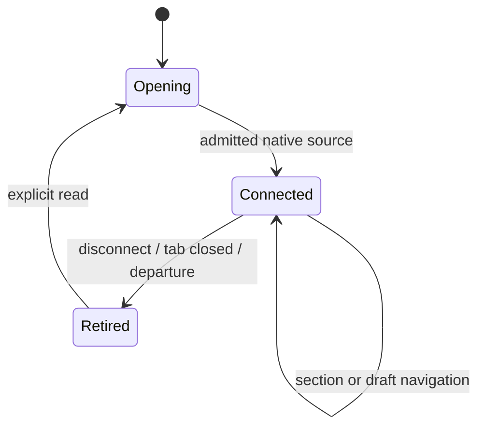
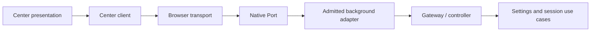

# Native control-center document lifetime

- Status: Ready for implementation within H3; native acceptance remains required
- Date: 2026-10-31
- Catalog capability ID: github-browser-extension
- Owners: Copilot maintainers
- Scope: preserve editing through same-document navigation and retire it on native disconnection.
- Related issue: [#704](https://github.com/vypdev/copilot/issues/704)
- Required review gates: UX, architecture, testing, security, documentation
- Open decisions blocking readiness: none

## 1. Executive summary

Navigating between center sections MUST preserve the same editor and unsaved
draft. Reloading or closing that document MUST retire its authority. A native
connection represents that lifetime; tab loading status cannot establish it.

```text
Open center → connect native document → read/edit → navigate with same owner
Disconnect → retire owner/reviews → retain draft/facts → explicit fresh read
```

## 2. Problem, current behavior, and evidence

Chrome for Testing 156.0.8078.80 emitted `tabs.onUpdated` loading events for
actual center anchor navigation, including a later loading event without URL.
The page retained `performance.timeOrigin`, emitted no pagehide/beforeunload,
and retained its credential epoch, but the background retired the editor.
Firefox 159.0 loaded all 20 sections in the same exploratory package test.
These are exploratory observations, not complete H3 acceptance.

H3 validation on Safari27.0.1 also measured one client publication and two
separately cloned deliveries of request sequence1 on one admitted native port,
before the first reply. The blanket repeated-sequence guard closed the channel
and left the center in recovery. Bounded diagnostic counters established the
single publication; they are removed from accepted source. Native receipts and
deterministic paired-port regressions remain separate evidence.

The pre-fix background integration regression reproduces the same owner loss.
Existing source: `background_runtime.ts`, `center_controller.ts`, `center_app.ts`.
Prospective design: retrospective classification does not apply. Current H2
receipts do not establish this refinement's behavior in any browser.

## 3. Actors, surfaces, and terminology

The center user navigates, edits and explicitly reloads current facts. The
native background owns editor authority. **Source** means one private native
connection object, never a page-provided document, tab or capability token.
The existing controller epoch and credential epoch remain independent fences.

## 4. Goals, non-goals, and fixed invariants

1. Same-document route changes MUST retain ownership, drafts and current reviews.
2. Native disconnect MUST synchronously retire that exact source and all its
   retained write authority; late results cannot restore it.
3. No loading grace period, arbitrary URL exception, permission expansion,
   periodic keepalive, automatic mutation replay or token restoration is allowed.
4. Native tab removal/departure MUST also retire its ports; another window and
   a replacement document MUST survive late events belonging to the old source.
5. No schema migration, GitHub Action command or remote operation is introduced.
6. An identical retained native delivery MUST be ignored without dispatching
   another application call, returning a cached reply or extending editing
   authority. A changed body or an unrecognized stale correlation MUST still
   retire the connection. Fingerprints cannot establish identity or permission.

## 5. Current versus proposed journey

| Event | Previous behavior | Required behavior |
|---|---|---|
| Chrome hash loading | editor becomes stale | keep same native connection/editor |
| Real document unload | inferred from loading | native disconnect retires source |
| Worker disappears | next request may fail | visible unavailable state; no hidden write retry |
| Explicit reload facts | may reuse stale authority | fresh connection/open before reading |



Text equivalent: open, use the same connection through routes, retire on
disconnect, and explicitly read through a fresh connection to recover.

## 6. Functional behavior and state model

The options application MUST send the existing closed `center.*` request
families through one `runtime.connect` port. Each accepted native port receives
an unexported source object. The controller binds both source and available
native document/tab facts. Missing optional document/tab metadata does not
permit sharing clients between ports. Reopening on the same live source is
idempotent; a new source never inherits its predecessor's client.

Only the background registers the receiving listener. Repeated disconnect
callbacks are idempotent. The client removes its listeners, retires pending
requests and private ownership, and preserves local drafts. A submitted
confirmation becomes uncertain until exact durable readback establishes its
fact; an unsubmitted preview becomes stale. Already observed saved facts remain
saved. An explicit read may reconnect; no mutation is transparently resubmitted.
Inactivity can stop a worker: keeping a port object does not prove it is alive.

Each private connection additionally owns a bounded delivery window. Parse the
closed envelope and byte limits first; process arrivals in order, using native
WebCrypto SHA-256 over canonical UTF-8 JSON. Object keys are sorted recursively;
arrays and scalar values keep their meaning and ordering. The retained window
contains only correlations and digests. Equal correlations with equal digests
are copies and cause no further effect. Different digests retire that source.
Unrecognized requests still require an increasing sequence; unrecognized replies
still require a matching pending request. Eviction never exempts those checks.

Hash completion MUST recheck transport lifetime before recording a fingerprint
or dispatching. Retirement clears queued frames and the window. A late hashing
success or failure cannot call the retired connection's observer, repaint the
page, disconnect its replacement or recreate authority. No acknowledgement,
ready-message exchange, automatic retransmission or cached response is added.

## 7. Configuration

No user setting can weaken source admission, deadlines, bounds or retirement.
Recommended configuration remains the existing local center defaults. An
alternative remains an observer center in a second window, with explicit
takeover; neither requires new permissions or persistence.

| Internal closed constant | Bound | Scope/persistence |
|---|---:|---|
| Port name/version | `copilot.center.v1` | native channel only |
| Admitted ports | 8 | worker memory |
| Outstanding requests | 16 per port | memory, cleared on retirement |
| New request correlation | positive safe integer, strictly increasing | per connection |
| Reply correlation | matches a pending request; completion may arrive out of order | per connection |
| Delivery window | 16 correlations with 64-character SHA-256 values | private memory, cleared on retirement |
| Incoming hashing queue | 32 validated frames, including one being hashed | per connection, cleared on retirement |
| Request deadline | 30 seconds | one request; expiry retires channel |
| Payload | existing center request/reply bounds plus 1024 envelope bytes | no expansion of payload limits |

Unknown fields, invalid sequence, invalid method family, excessive bytes or
capacity MUST fail closed. No fallback to unbound messaging is permitted when
native connect is unavailable. H2/content messaging retains its existing gates.
An identical retained copy does not allocate another request slot or refresh
window eviction order. The request deadline includes fingerprint processing.

## 8. Clean Architecture

| Layer | Owns | Forbidden responsibility |
|---|---|---|
| Pure domain | bounded closed envelopes, canonical JSON and digest-window decisions | native globals or clocks |
| Application | source identity, editor, review retirement | browser Port DTOs |
| Browser adapters | native connection/events, SHA-256, ordered bounded arrivals, correlation/deadline | mutation policy |
| Composition | bind private source, source-tree envelope, disposal | weakening sender admission |
| Presentation | semantic callbacks, drafts, localized status | native authority/ports |



Text equivalent: UI calls the client, its adapter exchanges bounded native
frames, and the admitted background delegates to existing application use cases.
Source pointers never enter serialization, settings, exports or UI models.
AST dependency/cycle/global checks and module budgets remain mandatory. Native
paired-port fixtures exercise composition without impersonating real engines.

## 9. UI/UX and content

Use existing complete en/es/fr/pt recovery content and semantic status regions:

| State | Primary content/action | Retained facts |
|---|---|---|
| Opening | loading current settings; wait | local draft remains |
| Connected | current settings and editor/observer status | current revision |
| Retired before write | settings unavailable; read again | draft and stale review |
| Retired during confirmation | outcome unknown; inspect/read | exact attempted review, no success claim |
| Readback proves save | change saved; close review | observed saved revision |

No raw native errors, private source IDs or provider payloads appear in content.
Focus, route guards, keyboard navigation, reduced motion, narrow layout and
screen-reader semantics remain the owning H3 contracts. No new notification,
GitHub comment or modal is generated for a routine section change.

## 10. Failure, recovery, and cleanup

Disconnect, malformed frame, timeout, capacity exhaustion or native exceptions
retire the relevant channel, reject pending requests with a fixed semantic
failure and remove all listeners/timers. New requests require a fresh open.
Missing/failed native crypto also retires the connection with the existing
semantic recovery state. It cannot downgrade to weaker comparison or unbound
messaging. Conflicting frames remain failures even after an earlier reply was
observed; an ignored copy cannot replace that observed fact.
A late completion may leave an actual durable effect, but cannot send a current
receipt through a retired source. Recovery reads storage and never repeats the
mutation. Shutdown unregisters the native listener and retires each owned port.

## 11. Security, permissions, and privacy

Admit only the fixed port name and existing exact extension options origin,
top-frame and non-private sender policy. Validate sender binding before storing
a source. Content scripts, other extensions, arbitrary schemes, queries,
subframes and malformed native metadata cannot open this channel. Each frame
uses the existing closed center parsers and controller/credential/revision
checks. Credential-bearing requests remain transient; neither adapter logs nor
retains completed request bodies. No credentials appear in evidence fixtures.
Queued frames remain transient. The delivery window stores no original request
or reply body, credential or private source pointer. The adapter clears its own
temporary UTF-8 byte array on hashing success and failure. A digest is neither
an exported capability nor a replacement for sender, source or epoch admission.

## 12. Observability and operational UX

Technical source/build identity remains the packaged digest. No heartbeat or
telemetry is added. Evidence records actual engine/version, exact package/source,
same-document versus unload behavior and cleanup, separately from human UX and
remote Codecov. Exploration is explicitly labelled as such.

## 13. Compatibility, migration, rollout, and rollback

No persisted schema changes. Older direct-message center clients retain loading
retirement and existing sender gates; their client cannot access a port-bound
owner. New H3 options never downgrade to that path. Registered H2 Safari rollback
stays untouched. All three actual browser families must verify the new source.

## 14. Testing strategy and numeric budget

| Risk area | Minimum distinct cases | Required behaviors |
|---|---:|---|
| Pure envelopes | 16 | boundaries, closed fields, byte limits, methods, correlation |
| Browser client | 16 | ordering, timeout, capacity, errors, reconnect, no replay |
| Background adapter | 16 | admission, native metadata, disconnect, overflow, late replies |
| Controller/application | 16 | source isolation, reuse, late disconnect, preview/confirm/readback |
| Mounted/composed flows | 12 | drafts, route events, uncertainty, second view, localized recovery |
| Real browser evidence | 4 | Chrome, Firefox, Safari; independent human navigation/recovery |
| **Total** | **80** | distinct risks; repeated locales alone do not multiply cases |

Preserve all prior cases. All changed executable lines must be covered without
partials; new pure policy branches and changed module metrics must reach 100%.
Deterministic clocks/paired native fakes cover races; native evidence uses real
loaded packages without API replacement. Human accessibility remains separate.

Native redelivery adds the following minimum43 distinct risks, including three
full source-bound engine journeys. Existing blanket-duplicate adapter cases are
refined to reject changed-content correlation collisions; new cases separately
prove that identical copies preserve at-most-once behavior. No existing source,
timeout, byte, capacity, owner, uncertainty or approval fence is removed.

| Supplemental area | Minimum | Required evidence |
|---|---:|---|
| Canonical JSON and digest window | 12 | shape, ordering, conflicts, eviction, isolation |
| Native fingerprint/privacy adapter | 6 | known bytes, Unicode, provider errors, transient byte cleanup |
| Ordered native arrivals | 12 | bounded queue, parsing, failures, retirement, late hash success/error |
| Client/background correlation | 6 | both directions, old correlations, out-of-order replies, replacement safety |
| Complete composed review | 4 | one save, cancel, uncertain readback, same-document draft |
| Actual Chrome/Firefox/Safari | 3 | current packaged source; boot, routes, persistence and recovery |
| **Total** | **43** | **40 automated plus3 native journeys** |

The jsdom environment supplies Node's actual SubtleCrypto API, which jsdom does
not implement. Deterministic adapter scheduling may inject the same SHA-256
algorithm through a test-only Node adapter. Neither proves a loaded browser;
native campaigns use each engine's own API with no replacement.

## 15. Documentation and discoverability

Update runtime architecture/lifecycle and troubleshooting with source retirement,
explicit read recovery and uncertain-save readback. Link this refinement from
the H3 owner and catalog; regenerate catalog and validate specifications, docs,
source budgets and all package targets.

## 16. Acceptance scenarios

1. Real anchor/hash navigation, including loading without URL, keeps editor.
2. True unload disconnects and invalidates an outstanding preview.
3. Two native ports with identical or absent optional metadata stay isolated.
4. Old-source disconnect cannot revoke the replacement or another window.
5. Disconnect during a submitted write preserves uncertainty/factual readback.
6. Invalid sender/frame/sequence/capacity cannot execute a mutation.
7. Explicit reread reconnects; no automatic mutation or credential restoration.
8. Actual Chrome, Firefox and containing-app Safari prove source-bound journeys.
9. Distinct native copies dispatch one request and resolve one pending reply;
   a changed body or a correlation outside the window cannot bypass retirement.
10. Loss during hashing or confirmation preserves the retired-source fence and
    uncertain/saved facts. Exact readback never issues a second mutation.

## 17. Traceability

| Requirement | Owner / verification | Documentation |
|---|---|---|
| §§4–6 source lifetime | controller, native lifetime integration + real engines | runtime |
| §§7–8 closed transport | domain frames, client/server adapter contracts | runtime |
| §§9–10 uncertainty/recovery | center client + mounted scenarios | troubleshooting |
| §§11–13 isolation/compatibility | adversarial sender/source and legacy tests | runtime |
| §§14–16 quality | full coverage, source receipts, native/human acceptance | H3 owner/catalog |

## 18. Implementation sequence

Reproduce, define contracts, implement pure frames/source fencing, native paired
adapters, presentation retirement, adversarial/composed tests, docs and catalog.
Then run complete coverage, exact-source native acceptance and independent UX.

## 19. Definition of Done

- [ ] Every scenario and numeric risk floor has distinct passing evidence.
- [ ] All metrics, architecture/budgets, types, specs/docs and packages pass.
- [ ] Actual source-bound Chrome/Firefox/Safari and human acceptance pass.
- [ ] No retries, permission/schema expansion or weakened lifecycle gate.
- [ ] Catalog, H3 owner, runtime/recovery guides and cleanup are current.
- [ ] Remaining full-H3 gates pass before source publication/PR; remote review,
  exact-head checks and Codecov remain mandatory before merge.

## 20. References and decisions

- [H3 owning specification](github-browser-extension-control-center-h3.md).
- [Chrome messaging and port lifetime](https://developer.chrome.com/docs/extensions/develop/concepts/messaging).
- [Mozilla Port lifecycle](https://developer.mozilla.org/en-US/docs/Mozilla/Add-ons/WebExtensions/API/runtime/Port).
- [Chrome worker lifecycle](https://developer.chrome.com/docs/extensions/develop/concepts/service-workers/lifecycle).
- [Native SHA-256 digest API](https://developer.mozilla.org/en-US/docs/Web/API/SubtleCrypto/digest).
- Rejected: ignoring loading globally, time-based grace periods or a document
  token supplied by the page. Native Port identity establishes the source.
