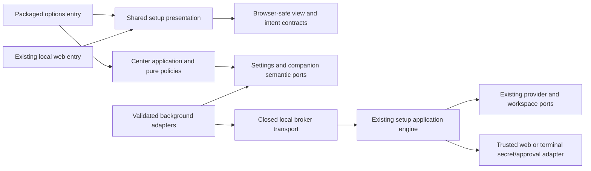

# GitHub Extension — Local Control Center and Integrated Copilot Setup

- Status: Ready for review — proposed complete product contract, unimplemented
- Date: 2026-10-25
- Catalog capability ID: `github-browser-extension`
- Last verified: 2026-10-25, current setup source/spec inspection only
- Owners: Copilot product, setup, browser, security, accessibility and QA maintainers
- Scope: Packaged full-page configuration application plus shared setup presentation and explicit CLI-owned privileged setup handoff.
- Related issues/PRs: [Issue #694](https://github.com/vypdev/copilot/issues/694), [PR #699](https://github.com/vypdev/copilot/pull/699)
- Required review gates: product UX, setup parity, architecture, credential/loopback security, browser packaging, accessibility, tests and documentation
- Open decisions blocking design readiness: None. This specifies a new bounded adapter; current CLI/web behavior is not claimed to implement it.

## 1. Executive summary

The extension includes a full local application, opened in its own browser tab, with searchable features, personal profiles, repository connections, workspaces, Copilot operations, setup, activity, privacy and diagnostics. It loads from the signed extension package and supports local settings and setup-intent preparation offline.

**Reuse decision:** extract browser-safe Svelte presentation, types, localization and pure setting/questionnaire validation from the existing setup into shared private modules. Keep the current CLI/application engine authoritative for repository inspection, credentials, permission probes, plans, writes and cleanup. The local center presents the complete shared journey; sensitive credential entry and final privileged approval take place in the paired existing same-origin local web authority page. A separate, newly designed broker may mirror sanitized state and submit nonsecret choices. It cannot proxy the existing web API or acquire Apply authority.

```text
Toolbar or in-page Settings -> packaged local center -> configure personal features
 -> choose Copilot repository -> prepare shared setup choices -> explicitly launch/pair CLI
 -> nonsecret wizard/configuration in center -> protected credential/approval step in local web
 -> CLI audits/applies/verifies -> redacted progress/result in center -> inspect/recover
```

Text equivalent: one setup engine has terminal, local web and extension presentations with explicit authority handoff; the browser feature does not become a second installer or a resident daemon requirement.

## 2. Problem, current behavior, and evidence

### Observed current behavior

- `package.json` already uses Svelte 5, TypeScript and Vite for the local web setup assets. `web/src/session/setupCommandTransport.ts` posts to same-origin routes.
- `src/application/contracts/web_setup_view.ts`, setup use cases and pure policies define nonsecret views, questions, decisions, plans and provider boundaries.
- `src/cli/web_setup_bridge.ts` coordinates revisions, one controller, takeover, choices, progress and cancellation. It imports Node crypto and is not a browser-safe shared module.
- `src/cli/web_setup_server.ts` binds only 127.0.0.1 on an ephemeral port, checks Host and same-origin POST context, pairs with a terminal code and rejects cross-site requests. Its CSP contains frame-ancestors none and X-Frame-Options DENY. It is deliberately not an extension API or embeddable iframe.
- Existing setup/configuration SDDs require current plan approval, grant audit, exact scope, no secret-bearing view and cleanup-verified permission probes. Reading a panel does not grant write authority.

The design must reuse these decisions while adding a separately reviewed presentation/transport adapter. Merely linking to the current web page is insufficient for the required local application; importing its Node bridge, embedding it in an iframe or loosening its CORS/origin checks is rejected. Runtime behavior and store/browser acceptance remain unknown until implementation. As-built reconstruction is not applicable.

## 3. Actors, surfaces, and terminology

| Actor | Goal | Surface |
|---|---|---|
| Individual developer | Configure personal GitHub experience | Packaged options application and toolbar |
| Repository maintainer | Inspect effective Copilot configuration and plan changes | Center Copilot/setup routes |
| Local setup operator | Supply credentials and approve exact privileged effects | Existing paired CLI/local web authority |
| Organization operator | Review inheritance/shared scope and batch plans | Shared setup flow, per-target previews/results |
| Maintainer/QA | Diagnose, prove parity and ship secure artifacts | Redacted receipts, shared fixtures, real browsers and docs |

Personal settings are extension-owned preferences, not repository policy. A setup intent is nonsecret untrusted input, not a plan approval. An authoritative plan is produced by the CLI/application engine from current facts. A broker capability grants only its closed nonsecret view/edit operation set; it is not the web session key, a GitHub token or permission to Apply. Controller epoch binds the current view role and is revoked on takeover/expiry.

## 4. Goals, non-goals, and fixed invariants

| Requirement | Behavior |
|---|---|
| HUB-UI | Complete navigable packaged application with feature discovery, profile/permission/privacy management and accessible four-locale journeys. |
| HUB-TRANSPORT | Closed typed extension messages and opt-in exact-origin/session/target-bound CLI broker, with truthful fallback and one controller. |
| HUB-PLAN | Shared setup question/setting/plan/audit/apply semantics, exact scope, current single-use approval and independent result/cleanup evidence. |
| HUB-SECURITY | Setup/bot/provider secrets and legacy web capabilities remain in their current trusted authority; no arbitrary fetch, shell or policy bypass. |
| HUB-OPERATIONS | Reproducible shared packaging, migration, real browser/CLI parity, diagnostics, complete docs and rollback. |

Required scope includes every CENTER and SETUP catalog row. No hosted service, user billing system, telemetry, localhost port scanner, arbitrary shell command, browser cookie scraping, default-branch write shortcut, hidden Action metadata editing or remote executable frontend. Native messaging may be evaluated as a separate transport with the same port contract; the complete product uses the bounded local broker plus a tested explicit native-web handoff when browser origin verification is unavailable.

## 5. Current versus proposed product journey

| Stage | Current | Required integrated product |
|---|---|---|
| Personal configuration | Small feature preferences | Full local application, search, profiles, permissions, privacy and recovery |
| Setup entry | Start terminal/local web | Repository confirmation and shared wizard/configuration inside center |
| No CLI | Existing installer unavailable | Useful local settings, complete nonsecret choices and explicit portable intent/handoff |
| Connect authority | Terminal prints local URL/code | Explicit user-started CLI session, identified target, code and permitted broker role |
| Sensitive step | Same-origin local web/terminal | The same protected authority step with clear return/progress in center |
| Apply | Existing engine audit/approval/write | Same engine and approval; no privileged broker shortcut |
| Result | Local web/terminal facts | Matching redacted center effects, partial cleanup and recovery links |

```mermaid
sequenceDiagram
  participant U as Operator
  participant C as Packaged center
  participant B as Extension background
  participant L as Local nonsecret broker
  participant E as Shared CLI engine
  participant W as Trusted local web
  U->>C: Choose repository and setup choices
  U->>E: Explicitly start companion session
  U->>C: Pair using terminal code
  C->>B: Closed pair/edit intent
  B->>L: Bound nonsecret request
  L->>E: Validate current choices/revision
  E-->>C: Redacted view and protected step required
  U->>W: Enter secrets and approve current plan
  W->>E: Existing authority/controller transaction
  E-->>C: Observed progress and verified effects
```



Text equivalent: the center sends nonsecret intent through the background/broker; credentials and final approval remain in the trusted local web authority; one engine emits all progress and effects.

## 6. Functional behavior and state model

### Local application information architecture

| Route | Required content and main action |
|---|---|
| Overview / My work | Selected scope, review/work queues, pending personal/setup actions and unavailable sources |
| Features | Search all 150 functions, problem/page filters, previews, default/effective state and why unavailable |
| Profiles | Named profile editor, inherited sources, full delta, import/export/migration/restore |
| Repositories / Workspaces | Explicit selected repositories, private retention, verified identities, pause/disconnect |
| Connections / Permissions | Active account per host, scoped read/write sessions, browser grants, revocation guidance |
| Copilot | Capability/context matrix, status/findings/commands, operational source links and configuration provenance |
| Setup / Configuration | Shared inspector, focused adjustments, full wizard, presets/batch, plan review, protected handoff and effects |
| Activity | Redacted intent/approval/acknowledgement/result distinction and user-invoked recovery |
| Privacy / Data | Retention, local/private state, export previews, per-scope clear/reset and authored-note protection |
| Diagnostics / Help / About | Per-feature health, compatibility, redacted export, complete docs, update/support and release identity |

Use packaged history/hash routes with a closed route/parameter parser; no arbitrary return URL, secret, ref or command in a deep link. Toolbar, a visible GitHub Settings entry, shortcut and browser extension manager all open the same app through runtime.openOptionsPage or its target-specific equivalent. Popup is a quick launcher/status view, not the only configuration UI. Optional side panels are supplementary.

Setup states: unpaired -> local-intent -> pairing -> inspecting -> editing -> review -> protected-authority -> checking -> applying -> verified/partial/blocked -> recovery/closed. Read-only observers and a single active controller have explicit roles. Expiry/disconnect never implies cancellation of already accepted effects. A local intent remains editable without a companion; importing it requires fresh authoritative validation and review.

## 7. User-facing configuration

| Setting | Default / allowed values | Scope and persistence |
|---|---|---|
| features | Packaged registered defaults; booleans per known ID | Global -> host/account -> organization -> repository, stored locally |
| active profile | Comfortable; choose among at most 10 named user profiles | Per host/account; complete diff before apply |
| workspace | Empty explicit selection; at most 20 repositories per workspace, 10 workspaces | Opaque IDs persistent; private metadata/session evidence expires on disconnect |
| locale | Browser-supported choice, fallback en; en/es/fr/pt | Personal setting, complete atomic message fallback |
| density / theme / motion | Comfortable / system / system; bounded documented alternatives | Personal; cannot remove required access/contrast |
| API connection | Off; at most five explicit named session identities | Partition host/user/repository/role; one chosen identity per operation |
| optional writes | Off; enable named supported write families independently | No inherited grant; live review per operation |
| alerts / quiet hours | Off; explicit supported channel and bounded monitor at 5–60 minutes for at most five selected targets; at most 3 per 10 minutes and 20/day, default quiet hours 22:00–08:00 local | Personal; Chrome/Firefox OS or local channel, Safari toolbar/center; no delivered-at guarantee during browser suspension |
| recents | Off; opt-in maximum 50 entries/7 days | Local extension activity only, no browser history permission |
| diagnostics | Off for collection beyond closed health reasons; maximum 200 redacted entries/7 days | User-controlled, private detail session-only |
| setup companion | Unpaired; manual exact local target/code | Broker capability session-only, no auto-discovery/reconnect |
| local note retention | Session | Persistent local authored content only after explicit opt-in; separate export/delete |

Pause precedence is emergency > tab > repository > organization > host/account > global. Invalid or conflicting values preserve the prior complete revision; apply changes atomically and announce the result. Profiles/imports cannot request grants, approve writes or alter repository/Action safety. Global-only nonsecret export is recommended; adding repository rules or authored notes requires a separate readable disclosure. Unknown newer records remain inert/exportable. The 64 KiB imported setup-intent/settings limits and current pure validation are enforced before persistence.

Recommended: local profile plus selected-repository read connection, writes/alerts/recents off, session notes and explicit CLI pairing when setup is needed. Alternative: maintainer profile with selected regular-label/run-retry write families and reviewed batch setup; every operation still needs its exact intent/grant/revision checks.

## 8. Clean Architecture design

### Reuse and package boundaries

Proposed private `packages/setup-presentation` contains portable Svelte components, design tokens and four-locale presentation catalogs; the existing web entry and extension options entry consume it. Proposed private `packages/setup-contracts` exposes browser-safe immutable view/intent schemas and pure validation under explicit public barrels. Extraction must preserve current web/CLI behavior and keep root dependency overrides; no copied parallel questionnaire or magic imports of the full web application.

Domain owns IDs, setting and approval invariants. Application owns InspectConfiguration, EditNonsecretSetupIntent, PreviewProfile, PairCompanion, ObserveSetup, HandoffProtectedStep and coordinator transitions through semantic ports. DOM/browser/GitHub/loopback/CLI implementations live in adapters; composition wires them. Presentation receives redacted view models and cannot call provider mutation, filesystem or shell APIs. The existing CLI remains the sole credential/provider/apply owner; server/Node modules are never browser shared code.



Text equivalent: two packaged browser entries reuse presentation/contracts; only the CLI engine reaches privileged provider/workspace adapters. Enforce transitive no-Node/no-provider imports in browser shared modules, no network/credential authority in presentation, closed package exports, cycle rules, component/module size budgets and exact registration parity. Changed shared components must pass both local-web and extension acceptance.

### New nonsecret broker contract

The following is a **proposed new protocol**, not an existing endpoint/flag. An explicitly launched CLI may open a separate 127.0.0.1-only ephemeral broker listener alongside the existing authority web server. Keeping separate listeners preserves all existing Host/origin/CSP/session guards. The broker accepts no reverse proxy, alias, forwarded host, arbitrary path, remote/LAN URL or redirect. The exact chosen authority/broker address, protocol and repository identity appear in CLI and center. No port scanning or page-supplied discovery.

The operator supplies the extension origin displayed by the packaged center when explicitly launching this proposed broker mode. The CLI configures that exact origin before serving pairing or CORS preflight; it never learns an allowlisted origin from an unauthenticated network request. This is a new reviewed launcher contract, not an existing CLI flag.

Pairing uses a separate single-use 128-bit terminal code expiring after 120 seconds, maximum five failures followed by 30-second cooldown. It establishes a 256-bit broker-only capability bound to exact extension origin/installation, repository, session and permitted observe/nonsecret-edit role. Check the real request origin and exact Host; no wildcard CORS or null/missing-origin exception. Unsupported origin behavior uses explicit existing local-web handoff. The broker capability is held only by the background session, never page/content scripts/URLs/exports. It cannot authenticate to legacy web routes, GitHub or any privileged Apply endpoint.

Closed operations: pair, read redacted current state, answer an explicitly nonsecret question, request nonsecret Back/retry-discovery, request handoff to the trusted authority page, relinquish view control and disconnect. Each request binds protocol major, session ID, target identity, controller epoch, question/plan revision and monotonically increasing sequence/nonce. Request maximum 8 KiB, answer maximum 4,096 characters, redacted view maximum 256 KiB; no arbitrary URL/method/body/CLI command field. Unknown kinds/fields reject. Maximum two in-flight local reads; conditional foreground progress refresh at most once/2 seconds, idle once/10 seconds, stopped when hidden/unpaired. Broker idle expiry 30 minutes and hard expiry four hours never exceed its parent setup session.

Credential, final plan approval, quick-edit approval and all provider/permission-probe/apply authority remain in the trusted terminal/local web role. Handoff rotates controller epoch; extension edits are read-only until a current explicit transfer back. Do not reuse an untyped answer route that could accidentally submit approve or a secret. The engine revalidates after every asynchronous boundary. A signed/native messaging adapter may later implement the same narrow port only after its target-specific install/packaging review; it does not become an arbitrary execution channel.

## 9. UI/UX and content contract

```text
Copilot · Configuration                       Repository: chosen/verified
Personal settings saved locally · GitHub not connected
[Features] [Profiles] [Repositories] [Copilot] [Setup] [Privacy]

Setup: reviewed choices ready; no repository changes made
Next: connect the local setup companion to inspect current facts.
[Connect local companion] [Export nonsecret choices] [Read setup help]
```

```text
Protected setup step
Your exact plan is ready in the paired local setup page.
Credentials and final approval stay with the local CLI.
Completed: repository confirmed, choices validated, current plan inspected
Next: review the displayed plan and grants in that trusted page.
[Open protected step] [View plan here] [Cancel before new changes]
```

Pending: “Checking selected repository facts; no write authorized.” Action required: “Review this changed plan in the trusted local page.” Blocked: “Companion protocol incompatible; local preferences remain available.” Partial: “Two resources verified; one write outcome unknown; cleanup requires inspection.” Complete: “Selected effects read back; doctor result and actual Action execution evidence shown separately.” Offline: “Local features and intent planning ready; no remote facts certified.” Each state has one primary action and exact inspectable source/authority links.

Use one page-level scroll, persistent understandable navigation, breadcrumbs and Back that preserve unsaved nonsecret choices. Route/page changes must not discard a form silently; show save/discard/cancel. Required warnings lead with user impact, then cause/action/retained state; raw IDs/logs stay expandable. Support keyboard, screen reader, EN/ES/FR/PT, dark/light/high contrast/reduced motion, 320 CSS px/200% zoom and long localized text. No nested scrolling plan pane, popup-only flow, surprise tabs or misleading current account. Protected handoff explicitly explains destination, purpose and return path.

## 10. Failure, recovery, and cleanup

No companion: offline intent or documented explicit CLI/web journey. Pair denial/expiry: show exact reason and current target, no silent retry loop. Browser/worker closed: reconcile canonical session state; do not resubmit an intent. Changed facts or controller: invalidate approval, retain choices and request fresh review. Permission or cleanup failure: preserve application/provider receipts and current cleanup journal. Uncertain effects: inspect/read back before retry; do not report rollback. Stop prevents subsequent effects under the existing engine contract. Disconnect clears broker/private cache and leaves applied resources and authored notes untouched. Closing an authority page is not proof that a CLI process stopped.

## 11. Security, permissions, and privacy

Browser origin is not GitHub authorization. The read/write browser account, one-run setup operator and bot/provider credentials are separate roles. Legacy web session keys and setup/bot/provider secrets never enter the extension background, message bus, browser storage, URL, plan intent, exported receipt or diagnostics. Only the new broker-only capability may live in protected background session memory; it is useless for privileged setup. A compromised content script cannot reach center-only ports or nominate a localhost target. Exact origins/Host, one-time pairing, role separation, nonsecret schemas, revision/epoch/nonce validation and current engine approval are independent defenses. Do not weaken existing server guards to make integration convenient.

Persist only explicitly authored nonsecret settings; private repository names, evidence and session connection data stay partitioned and session-scoped. No analytics by default. Secret presence remains presence, not validity. Diagnostics export has a visible redaction preview and never includes complete request bodies or raw local filesystem paths by default.

## 12. Observability and operational UX

A session view reports current step, completed facts, current controller/role, next required human action, application effects, cleanup obligations and expiry. A redacted correlation joins CLI/web/extension observations but carries no credential. Report local setup file/resource success, permission-audit evidence, doctor readiness and actual deployed Action evidence as distinct dimensions. The center cannot overwrite an earlier accepted effect with a later generic failure. At most one current progress surface per session; no GitHub comment on every local refresh.

## 13. Compatibility, migration, rollout, and rollback

Version browser-safe contracts and broker protocol independently from the Action status schema. Unknown protocol major blocks the bridge and preserves local functionality; native handoff remains safe. Shared UI extraction preserves CLI flags/defaults and current local-web contracts. Setup intent is a versioned nonsecret input; unknown schema is inert/exportable, never an implicit approval. Native messaging has separate Chrome/Firefox host-manifest and Safari containing-app prerequisites and is not assumed equivalent. Every distributed artifact includes the same reviewed setup UI/catalog version. Rollback cannot reuse a newer broker/controller approval or erase unknown authored state.

## 14. Testing strategy and numeric budget

CENTER and SETUP feature cases are already counted in the functional catalog's **659** cases. The following **48 additional distinct cross-boundary cases** exercise shared UI, protected authority and broker/CLI interaction; none replaces a feature case or one of the 96 original core cases. Product total remains **803**, not a sum of browser matrix reruns.

| Area | Minimum distinct cases | Behaviors/risks covered |
|---|---:|---|
| CTX | 8 | Cross-component ctx behavior with distinct concrete inputs and outcomes. |
| BRIDGE | 8 | Cross-component bridge behavior with distinct concrete inputs and outcomes. |
| PLAN | 8 | Cross-component plan behavior with distinct concrete inputs and outcomes. |
| SEC | 8 | Cross-component sec behavior with distinct concrete inputs and outcomes. |
| UX | 8 | Cross-component ux behavior with distinct concrete inputs and outcomes. |
| OPS | 8 | Cross-component ops behavior with distinct concrete inputs and outcomes. |
| Total | 48 | Independent integration boundaries, not copies of per-feature happy paths. |

| Case ID | Area | Requirements | Scenario |
|---|---|---|---|
| bexhub-CTX-C01 | CTX | HUB-TRANSPORT | A content-script sender attempts to invoke a local-center settings or setup command: reject before reading private local state. |
| bexhub-CTX-C02 | CTX | HUB-TRANSPORT | A forged options-page URL or another extension ID sends a broker message: reject the sender and retain current state. |
| bexhub-CTX-C03 | CTX | HUB-TRANSPORT | An old control-center tab sends an edit after explicit takeover: reject its controller epoch and refresh it read-only. |
| bexhub-CTX-C04 | CTX | HUB-TRANSPORT | An account switch occurs while the options page is projecting a private repository: retire the old identity and require fresh connection. |
| bexhub-CTX-C05 | CTX | HUB-TRANSPORT | A local-center deep link contains a credential, arbitrary return URL or executable route: reject it without forwarding or logging the value. |
| bexhub-CTX-C06 | CTX | HUB-TRANSPORT | An oversized or extra-key message targets a privileged route: reject its closed schema before any provider or CLI call. |
| bexhub-CTX-C07 | CTX | HUB-TRANSPORT | A worker restarts during a nonsecret center navigation: restore committed preferences but require revalidation of any pending operation. |
| bexhub-CTX-C08 | CTX | HUB-TRANSPORT | The same setup session is open in native web and extension views: exactly one current role/controller can edit and handoff rotates authority. |
| bexhub-BRIDGE-C01 | BRIDGE | HUB-TRANSPORT | An ordinary GitHub page attempts broker pairing without the terminal code: reject its origin and create no session. |
| bexhub-BRIDGE-C02 | BRIDGE | HUB-TRANSPORT | A loopback redirect, LAN address, hostname alias or page-supplied port targets pairing: reject rather than forwarding the code or broker token. |
| bexhub-BRIDGE-C03 | BRIDGE | HUB-TRANSPORT | Five failed pairing codes occur within the window: apply the 30-second cooldown; expired or consumed codes cannot pair. |
| bexhub-BRIDGE-C04 | BRIDGE | HUB-TRANSPORT | A paired request uses the wrong repository, session, nonce or protocol major: reject before coordinator access. |
| bexhub-BRIDGE-C05 | BRIDGE | HUB-TRANSPORT | The background broker channel asks for a legacy web session key, PAT prompt answer or final Apply: reject the operation class. |
| bexhub-BRIDGE-C06 | BRIDGE | HUB-TRANSPORT | The CLI closes or reaches idle/hard expiry during foreground progress: mark disconnected, retain observed effects and require new pairing. |
| bexhub-BRIDGE-C07 | BRIDGE | HUB-TRANSPORT | A replayed broker edit uses an already consumed sequence/revision: return its prior acknowledgement or stale result without a new effect. |
| bexhub-BRIDGE-C08 | BRIDGE | HUB-TRANSPORT | A browser cannot establish the exact origin/host-permission handshake: use the explicit trusted local-web handoff and never relax CORS or origin checks. |
| bexhub-PLAN-C01 | PLAN | HUB-PLAN | A question changes after a nonsecret answer is drafted: require current revision review and do not submit the old answer. |
| bexhub-PLAN-C02 | PLAN | HUB-PLAN | Repository default SHA or remote configuration changes after plan review: the CLI invalidates approval and presents the changed plan. |
| bexhub-PLAN-C03 | PLAN | HUB-PLAN | A quick adjustment is requested for an unknown workflow expression: preserve inspection and route structural work through the full wizard. |
| bexhub-PLAN-C04 | PLAN | HUB-PLAN | The selected batch changes after per-repository plans are reviewed: require fresh aggregate approval bound to exact item identities. |
| bexhub-PLAN-C05 | PLAN | HUB-PLAN | A setup intent export is imported into another repository: treat it as untrusted choices and recompute the authoritative plan. |
| bexhub-PLAN-C06 | PLAN | HUB-PLAN | A permission probe succeeds but cleanup cannot be confirmed: retain the exact cleanup journal and report partial status in both views. |
| bexhub-PLAN-C07 | PLAN | HUB-PLAN | Stop is requested after one batch item applied: preserve that receipt and stop before new items rather than reporting a total cancellation. |
| bexhub-PLAN-C08 | PLAN | HUB-PLAN | A restored web tab tries to reuse a completed plan approval: the shared coordinator rejects the consumed approval before provider access. |
| bexhub-SEC-C01 | SEC | HUB-SECURITY | A setup credential is entered in the trusted same-origin authority page: no value appears in broker views/messages, extension storage or diagnostics. |
| bexhub-SEC-C02 | SEC | HUB-SECURITY | A selected-repository read session is passed as setup or bot authority: reject the credential role mismatch before any write. |
| bexhub-SEC-C03 | SEC | HUB-SECURITY | A profile import includes permission grants, commands or approval receipts: reject those fields atomically without enabling authority. |
| bexhub-SEC-C04 | SEC | HUB-SECURITY | A runtime Secret exists but cannot be validated: show presence-only evidence and never claim installed credentials are healthy. |
| bexhub-SEC-C05 | SEC | HUB-SECURITY | A setup state includes hostile markup or mention text: render escaped bounded text and no executable or auto-submitted instruction. |
| bexhub-SEC-C06 | SEC | HUB-SECURITY | A diagnostic export is requested with a private setup target: show a redaction preview and omit tokens, raw commands and absolute local paths by default. |
| bexhub-SEC-C07 | SEC | HUB-SECURITY | The broker receives forwarded-host headers or a DNS-rebinding Host mismatch: reject even when a pairing attempt is otherwise well formed. |
| bexhub-SEC-C08 | SEC | HUB-SECURITY | Disconnect occurs after a write intent is previewed: revoke the broker/controller capability and require a newly reviewed plan on reconnect. |
| bexhub-UX-C01 | UX | HUB-UI | A new user opens the local center offline: feature discovery, personal settings and nonsecret setup-intent planning remain usable. |
| bexhub-UX-C02 | UX | HUB-UI | A keyboard/screen-reader user navigates feature search, profile preview, setup handoff and back: focus and current step are announced without traps. |
| bexhub-UX-C03 | UX | HUB-UI | The center runs at 320 CSS px and 200% zoom with a long plan: primary controls stay reachable without fixed-height inner scrolling. |
| bexhub-UX-C04 | UX | HUB-UI | An English, Spanish, French or Portuguese setup journey falls back after one missing catalog entry: the whole affected message is coherent and literal IDs stay unchanged. |
| bexhub-UX-C05 | UX | HUB-UI | A feature preset changes twenty preferences: show a readable complete delta and retain the previous profile if validation or storage fails. |
| bexhub-UX-C06 | UX | HUB-UI | The protected setup step opens in a separate trusted tab: explain why, show the same session/target, and return to the exact center step after completion. |
| bexhub-UX-C07 | UX | HUB-UI | The local center closes mid-Apply: the CLI continues or stops according to its committed stage; reopening shows actual effects without resubmitting Apply. |
| bexhub-UX-C08 | UX | HUB-UI | A user clears diagnostics but retains authored notes: respect the explicit cleanup scopes and preserve the unrelated authored content. |
| bexhub-OPS-C01 | OPS | HUB-OPERATIONS | The packaged options application is installed without source files, Vite or a CLI: local routes/assets render entirely from the reviewed extension package. |
| bexhub-OPS-C02 | OPS | HUB-OPERATIONS | A shared setup presentation component is changed: CLI/web/extension fixtures still agree on questions, choices, permission explanations and plan semantics. |
| bexhub-OPS-C03 | OPS | HUB-OPERATIONS | A real Chrome worker terminates while displaying a paired setup result: reconnect shows canonical retained state and cannot revive an approval. |
| bexhub-OPS-C04 | OPS | HUB-OPERATIONS | A real Firefox event page unloads during a center workflow: protected state and session/controller rules behave identically after wakeup. |
| bexhub-OPS-C05 | OPS | HUB-OPERATIONS | A real Safari containing-app extension opens configuration and completes the supported setup handoff: no generic WebKit result substitutes for this evidence. |
| bexhub-OPS-C06 | OPS | HUB-OPERATIONS | A bundled extension shared-UI import reaches Node, provider mutation or filesystem code transitively: the architecture/build gate rejects the artifact. |
| bexhub-OPS-C07 | OPS | HUB-OPERATIONS | The companion CLI and extension protocol majors are incompatible: keep local settings available and show an exact supported upgrade/handoff path. |
| bexhub-OPS-C08 | OPS | HUB-OPERATIONS | A rollback restores a reviewed older extension while a newer setup intent exists: keep the unknown intent inert/exportable and never replay its approval. |

Pure capability/epoch/approval/parser policies require 100% branch coverage; other new modules follow 95% statements/90% branches, with all changed executable lines covered and existing root thresholds retained. Use fake clocks, typed transports and provider fakes, corruption/replay/expiry/partial fixtures and semantic content assertions. Packaged CLI/web/extension shared-UI parity, actual Chrome/Firefox/Safari broker or documented authority handoff, EN/ES/FR/PT, real keyboard/screen-reader and privacy inspection are required acceptance evidence. A generic browser page does not prove extension or loopback handshake support.

## 15. Documentation and discoverability

Add local-center navigation, feature/profile examples, effective-setting provenance, connections/grants, privacy/retention/export/reset, shared setup full journey, protected handoff, command/CLI prerequisites, pairing/controller/expiry, batch/quick adjustment, credential roles, cleanup/replay and upgrade/rollback guides. Include an explicit statement that existing CLI/web works independently and which new adapter/flag is proposed rather than currently released. Link relevant context help from every unavailable/protected state. Contributor docs explain shared package exports, forbidden imports, fixtures, browser harnesses and secret-free diagnostic receipts. Register docs routes/assets/examples and validate all links.

## 16. Acceptance scenarios

1. Without a CLI/token, a user opens all local settings, discovers the full catalog, changes a bounded profile and prepares nonsecret setup choices.
2. With an explicitly started compatible CLI, the center confirms the same repository/session and participates in the shared nonsecret wizard.
3. Credential/final approval opens the trusted authority step; the center remains truthful and receives only sanitized progress/effects.
4. A stale approval, changed remote facts, takeover, expiry or duplicate intent cannot start new provider effects.
5. A failed/partial setup retains exact verified effects and cleanup obligations with a useful recovery action in both views.
6. All declared browser paths, four locales, accessibility, package/import rules and current CLI/web compatibility pass before acceptance.

## 17. Requirements traceability

| Requirement | Cases |
|---|---|
| HUB-UI | bexhub-UX-C01, bexhub-UX-C02, bexhub-UX-C03, bexhub-UX-C04, bexhub-UX-C05, bexhub-UX-C06, bexhub-UX-C07, bexhub-UX-C08 |
| HUB-TRANSPORT | bexhub-CTX-C01, bexhub-CTX-C02, bexhub-CTX-C03, bexhub-CTX-C04, bexhub-CTX-C05, bexhub-CTX-C06, bexhub-CTX-C07, bexhub-CTX-C08, bexhub-BRIDGE-C01, bexhub-BRIDGE-C02, bexhub-BRIDGE-C03, bexhub-BRIDGE-C04, bexhub-BRIDGE-C05, bexhub-BRIDGE-C06, bexhub-BRIDGE-C07, bexhub-BRIDGE-C08 |
| HUB-PLAN | bexhub-PLAN-C01, bexhub-PLAN-C02, bexhub-PLAN-C03, bexhub-PLAN-C04, bexhub-PLAN-C05, bexhub-PLAN-C06, bexhub-PLAN-C07, bexhub-PLAN-C08 |
| HUB-SECURITY | bexhub-SEC-C01, bexhub-SEC-C02, bexhub-SEC-C03, bexhub-SEC-C04, bexhub-SEC-C05, bexhub-SEC-C06, bexhub-SEC-C07, bexhub-SEC-C08 |
| HUB-OPERATIONS | bexhub-OPS-C01, bexhub-OPS-C02, bexhub-OPS-C03, bexhub-OPS-C04, bexhub-OPS-C05, bexhub-OPS-C06, bexhub-OPS-C07, bexhub-OPS-C08 |

HUB-UI also maps to every CENTER feature case and UX docs; HUB-TRANSPORT to pairing/session use cases and architecture/permissions; HUB-PLAN to SETUP features and setup/recovery docs; HUB-SECURITY to credential-role/sender/intent policies and privacy docs; HUB-OPERATIONS to shared package/CLI/browser tests and release/contributor guidance. Functional catalog entries provide the exact additional per-feature case IDs. Existing setup SDDs retain ownership of installer policy and permission transactions.

## 18. Implementation sequence

1. Shared view/intent schemas and transport/application boundaries, proposed broker threat model, UX prototypes and fixtures.
2. Extract compatible setup presentation/locale modules; prove current CLI/web behavior and package parity before integrating the extension.
3. Build the complete local center and all feature/profile/privacy/connection routes.
4. Add offline intent planning/import and exact-repository validation through shared pure contracts.
5. Add the separate nonsecret broker and role/epoch-bound handoff while preserving the current authority server guards.
6. Integrate shared setup inspector/full wizard/quick edit/batch/doctor/progress and protected approval, then all failure/cleanup paths.
7. Complete real browser/accessibility/locale/security/performance and distribution/docs evidence across every required journey.

These steps do not remove any registered setup or center function from final acceptance.

## 19. Definition of Done

- [ ] Every CENTER/SETUP feature and all 48 cross-boundary cases pass with source-linked evidence.
- [ ] Packaged local center is independently useful, searchable, accessible and complete in four locales.
- [ ] Shared UI/questionnaire/setting/plan/permission/cleanup parity passes CLI, web and extension fixtures.
- [ ] No Node/provider/credential authority enters browser shared packages or content scripts.
- [ ] Existing same-origin Host/CSP/pairing/session defenses remain intact; the new broker has only closed nonsecret operations.
- [ ] Current plan/controller/role and single-use approval fencing survive replay, takeover, expiry and partial outcomes.
- [ ] Actual target browser/OS paths, protected handoff, packaging and upgrade/rollback are verified.
- [ ] Documentation, help, routes, examples, privacy, diagnostics and recovery are complete and validated.
- [ ] No runtime/browser/provider/store acceptance is asserted from specification or fake-transport tests alone.

## 20. References and decisions

Owning current contracts: [local web setup](local-web-setup-assistant.md), [configuration management](setup-configuration-management.md), [setup/credentials/doctor](setup-configuration-credentials-and-doctor.md), [permission transactions](setup-pat-permission-guidance-and-verification.md), [batch setup](organization-configuration-reuse-and-batch-setup.md), [verification setup](verification-setup-onboarding.md).

Primary platform evidence: [Chrome options](https://developer.chrome.com/docs/extensions/develop/ui/options-page), [Mozilla options](https://developer.mozilla.org/en-US/docs/Mozilla/Add-ons/WebExtensions/user_interface/Options_pages), [Chrome cross-origin requests](https://developer.chrome.com/docs/extensions/develop/concepts/network-requests), [Mozilla optional host permissions](https://developer.mozilla.org/en-US/docs/Mozilla/Add-ons/WebExtensions/manifest.json/optional_host_permissions), [native messaging](https://developer.mozilla.org/en-US/docs/Mozilla/Add-ons/WebExtensions/Native_messaging). Inspected 2026-10-25; actual target behavior must be verified during implementation.

Chosen: packaged full-page application, shared original Svelte UI/contracts, one setup authority, separate nonsecret broker, protected same-origin credential/Apply handoff and explicit offline intent. Rejected: iframe of current setup, importing Node bridge into a browser, generic fetch/shell proxy, broad CORS, broker-acquired legacy session/Apply credentials, a duplicate installer and an options popup that substitutes for the complete application.
