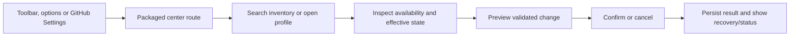
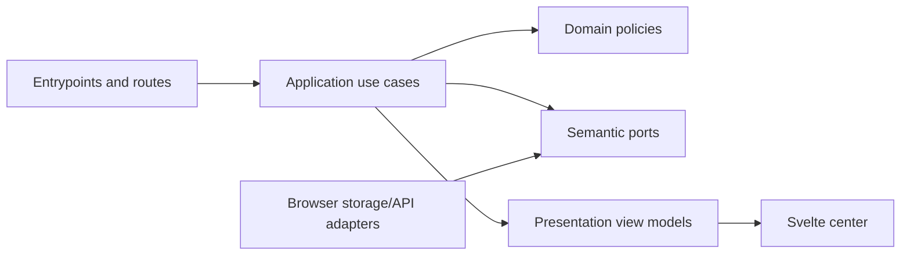

# H3 — Complete local control center, profiles and accessible configuration

- Status: Draft
- Date: 2026-10-28
- Catalog capability ID: `github-browser-extension`
- Last verified: not applicable; this is a prospective companion specification
- Owners: Copilot maintainers
- Scope: Deliver the H3 packaged local control center against all CENTER catalog capabilities while preserving the complete 150-function/803-case product contract.
- Related issues/PRs: [Issue #704](https://github.com/vypdev/copilot/issues/704); prerequisite [Issue #703](https://github.com/vypdev/copilot/issues/703), completed through merged PR #719.
- Required review gates: product UX, architecture, testing, documentation, security/operations
- Open decisions blocking readiness: none for this refinement; implementation must establish H3-specific source-bound acceptance evidence.

## 1. Executive summary

H3 delivers a packaged, local-first control center for understanding and configuring the GitHub browser extension. Users can navigate real center routes, search the complete 150-feature inventory, inspect effective settings and availability, manage profiles, permissions and sessions, and preview safe backup, reset and rollback actions. The experience is keyboard and screen-reader accessible, responsive, localized in English, Spanish, French and Portuguese, and available from toolbar, options and GitHub Settings entrypoints.

Recommended defaults are local-only storage, explicit preview before destructive or bulk changes, and clear explanations when an inventory feature depends on a later milestone. The principal safety rule is that configuration and export never expose credentials or private evidence, grant permissions silently, or weaken the extension's fixed safety boundaries.

```text
Open center → inspect/search feature or profile → review effective state and source → preview change → confirm → see result or recovery action
```

## 2. Problem, current behavior, and evidence

### 2.1 Problem

Extension users and maintainers need one understandable place to discover the proposed product's capabilities and safely manage local settings. Without it, users cannot reliably see why a feature is unavailable, which setting wins, what data is stored, or how to recover from an invalid import, quota limit or migration problem.

### 2.2 Current behavior

1. Verified prerequisite evidence reports H2 #703 closed through merged PR #719, with runtime/session/settings/GET services and actual extension-loaded Chrome, Firefox and real Safari containing-app receipts bound to input SHA-256 `60c22c6de3c06bd5e3b34320ac7acfc733a77ec9601c5aa04805b4e04da843c5`.
2. The pinned catalog identifies the proposed extension capability, its existing owning specifications and CENTER catalog source at `specs/browser-extension/features/CENTER.v1.json`.
3. H2 readiness does not implement H3. The complete center, its entrypoints, UX, profile management and H3 acceptance remain proposed; later-milestone behavior must be presented as unavailable where it is not implemented.

### 2.3 Evidence

- Code/workflow/documentation references: the pinned catalog at `4f69a8f9761568eac17120e9fe819a2c08ee0703` records the capability, existing sources and H2 evidence. Existing specifications are listed in section 20.
- Incidents or concrete examples: issue #704 requires honest availability, effective-state explanations and recovery for import/reset/migration/quota behavior.
- External primary sources: browser API and accessibility behavior must be checked against primary vendor documentation during implementation; no runtime/store approval is inferred here.
- Unknowns: exact H3 UI behavior and source-bound test receipts await implementation. Catalog feature definitions and their 56 existing cases remain normative by reference; this refinement does not reproduce or redefine those IDs.

### 2.4 Retrospective classification (as-built baselines only)

Not applicable: this is a prospective specification and does not reconstruct an implemented H3 baseline.

## 3. Actors, surfaces, and terminology

| Actor | Goal | Entry point | Visible surfaces |
|---|---|---|---|
| Extension user | Understand and configure local behavior safely | Toolbar, options, GitHub Settings | Full-page center, feature detail, profile, recovery views |
| Repository user | Review repository-scoped preferences and permissions | Center repository context | Profile and effective-state explanation |
| Maintainer | Diagnose local configuration and availability | Center diagnostics/help | Redacted diagnostics and documentation |

**Center** means the packaged full-page configuration application. **Feature inventory** means metadata for all 150 product functions, including features not yet implemented. **Effective state** means the resolved value plus its source and scope. **Profile** means bounded preferences at personal or repository scope. **Session** means a named local extension context; it is not a GitHub credential. **Private evidence** includes credential material and sensitive repository or account content; it is never exportable through center backup.

## 4. Goals

| Requirement | Behavior |
|---|---|
| H3-R01 | Center has real routes and toolbar, options and GitHub Settings entrypoints; navigation preserves the intended destination and supports keyboard operation. |
| H3-R02 | Search covers all 150 inventory records and details are lazy-loaded; every feature shows implementation availability and unmet dependency honestly. |
| H3-R03 | Effective-state views explain value, source, scope and precedence for personal and repository profile settings. |
| H3-R04 | Users can create, select, edit and remove bounded personal/repository profiles with validation and recoverable persistence. |
| H3-R05 | Permission and named-session management displays current grants/state, asks for explicit browser-mediated authorization where required, and handles unavailable APIs. |
| H3-R06 | Favorites, shortcuts, attention and work views expose useful local navigation without claiming unavailable product functionality. |
| H3-R07 | Import, export, reset and rollback are schema-validated, redacted, bounded and previewed before confirmation. |
| H3-R08 | Diagnostics and activity are useful, local and redacted; no credential or private-evidence export is possible. |
| H3-R09 | Appearance, onboarding, help and recovery are discoverable and persist only within documented local scope. |
| H3-R10 | All center content is available in en/es/fr/pt with accessible interaction, responsive layout and reduced-motion support. |
| H3-R11 | Storage failures, quota, migration and future-schema data produce safe, understandable recovery without silent destructive fallback. |
| H3-R12 | H3 passes its own source-bound options, storage, session and UX evidence on Chrome, Firefox and Safari. |

### 4.1 Non-goals

1. Implementing the remaining H4–H12 product milestones, shared setup extraction, broker or privileged Apply behavior.
2. Remote SPA delivery, browser history permission, store submission or claiming unverified browser/runtime/store compatibility.
3. Replacing or narrowing any existing owning SDD or catalog requirement.

### 4.2 Fixed product/safety invariants

1. The full 150-function/803-case product baseline remains normative; H3 owns all CENTER capabilities and their 56 existing catalog cases by reference.
2. Permission grants, destructive actions and profile replacement require explicit user intent; previews never mutate state.
3. Credentials and private evidence never enter export, diagnostic logs or UI error details.

## 5. Current versus proposed product journey

| Stage | Current | Proposed | User/operator effect |
|---|---|---|---|
| Entry | H3 center is not implemented | Toolbar/options/GitHub Settings open packaged center routes | User reaches a consistent local control surface |
| Discovery | No H3 inventory UI | Search all 150 features and inspect details | Availability and dependencies are explicit |
| Configuration | H3 profile journey is not implemented | Explain precedence, edit scoped profiles and manage sessions/permissions | User can predict effect before saving |
| Recovery | H3 preview/recovery journey is not implemented | Validate and preview import/reset/rollback, then confirm | Invalid or risky changes are recoverable |



Text equivalent: entrypoint → packaged route → inspect inventory/state → preview → confirm or cancel → visible outcome and recovery.

## 6. Functional behavior and state model

### 6.1 Happy path

1. The entrypoint resolves to a real center route without requesting browser history permission.
2. The inventory presents all 150 metadata records; search and filters do not imply runtime availability.
3. A detail view identifies availability, dependency, effective value, source and scope.
4. The user edits a bounded profile or selects an explicit permission/session action.
5. The application validates a complete proposed change and presents its consequences before persistence.
6. The user confirms; storage reports success or an actionable failure with retained state.

### 6.2 Alternative paths

- A feature awaiting H4–H12 remains discoverable and explains its dependency; its unavailable controls are not represented as working.
- Canceling any preview leaves durable state unchanged.
- Unsupported browser APIs are identified with a supported alternative or explanation, not a false success.
- Import containing unknown fields, future schema, invalid values or private data is rejected or safely quarantined according to schema policy; it is never partially applied without a preview and explicit contract.

### 6.3 State machine

| State | Entered when | User-visible meaning | Allowed next states | Recovery/owner |
|---|---|---|---|---|
| Loading | Route starts or storage is read | Center is loading local data | Ready, Degraded, Failed | Retry read; application |
| Ready | Inventory and state are resolved | Center is usable | Preview, Degraded | User action; presentation |
| Preview | Validated proposed mutation exists | No change has yet been applied | Ready, Applying | Cancel or confirm; application |
| Applying | Confirmed mutation is being persisted | Change is in progress | Ready, Degraded, Failed | Re-read durable state; application/adapter |
| Degraded | Optional API/data unavailable | Partial center remains usable | Ready, Failed | Explain dependency and retry; presentation |
| Failed | Required read/write cannot complete | Requested action did not complete | Loading, Ready | Retry or recovery instructions; application |

Duplicate confirmations MUST be idempotent; stale previews MUST be invalidated when their source revision changes. Canceled and out-of-order operations MUST NOT overwrite newer durable state. Partial persistence MUST be detected by rereading and reported with exact retained facts.

## 7. User-facing configuration

| Input | Type | Recommended default | Allowed values/range | Scope/persistence |
|---|---|---|---|---|
| Active profile | Stable local profile ID | Personal default, clearly labeled | Existing profile ID or explicit create | Local persistent |
| Profile scope | Enum | Personal | Personal, current repository | Local persistent; repository identity validated |
| Appearance | Enum | System | System, light, dark | Local persistent |
| Locale | Enum | Browser locale when supported | en, es, fr, pt; fallback en | Local persistent |
| Favorites | Bounded ID list | Empty | Registered inventory IDs, bounded by schema | Local persistent |
| Backup schema | Versioned structured document | Current supported version | Current known version only for restore | Export file; import preview |

Validation rejects unknown profile references, malformed repository identity, duplicate IDs, out-of-range collections and incompatible schema versions. Precedence is feature default → personal profile → repository profile; the effective-state view names the winning layer and any unavailable dependency. A preview snapshots source revision and proposed values; confirmation rereads revision and requires a new preview if state changed. Missing values use documented defaults; retired values migrate explicitly; unknown/future values are preserved only when safe and otherwise rejected without destructive downgrade. Recommended configuration is system appearance with personal defaults; a meaningful alternative is a repository profile overriding one preference while retaining personal values elsewhere. Permission boundaries, privacy exclusions and explicit confirmation are not configurable.

## 8. Clean Architecture

### 8.1 Responsibilities and dependency direction

| Layer/boundary | Owns | Must not own/import |
|---|---|---|
| Domain/pure policy | Profile precedence, validation, eligibility, import/reset/rollback planning, redaction rules | Browser APIs, Svelte, storage DTOs |
| Application | Route data, profile/session/permission use cases, previews and confirmed mutations | Concrete browser SDK or rendering |
| Adapters/data | Browser storage/API mapping, schema migration and provider error mapping | Product policy decisions |
| Infrastructure/composition | Packaged routes, entrypoint wiring, capability detection | Duplicated policy or state transitions |
| Entrypoints | Toolbar/options/settings event adaptation | Domain decisions and duplicated orchestration |
| Presentation | Accessible localized route views and immutable view models | Mutations, storage access or authorization policy |



Text equivalent: entrypoints call application use cases; domain policies decide; semantic ports isolate browser operations; adapters implement ports; presentation renders use-case results.

### 8.2 Contracts, state, and trust boundaries

- Pure decisions: eligibility, effective-state precedence, schema validation, preview diff, redaction and permission-intent validation.
- Application contracts: immutable inputs/results with stable IDs, source revision and explicit outcome states.
- Semantic ports: local settings/profile repository, permission/session capability, inventory provider and clock/ID source.
- Durable state/schema ownership: application defines semantic records; adapter owns browser serialization and version migration.
- Concurrency/idempotency strategy: revision-checked compare-and-write where supported; serialize local mutations; deduplicate confirmed operation IDs; reread after uncertain writes.
- Trusted and untrusted inputs: browser events, storage, imported files, repository metadata and rendered GitHub content are untrusted; validate and encode before use.
- Provider error mapping: distinguish denied permission, unsupported API, quota, malformed storage, interruption and unknown failure without leaking provider internals.

### 8.3 Executable architecture constraints

Architecture validation MUST reject imports from domain/application into browser APIs, Svelte or concrete storage adapters; verify route composition and semantic-port adapters; detect cycles; validate schema fixtures; and ensure every manifest inventory item has exactly one displayable metadata record. Existing repository conventions and package layout remain authoritative; no `src/` root or `.test.ts` suffix is required.

## 9. UI/UX and content contract

The center puts current state first, then completed facts, next action, required human action, impact and inspectable details. Feature detail and risky-action preview use plain language before technical diagnostics.

### 9.1 Information hierarchy

1. Route title and current profile/context.
2. Effective state, source and availability.
3. Next recommended action, or explicit “No action required.”
4. Consequences and preview controls.
5. Help and recovery links; technical diagnostics disclosed progressively.

### 9.2 Representative primary view

```markdown
# Control center

**Current status:** Personal profile is active. 12 features are unavailable because their milestones are pending.

**Action required:** Review the highlighted permission before enabling repository-specific behavior.

## Effective settings

- Appearance: System — from personal profile
- Repository profile: Not selected
- Storage: Local browser storage

## Feature availability

Search all 150 features. Unavailable features explain the required milestone and do not imply that the behavior is installed.

[Review permissions] · [Open profiles] · [Help and recovery]
```

Required variants: pending state says “Loading local settings; no changes have been made”; action-required state names the permission and browser-mediated action; blocked state says “Import was not applied,” names invalid/future schema as cause, offers export/recovery instructions, and confirms existing settings remain; partial state identifies precisely which record persisted and what remains; completed state names the saved profile and offers undo/rollback where supported.

### 9.3 Issue, PR, and comment behavior

- Deterministic UI titles identify center route and action; no automated issue/PR comments are required by H3.
- Merge, close and retry behavior is governed by the repository Action lifecycle; the center itself does not create branches or change issue state.
- Durable markers: local operation IDs and schema revisions; no GitHub comment marker.
- Comment/notification budget: zero center-generated GitHub comments or notifications.
- Labels/checks are not a source of local runtime state.
- Links use descriptive destinations to packaged routes and documented recovery pages.

### 9.4 Accessibility, localization, and responsive behavior

Support en/es/fr/pt with en fallback, complete translated labels/errors/help, and no unlocalized user-facing strings. All controls have names, logical focus order, visible focus, keyboard operation and screen-reader status announcements. At 200% zoom and narrow widths, content reflows without lost controls or horizontal page scrolling. Support light/dark/system themes and reduced motion. Icons and charts have text equivalents; headings and tables are semantic. Imported text and repository-derived strings are rendered as text, never executable HTML; external URLs are validated, and untrusted Markdown, mentions and command-like content are not executed.

## 10. Failure, recovery, and cleanup

| Failure/partial state | User impact | Retained facts | Automatic retry | Required action | Cleanup |
|---|---|---|---|---|---|
| Storage quota | Save may not fit | Prior durable profile remains | No unbounded retry | Reduce data or export safe settings | Remove temporary preview |
| Future/invalid import schema | Import not applied | Existing profile unchanged | No | Keep source file; use supported export | Discard parsed memory |
| Migration failure | Center may be degraded | Original data retained where possible | One bounded reread | Follow recovery instructions; do not reset silently | Clear temporary migration copy |
| Permission denied/unavailable | Dependent feature unavailable | Existing settings remain | No | Grant through browser UI or continue without it | No permission escalation |
| Stale preview/write conflict | Proposed change not applied | Newer revision retained | No | Reopen preview | Drop stale proposal |
| Partial/uncertain write | Some data may be persisted | Reread and report exact records | One verification read | Use recovery/rollback path | Remove incomplete temporary data |

Errors follow impact → cause → action → retained state. They never claim a successful write failed without rereading durable state.

## 11. Security, permissions, and privacy

1. Request only browser permissions needed for an explicit user action; no browser history permission and no silent grant.
2. Imported data, GitHub content, repository metadata and stored values are untrusted; validate schemas, bounds and URLs, and render as inert text.
3. Credentials and private evidence are excluded from export, logs, diagnostics and UI error details. Backups contain only documented safe configuration.
4. Destructive reset/restore requires preview, explicit confirmation, revision check and recoverable outcome; replayed or forged operation IDs cannot bypass authorization.

## 12. Observability and operational UX

- User-facing state: route loading/degraded/ready and operation preview/result, with source and revision where useful.
- Job Summary/operator evidence: implementation PR links issue, actual test/browser/docs receipts and source-bound build identity; H3 generates no runtime GitHub Job Summary.
- Logs, metrics, and correlation: local redacted diagnostics with operation ID, error category and schema version; no content or credential payloads.
- Pending external dependency versus workflow failure: later milestone availability is explicitly labeled pending; inability to read/write current center state is an error.
- Rate-limit/retry behavior: center does not add remote polling; browser storage retries are bounded.
- Noise/comment budget: no automatic comments, notifications or repeated prompts.

## 13. Compatibility, migration, rollout, and rollback

- Existing in-flight H2 runtime/session/settings behavior remains governed by its owners; H3 must integrate without claiming that prior receipts establish H3 acceptance.
- Migrate versioned center settings transactionally where possible; retain original data until the new schema is verified. Future-schema data is not downgraded or overwritten automatically.
- Deprecated keys have an explicit mapping and removal policy in implementation documentation; unknown values cannot silently become permissive settings.
- Roll out as a packaged extension increment, with per-target source-bound receipts; no remote SPA, release, deploy or store submission is implied.
- Rollback preview identifies the target revision and affected settings. Irreversible browser permission changes are not silently revoked; explain browser-mediated cleanup.

## 14. Testing strategy

| Area | Minimum distinct cases | Behaviors/risks covered |
|---|---:|---|
| Domain/configuration/pure planning | 8 | Observable scenarios in the case inventory. |
| State/application/idempotency/races | 8 | Observable scenarios in the case inventory. |
| Adapters/provider contracts | 8 | Observable scenarios in the case inventory. |
| Workflows/setup/schema | 8 | Observable scenarios in the case inventory. |
| UI/UX/localization/sanitization | 8 | Observable scenarios in the case inventory. |
| Integration/security/migration | 10 | Observable scenarios in the case inventory. |
| Documentation/discoverability | 6 | Observable scenarios in the case inventory. |
| Total | 56 | Distinct inventory cases; repeated executions do not add cases. |

| Case ID | Area | Requirements | Scenario |
|---|---|---|---|
| bexh3-center-C01 | Domain/configuration/pure planning | H3-R02 | Inventory eligibility marks a later-milestone feature unavailable with its dependency. |
| bexh3-center-C02 | Domain/configuration/pure planning | H3-R03 | Effective state selects repository override and reports its source. |
| bexh3-center-C03 | Domain/configuration/pure planning | H3-R03 | Missing repository value falls back to personal profile and identifies that source. |
| bexh3-center-C04 | Domain/configuration/pure planning | H3-R04 | Invalid profile ID, duplicate ID and invalid repository identity are rejected. |
| bexh3-center-C05 | Domain/configuration/pure planning | H3-R07 | Import planner rejects unsupported future schema without proposing writes. |
| bexh3-center-C06 | Domain/configuration/pure planning | H3-R07 | Import preview lists bounded settings changes and excludes private evidence. |
| bexh3-center-C07 | Domain/configuration/pure planning | H3-R07 | Reset planner computes selected scope and preserves unrelated profiles. |
| bexh3-center-C08 | Domain/configuration/pure planning | H3-R08 | Diagnostic redactor removes credential and private-content fields. |
| bexh3-center-C09 | State/application/idempotency/races | H3-R01 | Direct navigation resolves each registered center route and unknown route recovery. |
| bexh3-center-C10 | State/application/idempotency/races | H3-R04 | Create, select and edit personal profile persists and rereads the selected value. |
| bexh3-center-C11 | State/application/idempotency/races | H3-R04 | Repository profile overlays personal setting while retaining other personal values. |
| bexh3-center-C12 | State/application/idempotency/races | H3-R05 | Session removal requires explicit confirmation and updates visible session state. |
| bexh3-center-C13 | State/application/idempotency/races | H3-R07 | Cancel import preview leaves durable state byte-for-byte unchanged. |
| bexh3-center-C14 | State/application/idempotency/races | H3-R07 | Duplicate confirmation for one operation ID applies at most once. |
| bexh3-center-C15 | State/application/idempotency/races | H3-R11 | Changed source revision invalidates stale preview and preserves newer state. |
| bexh3-center-C16 | State/application/idempotency/races | H3-R11 | Uncertain write triggers one reread and reports actual retained records. |
| bexh3-center-C17 | Adapters/provider contracts | H3-R01,H3-R12 | Toolbar entrypoint opens packaged center on Chrome, Firefox and Safari harnesses. |
| bexh3-center-C18 | Adapters/provider contracts | H3-R01,H3-R12 | Options entrypoint reaches real routes on all three target harnesses. |
| bexh3-center-C19 | Adapters/provider contracts | H3-R01 | GitHub Settings entrypoint opens center without requesting history permission. |
| bexh3-center-C20 | Adapters/provider contracts | H3-R05 | Permission adapter reports granted, denied and unsupported states distinctly. |
| bexh3-center-C21 | Adapters/provider contracts | H3-R05 | Session adapter maps provider failure without exposing raw provider details. |
| bexh3-center-C22 | Adapters/provider contracts | H3-R11 | Storage quota maps to actionable error and retains prior durable profile. |
| bexh3-center-C23 | Adapters/provider contracts | H3-R11 | Interrupted migration preserves original data and exposes recovery state. |
| bexh3-center-C24 | Adapters/provider contracts | H3-R12 | Storage/session contract verifies read-after-write behavior on each target harness. |
| bexh3-center-C25 | Workflows/setup/schema | H3-R02 | Catalog fixture renders exactly 150 inventory entries with stable identifiers. |
| bexh3-center-C26 | Workflows/setup/schema | H3-R04 | Profile schema accepts bounded valid personal and repository records. |
| bexh3-center-C27 | Workflows/setup/schema | H3-R06 | Favorites and shortcut schema rejects unknown inventory identifiers and overflow. |
| bexh3-center-C28 | Workflows/setup/schema | H3-R07 | Export schema contains safe settings only and round-trips supported fixture. |
| bexh3-center-C29 | Workflows/setup/schema | H3-R07 | Malformed, oversized and unknown-field imports are rejected with no writes. |
| bexh3-center-C30 | Workflows/setup/schema | H3-R09 | Onboarding/help route links resolve to documented local center destinations. |
| bexh3-center-C31 | Workflows/setup/schema | H3-R10 | Locale resource contract detects missing keys in en/es/fr/pt. |
| bexh3-center-C32 | Workflows/setup/schema | H3-R12 | Packaged route and options manifest contract passes for three targets. |
| bexh3-center-C33 | UI/UX/localization/sanitization | H3-R01 | Keyboard-only navigation reaches routes, controls, dialogs and recovery links. |
| bexh3-center-C34 | UI/UX/localization/sanitization | H3-R02 | Search finds matching feature across all inventory records and announces result count. |
| bexh3-center-C35 | UI/UX/localization/sanitization | H3-R03 | Detail view visibly states effective value, winning source and scope. |
| bexh3-center-C36 | UI/UX/localization/sanitization | H3-R05 | Permission action communicates required browser grant and never implies silent approval. |
| bexh3-center-C37 | UI/UX/localization/sanitization | H3-R07 | Reset preview states affected scope; cancel and confirm have distinct outcomes. |
| bexh3-center-C38 | UI/UX/localization/sanitization | H3-R08 | Diagnostic content displays redacted fixtures and inert untrusted strings. |
| bexh3-center-C39 | UI/UX/localization/sanitization | H3-R10 | Screen reader receives labels, headings, validation errors and status announcements. |
| bexh3-center-C40 | UI/UX/localization/sanitization | H3-R10 | 200% zoom and narrow viewport preserve all controls without page-level horizontal overflow. |
| bexh3-center-C41 | Integration/security/migration | H3-R07 | Confirmed import persists only after preview revision check and explicit confirmation. |
| bexh3-center-C42 | Integration/security/migration | H3-R07 | Reset storage quota failure retains prior configuration and offers recovery. |
| bexh3-center-C43 | Integration/security/migration | H3-R11 | Older schema migrates transactionally and verifies new record before retiring old. |
| bexh3-center-C44 | Integration/security/migration | H3-R11 | Future schema remains untouched and center explains supported recovery path. |
| bexh3-center-C45 | Integration/security/migration | H3-R05 | Forged permission/session operation without user intent is rejected. |
| bexh3-center-C46 | Integration/security/migration | H3-R08 | Export inspection proves credentials and private evidence cannot be serialized. |
| bexh3-center-C47 | Integration/security/migration | H3-R12 | Integrated Chrome harness exercises options, storage and session journey. |
| bexh3-center-C48 | Integration/security/migration | H3-R12 | Integrated Firefox harness exercises options, storage and session journey. |
| bexh3-center-C49 | Integration/security/migration | H3-R12 | Integrated real Safari containing-app harness exercises options, storage and session journey. |
| bexh3-center-C50 | Integration/security/migration | H3-R09 | Theme and reduced-motion preferences apply without changing functional state. |
| bexh3-center-C51 | Documentation/discoverability | H3-R09 | User guide explains normal journey, defaults and feature availability labels. |
| bexh3-center-C52 | Documentation/discoverability | H3-R05 | Permissions page documents grants, denial, unsupported APIs and recovery. |
| bexh3-center-C53 | Documentation/discoverability | H3-R07 | Configuration/privacy page documents profile precedence and safe backup format. |
| bexh3-center-C54 | Documentation/discoverability | H3-R11 | Troubleshooting page covers quota, migration, future schema and rollback preview. |
| bexh3-center-C55 | Documentation/discoverability | H3-R10 | Locale, keyboard, zoom, theme and reduced-motion help is discoverable. |
| bexh3-center-C56 | Documentation/discoverability | H3-R12 | Contributor guide records architecture boundaries and source-bound target receipts. |

Repository-wide existing gates remain in force. New pure evidence/eligibility/intent/approval policies require 100% branch coverage; other new modules require at least 95% statements and 90% branches, with changed executable lines covered. Keep modules at or below 220 lines and Svelte components at or below 90 lines unless a reviewed decomposition exception is recorded. Add risk-derived cases beyond this floor when findings require them. Use deterministic clocks, IDs and fakes; no real waits or live services in unit tests. Contract tests parse schemas/routes/manifests rather than grep prose. Golden UI fixtures require semantic assertions. Human evidence must assess readability, keyboard/focus, screen-reader behavior, 200% zoom and narrow layouts on all three target environments. Existing catalog cases, including all 56 CENTER cases and relevant existing center cross-boundary cases, remain required and are not counted in this new inventory.

## 15. Documentation and discoverability

| Path | Change |
|---|---|
| `specs/github-browser-extension-control-center-h3.md` | create |
| `specs/github-browser-extension.md` | reference |
| `specs/github-browser-extension-functional-catalog.md` | reference |
| `specs/github-browser-extension-platforms-and-delivery.md` | reference |
| `specs/github-browser-extension-action-integration.md` | reference |
| `specs/github-browser-extension-control-center-and-setup.md` | reference |
| `specs/github-browser-extension-foundation.md` | reference |
| `specs/github-browser-extension-runtime.md` | reference |
| `specs/browser-extension/features/CENTER.v1.json` | reference |
| `specs/browser-extension/feature-catalog.v1.json` | reference |
| `specs/README.md` | reference |
| `specs/_template.md` | reference |
| `specs/catalog.json` | update |
| `specs/CATALOG.md` | update |
| `docs/browser-extension/control-center.mdx` | create |
| `docs/browser-extension/configuration-and-profiles.mdx` | create |
| `docs/browser-extension/permissions-and-privacy.mdx` | create |
| `docs/browser-extension/troubleshooting.mdx` | create |
| `docs/development/browser-extension.mdx` | update |
| `extension/README.md` | update |
| `docs/browser-extension/runtime.mdx` | reference |

User documentation leads with the normal journey and recommended defaults, then profiles, permission behavior, privacy, recovery, migration and technical details. Contributor documentation describes ports, route registration and target evidence. Examples are synchronized with fixtures. Catalog metadata and generated catalog view are updated in the implementation PR and validated with `pnpm run validate:specifications` and `pnpm run generate:specifications` as appropriate.

## 16. Acceptance

1. Given a packaged extension on each target, when the user opens toolbar, options or GitHub Settings entrypoints, then a real center route opens without history permission.
2. Given the complete inventory, when the user searches and opens a feature, then matching metadata, effective state, availability and pending dependency are understandable.
3. Given personal and repository values, when effective state is shown, then the winning source and scope are explicit and follow the specified precedence.
4. Given a user-created profile, when it is saved, reopened and selected, then values persist and survive a supported migration; invalid combinations are rejected.
5. Given import, reset or rollback, when the user reviews the preview, then no state changes until confirmation; cancel leaves durable state unchanged.
6. Given quota, future schema, migration interruption or stale revision, when an operation fails, then prior/newer state is retained and recovery is actionable.
7. Given an unsupported feature, browser API or denied permission, when the user visits its view, then the center explains the dependency or limitation without claiming success.
8. Given an attempted export or diagnostic operation, when credentials/private evidence are present in source fixtures, then none appear in serialized output or rendered diagnostics.
9. Given keyboard-only use, screen-reader use, each supported locale, 200% zoom, narrow layout, theme and reduced-motion preferences, then content and actions remain perceivable and operable.
10. Given untrusted imported or repository-derived strings, when rendered, then markup, URLs and command-like text remain inert.
11. Given implementation completion, when source-bound browser evidence is reviewed, then Chrome, Firefox and real Safari containing-app options/storage/session journeys pass; H2 receipts alone do not satisfy this gate.
12. Given the implementation PR, when documentation and catalog validation run, then all new user/contributor pages are linked, examples match fixtures and catalog evidence is current.

## 17. Requirements traceability

| Requirement | Cases |
|---|---|
| H3-R01 | bexh3-center-C09, bexh3-center-C17, bexh3-center-C18, bexh3-center-C19, bexh3-center-C33 |
| H3-R02 | bexh3-center-C01, bexh3-center-C25, bexh3-center-C34 |
| H3-R03 | bexh3-center-C02, bexh3-center-C03, bexh3-center-C35 |
| H3-R04 | bexh3-center-C04, bexh3-center-C10, bexh3-center-C11, bexh3-center-C26 |
| H3-R05 | bexh3-center-C12, bexh3-center-C20, bexh3-center-C21, bexh3-center-C36, bexh3-center-C45, bexh3-center-C52 |
| H3-R06 | bexh3-center-C27 |
| H3-R07 | bexh3-center-C05, bexh3-center-C06, bexh3-center-C07, bexh3-center-C13, bexh3-center-C14, bexh3-center-C28, bexh3-center-C29, bexh3-center-C37, bexh3-center-C41, bexh3-center-C42, bexh3-center-C53 |
| H3-R08 | bexh3-center-C08, bexh3-center-C38, bexh3-center-C46 |
| H3-R09 | bexh3-center-C30, bexh3-center-C50, bexh3-center-C51 |
| H3-R10 | bexh3-center-C31, bexh3-center-C39, bexh3-center-C40, bexh3-center-C55 |
| H3-R11 | bexh3-center-C15, bexh3-center-C16, bexh3-center-C22, bexh3-center-C23, bexh3-center-C43, bexh3-center-C44, bexh3-center-C54 |
| H3-R12 | bexh3-center-C17, bexh3-center-C18, bexh3-center-C24, bexh3-center-C32, bexh3-center-C47, bexh3-center-C48, bexh3-center-C49, bexh3-center-C56 |

## 18. Implementation sequence

1. Confirm current CENTER catalog records and owning contracts; define schemas, ports, route map and executable architecture checks.
2. Implement and exhaustively test pure availability, precedence, validation, redaction and preview policies.
3. Implement profile/session/permission application flows with revision checks, idempotency and recovery.
4. Implement browser adapters and validate storage/session behavior on Chrome, Firefox and Safari harnesses.
5. Build the packaged Svelte center, real routes and entrypoints; complete localization, accessibility and responsive evidence as routes land.
6. Deliver import/export/reset/rollback safeguards, migration and recovery documentation with fixtures.
7. Complete integrated browser receipts, coverage, human UX review, complete finding-free current-head review, catalog updates and docs validation.

H4–H12 remain separate required implementations. H10/H11 own shared setup extraction/broker/privileged Apply. This refinement does not advertise those future behaviors as implemented.

## 19. Definition of Done

- [ ] All CENTER capabilities and their 56 existing catalog cases pass; relevant retained cross-boundary cases also pass.
- [ ] Every H3 requirement has an executable case and reciprocal traceability; additional risk cases are added as needed.
- [ ] Architecture boundaries, route/inventory contracts and schema checks are automatically enforced.
- [ ] Numeric budget and coverage thresholds pass; module/component limits are met or exception reviewed.
- [ ] Options, storage, session and UX evidence is source-bound for Chrome, Firefox and real Safari containing-app execution.
- [ ] Import/reset/rollback cancellation, quota, migration and future-schema recovery pass.
- [ ] Accessibility, en/es/fr/pt localization, responsive, theme and reduced-motion requirements pass with human UX receipts.
- [ ] Privacy, permission, redaction, untrusted input, idempotency and cleanup requirements pass.
- [ ] User, permission/privacy, configuration, troubleshooting and contributor documentation is complete and discoverable.
- [ ] `specs/catalog.json` evidence and `specs/CATALOG.md` are current and `pnpm run validate:specifications` passes.
- [ ] Complete finding-free current-head review is recorded. No release, deploy or store submission is implied.

## 20. References and decisions

- Primary sources: pinned catalog evidence at `4f69a8f9761568eac17120e9fe819a2c08ee0703`; `specs/browser-extension/features/CENTER.v1.json`; repository browser API/accessibility primary documentation to be pinned during implementation.
- Related specs/ADRs/issues/PRs: `specs/github-browser-extension.md`; `specs/github-browser-extension-functional-catalog.md`; `specs/github-browser-extension-platforms-and-delivery.md`; `specs/github-browser-extension-action-integration.md`; `specs/github-browser-extension-control-center-and-setup.md`; `specs/github-browser-extension-foundation.md`; `specs/github-browser-extension-runtime.md`; issue #704; issue #703; merged PR #719.
- Decisions: use a companion refinement for the existing `github-browser-extension` capability; preserve all existing owning SDDs and full product baseline by reference; add H3-specific cases only in the fresh `bexh3-center-*` namespace.
- Follow-up work outside this spec: H4–H12 implementations, full product/core acceptance across 150 functions and three targets, signed delivery, release/deploy and store submission.
