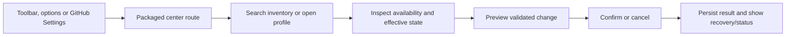
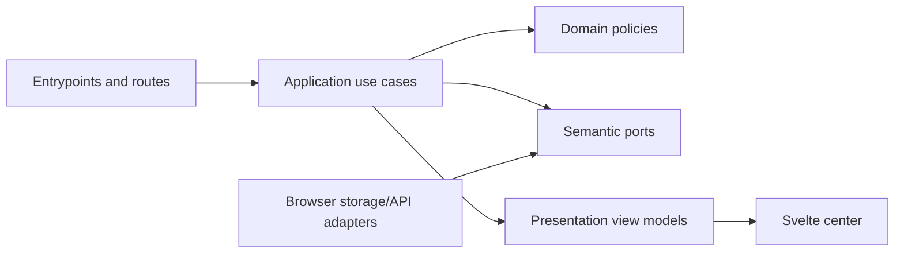
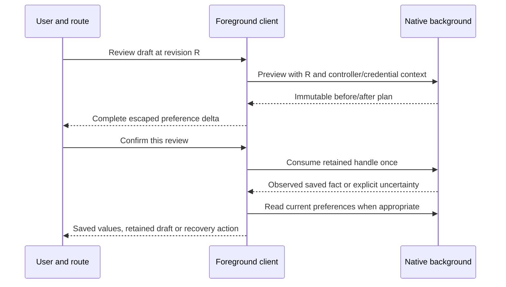

# H3 — Complete local control center, profiles and accessible configuration

- Status: Draft
- Date: 2026-10-30
- Catalog capability ID: `github-browser-extension`
- Last verified: not applicable; this is a prospective companion specification
- Owners: Copilot maintainers
- Scope: Deliver the H3 packaged local control center against all CENTER catalog capabilities while preserving the complete 150-function/803-case product contract.
- Related issues/PRs: [Issue #704](https://github.com/vypdev/copilot/issues/704); prerequisite [Issue #703](https://github.com/vypdev/copilot/issues/703), completed through merged PR #719.
- Required review gates: product UX, architecture, testing, documentation, security/operations
- Open decisions blocking readiness: none for this refinement; implementation must establish H3-specific source-bound acceptance evidence.

The focused [welcome and independent support refinement](github-browser-extension-onboarding-and-support.md)
defines CENTER13 progress, native package observations and recovery without
readable settings. It preserves the full H3 and product acceptance requirements.

The [generated local journal refinement](github-browser-extension-local-journal.md)
defines optional redacted activity/diagnostics, recent destinations and atomic
generation-fenced clearing. Its transactional core is an implementation slice;
it does not accept the complete CENTER09/10/14 journeys or H3.

The [durable consent refinement](github-browser-extension-collection-consent.md)
defines reviewed activation/stop, restart behavior, atomic policy admission and
truthful partial outcomes. The source includes restriction-only preference
preflight, an application consent coordinator, retained start/stop plans and composed collectors/gateway/four-locale activity/privacy UI. Current and optional retained observations distinguish preference, protected session and compound collection effects. Explicit clear observations now distinguish native attempt, acknowledgement and readback. Helper samples now have their own pre-open observation and native options handoff. Remaining CENTER behavior and full source-bound native/human evidence remain required for acceptance.

## 1. Executive summary

H3 delivers a packaged, local-first control center for understanding and configuring the GitHub browser extension. Users can navigate real center routes, search the complete 150-feature inventory, inspect effective settings and availability, manage profiles, permissions and sessions, and preview safe backup, reset and rollback actions. The experience is keyboard and screen-reader accessible, responsive, localized in English, Spanish, French and Portuguese, and available from toolbar, options and GitHub Settings entrypoints.

Recommended defaults are local-only storage, explicit preview before destructive or bulk changes, and clear explanations when an inventory feature depends on a later milestone. The principal safety rule is that configuration and export never expose credentials or private evidence, grant permissions silently, or weaken the extension's fixed safety boundaries.

```text
Open center → inspect/search feature or profile → review effective state and source → preview change → confirm → see result or recovery action
```

## 2. Problem, current behavior, and evidence

### 2.1 Problem

Extension users and maintainers need one understandable place to discover the proposed product's capabilities and safely manage local settings. Without it, users cannot reliably see why a feature is unavailable, which setting wins, what data is stored, or how to recover from an invalid import, quota limit or migration problem.

### 2.2 Current behavior

1. Verified prerequisite evidence reports H2 #703 closed through merged PR #719, with runtime/session/settings/GET services and actual extension-loaded Chrome, Firefox and real Safari containing-app receipts bound to input SHA-256 `60c22c6de3c06bd5e3b34320ac7acfc733a77ec9601c5aa04805b4e04da843c5`.
2. The pinned catalog identifies the proposed extension capability, its existing owning specifications and CENTER catalog source at `specs/browser-extension/features/CENTER.v1.json`.
3. H2 readiness does not implement H3. The complete center, its entrypoints, UX, profile management and H3 acceptance remain proposed; later-milestone behavior must be presented as unavailable where it is not implemented.

### 2.3 Evidence

- Code/workflow/documentation references: the pinned catalog at `4f69a8f9761568eac17120e9fe819a2c08ee0703` records the capability, existing sources and H2 evidence. Existing specifications are listed in section 20.
- Incidents or concrete examples: issue #704 requires honest availability, effective-state explanations and recovery for import/reset/migration/quota behavior.
- External primary sources: browser API and accessibility behavior must be checked against primary vendor documentation during implementation; no runtime/store approval is inferred here.
- Unknowns: exact H3 UI behavior and source-bound test receipts await implementation. Catalog feature definitions and their 56 existing cases remain normative by reference; this refinement does not reproduce or redefine those IDs.

### 2.4 Retrospective classification (as-built baselines only)

Not applicable: this is a prospective specification and does not reconstruct an implemented H3 baseline.

## 3. Actors, surfaces, and terminology

| Actor | Goal | Entry point | Visible surfaces |
|---|---|---|---|
| Extension user | Understand and configure local behavior safely | Toolbar, options, GitHub Settings | Full-page center, feature detail, profile, recovery views |
| Repository user | Review repository-scoped preferences and permissions | Center repository context | Profile and effective-state explanation |
| Maintainer | Diagnose local configuration and availability | Center diagnostics/help | Redacted diagnostics and documentation |

**Center** means the packaged full-page configuration application. **Feature inventory** means metadata for all 150 product functions, including features not yet implemented. **Effective state** means the resolved value plus its source and scope. **Profile** means bounded preferences at personal or repository scope. **Session** means a named local extension context; it is not a GitHub credential. **Private evidence** includes credential material and sensitive repository or account content; it is never exportable through center backup.

## 4. Goals

| Requirement | Behavior |
|---|---|
| H3-R01 | Center has real routes and toolbar, options and GitHub Settings entrypoints; navigation preserves the intended destination and supports keyboard operation. |
| H3-R02 | Search covers all 150 inventory records and details are lazy-loaded; every feature shows implementation availability and unmet dependency honestly. |
| H3-R03 | Effective-state views explain value, source, scope and precedence for personal and repository profile settings. |
| H3-R04 | Users can create, select, edit and remove bounded personal/repository profiles with validation and recoverable persistence. |
| H3-R05 | Permission and named-session management displays current grants/state, asks for explicit browser-mediated authorization where required, and handles unavailable APIs. |
| H3-R06 | Favorites, shortcuts, attention and work views expose useful local navigation without claiming unavailable product functionality. |
| H3-R07 | Import, export, reset and rollback are schema-validated, redacted, bounded and previewed before confirmation. |
| H3-R08 | Diagnostics and activity are useful, local and redacted; no credential or private-evidence export is possible. |
| H3-R09 | Appearance, onboarding, help and recovery are discoverable and persist only within documented local scope. |
| H3-R10 | All center content is available in en/es/fr/pt with accessible interaction, responsive layout and reduced-motion support. |
| H3-R11 | Storage failures, quota, migration and future-schema data produce safe, understandable recovery without silent destructive fallback. |
| H3-R12 | H3 passes its own source-bound options, storage, session and UX evidence on Chrome, Firefox and Safari. |

### 4.1 Non-goals

1. Implementing the remaining H4–H12 product milestones, shared setup extraction, broker or privileged Apply behavior.
2. Remote SPA delivery, browser history permission, store submission or claiming unverified browser/runtime/store compatibility.
3. Replacing or narrowing any existing owning SDD or catalog requirement.

### 4.2 Fixed product/safety invariants

1. The full 150-function/803-case product baseline remains normative; H3 owns all CENTER capabilities and their 56 existing catalog cases by reference.
2. Permission grants, destructive actions and profile replacement require explicit user intent; previews never mutate state.
3. Credentials and private evidence never enter export, diagnostic logs or UI error details.

## 5. Current versus proposed product journey

| Stage | Current | Proposed | User/operator effect |
|---|---|---|---|
| Entry | H3 center is not implemented | Toolbar/options/GitHub Settings open packaged center routes | User reaches a consistent local control surface |
| Discovery | No H3 inventory UI | Search all 150 features and inspect details | Availability and dependencies are explicit |
| Configuration | H3 profile journey is not implemented | Explain precedence, edit scoped profiles and manage sessions/permissions | User can predict effect before saving |
| Recovery | H3 preview/recovery journey is not implemented | Validate and preview import/reset/rollback, then confirm | Invalid or risky changes are recoverable |



Text equivalent: entrypoint → packaged route → inspect inventory/state → preview → confirm or cancel → visible outcome and recovery.

## 6. Functional behavior and state model

### 6.1 Happy path

1. The entrypoint resolves to a real center route without requesting browser history permission.
2. The inventory presents all 150 metadata records; search and filters do not imply runtime availability.
3. A detail view identifies availability, dependency, effective value, source and scope.
4. The user edits a bounded profile or selects an explicit permission/session action.
5. The application validates a complete proposed change and presents its consequences before persistence.
6. The user confirms; storage reports success or an actionable failure with retained state.

### 6.2 Alternative paths

- A feature awaiting H4–H12 remains discoverable and explains its dependency; its unavailable controls are not represented as working.
- Canceling any preview leaves durable state unchanged.
- Unsupported browser APIs are identified with a supported alternative or explanation, not a false success.
- Import containing unknown fields, future schema, invalid values or private data is rejected or safely quarantined according to schema policy; it is never partially applied without a preview and explicit contract.

### 6.3 State machine

| State | Entered when | User-visible meaning | Allowed next states | Recovery/owner |
|---|---|---|---|---|
| Loading | Route starts or storage is read | Center is loading local data | Ready, Degraded, Failed | Retry read; application |
| Ready | Inventory and state are resolved | Center is usable | Preview, Degraded | User action; presentation |
| Preview | Validated proposed mutation exists | No change has yet been applied | Ready, Applying | Cancel or confirm; application |
| Applying | Confirmed mutation is being persisted | Change is in progress | Ready, Degraded, Failed | Re-read durable state; application/adapter |
| Degraded | Optional API/data unavailable | Partial center remains usable | Ready, Failed | Explain dependency and retry; presentation |
| Failed | Required read/write cannot complete | Requested action did not complete | Loading, Ready | Retry or recovery instructions; application |

Duplicate confirmations MUST be idempotent; stale previews MUST be invalidated when their source revision changes. Canceled and out-of-order operations MUST NOT overwrite newer durable state. Partial persistence MUST be detected by rereading and reported with exact retained facts.

## 7. User-facing configuration

| Input | Type | Recommended default | Allowed values/range | Scope/persistence |
|---|---|---|---|---|
| Active profile | Stable local profile ID | Personal default, clearly labeled | Existing profile ID or explicit create | Local persistent |
| Profile scope | Closed discriminated record | Global personal preference | Global, github.com host, verified numeric account, organization or repository | Local persistent; account-qualified numeric identities |
| Appearance | Enum | System | System, light, dark | Local persistent |
| Locale | Enum | Browser locale when supported | en, es, fr, pt; fallback en | Local persistent |
| Favorites | Bounded ID list | Empty | Registered inventory IDs, bounded by schema | Local persistent |
| Backup schema | Versioned structured document | Current supported version | Current known version only for restore | Export file; import preview |

Validation rejects unknown profile references, malformed repository identity, duplicate IDs, out-of-range collections and incompatible schema versions. The complete owning contract's precedence remains feature default → global preference/profile → host → account → organization → repository → current session. The effective-state view names the winning layer and any unavailable dependency. A preview snapshots source revision and proposed values; confirmation rereads revision and requires a new preview if state changed. Missing values use documented defaults; retired values migrate explicitly; unknown/future values are preserved inert and exportable without destructive downgrade. Recommended configuration is system appearance with personal defaults; a meaningful alternative is a repository profile overriding one preference while retaining personal values elsewhere. Permission boundaries, privacy exclusions and explicit confirmation are not configurable.

### 7.1 Concrete profile, navigation and session contract

The profile collection contains at most ten complete records and ten selected
IDs. Each record has a unique lowercase local ID of at most 48 ASCII characters,
a user-authored name of 1–60 characters without controls or bidi-formatting
characters, one closed scope, and known feature booleans/density/shortcuts/pause
preferences. Exactly one profile may be selected per exact scope; selected IDs
must exist. Scope identities use positive decimal strings of at most twenty
digits, never mutable repository/account names. Account, organization and
repository scopes carry the github.com account identity; they cannot inherit
another account's private context. The encoded settings/import limit remains
64 KiB. No connection, permission, credential, command or approval field is a
profile preference.

Session overrides are separate transient records bound to the current verified
account, numeric repository and credential epoch. A changed or unavailable
identity/epoch makes the old override inapplicable. A session override is never
persisted through profile selection, import or rollback. Pause is monotonic
across inherited scopes: a more specific false value cannot clear an active
inherited pause. Emergency and tab pauses take priority and expose their own
provenance. Explicit resumption edits the owning pause scope.

Navigation accepts only packaged hash routes from a fixed route inventory.
Feature details use known catalog IDs; profile details use bounded local IDs.
Queries, encoded paths, arbitrary return URLs, commands, secrets, extra fields
and other route parameters are rejected. Unknown routes show a safe local
recovery destination without forwarding or logging the rejected value.

These contracts are exercised by
`extension/test/contracts/center_routes.test.ts`,
`extension/test/contracts/center_profiles.test.ts` and
`extension/test/contracts/profile_resolution.test.ts`. Their isolated policy
evidence does not establish a working center, browser journey or completion of
an entire catalog case before application/presentation integration.

Profile operations are closed save/select/deselect/remove intents. Saving a
profile plans creation or an edit; selection replaces only the selected profile
at the same exact scope. Removing a profile also removes its selection, while
deselection retains the authored profile. Moving a selected profile into a scope
with another selected profile is invalid until the user reviews a nonconflicting
choice. Every preview enumerates the complete semantic delta, including removed
overrides returning to inheritance and explicit false values. Repeating a
semantically unchanged choice produces no write. Planning copies validated input
and never mutates storage; application confirmation must still bind the plan to
the current revision. `extension/test/contracts/profile_change.test.ts` exercises
these preview and preservation boundaries.

## 8. Clean Architecture

### 8.1 Responsibilities and dependency direction

| Layer/boundary | Owns | Must not own/import |
|---|---|---|
| Domain/pure policy | Profile precedence, validation, eligibility, import/reset/rollback planning, redaction rules | Browser APIs, Svelte, storage DTOs |
| Application | Route data, profile/session/permission use cases, previews and confirmed mutations | Concrete browser SDK or rendering |
| Adapters/data | Browser storage/API mapping, schema migration and provider error mapping | Product policy decisions |
| Infrastructure/composition | Packaged routes, entrypoint wiring, capability detection | Duplicated policy or state transitions |
| Entrypoints | Toolbar/options/settings event adaptation | Domain decisions and duplicated orchestration |
| Presentation | Accessible localized route views and immutable view models | Mutations, storage access or authorization policy |



Text equivalent: entrypoints call application use cases; domain policies decide; semantic ports isolate browser operations; adapters implement ports; presentation renders use-case results.

### 8.2 Contracts, state, and trust boundaries

- Pure decisions: eligibility, effective-state precedence, schema validation, preview diff, redaction and permission-intent validation.
- Application contracts: immutable inputs/results with stable IDs, source revision and explicit outcome states.
- Semantic ports: local settings/profile repository, permission/session capability, inventory provider and clock/ID source.
- Durable state/schema ownership: application defines semantic records; adapter owns browser serialization and version migration.
- Concurrency/idempotency strategy: revision-checked compare-and-write where supported; serialize local mutations; deduplicate confirmed operation IDs; reread after uncertain writes.
- Trusted and untrusted inputs: browser events, storage, imported files, repository metadata and rendered GitHub content are untrusted; validate and encode before use.
- Provider error mapping: distinguish denied permission, unsupported API, quota, malformed storage, interruption and unknown failure without leaking provider internals.

### 8.3 Executable architecture constraints

Architecture validation MUST reject imports from domain/application into browser APIs, Svelte or concrete storage adapters; verify route composition and semantic-port adapters; detect cycles; validate schema fixtures; and ensure every manifest inventory item has exactly one displayable metadata record. Existing repository conventions and package layout remain authoritative; no `src/` root or `.test.ts` suffix is required.

### 8.4 Settings preview and confirmed transaction contract

The background owns complete immutable previews for closed profile, personal,
center and repository preference changes, import, scoped reset and rollback.
The browser view cannot supply a replacement after-state when confirming an
operation. Pure planning preserves unchanged fields, reports inherited feature
values explicitly and treats a semantically unchanged choice as no write.

Each preview binds an opaque 128-bit operation ID, exact settings revision,
current local controller identity/epoch and credential epoch. A preview lasts
at most five minutes. There are at most sixteen pending/in-flight operations;
completion replay retains only bounded nonsecret outcome metadata for at most
thirty-two operations/five minutes. Maps are checked on foreground operations;
there is no timer or background keepalive. Expiry, clock rollback, takeover,
disconnect, restart or changed source revision cannot revive approval. A worker
restart requires a fresh preview; reading a prior receipt is not approval.

Preview construction is read-only, including on legacy records. Startup owns
the existing atomic migration; if it has not completed, preview reports that
prerequisite rather than writing during a cancelable review. Confirmations
serialize with all existing preference updates. Duplicate confirmation reuses
its result, and cancellation during persistence says that the operation is
already in progress instead of claiming an undo.

The complete current record, prior rollback record and operation ID/before
revision receipt share one storage set. Confirmation then rereads storage and
checks the exact receipt, revision and complete content before reporting saved
state. An acknowledgement by itself is insufficient. If acknowledgement fails
but that exact committed record is observed, preserve both facts. If readback
is partial, changed or unavailable, report an unknown outcome with the bounded
observed revision/facts and do not retry a write automatically. A later context
change cannot erase a confirmed completed effect or expose its settings into a
different current context. Provider exception text never reaches a view.

Settings-only reset and rollback never pretend to disconnect or restore a
credential. Current connection opt-ins are retained where that reset scope
preserves them; credential removal is a separately explicit session operation.
Import/rollback cannot grant a new connection, restore a credential or import a
permission/approval. The final preview must disclose each retained session and
the exact settings scope so that “reset settings” is not confused with “erase
all data”. Authored notes and private evidence are separate stores.

The dedicated settings-preview route accepts at most 68 KiB UTF-8 of closed
intent/envelope data, accommodating the existing 64 KiB settings import limit.
Its full before/after preview is at most 132 KiB including bounded metadata;
both records remain individually limited to 64 KiB. Other center privilege
routes remain at most 8 KiB. These settings transport bounds do not change
setup-broker request/view limits or authorize arbitrary payloads or operations.

Current transaction evidence is
`extension/test/integration/settings_transactions.test.ts`,
`extension/test/integration/settings_transaction_outcomes.test.ts`,
`extension/test/integration/settings_operations.test.ts` and
`extension/test/integration/settings_operation_fences.test.ts`, together with
`extension/test/contracts/settings_operation.test.ts`,
`extension/test/contracts/settings_change.test.ts` and
`extension/test/contracts/settings_recovery_plans.test.ts`. Policy/application
tests do not substitute for the complete center UI or native-browser journeys.

### 8.5 Packaged center controller and native message contract

The native background accepts only closed `center.open/read/claim/close` and
`center.preview/confirm/cancel` messages from its own packaged runtime page.
Known local hash routes are allowed; query strings, extra fields, foreign
origins, child frames, private contexts and content-page center messages are
rejected before settings or connection access. The legacy H2 raw-settings
method cannot change center state to bypass its retained preview contract.

Opening a center obtains a background-generated cryptographic 128-bit client
handle. Native document/tab identity binds it when available; optional sender
fields are not assumed to exist across vendors. A tab ID without a document ID
does not deduplicate a reload into an older client. Native reload, departure
and tab-removal events release matching clients. Navigation between known
packaged hash routes retains the current document's controller. No new
permission, keepalive, alarm or persistent authority field is introduced.

| Transition | User meaning | Authority and retained facts |
|---|---|---|
| First open | This window can edit settings. | One editor; at most eight worker-local clients. |
| Another open | Settings are viewable; another window is editing. | Observer cannot preview, confirm or cancel a mutation. |
| Explicit takeover | This window now controls editing. | Expected controller epoch must match; increment it before invalidating prior previews. |
| Changed revision or owner | Review the latest settings again. | Stale approval cannot replace newer content. |
| Close, restart or thirty minutes idle | Reopen or take control before editing. | Client authority expires; saved operation receipts remain inspectable facts. |
| Context changes during persistence | The change was saved; this window is no longer current. | Exact observed persistence is retained and is not automatically retried. |

Text equivalent: open as editor or observer, explicitly take control if needed,
request a revision-bound preview, then confirm that exact plan. Losing control
requires a fresh review; a completed saved effect remains a completed fact.
Each foreground interaction checks the idle lease and clock without timers.
The thirty-minute/eight-client/five-minute-preview limits are fixed safety
bounds. The current credential epoch fences preview/confirmation and any
asynchronous settings view; no credential or provider exception is returned.

Native sender fields and tab-event semantics follow the primary
[Chrome sender contract](https://developer.chrome.com/docs/extensions/reference/api/runtime#type-MessageSender),
[Mozilla sender contract](https://developer.mozilla.org/en-US/docs/Mozilla/Add-ons/WebExtensions/API/runtime/MessageSender)
and [tab-update contract](https://developer.mozilla.org/en-US/docs/Mozilla/Add-ons/WebExtensions/API/tabs/onUpdated).
Current executable evidence is `extension/test/contracts/center_protocol.test.ts`,
`extension/test/integration/center_controller.test.ts`,
`extension/test/integration/center_gateway.test.ts`,
`extension/test/integration/center_persistence_fences.test.ts` and
`extension/test/integration/center_native.test.ts`. The last file exercises real
background composition with deterministic browser ports; actual loaded-browser
and presentation evidence remains required separately.

### 8.6 Authored Svelte and packaged style boundary

The private extension pins Svelte 5.57.1, its Vite plugin 7.3.1 and svelte-check
4.7.6. Both TypeScript and Svelte type checking remain mandatory, with compiler
warnings treated as failures. Compiler configuration is explicit; an unrelated
local Svelte config must not silently alter the accepted view. The existing
Node build/driver tests retain native package resolution; only Svelte's public
browser export is selected for mounted DOM component tests.
Executable test configuration lives in the covered tooling module; the Vitest
entrypoint only re-exports it. A green empty report for an automatically excluded
configuration file does not establish coverage of its logic.

Architecture validation inspects the original typed instance/module scripts,
markup and styles before compilation. Erased type-only imports still obey layer
boundaries. Components stay in presentation and at most ninety lines; domain
and application acquire no Svelte/browser authority. Only presentation and
composition may import the public Svelte runtime. Literal packaged lazy imports
belong to composition; nonliteral, remote, option-bearing or unresolved imports
are rejected. Original `.svelte`/`.css` inputs and the Svelte check configuration
participate in the source fingerprint.

Markup must preserve text escaping and cannot acquire native globals, raw HTML,
DOM bindings, arbitrary actions/attachments, resource attributes or hidden
anchor telemetry. Password entry remains native and unbound to presentation
state. Local links use the reviewed closed route policy; static help links have
fixed documentation destinations. Scope bindings cannot shadow that navigation
policy. SVG resource attributes, inline styles and styles capable of fetching
resources cannot bypass the same boundary. Static packaged theme/layout styles
remain available, including responsive, focus, contrast and reduced-motion rules.
There is no warning-suppression escape hatch.

`SettingsReview.svelte` renders immutable, nonsecret review data and narrow
confirm/cancel/read/dismiss callbacks. Preview shows complete supplied before
and after values; observation-only views disable mutation. Saving exposes no
control that claims an in-flight write can be undone. Unknown, conflicting,
stale or unavailable outcomes offer a current-state read, never an automatic
repeat write. Plain outcomes and technical revision details remain distinct.
Review messages are complete immutable en/es/fr/pt resources, selected as a
whole; authored names and values remain escaped text.

Current evidence is `extension/test/contracts/component_architecture.test.ts`,
`extension/test/contracts/component_markup.test.ts`,
`extension/test/contracts/component_styles.test.ts`,
`extension/test/contracts/review_copy.test.ts` and the actual mounted component
in `extension/test/integration/settings_review.test.ts`. This establishes a
review component and its source boundaries, not the complete center journey.
The full route application, packaged lazy-asset contract and actual loaded
Chrome/Firefox/Safari/human acceptance remain required before completing H3.
Compiler and test usage follows the primary
[compiler](https://svelte.dev/docs/svelte/svelte-compiler),
[TypeScript](https://svelte.dev/docs/svelte/typescript) and
[component testing](https://svelte.dev/docs/svelte/testing) documentation.

### 8.7 Foreground application, draft context and packaged modules

The production options entry mounts the Svelte center. Its foreground client
keeps native client and unconsumed preview handles private. Presentation receives
validated preferences, nonsecret outcomes and semantic callbacks. Each mutation
echoes controller/credential epochs and the draft's original revision; stale
forms are never silently rebased. Unknown persistence permits reading, never
automatic writing. Invalid or unchanged values allow local correction.



Text equivalent: draft, context-bound preview, explicit confirmation, observed
outcome and a fresh read. A lost response is reconciled only through the exact
saved receipt and complete expected values. A draft resets only after the saved
revision is observed. Unsaved drafts and reviews guard hash navigation; keeping
a draft restores the local route, and leaving requires explicit discard.
Navigation cannot undo an in-flight write. Options URLs containing queries or
invalid initial routes reload the fixed recovery URL before registration.

Appearance is one atomic intent covering theme, density, text size, motion and
contrast. Profile create/edit/select/remove, language, import/reset/rollback use
the same retained review protocol. Import reads at most 64 KiB, requires valid
UTF-8 and a supported closed schema, clears its native input and never renders
an unvalidated document. Native file-read completions remain bound to their
original route, draft epoch and latest request; discarding or superseding that
draft retires a late completion before it can create another preview.
Export serializes portable preferences only, omitting
connection grants and native session state. Permission/secret-entry flows stay
separate. No new permission or configurable safety override is introduced.

If disposal races with a completed native takeover, close the returned handle
with its returned controller epoch, only when it identifies this same client.
Late read/render responses cannot resurrect a retired view. A migration-write
failure has a fixed semantic error; inspect storage once to distinguish a
retained read-only migration from an actually persisted result with a lost
acknowledgement. Ordinary read failures remain unavailable, without a hidden
read retry. Never repeat a confirmed preference write automatically.

Artifacts contain six fixed files (manifest, background, content, runtime HTML,
JavaScript and CSS) plus reachable packaged center chunks. Each chunk has a
closed name with the input digest prefix. Static/lazy imports must name declared
local runtime/chunk assets; arbitrary operands, import options, paths, queries
and remote destinations fail. Orphan/mixed-source chunks fail. Receipts hash all
UTF-8 assets: at most 96 files/8 MiB per target and a 128 KiB receipt. Background
and content remain self-contained. Atomic publication, rollback, resource-free
CSS and reproducibility gates continue to apply.

`center_app.test.ts` mounts the application through the gateway with deterministic
native ports. Its nonopaque jsdom origin is a test requirement, not native proof.
`center_client.test.ts`, `center_frame.test.ts`, `center_files.test.ts` and
`center_assets.test.ts` cover the client, drafts/locales, data and asset boundary.
The development build labels unfinished sections; placeholders are not accepted
workflows. Complete repository management, full inventory/provenance,
remaining routes, native/human evidence and final full coverage/review remain
required. Numeric budgets, traceability and Definition of Done are unchanged.

### 8.8 Named read-session boundary

Connections and Repositories share the native protected read-session surface.
Each of at most five entries has a unique case-insensitive local name (1–64
UTF-16 code units, trimmed, no control/format characters), an opaque local ID,
the fixed `github.com` host and the closed `repository-read` purpose. GitHub
verifies the numeric account/repository identities before selection. Selecting
an existing entry rereads both identities: a rename with the same numeric IDs
updates its display, while a different account or repository is rejected. One
identity is selected for a read. This does not implement optional write roles,
repository workspaces, scoped pause controls or effective-profile provenance.

```text
Named draft → explicit browser permission → verified account and repository
→ protected session record → redacted selected-session view
Uncertain response → read current sessions; never repeat Connect automatically
```

Text equivalent: explicit authorization precedes identity verification and the
protected save. An uncertain result requires a read, not another mutation.
The unbound native password field clears before awaiting permission, including
denial or native API failure. Svelte receives semantic callbacks and validated
nonsecret summaries; it never receives credential values. Permission request is
the first browser API call in the submit gesture. Observer, controller, native
document, credential-epoch and vault-revision checks remain independent.

The session vault is separate from preference/rollback/export state. A valid
existing H2 connection is presented as `GitHub`/`previous-session` at vault
revision zero; an explicit mutation materializes the named vault. No new grant
is inferred. Missing data is empty; damaged/future vaults remain unavailable
without a destructive downgrade. Explicit **Forget all protected sessions**
requires its own visible confirmation and clears the fixed protected keys even
when the vault schema cannot be read. It never resets preferences or revokes a
GitHub credential. Confirmed forgetting also clears an unsubmitted password
field; opening and canceling that confirmation does not discard it. A failed
native credential deletion remains unavailable,
rather than being treated as proof that all credentials were removed.
Session-storage or permission unavailability
cannot trigger fallback into persistent local storage.

Switching fences the prior active session and invalidates its private evidence
before verifying the candidate; failure leaves the candidate disconnected.
Disconnect removes the selected local credential and entry. Inactive-entry
removal retains the selected identity; selected-entry removal disconnects it.
Removal requires a visible exact-entry confirmation. These operations do not
revoke a credential at GitHub. Browser API permission removal fences in-flight
work and serializes deletion after any admitted vault write, preventing a late
write from resurrecting credentials. A failed write acknowledgement is inspected
once; an exactly observed save is accepted, otherwise the result stays unknown
and the candidate is disconnected. No automatic second write occurs.

#### Canonical active-session persistence

The active-session service MUST distinguish native acknowledgement from a single
canonical readback for both save and removal. A successful response alone cannot
establish a saved credential or completed deletion. An exactly observed saved
record MAY establish completion after a lost acknowledgement. Observed absence
MAY establish deletion after a lost acknowledgement. A nonmatching record or
unavailable readback leaves that desired persistence unconfirmed; never repeat
the native write or removal automatically.

```text
Attempt once → retain accepted/unknown acknowledgement → inspect once
 → exact saved record / observed absence: persistence verified
 → different record / failed inspection: desired persistence unconfirmed
```

Text equivalent: acknowledgement and observation are independent. Save compares
the complete validated protected record, including optional organization identity,
without depending on property order. Removal requires actual absence. Native
write and readback remain inside the same persistence queue reservation. Epoch,
permission and current-source fences still apply before publishing a connection;
an old observation cannot replace a newer session. Unconfirmed removal invalidates
in-memory access immediately and reports unavailable protected cleanup. No secret,
raw exception or protected record appears in public persistence facts.

The native session operation family now projects each actual active-key,
repository-preference and named-vault attempt through a per-call observer. Current
metadata and optional same-row history preserve ordered acknowledgement and
canonical observations separately from the returned session view. Private labels
stay only in source-bound current memory. Only this operation's synchronous own
epoch advance can preserve its private observation witness; external revocation
or controller replacement retires it. A later matching payload without an
operation receipt cannot prove that an earlier unknown effect completed.

Explicit cold revocation fences automatic restoration in the current worker,
even if cleanup cannot be verified. That is not proof of durable physical deletion
across a restart: uncertain cleanup still requires native disable/recovery. The
local form may clear its submitted draft only on the directly observed vault
revision, independently from invalidation of its private summary; a lost response
supplies no receipt and causes no automatic retry. The four-locale current/history
view and bounded generated-row capacity tests are source evidence, not complete
native-browser or human H3 acceptance. The detailed contract is in the
[collection refinement](github-browser-extension-collection-consent.md#610-native-session-observations).
No new permission, persistent-local fallback or publication is introduced.

The authenticated session read/disconnect path works independently of corrupt or
future preference schemas; it never invents default settings to mount a page.
Ordinary lifecycle updates are coalesced; a user mutation emits at most two
invalidation notifications (initial fencing and final observed outcome).
Current deterministic evidence lives in `named_sessions.test.ts` (domain and
integration), `center_connections.test.ts` (actual mounted form/gateway) and
the existing runtime/browser contracts. They refine H3-R05/R09 and CENTER04/05
boundaries without completing those entire capabilities or replacing the
required source-bound Chrome, Firefox, Safari and human acceptance.

### 8.9 Upgrade authority and identity-backed preference preview

Once the center composition is installed, legacy `session.connect` and
`settings.write` requests are rejected even from an otherwise admitted old
options view. New connections use the named-session controller, epoch and
revision checks; preference changes use retained previews and confirmation.
This prevents an old view from creating a serving identity absent from the
manager or bypassing its current editor. Legacy read/status methods remain
available to packaged pages; page status is local-only and cannot start HTTP.
An explicit old `session.disconnect` is an absolute safety action:
it fences work and clears all protected connection keys, preserving authored
preferences. It cannot grant authority or select another identity. Old views
must reopen the current options application to connect or edit.

Profile scope controls choose numeric identities from protected saved read
sessions. No newly typed account/repository name becomes authority. Changing
account clears dependent repository/organization choices. An authored scope
absent from current sessions remains explicitly unavailable and editable without
silently deleting it. Choosing or saving a profile never connects an account.
For an optional organization scope, the closed GET decoder verifies owner
ID/type/login and its relationship to the requested repository. A missing legacy
owner field leaves organization identity unknown; a malformed supplied owner
is rejected. User owners produce no organization scope. Unrelated provider
fields, including temporary clone credentials, are not copied to records/views.
This uses the existing [Get a repository](https://docs.github.com/en/rest/repos/repos#get-a-repository)
operation; no new endpoint, permission or network authority is introduced.

The current selected-session view projects freshly verified canonical/owner
facts after restoration. It cannot apply an old organization's profile from
stale vault metadata; unknown fresh ownership removes the old organization from
effective context. Reading does not rewrite inactive entries or authored scopes.
The saved-preference preview shows density, shortcuts and pause plus their
default/global/repository/profile source. It uses only the connected selected
identity for account/organization/repository matching. Without it, personal and
host preferences still resolve. Tab/emergency/transient-session overrides and
per-feature provenance remain separate work; this view does not claim that all
GitHub runtime features already consume the resolver.

Repositories offers reviewed per-repository pause, removal of that local pause
and preference reset against numeric IDs from saved sessions. Reset preserves
the read credential. Resuming this scope cannot release global or inherited
pause. Duplicate saved sessions for one physical repository share its numeric
preference row. An unrelated unfinished connection form disables repository
preference reviews so saving one cannot discard the other's draft. Full bounded
workspaces and remaining
CENTER workflows are still required before H3 acceptance.

Current evidence: `profile_context.test.ts`, `repository_owner.test.ts`,
`scoped_profiles.test.ts`, `session_owner_projection.test.ts`,
`legacy_center_upgrade.test.ts` and the real background composition contract.
These are deterministic policy/mounted integration tests; native browser and
human acceptance still require new source-bound receipts. The 160 distinct risk
floor and the complete 56+56 CENTER case obligations are unchanged.

### 8.9 Live profile configuration and read admission

The content runtime consumes a closed effective-configuration projection, rather
than the complete personal settings/profile collections. `page.configuration`
is a content-only, exact native-route/generation/repository/viewer request. Its
reply includes the immutable source digest, matched operands, credential epoch
and seven rendering fields (revision, locale, theme, density, shortcuts, feature
booleans and pause). Unknown fields, wrong source/identity, impossible paused
connection grants, missing/unknown features and malformed enums are rejected.
Raw `settings.read` is now packaged-page-only; old content must reload the new
package. Page-script messages cannot obtain the profile names or credential.

```text
Eligible native page → local/global/host and restriction-only pause checks
 → retained identity may only restrict → eligible restoration if needed
 → verified account/canonical repository + current owner → effective projection
 → current source/scope receipt → runtime and separately admitted object GET
```

The background owns both projection and actual GET admission through the same
resolver. Global/host preferences work without credentials. A verified viewer
may supply account scope when its login agrees with the observed page; org/repo
scope additionally requires both numeric repository ID and canonical route.
DOM observations only veto verified identity; they never manufacture authority.
A different repository cannot inherit the selected repository's preferences.
Density changes the extension-owned panel spacing; no GitHub editor or native
page preference is rewritten. Feature booleans/shortcuts are configuration for
their implementations, not evidence that later-milestone features exist.

Before any restoration HTTP, global/host pause and numeric repository pause
restrict the request. A protected retained identity may additionally enforce
an inherited account/org/repository profile pause, but cannot grant positive
preferences or connection until reverified. This conservative pause can be
reviewed from the local center, including after repository ownership changed.
Unpaused restoration requires matching retained repository/viewer, connected
preference, visible/active/online eligible context and current native lease.
Fresh provider owner facts replace retained org context before the object GET;
a newly matched pause stops that GET. Permission/storage failures never enable
connection. No extra provider endpoint or host permission is introduced.

Hidden pages, native tab activation/navigation, settings invalidation, source
change, observed account/repository/object change and teardown retire old
effects and cancel their page lease. Restoration releases its scoped abort
listeners and keeps the credential when the page merely departs. A fresh
eligible request can retry within the existing scheduler cooldown/budget;
there is no automatic regeneration/retry loop. Current settings revision,
credential epoch and native tab are checked again before publication. Invalid
receipts retain only a disabled local health/recovery surface. A root replacement
queued during asynchronous mounting is reconciled once after mount, bounded by
the existing refresh-storm policy.

The native activation event is cancellation-only: its URL may be unavailable,
so it cannot authorize a new context ([Mozilla tabs.onActivated](https://developer.mozilla.org/en-US/docs/Mozilla/Add-ons/WebExtensions/API/tabs/onActivated),
[Chrome tabs](https://developer.chrome.com/docs/extensions/reference/api/tabs#event-onActivated)).
Deterministic evidence: `runtime_configuration.test.ts` (closed policy/protocol),
`page_configuration.test.ts` (real gateway/session/read admission and races),
`content_configuration.test.ts` (actual background/center/content composition),
and the retained runtime lifecycle/DOM contracts. They refine H3-R03/R04/R05/R11;
native H3 receipts, transient-session/tab/emergency controls, per-feature
provenance and the remaining full H3 scope still require acceptance.

## 9. UI/UX and content contract

The center puts current state first, then completed facts, next action, required human action, impact and inspectable details. Feature detail and risky-action preview use plain language before technical diagnostics.

### 9.1 Information hierarchy

1. Route title and current profile/context.
2. Effective state, source and availability.
3. Next recommended action, or explicit “No action required.”
4. Consequences and preview controls.
5. Help and recovery links; technical diagnostics disclosed progressively.

### 9.2 Representative primary view

```markdown
# Control center

**Current status:** Personal profile is active. 12 features are unavailable because their milestones are pending.

**Action required:** Review the highlighted permission before enabling repository-specific behavior.

## Effective settings

- Appearance: System — from personal profile
- Repository profile: Not selected
- Storage: Local browser storage

## Feature availability

Search all 150 features. Unavailable features explain the required milestone and do not imply that the behavior is installed.

[Review permissions] · [Open profiles] · [Help and recovery]
```

Required variants: pending state says “Loading local settings; no changes have been made”; action-required state names the permission and browser-mediated action; blocked state says “Import was not applied,” names invalid/future schema as cause, offers export/recovery instructions, and confirms existing settings remain; partial state identifies precisely which record persisted and what remains; completed state names the saved profile and offers undo/rollback where supported.

### 9.3 Issue, PR, and comment behavior

- Deterministic UI titles identify center route and action; no automated issue/PR comments are required by H3.
- Merge, close and retry behavior is governed by the repository Action lifecycle; the center itself does not create branches or change issue state.
- Durable markers: local operation IDs and schema revisions; no GitHub comment marker.
- Comment/notification budget: zero center-generated GitHub comments or notifications.
- Labels/checks are not a source of local runtime state.
- Links use descriptive destinations to packaged routes and documented recovery pages.

### 9.4 Accessibility, localization, and responsive behavior

Support en/es/fr/pt with en fallback, complete translated labels/errors/help, and no unlocalized user-facing strings. All controls have names, logical focus order, visible focus, keyboard operation and screen-reader status announcements. At 200% zoom and narrow widths, content reflows without lost controls or horizontal page scrolling. Support light/dark/system themes and reduced motion. Icons and charts have text equivalents; headings and tables are semantic. Imported text and repository-derived strings are rendered as text, never executable HTML; external URLs are validated, and untrusted Markdown, mentions and command-like content are not executed.

## 10. Failure, recovery, and cleanup

| Failure/partial state | User impact | Retained facts | Automatic retry | Required action | Cleanup |
|---|---|---|---|---|---|
| Storage quota | Save may not fit | Prior durable profile remains | No unbounded retry | Reduce data or export safe settings | Remove temporary preview |
| Future/invalid import schema | Import not applied | Existing profile unchanged | No | Keep source file; use supported export | Discard parsed memory |
| Migration failure | Center may be degraded | Original data retained where possible | One bounded reread | Follow recovery instructions; do not reset silently | Clear temporary migration copy |
| Permission denied/unavailable | Dependent feature unavailable | Existing settings remain | No | Grant through browser UI or continue without it | No permission escalation |
| Stale preview/write conflict | Proposed change not applied | Newer revision retained | No | Reopen preview | Drop stale proposal |
| Partial/uncertain write | Some data may be persisted | Reread and report exact records | One verification read | Use recovery/rollback path | Remove incomplete temporary data |

Errors follow impact → cause → action → retained state. They never claim a successful write failed without rereading durable state.

## 11. Security, permissions, and privacy

1. Request only browser permissions needed for an explicit user action; no browser history permission and no silent grant.
2. Imported data, GitHub content, repository metadata and stored values are untrusted; validate schemas, bounds and URLs, and render as inert text.
3. Credentials and private evidence are excluded from export, logs, diagnostics and UI error details. Backups contain only documented safe configuration.
4. Destructive reset/restore requires preview, explicit confirmation, revision check and recoverable outcome; replayed or forged operation IDs cannot bypass authorization.

## 12. Observability and operational UX

- User-facing state: route loading/degraded/ready and operation preview/result, with source and revision where useful.
- Job Summary/operator evidence: implementation PR links issue, actual test/browser/docs receipts and source-bound build identity; H3 generates no runtime GitHub Job Summary.
- Logs, metrics, and correlation: local redacted diagnostics with operation ID, error category and schema version; no content or credential payloads.
- Pending external dependency versus workflow failure: later milestone availability is explicitly labeled pending; inability to read/write current center state is an error.
- Rate-limit/retry behavior: center does not add remote polling; browser storage retries are bounded.
- Noise/comment budget: no automatic comments, notifications or repeated prompts.

## 13. Compatibility, migration, rollout, and rollback

- Existing in-flight H2 runtime/session/settings behavior remains governed by its owners; H3 must integrate without claiming that prior receipts establish H3 acceptance.
- H3 advances the complete personal settings record to schema 2, with a closed
  schema-1 `center` record inside the same atomic current/previous envelope and
  existing settings key. Exact H2 schema-1 records migrate with their revision,
  preferences and numeric repository mappings preserved, plus safe center
  defaults. The prior complete current record is retained as rollback, not a
  nested copy of its entire old envelope. Schema-0 compact migration remains
  supported. New readers never silently downgrade future root or center schemas.
- Migration expansion must still fit the total 64 KiB bound. Capacity or storage
  failure retains the exact original envelope and gives recovery; no trimming
  of authored preferences establishes success. A legacy rollback restores
  compatible preferences into the current schema rather than reinstalling an
  older schema. Import cannot remove a selected scoped profile pause, including
  by changing IDs/scopes, and retains repository pauses omitted from an import.
  If these protections exceed capacity, the complete import fails without a
  partial write. Explicit scoped reset/resumption is a different reviewed action.
- Migrate versioned center settings transactionally where possible; retain original data until the new schema is verified. Future-schema data is not downgraded or overwritten automatically.
- Deprecated keys have an explicit mapping and removal policy in implementation documentation; unknown values cannot silently become permissive settings.
- Roll out as a packaged extension increment, with per-target source-bound receipts; no remote SPA, release, deploy or store submission is implied.
- Rollback preview identifies the target revision and affected settings. Irreversible browser permission changes are not silently revoked; explain browser-mediated cleanup.

## 14. Testing strategy

| Area | Minimum distinct cases | Behaviors/risks covered |
|---|---:|---|
| Domain/configuration/pure planning | 8 | Observable scenarios in the case inventory. |
| State/application/idempotency/races | 8 | Observable scenarios in the case inventory. |
| Adapters/provider contracts | 8 | Observable scenarios in the case inventory. |
| Workflows/setup/schema | 8 | Observable scenarios in the case inventory. |
| UI/UX/localization/sanitization | 8 | Observable scenarios in the case inventory. |
| Integration/security/migration | 10 | Observable scenarios in the case inventory. |
| Documentation/discoverability | 6 | Observable scenarios in the case inventory. |
| Total | 56 | Distinct inventory cases; repeated executions do not add cases. |

Active-session persistence adds a minimum16 distinct regression cases: four
save/removal acknowledgement-versus-observation combinations, four exact-record
and optional-identity validation cases, four source/epoch/queue races, and four
native/readback failure cases. Each belongs to one budget category only. Existing
H2 cases may satisfy unchanged fences only with current source-bound results;
new policy and modified executable branches remain100% covered. This supplement
does not replace the56 CENTER cases, full H3 native journeys or human gate.

| Case ID | Area | Requirements | Scenario |
|---|---|---|---|
| bexh3-center-C01 | Domain/configuration/pure planning | H3-R02 | Inventory eligibility marks a later-milestone feature unavailable with its dependency. |
| bexh3-center-C02 | Domain/configuration/pure planning | H3-R03 | Effective state selects repository override and reports its source. |
| bexh3-center-C03 | Domain/configuration/pure planning | H3-R03 | Missing repository value falls back to personal profile and identifies that source. |
| bexh3-center-C04 | Domain/configuration/pure planning | H3-R04 | Invalid profile ID, duplicate ID and invalid repository identity are rejected. |
| bexh3-center-C05 | Domain/configuration/pure planning | H3-R07 | Import planner rejects unsupported future schema without proposing writes. |
| bexh3-center-C06 | Domain/configuration/pure planning | H3-R07 | Import preview lists bounded settings changes and excludes private evidence. |
| bexh3-center-C07 | Domain/configuration/pure planning | H3-R07 | Reset planner computes selected scope and preserves unrelated profiles. |
| bexh3-center-C08 | Domain/configuration/pure planning | H3-R08 | Diagnostic redactor removes credential and private-content fields. |
| bexh3-center-C09 | State/application/idempotency/races | H3-R01 | Direct navigation resolves each registered center route and unknown route recovery. |
| bexh3-center-C10 | State/application/idempotency/races | H3-R04 | Create, select and edit personal profile persists and rereads the selected value. |
| bexh3-center-C11 | State/application/idempotency/races | H3-R04 | Repository profile overlays personal setting while retaining other personal values. |
| bexh3-center-C12 | State/application/idempotency/races | H3-R05 | Session removal requires explicit confirmation and updates visible session state. |
| bexh3-center-C13 | State/application/idempotency/races | H3-R07 | Cancel import preview leaves durable state byte-for-byte unchanged. |
| bexh3-center-C14 | State/application/idempotency/races | H3-R07 | Duplicate confirmation for one operation ID applies at most once. |
| bexh3-center-C15 | State/application/idempotency/races | H3-R11 | Changed source revision invalidates stale preview and preserves newer state. |
| bexh3-center-C16 | State/application/idempotency/races | H3-R11 | Uncertain write triggers one reread and reports actual retained records. |
| bexh3-center-C17 | Adapters/provider contracts | H3-R01,H3-R12 | Toolbar entrypoint opens packaged center on Chrome, Firefox and Safari harnesses. |
| bexh3-center-C18 | Adapters/provider contracts | H3-R01,H3-R12 | Options entrypoint reaches real routes on all three target harnesses. |
| bexh3-center-C19 | Adapters/provider contracts | H3-R01 | GitHub Settings entrypoint opens center without requesting history permission. |
| bexh3-center-C20 | Adapters/provider contracts | H3-R05 | Permission adapter reports granted, denied and unsupported states distinctly. |
| bexh3-center-C21 | Adapters/provider contracts | H3-R05 | Session adapter maps provider failure without exposing raw provider details. |
| bexh3-center-C22 | Adapters/provider contracts | H3-R11 | Storage quota maps to actionable error and retains prior durable profile. |
| bexh3-center-C23 | Adapters/provider contracts | H3-R11 | Interrupted migration preserves original data and exposes recovery state. |
| bexh3-center-C24 | Adapters/provider contracts | H3-R12 | Storage/session contract verifies read-after-write behavior on each target harness. |
| bexh3-center-C25 | Workflows/setup/schema | H3-R02 | Catalog fixture renders exactly 150 inventory entries with stable identifiers. |
| bexh3-center-C26 | Workflows/setup/schema | H3-R04 | Profile schema accepts bounded valid personal and repository records. |
| bexh3-center-C27 | Workflows/setup/schema | H3-R06 | Favorites and shortcut schema rejects unknown inventory identifiers and overflow. |
| bexh3-center-C28 | Workflows/setup/schema | H3-R07 | Export schema contains safe settings only and round-trips supported fixture. |
| bexh3-center-C29 | Workflows/setup/schema | H3-R07 | Malformed, oversized and unknown-field imports are rejected with no writes. |
| bexh3-center-C30 | Workflows/setup/schema | H3-R09 | Onboarding/help route links resolve to documented local center destinations. |
| bexh3-center-C31 | Workflows/setup/schema | H3-R10 | Locale resource contract detects missing keys in en/es/fr/pt. |
| bexh3-center-C32 | Workflows/setup/schema | H3-R12 | Packaged route and options manifest contract passes for three targets. |
| bexh3-center-C33 | UI/UX/localization/sanitization | H3-R01 | Keyboard-only navigation reaches routes, controls, dialogs and recovery links. |
| bexh3-center-C34 | UI/UX/localization/sanitization | H3-R02 | Search finds matching feature across all inventory records and announces result count. |
| bexh3-center-C35 | UI/UX/localization/sanitization | H3-R03 | Detail view visibly states effective value, winning source and scope. |
| bexh3-center-C36 | UI/UX/localization/sanitization | H3-R05 | Permission action communicates required browser grant and never implies silent approval. |
| bexh3-center-C37 | UI/UX/localization/sanitization | H3-R07 | Reset preview states affected scope; cancel and confirm have distinct outcomes. |
| bexh3-center-C38 | UI/UX/localization/sanitization | H3-R08 | Diagnostic content displays redacted fixtures and inert untrusted strings. |
| bexh3-center-C39 | UI/UX/localization/sanitization | H3-R10 | Screen reader receives labels, headings, validation errors and status announcements. |
| bexh3-center-C40 | UI/UX/localization/sanitization | H3-R10 | 200% zoom and narrow viewport preserve all controls without page-level horizontal overflow. |
| bexh3-center-C41 | Integration/security/migration | H3-R07 | Confirmed import persists only after preview revision check and explicit confirmation. |
| bexh3-center-C42 | Integration/security/migration | H3-R07 | Reset storage quota failure retains prior configuration and offers recovery. |
| bexh3-center-C43 | Integration/security/migration | H3-R11 | Older schema migrates transactionally and verifies new record before retiring old. |
| bexh3-center-C44 | Integration/security/migration | H3-R11 | Future schema remains untouched and center explains supported recovery path. |
| bexh3-center-C45 | Integration/security/migration | H3-R05 | Forged permission/session operation without user intent is rejected. |
| bexh3-center-C46 | Integration/security/migration | H3-R08 | Export inspection proves credentials and private evidence cannot be serialized. |
| bexh3-center-C47 | Integration/security/migration | H3-R12 | Integrated Chrome harness exercises options, storage and session journey. |
| bexh3-center-C48 | Integration/security/migration | H3-R12 | Integrated Firefox harness exercises options, storage and session journey. |
| bexh3-center-C49 | Integration/security/migration | H3-R12 | Integrated real Safari containing-app harness exercises options, storage and session journey. |
| bexh3-center-C50 | Integration/security/migration | H3-R09 | Theme and reduced-motion preferences apply without changing functional state. |
| bexh3-center-C51 | Documentation/discoverability | H3-R09 | User guide explains normal journey, defaults and feature availability labels. |
| bexh3-center-C52 | Documentation/discoverability | H3-R05 | Permissions page documents grants, denial, unsupported APIs and recovery. |
| bexh3-center-C53 | Documentation/discoverability | H3-R07 | Configuration/privacy page documents profile precedence and safe backup format. |
| bexh3-center-C54 | Documentation/discoverability | H3-R11 | Troubleshooting page covers quota, migration, future schema and rollback preview. |
| bexh3-center-C55 | Documentation/discoverability | H3-R10 | Locale, keyboard, zoom, theme and reduced-motion help is discoverable. |
| bexh3-center-C56 | Documentation/discoverability | H3-R12 | Contributor guide records architecture boundaries and source-bound target receipts. |

Repository-wide existing gates remain in force. New pure evidence/eligibility/intent/approval policies require 100% branch coverage; other new modules require at least 95% statements and 90% branches, with changed executable lines covered. Keep modules at or below 220 lines and Svelte components at or below 90 lines unless a reviewed decomposition exception is recorded. Add risk-derived cases beyond this floor when findings require them. Use deterministic clocks, IDs and fakes; no real waits or live services in unit tests. Contract tests parse schemas/routes/manifests rather than grep prose. Golden UI fixtures require semantic assertions. Human evidence must assess readability, keyboard/focus, screen-reader behavior, 200% zoom and narrow layouts on all three target environments. Existing catalog cases, including all 56 CENTER cases and relevant existing center cross-boundary cases, remain required and are not counted in this new inventory.

## 15. Documentation and discoverability

| Path | Change |
|---|---|
| `specs/github-browser-extension-control-center-h3.md` | create |
| `specs/github-browser-extension.md` | reference |
| `specs/github-browser-extension-functional-catalog.md` | reference |
| `specs/github-browser-extension-platforms-and-delivery.md` | reference |
| `specs/github-browser-extension-action-integration.md` | reference |
| `specs/github-browser-extension-control-center-and-setup.md` | reference |
| `specs/github-browser-extension-foundation.md` | reference |
| `specs/github-browser-extension-runtime.md` | reference |
| `specs/browser-extension/features/CENTER.v1.json` | reference |
| `specs/browser-extension/feature-catalog.v1.json` | reference |
| `specs/README.md` | reference |
| `specs/_template.md` | reference |
| `specs/catalog.json` | update |
| `specs/CATALOG.md` | update |
| `docs/browser-extension/features.mdx` | create |
| `docs/browser-extension/configuration.mdx` | create |
| `docs/browser-extension/permissions.mdx` | create |
| `docs/browser-extension/privacy.mdx` | create |
| `docs/browser-extension/troubleshooting.mdx` | create |
| `docs/development/browser-extension.mdx` | update |
| `extension/README.md` | update |
| `docs/browser-extension/runtime.mdx` | reference |

User documentation leads with the normal journey and recommended defaults, then profiles, permission behavior, privacy, recovery, migration and technical details. Contributor documentation describes ports, route registration and target evidence. Examples are synchronized with fixtures. Catalog metadata and generated catalog view are updated in the implementation PR and validated with `pnpm run validate:specifications` and `pnpm run generate:specifications` as appropriate.

## 16. Acceptance

1. Given a packaged extension on each target, when the user opens toolbar, options or GitHub Settings entrypoints, then a real center route opens without history permission.
2. Given the complete inventory, when the user searches and opens a feature, then matching metadata, effective state, availability and pending dependency are understandable.
3. Given personal and repository values, when effective state is shown, then the winning source and scope are explicit and follow the specified precedence.
4. Given a user-created profile, when it is saved, reopened and selected, then values persist and survive a supported migration; invalid combinations are rejected.
5. Given import, reset or rollback, when the user reviews the preview, then no state changes until confirmation; cancel leaves durable state unchanged.
6. Given quota, future schema, migration interruption or stale revision, when an operation fails, then prior/newer state is retained and recovery is actionable.
7. Given an unsupported feature, browser API or denied permission, when the user visits its view, then the center explains the dependency or limitation without claiming success.
8. Given an attempted export or diagnostic operation, when credentials/private evidence are present in source fixtures, then none appear in serialized output or rendered diagnostics.
9. Given keyboard-only use, screen-reader use, each supported locale, 200% zoom, narrow layout, theme and reduced-motion preferences, then content and actions remain perceivable and operable.
10. Given untrusted imported or repository-derived strings, when rendered, then markup, URLs and command-like text remain inert.
11. Given implementation completion, when source-bound browser evidence is reviewed, then Chrome, Firefox and real Safari containing-app options/storage/session journeys pass; H2 receipts alone do not satisfy this gate.
12. Given the implementation PR, when documentation and catalog validation run, then all new user/contributor pages are linked, examples match fixtures and catalog evidence is current.
13. Given a protected save or removal, when native acknowledgement disagrees with
    canonical storage, then only the one readback establishes desired persistence:
    exact save/absence may survive lost acknowledgement, and accepted-but-unapplied
    effects remain unconfirmed without an automatic repeated effect.
14. Given delayed protected readback, when source, permission or epoch changes,
    then old completion cannot publish current identity or overwrite a newer session;
    native mutation and observation remain inside the same persistence reservation.

## 17. Requirements traceability

| Requirement | Cases |
|---|---|
| H3-R01 | bexh3-center-C09, bexh3-center-C17, bexh3-center-C18, bexh3-center-C19, bexh3-center-C33 |
| H3-R02 | bexh3-center-C01, bexh3-center-C25, bexh3-center-C34 |
| H3-R03 | bexh3-center-C02, bexh3-center-C03, bexh3-center-C35 |
| H3-R04 | bexh3-center-C04, bexh3-center-C10, bexh3-center-C11, bexh3-center-C26 |
| H3-R05 | bexh3-center-C12, bexh3-center-C20, bexh3-center-C21, bexh3-center-C36, bexh3-center-C45, bexh3-center-C52 |
| H3-R06 | bexh3-center-C27 |
| H3-R07 | bexh3-center-C05, bexh3-center-C06, bexh3-center-C07, bexh3-center-C13, bexh3-center-C14, bexh3-center-C28, bexh3-center-C29, bexh3-center-C37, bexh3-center-C41, bexh3-center-C42, bexh3-center-C53 |
| H3-R08 | bexh3-center-C08, bexh3-center-C38, bexh3-center-C46 |
| H3-R09 | bexh3-center-C30, bexh3-center-C50, bexh3-center-C51 |
| H3-R10 | bexh3-center-C31, bexh3-center-C39, bexh3-center-C40, bexh3-center-C55 |
| H3-R11 | bexh3-center-C15, bexh3-center-C16, bexh3-center-C22, bexh3-center-C23, bexh3-center-C43, bexh3-center-C44, bexh3-center-C54 |
| H3-R12 | bexh3-center-C17, bexh3-center-C18, bexh3-center-C24, bexh3-center-C32, bexh3-center-C47, bexh3-center-C48, bexh3-center-C49, bexh3-center-C56 |

The canonical active-session supplement to H3-R05/R11 is exercised by
`protected_persistence.test.ts`, `protected_mutation.test.ts` and
`protected_session_equality.test.ts`, together with current `session_races.test.ts`
and `session_owner_projection.test.ts` fences. These deterministic cases do not
establish the separate H3-R12 loaded-browser or human acceptance gate.

## 18. Implementation sequence

1. Confirm current CENTER catalog records and owning contracts; define schemas, ports, route map and executable architecture checks.
2. Implement and exhaustively test pure availability, precedence, validation, redaction and preview policies.
3. Implement profile/session/permission application flows with revision checks, idempotency and recovery.
4. Implement browser adapters and validate storage/session behavior on Chrome, Firefox and Safari harnesses.
5. Build the packaged Svelte center, real routes and entrypoints; complete localization, accessibility and responsive evidence as routes land.
6. Deliver import/export/reset/rollback safeguards, migration and recovery documentation with fixtures.
7. Complete integrated browser receipts, coverage, human UX review, complete finding-free current-head review, catalog updates and docs validation.

H4–H12 remain separate required implementations. H10/H11 own shared setup extraction/broker/privileged Apply. This refinement does not advertise those future behaviors as implemented.

## 19. Definition of Done

- [ ] All CENTER capabilities and their 56 existing catalog cases pass; relevant retained cross-boundary cases also pass.
- [ ] Every H3 requirement has an executable case and reciprocal traceability; additional risk cases are added as needed.
- [ ] Architecture boundaries, route/inventory contracts and schema checks are automatically enforced.
- [ ] Numeric budget and coverage thresholds pass; module/component limits are met or exception reviewed.
- [ ] Options, storage, session and UX evidence is source-bound for Chrome, Firefox and real Safari containing-app execution.
- [ ] Import/reset/rollback cancellation, quota, migration and future-schema recovery pass.
- [ ] Accessibility, en/es/fr/pt localization, responsive, theme and reduced-motion requirements pass with human UX receipts.
- [ ] Privacy, permission, redaction, untrusted input, idempotency and cleanup requirements pass.
- [ ] User, permission/privacy, configuration, troubleshooting and contributor documentation is complete and discoverable.
- [ ] `specs/catalog.json` evidence and `specs/CATALOG.md` are current and `pnpm run validate:specifications` passes.
- [ ] Complete finding-free current-head review is recorded. No release, deploy or store submission is implied.

## 20. References and decisions

- Primary sources: pinned catalog evidence at `4f69a8f9761568eac17120e9fe819a2c08ee0703`; `specs/browser-extension/features/CENTER.v1.json`; repository browser API/accessibility primary documentation to be pinned during implementation.
- Related specs/ADRs/issues/PRs: `specs/github-browser-extension.md`; `specs/github-browser-extension-functional-catalog.md`; `specs/github-browser-extension-platforms-and-delivery.md`; `specs/github-browser-extension-action-integration.md`; `specs/github-browser-extension-control-center-and-setup.md`; `specs/github-browser-extension-foundation.md`; `specs/github-browser-extension-runtime.md`; issue #704; issue #703; merged PR #719.
- Decisions: use a companion refinement for the existing `github-browser-extension` capability; preserve all existing owning SDDs and full product baseline by reference; add H3-specific cases only in the fresh `bexh3-center-*` namespace.
- Follow-up work outside this spec: H4–H12 implementations, full product/core acceptance across 150 functions and three targets, signed delivery, release/deploy and store submission.

Implementation research on 2026-10-28 verified the installed Svelte 5.57.1,
Vite 8.3.1 and Svelte Vite plugin 7.3.1. A typed Svelte component's modern AST
exposes its original script range and compiles to the packaged client runtime;
the build/architecture gates must inspect component scripts and markup as well
as TypeScript, and include all packaged component/style inputs in source hashes.
The [Svelte imperative component API](https://svelte.dev/docs/svelte/imperative-component-api)
and [testing guidance](https://svelte.dev/docs/svelte/testing) guide mount/dispose
and component tests. [Chrome options](https://developer.chrome.com/docs/extensions/develop/ui/options-page)
and [Mozilla options](https://developer.mozilla.org/en-US/docs/Mozilla/Add-ons/WebExtensions/user_interface/Options_pages)
describe native entrypoints; actual target receipts remain independently required.

## Implementation refinement — complete local inventory (2026-10-29)

The Features route now serves the complete 150 canonical records, with purpose
and safeguards in en/es/fr/pt. Packaged metadata retains the exact IDs, modes,
permissions, optional browser grants, native target and English outcome/boundary
from each family contract. Parity tests detect drift; localized title/description
resources cover every ID. High-level native surface tags span categories rather
than equating a family with one surface. These are discovery records, never
implementations or permission grants. No later-milestone module is activated.

```text
Local inventory → combined filters in the displayed context → lazy detail
 → effective saved value and winning source → reviewed preference/favorite
 → current revision confirmation → observed saved result
```

Search is case/accent-insensitive across all 150 IDs, localized content and source
labels, bounded to 200 characters. Category, multi-surface, capability, required
access, implementation, source, winning-profile and enabled/disabled/paused
filters compose. Results announce counts/range, use25-record pages and reset to
page 1 when filters change. No-match and clear-filter recovery are explicit.
Search/filter/page state is memory-only in this options instance and survives a
visit to a detail and back. It is absent from URLs, exported preferences and
browser history. The overview links to Features. Details load as a distinct
packaged component through literal imports; source-bound late-load fencing remains.

The phase label separates all 14 current H3 capabilities still in progress from
136 later-milestone functions, with their exact existing issues. It never claims
full implementation from a saved boolean, existing subflow, catalog count or
rendered button. Links to current tools are present only for useful implemented
local routes; unfinished workflows get their milestone, not a placeholder
activation. Required access and optional permissions remain requirements, with
an explicit statement that this view certifies no grant. Native and full product
acceptance remain unproven, as do future transient/session/tab/emergency controls.
The current host still gates feature pages when settings are future/corrupt or
unavailable; read-only discovery in those recovery states remains required before
H3 acceptance and must not be solved by fabricating editable default preferences.

Per-feature values use the shared resolver and selected verified context. The
view names its account/repository or personal/github.com scope. A profile filter
matches the winning profile here, not an implicit profile switch. Profile names
are escaped text and local links use the closed route builder. The global editor
plans one known boolean or explicit inheritance (delete that override), preserves
other preferences, and retains inherited pause. An unsaved choice guards
navigation and blocks an unrelated favorite review. Favorites retain order,
accept at most 20 distinct known IDs and always use the existing current-revision
preview/confirm transaction. Observer/dirty/capacity/stale states cannot become
mutation authority through DOM interference.

Connection projections now carry the current optional credentialEpoch fact,
separate from persisted vault schema and all secrets. The manager stamps current
views; the client drops a ready projection whose absent/different epoch does not
match its freshly read native controller document. Old five-field views remain
parsable for compatibility but cannot survive that client freshness check as
verified context. Foreground/invalidation refresh rereads current connections on
relevant routes. Both retained and delayed pre-revocation projections are tested;
failed/unknown mutations are not retried. No credential reaches metadata/content.
The runtime health panel also uses existing localized connected copy only when
its current validated configuration establishes that connection.

Authored navigation remains constrained. Every local data-dependent link calls
centerLocationHash. Two external reference kinds use featureReferenceLink:
registered feature ID → exact existing milestone issue, or its fixed product
contract file under vypdev/copilot. The helper accepts no host/ref/path/URL,
rejects extra fields, and has pure boundary tests. The component AST gate admits
only that exact named import from its canonical domain module alongside the
existing local builder; generic expressions, forged imports, shadowing and
resource URLs remain rejected. No remote SPA, new endpoint or browser grant is
introduced.

This refinement adds a minimum 24 distinct risk cases to the implementation
campaign: 6 pure filter/provenance/planning/pagination cases, 6 metadata/locale/
closed-link contract cases, 8 mounted discovery/review/navigation/favorite/role
journeys, and 4 freshness/race/architecture cases. Matrix repetitions and metadata
presence cannot substitute for feature implementations or the unchanged 160
risk floor,56+56 CENTER obligations and full 803 product baseline.

| Requirement | Current owners and executable evidence | User guidance |
|---|---|---|
| H3-R02 | feature_metadata*, feature_text*, feature_inventory; feature_inventory.test.ts contract and mounted integration; exact150 parity, search, surfaces, phases, lazy details and no-match recovery | features.mdx |
| H3-R03/R04 | shared profile resolver/context, FeatureProvenance/FeaturePreferenceEditor; verified scope/source and reviewed override/inheritance/pause tests | features.mdx, configuration.mdx |
| H3-R05/R11 | named_sessions/center_client credential epoch; retained/delayed stale-view regressions and no credential in messages | features.mdx |
| H3-R06 | bounded favorite intents and reviewed UI; limit 20, removal at capacity, dirty/observer and full-inventory filtering | features.mdx |
| H3-R10 | complete four-locale inventory/copy contracts and mounted details; required human/native evidence still pending | features.mdx, development guide |

Metadata, mounted tests, canonical catalog code/test paths and the registered
feature guide change together. Run specifications/catalog, documentation/routes,
types/Svelte, lint, full extension coverage, normal root hooks, source-bound
three-target reproducibility and Graphify. Source-controlled assertions do not
constitute browser loading, native UX or remote Codecov proof.

Inventory verification also exposed repeated parsing of large bundles on a later
target receipt mismatch. Artifact validation now admits each target’s bounded
shape and hashes first, then requires successful JavaScript/style/import checks.
A fixed process-local cache of at most 12 successful proofs can reuse the same
check for identical target, complete filename/byte hashes and policy function
identities. It retains no source text, disk path, receipt assertion or failure.
Caller maps are snapshotted; target shape, receipt metadata, every asset hash and
source-tagged chunk identity are always checked afresh. Receipt hashes alone
never authorize code. Six guard regressions cover exact reuse, changed bytes,
target/permission identity, failed JS/CSS, file/import graph changes, policy
replacement and bounded eviction. A receipt regression rejects a later-target
hash mismatch before unrelated parsing and still rejects rehashed executable
authority after hashes match; no cap or timeout is raised. Native invalidation
and foreground refresh clear session projections before awaits, with one queued
current-state read after the client is ready. Stop drops private connection data.

### Read-only discovery and recovery refinement (2026-10-29)

H3-R02 discovery MUST remain available independently of a usable saved-settings
document. Native options load the same packaged inventory and lazy detail routes
through a narrow nullable-settings presentation port. Future/corrupt/migration
states, failed native opening and inaccessible storage MUST NOT substitute
DEFAULT_SETTINGS for current user facts. One shared pure admission policy also
rejects retained settings after a failed current observation; recoverable invalid
or unchanged draft messages do not invalidate a successfully read configuration.

```text
Unknown configuration -> searchable 150-feature catalog + documented defaults
                      -> saved state/favorites/profiles unknown; no mutation UI
Explicit successful read -> actual saved state and reviewed controls
Dirty draft + unknown configuration -> retained, disabled authored value
Recovery at changed revision -> original draft fence -> conflict; explicit discard
```

The inventory model uses null for unknown enabled/favorite/pause facts and an
explicit unknown source. It MUST NOT describe unknown preferences as disabled,
unfavorited, inherited defaults or current profile decisions. Metadata search,
category/surface/capability/access/implementation filters, paging, details and
fixed milestone/contract links stay available. Personal-state filters temporarily
show All and are disabled; their unknown facts cannot filter out catalog rows.
Their retained per-page state is reapplied only after a compatible current read,
or discarded when the user edits the available filters. No private context or
profile names appear in the unknown view. A saved revision is displayed only
when the shared policy admits its settings as current.

Static discovery MUST NOT read private connection projections or retry a failed
migration on navigation. Initial native configuration observation retains its
existing bounded repository semantics; this change grants no repair/reset or
migration authority. Localized explanations use the native supported locale
when unsupported stored metadata cannot be trusted. A missing/failed lazy module
shows sanitized local recovery; a retired route's late result cannot replace the
current page. After an explicit successful compatible read, the native center
MUST reread its current connection projection once before presenting verified
scope provenance; a retained private projection cannot stand in for that read.

An authored feature override MUST survive temporary unknown settings as an
inert draft. Its original revision remains the preview fence after recovery;
new external edits cause conflict before a write. Untouched forms follow a new
successful current read. Successful reviewed saves still reset drafts through
the existing epoch; canceled reviews and explicit navigation discard preserve
their established contracts. These rules add no automatic write retry.

This refinement requires at least 16 distinct risk cases: four unavailable-data
causes, migration retry suppression, both known/unknown transitions, two draft
revision journeys, private projection retirement, personal-filter handling,
sanitized chunk failure, both late chunk outcomes, complete locale recovery and
one explicit fresh-scope recovery.
Parameterized translations supplement the locale obligation without counting
as four distinct product journeys. Evidence owners are catalog_readonly.test.ts
(contract and mounted integration), center_host.test.ts, the shared inventory,
center_client_view admission, typed local loader/host and feature editor.
The feature guide documents recovery and the original revision fence. Keep the
160 distinct H3 risk floor, 56+56 CENTER obligations, full 803-case baseline and
all architecture/coverage/browser/human gates unchanged.

Additional lifetime evidence exercises the existing H3-R01/R07/R11 contracts
without adding capabilities: `center_client_retirement.test.ts` covers disposal
during refresh/preview/confirmation, stale native documents, changed controller
and credential epochs, foreign late takeover replies and one retained committed
effect. `center_queued_actions.test.ts` observes the real mounted presentation
port for unavailable exports and queued navigation around commit/disposal;
`center_foreground.test.ts` verifies that an already queued native notification
cannot reopen a disposed center. Native driver and human evidence remain
separate requirements. No coverage exclusion or threshold change is permitted.

### Permission inspection refinement (2026-10-29)

CENTER06 MUST distinguish browser-reported access from the extension's GitHub
read identity, provider-side token entitlements and future CLI pairing. The
inspector is a local observation surface. No reported grant authorizes an
operation; existing native execution fences remain independent. A manifest
declaration alone cannot establish an observed grant.

The options composition calls a narrow semantic browser-permission reader for
exactly three fixed build capabilities: storage, `https://github.com/*`, and
`https://api.github.com/*`. It uses `permissions.contains` with constant operands;
it accepts no arbitrary permission, origin, ref or command. It never requests a
grant, changes browser access, fetches GitHub data or reads a credential. Native
API absence, exceptions and malformed nonboolean results are distinct from
denial. Future optional capabilities remain unavailable in this build. Broad
reported site access is not proof that a particular page is eligible or that
Safari's native per-site/per-profile controls permit its current operation.

```text
Open Privacy -> unknown -> one native three-query check -> per-capability result
Context changes -> retire observation before awaits -> one fresh queued check
No response in5s -> unknown timeout; original native calls remain bounded
Late/canceled/retired response -> ignored; explicit fresh check required
```

One options instance owns the transient reader. There is at most one physical
three-query batch and one coalesced explicit request. A five-second deadline
reports unknown without pretending the native calls were aborted; no additional
calls start until the original batch settles or the page is reopened. There is
no failure retry loop. Navigation, hiding, focus loss, native permission events
and disposal retire prior results synchronously. Supported permission events,
return to foreground and explicit refresh can request a new observation. No
inspection result is persisted or exported.

This reader is composed directly in the native options infrastructure through
the browser adapter. It does not extend the CenterGateway protocol or supply
observed permissions to background authorization. The inspector starts without
awaiting the configuration opening handshake, including a suspended handshake.

Presentation receives immutable closed states through the existing local frame;
the native adapter and application reader stay outside Svelte. The page remains
usable when saved settings are future/corrupt/unavailable. Private GitHub scope
is displayed only from a current admitted named-session projection, never a
browser grant or retained unsupported settings. Read purpose does not certify
the credential's full provider entitlements. Optional write identities and CLI
operations must describe actual supported state; their remaining implementation
and acceptance are not replaced by this inspector.

Opening Privacy and native permission queries never request a GitHub read.
The separate, explicit selected-identity button states that it may contact
GitHub and uses the existing protected connection service. It is available to
editor or observer only with a current native session and no active operation or
review. Invalidating a connection observation increments a separate read-result
generation before awaiting anything; a response from an older generation cannot
republish private scope even when the native permission remains granted. The
completed operation still releases its busy state and reads current settings.

Privacy's independently usable region must not inherit the configuration
handshake's busy announcement. Its native-check section owns its own busy/status
semantics. A canceled deadline already queued by the event loop cannot replace
a completed observation with a fictitious timeout. Queued presentation actions
must recheck route, focus, visibility and disposal before starting a query.

Required content: each capability's source, scope and observed status; protected
session versus local preference retention; separate provider and CLI status;
native revocation instructions for Chrome, Firefox and Safari; explicit next
actions for pending/denied/unknown/unavailable states; links to Connections,
reviewed Data controls and the complete feature inventory. All content has
en/es/fr/pt resources, text statuses, native controls and accessible focus.

This refinement adds a floor of40 distinct risk cases:7 pure scope/state cases,
9 lifecycle/timeout/coalescing races,6 adapter outcomes,10 mounted integration
journeys,6 presentation/localization/recovery cases and2 architecture/manifest
contracts. Translation repetitions count once. Keep all existing H3/catalog
budgets and native/human acceptance gates. Add the user permission guide and
catalog code/test evidence together; validate specifications, docs, types,
authored component constraints, full coverage and exact target artifacts.

Primary API sources verified2026-10-29: [Chrome permissions API](https://developer.chrome.com/docs/extensions/reference/api/permissions),
[Mozilla permissions.contains](https://developer.mozilla.org/en-US/docs/Mozilla/Add-ons/WebExtensions/API/permissions/contains)
and [Safari permission management](https://developer.apple.com/documentation/safariservices/managing-safari-web-extension-permissions).
Actual cross-browser observations supplement these contracts; no browser loading
or native UX approval follows from unit tests or API documentation.

### Bounded shortcut refinement (2026-10-29)

The four local commands are `open-center`, `open-features`, `open-profiles` and
`open-help`. They open only Overview, Features, Profiles and Help in the packaged
center. A command never supplies a URL, credential, GitHub operation or Apply
authority. The existing native active-tab, sender, eligibility and incognito
checks remain mandatory before opening a center window.

The Shortcuts form edits the global enabled preference and at most four unique
command/binding pairs atomically through the existing preview/confirmation
transaction. Bindings retain the closed `Alt+Shift+[A-Z]` grammar, with an empty
choice meaning unassigned. Duplicate commands/chords, other modifier families,
unknown commands and malformed input fail before persistence. Reset reviews
removal of these assignments, preserving favorites, profiles and grants. The
review describes command names and actual before/after chords in the current
locale. An observer can inspect but must take control explicitly before editing.

```text
Shortcuts -> edit global switch/closed assignments -> inspect conflict limits
 -> review complete delta -> confirm -> native readback -> eligible page
 -> trusted matching key outside protected typing -> fixed local destination
```

A saved chord is a preference, not an authorization or proof of native delivery.
The content configuration projects only these four bounded assignments alongside
the already resolved shortcuts/feature/pause policy. It does not expose the
profile/favorite/session collections. The runtime listens in the bubbling phase,
respects an already prevented event, and does not stop native propagation. It
acts only in the current visible, focused, eligible top frame, with current
source-bound settings, resolved shortcuts enabled, CENTER07 enabled and pause
inactive. A held/repeated key, Ctrl/Meta/AltGr, synthetic event, dead/process
key, composition session or legacy composing signal does not invoke a command.
Assignments explicitly name physical US-QWERTY positions, with a visible reference
in all four locales. Match only `KeyboardEvent.code` values `KeyA`–`KeyZ`; do not
mislabel them as printed characters. `key` still rejects dead/process/unknown or
control delivery. This keeps Option-modified symbols usable on macOS and avoids
assuming that Alt preserves a Latin character. Missing/unsupported physical codes
remain inactive. Check both the physical letter and delivered character against
page access keys. No keyboard-layout permission or layout fingerprint is read. Firefox reports
Option as AltGraph on Mac; a transient browser-reported Mac platform hint
normalizes that documented alias. Ctrl/Meta and protected-typing checks remain
independent. Unknown/failed modifier context stays inactive. The hint is never
stored, exported or treated as provider authority.

The DOM boundary rejects inputs, textareas, editable content, interactive form
controls, textbox/combobox/searchbox roles, protected focus in frames and
retargeted shadow editors before reading the event's character. It reads no
field value, draft, clipboard, history or credential. Native access-key collision
checks are bounded and fail closed when their complete inspection is unavailable.
At most one center-opening request is pending in an owning runtime scope. Route,
settings, permission or document retirement removes listeners and prevents queued
callbacks or late results from opening a new destination.

Closed-shadow focus can retarget to a standard `div`, not only a custom element.
Reject focused hosts other than the known document roots/current `main`, after
excluding their editable/form ancestry; do not infer safety from the host's tag
name. Ordinary main-region keyboard focus remains a supported navigation context.

Native opening admission has at most one ticket per tab and128 tickets total.
Tab/global invalidation and worker shutdown retire pending tickets before the
tab-inspection await resolves. An older ticket cannot remove a newer ticket.
Once the native opening effect was accepted, later retirement does not falsify
its acknowledgement or claim that the resulting tab was undone. The stopped
gateway rejects queued deliveries before reading any native tab.
Opening a shortcut adds no preference read/write or GitHub request. Independent
listener-first background bootstrap reads collection control metadata under the
[consent refinement](github-browser-extension-collection-consent.md); that startup
work is measured separately from each shortcut's effects.

Conflict UX must distinguish duplicate local bindings, observed HTML access-key
collisions, potential browser/OS interception, unavailable observations and
actual received-key evidence. It MUST NOT call any configuration conflict-free
merely because a binding parsed or a native command list was empty. Native
command enumeration does not expose a complete OS/other-extension registry.
Keep toolbar/options entrypoints and per-browser recovery guidance available;
actual native keyboard and protected-typing evidence remain required on Chrome,
Firefox and Safari. No manifest permission or generic command dispatcher is added.

Add at least40 distinct cases:12 pure admission/configuration cases,12 protected
DOM/IME/coexistence cases,8 mounted reviewed edit/reset/recovery journeys,4
native gateway target/sender races and4 artifact/traceability/localization cases.
Count translation and platform reruns once. Keep the existing H3/catalog budgets,
100% changed lines without partials, complete docs and independent native/human
acceptance. No UI placeholder or fake native conflict result satisfies the flow.

Primary sources checked2026-10-29: [Chrome commands](https://developer.chrome.com/docs/extensions/reference/api/commands),
[Mozilla commands.getAll](https://developer.mozilla.org/en-US/docs/Mozilla/Add-ons/WebExtensions/API/commands/getAll),
[KeyboardEvent.key/code distinction](https://developer.mozilla.org/en-US/docs/Web/API/KeyboardEvent/code)
and [composition state](https://developer.mozilla.org/en-US/docs/Web/API/KeyboardEvent/isComposing).

Additional shortcut source: [Firefox modifier semantics](https://developer.mozilla.org/en-US/docs/Web/API/KeyboardEvent/getModifierState) and [native platform keyboard hints](https://developer.mozilla.org/en-US/docs/Web/API/Navigator/platform), verified2026-10-29.

### Closed health reasons and helper isolation refinement (2026-10-29)

Observed before refinement: content composition changed its shared valid-
configuration flag to false on any helper failure. Two mounted regressions show
that a panel mount failure blocks shortcuts, and a panel refresh failure retires
a healthy shortcut scope. These controlled cases are not a production incident.

Configuration availability and helper failure MUST remain independent. A current
failure quarantines only that registered helper for its admitted configuration
lease. Repeated page hints do not retry it. A fresh source-bound lease may reset
quarantine without changing preferences or grants. A retired failure cannot
disable its replacement. Diagnostic-delivery failures cannot reject the runtime
or prevent the remaining owned-resource cleanup.

Mount-failed includes local activation-policy or resource-allocation failure;
these stages are isolated before a controller exists. An unallocated scope cannot
certify itself current, and a failed eligibility decision releases only its own
existing controller. No private exception payload is accepted.

```text
Current failure → release its resources → closed reason → other helpers remain
 → fresh admitted configuration lease → eligible helper may retry
Retired failure → bounded historical reason; no current quarantine
```

The content lifetime retains at most100 closed in-memory records: a registered
nonprivate helper ID, mount-failed/refresh-failed/cleanup-failed, and active-at-
observation/retired-at-observation. Observation scope is historical, not current
health. No raw error, URL, timestamp trail, account/repository identity, credential,
code or draft is accepted. Detached immutable snapshots separate current blocked
helpers from prior events. Reset preserves prior events; disposal clears both.
This is the existing D6 closed-reason allowance, not persistent diagnostic history.

The existing native content listener accepts exactly
`{version:1,method:"runtime.health"}` from this extension's non-content sender.
Foreign/content senders and unknown/future/expanded packets remain inert. Replies
carry this page's source and either `ready` with `{blocked,events}`, or
`unavailable` without a retained snapshot. Ready describes current configuration,
not proof that all150 functions or permissions work. Pending, hidden, protected,
identity-changed and uninspectable contexts cannot return stale facts as an empty
current result. Hidden/protected queries inspect no page metadata. Stopped
listeners ignore queued delivery before accessing a retired document. Synchronous
response is attempted at most once; failed delivery changes no helper or setting.
No network, storage, grant, export, polling or retry command is added. The
background parser still offers no generic corresponding page-send operation.
Future center consumers must validate the closed source-bound reply and cannot
use an observation as mutation authority.

Domain owns the bounded registry/reason policy; lifecycle owns current versus
retired scopes and cleanup; composition owns the content-lifetime ring and native
listener. Existing AST/import/cycle/size/package constraints remain. Add at least
24 distinct cases:8 pure registry/reason/bounds/immutability,6 lifecycle/races,
8 native sender/context/delivery,2 real composition regressions. Maintain100%
changed-line and pure-branch coverage without partials or exclusions, root
budgets, three-target builds and source-bound native/human H3 evidence.

Complete CENTER09/CENTER10 UI, opt-in diagnostic200entries/7days and recents50/
7days, reviewed export/clear/recovery and all H3 scope remain required. The ring
does not satisfy those flows by itself. Update runtime/contributor recovery
guidance and catalog evidence together. No new user-facing string is introduced;
the existing four localized resources remain. Acceptance requires meaningful
semantic tests and native/human evidence, not case counts alone. Primary API
reference checked2026-10-29:
[native response semantics](https://developer.mozilla.org/en-US/docs/Mozilla/Add-ons/WebExtensions/API/runtime/onMessage).

### Explicit repository relocation refinement (2026-10-30)

**Decision:** H3-R04/R05/R11 and BEX-CENTER-04 include a reviewed recovery path
when a saved repository is renamed or transferred. GitHub documents that old
names may redirect, and that reusing an old name removes its redirect. Numeric
repository identity must therefore remain the authority
([rename guidance](https://docs.github.com/en/repositories/creating-and-managing-repositories/renaming-a-repository),
[identity guidance](https://github.blog/security/supply-chain-security/how-to-stay-safe-from-repo-jacking/)).
The existing adapter deliberately rejects redirects. Preserve that boundary.

The user MUST choose an existing protected read session, type its new bounded
`owner/name`, review that address alongside the saved account/repository, and
explicitly confirm **Verify new address**. Extend only the existing named
`select` intent with an optional repository address; removal, disconnect and
Connect cannot acquire this operand. The address uses the existing 201-character
repository-name grammar with dot path segments rejected, never a URL, endpoint, credential, host or write role.
The background MUST reuse only that entry's repository-read credential, verify
both the saved numeric viewer ID and repository ID, and persist its newly
verified canonical name/owner using the existing single-attempt/readback queue.
An identical address remains a legitimate explicit re-verification.

```text
Choose saved session → type new owner/name → review saved identity + address
 → explicitly verify → same numeric account/repository → canonical save + receipt
                    → different identity / unavailable → disconnected candidate
```

Text equivalent: the proposed name is untrusted until fresh provider identity
matches the selected session. A wrong or reused name cannot adopt a different
private repository. The previous named-vault entry remains intact on failed
verification; the previously serving active session is fenced before candidate
reads. A newly verified organization replaces old owner metadata. There are no
new endpoints, redirect exceptions, host grants, background retries, timers or
credential purposes. Names/IDs are protected session evidence, excluded from
preferences, backups and redacted history. Current operation/history retain the
existing `select` action and exact native step observations, rather than treating
a later canonical name as proof of an earlier unknown outcome.

| State | Primary content/action | Retained facts |
|---|---|---|
| Draft | New repository address; Review address | Saved identity + typed local draft; no provider call |
| Review | Account, repository ID and proposed address; Verify new address | Exact vault revision; cancel keeps draft |
| Verifying | Checking the selected repository; wait | No duplicate submission or unrelated mutation |
| Confirmed | Current canonical session is displayed | Only the direct exact next-revision receipt clears this draft |
| Unknown / failed | Read current sessions before deciding again | Typed address and saved target survive; no automatic resubmission |
| Changed revision / observer | Review current identity or cancel | Old review cannot be confirmed; missing/changed target stays unavailable |

The review MUST bind the unchanged local entry ID, numeric account/repository,
and current vault revision. A fresh read may make a new review possible but
MUST NOT retrospectively certify the previous operation. Navigation retains the
normal unsaved-draft guard. A connection draft prevents opening this second
editor. One relocation editor at a time disables unrelated session mutations;
explicit read and cancel remain available. Four complete locales, semantic
labels/headings/statuses, keyboard submission and escaping apply. Example:
“New address: team/renamed · Same saved account and repository required. No new
permission or write access will be granted.” Technical numeric IDs remain in
the review's details.

Domain owns the closed operand and immutable draft/source comparison;
NamedSessions reuses ProtectedSessionService and protected storage observations;
composition returns the direct mutation receipt; presentation owns only the
nonsecret draft/review. Enforce the existing import/cycle/size/package rules.
No durable schema migration is required: vault, preference and journal schemas
and all old select messages remain unchanged. An older package rejects the new
operand and preserves state. A recovery command from an old controller, source,
credential epoch or vault revision remains rejected by independent native gates.

Add **34 distinct risk cases**: 8 closed-wire/identity policies, 10 application
verification/persistence/fence cases, 10 mounted review/draft/localization cases,
and 6 transport/composition/privacy cases. Count reruns once. Every changed
runtime line and branch must be covered; the existing 160 H3 risk floor,
56+56 CENTER cases and 803-case product floor remain unchanged. Document the
normal recovery flow, unsupported redirects, wrong-identity/unknown outcomes,
retained protected credential and explicit retry/revocation in configuration,
permissions and runtime troubleshooting. Keep native H3 and human acceptance
separate from deterministic tests.

Acceptance: a renamed or transferred address with the same numeric identities
updates its protected canonical metadata; a reused old name with a different
ID disconnects the candidate and preserves the named record; a missing response
preserves the draft and never repeats verification; a revision/account/controller
change invalidates review; old select requests still work; every supported locale
presents the exact destination without exposing a credential. Required evidence
maps this refinement to closed-wire tests, actual named-session/center composition,
mounted four-locale review tests and the user recovery documentation. Workspaces,
optional write-purpose management and remaining H3 acceptance stay required.
