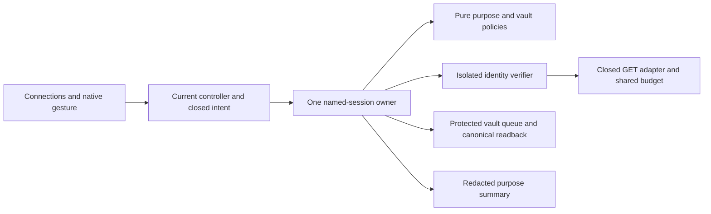

# Purpose-isolated GitHub session roles

- Status: Ready for implementation; acceptance outstanding
- Date: 2026-10-30
- Catalog capability ID: github-browser-extension
- Owners: browser extension maintainers
- Scope: complete named read and optional write-purpose session management in H3
- Related issue: [#704](https://github.com/vypdev/copilot/issues/704)
- Required review: UX, architecture, testing, documentation, security/operations
- Open decisions blocking implementation: none

## 1. Executive summary

Connections MUST manage at most five named GitHub sessions across separate
selected-repository read, issue-triage and Actions-operation purposes. Reading
remains the recommended default. Optional write purposes are disabled until
explicit selection. Credentials, selections, identity verification and actual
permission to perform an operation are independent facts.

```text
Choose purpose → enter user-owned credential → authorize browser access
→ verify account and repository → save protected session
→ review exact optional-purpose identity → explicitly select
→ later operation owner checks its own grants, target and reviewed intent
```

Text equivalent: saving a purpose-bound identity does not select an optional
writer or perform a GitHub mutation. This refinement completes the H3 manager;
the actual closed issue/run operations remain owned by their later milestones.

## 2. Problem, current behavior, and evidence

### 2.1 Problem

BEX-CENTER-05 requires separate read and optional write roles. A connection
manager supporting only reads cannot satisfy that requirement. Conversely,
accepting one broad credential and silently promoting it would erase the
purpose boundary and make account selection misleading.

### 2.2 Current behavior

The local H3 checkpoint `b229d7f3` implements the protected schema-1 named read
vault, a single selected read identity, native password input, controller and
revision fences, canonical persistence observations and independent session
preferences. It implements no write-purpose manager. Its local deterministic
coverage is not native-browser, human or remote Codecov acceptance.

### 2.3 Evidence

- `extension/src/domain/named_sessions.ts` and the application owner define
  five entries, 16 KiB, one read selection and protected session storage.
- `protected_session.ts` exclusively owns the active read credential key.
- `center_connections.ts` clears native password input before awaiting the
  browser permission request; Svelte receives no credential value.
- `CENTER.v1.json`, BEX-CENTER-05, and the Action integration SDD §11 define
  separate user-owned roles. The setup companion and BEX-SETUP-06 prohibit
  setup/bot/provider secrets and legacy Apply capabilities in the extension.
- [GitHub repository metadata](https://docs.github.com/en/rest/repos/repos#get-a-repository)
  requires Metadata read; success does not establish Issues or Actions write.
- [GitHub endpoint permissions](https://docs.github.com/en/rest/authentication/permissions-required-for-fine-grained-personal-access-tokens)
  define endpoint-specific grants. Do not infer them from an account label,
  repository visibility, token syntax or a successful identity read.
- [GitHub token formats](https://docs.github.com/en/authentication/keeping-your-account-and-data-secure/about-authentication-to-github#githubs-token-formats)
  identify `github_pat_` as the fine-grained PAT prefix. New optional purposes
  accept that family within the existing 255-character bound, without assuming
  a fixed token length. Prefix recognition is not ownership or grant evidence.
- [Chrome storage](https://developer.chrome.com/docs/extensions/reference/api/storage)
  and [Mozilla session storage](https://developer.mozilla.org/en-US/docs/Mozilla/Add-ons/WebExtensions/API/storage/session)
  describe the session boundary. Actual target protection remains independently
  verified; unsupported APIs never trigger persistent storage fallback.

Primary provider documentation was consulted on 2026-10-30. Unknowns are future
operation-specific grant outcomes and required native/human acceptance results.

### 2.4 Retrospective classification

Not applicable: this is a prospective extension of the read-session contract.
The previous checkpoint is evidence, not a claim of completed H3 acceptance.

## 3. Actors, surfaces, and terminology

| Actor | Goal | Entry point | Visible surface |
|---|---|---|---|
| User | Preserve read access and choose a separate operation identity | Connections | Purpose form, named rows, selection review |
| Observer window | Inspect current roles without changing them | Same route | Read-only current metadata |
| Maintainer | Diagnose retention or permission uncertainty | Privacy/help | Purpose guidance and redacted operation facts |

A **purpose** is what this extension may use a credential for. An
**identity-verified** selection has matching numeric GitHub account/repository
facts from this worker's explicit verification. A **stored** selection retains
only native intent after suspension/restart; it is not fresh authorization.
**Write permission unverified** is distinct from either identity state.

## 4. Goals, non-goals, and fixed invariants

1. Manage all three closed purposes with a shared five-entry limit and clear,
   independently selected identities.
2. Preserve the default read journey, existing settings and authored drafts.
3. Make create, select, disable, relocate, remove and forget operational and
   source-bound, including uncertain native persistence.
4. Never reuse a credential across purposes or place a writer in the active
   read key, read selection, content messages, profiles, history or exports.
5. No setup, bot, provider, generic write, administration, Secrets, merge or
   deployment purpose exists. No new browser host grant is introduced.

Actual provider writes, setup pairing/Apply, token provisioning/revocation,
OAuth, arbitrary endpoint forwarding and persistent credential remembrance are
outside this manager. Their absence does not defer the H3 role-management work.

## 5. Current versus proposed journey

| Stage | Current | Proposed | User effect |
|---|---|---|---|
| Add | Read only | Explicit purpose, default Read | Understand intended use before secret entry |
| Verify | Account/repository GETs and active read save | Same read flow; isolated GET-only writer verification | No accidental read activation by a writer |
| Select | One read identity | One read slot plus two independent optional slots | Know which account each operation would use |
| Disable | Disconnect/remove a read session | Disable a write purpose separately from deleting its credential | Stop selection while retaining an explicitly saved session |
| Resume | Reverify retained read identity | Retained optional selections show Stored until explicit verification | No stale grant or hot identity claim |
| Recover | Read current native state | Same one-attempt/readback rule across all purposes | No automatic effect replay |

## 6. Functional behavior and state model

### 6.1 Create and select

The form MUST default to `repository-read`. Optional purposes are `issues-write`
and `actions-write`; names, host, numeric identity and credential limits retain
the existing closed validation. Purpose cannot be edited on an existing entry.
Duplicate names/IDs and a credential reused under a different purpose reject
before provider verification or persistence. Do not retain token fingerprints.

An optional-purpose credential MUST be verified with only the existing semantic
viewer and repository GETs. Both numeric identities must match an existing entry
on reselection/relocation. Cosmetic rename/organization observations may update
only after that check. Optional roles MUST NOT invoke active-read connect,
restore, revoke or repository-read preference writes.

Adding an optional entry MUST leave that purpose disabled or retain its existing
selection. Selecting it requires an explicit exact-row review binding ID,
purpose, account, numeric repository and vault revision. Reverify on confirmation.
A changed source invalidates that review; never silently rebase it. No provider
write or test mutation is a permission probe.

### 6.2 Disable, remove and forget

`disable-role` clears only that optional purpose's selection; it keeps the named
credential and independent read selection. Removing an entry requires exact-row
confirmation and clears any slot selecting it. Existing read Disconnect retains
its documented removal semantics. Forget all remains independently available
with unreadable/future preferences or vaults, uses its own explicit confirmation
and verifies removal of every fixed protected credential key. It does not revoke
a GitHub token, reset preferences or clear generated user data implicitly.

### 6.3 States and concurrency

The adjacent read-session consumers MUST keep the same purpose boundary.
Profile account/organization/repository choices, local repository preference
rows and new workspace choices use saved `repository-read` entries only. A
verified or selected optional writer is not a read identity. Existing authored
scope values remain retained but unknown when only a writer matches; no private
writer label may fill them. A retained workspace slot pointing to a writer stays
missing, in its original position, without a read-selection action. Even a
malformed read-selection projection must not activate a write account's scoped
preferences. Removing or changing a purpose never rebinds these authored values.

| State | Fact | Next action |
|---|---|---|
| Disabled | No optional selection | Add or explicitly select a purpose-bound session |
| Stored | Selection exists, no current worker verification | Reverify exact selection |
| Identity verified | Explicit verification and exact native readback match | Later operation owner checks its own authority |
| Checking | One admitted role mutation is in flight | Wait; no competing effect |
| Conflict/stale | Revision, controller or identity changed | Read and review again |
| Unknown | Desired native effect not established | Read current state; do not automatically repeat |
| Unavailable | Protection, permission, schema or native observation failed | Retain data; follow recovery/forget guidance |

One background owner serializes all named-vault writes and removes. An admitted
identity/role change MUST retire relevant private evidence before asynchronous
verification; cached reads are partitioned by purpose and attempt. Provider
verification, persistence and publication recheck current authority. Native
vault drift before persistence MUST be detected rather than overwritten. Browser
storage has no cross-process transactional CAS; the enforced single-owner port
and final source/revision checks are the supported concurrency model.

Every admitted named-session operation MUST retain its exact read-credential
epoch through provider verification, preference awaits, native preflight and
publication. Only synchronous epoch callbacks from that operation's own active
read connect/revoke calls may advance its private expected epoch. An external
advance permanently retires the operation even while its editor remains current.
If retirement follows a submitted native save, retain the actual effect and
return Stale without publishing hot identity proof; never undo or replay it.
Read cleanup may retire only the credential generation created by that same
operation. It MUST NOT revoke a newer independently established read account.

Forget/permission revocation fences in-flight verification immediately and queues
physical removal after admitted persistence. A late verification cannot restore
deleted credentials or recreate a cleared selection. Native writes happen once;
accepted acknowledgement and exact canonical readback are separate observations.
Unknown effects never become verified from a later generic read without a current
identity proof. No retry loop, inverse mutation or automatic repair is added.

## 7. Configuration and persistence

| Field | Default | Bounds and ownership |
|---|---|---|
| Purpose | `repository-read` | Closed three-value union; immutable per entry |
| Name | User authored | Existing 1–64 UTF-16 units, unique case-insensitively |
| Host | `github.com` | Fixed; not editable or importable |
| Read selection | Existing behavior | Null or a read-entry ID only |
| Optional selections | Both null | At most one ID for each matching purpose |
| Capacity/size | Five / 16 KiB | Global across purposes; fixed safety limits |
| Credentials and selections | Protected session | No local/sync/export/rollback fallback |
| Verification | Current worker only | Detached identity facts, never a grant |

Schema 1 remains readable. Read-only operations MAY retain schema 1. The first
explicit optional-role mutation upgrades to schema 2 in the same canonical vault
key, preserving revision, read selection and every validated entry. Schema 2 adds
a closed `writeSelections` record with `issues-write` and `actions-write` nullable
IDs. Validate existence and exact purpose of each selected ID; a writer cannot
occupy the read slot. Newer/invalid schemas are preserved and unavailable, never
downgraded. Returning to old software may require explicit protected-session
forgetting/reconnection; it cannot silently reinterpret a writer as a reader.

Recommended: one read session, both optional purposes disabled. Alternative:
separate selected-repository credentials named “Work read”, “Issue triage” and
“Run controls”. Selection never changes personal profile precedence, native pause
authority or repository Action policy. Any vault revision change keeps the
existing session-preference retirement/retained-positive-pause rules.

## 8. Clean Architecture

| Boundary | Owns | Forbids |
|---|---|---|
| Domain | Purpose/slot schemas, migration, closed intents and redacted summaries | Browser/provider APIs, credential acquisition |
| Named-session application owner | Capacity, current-source admission, revision/queue, selection and persistence | Generic provider write transport |
| Purpose verifier | Bounded identity verification through semantic GET port, cancellation and private identity witnesses | Active read persistence, permission certification |
| Native storage/provider adapters | Protected records, closed GET mapping and canonical observations | UI policy, arbitrary URLs/methods/bodies |
| Infrastructure | Instantiate shared scheduler, protection, source invalidation and gesture adapter | Duplicate vault authority |
| Presentation | Purpose guidance, exact-row review, drafts/focus and factual state | Credential values, provider/storage calls |



Text equivalent: presentation requests semantic role actions through the native
controller. One application owner consults pure policy and the isolated verifier,
then persists through the existing protected queue and returns redacted facts.

No writer secret is exposed through a getter or message. No unused provider-write
stub is added. Read admission selects only the validated read slot. The existing
architecture/import/cycle checks, credential-free content bundle rules and
220-line TypeScript/90-line Svelte budgets remain mandatory. Decompose the owner
and shared schema before increasing a module budget. Keep existing read contracts
and tests; compatibility is tested semantically, not by weakening validators.

## 9. UI, accessibility and localization

```text
Connections
Read session: Work read — octo / octo/example — Connected
Issue triage: Disabled
Actions operations: Run controls — Stored; reverify this identity

Add a session
Purpose: [Read selected repository]
Name / Repository / Credential (native password field)
[Authorize browser access and verify]

Issue triage — octo / octo/example
Saved; not selected. Verify this identity when selecting it.
No GitHub change was made. Write permissions have not been checked.
[Review selection] [Remove protected session]
```

Selection review names the exact purpose/account/repository, explains the separate
read selection and that future operations need their own review. Pending content
says what is being verified; unavailable content says what remains stored and
offers one current read. Unknown content preserves accepted/observed effects and
forbids an automatic repeat. Complete content distinguishes Saved, Selected,
Disabled and Removed; none means a GitHub mutation or token revocation occurred.

The native password stays unbound, clears before the permission await and never
enters Svelte state, HTML attributes, diagnostics or selected-row reviews. Browser
permission is the first browser API call within the submit gesture. Observer,
blurred, stale, busy and incompatible views cannot submit, including synthetic
form events. Drafts and focus survive failure; changes clear only on the observed
matching native result. Leaving an uncertain operation cannot undo its effect.

All strings ship in en/es/fr/pt with existing fallback, themes, contrast and
reduced-motion rules. Controls need labels, keyboard operation, stable focus,
understandable status announcements and 320 CSS px/200% zoom layouts. Role
selection and deletion confirmations must not rely on color or icons alone.

## 10. Failure and recovery

Identity/target mismatch fails without selecting the candidate. Permission/SSO or
401/403/404 failures remain unavailable identity evidence; they do not disclose
private resource existence or certify a grant. Native-state failure, bounded
rate/budget delays and stale controller retain their supported outcome classes.
No read token or different purpose is a fallback. On uncertain persistence,
inspect once and preserve both factual
dimensions. A successful read of old metadata is not a successful selection.
Explicit native forgetting remains the final local recovery, with unconfirmed
deletion reported truthfully. Browser disable/restart recovery never promises
physical credential deletion from an unavailable native store.

## 11. Security and privacy

Only the admitted native extension-origin editor can mutate roles. Content/page,
foreign/private/opaque origins, observer controllers, stale epochs and malformed
closed payloads reject before credential/provider access. Transport remains
8 KiB for connection requests with existing bounded native replies. No endpoint,
headers, script, command, host, setup answer or grant field is accepted.

Only user-owned GitHub credentials are requested. Read/write browser roles and
the setup operator/provider/bot roles have separate owners. The existing
nonsecret setup intent cannot import or select any credential. Generated history
keeps bounded redacted operation facts; role labels/private repository identities
stay source-bound current memory and never enter default exports or URLs.

## 12. Observability and notification budget

Current operation metadata and optional already-consented history distinguish
role-selection/disable/vault effects from active read effects. Do not record a
writer as having changed the active read credential or repository read opt-in.
Keep native attempt, acknowledgement and canonical observation separate. At most
two invalidation notifications per admitted mutation; no GitHub comments, polling
loop or telemetry are introduced. Technical details never contain a secret.

## 13. Compatibility, rollout and rollback

H2 active reads and schema-1 named read sessions remain supported. Browser-session
loss clears optional secrets and hot verification; preferences remain. Schema-2
native selection is not imported authority after worker restart. Source-tree
matching and the closed current protocol prevent stale native pages from applying
new roles. Unknown future data remains unavailable until explicit recovery.
Rebuilding packages does not establish loaded-browser behavior or store approval.

## 14. Testing strategy

Minimum **208 distinct new risk cases**, each assigned once:

| Area | Floor | Distinct risks |
|---|---:|---|
| Pure policy/schema | 44 | Purposes, slot matching, migration, capacity, malformed/unknown state, credential reuse and twelve adjacent read-consumer cases |
| Identity verification | 36 | Numeric identity/rename, isolated GETs, SSO/denial, rate/budget, cancellation and late completion |
| Native state/races | 40 | CAS/queue, lost acknowledgement, canonical readback, select/disable/remove/forget and suspension |
| Native wire/security | 24 | Actual closed parser/gateway, controller/source/role denial, oversized/private payloads |
| Mounted UI | 42 | Defaults, role guidance/review, retained drafts, uncertainty, source loss, focus, localization/accessibility and six read-consumer journeys |
| Composition | 22 | Actual background→gateway→native page; read runtime, settings and setup isolation plus six adjacent role-boundary journeys |
| **Total** | **208** | Existing cases and repeated locale executions do not add new risks |

Tests use deterministic clocks, IDs and provider/native fakes; no real wait or live
credential. All existing tests remain. The full extension suite and every changed
runtime module MUST have 100% lines, branches, functions and statements locally;
strict diff coverage has zero misses/partials. Existing repository gates remain.
Source-bound loaded Chrome/Firefox/Safari and the H3 human UX evidence are
independent gates. A DOM or composed fake is never a native/human acceptance claim.
Remote current-head/base Codecov must cover every modified executable line without
partials before merge; exceeding a configured threshold alone is insufficient.

## 15. Documentation

Update configuration, permissions, runtime/troubleshooting and developer guides
together. Explain default reading, separate optional purposes, creation/selection,
unverified write grants, session retention, revocation versus local removal,
schema downgrade recovery and CLI/setup separation. Register this refinement and
actual source/test evidence in the existing catalog without accepting the whole
150-feature product. Run catalog generation, specifications and documentation
validators. Do not duplicate the large parent H3 SDD or its existing case IDs.

## 16. Acceptance

1. Standalone configuration works with all optional purposes disabled.
2. Creating a writer verifies only its account/target, saves one protected entry,
   changes no active read key/settings and leaves optional selection unchanged.
3. Exact-row confirmation selects only the matching purpose after fresh numeric
   verification; every private source fence remains current.
4. A write credential cannot serve a page read, cross purpose, restore a different
   account or enter settings/history/content/setup transport.
5. Disable/removal/forget retain correct independent selections and truthful native
   facts through concurrent verification and lost acknowledgements.
6. Schema-1 migration preserves read behavior; schema-2 slot violations and unknown
   future records fail closed without overwriting data.
7. Worker resume labels retained selection Stored, never fresh write authority.
8. The complete four-locale keyboard/recovery journey, native source-bound packages,
   full coverage and independent human H3 evidence pass before H3 publication.

## 17. Traceability

| Requirement | Owner and evidence | Documentation |
|---|---|---|
| BEX-CENTER-05; H3-R05 | Purpose/slot policies, named owner, verifier, native wire and composition cases | Configuration/permissions |
| Purpose/secret isolation | Active read/vault boundaries and native/content denial cases | Runtime/developer |
| H3-R10 | Mounted localized review/draft/focus cases and human UX receipts | Configuration/accessibility |
| H3-R11 | Schema, queue/readback/forget and failure fixtures | Troubleshooting |
| H3-R12 | Exact-source loaded target receipts, distinct from deterministic tests | Compatibility/developer |
| BEX-SETUP-06 | Closed purposes and no secret/setup bridge; import/content tests | Setup/permissions |

## 18. Implementation sequence

1. Add pure role/schema/migration and closed DTO contracts with regression cases.
2. Decompose the protected owner; add isolated verifier, source/CAS and purpose
   selection/disable with canonical observations and compatibility tests.
3. Wire the native gesture and complete localized role-management UI; update
   operation facts, docs and catalog alongside source.
4. Run full coverage, architecture/types/package checks, Graphify and local hooks.
5. Complete the remaining H3 native/human acceptance. Publish source and prepare
   its PR only after all #704 requirements are complete, as the user instructed.

## 19. Definition of Done

- [ ] All three role-management journeys and recovery paths work, with no deferred
  H3 manager or pretend provider-operation control.
- [ ] Default read compatibility, purpose/secret isolation, one native owner,
  revision/current-source/queue/readback and revocation gates pass.
- [ ] Numeric risk floor, complete existing tests, strict full local coverage and
  changed executable-line coverage pass without exclusions or skipped cases.
- [ ] Four-locale UX, user/developer docs, catalog and executable architecture gates
  are current; Graphify is updated.
- [ ] Source-bound native and human H3 receipts are independently accepted.
- [ ] Current-head/base remote checks and complete review pass with no findings;
  Codecov has no modified executable line or partial branch uncovered.
- [ ] Any protected human decision is specific to the final candidate; no release,
  tag, deploy or store submission is implied.

## 20. References and decisions

The main extension, functional catalog, Action integration, H3, session preferences,
collection consent and setup companion SDDs remain normative. This refinement
chooses one bounded purpose-aware vault, separate selections and GET-only identity
verification. It rejects a second independently sized vault, a broad shared token,
mutation-based permission probes, setup secret reuse and active-read promotion.
Implementation and all H3/product acceptance remain outstanding until evidenced.
