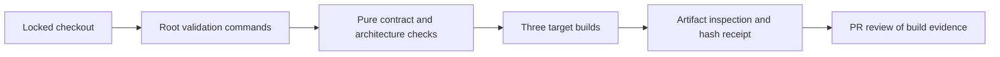
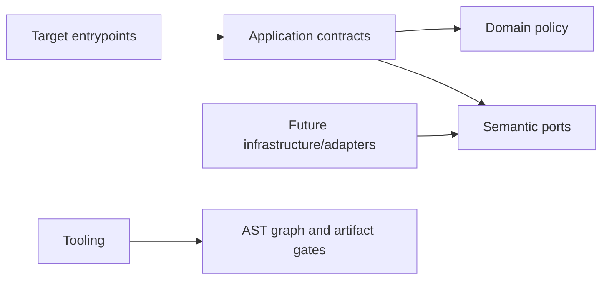

# GitHub Browser Extension Engineering Foundation (H1)

- Status: H1 historical baseline merged in PR #715; current runtime changes are owned by H2
- Date: 2026-10-25
- Catalog capability ID: `github-browser-extension`
- Last verified: 2026-10-25; H1 source/build/test evidence only, with final checks recorded in the PR
- Owners: Copilot maintainers
- Scope: Establish a private, independently versioned, reproducible three-target browser extension engineering foundation without claiming product features or browser-loading evidence.
- Related issues/PRs: [Issue #702](https://github.com/vypdev/copilot/issues/702); complete product accepted in PR #699 at `b4b06be9e9431bf337729a42a355cbb27f5a419c`.
- Required review gates: product UX, architecture, testing, documentation, security/operations
- Open decisions blocking readiness: none

This is an engineering companion to the five existing owning specifications: `specs/github-browser-extension.md`, `specs/github-browser-extension-functional-catalog.md`, `specs/github-browser-extension-platforms-and-delivery.md`, `specs/github-browser-extension-action-integration.md`, and `specs/github-browser-extension-control-center-and-setup.md`. The catalog capability remains proposed for the complete product: 150 required functions and an 803-case acceptance floor. H1 does not replace or reduce that scope.

## 1. Executive summary

H1 gives contributors a private `extension` pnpm workspace package with typed browser-safe contracts, enforced Clean Architecture boundaries, and deterministic development artifacts for Chrome 140, Firefox 140/ESR, and Safari 18.2 on macOS 15.2. The recommended default is the locked repository toolchain (Node 24 and pnpm 10.12.4) and the package's explicit build, typecheck, test, and validation commands. Existing Action, CLI, web, root package, coverage, and workspace override behavior remains supported.

The principal safety rule is that a successful build proves artifact construction and inspection only. It does not prove an extension was loaded in a browser or that product behavior works. The content entry is inert after a pure eligibility check; H1 performs no DOM manipulation, GitHub request, credential handling, storage write, observation, automatic operation, or product feature.

```text
Locked checkout -> validate pure contracts and boundaries -> build three development targets -> inspect deterministic artifacts and hashes
```

Text equivalent: contributors validate a locked checkout, build three inspectable development targets, and review their artifact evidence; no browser product operation occurs.

## 2. Problem, current behavior, and evidence

### 2.1 Problem

Contributors need a portable foundation before implementing the accepted extension product. Without a shared package boundary, target-specific manifests, browser-safe contract, and automated architecture checks, later features could import Node runtime code, drift in permissions, or behave differently across browsers.

### 2.2 Current behavior

1. The accepted product is specified, but the repository baseline has no extension runtime or package.
2. The root workspace configuration supplies dependency overrides; the existing Action, CLI, web builds, root coverage gates, hooks, and npm package contract already matter and must remain intact.
3. The connection manifest v1 schema and example exist under `specs/browser-extension/` and define the contract H1 validates.
4. The five owning SDDs describe the complete product; the catalog records it as proposed and runtime-unimplemented.

These describe the immutable design baseline before H1. H1 now supplies the private package, pure contract/guard, target generation and executable architecture/build gates. The complete product is still proposed; no actual browser-loading proof is claimed.

### 2.3 Evidence

- Code/workflow/documentation references: the five owner SDDs, `specs/README.md`, `specs/_template.md`, `specs/browser-extension/manifest-v1.schema.json`, `specs/browser-extension/examples/manifest-v1.json`, and the supplied validated catalog at the stated revision.
- Incidents or concrete examples: none supplied. The prior managed candidate attempts failed closed on table format and then repository-path validation; those failures establish publication constraints, not product behavior.
- External primary sources: official compatibility documentation for the selected TypeScript, Vite, and Vitest versions must be consulted and recorded during implementation; no version compatibility claim is inferred here.
- Selected versions: TypeScript 5.9.3, Vite 8.3.1, Vitest and coverage-v8 5.0.5, locked in the private workspace. Official requirements and platform references are linked in the contributor guide. Actual browser evidence remains outside H1.

### 2.4 Retrospective classification (as-built baselines only)

Not applicable: this is prospective and does not reconstruct an implemented extension baseline.

## 3. Actors, surfaces, and terminology

| Actor | Goal | Entry point | Visible surfaces |
|---|---|---|---|
| Extension contributor | Build and validate portable development targets | Root/package commands and contributor guide | CI checks, local command output, generated development artifacts |
| Maintainer/reviewer | Inspect scope, architecture, permissions, and evidence | Pull request linked to Issue #702 | PR description, checks, artifact manifests and hash receipt |
| GitHub user | No H1 product action | Eligible page may load an inert content entry | No H1 UI or page change |

A **development artifact** is a locally inspectable target build, not a store package or release. **Eligibility** is a pure decision about a URL. **Connection manifest v1** is the existing repository connection-manifest value contract. **Owning SDDs** are the five complete-product specifications listed above. **Build evidence** records generated artifacts and their hashes; **loaded-browser evidence** requires actual later browser execution and is outside H1.

## 4. Goals

### 4.1 Goals

| Requirement | Behavior |
|---|---|
| BEXH1-CONTRACT | Provide readonly browser-safe connection-manifest v1 types and pure validation of an already-decoded unknown value, conforming exactly to the existing schema and example. |
| BEXH1-TARGET | Build three typed, least-privilege development targets and reject ineligible or protected URLs before any future mount work. |
| BEXH1-BOUNDARY | Automatically enforce dependency direction, browser-safe pure code, no cycles, and prohibited bundle/manifest content. |
| BEXH1-PACKAGE | Preserve root behavior, provide clean reproducible complete artifacts and actionable recovery, and document contributor workflows and scope accurately. |

### 4.2 Non-goals

1. H1 does not implement lifecycle, UI, settings, connection, status/request decoding, producer integration, setup, notifications, optional grants, or any of the 150 full-product capabilities.
2. H1 does not implement raw JSON duplicate-key parsing. Validation accepts an already-decoded value; duplicate keys cannot be diagnosed after ordinary decoding and remain for a later parsing milestone.
3. H1 does not claim Chrome, Firefox, or Safari loading, real Safari containing-app evidence, store identity, signing, publication, or stable release.
4. H1 does not reserve or invent published accounts or signing metadata, nor ship generated extension output in the root npm package.

### 4.3 Fixed product/safety invariants

1. Root Action/CLI/web builds, workspace overrides, root npm contents, existing checks, coverage gates, and hooks remain supported.
2. Node 24 and pnpm 10.12.4 are locked. The private extension package starts at version `0.1.0`, explicitly distinct from future store identity.
3. The only permitted root source entrypoint for extension code is `src/domain/browser_extension_contract/index.ts`; application code imports domain and semantic ports only.
4. Initial target permissions are `storage` only. There are no optional grants, remote code, remote assets, broad host access, options page, toolbar control, or incognito enablement. Optional API/alerts/setup grants are added only with later features that require them.
5. The content script is static, isolated, top-frame-only, and matches `https://github.com/*`. It performs only eligibility evaluation and remains inert. It has no DOM, network, credential, storage, observer, or automatic-operation authority.
6. Source modules containing executable code are at most 220 lines. Pure decisions require 100% branch coverage; other new executable modules require at least 95% statement and 90% branch coverage, with changed executable lines covered.
7. A failed build or validation never advertises a partial target set. Rebuilds in two clean temporary directories produce byte-identical artifacts; receipts include target hashes and source revision without secrets.
8. The product's existing 803-case acceptance floor remains unchanged and is not satisfied by H1 engineering cases.

## 5. Current versus proposed product journey

| Stage | Current | Proposed | User/operator effect |
|---|---|---|---|
| Checkout | No extension package/runtime | Locked workspace includes private extension package | Contributor uses documented root commands |
| Contract | Schema/example exist; no extension validator | Shared browser-safe readonly types and pure validator | Invalid decoded values fail before use |
| Target build | No extension artifacts | Three target-specific development artifact sets | Reviewer can inspect manifests and bundles |
| Validation | No extension architecture gates | AST/import graph and artifact checks run locally and in CI | Violations fail with actionable target/file diagnostics |
| Browser use | No H1 product operation | Ineligible URL rejects; eligible content entry remains inert | No product UI or GitHub effect is implied |



Text equivalent: checkout flows through validation and target builds to inspectable artifacts and PR review; the flow does not include browser loading or user-facing extension behavior.

## 6. Functional behavior and state model

### 6.1 Happy path

1. A contributor installs from the lockfile with the prescribed Node and pnpm versions.
2. Root commands typecheck, test, validate architecture/artifacts, and build the extension package without weakening existing gates.
3. The build creates complete Chrome, Firefox, and Safari development outputs from typed allowlisted target differences.
4. Artifact validation parses manifests, inspects packaged contents and bundles, and emits target hashes plus source revision without secrets.
5. The contributor links Issue #702 in the PR, records exact checks and remaining product gates, and awaits maintainer review.

### 6.2 Alternative paths

- Invalid decoded manifest: return a closed validation failure without throwing or causing an effect.
- Ineligible/protected URL: return false; no mount or other work follows.
- Architecture or artifact violation: fail with the relevant file, target, and rule; do not publish output as a complete set.
- Build failure: remove staging and any newly advertised partial target set. A corrected retry replaces the complete set and removes stale/undeclared assets.
- Root or extension check failure: retain the failure status and diagnostics; do not claim acceptance.

### 6.3 State machine

| State | Entered when | User-visible meaning | Allowed next states | Recovery/owner |
|---|---|---|---|---|
| Clean checkout | Locked dependencies available | Ready to validate | Validating | Contributor runs documented command |
| Validating | Typecheck/tests/architecture/artifact checks run | Checks are in progress | Buildable, Failed | Contributor follows diagnostic |
| Buildable | Required checks pass | Targets may be built | Complete artifacts, Failed | Build tool owns staging |
| Complete artifacts | All targets validate and hashes recorded | Complete development set is inspectable | Reviewed, Rebuild | Reviewer inspects evidence |
| Failed | Any required phase fails | No complete artifact set is claimed | Validating | Fix cause and retry; staging cleanup is automatic |

Duplicate invocation is deterministic and has no browser effect. Stale output is removed before a clean build. H1 has no asynchronous product events, cancellation, durable user state, or irreversible provider effects; those lifecycle concerns belong to later milestones.

## 7. User-facing configuration

| Input | Type | Recommended default | Allowed values/range | Scope/persistence |
|---|---|---|---|---|
| Node runtime | Tool version | Node 24 — repository baseline | Locked supported Node 24 toolchain | Contributor environment; not persisted by extension |
| pnpm runtime | Tool version | pnpm 10.12.4 — lockfile consistency | Exact locked version | Workspace installation |
| Extension package version | Semver | `0.1.0` — private development identity | Independently versioned private package; no published identity | Package metadata only |
| Build output location | Package command output | Package-local generated output | Declared target outputs only | Ignored/generated; not root npm package |
| Browser target | Build selection | Build all three targets | Chrome 140; Firefox 140/ESR; Safari 18.2/macOS 15.2 | Build invocation; no runtime user setting |

The build must use TypeScript, Vite, and extension-specific Vitest versions selected and locked against official compatibility documentation. Configuration must reject undeclared targets and arbitrary output destinations that bypass cleanup/validation. No secrets, URLs, arbitrary code, published identity, or signing values are accepted. Recommended configuration builds all targets; a meaningful alternative is focused test/manifest inspection for one target during diagnosis, while the public build/validation commands and acceptance always use all three. Permission limits and content inertness are not configurable. There is no migration of user data in H1.

## 8. Clean Architecture

### 8.1 Responsibilities and dependency direction

| Layer/boundary | Owns | Must not own/import |
|---|---|---|
| Domain/pure policy | Manifest value contract, eligibility and target policy | Browser/Node globals, provider SDKs, DOM, storage, network |
| Application | Future orchestration contracts and semantic ports | Concrete adapters, target entrypoints, presentation, SDK/process concerns |
| Adapters/data | Future translation between semantic contracts and provider formats | Product policy or H1 browser effects |
| Infrastructure/composition | Target manifests, build composition, inert content/background entries | Duplicated domain decisions or user-facing business policy |
| Entrypoints | Adapt target startup and call pure eligibility; remain inert | Orchestration duplication, DOM mutation, network, credentials, storage writes |
| Presentation | Future view models/rendering in later milestones | Mutations, network authority, credentials, disallowed shared-root/deep imports |



Text equivalent: entrypoints depend inward on application contracts and domain policy; future adapters implement semantic ports; tooling independently checks the graph and emitted artifacts.

### 8.2 Contracts, state, and trust boundaries

- Pure decisions: validation of already-decoded connection-manifest v1 values, exact URL eligibility, and typed target differences.
- Application contracts: no feature use case is implemented in H1; future use cases may depend on domain and semantic ports only.
- Semantic ports: future browser capabilities must be named as narrow semantic interfaces, not provider DTOs; none grants H1 runtime authority.
- Durable state/schema ownership: no H1 durable extension state. Manifest value types conform to `specs/browser-extension/manifest-v1.schema.json` and `specs/browser-extension/examples/manifest-v1.json`.
- Concurrency/idempotency strategy: build staging is isolated and replacement is all-or-nothing; no runtime concurrency exists in H1.
- Trusted and untrusted inputs: URLs and decoded manifest values are untrusted. Target definitions and build configuration are repository-controlled but still parsed and validated.
- Provider error mapping: not applicable; H1 invokes no browser provider API or external service.

### 8.3 Executable architecture constraints

A structured TypeScript AST and import-resolution graph must enforce layer direction, no unresolved imports, cycles, and no boundary escapes. It must reject Node/browser/DOM ambient globals and provider imports in pure code; concrete infrastructure, adapters, and presentation imports from application; SDK/runtime/deep root imports; and presentation network, mutation, or credential authority. Negative and positive fixtures exercise the same validator. Built bundles and parsed generated manifests are checked for forbidden executable/Node primitives, permissions, hosts, remote assets, and structural drift. Diagnostics identify file, target, and failed rule. Shared extension source imports only through `src/domain/browser_extension_contract/index.ts`.

## 9. UI/UX and content contract

### 9.1 Information hierarchy

For contributor-facing checks, show current phase, completed checks, next command or review action, whether action is required, artifact impact, inspectable target/hash evidence, and collapsed technical diagnostics in that order. H1 adds no GitHub-user interface.

### 9.2 Representative primary view

A PR description may use this concrete build-evidence summary:

```markdown
# Browser extension H1 build evidence

> **Current status:** Three development targets built and validated.
>
> **Action required:** Maintainer review of this PR.

## Progress

- [x] Locked workspace and architecture gates passed
- [x] Chrome 140, Firefox 140/ESR, and Safari 18.2/macOS 15.2 artifacts inspected
- [ ] Loaded-browser and complete-product acceptance remain later work

## What happens next

Review the target manifests, bundle checks, reproducibility receipt, and linked issue.

## Links

[Issue #702](https://github.com/vypdev/copilot/issues/702) · [Foundation specification](../specs/github-browser-extension-foundation.md)

<details>
<summary>Technical details</summary>

Record exact command results, source revision, and target hashes. Do not include secrets.

</details>
```

Variants required in contributor/PR guidance:

- Pending: “**Current status:** Extension checks are running. **Action required:** Wait for CI; no artifact is yet accepted.”
- Action required: “**Current status:** A target artifact failed validation. **Action required:** Fix the reported target/rule and rerun the documented command.”
- Blocked/failed: “**Current status:** Build stopped before a complete target set was produced. **Action required:** Correct the phase error and retry; partial output is not advertised.”
- Partially complete: “**Current status:** Some targets built, but the set is incomplete. **Action required:** Resolve the failed target and rerun all targets; no complete set is accepted.”
- Complete: the representative mockup above; it reports build evidence and explicitly leaves browser/product gates open.

### 9.3 Issue, PR, and comment behavior

- Deterministic PR purpose: “Implement H1 browser extension engineering foundation”; link canonical Issue #702.
- Merge/close/retry behavior: this spec authorizes no merge, deployment, store submission, or release. Retry replaces output only after a complete successful build.
- Durable marker and idempotent update policy: no bot comments or durable GitHub markers are introduced. CI checks are supplemental evidence.
- Comment/notification budget: no automated comments; one PR description and normal review activity.
- Labels and checks as supplemental state: checks report exact verification; issue/PR state remains the source of review workflow.
- Direct links and navigation: link Issue #702, the foundation SDD, and relevant owning specifications in contributor documentation and PR evidence.

### 9.4 Accessibility, localization, and responsive behavior

Contributor documentation and PR content use English with repository conventions and no H1 localized UI. Text is primary; tables have headers, links are descriptive, headings are ordered, and output remains readable on narrow screens and light/dark GitHub themes. Diagnostics sanitize control characters and never render untrusted input as executable Markdown, HTML, commands, mentions, or links. Any future diagrams have adjacent textual equivalents. User-facing extension accessibility/localization is not applicable because H1 creates no UI.

## 10. Failure, recovery, and cleanup

| Failure/partial state | User impact | Retained facts | Automatic retry | Required action | Cleanup |
|---|---|---|---|---|---|
| Lock/toolchain mismatch | Validation cannot establish reproducible inputs | Version diagnostic | No | Use Node 24 and pnpm 10.12.4 | No target output advertised |
| Contract validation fails | Invalid value cannot be used | Safe rule/path diagnostic only | No | Correct fixture/value | No state written |
| Architecture gate fails | Boundary violation blocks build | File, import/global, and rule | No | Move/fix dependency and rerun | Build staging removed |
| One target build fails | Complete target set unavailable | Failed target and phase | No blind retry | Correct cause and rerun | Remove staging/partial advertised set |
| Artifact inspection/reproducibility differs | Build evidence rejected | Target and differing hash/check | No | Inspect drift and clean rebuild | Replace only with full validated set |
| Documentation/catalog validation fails | PR is not ready for acceptance | Exact validator diagnostics | No | Correct docs/evidence and rerun gates | No runtime cleanup needed |

Errors follow impact, cause, action, retained state. A successful target build is never described as a successful browser load. Cleanup must be safe to repeat and must not delete unrelated root outputs.

## 11. Security, permissions, and privacy

1. Package only required `storage` permission in target manifests; it is not used by H1. No optional grants, notifications, broad host access, or unneeded browser permissions.
2. Restrict static isolated content script matching to `https://github.com/*`, top frame only; exact URL eligibility requires HTTPS, hostname `github.com`, no credentials, and no explicit port. Reject other origins and protected account/auth/settings/billing/security paths, including repository administration/security routes as specified by the owning SDD.
3. No remote code or remote assets. Browser execution authority, DOM access, network, credential handling, and storage writes are absent from H1 behavior.
4. Treat manifest values and URLs as untrusted. Validation is closed and non-throwing for null, scalar, array, and malformed nested inputs. H1 does not claim duplicate JSON key detection after decoding.
5. Build diagnostics and receipts contain no secrets. Do not reserve or fabricate store account/signing data.
6. Bundle and manifest inspection rejects forbidden Node primitives, undeclared permissions/hosts, remote executable content, and target drift.

## 12. Observability and operational UX

- User-facing state: local command phase and CI pass/fail, with actionable target/file/rule diagnostics.
- Job Summary/operator evidence: CI logs/checks record command, source revision, target hashes, and deterministic comparison result without secrets.
- Logs, metrics, and correlation: no runtime telemetry or external service. Build output uses deterministic identifiers and stable diagnostics.
- Pending external dependency versus workflow failure: official tool compatibility selection is recorded as build configuration; missing tools or failed gates are workflow failures, not browser failures.
- Rate-limit/retry behavior: not applicable; no external calls. Build retry is explicit after cause correction.
- Noise/comment budget: no bot comments; do not duplicate full logs in PR text.

## 13. Compatibility, migration, rollout, and rollback

- Existing in-flight operations/data: none in the extension. Existing Action/CLI/web behavior and root npm package contract remain supported.
- Schema/configuration migration: no user data migration. The connection manifest v1 is validated against its existing schema/example; later status-v1 and request-v2 decoding is outside H1.
- Deprecated behavior and compatibility window: none introduced.
- Rollout stages/feature flag if needed: private engineering package and CI gates only; not a public release or product rollout.
- Rollback and irreversible effects: reverting the H1 change removes the package/gates and generated outputs; no external or user effect is performed. Root checks must remain intact during rollback.
- Browser loading, actual Safari containing-app evidence, lifecycle/settings/connection/UI, store signing/publication, and complete product acceptance are later issues.

## 14. Testing strategy

The H1 floor is 28 distinct observable engineering cases. It supplements but does not replace the 803 full-product cases retained by the five owning SDDs. Browser matrix repetitions do not increase the count. Increase the floor if implementation exposes additional schema boundaries or branches. Root tests, hooks, and thresholds remain mandatory.

| Area | Minimum distinct cases | Behaviors/risks covered |
|---|---:|---|
| Connection manifest | 8 | Observable scenarios in the case inventory. |
| Eligibility and targets | 8 | Observable scenarios in the case inventory. |
| Architecture | 6 | Observable scenarios in the case inventory. |
| Build and package | 6 | Observable scenarios in the case inventory. |
| Total | 28 | Distinct inventory cases; repeated executions do not add cases. |

| Case ID | Area | Requirements | Scenario |
|---|---|---|---|
| bexh1-foundation-C01 | Connection manifest | BEXH1-CONTRACT | A conforming enabled example is accepted with typed readonly data. |
| bexh1-foundation-C02 | Connection manifest | BEXH1-CONTRACT | A conforming disabled manifest is accepted without enabling a connection. |
| bexh1-foundation-C03 | Connection manifest | BEXH1-CONTRACT | Missing/unknown keys, wrong schema/status/publication and invalid boolean types are rejected. |
| bexh1-foundation-C04 | Connection manifest | BEXH1-CONTRACT | Repository and producer IDs outside the positive safe-integer range or wrong types are rejected. |
| bexh1-foundation-C05 | Connection manifest | BEXH1-CONTRACT | Empty, oversized, duplicate or non-array workflow lists are rejected. |
| bexh1-foundation-C06 | Connection manifest | BEXH1-CONTRACT | Workflow names outside the exact bounded .github/workflows YAML grammar are rejected. |
| bexh1-foundation-C07 | Connection manifest | BEXH1-CONTRACT | Oversized, duplicate, non-array or invalid capability identifiers are rejected. |
| bexh1-foundation-C08 | Connection manifest | BEXH1-CONTRACT | Null, scalar, array and malformed nested inputs return a closed validation failure without throwing. |
| bexh1-foundation-C09 | Eligibility and targets | BEXH1-TARGET | An exact eligible HTTPS github.com page passes the pure guard without an effect. |
| bexh1-foundation-C10 | Eligibility and targets | BEXH1-TARGET | Other protocols/hosts, credentials, ports and deceptive host suffixes are rejected. |
| bexh1-foundation-C11 | Eligibility and targets | BEXH1-TARGET | Direct protected account/login/signup/session/OAuth/token/settings/billing routes are ineligible. |
| bexh1-foundation-C12 | Eligibility and targets | BEXH1-TARGET | Repository administration/security routes are ineligible while normal issue/PR/code routes retain identity. |
| bexh1-foundation-C13 | Eligibility and targets | BEXH1-TARGET | Chrome output has MV3 module service worker and the chosen compatibility floor. |
| bexh1-foundation-C14 | Eligibility and targets | BEXH1-TARGET | Firefox output has MV3 nonpersistent background scripts and its chosen floor/development identity. |
| bexh1-foundation-C15 | Eligibility and targets | BEXH1-TARGET | Safari output has MV3 nonpersistent background scripts and its chosen floor without unsupported notification permissions. |
| bexh1-foundation-C16 | Eligibility and targets | BEXH1-TARGET | All target manifests allow only packaged top-frame GitHub content and storage, with no unused options, remote assets, broad/optional grants or incognito enablement. |
| bexh1-foundation-C17 | Architecture | BEXH1-BOUNDARY | A valid inward dependency graph and explicit shared barrel pass. |
| bexh1-foundation-C18 | Architecture | BEXH1-BOUNDARY | Pure modules using forbidden Node/browser/DOM/provider imports or ambient globals fail with file diagnostics. |
| bexh1-foundation-C19 | Architecture | BEXH1-BOUNDARY | Application imports of concrete infrastructure/adapter/presentation modules fail. |
| bexh1-foundation-C20 | Architecture | BEXH1-BOUNDARY | Presentation network/mutation/credential and disallowed root/deep shared imports fail. |
| bexh1-foundation-C21 | Architecture | BEXH1-BOUNDARY | Cross-layer cycles, unresolved imports and boundary escapes fail deterministically. |
| bexh1-foundation-C22 | Architecture | BEXH1-BOUNDARY | Injected forbidden bundled executable/Node primitives and structural manifest drift are detected by the gate. |
| bexh1-foundation-C23 | Build and package | BEXH1-PACKAGE | A locked workspace install/typecheck/build produces all declared development target assets. |
| bexh1-foundation-C24 | Build and package | BEXH1-PACKAGE | Two clean output directories produce byte-identical target manifests/bundles and matching hash receipts. |
| bexh1-foundation-C25 | Build and package | BEXH1-PACKAGE | Root npm package file selection excludes extension runtime/development outputs and preserves existing contracts. |
| bexh1-foundation-C26 | Build and package | BEXH1-PACKAGE | A build error reports target/phase, cleans staging and never advertises a partial new target set. |
| bexh1-foundation-C27 | Build and package | BEXH1-PACKAGE | A corrected retry replaces the complete development artifact set without stale or undeclared assets. |
| bexh1-foundation-C28 | Build and package | BEXH1-PACKAGE | Root commands and parsed CI steps retain existing gates and execute extension validation; contributor docs commands/target claims match inspectable artifacts. |

Define:

- Keep all existing repository coverage gates and root checks; changed executable lines are covered.
- Pure domain decisions require 100% branch coverage. Every other new executable module requires at least 95% statements and 90% branches.
- Use deterministic fixtures, IDs, and temporary directories; do not use real waits, live services, or browser loading as a substitute for automated checks.
- Parse TypeScript AST/import resolution, generated manifests, package contents, and CI structure rather than relying on prose grep.
- Exercise positive and negative architecture fixtures, cleanup, retry, and reproducibility. Each inventory row is one distinct case; do not double count target matrix repetitions.
- Human review confirms contributor diagnostics and PR evidence are understandable. This does not constitute loaded-browser evidence.

## 15. Documentation and discoverability

| Path | Change |
|---|---|
| `specs/github-browser-extension-foundation.md` | create |
| `extension/package.json` | create |
| `extension/tsconfig.json` | create |
| `extension/vitest.config.mts` | create |
| `extension/README.md` | create |
| `extension/src/domain/eligibility.ts` | create |
| `extension/src/domain/target.ts` | create |
| `extension/src/infrastructure/content_entry.ts` | create |
| `extension/src/infrastructure/background_entry.ts` | create |
| `extension/src/infrastructure/target_manifests.ts` | create |
| `extension/tooling/build.mts` | create |
| `extension/tooling/artifact_validation.mts` | create |
| `extension/tooling/architecture_validation.mts` | create |
| `extension/tooling/source_graph.mts` | create |
| `extension/tooling/cli.mts` | create |
| `extension/test/contracts/manifest_value.test.ts` | create |
| `extension/test/contracts/eligibility.test.ts` | create |
| `extension/test/contracts/target_manifests.test.ts` | create |
| `extension/test/contracts/architecture.test.ts` | create |
| `extension/test/integration/build.test.ts` | create |
| `extension/test/integration/package.test.ts` | create |
| `extension/test/fixtures/architecture.ts` | create |
| `src/domain/browser_extension_contract/index.ts` | create |
| `src/domain/browser_extension_contract/manifest.ts` | create |
| `docs/development/browser-extension.mdx` | create |
| `.gitignore` | update |
| `package.json` | update |
| `pnpm-workspace.yaml` | update |
| `pnpm-lock.yaml` | update |
| `.github/workflows/ci_check.yml` | update |
| `docs.json` | update |
| `specs/catalog.json` | update |
| `specs/CATALOG.md` | update |
| `specs/github-browser-extension-platforms-and-delivery.md` | update |
| `extension/test/integration/receipt.test.ts` | create |
| `extension/tooling/gate_error.mts` | create |
| `extension/tooling/package_contract.mts` | create |
| `extension/tooling/validation.mts` | create |
| `extension/test/integration/recovery.test.ts` | create |
| `extension/test/integration/commands.test.ts` | create |
| `src/domain/__tests__/browser_extension_contract.test.ts` | create |
| `eslint.config.mjs` | update |
| `specs/browser-extension/manifest-v1.schema.json` | update |
| `specs/README.md` | reference |
| `specs/_template.md` | reference |
| `specs/github-browser-extension.md` | reference |
| `specs/github-browser-extension-functional-catalog.md` | reference |
| `specs/github-browser-extension-action-integration.md` | reference |
| `specs/github-browser-extension-control-center-and-setup.md` | reference |
| `specs/browser-extension/examples/manifest-v1.json` | reference |

The contributor guide must show install/build/typecheck/test/validate commands, target differences and compatibility floors, architecture/shared contract, permission rationale, clean rebuild and recovery, and planned versus delivered scope. The root command surface must expose explicit extension build, typecheck, test, and validation commands; CI invokes relevant new gates without removing existing checks. Documentation navigation and catalog metadata identify the companion in the existing `github-browser-extension` catalog entry and preserve full-product proposed status. Generated output is ignored and excluded from root npm package contents. Validate catalog and generated CATALOG together using repository commands.

## 16. Acceptance

1. Given a clean checkout with locked Node 24/pnpm 10.12.4 dependencies, when a contributor runs the documented gates and build, then three inspectable development artifacts are produced with only declared packaged assets.
2. Given two clean temporary output directories, when all targets are rebuilt from the same revision, then manifests and bundles are byte-identical and hash receipts match without secrets.
3. Given a decoded invalid repository manifest or an ineligible/protected URL, when the pure validator/guard runs, then it returns rejection before any future effect and never throws for malformed top-level input.
4. Given a forbidden import, ambient global, cycle, unresolved import, bundle primitive, or structural manifest drift, when the corresponding gate runs, then it fails with actionable file/target/rule diagnostics.
5. Given an injected target build failure, when the build stops, then staging and partial advertised outputs are cleaned; after correction, retry yields the complete target set without stale or undeclared assets.
6. Given a pull request, when its author records verification, then it links Issue #702, gives exact verification and remaining product gates, and awaits maintainer review. No merge, deployment, store submission, or stable-release authorization is implied.
7. Given existing Action, CLI, web, root npm package, root hooks and coverage gates, when the new workspace is validated, then existing contracts remain supported and all old and new required gates pass.
8. Given the contributor guide and catalog, when a reviewer follows navigation and compares claims to artifacts, then commands, target differences, permissions, recovery, full-product status, and the distinction between build and loaded-browser evidence are accurate.

The implementation order is: add locked workspace package and shared contract; implement pure validation and eligibility; add target definitions and inert entries; enforce AST graph and artifact gates; implement clean deterministic build and recovery; wire root commands and CI while preserving existing gates; update docs, owner evidence, catalog and generated CATALOG; run all checks and collect reviewable hashes. Documentation and UX evidence are delivered with behavior, not postponed.

## 17. Requirements traceability

| Requirement | Cases |
|---|---|
| BEXH1-CONTRACT | bexh1-foundation-C01, bexh1-foundation-C02, bexh1-foundation-C03, bexh1-foundation-C04, bexh1-foundation-C05, bexh1-foundation-C06, bexh1-foundation-C07, bexh1-foundation-C08 |
| BEXH1-TARGET | bexh1-foundation-C09, bexh1-foundation-C10, bexh1-foundation-C11, bexh1-foundation-C12, bexh1-foundation-C13, bexh1-foundation-C14, bexh1-foundation-C15, bexh1-foundation-C16 |
| BEXH1-BOUNDARY | bexh1-foundation-C17, bexh1-foundation-C18, bexh1-foundation-C19, bexh1-foundation-C20, bexh1-foundation-C21, bexh1-foundation-C22 |
| BEXH1-PACKAGE | bexh1-foundation-C23, bexh1-foundation-C24, bexh1-foundation-C25, bexh1-foundation-C26, bexh1-foundation-C27, bexh1-foundation-C28 |

Architecture, documentation, and repository-change traceability is specified in sections 8, 14, 15, and 19. The table above is the exact reciprocal mapping from the four bounded H1 requirements to the engineering case inventory; retained full-product case IDs remain owned by the existing specifications and are not copied into this inventory.

## 18. Implementation sequence

1. Add the private independently versioned workspace package and root commands while preserving overrides, existing builds, package contents, hooks, and thresholds.
2. Add the shared browser-safe manifest types and pure validator conforming to the existing v1 schema/example; add pure URL eligibility and typed target differences.
3. Add inert content/background entries and three development target manifests, using official compatibility documentation to select and lock TypeScript, Vite, and Vitest.
4. Add structured AST/import resolution graph checks, negative fixtures, manifest parsing, bundle/package inspection, and deterministic diagnostics.
5. Add staged all-or-nothing builds, two-directory reproducibility checks, hash receipts, cleanup/retry integration behavior.
6. Wire relevant gates into CI without removing existing checks; preserve root npm package selection and ignore generated outputs.
7. Publish contributor documentation, update the platform owner SDD and catalog evidence/generated CATALOG, then run repository specification validation and all required root/new gates.

## 19. Definition of Done

- [ ] Every normative H1 requirement has executable acceptance and exact traceability; the 28 literal cases are present and reciprocal.
- [ ] The private package uses locked Node/pnpm and compatible locked TypeScript, Vite, and extension-specific Vitest versions.
- [ ] Shared manifest contract and eligibility policy are pure, readonly where applicable, conform to existing evidence, and have required coverage.
- [ ] Three target manifests and bundles meet stated compatibility, inertness, permission, host, and packaged-content constraints.
- [ ] Architecture graph and artifact gates enforce direction, globals/imports, cycles, resolution, structural manifests, and forbidden bundle content with actionable diagnostics.
- [ ] Clean rebuilds are byte-identical; failure cleanup and corrected retry never advertise partial/stale output.
- [ ] Existing Action/CLI/web behavior, workspace overrides, root package contents, hooks, tests, and thresholds remain supported; all existing and new gates pass.
- [ ] Contributor docs and navigation explain commands, architecture, permissions, recovery, and planned versus delivered scope.
- [ ] Catalog evidence and generated CATALOG accurately preserve the complete product's proposed status and distinguish build evidence from loaded-browser evidence; specification validation passes.
- [ ] PR links Issue #702, reports exact verification and remaining product gates, and awaits maintainer review. No publication or release is implied.

### H1 implementation evidence

The H1 suite contains 56 distinct automated tests across 9 files, including every one of the 28 required named engineering cases and native GitHub SSO/SAML/session exclusion. Local coverage is 100% statements/lines/functions/branches across every executable H1 module. The shared barrel and value contract also have eight CommonJS compatibility tests under root Jest, reported separately from the extension cases. Per-file thresholds remain enforced. Root hook/CI verification and exact revision evidence are recorded in the implementation PR. Plain root test retains Jest argument forwarding; the explicit extension suite is also part of the CI coverage flow.

The contributor guide and private package README describe the checked commands, receipt format, permission rationale and interrupted-build recovery. The prospective manifest-v1 workflow/capability patterns now require a true end of string: JavaScript dollar anchors alone also match before a terminal newline. Differential schema/value tests reject that ambiguity, sparse malformed arrays and unsafe identities; valid wire values retain their meaning. This is not raw duplicate-key parsing or Action producer implementation.

Artifact-set validation reads a closed, canonical receipt (at most 16 KiB), validates its schema/evidence mode and exact revision/input digest formats, and recomputes every target asset SHA-256 from validated UTF-8 bytes. Malformed metadata, duplicate keys, missing/extra hashes and changed bytes fail before reproducibility is claimed. Updating a receipt to match modified bytes is insufficient: the public validation flow additionally compares the set to two fresh builds of the current source. Regression tests preserve a valid bundle while appending a no-op, exercise rehashed tampering, and reject invalid UTF-8 instead of hashing replacement characters.

CI publishes the root Jest LCOV report together with extension LCOV coverage, using repository-relative source paths for extension and shared-root modules. This supplements the unchanged root thresholds with independently enforced per-file extension/shared-contract budgets; neither suite hides the other's failures. The shared contract is exercised by both module systems so merged coverage includes CommonJS re-export/declaration lines as well as ESM execution. Malformed static/type imports, forbidden-adapter diagnostic scoping and a workflow job with no steps have explicit regressions; no runtime coverage is excluded.

Executable implementation traceability: the four requirements map to the literal named tests in the contract/integration suites; additional tests cover replacement rollback, locks, source/artifact boundaries, commands and stale/nonreproducible receipts. The complete-product 803-case floor remains unchanged. Runtime layers with no H1 behavior remain future responsibilities rather than placeholder modules. Root npm package contents are inspected by the real pack dry-run as well as structural checks.

## 20. References and decisions

- Primary sources: `specs/README.md`; `specs/_template.md`; `specs/github-browser-extension-platforms-and-delivery.md`, especially its architecture boundary; `specs/browser-extension/manifest-v1.schema.json`; `specs/browser-extension/examples/manifest-v1.json`; validated catalog evidence at `b4b06be9e9431bf337729a42a355cbb27f5a419c`.
- Related specs/issues/PRs: the five owning SDDs listed in metadata; [Issue #702](https://github.com/vypdev/copilot/issues/702); PR #699 at the stated baseline revision.
- Decisions and rejected alternatives: follow the complete accepted product through dependency-sized increments. Reject Chrome-only scaffolding, copied extensions, Node setup/runtime imports into the browser, weakening root gates, and treating build success as browser acceptance.
- Follow-up work explicitly outside this spec: runtime/lifecycle/protected sessions and real browser harnesses; complete center; all catalog feature families; Action producer/consumer contracts; shared setup presentation/broker; actual Chrome/Firefox/Safari loading and real Safari containing-app evidence; store identity/signing/publication; and all 803 full-product acceptance cases.


### H2 runtime evidence boundary

[H2 runtime](github-browser-extension-runtime.md) now implements shared lifecycle,
versioned nonsecret settings, protected read sessions, a closed GET-only gateway,
activity/epoch fencing and native-browser harnesses. Its engineering page/panel
and tests do not complete inventory functions, the 96 full core scenarios or the
803-case product floor. The implementation PR records exact browser/source/
container receipts and failures separately; no compatibility, signed distribution
or complete local-center/setup availability is inferred from build success.


### Root package allowlist maintenance — issue #730 (2026-10-28)

The exact root npm allowlist now additionally ships `issue-admission/action.yml` and its fail-closed `index.cjs` bootstrap
for the upstream isolated issue-admission subaction. C25 MUST verify that file is
present while retaining the exclusion of `extension/`, generated extension
artifacts and browser-contract development sources. Package identity, private
extension version, target receipts, clean-build comparisons, workspace overrides
and every verification gate remain unchanged. This is root package maintenance,
not a browser product, permission, store or loading claim.
