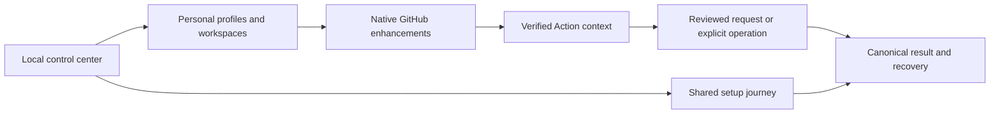

# Complete GitHub Extension — Functional Catalog and Product Acceptance

- Status: Ready for review — complete proposed product contract; runtime unimplemented
- Date: 2026-10-25
- Catalog capability ID: `github-browser-extension`
- Last verified: 2026-10-25, specification/schema review only
- Owners: Copilot product, architecture, security, accessibility, QA and documentation maintainers
- Scope: All 150 registered capabilities across 12 families, with mandatory acceptance on Chrome, Firefox and Safari desktop.
- Related issues/PRs: [Issue #694](https://github.com/vypdev/copilot/issues/694), [PR #699](https://github.com/vypdev/copilot/pull/699)
- Required review gates: product, architecture, security, accessibility, performance, testing, documentation, real browsers and release operations
- Open decisions blocking design readiness: None for this desktop github.com contract. Actual runtime/store evidence is required before product acceptance.

## 1. Executive summary

The extension is a complete daily GitHub productivity product: native page improvements, a local full-page control center, personal workspaces, Copilot automation tools and integrated setup. **Every row below is a required product capability.** Implementation waves organize dependencies; they cannot relabel required rows as optional future promises or accept a reduced feature set as the finished product.

```text
Welcome and choose personal profile -> improve native GitHub -> configure local workspace
 -> connect selected repositories if useful -> inspect verified Copilot context
 -> prepare or explicitly authorize a supported operation -> inspect its result
 -> configure Copilot through the shared setup journey -> diagnose and recover
```

The [product](github-browser-extension.md), [Action integration](github-browser-extension-action-integration.md), [platforms](github-browser-extension-platforms-and-delivery.md) and [control center/setup](github-browser-extension-control-center-and-setup.md) companions are normative. The [versioned feature catalog](browser-extension/feature-catalog.v1.json) is the authoritative structured inventory, not runtime implementation or evidence that tests ran.

## 2. Problem, current behavior, and evidence

The complete product must make a broad GitHub workflow understandable and dependable: comprehensive functions, excellent UX, reusable setup, enforceable architecture, proportional tests and complete documentation. This catalog defines that required scope while preserving the existing 96 core behavior cases and all provenance/authorization/native-preservation protections.

Existing GitHub controls and current Copilot commands remain authoritative. An enhancement only mounts when it adds a useful workflow and does not duplicate an equivalent native control. Source baselines include the existing command reference, setup view/session contracts and the three original extension SDDs. No extension runtime or browser/store execution is claimed. Retrospective reconstruction is not applicable.

## 3. Actors, surfaces, and terminology

| Actor | Main journey | Surfaces |
|---|---|---|
| Developer | Read, navigate, search and organize work | Repository, code, lists, workspace |
| Reviewer/author | Understand changes and preserve review work | Diffs, threads, review drafts, checks |
| Maintainer | Triage, request automation and inspect delivery | Issues, Actions, releases, Copilot control tower |
| Setup operator | Inspect/configure repositories with reviewed authority | Packaged local center plus paired trusted CLI/web authority |
| Release/QA owner | Verify the complete product contract | Catalog, case inventory, artifact and human evidence receipts |

Local is visible DOM/URL or personal settings; read is explicit canonical API evidence; draft prepares a native human-submitted request; write is a separately enabled reviewed GitHub mutation; setup delegates to the existing setup engine; monitor is an explicitly enabled, target-bounded subscription that revalidates authority on every scheduled wake. These are access boundaries, not commercial tiers. Premium describes quality/completeness and introduces no unrequested licensing, billing or hosted account.

## 4. Goals, non-goals, and fixed invariants

| Requirement | Behavior |
|---|---|
| CAT-NAV | Deliver every registered navigation and context capability with its access, boundaries, failure, UX and documentation contract. |
| CAT-CODE | Deliver every registered code, files and diffs capability with its access, boundaries, failure, UX and documentation contract. |
| CAT-REVIEW | Deliver every registered pull requests and reviews capability with its access, boundaries, failure, UX and documentation contract. |
| CAT-ISSUE | Deliver every registered issues, discussions and collaboration capability with its access, boundaries, failure, UX and documentation contract. |
| CAT-SEARCH | Deliver every registered search and personal views capability with its access, boundaries, failure, UX and documentation contract. |
| CAT-NOTIFY | Deliver every registered notifications and attention capability with its access, boundaries, failure, UX and documentation contract. |
| CAT-CI | Deliver every registered actions, checks and delivery evidence capability with its access, boundaries, failure, UX and documentation contract. |
| CAT-RELEASE | Deliver every registered releases, tags and repository changes capability with its access, boundaries, failure, UX and documentation contract. |
| CAT-WORK | Deliver every registered personal workspaces and platform ergonomics capability with its access, boundaries, failure, UX and documentation contract. |
| CAT-COPILOT | Deliver every registered copilot action integration capability with its access, boundaries, failure, UX and documentation contract. |
| CAT-CENTER | Deliver every registered local configuration and product experience capability with its access, boundaries, failure, UX and documentation contract. |
| CAT-SETUP | Deliver every registered integrated copilot setup and management capability with its access, boundaries, failure, UX and documentation contract. |

All registered capabilities are required for general product acceptance. A user's missing permission, unavailable provider or unsupported repository configuration produces a tested unavailable state with an actionable native fallback, not a fabricated result. Optional permission means opt-in access, never an excuse to omit implementation.

No page load submits comments or starts an agent. The browser never owns managed refs, hidden Action state, review policy, immutable release tags or setup approvals. No copied implementation/assets/product text, arbitrary scripts, remote executable patches, forced permission grants, broad-cookie access, telemetry by default or bypassed repository controls. Desktop github.com is the declared host/platform product; mobile and Enterprise compatibility need their separately verified host/API/store matrices and are not advertised implicitly.

## 5. Current versus proposed product journey

| Journey | Current limitation | Required product outcome |
|---|---|---|
| Native GitHub work | Repeated navigation and view decisions | Complete local/read workflows with reversible personal control |
| Review | Context spread across files, threads and checks | Revision-aware review workspace, drafts and evidence |
| Automation | Commands and lifecycle must be reconstructed | Current capability catalog, precise request preparation and trustworthy control tower |
| Configuration | Separate small options and setup tools | Full local center and shared setup presentation/engine |
| Failure | A failed feature can look like a failed repository | Isolated feature health, honest partial results and exact recovery |



Text equivalent: the local center configures personal GitHub use and shared setup; verified operations return inspectable results and recovery rather than an optimistic success state.

## 6. Functional behavior and state model

### Complete required capability inventory

The following matrices are the readable projection of the JSON catalog. The nativeTarget field distinguishes a human text composer from a native control/form handoff; handoff cases verify preserved selection and native confirmation, not nonexistent comment-editor behavior. Each JSON entry also specifies activation, privacy, coexistence, accessibility, browser support, requirement owner, documentation and explicit test scenarios. Those fields and the mode contracts in §7 apply to every row.

### Navigation and context (12 capabilities)

| ID / feature | Surface and observable result | Access / default | Boundary acceptance |
|---|---|---|---|
| BEX-NAV-01 — Repository command palette | Repository pages: Open a searchable keyboard palette of native destinations, personal views and eligible Copilot tools. | page-local; available-with-eligible-page | Unsupported destinations are absent and native keyboard shortcuts keep precedence. |
| BEX-NAV-02 — Canonical object links | Issues, pull requests and commits: Copy the canonical URL with repository and object type preserved. | page-local; available-with-eligible-page | A same-number issue or unverified redirect cannot replace the observed target. |
| BEX-NAV-03 — Immutable line permalinks | Files and diffs: Copy an exact commit and selected line range, with a readable preview. | page-local; available-with-eligible-page | A moving branch or missing immutable revision disables permalink creation. |
| BEX-NAV-04 — Default branch and origin navigation | Repository, directory and fork pages: Jump to the observed default branch or verified upstream repository without losing the relative path when it exists. | page-local; available-with-eligible-page | Missing paths offer the repository root instead of an invented file. |
| BEX-NAV-05 — Branch and tag switch context | Files, branches and tags: Compare the current ref with a selected verified ref and preview file availability before switching. | selected-repository-read; explicit-opt-in | A deleted ref or incomplete ref listing cannot become the default branch implicitly. |
| BEX-NAV-06 — Compare direction controls | Compare pages: Swap known base and head with a preview that preserves explicit comparison semantics. | page-local; available-with-eligible-page | Cross-repository and three-dot comparisons retain their original repository identities. |
| BEX-NAV-07 — Issue, pull request and commit references | Conversations and rendered text: Make unambiguous observed object references navigable with accessible object-type labels. | page-local; available-with-eligible-page | Code samples, ambiguous identifiers and untrusted external hosts remain untouched. |
| BEX-NAV-08 — Contextual breadcrumbs | Deep file, review and workflow pages: Show compact breadcrumbs to repository, associated PR and source run only when verified. | page-local; available-with-eligible-page | Unknown associations remain explicitly unknown rather than guessed from a branch name. |
| BEX-NAV-09 — Copy names and paths | Repository, file and ref headers: Copy normalized repository name, ref, file path or qualified object identifier through explicit commands. | page-local; available-with-eligible-page | Clipboard denial exposes selectable text and preserves user selection. |
| BEX-NAV-10 — Context menus for selected references | Selected GitHub links and text: Offer opt-in browser context-menu actions for validated links, permalinks and opening the local control center. | page-local; available-with-eligible-page | Unrecognized selections and protected login pages receive no extension action. |
| BEX-NAV-11 — Personal location bookmarks | Repository and object pages: Pin an exact location in a named personal workspace with visibility and account scope shown. | personal-settings; explicit-opt-in | Private locations default to session retention and are excluded from ordinary settings export. |
| BEX-NAV-12 — Related object preview | Issue, PR, commit and workflow links: Show an opt-in bounded preview containing canonical identity, state and source time. | selected-repository-read; explicit-opt-in | Hover alone does not trigger unbounded reads and denied private previews reveal no cached title. |
### Code, files and diffs (14 capabilities)

| ID / feature | Surface and observable result | Access / default | Boundary acceptance |
|---|---|---|---|
| BEX-CODE-01 — File tree and outline navigation | Files changed and code views: Navigate loaded file groups, symbols exposed by native GitHub and exact path search with visible loaded-scope counts. | page-local; available-with-eligible-page | Virtualized or unloaded files are labeled as a subset rather than silently omitted. |
| BEX-CODE-02 — Next and previous changed file | Pull request Files changed: Move among eligible files with a keyboard-accessible position indicator and return-to-origin action. | page-local; available-with-eligible-page | Disposed file anchors cannot receive focus after a soft navigation. |
| BEX-CODE-03 — Generated-file focus | Pull request diffs: Hide explicitly classified generated files with hidden counts and immediate restore. | page-local; available-with-eligible-page | Filename suffix alone never establishes generated status or hides a required finding. |
| BEX-CODE-04 — Whitespace and indentation readability | Code and diffs: Toggle visual whitespace markers, indentation guides and tab width without changing copied source. | page-local; available-with-eligible-page | Native code selection, line anchors and diff meaning remain intact. |
| BEX-CODE-05 — Readability and wrap profiles | Code, Markdown and diffs: Apply per-surface font size, line height, wrapping and density through bounded design tokens. | personal-settings; explicit-opt-in | Unsupported combinations retain horizontal access and never clip native controls. |
| BEX-CODE-06 — Copy patch and changed fragment | Diff hunks: Prepare a bounded patch or selected fragment with source revision and explicit inclusion preview. | page-local; available-with-eligible-page | Truncated or partially loaded hunks cannot be presented as the complete patch. |
| BEX-CODE-07 — Rename and binary context | Changed files: Explain verified rename relationships and binary or image changes with native source links. | selected-repository-read; explicit-opt-in | An unavailable blob or similarity estimate is not proof of identical content. |
| BEX-CODE-08 — File history and blame links | Code and diffs: Open native history or blame at the observed file/ref and preserve line context where supported. | page-local; available-with-eligible-page | A line that cannot be mapped opens the file with an explicit mapping limitation. |
| BEX-CODE-09 — Symbol and text navigation | Rendered code: Search loaded text and native symbol anchors with match counts and next/previous controls. | page-local; available-with-eligible-page | Search does not execute repository code or infer cross-file symbol resolution. |
| BEX-CODE-10 — Review progress markers | Pull request files: Track personal visited files against exact head/base identity and show what remains. | personal-settings; explicit-opt-in | A changed revision invalidates only affected progress and never alters GitHub review state. |
| BEX-CODE-11 — File type and path filters | Diff and directory lists: Combine extension, directory and text filters while exposing hidden content and reset. | page-local; available-with-eligible-page | Filtering cannot suppress native security or required-check blockers. |
| BEX-CODE-12 — Raw, rendered and download navigation | File headers: Offer native raw, rendered and download destinations with the exact source identity shown. | page-local; available-with-eligible-page | An executable download is never opened or run automatically. |
| BEX-CODE-13 — Dependency and configuration context | Manifests and lockfile changes: Link observed package names, version changes and configuration references to allowlisted native evidence. | selected-repository-read; explicit-opt-in | A package name alone cannot infer vulnerability status or fetch arbitrary registry URLs. |
| BEX-CODE-14 — Review checkpoints and return position | Long diffs: Resume an explicit per-revision review checkpoint with scroll and focused file context. | personal-settings; explicit-opt-in | A missing or rewritten file offers a safe fallback without inventing progress. |
### Pull requests and reviews (14 capabilities)

| ID / feature | Surface and observable result | Access / default | Boundary acceptance |
|---|---|---|---|
| BEX-REVIEW-01 — Review readiness overview | Pull request header: Separate review requests, required checks, conflicts, queue state and Copilot assessment with source times. | selected-repository-read; explicit-opt-in | A successful advisory check cannot establish overall merge readiness. |
| BEX-REVIEW-02 — Finding and comment navigator | Pull request conversation and diffs: Navigate native comments and verified findings by file, severity, author and current state. | selected-repository-read; explicit-opt-in | Incomplete collection preserves unknown totals and historical findings stay labeled. |
| BEX-REVIEW-03 — Resolved and outdated thread controls | Review threads: Expand, collapse and restore selected thread categories while preserving editors and focus. | page-local; available-with-eligible-page | An active draft or unresolved required action cannot be silently hidden. |
| BEX-REVIEW-04 — Conversation event focus | Long issue and PR timelines: Focus comments, state changes, reviews or bot activity with visible hidden-event counts. | page-local; available-with-eligible-page | Filtered workflow failures remain discoverable through an explicit blocker indicator. |
| BEX-REVIEW-05 — Draft preservation and snippets | Native comment and review editors: Use local user-authored snippets with placeholder preview, append/keep/cancel and optional session drafts. | personal-settings; explicit-opt-in | No draft is sent to an agent or overwritten by a background refresh. |
| BEX-REVIEW-06 — Changed-since-review navigation | Updated pull requests: Compare a verified reviewed revision with the current head and open native comparisons. | selected-repository-read; explicit-opt-in | Force-pushed or unavailable commits show an unresolvable range instead of an empty diff. |
| BEX-REVIEW-07 — Requested reviewer context | Pull request sidebar: Explain requested versus submitted reviews and team-based requests from canonical facts. | selected-repository-read; explicit-opt-in | Team membership or reviewer presence cannot substitute for a current approval. |
| BEX-REVIEW-08 — Review submission preparation | Pull request review composer: Open the native review summary with selected comment, approve or request-changes intent for human review. | native-human-submission; explicit-opt-in | The extension never submits an approval or bypasses current repository review policy. |
| BEX-REVIEW-09 — Conflict explanation and recovery links | Conflicting pull requests: Show which native comparison or managed synchronization control can resolve the observed conflict. | selected-repository-read; explicit-opt-in | Unknown mergeability stays pending and no browser edit manufactures a managed branch. |
| BEX-REVIEW-10 — Merge and queue handoff | Pull request merge controls: Prepare a contextual handoff showing target, revision, merge method and queue/protection implications. | native-human-submission; explicit-opt-in | Unknown policy or a moved head blocks a claimed safe merge and returns to native GitHub. |
| BEX-REVIEW-11 — Task and checklist navigation | Descriptions and conversations: Index loaded checklist items and link back to their source without editing them. | page-local; available-with-eligible-page | Unchecked or partially loaded lists cannot be reported as complete. |
| BEX-REVIEW-12 — Change summary by ownership | Pull request overview: Group verified changed paths by directory and available CODEOWNERS evidence with completeness shown. | selected-repository-read; explicit-opt-in | Unparsed ownership rules remain unknown and never nominate an invented reviewer. |
| BEX-REVIEW-13 — Saved review filters | Review conversations and Files changed: Save personal author, state and path filters in a named profile with a visible active-filter summary. | personal-settings; explicit-opt-in | A shared URL or new account does not inherit another person's private review context. |
| BEX-REVIEW-14 — Review evidence export | Pull request overview: Export an explicitly selected redacted review receipt with exact revisions, sources and missing evidence. | selected-repository-read; explicit-opt-in | The export excludes tokens, private source text and unrelated review comments by default. |
### Issues, discussions and collaboration (12 capabilities)

| ID / feature | Surface and observable result | Access / default | Boundary acceptance |
|---|---|---|---|
| BEX-ISSUE-01 — Issue triage summary | Issue header and lists: Show observed state, ownership, labels, milestone and next human action without inferring priority. | selected-repository-read; explicit-opt-in | Denied metadata cannot be displayed as unassigned or unlabeled. |
| BEX-ISSUE-02 — Structured issue drafting | Native issue forms: Prepare an installed issue form with explicit user answers and validation hints. | native-human-submission; explicit-opt-in | The extension does not silently replace an enabled form with a blank issue or submit it. |
| BEX-ISSUE-03 — Related issue and PR navigation | Issue and PR sidebars: Show native parent, sub-issue, dependency and closing-PR relationships when available. | selected-repository-read; explicit-opt-in | Textual mentions remain suggestions until the canonical relationship is verified. |
| BEX-ISSUE-04 — Label and assignee adjustments | Issue and PR triage controls: Preview and apply one explicit add/remove label or assignee change with current scope and read-back. | explicit-user-write; explicit-opt-in | Conflicting changes, missing write access and protected lifecycle labels route to native or Action-owned controls. |
| BEX-ISSUE-05 — Milestone and project handoff | Issue and PR sidebars: Open a verified milestone or project destination and prepare the selected native adjustment. | native-human-submission; explicit-opt-in | Unavailable Projects access does not trigger broader credential fallback. |
| BEX-ISSUE-06 — Duplicate and similarity research | Issue search and triage: Build explicit bounded searches from user-selected text and present source-linked candidate duplicates. | selected-repository-read; explicit-opt-in | Similarity is advisory and never closes or links an issue automatically. |
| BEX-ISSUE-07 — Conversation content navigation | Long issues and discussions: Navigate headings, decisions and loaded code blocks with source anchors and readable summaries of structure. | page-local; available-with-eligible-page | Structural navigation never claims an AI interpretation was reviewed by a maintainer. |
| BEX-ISSUE-08 — Personal issue annotations | Issue and PR context: Keep session-first personal notes and reminders with clear local/account ownership. | personal-settings; explicit-opt-in | Persistent local notes require explicit opt-in and are excluded from shared repository state. |
| BEX-ISSUE-09 — Cross-reference insertion | Native editors: Prepare canonical selected references as readable Markdown with a preview of the exact targets. | native-human-submission; explicit-opt-in | Untrusted text cannot inject an extra bot command, mention or hidden marker. |
| BEX-ISSUE-10 — Selected bulk triage | Issue and PR lists: Review an explicit bounded selection and per-item label/assignee changes, then execute with item receipts. | explicit-user-write; explicit-opt-in | Selection never extends to unloaded pages; partial success and uncertain items remain separate. |
| BEX-ISSUE-11 — Discussion and answer navigation | GitHub Discussions: Navigate loaded answers, categories and accepted-answer anchors while leaving moderation native. | page-local; available-with-eligible-page | An accepted answer is not inferred from reactions or comment ordering. |
| BEX-ISSUE-12 — Issue activity and dependency views | Issue overview: Show source-linked dependency blockers and chronological milestones from available native evidence. | selected-repository-read; explicit-opt-in | Circular, incomplete or inaccessible relationships are represented explicitly. |
### Search and personal views (8 capabilities)

| ID / feature | Surface and observable result | Access / default | Boundary acceptance |
|---|---|---|---|
| BEX-SEARCH-01 — Named saved searches | GitHub search and lists: Save and restore an explicit query with host, account and repository scope. | personal-settings; explicit-opt-in | Opening a shared query never silently replaces it with a personal default. |
| BEX-SEARCH-02 — Search query builder | Search controls: Build supported native qualifiers through readable chips and preview the exact query. | page-local; available-with-eligible-page | Unsupported qualifiers remain editable text and are not represented as validated filters. |
| BEX-SEARCH-03 — In-page loaded-result filtering | Search and repository lists: Filter already loaded results by visible properties with local-versus-server scope explained. | page-local; available-with-eligible-page | Local filtering cannot claim it searched unseen pages. |
| BEX-SEARCH-04 — Cross-repository work searches | Local workspace: Run explicit bounded saved searches across selected repositories with per-repository completeness. | selected-repository-read; explicit-opt-in | Denied repositories stay unavailable instead of disappearing from the result summary. |
| BEX-SEARCH-05 — Result provenance and completeness | Search results: Show repository/object identity, observation time and pagination/truncation alongside result counts. | selected-repository-read; explicit-opt-in | An exhausted budget cannot be shown as a complete zero-result search. |
| BEX-SEARCH-06 — Recent local navigation | Control center and command palette: Offer opt-in extension-local recent destinations with bounded retention and clear/delete controls. | personal-settings; explicit-opt-in | No browser history permission or background browsing-history collection is used. |
| BEX-SEARCH-07 — Search-to-workspace collections | Search results: Pin selected canonical results to an account-scoped personal collection with explicit privacy choice. | personal-settings; explicit-opt-in | Unloaded results and private titles are not copied into persistent collections implicitly. |
| BEX-SEARCH-08 — Accessible result traversal | Search and lists: Move among visible results with stable focus, position announcements and return links. | page-local; available-with-eligible-page | Native text input and browser find retain their normal keyboard behavior. |
### Notifications and attention (8 capabilities)

| ID / feature | Surface and observable result | Access / default | Boundary acceptance |
|---|---|---|---|
| BEX-NOTIFY-01 — Loaded inbox grouping | Native notifications page: Group visible notifications by repository, reason and object type without API credentials. | page-local; available-with-eligible-page | The group count is explicitly limited to loaded notifications. |
| BEX-NOTIFY-02 — Notification source previews | Native notifications list: Show observed source state and source links beside the native notification entry. | page-local; available-with-eligible-page | Private content absent from the current page is not fetched with a classic token fallback. |
| BEX-NOTIFY-03 — Explicit notification selection | Native notifications page: Select loaded notifications by visible reason/state and preview the exact set before native actions. | page-local; available-with-eligible-page | Selection never includes unloaded notifications or executes a destructive action on page open. |
| BEX-NOTIFY-04 — Mark-read and unsubscribe handoff | Native notification controls: Focus the native mark-read, done or unsubscribe action for the reviewed selection. | native-human-submission; explicit-opt-in | The official notification API's classic-token requirement never silently broadens access. |
| BEX-NOTIFY-05 — Personal snooze and reminders | Workspace attention queue: Snooze a personal reference until a chosen local time and show its local-only status. | personal-settings; explicit-opt-in | Snoozing does not change GitHub subscription or guarantee a background notification delivery time. |
| BEX-NOTIFY-06 — Optional desktop attention alerts | Extension toolbar and OS notifications: Enable bounded opt-in alerts for explicitly tracked verified transitions with quiet hours and deduplication. | explicit-bounded-alert-monitor; explicit-opt-in | Permission denial, background suspension and missing evidence do not create repeated prompts or guessed alerts. |
| BEX-NOTIFY-07 — Mentions and review attention views | Native inbox and visible lists: Focus visible direct mentions and review requests while preserving access to all hidden categories. | page-local; available-with-eligible-page | A matching string alone cannot classify a private team mention or authoritative review request. |
| BEX-NOTIFY-08 — Notification privacy and lifecycle | Control center privacy page: Inspect and clear local attention state with retention, quiet-hours and account isolation controls. | personal-settings; explicit-opt-in | Disconnect removes private cached evidence while preserving explicitly authored nonsecret settings. |
### Actions, checks and delivery evidence (10 capabilities)

| ID / feature | Surface and observable result | Access / default | Boundary acceptance |
|---|---|---|---|
| BEX-CI-01 — Check hierarchy overview | Pull request and commit checks: Separate required, advisory, skipped, cancelled and unknown-producer checks with source details. | selected-repository-read; explicit-opt-in | A skipped matrix leg cannot count as a successful required browser or platform result. |
| BEX-CI-02 — Run and attempt navigation | Actions and PR checks: Navigate the exact workflow run, attempt, job and annotation referenced by a result. | selected-repository-read; explicit-opt-in | A later attempt cannot silently replace the source of an older finding. |
| BEX-CI-03 — Annotation navigator | Check output and changed files: Group canonical annotations by file/severity with exact line and revision mapping. | selected-repository-read; explicit-opt-in | Unmapped or truncated annotations remain visible as unplaced evidence. |
| BEX-CI-04 — Failure comparison | Workflow run history: Compare selected attempts' observed outcomes and changed failure locations. | selected-repository-read; explicit-opt-in | The extension does not diagnose causation from a single timing correlation. |
| BEX-CI-05 — Run retry controls | Workflow run or failed job: Preview exact repository, workflow, run/attempt and failed-job scope, then request one supported retry. | explicit-user-write; explicit-opt-in | An uncertain response is reconciled through canonical run state before any repeated request. |
| BEX-CI-06 — Run cancellation controls | Active workflow run: Confirm the exact running attempt and explain retained side effects before cancellation. | explicit-user-write; explicit-opt-in | A completed or replaced attempt invalidates the confirmation rather than cancelling another run. |
| BEX-CI-07 — Workflow dispatch preparation | Actions workflow page: Prepare a reviewed native workflow-dispatch form with exact ref and supported inputs. | native-human-submission; explicit-opt-in | Hidden inputs, deployment policy and unknown workflow identity block an invented execution route. |
| BEX-CI-08 — Artifacts and job summaries | Workflow runs: Navigate verified summaries and user-selected artifacts with size/type/source preview. | selected-repository-read; explicit-opt-in | Expired artifacts or redirected downloads never receive an unrelated credential. |
| BEX-CI-09 — Queue, runner and waiting explanations | Run and PR status: Distinguish queued, waiting for environment approval, running and unavailable runner evidence. | selected-repository-read; explicit-opt-in | Unavailable runner permissions cannot be converted into zero capacity or a failed workflow. |
| BEX-CI-10 — Performance and reliability trends | Selected workflow history: Summarize a bounded explicit run sample with percentile, cancellation and missing-sample disclosure. | selected-repository-read; explicit-opt-in | Sampling bias and incomplete history prevent claims about repository-wide reliability. |
### Releases, tags and repository changes (8 capabilities)

| ID / feature | Surface and observable result | Access / default | Boundary acceptance |
|---|---|---|---|
| BEX-RELEASE-01 — Release and tag navigation | Merged PRs, tags and releases: Navigate verified native release/tag destinations and preserve immutable source links. | page-local; available-with-eligible-page | A merge date alone cannot associate a PR with a release. |
| BEX-RELEASE-02 — Release comparison builder | Releases and compare pages: Prepare comparisons between selected existing tags and disclose unavailable refs. | selected-repository-read; explicit-opt-in | A missing tag is not substituted with a similarly named branch. |
| BEX-RELEASE-03 — Unreleased change inspection | Repository overview: Show a bounded comparison of the default branch and a selected verified release tag. | selected-repository-read; explicit-opt-in | The view labels its chosen baseline instead of claiming a universal latest-release definition. |
| BEX-RELEASE-04 — Changelog drafting | Native release editor: Prepare user-reviewed Markdown from explicitly selected linked PRs and commits with source attribution. | native-human-submission; explicit-opt-in | The extension does not publish a release or claim every change was collected. |
| BEX-RELEASE-05 — Release asset verification context | Release assets: Show published checksums/signature/provenance links that actually exist for the selected asset. | selected-repository-read; explicit-opt-in | A checksum without an authenticated source is not labeled as a trusted signature. |
| BEX-RELEASE-06 — Dependency and security navigation | Dependency and security pages: Link native dependency, advisory and update surfaces with available permissions shown. | page-local; available-with-eligible-page | Private security alerts are not scraped from unrelated pages or exported by default. |
| BEX-RELEASE-07 — Branch comparison workspace | Branches and compare pages: Compare explicitly selected branches with ahead/behind and ancestry facts from canonical data. | selected-repository-read; explicit-opt-in | Divergence is not described as safely deletable or automatically reconcilable. |
| BEX-RELEASE-08 — Release activity attention | Workspace release views: Track selected release or tag links through explicit foreground refresh and optional alerts. | personal-settings; explicit-opt-in | No background repository-wide polling or automatic package execution occurs. |
### Personal workspaces and platform ergonomics (8 capabilities)

| ID / feature | Surface and observable result | Access / default | Boundary acceptance |
|---|---|---|---|
| BEX-WORK-01 — My work overview | Local control center: Aggregate explicit selected assigned issues, authored PRs and review requests with per-source completeness. | selected-repository-read; explicit-opt-in | The default scope never expands to every private organization repository. |
| BEX-WORK-02 — Named repository workspaces | Control center: Create bounded personal workspace collections and switch context without changing repository policy. | personal-settings; explicit-opt-in | Private membership and metadata remain account-partitioned and excluded from ordinary exports. |
| BEX-WORK-03 — Work queues and next actions | Control center: Arrange personal reading/review/maintenance queues with source-linked next actions. | personal-settings; explicit-opt-in | Personal order cannot masquerade as a shared repository priority or SLA. |
| BEX-WORK-04 — Context-preserving split navigation | GitHub links and command palette: Offer explicit open-in-current or new-tab actions while preserving native browser behavior. | page-local; available-with-eligible-page | The extension never scans all open tabs or steals focus from another application. |
| BEX-WORK-05 — View and reading profiles | All supported GitHub pages: Switch bounded named comfortable, compact and review profiles with a preview of changed features. | personal-settings; explicit-opt-in | Profiles cannot grant permissions or hide required native actions. |
| BEX-WORK-06 — Local draft and session workspace | Control center: Inspect explicitly saved session snippets, notes and pending drafts with deletion and export choices. | personal-settings; explicit-opt-in | Disconnect cannot publish a draft or silently delete an explicitly persisted authored note. |
| BEX-WORK-07 — Unavailable capability explanations | Every feature entry point: Explain missing permission, producer, source, browser API or page support with one useful recovery action. | page-local; available-with-eligible-page | The UI never implies a feature is complete merely because a button rendered. |
| BEX-WORK-08 — Upgrade and compatibility center | Control center: Show extension, Action contract, setup companion and browser compatibility with exact sources. | selected-repository-read; explicit-opt-in | Unknown versions remain unknown and no release asset is executed automatically. |
### Copilot Action integration (24 capabilities)

| ID / feature | Surface and observable result | Access / default | Boundary acceptance |
|---|---|---|---|
| BEX-COPILOT-01 — Issue-to-release control tower | Issue, PR and control center: Show verified issue, SDD, branch, PR, run, promotion, publication and reconciliation links in one journey. | selected-repository-read; explicit-opt-in | Partial publication remains published even if later synchronization fails. |
| BEX-COPILOT-02 — SDD question workbench | Issue clarification card: Prepare numbered answers for the current verified questions with owner and revision context. | native-human-submission; explicit-opt-in | A changed question round invalidates prepared answers rather than submitting stale decisions. |
| BEX-COPILOT-03 — SDD publication comparison | Issue and PR SDD panel: Prepare the supported sdd-diff request and open verified first/current publications. | native-human-submission; explicit-opt-in | Unavailable historical evidence cannot be inferred from a filename or an unverified comment. |
| BEX-COPILOT-04 — Issue admission and start guidance | Installed issue forms and issue sidebar: Guide enabled issue-kind forms and the native in-progress transition with the Action as branch owner. | native-human-submission; explicit-opt-in | The extension never creates, renames or deletes an Action-managed branch. |
| BEX-COPILOT-05 — Plan, clarify and estimate requests | Supported issue or PR conversation: Prepare the selected plan, clarify or estimate command with explicit request text and context. | native-human-submission; explicit-opt-in | A read-oriented command's possible agent cost is shown before human submission. |
| BEX-COPILOT-06 — Explain, diagnose and test-plan requests | Supported issue or PR conversation: Prepare explain, diagnose or test-plan for the user's selected bounded context. | native-human-submission; explicit-opt-in | Selected private code is not transmitted until the user explicitly includes and submits it. |
| BEX-COPILOT-07 — Analysis and review requests | Supported conversations: Prepare analyze, review, findings or recheck with the exact target and expected review effect. | native-human-submission; explicit-opt-in | Findings reconciliation is not falsely described as always model-free. |
| BEX-COPILOT-08 — Finding state navigator | Pull request findings: Show open, fixed, obsolete, dismissed, reopened, verification and unknown states with current coverage. | selected-repository-read; explicit-opt-in | A resolved native thread alone cannot prove a finding was fixed. |
| BEX-COPILOT-09 — Targeted finding corrections | Authoritative PR review thread or verified branch-scoped route: Prepare fix for explicit verified finding IDs and show the exact branch/revision that the Action will recheck. | native-human-submission; explicit-opt-in | Unknown or foreign-fork write authority gives copy-only guidance instead of a guessed target. |
| BEX-COPILOT-10 — Finding dismissal preparation | Supported current finding context: Prepare dismiss for selected current IDs with explicit rationale and scope. | native-human-submission; explicit-opt-in | Dismissal remains a state-changing authorized request even though it changes no files. |
| BEX-COPILOT-11 — Implementation requests | Supported authoritative branch-scoped context: Prepare a concrete implementation request with explicit scope, branch, revision and verification expectations. | native-human-submission; explicit-opt-in | An issue-only context without an authoritative branch route cannot invent a write target. |
| BEX-COPILOT-12 — Learned rule preparation | Verified current PR or native issue branch route: Prepare remember with user-authored rule text, affected repository file and persistent-effect warning. | native-human-submission; explicit-opt-in | Untrusted page instructions cannot become a persistent learned rule without explicit human review. |
| BEX-COPILOT-13 — Branch synchronization workbench | Verified issue or PR branch context: Prepare sync-branch with reviewed dry-run, no-agent and optional verified source choices. | native-human-submission; explicit-opt-in | The source is selected from authoritative refs and cannot be injected through page prose. |
| BEX-COPILOT-14 — Runtime doctor and health | Issue, PR and setup center: Prepare doctor and distinguish credential presence, runtime readiness and actual execution evidence. | native-human-submission; explicit-opt-in | A read-only doctor result cannot certify write permissions or runner authentication. |
| BEX-COPILOT-15 — Request history and receipts | Supported conversation: Prepare history and navigate current supported request receipts with correlation and source identity. | native-human-submission; explicit-opt-in | Missing receipts do not imply an empty history or a failed execution. |
| BEX-COPILOT-16 — PR description and help | Supported PR conversation: Prepare description or help with the installed capability and potential PR-body effect explained. | native-human-submission; explicit-opt-in | Description refresh cannot overwrite a native draft without an explicit operator decision. |
| BEX-COPILOT-17 — Approval and blocker explanation | Pull request status: Explain current review, check, finding, policy and branch-sync blockers with source links. | selected-repository-read; explicit-opt-in | The extension never grants approval or converts unknown-producer checks into verified checks. |
| BEX-COPILOT-18 — Queue and concurrency view | Copilot runs and control center: Show durable lifecycle, temporary activity and human waiting as independent facts. | selected-repository-read; explicit-opt-in | An old agent label cannot prove a current active run or permanently block a page feature. |
| BEX-COPILOT-19 — Release and hotfix launch guidance | Installed release and hotfix issue forms: Prepare the appropriate native form with version, origin and production-first consequences for human submission. | native-human-submission; explicit-opt-in | The extension never silently creates a release issue or selects an unverified version tag. |
| BEX-COPILOT-20 — Deployment review handoff | Verified deployment control center: Show publication state, intended deploy-label or native approval action, modes and retained effects before opening the exact native control. | native-human-submission; explicit-opt-in | Unknown deployment policy blocks an asserted safe launch; page opening never deploys. |
| BEX-COPILOT-21 — Reconciliation and recovery view | Deployment issue and promotion/reconciliation PRs: Separate published artifacts, pending development targets, cleanup and permitted recovery operations. | selected-repository-read; explicit-opt-in | Immutable tags, unknown lineage and nonretryable blocks are never repaired by browser metadata edits. |
| BEX-COPILOT-22 — Policy and configuration provenance | Copilot panel and settings: Show versioned workflow/input/Variable scope and source-time policy limitations with exact links. | selected-repository-read; explicit-opt-in | Secret existence is presence only; hidden effective values remain unknown. |
| BEX-COPILOT-23 — Run, cost and evidence inspection | Copilot history and job summaries: Present published duration, usage/cost and verification artifacts only when the producer supplies them. | selected-repository-read; explicit-opt-in | Missing usage is unknown, never zero, and no billing value is inferred from a model name. |
| BEX-COPILOT-24 — Capability and command compatibility | Control center and every Copilot action: Show the installed supported command/context matrix and explain unavailable product actions. | selected-repository-read; explicit-opt-in | An unknown Action version cannot receive a newly invented command syntax or event route. |
### Local configuration and product experience (14 capabilities)

| ID / feature | Surface and observable result | Access / default | Boundary acceptance |
|---|---|---|---|
| BEX-CENTER-01 — Full-page local control center | Packaged extension options page: Open a navigable application with overview, features, profiles, repositories, Copilot, setup, activity, privacy and help. | personal-settings; available-on-local-center | The page loads from the extension package and remains useful offline without a CLI. |
| BEX-CENTER-02 — Feature catalog and previews | Features route: Search, filter and preview every registered feature by surface, capability, permission, state and profile. | personal-settings; available-on-local-center | A disabled feature explains its reason and cannot be silently enabled by a remote publication. |
| BEX-CENTER-03 — Profile editor and inheritance | Profiles route: Preview global, host/account, organization, repository and session overrides with provenance and reset. | personal-settings; available-on-local-center | An unknown imported field or invalid cross-field combination leaves the previous complete profile intact. |
| BEX-CENTER-04 — Repository connection manager | Repositories route: Connect, pause, switch and remove explicitly selected repositories with account/source identity shown. | personal-settings; available-on-local-center | A repository rename uses its verified numeric identity and cannot expose a different private repository. |
| BEX-CENTER-05 — Account and credential roles | Connections route: Manage at most five named session identities with separate selected-repository read and optional write roles. | personal-settings; available-on-local-center | Switching identity invalidates private evidence and never reuses a token across hosts or purposes. |
| BEX-CENTER-06 — Permission and privacy inspector | Privacy route: Explain each browser/GitHub/CLI capability, granted scope, retention and revocation path. | personal-settings; available-on-local-center | Unknown permission is displayed as unknown and optional capabilities stay off until granted. |
| BEX-CENTER-07 — Shortcuts and command customization | Shortcuts route: Configure bounded bindings and favorites with native/OS conflict detection and reset. | personal-settings; available-on-local-center | Editing shortcuts cannot capture secrets, typing composition or protected login interactions. |
| BEX-CENTER-08 — Settings backup and restore | Data route: Preview, validate and atomically import/export versioned nonsecret settings with migration and rollback. | personal-settings; available-on-local-center | Private evidence, credentials and setup approval receipts are excluded from settings exports. |
| BEX-CENTER-09 — Local operation activity | Activity route: Inspect redacted operation intent, exact target, acknowledgement and observed completion separately. | personal-settings; available-on-local-center | A timeout is unknown outcome and cannot be replaced by a fabricated success record. |
| BEX-CENTER-10 — Feature diagnostics and recovery | Diagnostics route: Identify broken adapters, missing permissions and stale versions; disable one feature or reset owned state. | personal-settings; available-on-local-center | Diagnostics never collect private code, tokens or full browsing history automatically. |
| BEX-CENTER-11 — Appearance and accessibility preferences | Appearance route: Configure themes, density, readable text, reduced motion and contrast through accessible bounded controls. | personal-settings; available-on-local-center | A setting cannot lower required contrast or remove keyboard access to a core action. |
| BEX-CENTER-12 — Language and terminology | Language route: Provide complete English, Spanish, French and Portuguese with atomic fallback and separate Action-source language. | personal-settings; available-on-local-center | A missing message cannot produce a partly translated confirmation or reinterpret command IDs. |
| BEX-CENTER-13 — Onboarding, updates and release notes | Welcome and About routes: Explain value, selected profile, permissions and changes with resumable nonsecret onboarding and verified update links. | personal-settings; available-on-local-center | An update never expands grants or changes a user's selected profile without review. |
| BEX-CENTER-14 — Privacy controls and reset center | Privacy and recovery routes: Pause all features, disconnect credentials, clear caches and reset selected settings with explicit scope. | personal-settings; available-on-local-center | A data reset preserves unrelated GitHub content and requires review before deleting authored local notes. |
### Integrated Copilot setup and management (18 capabilities)

| ID / feature | Surface and observable result | Access / default | Boundary acceptance |
|---|---|---|---|
| BEX-SETUP-01 — Setup entry and repository confirmation | Local setup route: Confirm the exact repository and show inspect, configure, repair or full setup as separate journeys. | cli-owned-setup; local-planning-available; pairing-and-apply-explicit | A URL, local checkout and selected GitHub account mismatch blocks application. |
| BEX-SETUP-02 — Shared full questionnaire | Packaged setup wizard: Use the shared setup questionnaire, catalog and validation for every existing CLI/web choice. | cli-owned-setup; local-planning-available; pairing-and-apply-explicit | Extension-only defaults cannot silently create a second setup policy. |
| BEX-SETUP-03 — Effective configuration inspector | Copilot configuration route: Inspect understood bindings, repository/organization precedence, source times and unknown values. | cli-owned-setup; local-planning-available; pairing-and-apply-explicit | A Secret name or complex workflow expression is not displayed as a verified effective value. |
| BEX-SETUP-04 — Focused runtime adjustments | Configuration quick adjustments: Review current/new value and existing scope, then delegate the existing narrow approved adjustment transaction. | cli-owned-setup; local-planning-available; pairing-and-apply-explicit | Structural changes, scope movement and unknown bindings require the full reviewed setup journey. |
| BEX-SETUP-05 — Runner and verification setup | Setup runtime stage: Plan supported runner profiles, required runtime versions and verification setup with ownership preserved. | cli-owned-setup; local-planning-available; pairing-and-apply-explicit | Generated starter files do not count as a working verification environment. |
| BEX-SETUP-06 — Credential role guidance | Protected credential handoff: Explain operator, bot and provider credential roles and open the paired trusted local setup step. | cli-owned-setup; local-planning-available; pairing-and-apply-explicit | No setup/bot/provider secret enters content scripts, extension messages or extension storage. |
| BEX-SETUP-07 — Permission audit progress | Setup permission stage: Show canonical metadata-only initial read and approved final write-probe progress from the shared engine. | cli-owned-setup; local-planning-available; pairing-and-apply-explicit | A write probe is a real temporary mutation and cleanup uncertainty remains a partial result. |
| BEX-SETUP-08 — Reviewed installation plan | Setup review stage: Show exact files/resources, scope, defaults, conflicts, changed facts and consequences before privileged approval. | cli-owned-setup; local-planning-available; pairing-and-apply-explicit | A changed plan or target invalidates prior approval and requires a new review. |
| BEX-SETUP-09 — Presets and organization reuse | Setup planning stage: Select named reviewed presets and organization inheritance with per-repository differences displayed. | cli-owned-setup; local-planning-available; pairing-and-apply-explicit | A preset cannot carry credentials, grant permissions or overwrite unrelated workflow customization. |
| BEX-SETUP-10 — Batch repository setup | Batch selection and review: Preview an explicit bounded repository set and exact per-item plans using the shared batch engine. | cli-owned-setup; local-planning-available; pairing-and-apply-explicit | One approval cannot silently include a newly discovered repository or changed per-item plan. |
| BEX-SETUP-11 — Protected application and progress | Paired local setup authority: Run Apply only through the CLI-owned current review/controller and stream redacted effects back to the center. | cli-owned-setup; local-planning-available; pairing-and-apply-explicit | The extension cannot invoke arbitrary shell commands, push managed refs or bypass final grant re-audit. |
| BEX-SETUP-12 — Doctor and installation evidence | Setup result and health route: Separate file/resource application, metadata diagnosis, runner verification and live Action execution evidence. | cli-owned-setup; local-planning-available; pairing-and-apply-explicit | Installed Secret presence does not prove credential validity or deployment success. |
| BEX-SETUP-13 — Drift, upgrade and maintenance plans | Configuration maintenance route: Compare the installed known manifest and current reviewed plan with safe preserve/replace decisions. | cli-owned-setup; local-planning-available; pairing-and-apply-explicit | Unknown consumer files and newer schemas are never deleted or downgraded automatically. |
| BEX-SETUP-14 — Cancellation and partial recovery | Active setup and recovery route: Cancel before new effects, retain completed effects and expose exact cleanup/retry ownership. | cli-owned-setup; local-planning-available; pairing-and-apply-explicit | Cancellation cannot undo completed writes or suppress an unresolved cleanup journal. |
| BEX-SETUP-15 — Offline intent preparation and handoff | Local wizard without companion: Prepare a nonsecret portable setup intent and import it into a later reviewed local setup session. | cli-owned-setup; local-planning-available; pairing-and-apply-explicit | An exported intent is never an approval or a trusted installation manifest. |
| BEX-SETUP-16 — CLI pairing and controller lifecycle | Connect local companion: Pair an explicitly launched local CLI session, bind repository/controller and show liveness/expiry. | cli-owned-setup; local-planning-available; pairing-and-apply-explicit | The extension never scans loopback ports or adopts a session from a page-supplied URL. |
| BEX-SETUP-17 — Plan revision and audit history | Setup review and result: Navigate redacted plan revisions and verified effects without reusing an old approval. | cli-owned-setup; local-planning-available; pairing-and-apply-explicit | A restored browser tab cannot regain controller authority after expiry or takeover. |
| BEX-SETUP-18 — Shared setup parity and documentation | Help and acceptance surfaces: Use the same setting catalog, localized explanations, examples and acceptance fixtures across CLI, web and extension. | cli-owned-setup; local-planning-available; pairing-and-apply-explicit | Any transport-specific unsupported step is explicit and cannot be silently skipped to claim completion. |

Every capability uses: available -> preparing/loading -> ready or partial/unavailable -> explicitly acting where applicable -> verified complete/failed/unknown -> recover/dispose. Navigation, account changes and revoked access retire the active generation. Unknown effects never become retryable writes automatically. Private evidence remains session-scoped; user-authored persistent notes require a separate explicit choice.

## 7. User-facing configuration

| Mode/profile | Default | Authority and data | Required behavior |
|---|---|---|---|
| Page-local | Available on eligible supported pages | Current DOM/URL, no API credential | Native coexistence; explicit gestures for copy/navigation |
| Personal settings | Explicit user choice for stateful features | Versioned nonsecret local settings | Atomic import/migration/reset and visible inheritance |
| Selected-repository read | Off until Connect | User-owned least-privilege read session | Exact source identity/freshness/completeness and revocation |
| Bounded alert monitoring | Off; five explicit tracked targets | Optional alarms/notifications grants and shared read budget | Revalidate on wake; dedupe, quiet hours, pause/revoke and unknown evidence rules |
| Native human submission/handoff | Explicit per request | Verified context and native editor | Preserve drafts or native selection/input, preview scope and let the human submit/confirm |
| Explicit user write | Off until its separate grant is enabled | Exact selected-repository write profile | Intent preview, live recheck, single-use approval and read-back |
| CLI-owned setup | Explicit local pairing | Existing shared coordinator and protected authority page | No credential/Apply authority in page scripts or extension transport |

Per-feature values are enabled/disabled, default profile, favorites and bounded presentation choices. Scope precedence is emergency pause > tab pause > repository > organization > host/account > global > packaged default; show each inherited source. Enablement does not grant host, GitHub, CLI or Action authority. Profile changes preview their full delta. Unknown feature/schema values are preserved inert for migration, never executed. The center companion defines names, bounds, persistence, export and examples.

Notifications use the native notifications page and explicit native controls: the official REST notification API currently requires classic PATs. The product does not silently widen its fine-grained credential model to satisfy that endpoint. Context menus and desktop alerts request their narrow optional browser permissions only from a user gesture. The product never requests browser history permission for its own local recents.

## 8. Clean Architecture design

Registry metadata and pure eligibility/availability/operation policies -> immutable feature use cases -> semantic DOM/read/draft/write/settings/setup ports -> browser/GitHub/CLI adapters. Presentation consumes credential-free view models. Concrete command selection, permission checks and mutation admission never live in a component or page selector.

The shared setup package contains presentation and browser-safe contracts; the CLI retains provider/credential/filesystem authority. Structured dependency checks prohibit DOM/provider DTOs in domain/application and Node imports in extension bundles. Build checks compare catalog IDs, defaults, docs and case inventory with every registered feature module; missing or extra registrations block acceptance. A narrow MutationPort accepts a closed operation union, never arbitrary URLs/methods/bodies. Browser adapters are original, independently disposable and exercised against actual target artifacts.

## 9. UI/UX and content contract

One consistent information hierarchy applies to every surface: current state, completed facts, next transition, actor/action, impact/source links and expandable technical detail. The local center offers global feature search, permission explanations, command discovery, meaningful empty states and one primary action per view. Feature presets make a large catalog understandable; progressive disclosure exposes detail without withholding controls.

```text
Copilot extension · My work                   Account: chosen identity
GitHub improvements ready · 12 repositories explicitly selected
3 review requests · 1 setup plan awaiting review · 2 unavailable sources
[Open review queue]   [Review setup plan]   [Inspect unavailable sources]
Features: search by problem, page, permission or keyboard command
```

Pending: “Loading selected sources; completed repositories remain available.” Action required: “Review the exact setup plan in the paired local authority page.” Blocked: “This operation needs Pull requests write; no request was submitted.” Partial: “Two selected issues updated; one denied; one outcome awaiting verification.” Complete: “Selected change read back on the displayed target.” Offline: “Local features and saved nonsecret preferences are available; connected facts are unavailable.” Each includes a source or recovery link and preserves existing work.

Keyboard-only, visible focus, screen-reader names/live regions, reduced motion, light/dark/high contrast and 200% zoom at 320 CSS px are mandatory. English, Spanish, French and Portuguese have complete atomic catalogs. Native/OS shortcuts win. No hover-only essential control, nested fixed-height scroll trap, disruptive focus steal, unannounced filtering or full private content in diagnostics.

## 10. Failure, recovery, and cleanup

Unsupported page/DOM disables one feature; missing source/API/grant explains the limitation; stale/partial data stays labeled; navigation cancels reads; revoked identity invalidates caches; ambiguous mutation returns unknown outcome until canonical reconciliation. Bulk selection is explicit (maximum 20 items per reviewed operation) with independent receipts. Stop prevents new items, not already accepted effects. Never automatically roll back unknown provider state. Feature disable removes only owned DOM/listeners/observers; disconnect clears credentials/private cache and pauses operations. Authored notes/settings have separate explicit cleanup scope.

## 11. Security, permissions, and privacy

All page/comment/Markdown/message/URL input is untrusted. Source provenance and Action authority remain separate from a user's write credential. No server Secret value is read; no bot credential becomes a browser credential. Private scopes, selected repositories and current account are visible. Local center routes never expose credentials through deep-link parameters; browser/pairing capabilities remain background or CLI-owned and cannot cross content-script messages. Protected setup credential steps remain in the trusted same-origin local web page. A settings import cannot enable grants, execute a command or approve a plan. No telemetry or remote feature-code service is introduced.

## 12. Observability and operational UX

Per-feature health records include stable ID, enabled/available state, closed reason, target generation, last successful operation time and redacted correlation. Distinguish intent prepared, user approval, provider acknowledgement and observed result. Bounded local diagnostics are opt-in exports and omit private titles/source text, commands containing user prose, credentials and full browsing history. Keep at most 200 redacted entries/7 days; private operation details are session-only. Normal operation sends no external analytics.

## 13. Compatibility, migration, rollout, and rollback

All three browser targets are required. Package manifests/IDs, API floors, permissions, storage/background adapters and store evidence follow the platform companion. The full catalog remains visible with accurate availability; compatibility is never inferred from common source alone. A new feature added to the required catalog updates its docs, test inventory, permission/availability mapping and release checklist together. Supported settings migrate atomically; unknown future records remain inert/exportable. Staged channels validate one reviewed immutable artifact set and never advertise complete product acceptance while required features/evidence are missing.

## 14. Testing strategy and numeric budget

The feature inventory defines **659 distinct future feature cases**. Counts follow behavior and risk: local=3, personal settings=4, reads=4, drafts=5, explicit writes=7, setup=7, opted-in alert monitoring=7; each row contains its concrete normal and boundary scenario, then the relevant coexistence, state, permission, approval, replay and recovery cases. These are a minimum inventory, not permission to replace distinct behavior with repeated boilerplate tests. Equivalent scenarios must be merged and replaced with missing distinct coverage rather than counted twice.

| Area | Minimum distinct cases | Behaviors/risks covered |
|---|---:|---|
| Navigation and context | 39 | 12 concrete capabilities; normal, boundary and applicable policy/race/recovery cases. |
| Code, files and diffs | 47 | 14 concrete capabilities; normal, boundary and applicable policy/race/recovery cases. |
| Pull requests and reviews | 55 | 14 concrete capabilities; normal, boundary and applicable policy/race/recovery cases. |
| Issues, discussions and collaboration | 55 | 12 concrete capabilities; normal, boundary and applicable policy/race/recovery cases. |
| Search and personal views | 29 | 8 concrete capabilities; normal, boundary and applicable policy/race/recovery cases. |
| Notifications and attention | 32 | 8 concrete capabilities; normal, boundary and applicable policy/race/recovery cases. |
| Actions, checks and delivery evidence | 47 | 10 concrete capabilities; normal, boundary and applicable policy/race/recovery cases. |
| Releases, tags and repository changes | 31 | 8 concrete capabilities; normal, boundary and applicable policy/race/recovery cases. |
| Personal workspaces and platform ergonomics | 30 | 8 concrete capabilities; normal, boundary and applicable policy/race/recovery cases. |
| Copilot Action integration | 112 | 24 concrete capabilities; normal, boundary and applicable policy/race/recovery cases. |
| Local configuration and product experience | 56 | 14 concrete capabilities; normal, boundary and applicable policy/race/recovery cases. |
| Integrated Copilot setup and management | 126 | 18 concrete capabilities; normal, boundary and applicable policy/race/recovery cases. |
| Total feature cases | 659 | Explicit unique IDs/scenarios in the JSON inventory. |

The primary retains **96 distinct core cases**; the control-center/setup companion adds **48 distinct cross-boundary cases**. Complete product minimum: **803 distinct automated cases**, without counting browser/version/locale matrix reruns as extra cases. The semantic specification validator recomputes the feature count, unique case IDs, family totals and traceability; summary numbers cannot override the actual inventory.

Root thresholds remain. New pure eligibility/evidence/authorization/plan policies require 100% branch coverage; other new modules at least 95% statements and 90% branches, with all changed executable lines covered. Deterministic clocks/fakes plus semantic golden output cover duplicates, cancellation, out-of-order responses and partial effects. Actual extension-loaded Chrome/Firefox/Safari tests exercise every eligible registered capability; critical user journeys also run in the supported OS/version matrix. Real Safari, keyboard/screen-reader and human UX evidence is mandatory. No future case here is represented as already executed.

## 15. Documentation and discoverability

Every feature entry has a stable lowercase feature-ID documentation anchor and maps to user feature guidance, permission/availability explanation, configuration and troubleshooting. Add complete user journeys, all settings/defaults/examples, privacy/retention/export, shortcut reference, operation confirmation/recovery, Action compatibility/command contexts, setup prerequisites/credential roles/batch/recovery, contributor architecture/testing and release/migration/rollback. Register routes in docs.json, validate links/examples and expose contextual help from the actual feature state. Human docs and JSON catalog must agree; no “coming soon” row satisfies a required function.

The specification package creates this SDD, the control-center/setup companion, the catalog JSON/schema and a semantic validator; the three original SDDs and catalog metadata are updated. Runtime files, platform manifests, docs pages and provider adapters are implementation deliverables described by the companions, not fabricated current evidence.

## 16. Acceptance scenarios

1. A clean installation provides useful page-local improvements and the complete local center without connecting a repository or starting a CLI.
2. A user finds any catalog function by problem/page, sees its default/grants, enables it explicitly and reverses it without harming native GitHub.
3. A reviewer resumes exact-revision work, filters visible content, navigates findings and prepares a native request without losing a draft.
4. A maintainer sees honest complete/partial/stale sources and can perform a reviewed permitted operation with an inspectable result.
5. A setup operator completes the shared configuration journey with identical policy/plan/audit semantics across CLI, local web and extension presentation.
6. Permission denial, incompatible producer, expired CLI, worker suspension and changed head never produce false success or unsolicited effects.
7. Every registered function has actual target-browser, accessibility, locale, documentation and behavioral evidence before full product acceptance.

## 17. Requirements traceability

| Requirement | Capabilities | Explicit feature tests | Companion/docs ownership |
|---|---|---|---|
| CAT-NAV | BEX-NAV-01, BEX-NAV-02, BEX-NAV-03, BEX-NAV-04, BEX-NAV-05, BEX-NAV-06, BEX-NAV-07, BEX-NAV-08, BEX-NAV-09, BEX-NAV-10, BEX-NAV-11, BEX-NAV-12 | 39 explicit cases in the JSON test inventory | product/integration/platform companions; feature, permission and recovery docs |
| CAT-CODE | BEX-CODE-01, BEX-CODE-02, BEX-CODE-03, BEX-CODE-04, BEX-CODE-05, BEX-CODE-06, BEX-CODE-07, BEX-CODE-08, BEX-CODE-09, BEX-CODE-10, BEX-CODE-11, BEX-CODE-12, BEX-CODE-13, BEX-CODE-14 | 47 explicit cases in the JSON test inventory | product/integration/platform companions; feature, permission and recovery docs |
| CAT-REVIEW | BEX-REVIEW-01, BEX-REVIEW-02, BEX-REVIEW-03, BEX-REVIEW-04, BEX-REVIEW-05, BEX-REVIEW-06, BEX-REVIEW-07, BEX-REVIEW-08, BEX-REVIEW-09, BEX-REVIEW-10, BEX-REVIEW-11, BEX-REVIEW-12, BEX-REVIEW-13, BEX-REVIEW-14 | 55 explicit cases in the JSON test inventory | product/integration/platform companions; feature, permission and recovery docs |
| CAT-ISSUE | BEX-ISSUE-01, BEX-ISSUE-02, BEX-ISSUE-03, BEX-ISSUE-04, BEX-ISSUE-05, BEX-ISSUE-06, BEX-ISSUE-07, BEX-ISSUE-08, BEX-ISSUE-09, BEX-ISSUE-10, BEX-ISSUE-11, BEX-ISSUE-12 | 55 explicit cases in the JSON test inventory | product/integration/platform companions; feature, permission and recovery docs |
| CAT-SEARCH | BEX-SEARCH-01, BEX-SEARCH-02, BEX-SEARCH-03, BEX-SEARCH-04, BEX-SEARCH-05, BEX-SEARCH-06, BEX-SEARCH-07, BEX-SEARCH-08 | 29 explicit cases in the JSON test inventory | product/integration/platform companions; feature, permission and recovery docs |
| CAT-NOTIFY | BEX-NOTIFY-01, BEX-NOTIFY-02, BEX-NOTIFY-03, BEX-NOTIFY-04, BEX-NOTIFY-05, BEX-NOTIFY-06, BEX-NOTIFY-07, BEX-NOTIFY-08 | 32 explicit cases in the JSON test inventory | product/integration/platform companions; feature, permission and recovery docs |
| CAT-CI | BEX-CI-01, BEX-CI-02, BEX-CI-03, BEX-CI-04, BEX-CI-05, BEX-CI-06, BEX-CI-07, BEX-CI-08, BEX-CI-09, BEX-CI-10 | 47 explicit cases in the JSON test inventory | product/integration/platform companions; feature, permission and recovery docs |
| CAT-RELEASE | BEX-RELEASE-01, BEX-RELEASE-02, BEX-RELEASE-03, BEX-RELEASE-04, BEX-RELEASE-05, BEX-RELEASE-06, BEX-RELEASE-07, BEX-RELEASE-08 | 31 explicit cases in the JSON test inventory | product/integration/platform companions; feature, permission and recovery docs |
| CAT-WORK | BEX-WORK-01, BEX-WORK-02, BEX-WORK-03, BEX-WORK-04, BEX-WORK-05, BEX-WORK-06, BEX-WORK-07, BEX-WORK-08 | 30 explicit cases in the JSON test inventory | product/integration/platform companions; feature, permission and recovery docs |
| CAT-COPILOT | BEX-COPILOT-01, BEX-COPILOT-02, BEX-COPILOT-03, BEX-COPILOT-04, BEX-COPILOT-05, BEX-COPILOT-06, BEX-COPILOT-07, BEX-COPILOT-08, BEX-COPILOT-09, BEX-COPILOT-10, BEX-COPILOT-11, BEX-COPILOT-12, BEX-COPILOT-13, BEX-COPILOT-14, BEX-COPILOT-15, BEX-COPILOT-16, BEX-COPILOT-17, BEX-COPILOT-18, BEX-COPILOT-19, BEX-COPILOT-20, BEX-COPILOT-21, BEX-COPILOT-22, BEX-COPILOT-23, BEX-COPILOT-24 | 112 explicit cases in the JSON test inventory | product/integration/platform companions; feature, permission and recovery docs |
| CAT-CENTER | BEX-CENTER-01, BEX-CENTER-02, BEX-CENTER-03, BEX-CENTER-04, BEX-CENTER-05, BEX-CENTER-06, BEX-CENTER-07, BEX-CENTER-08, BEX-CENTER-09, BEX-CENTER-10, BEX-CENTER-11, BEX-CENTER-12, BEX-CENTER-13, BEX-CENTER-14 | 56 explicit cases in the JSON test inventory | control center and setup companion; feature, permission and recovery docs |
| CAT-SETUP | BEX-SETUP-01, BEX-SETUP-02, BEX-SETUP-03, BEX-SETUP-04, BEX-SETUP-05, BEX-SETUP-06, BEX-SETUP-07, BEX-SETUP-08, BEX-SETUP-09, BEX-SETUP-10, BEX-SETUP-11, BEX-SETUP-12, BEX-SETUP-13, BEX-SETUP-14, BEX-SETUP-15, BEX-SETUP-16, BEX-SETUP-17, BEX-SETUP-18 | 126 explicit cases in the JSON test inventory | control center and setup companion; feature, permission and recovery docs |

The JSON feature entry is the exact requirement -> feature/use case -> case IDs -> documentation mapping. The primary BEX-P requirements, integration I requirements and platform D requirements remain cross-cutting constraints; the center companion owns its HUB requirements and 48 integration cases. No family is satisfied by a diagram or test-count statement alone.

## 18. Implementation sequence

1. Freeze this complete catalog, schemas, case ownership, UX prototypes and executable architecture/quality constraints.
2. Build the local application, shared setup presentation, portable feature registry and three real-browser harnesses.
3. Implement native GitHub families in dependency-sized reviewed increments with docs and acceptance evidence together.
4. Implement read/evidence producers and all compatible Action request/context tools; preserve server authorization.
5. Implement reviewed optional writes and paired setup metadata/controller transport with threat/race/partial-state acceptance.
6. Complete every remaining family, documentation, accessibility/locales, performance, signed artifacts and real target-matrix evidence.
7. Audit the complete catalog/case inventory and release receipts; missing required rows prevent general acceptance.

These are work waves, not alternative product scopes or reduced release tiers.

## 19. Definition of Done

- [ ] All 150 catalog functions are implemented with documented defaults and honest availability states.
- [ ] All 803 distinct cases, coverage, dependency/schema/permission checks and actual browser matrix pass.
- [ ] Local center and shared setup have policy/plan/permission/cleanup parity and no duplicated authority.
- [ ] All UI states, four locales, keyboard/screen-reader/theme/narrow/zoom/reduced-motion review pass.
- [ ] Performance/memory/request/notification budgets and pause/disposal behavior pass on representative workloads.
- [ ] User, operator, setup, permission, recovery, architecture, test and release docs/examples/navigation are complete.
- [ ] Every partial effect and failure has source-linked recovery and bounded safe replay behavior.
- [ ] Signed artifact identities, provenance, store/support/privacy and rollback evidence are reviewed.
- [ ] Catalog evidence distinguishes specification, implemented tests and live browser/provider proof.
- [ ] No required capability or material architecture/security/public-contract decision is deferred behind a completion claim.

## 20. References and decisions

- [GitHub command contract](../docs/issues/comment-commands.mdx) and existing setup/local-web SDDs define current repository authority.
- [Browser options pages](https://developer.mozilla.org/en-US/docs/Mozilla/Add-ons/WebExtensions/user_interface/Options_pages) and [Chrome options](https://developer.chrome.com/docs/extensions/develop/ui/options-page) support packaged extension configuration UI.
- [GitHub workflow runs](https://docs.github.com/en/rest/actions/workflow-runs), [workflows](https://docs.github.com/en/rest/actions/workflows) and [issue comments](https://docs.github.com/en/rest/issues/comments) define separate read/mutation resources.
- [GitHub notifications](https://docs.github.com/en/rest/activity/notifications) documents classic-token-only endpoints; native notification interaction is the chosen complete supported experience.

Primary sources inspected 2026-10-25; reverify provider/API/store details at implementation and release. All behavior, architecture, selectors, assets and text are independently authored. The product documentation contains no external extension branding or copied functional descriptions.
