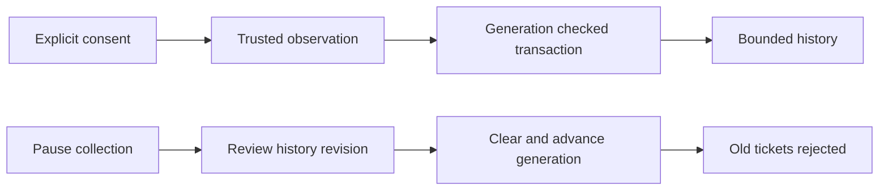

# Generated local activity, diagnostics and recent destinations

- Status: Draft; implementation in progress, not H3 acceptance
- Date: 2026-10-29
- Catalog capability ID: `github-browser-extension`
- Last verified: not applicable; prospective refinement
- Owners: Copilot maintainers
- Scope: CENTER09/10/14 generated local history within complete H3 #704
- Related issues/PRs: [#704](https://github.com/vypdev/copilot/issues/704)
- Required review gates: product UX, architecture, testing, documentation, security/operations
- Open decisions blocking readiness: none for the transactional journal core;
  source handoff and the complete center journey need their own verified implementation.

## 1. Executive summary

The center will distinguish the current operation from optionally retained,
redacted history. Collection is off by default. Stopping collection preserves
existing records until expiry or a separately reviewed clear. A transaction
checks the history generation before changing it, so an old completion cannot
repopulate a history that the user cleared.

```text
Review collection → explicitly enable → retain bounded safe facts
 → stop collection → review exact history revision → clear → inspect result
```

This refinement preserves all150 functions/803 catalog cases and the owning H3
acceptance. The core alone does not implement or accept the center UI.

The [durable collection-consent refinement](github-browser-extension-collection-consent.md)
defines the prospective version2 policy-store upgrade and atomic admission.
Version1 below records the implemented engineering core; collection remains
uncomposed until that refinement and its complete native/UI evidence are delivered.

## 2. Problem, current behavior, and evidence

### 2.1 Problem

Users need useful activity without fabricated success, accidental private-data
retention, or records returning after a clear.

### 2.2 Current behavior

Settings previews and operation outcomes are ephemeral. CENTER09/10 are not
complete. Content health has a separate100-entry closed-reason memory ring;
that ring is not persistent history. Preferences already declare diagnostics
and recent-destination consent, both false.
The application now has a bounded opaque-ticket writer and canonical-clear
observer, composed with the background preference owner and closed native-center
history/review gateway. Actual trusted producers and mounted controls remain
required; this source increment does not complete CENTER09/10.

### 2.3 Evidence

`settings_operations.ts`, `settings_transaction_ports.ts`, `center_settings.ts`,
`runtime_health.ts`, and the CENTER catalog establish those facts. Native
IndexedDB transactions serialize overlapping writes and remain active in request
callbacks; background globals do not survive worker termination. Sources are in
section20. Native H3 transaction/browser and human evidence remains outstanding.

### 2.4 Retrospective classification

Not applicable: prospective behavior, not an as-built reconstruction.

## 3. Actors, surfaces, and terminology

| Actor | Goal | Surface |
|---|---|---|
| User | Inspect and clear optional generated history | Activity, Diagnostics, Privacy |
| Maintainer | Understand a closed failure without private evidence | Redacted detail/export preview |
| Background owner | Retain only admitted observations | Narrow application ports |

**Generation** is the durable clear epoch; **revision** changes with every
committed history change. **Sequence** identifies an entry within one generation.
**Acknowledgement** is the native submission fact; **observation** is a distinct
canonical reread. Neither timeout nor acknowledgement proves requested completion.

## 4. Goals, non-goals, and fixed invariants

1. Generated facts contain closed enums and registered nonprivate feature IDs.
2. Diagnostics retain at most200 entries; recents at most50; both expire after
   seven days. Current page health remains separately bounded to100/session.
3. No credential, account/repository identity, URL, error text, code, draft,
   authored note, profile label or arbitrary property enters this journal.
4. Preferences, protected session credentials and authored notes keep separate
   stores and deletion scopes. No GitHub/provider mutation or browser history.
5. Unknown/future data is preserved and shown unavailable; no default replacement.

The current core excludes UI admission, source handoff, automatic telemetry and
remote upload. Their absence does not remove the full H3 requirements.

## 5. Current versus proposed product journey

| Stage | Current | Proposed effect |
|---|---|---|
| Operation | Ephemeral result | Still useful with retention off |
| Opt in | Preference only | Disclosed redacted diagnostics and operation history |
| Clear | No generated history | Separate preview binds exact generation/revision |
| Late completion | Not retained | Updates only an admitted entry in its generation |



Text equivalent: consent admits an observation; one transaction validates and
stores it. Pausing then confirming clear advances the generation and fences old tickets.

## 6. Functional behavior and state model

### 6.1 Normal path

The trusted owner obtains a known journal generation before capture. No event
predating consent is collected retrospectively. An admitted operation may move
from reviewed to submitted or canceled/blocked, then retain acknowledgement and
canonical observation separately. Exact target remains session-only; history
after its loss explicitly says that the exact target is unavailable/redacted.

### 6.2 Bounded storage policy

Each fixed journal stores one strict version1 envelope: kind, generation,
revision, next sequence, last observed clock and entries. No configurable name,
key, predicate or executable reducer comes from a renderer. Entries are bounded
to64KiB total. Expiry is applied in a readwrite transaction on access, including
when collection is off; no background wakeup or guaranteed physical erasure at
the expiry instant is claimed. Inactive expired records are hidden on the next
access and removed by that transaction. Clear cannot erase authored state.

| State | Meaning | Recovery |
|---|---|---|
| Ready/empty | Successfully read this generation | Inspect or review clear |
| Stale | Expected generation/revision no longer matches | Read and review again |
| Clock invalid | Clock went backwards or is invalid | Correct clock, reread; no capture |
| Future/corrupt | Stored data cannot be interpreted | Preserve; upgrade/native removal guidance |
| Unavailable before start | No history transaction submitted | Explicit reread |
| Aborted | Native transaction rollback observed | Explicit reread; no automatic replay |
| Unknown | Transaction outcome not established | Reread; never report cancellation/success |

Counter exhaustion fails closed. A future event time or unsafe integer cannot
fabricate freshness. Ordinary reads do not clear or reset unknown data. Once a
completion is canonically established, a later unavailable read cannot downgrade
that completed historical fact. Duplicate settled updates are inert.

Clear removes entries, not the small epoch/revision/clock-fence envelope used to
reject stale work and backwards clocks. That envelope persists until native
extension-data removal; its one clock value is not a browsing or incident trail.
Privacy/clear review MUST disclose that distinction. Seven-day retention applies
to generated entries; policy and safety-control metadata have separate lifetimes.

## 7. User-facing configuration

| Preference | Default | Meaning and bounds |
|---|---|---|
| `center.diagnostics` | false | Retain redacted closed diagnostics and operation facts,200/7days |
| `center.recents` | false | Retain admitted extension-owned destinations,50/7days |
| `center.notes` | session | Authored notes are outside this journal and clear scope |

Existing strict settings schema is retained; no extra field is silently added.
Recommended: both collections off. Alternative: enable diagnostics explicitly
after its disclosure, keep recents off. An opt-out stops new admissions; a
previously admitted operation may update its existing record until clear.
Failed/unknown privacy changes keep capture safely paused and disclose that pause;
they do not silently resume. Clear requires paused collection and a settled owner.

## 8. Clean Architecture design

| Layer | Owns | Forbidden |
|---|---|---|
| Domain | Strict facts, expiry, limits, transitions, immutable decisions | DOM, clocks, storage, provider errors |
| Application | Consent, opaque tickets, source/controller fences, reviewed clear | Native IndexedDB requests |
| Browser adapter | Fixed versioned journal/policy stores and transaction events | Consent or UI decisions |
| Composition | Native factory and service ownership | Renderer-selected database/store |
| Presentation | Localized state and exact preview | Generic append/update/delete RPC |

```text
Center/trusted observation → application → pure journal decision
                                      → fixed transactional port ← native adapter
```

The adapter synchronously queues reads and writes from native transaction request
callbacks; it never awaits an external promise inside one. Request success is
not commit: only transaction completion yields a committed result. Abort and
blocked/version errors are distinct. Late successful opens are closed after a
blocked result. Version changes close old connections; no database is deleted or
downgraded. One transaction reads epoch+payload and writes both atomically.
AST dependency/cycle/220-line module/pure-environment rules remain enforced.

`JournalReviews` separately owns at most16 retained five-minute clear previews,
32 completed results and duplicate-confirmation single flight. Its preview binds
the editor/controller/credential lifetime, kind, exact history generation/revision
and a canonically read paused-collection settings revision. It rereads privacy
after reading history. Cancel before submission discards the preview; cancel
during a native effect reports pending and cannot claim to abort it.

Before clear, the use case requires a shared-owner reservation for that paused
settings revision. The coordinator MUST prevent new admissions and consent writes
for that collection until release; an unavailable/busy reservation does not grant
authority. This is an application coordination contract, not an atomic transaction
across preferences and IndexedDB. Collection-coordinator composition is a remaining delivery
requirement. The adapter rechecks the supplied private admission guard before
open, after open and in the native request callback before deciding any write.
Loss of source/lease authority leaves the envelope unchanged. No renderer can
provide this callback. A submitted transaction is not retrospectively canceled.

After commit or unknown submission, a distinct read checks the exact next
generation/revision and empty scope. Lost acknowledgement plus matching state is
reported as observed-cleared with acknowledgement unknown; it does not attribute
the transaction to this request. Unavailable/changed readback preserves the
accepted or unknown submission fact. A later source retirement marks the fact
noncurrent without erasing it. No confirm replay resubmits the clear. Connection
and reservation cleanup cannot erase a terminal effect fact.
`sourceCurrentAtObservation` describes the source/reservation when the result was
observed; a replay never promotes that historical field to a new live observation.

The preference half of that reservation reuses `SettingsRepository`'s serialized
mutation queue. A reservation succeeds only when no owned preference mutation is
pending. Once held, subsequently queued commit/update/initialize operations wait
for its release and then read the current complete envelope; their source guard
still applies. Reads/inspection remain available. A failed mutation cannot poison
the next queue entry; an old/idempotently released reservation cannot unlock a
new one. These are background-owned capabilities, never renderer-selected work.

`JournalReviews` acquires this preference reservation before the collection
reservation and rereads canonical privacy while both are held. It releases both
on every terminal path without losing a committed fact. A busy preference queue
blocks clear before native history submission. Existing preference migration,
rollback, admission snapshots, acknowledgement/readback and source fencing remain
unchanged. This does not implement durable collection consent across worker
restart; that policy must be refined before the collector is composed.

Add at least14 distinct coordination cases beyond the core budget:6 queue
ordering/rejection/release cases,4 actual preference mutation/migration cases,
4 composed history/preference races. Keep100%modified lines/branches and all
owning H3 gates. Counter bookkeeping and leases are transient; no new user
configuration, persistence schema, permission or automatic mutation retry is added.

## 9. UI/UX and content contract

```text
Activity — Collection paused
Previously saved redacted facts: 12. Exact private targets are not retained.
[Review clear] [Privacy controls]

Review clear: Diagnostics and operation history, 12 records at this revision.
Preferences, credentials and authored notes remain outside this scope.
[Clear reviewed history] [Cancel]
```

Pending: “Clearing the reviewed history. No action needed.” Complete: “History
cleared at this revision. Collection remains paused.” Stale: “History changed;
reread before confirming.” Partial/unknown: “The result is unknown. Read history
again; the clear will not be repeated automatically.” Unavailable: “History could
not be read. Existing data is preserved.” Saved operation success stays visible
even if history retention fails; history reports its own unavailable state.

Keyboard/focus, screen readers,320CSSpx,200%zoom, themes and reduced motion follow
H3. All primary and recovery states require complete en/es/fr/pt. Dynamic labels
are text, never HTML. No automatic issue/comment/notification is produced.

## 10. Failure, recovery, and cleanup

Old-generation append/update is stale and writes nothing, including after worker
restart. A capacity eviction removes the oldest retained sequence. Expired
operation updates never resurrect an entry. Quota/abort cannot fail the primary
settings operation. A reread observes facts and does not repeat a mutation.
Missing/future/invalid schema preserves raw data; native removal has a disclosed
broader scope and is never performed by this fixed journal adapter.

## 11. Security, permissions, and privacy

Only background-owned narrow ports can append. Generic renderer event recording
is forbidden. Recents contain a fixed center route or known feature destination;
profile detail is generalized, never persisted. Future GitHub recents require
their own explicit H4 admission/scope contract. Diagnostic export previews exactly
the selected nonsecret JSON, at most64KiB, before a fixed native download. This
database is never a credential fallback, sync destination or authorization proof.

## 12. Observability and operational UX

History reports its own availability, capture pause and retained count. Closed
records cannot establish full feature health. Clock/expiry/counter limits and
drop/partial status must remain inspectable without raw error payloads. Separate
center-only invalidation avoids resetting content quarantine through history writes.

## 13. Compatibility, migration, rollout, and rollback

The initial uncomposed core used native DB version1 with two fixed history
stores. The consent refinement upgrades known version1 to version2, adding only
the policy store and preserving version1 history envelopes. Unexpected/future
layouts and envelope versions remain unavailable without destructive replacement.
Retain current H2 Safari rollback separately; it is not H3 browser evidence. No
browser SDK, dependency upgrade, manifest permission or release is introduced.

## 14. Testing strategy and numeric budget

| Area | Minimum distinct cases | Risk |
|---|---:|---|
| Pure schema/expiry/transitions | 30 | Private fields, unsafe time, bounds, monotonic facts |
| Native transaction adapter | 18 | Abort/commit, upgrade, blocked/late open, serialization |
| Admission/clear/source races | 48 | Consent, restart, bounded tickets, stale writer, uncertain identity, reconciliation without write retry, replay |
| UI/locales/export | 18 | Factual states, scope, exact preview, accessibility |
| Native targets and human | 9 | Three target transaction journeys and human UX |
| **Total** | **123** | Cases count once; full H3 gates remain |

Keep root budgets and100%modified executable lines with no partials; pure branches
100%. Deterministic request fixtures test adapter contracts; they do not prove
native IndexedDB semantics. Actual source-bound Chrome/Firefox/Safari evidence
must exercise a write queued before clear and a late old-generation update.
The consent refinement defines the writer's200-ticket/five-minute bound, exact
known-row progress, visible dropped observations and unknown-append prohibition.
Application clear races use the actual preference queue, coordinator, writer and
review service; those deterministic ports are not loaded-browser acceptance.

## 15. Documentation and discoverability

User Privacy/Activity guidance must explain defaults, stop versus clear, separate
target/ack/observation and unknown outcomes. Configuration lists fixed limits.
Contributor guidance documents transaction lifetime and stores. Recovery covers
clock, quota, future schema, native removal scope and rollback. Register routes
and links; validate specs/catalog/docs together.

## 16. Acceptance scenarios

1. Off by default: navigating/operating does not retain generated history.
2. Explicit opt-in: only closed redacted admitted facts appear within bounds.
3. Clear after pause: exact generation/revision is checked and advances atomically.
4. Late old completion: stale result, with no record resurrection.
5. Timeout/abort: factual unknown/rolled-back outcome, never invented success.
6. Future/private/malformed input: preserve stored data, reject capture, no secret output.
7. Clock rollback/expiry: no false freshness and no expired record resurrection.
8. Current operation succeeds/history fails: retain success and separate history limitation.
9. All target/browser and human flows satisfy the unchanged owning H3 gates.

## 17. Requirements traceability

| Concern | Owner | Verification | Documentation |
|---|---|---|---|
| Strict safe facts/retention | Domain journal | Schema/policy cases | Privacy/configuration |
| Atomic clear/generation | Native adapter+domain | Transaction/race/native cases | Contributor/recovery |
| Explicit consent/no replay | Application | Admission/fence/integration | Activity/privacy |
| Truthful outcome/export | Presentation | Semantic UI/locales/preview | Activity/help |

## 18. Implementation sequence

1. Transactional core, strict facts and deterministic tests (first local slice).
2. Consent/tickets, reviewed clear and source-bound activity integration.
3. Localized activity/privacy/diagnostics, exact export and documentation.
4. Real browser transactions, human evidence, current-base remote checks/review/Codecov.

## 19. Definition of Done

- [ ] Every normative journey is implemented with distinct tests and traceability.
- [ ] No arbitrary/private data or generic recording RPC crosses the boundary.
- [ ] Consent, clear, late writes, expiry, outcomes and recovery are verified.
- [ ] All four locales and native/human H3 evidence pass.
- [ ] Specs/catalog/docs and unchanged repository budgets pass.
- [ ] Current-head review has no open findings; remote Codecov covers every modified line.
- [ ] The complete #704 scope, not this core alone, meets all merge gates.

## 20. References and decisions

- [Owning H3](github-browser-extension-control-center-h3.md) and CENTER catalog.
- [IndexedDB transaction lifecycle](https://developer.mozilla.org/en-US/docs/Web/API/IDBTransaction).
- [Open/version events](https://developer.mozilla.org/en-US/docs/Web/API/IDBFactory/open).
- [Chrome worker persistence](https://developer.chrome.com/docs/extensions/develop/concepts/service-workers/lifecycle).
- Primary sources checked2026-10-29. Transaction completion is browser-acknowledged
  commit, not a guarantee against OS power loss or native user data removal.
- Decision: native transactions over multi-key browser.storage read/modify/write;
  the latter cannot atomically fence a clear against late writes. Fixed bounded
  documents keep validation and storage ownership small without a new dependency.
- Deferred #763 large-SDD tooling remains separate and is not started here.
