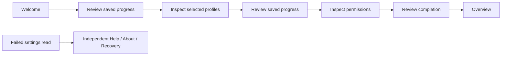

# Browser extension — resumable welcome and independent support

- Status: Draft; implementation and source-bound browser/human evidence pending
- Date: 2026-10-29
- Catalog capability ID: `github-browser-extension`
- Last verified: not applicable; prospective H3 refinement
- Owners: Copilot maintainers
- Scope: CENTER13 welcome/update information and H3 help/recovery, preserving all 150 functions and 803 product cases.
- Related issue: [#704](https://github.com/vypdev/copilot/issues/704)
- Required review gates: product UX, architecture, testing, documentation, security/operations
- Open decisions blocking implementation: none; acceptance evidence remains required

## 1. Executive summary

Users can resume a short local welcome, understand their selected profiles and
permissions, and reach useful help even when settings cannot be read. Recommended
behavior is to explore first, then review each saved progress change. Completing
welcome never selects a profile, connects an account or certifies product readiness.

```text
Welcome → review local progress → selected profiles → review local progress
 → inspect access → review completion → overview
Help / About / Recovery remain available independently of settings.
```

## 2. Problem, current behavior, and evidence

### 2.1 Problem

A support page that requires readable settings disappears when it is most useful.
A one-click completion marker does not explain permissions or selected profiles.

### 2.2 Current behavior

At local source `6687b3f2`, InformationPage contains generic help and a single
reviewed welcome-completion button. CenterRouteContent gates that page on readable
settings. No package identity is presented. The existing settings schema already
owns the closed onboarding states `welcome`, `profile`, `permissions`, `complete`.

### 2.3 Evidence

Owning sources: `InformationPage.svelte`, `CenterRouteContent.svelte`,
`center_settings.ts`, `center_client.ts`, and the CENTER13 catalog record.
Native metadata uses the synchronous, parameterless `runtime.getManifest()`;
Mozilla documents that its object can differ from parsed manifest JSON. Inspect
only needed bounded scalar fields, without serializing the complete object.
Native target behavior and human accessibility evidence still need verification.

### 2.4 Retrospective classification

Not applicable: this document proposes a refinement, rather than an as-built baseline.

## 3. Actors, surfaces, and terminology

| Actor | Goal | Entry | Surfaces |
|---|---|---|---|
| New or returning user | Understand local configuration | Welcome / Overview | Saved progress, profiles, access, review |
| User with a failed read | Recover without losing data | Help / Recovery | Current status, retained facts, safe next action |
| Contributor | Identify the running development package | About | Native package version, page source digest, verification limits |

**Saved progress** is a nonsecret personal preference, not completion evidence.
**Package version** is the version observed from this native extension context.
**Source tree** identifies this page's build inputs, not a Git commit or installed
Action version. A release-history link identifies this project's releases; it
does not imply an extension store listing or an available compatible update.

## 4. Goals, non-goals, and fixed invariants

1. WELCOME-R1: resume only committed onboarding progress; saving is reviewed.
2. WELCOME-R2: explain selected local profiles and access without changing either.
3. SUPPORT-R1: help, about and recovery render without invented editable defaults.
4. SUPPORT-R2: display bounded native package facts and page source, or unknown.
5. SUPPORT-R3: distinguish configuration availability from an already saved or
   uncertain operation; rereading never resubmits a mutation.
6. SUPPORT-R4: provide fixed local/documentation/release destinations and complete
   en/es/fr/pt content, keyboard navigation and useful narrow-screen layout.

Non-goals: store submission, automatic update checks, surprise welcome/update
tabs, setup pairing, privileged Apply, automatic repair/reset, credential exports,
or replacing any later milestone. None is removed from its owning product scope.

Fixed invariants: no permission requests, GitHub requests, new credential scope,
profile change or automatic write on route entry; no raw manifest/error export.
No onboarding or support status can authorize an operation.

## 5. Current versus proposed journey

| Stage | Current | Proposed | Effect |
|---|---|---|---|
| Welcome | One completion control | Review each persisted stage, revisit any stage | Resume without accidental configuration |
| About | Generic help | Native package version and separate source identity | Useful support context with honest limits |
| Recovery | Requires readable preferences | Independent safe help and read action | Guidance remains available on failed reads |



Text equivalent: review local progress between welcome, profiles and permissions;
review completion before overview. Failed settings still allow support routes.

## 6. Functional behavior and state model

Welcome shows the saved stage separately from a locally revisited step. Advancing
or restarting prepares the existing atomic center preference intent; cancel
preserves the saved stage. An observer can explore and follow links, but cannot
save without explicit takeover. A revision conflict requires a fresh review.
Unknown/future/corrupt settings never receive a default editable welcome.

Support has independent settings states: checking, ready, future, corrupt,
migration-required, incompatible, stale, unavailable. Retained settings after a
failed read are never promoted to a current observation. An operation has its own
none/applying/unknown/saved fact: an unknown save must be inspected, not repeated;
an already saved result stays saved even when the following read fails.

Native metadata is read synchronously once per mounted page, separately from the
background settings handshake. Missing API → unsupported; exception or malformed
fields → unavailable. There is no retry loop, network fallback or guessed version.
Lazy page failures show local recovery; retired loads cannot replace a newer route.

## 7. User-facing configuration

| Input | Default | Bound | Scope / persistence |
|---|---|---|---|
| onboarding | welcome | welcome, profile, permissions, complete | Existing local settings; atomic reviewed revision |
| revisited welcome step | committed step | Same finite inventory | Mounted view only; never implicitly saved |
| support/package information | unknown until observed | Read-only scalar projection | Mounted native page only; no settings field |

Recommended: follow the saved step. Alternative: revisit profile/access guidance
without editing progress. Existing validation/migration/import rules remain; no
new schema is needed. Profile selection and browser grants remain separate flows.
Native metadata/version/source, fixed URLs and review guards are not configurable.

## 8. Clean Architecture design

Domain owns immutable package facts, welcome steps and support status policy.
Application retains the existing center client/preview/confirmation authority.
The browser adapter reads only native manifest name/version/manifest_version;
infrastructure composes the observation and literal lazy imports. Presentation
receives a narrow readonly support port independently of Settings.

```text
native runtime → metadata adapter → immutable frame → typed support page
native center messages → center client → pure support status → typed support page
welcome → reviewed preference intent → existing controller/storage guards
```

Dependency/cycle and authored-component AST checks remain mandatory. No renderer
imports browser authority. Only exact authored release/help destinations may be
added to the navigation allowlist; arbitrary repository paths remain rejected.

## 9. UI/UX and content contract

Meaning precedes technical detail. Example states (localized in all four locales):

```text
Recovery
Checking current settings… Help remains available while the browser responds.
[Read current settings — unavailable while a read is pending]
[Configuration guide] [Inspect privacy]

Saved settings require a newer extension.
The saved data is preserved. Install a compatible build, then reopen the center.

Saving could not be confirmed.
Read the saved state before deciding what to do. Do not repeat the change.

The change was saved. The current settings read is unavailable.
Keep the saved result; read current settings to inspect the present state.

About
Development package information
Version: 0.1.0 [illustrative observed value, not hardcoded]
This is separate from the Action version and store/product acceptance.
[Project release history]
Technical details ▸ Native package name, manifest version, page source SHA-256
```

Support primary recovery action rereads settings; disabled during an active
client operation. Links remain usable independently. Semantically labeled
headings, ordered progress, native links/buttons, visible focus, 320 CSS px/200%
zoom and reduced motion are required. Authored names are escaped text. No HTML,
provider error, arbitrary URL or user mention is interpreted.

GitHub issues/PRs/checks are not changed by this subflow; their existing lifecycle
contracts remain. It posts no comments/notifications. Verification reports must
distinguish unit/build, native execution, human UX and remote review/coverage.

## 10. Failure, recovery, and cleanup

| Condition | Meaning and next action | Retention / retry |
|---|---|---|
| Pending or failed settings handshake | Support still works; reopen if native context stalls | No abort claim or automatic retry |
| Future/corrupt/migration-required settings | Preserve data; use documented compatible recovery | No reset/default replacement |
| Different page/background build | Reload native extension, then reopen center | No claim that page digest identifies background |
| Unknown save / failed read after success | Reread actual state; never infer rollback | Preserve exact operation fact |
| Native metadata missing/throws/malformed | Version unavailable; follow fixed help | No raw object, exception text or remote lookup |
| Retired route/chunk | Ignore eventual resolution/rejection | Dispose mounted subscriptions normally |

## 11. Security, permissions, and privacy

No new browser permissions, network channels or backend endpoints. Native manifest
fields are untrusted and bounded; source digest accepts only 64 lowercase hex
characters. Raw objects and errors never reach UI/logs. Readonly support facts
are not credentials, grants, session authority or authorization inputs. Existing
source/controller/revision/credential fences remain the only mutation path.

## 12. Observability and operational UX

One local status per setting observation plus separate factual save status;
technical package fields are collapsed. No telemetry, polling, update checks,
notifications, external diagnostics upload or durable support log. The support
guide explains collecting only the displayed nonsecret package/source facts.

## 13. Compatibility, migration, rollout, and rollback

Chrome, Firefox and Safari use feature-detected getManifest, never a newer API
above declared floors. Support works without it. Existing four progress values
and migration rules remain; local progress is not account authentication. No
selected profile, grant or prior operation changes during update/route entry.
Rollback uses reviewed compatible package/settings procedures; it cannot infer
credential or provider-effect rollback. H2 receipts do not establish H3 acceptance.

## 14. Testing strategy and numeric budget

| Area | Minimum distinct cases | Risks |
|---|---:|---|
| Pure package/status/welcome policy | 12 | Bounds, unavailable data, pending vs saved/unknown, closed steps |
| Native adapter | 8 | Receiver, missing API, exception, prototype/extra fields, no leakage |
| Application integration | 10 | Hung handshake, source mismatch, failed reads, readonly scope, no extra authority |
| UI/UX/localization | 12 | All locales/routes, escaping, links, review/cancel/resume |
| Races/migration/security/contracts | 8 | Late chunks, takeover, conflict, future/migration preservation, AST navigation |
| **Total** | **50** | Distinct behavior; no double-counting parametrized duplicates |

All changed executable lines and pure-policy branches must be covered; retain
the existing 100% per-file extension metrics and root budgets without exclusions.
Use deterministic ports/deferred reads, real mounted components, semantic text
and structural contract assertions. Native Chrome/Firefox/real Safari and human
keyboard/screen-reader/narrow/zoom evidence remain H3 acceptance requirements.

## 15. Documentation and discoverability

User/configuration: registered `docs/browser-extension/onboarding.mdx`, linked
from configuration, welcome and support. Operator: the same guide's recovery
table, update limits, retained state and package identity. Contributor:
`docs/development/browser-extension.mdx` documents the observation boundary and
evidence limits. Validate routes, navigation, specifications and documentation.

## 16. Acceptance scenarios

1. Save one welcome stage, close/reopen: resume that committed stage only.
2. Cancel advancement/restart: retain previous revision, profiles and grants.
3. Explore help/about/recovery with a hung or future settings read: useful links
   and native package facts, no editable defaults or invented current data.
4. Native metadata unsupported/throws/malformed: unknown identity, no leaked data.
5. Save acknowledged then read fails, or save unknown: distinct factual status
   and safe reread; no repeat mutation.
6. Late route chunks, observer/takeover and revision conflict: current surface
   and existing mutation fences remain authoritative.
7. Four locales, keyboard/assistive navigation, narrow/zoom: meaningful complete
   flow and visible focus; actual human/native evidence required before H3 merge.
8. Source/package/help fields never grant permissions or change selected profiles.

## 17. Requirements traceability

| Requirement | Owner | Automated evidence | Documentation |
|---|---|---|---|
| WELCOME-R1/R2 | welcome policy/page and existing preference transaction | `welcome.test.ts`, `welcome_page.test.ts`, existing migration/guard tests | onboarding, configuration |
| SUPPORT-R1/R3 | support context and independent route composition | `package_identity.test.ts`, `support_page.test.ts`, `center_host.test.ts` | recovery table |
| SUPPORT-R2 | package identity adapter/domain | `package_identity.test.ts`, `package_reader.test.ts` | About guidance |
| SUPPORT-R4 | localized support/welcome copy, fixed authored links | Four-locale semantic UI, component/architecture contracts, native/human H3 receipts | all registered guides |

These refine H3-R09/R10/R11 and CENTER13-C01–C04; partial subflow tests do not
declare any full catalog case, H3, or complete product accepted.

## 18. Implementation sequence

1. Pure package/support policies, native metadata reader and narrow route port.
2. Localized independent help/about/recovery plus race/security regressions/docs.
3. Resumable welcome/profile/access explanation using existing reviewed progress.
4. Complete traceability/coverage, target builds and native/human evidence.

## 19. Definition of Done

- [ ] Every requirement and primary state has semantic tests and documentation.
- [ ] Existing dependency/AST/size/security constraints pass without exemptions.
- [ ] Numeric budget and 100% changed-line/extension coverage pass without skips.
- [ ] Review/cancel/resume, migration, observer/revision guards preserve data.
- [ ] Complete four-locale accessible content and registered links pass.
- [ ] Chrome/Firefox/real Safari plus human UX evidence binds exact H3 inputs.
- [ ] Catalog/generator/specification/documentation/build checks pass.
- [ ] Current-head/base remote checks/review have no open findings and Codecov
      covers every changed executable line without partials before merge.

## 20. References and decisions

- [H3 owning SDD](github-browser-extension-control-center-h3.md),
  [center/setup contract](github-browser-extension-control-center-and-setup.md),
  [CENTER catalog](browser-extension/features/CENTER.v1.json).
- [Chrome runtime](https://developer.chrome.com/docs/extensions/reference/api/runtime),
  [Mozilla getManifest](https://developer.mozilla.org/en-US/docs/Mozilla/Add-ons/WebExtensions/API/runtime/getManifest).
- Project release-history destination verified read-only through GitHub releases
  API on 2026-10-29; observed v3.10.6 is an Action/project release, not an extension
  store or compatibility assertion. Link the history, never hardcode a latest tag.
- Decision: reuse existing progress schema and transaction guards; no separate
  storage engine, generic external-link router or automatic update mechanism.
- Deferred independently: large-SDD tooling #763 and H4–H12 product delivery.
