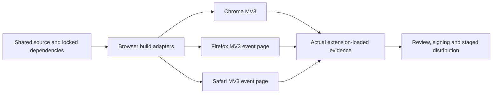
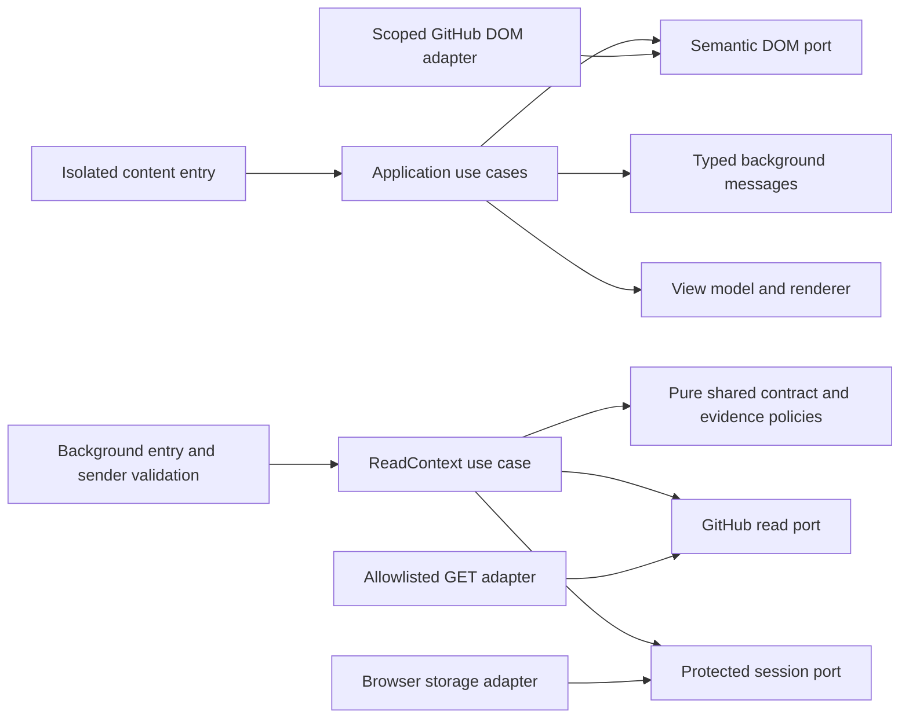

# GitHub Browser Extension — Platforms, Architecture and Delivery

- Status: Ready for review — proposed, not implemented or browser-verified
- Date: 2026-10-25
- Catalog capability ID: `github-browser-extension`
- Last verified: 2026-10-25, primary documentation and source research only
- Owners: Copilot maintainers; release owner provisions each store account/signing identity before distribution
- Scope: Shared extension architecture, Chrome/Firefox/Safari adapters, lifecycle, privacy, performance, testing and distribution.
- Related issues/PRs: [#694](https://github.com/vypdev/copilot/issues/694)
- Required review gates: product UX, architecture, testing, documentation, security/operations
- Open decisions blocking design readiness: None. Actual device evidence, registered package identities and store accounts are release prerequisites, not assumed available.

## 1. Executive summary

One portable TypeScript core delivers [the product](github-browser-extension.md)
and [Action contract](github-browser-extension-action-integration.md). Narrow
adapters handle browser APIs and GitHub's changing page structure. Each feature
owns its nodes/listeners/observers, mounts once and can be disabled independently.
Desktop Safari participates from the first working shell through release.

```text
Shared pure policies/contracts → use cases → browser/GitHub/DOM adapters
 → generated target manifest → actual extension-loaded tests
 → Chrome package / signed Firefox package / Safari containing app
```

No browser sidebar API, persistent background process, remote code patch or
resident CLI/web server is a runtime prerequisite.

## 2. Problem, current behavior, and evidence

There is currently an Action/CLI and a local web setup assistant, with existing
domain/application/adapter boundaries. There is no catalogued browser runtime,
browser manifest or verified extension package. Root `pnpm-workspace.yaml`
currently supplies dependency overrides; it is not evidence of a multi-package
extension build. `package.json` and the current architecture/coverage validators
must remain supported as a new package is introduced in follow-up work.

Primary sources establish differing background environments, storage access and
Safari distribution, rather than one universal manifest. Technical mechanics
research found useful feature isolation/navigation/settings patterns (§20).
They inform original requirements; no implementation, selectors, text or assets
are copied. All platform/runtime statements here are proposed contracts until
the explicit evidence matrix passes. Retrospective classification is not
applicable to this prospective capability.

## 3. Actors, surfaces, and terminology

| Actor | Responsibility | Surface |
|---|---|---|
| Browser user | Site access, feature settings, optional session connection | Options/toolbar and github.com |
| Feature owner | Own DOM/listener lifecycle and tests | Feature module and scoped diagnostics |
| Platform maintainer | Browser-specific manifests/adapters and compatibility | Build, fixture and real browser matrix |
| Action maintainer | Integration producer and existing policy | Owning Action contracts |
| Release maintainer | Reproducible bundles, signing, store submission, rollback | CI artifacts and stores/TestFlight |

`background` means an event-driven extension context, not necessarily a service
worker. `page generation` identifies one route/object identity. `owned DOM` means
nodes created by the extension, not GitHub's editors/content. `session` survives
background suspension where the API supports it, and ends on browser restart.
`WebKit test` is not proof that a Safari extension package loaded and operated.

## 4. Goals, non-goals, and fixed invariants

- **D1 — Browser parity:** U1–U6/K1–K3 have the same product meaning across the
  required Chrome/Firefox/Safari desktop matrix and explicit minimums.
- **D2 — Architecture:** portable pure decisions, semantic ports, provider/DOM
  adapters and composition have executable import/package boundaries.
- **D3 — Lifecycle:** scoped, idempotent mount/refresh/dispose, bounded observers,
  canceled work and native coexistence prevent duplicate/broken page controls.
- **D4 — Privacy/security:** least permissions, validated messages/URLs,
  session-only secrets/private evidence and account/isolation cleanup.
- **D5 — Inclusive UI:** original controls follow GitHub themes, keyboard/focus,
  assistive technology, locale and narrow-layout contracts.
- **D6 — Operations/performance:** measurable page/bundle/memory/request budgets,
  sanitized local diagnostics and per-feature recovery.
- **D7 — Settings/migration:** bounded original settings, atomic migrations,
  previous-version recovery and no token/private-data export.
- **D8 — Proof:** the shared numeric test budget, real extension-loaded matrix,
  fixtures and human artifacts are release gates.
- **D9 — Packaging/distribution:** reproducible target outputs, independent
  versioning, review/signing prerequisites and honest rollback.
- **D10 — Documentation/rollout:** planned versus delivered behavior, install and
  recovery guidance, catalogue evidence and staged three-browser availability.

Normative tables below refine these IDs. Non-goals: iOS/iPadOS/Android,
Enterprise hosts, webRequest interception, cookie access, host-wide automation,
custom code/CSS, native messaging, browser history access, AI runtime and hosted
telemetry. A per-feature hotfix can only arrive as a reviewed packaged release;
MVP contains no remote executable or remote CSS injection service.

## 5. Current versus proposed product journey

| Stage | Current evidence | Proposed delivery |
|---|---|---|
| Build | One Action/CLI package and web setup | Separate extension package plus narrow shared contract entrypoint |
| Mount | No extension | One registry-driven page generation with feature disposal |
| Suspend | No browser contract | Persist nonsecret settings, keep protected session state, revalidate on resume |
| Test | Existing Action tests/validators | Add fixture, package, real browser and human gates |
| Distribute | Existing Action/npm delivery | Independent browser packages/store lifecycles |
| Recover | Existing Action recovery | Per-feature pause plus reviewed extension/settings rollback |



Text equivalent: shared source and lockfile produce three target packages;
each is loaded as a real extension and tested before signing/store distribution.
Failure of one required target blocks advertising the three-browser MVP.

## 6. Functional behavior and platform state

### 6.1 Browser and OS compatibility matrix (D1)

These are **chosen compatibility floors**, not claims that those are today's
latest versions or that they have already been tested. Record exact browser/OS
builds in each release receipt and increase floors through a documented release
decision if current APIs or provider support require it.

| Concern | Chrome | Firefox | Safari |
|---|---|---|---|
| Product API floor | 140 | 140, including ESR 140 compatibility | 18.2 |
| Supported desktop OS baseline | Windows 11, macOS 15.2+, Ubuntu 24.04 LTS | Windows 11, macOS 15.2+, Ubuntu 24.04 LTS | macOS 15.2+ |
| Release test versions | Chosen floor in isolated fixtures; current and previous stable | Floor/ESR 140 fixtures; current stable and currently supported ESR ≥140 | 18.2 isolated fixtures; current and preceding supported Safari major ≥18.2 |
| Manifest | Generated MV3, `background.service_worker`, module | Generated MV3, nonpersistent `background.scripts`; no service-worker assumption | Generated MV3, nonpersistent `background.scripts`; containing app |
| Background durability | Can terminate; use asynchronous session/settings ports | Event page may unload; same revalidation contract | Event page may suspend; same revalidation contract |
| Storage | local nonsecret settings; protected session data | Same; default session not exposed to content scripts; no `setAccessLevel` assumption | Same; explicit site/session permission handling |
| UI | In-page panel/options/toolbar | Same | Same; no vendor-only side panel prerequisite |
| Testing package | Unpacked artifact and store candidate | Temporary load then signed beta candidate | Actual containing-app extension enabled in Safari; TestFlight candidate |
| Distribution | Chrome Web Store ZIP | AMO listed signed XPI | App Store Connect/TestFlight/App Store containing macOS app |

Minimum manifests declare the exact floors. Version detection is a compatibility
notice; APIs are also feature-detected. Unsupported APIs disable only dependent
features and identify why. Every deviation in a release matrix is disclosed;
maintainers cannot count a generic WebKit run as Safari evidence. Real user
acceptance uses currently vendor-supported builds; old floor fixtures contain
no real credentials or personal repositories. The release support table
distinguishes API compatibility from currently supported vendor/OS versions.

Mobile/Enterprise: unsupported in MVP, no matching script registration on extra
hosts. Responsive page layout still works in desktop narrow windows. Future
Enterprise support requires per-origin opt-in, credential/config cache isolation,
API compatibility and exact host registration. Future mobile work needs its own
input/navigation/background/store matrix; it is not implied by shared source.

### 6.2 Manifest/API matrix and defaults

| Capability | Manifest / adapter decision | Degradation |
|---|---|---|
| GitHub page scripts | Static isolated content script for `https://github.com/*`, top frame only, packaged JS/CSS | Missing site access: explain how to enable; no request on arbitrary sites |
| API connection | Optional host permission `https://api.github.com/*`, requested by explicit Connect gesture | Standalone remains fully usable |
| Settings/session | Required `storage`; use known keys/get(null), not newer `getKeys` APIs absent at floors | Quota/storage error disables persistence/connection explicitly |
| Clipboard | User-gesture DOM clipboard adapter; no blanket read permission | Copyable selected text and native copy fallback |
| Toolbar/options | Packaged options page, toolbar opens settings/current feature status | No resident popup connection required |
| Background scheduling | No persistent timer/keepalive; react to tab/content activity and stored nextAllowedAt | Hidden/suspended pages do not poll |
| Context menus/notifications/history | Not requested in MVP | U5 and inline UI supply actions/help |
| Programmatic injection | Not required for static github.com matching | No `scripting`/`activeTab` permission without a later reviewed need |

Browser/extension message listeners register synchronously at background entry,
before async initialization, to survive wakeup. Target manifests are generated
from a typed base plus allowlisted differences, never string replacement over
one vendor's JSON. Firefox add-on ID and Safari bundle/container identities are
maintainer-owned release metadata. Development IDs are distinct from published
identities and cannot share real credentials.

### 6.3 Feature lifecycle (D3)

```text
Observe route identity → decide eligibility/settings → mount once
 → scoped native content refresh → update owned view
 → route/identity/pause change → abort requests → disconnect observers/listeners
 → remove owned nodes → restore native focus/state → next generation
```

| State | Transition | Required behavior |
|---|---|---|
| Ineligible/disabled | Route, unsupported API, setting or protected path | No DOM work or network for that feature |
| Mounting | Eligible and unique pageGeneration | Create controller and scoped ownership; check anchor before write |
| Mounted | Successful DOM insertion | Stable accessible controls; no duplicate native equivalent |
| Refreshing | Relevant scoped mutation/soft navigation | Reconcile keyed owned nodes; preserve native editors/focus |
| Unsupported/error | Anchor missing or feature exception | Stop only affected feature, show local reason in diagnostics |
| Disposing | Navigation, pause, revoke, extension generation change | Abort, remove listeners/observers/owned nodes; no native subtree deletion |
| Disposed | Resources released | Late work checks epoch and becomes no-op |

Route detection uses current canonical URL and observed repository/object ID;
GitHub Turbo/React soft-navigation events may be hints but are not exclusive
truth. Validate route/anchors after history restoration, partial refresh and
visibility/pageshow. Registry observes a scoped route root and relevant anchors,
not every subtree in the document. Each request captures immutable page/settings/
credential epochs. A moved virtualized node is reconciled, not treated as a new
permission/operation. Native editor subtrees are never reparented or rewritten.

## 7. User-facing configuration

Product §7 is the complete personal schema; integration §7 is the repository
manifest. This companion adds no experimental feature flags or unbounded custom
code inputs. D7 requires atomically validated migrations and one previous
nonsecret settings version, explicit import/reset previews and namespace cleanup
on feature retirement. Maximum settings JSON is 64 KiB, 100 repo overrides and
20 saved views/repo. A future schema is preserved read-only, not destructively
normalized; a higher compatible package or explicit reset is the recovery.

Recommended: shipped defaults, session connection only when needed, no optional
host until Connect. Alternative: a repository-specific compact view and paused
connected functions during troubleshooting. Trust/host/byte limits, no auto-write,
protected session exposure and typed message methods are non-configurable.

## 8. Clean Architecture design (D2)

### 8.1 Physical boundaries and toolchain

Proposed placement, to be introduced by later implementation PRs:

```text
extension/
  package.json                  private workspace package; independent version
  src/domain/                   eligibility, settings, IDs, pure view policies
  src/application/              use cases and semantic ports
  src/adapters/{github,browser,dom}/
  src/infrastructure/           entrypoints, composition, target manifests
  src/presentation/             immutable view models, original components/CSS
  test/{fixtures,contracts,integration}/
src/domain/browser_extension_contract/
  index.ts                      only shared import entrypoint
  schema.json                   versioned closed wire schema
  ...                           pure parser/semantic validation
```

The root Action imports its pure domain contract normally. The extension may
import only that explicit shared barrel from root `src/`; no Action runtime,
Node utility, provider DTO or deep implementation import. Do not move existing
Action policies wholesale into browser bundles. Shared types/parser belong to
the domain; existing authoritative decisions remain Action-owned.

Add `extension` to pnpm's workspace package selection while preserving existing
overrides and root package behavior. Use the repository's locked Node/pnpm
toolchain, TypeScript, a locked Vite build plus explicit target manifest
generation, and Vitest for extension-specific pure/DOM tests. Use Playwright
where it can actually load the Chrome artifact; Firefox and Safari acceptance
may require browser-native/manual harnesses and signed candidates. Tool/library
versions are selected and locked in the implementation PR, verified against
official documentation then; this SDD does not prescribe unverified future APIs.
Root commands orchestrate contract build/typecheck, extension targets/tests and
existing Action verification without requiring browser packages in the published
Action runtime. Existing root coverage thresholds are not replaced by an easier
extension-only aggregate.

### 8.2 Semantic responsibility and trust graph

| Layer | Owns | Must not import/receive |
|---|---|---|
| Pure domain | Feature eligibility, bounded settings, IDs, state/next action | Browser globals, DOM, Node, GitHub SDK, tokens |
| Application | MountFeature, ReadContext, ReadFindings, PrepareDraft, Pause, MigrateSettings | Concrete HTTP/DOM/storage/provider DTOs |
| Ports | Immutable semantic input/result unions and cancellation/epoch | Arbitrary URL/command/body capability |
| Adapters | GET mapping, browser API differences, scoped GitHub anchors/editor | Product authorization/readiness policy duplication |
| Infrastructure | Target manifest generation, synchronous listeners, composition | Business decisions hidden in entrypoints |
| Presentation | Accessible original renderer/CSS and immutable VM | Token, mutating GitHub client, raw remote HTML |



Text equivalent: isolated page entry calls use cases through DOM and typed
background ports; background validates the sender, reads GitHub/session state
and pure contracts, then returns a credential-free view to the renderer.

### 8.3 Executable architecture constraints

Implementation introduces structured checks for:
1. Import graph: pure contract/domain has no side effects/Node/browser imports;
   application imports ports/domain only; presentation has no credential/network
   or mutation dependencies; root cross-imports use the single shared barrel.
2. Bundle scan/manifest parse: no Node builtins, `eval`, remote executable script,
   unapproved web-accessible assets, wildcard hosts or new permission drift.
3. Typed message schema: known methods only, closed bounded payloads, valid
   sender/tab/frame/origin and page/credential epochs; no arbitrary fetch gateway.
4. GitHub adapter: GET-only endpoint allowlist and cross-origin credential stripping;
   tests fail if an extension mutating method or command submission is added.
5. Schema/golden compatibility: valid/invalid snapshots/config/migrations and
   original DOM fixtures; public contract changes require explicit version rules.
6. Package/target receipts: lockfile and generated manifests/build hashes match the
   source revision; reproducibility check builds twice in clean temporary output.

## 9. UI/UX and content contract (D5)

Use product §9 state variants. All injected controls are original markup/styles
using bounded tokenized styles; a shadow-root panel isolates its presentation
where compatible with focus/accessibility, while inline helpers use namespaced
owned nodes. Shadow DOM is styling isolation, not a credential/security boundary.
Theme adapter maps GitHub light/dark/high-contrast tokens without replacing global
CSS or adding generic selectors that restyle native components.

```text
Extension settings
GitHub improvements: Enabled      Repository: vypdev/copilot
Connected context: Not connected (optional)
[Connect read access for this session]

Feature status
Diff navigation: Enabled
Conversation controls: Unavailable on this page — anchor not found
[Pause conversation controls] [Open native page]

Privacy
View settings stay in this browser. Connection ends when the browser restarts.
No browsing-history or code telemetry. [Review permissions] [Disconnect]
```

Focus, live announcements, shortcut/help behavior, EN/ES fallback and narrow
layout are product P7. Extension update/feature failures use nonmodal inline
notices; do not interrupt native typing, open surprise welcome tabs per update,
or request more permission as error recovery. Setup onboarding appears once
after install or explicit Open setup and shows standalone value first.

## 10. Failure, recovery, and cleanup

| Failure / partial result | User effect and retained state | Recovery | Cleanup owner |
|---|---|---|---|
| One feature exception | Other features/native GitHub remain; diagnostic names affected feature | Toggle it off or update reviewed package | Feature controller releases owned nodes/listeners |
| Background suspension | Pending read canceled/unknown, settings retained | Wake → revalidate account/page/source before rendering | Scheduler/session port |
| Session store absent/lost | Connected mode unavailable/disconnected | Explicit reconnect; no local-storage credential fallback | Credential epoch reset |
| Storage quota/migration failure | Previous nonsecret settings retained | Export/reset/retry once; never partial overwrite | Atomic settings store |
| Optional API site access revoked | Context unavailable, U features remain | User regrants exact optional origin | Abort and clear credentials/private evidence |
| Base GitHub site access revoked | No enhancement runs | Explain in toolbar; native page unaffected | Dispose feature generation |
| Extension update on open tab | Old generation disposed; no duplicate controls | One reload/resume affordance | Generation handshake |
| Browser close/disable/uninstall | No repository side effects | Intentional reconnect on reinstall/restart | Session API clears data; settings local removed by uninstall |

Disconnect atomically advances credential epoch *before* aborting requests and
deleting session token/evidence/cache; late responses cannot repopulate it.
Account switch uses the same path. Browser logout is not reliably observable by
an extension: pause when a visible logged-out/different-viewer signal is observed
and require explicit reconnect. Never claim that a PAT is invalidated by GitHub
web logout. Optional token itself is revoked only through GitHub native settings.
At most one session credential in MVP; no silent cross-account continuation.

## 11. Security, permissions, and privacy (D4)

Secrets/private evidence use `storage.session` in the background with default
content-script exposure disabled; call trusted-context access control where the
target supports it. Firefox lacks `setAccessLevel`, so no cross-browser policy
may assume the method exists. The API's default restricted session exposure is
required and tested. If a target cannot enforce this boundary, C features remain
unavailable; it is a release blocker for connected parity, not a disk fallback.
Do not keep credentials solely in service-worker globals or persistent local/
sync/IndexedDB storage. Session loss is a clear disconnect, not guessed success.

Options receives the user-entered token and sends it only through an
extension-origin credential-setting message; content scripts cannot call that
method. Background returns no token to any caller. Session caches for private
data share the credential epoch and are never exported. Browser extension
session storage is not advertised as an encrypted hardware-backed secret store.

Every content message validates extension sender ID, top-level frame, exact
HTTPS github.com origin, current tab route/object/epoch and closed method schema.
Credential/settings commands require packaged extension-origin sender paths.
Reject externally_connectable messages and web-page `postMessage` command bridges;
MVP needs neither main-world injection nor page-cookie access. A compromised
page cannot ask the background to fetch arbitrary URLs, switch repository,
retrieve a secret or execute code. Redirected API reads cannot send Authorization
to another origin. Remote strings are bounded text; URLs/commands/DOM selectors
are never assembled from free-form page content.

Do not register/inject on login, signup, password/session, OAuth authorization,
personal account/token settings or repository administration routes. Exact route
predicates and native fixtures test both direct load and soft navigation into
these paths. Content registration alone may match github.com, but entrypoint
exits before observers, storage reads containing private data or background
requests on a protected route. No all-frames/related-frame injection.

Incognito/private browsing is unsupported in MVP: explicitly disable in manifests
where possible and check context/sender flags before every connected read/write
to personal settings. If users manually allow it, refuse connection and retain
no private browsing evidence. No `history`, `cookies`, `webRequest`,
`notifications`, `nativeMessaging`, blanket host or unlimited-storage permission.
No third-party remote font/code/telemetry fetch; assets are packaged. Any added
permission is a separately reviewed contract change with visible upgrade impact.

## 12. Observability, performance and operational UX (D6)

### 12.1 Performance budgets

These are release targets, not current measurements. Reference fixture: desktop
viewport 1440×900, four logical CPU cores/8 GiB RAM class machine, fixed original
HTML with 10,000 native nodes, 100 diff files and 100 conversation threads;
network facts are replayed with deterministic latency. Run 30 warm measurements
after five warmups per target; retain fixture/tool/device/browser IDs. Report
median/p95 and baseline separately so native GitHub/network time is not attributed
to extension work.

| Area | Required bound | Measurement |
|---|---|---|
| Packaged content code | ≤500 KiB gzip JS across required content entrypoints; ≤50 KiB gzip CSS | Build receipt with compressed byte counts |
| Initial feature work | p95 ≤100 ms attributable JS in first second; no extension task >50 ms | Browser profiler on fixed fixture |
| Scoped refresh | Process ≤200 changed nodes/batch and yield after ≤8 ms target; hard task cap 50 ms | Deterministic mutation fixture + profiler |
| Observers | ≤1 route observer plus ≤1 scoped observer per mounted feature; none after dispose | Instrumented lifecycle counters |
| Owned DOM | ≤500 initial nodes; ≤50 findings mounted at once, virtualized/paged to 100 snapshot cap | Semantic DOM assertions |
| Retained growth | After 20 issue/PR/route cycles, ≤2 MiB growth over first settled extension state; added retained heap target ≤20 MiB/tab | Five profiler comparisons/target with GC/procedure disclosed |
| Idle | No foreground-independent polls, background keepalive or observers on protected pages | Fake clocks and real suspension inspection |
| API | I6 concurrency/byte/hour/rate-limit budgets | Scheduler traces with no live waits |

Heap measurement uses the supported profiler for each engine, not an assumed
universal browser API; receipts document measurement limitations. Failure to
establish a comparable measurement is recorded as missing evidence, not a pass.
Large native pages/virtualized lists beyond fixtures keep bounded work and show
partial loaded scope; do not remove caps to make data appear complete.

### 12.2 Local diagnostics

Retain a ring of at most 100 sanitized events/session and aggregate counters:
feature ID, adapter/browser version, error code, page type (no full URL), request
outcome/cached flag and disposal counts. No token, query text, draft, path,
comment, user identity or private repo name by default. Manual export previews
the exact ≤64 KiB nonsecret report and supports clearing it. There is no remote
diagnostic submission or automatic issue creation. Existing Action summaries
remain native source links, not copied bulk logs.

## 13. Compatibility, migration, rollout, and rollback

D7: schema-1 settings are bounded and local; migration validates into a fresh
record then commits atomically, retaining one previous settings version. Future
schema is read-only/exportable; never erase an unknown record. Retired feature
IDs have an explicit rename/remove map, a migration fixture and a release note.
Do not retire a user override merely because a module failed to load once.

Native coexistence: before mounting, detect a semantic native equivalent and
disable only the redundant helper. If another extension provides the same
control, favor native usability and a clear feature-disable path; do not mutate
that extension's nodes. Broken-feature recovery is local settings/pause or a
reviewed packaged update, with no remote JavaScript or CSS hotfix channel.

Rollout gates are D8/D9: all-target shell → internal fixture/pilot → beta store/
TestFlight → stable release. Safari packaging begins with the shell, not after
Chrome's feature completion. A store-specific incident may pause that rollout,
but three-browser MVP completion remains blocked until parity evidence exists.
Rollback restores an approved compatible code/settings pair. If stores reject a
lower version, submit a higher numeric build containing the reviewed revert.
Disable connected manifest support independently while preserving standalone
features and native Action publications. No user token is included in backups.

## 14. Testing strategy and numeric budget (D8)

Product §14 is the single **96-case minimum**. This companion owns F/N lifecycle,
S security and E packaging areas and shares adapter/presentation coverage;
it does not add a duplicate 96. Every requirement below maps to those IDs.
Maintain root Action thresholds and separate extension reports; pure trust and
authorization policies require 100% branch coverage. Test decisions, not getters
or mirrored implementation. Use deterministic clocks, aborts, fake providers,
original HTML fixtures and semantic assertions in addition to snapshots.

### 14.1 Real execution matrix

| Target | Automated minimum | Actual extension evidence | Human minimum |
|---|---|---|---|
| Chrome | Pure/DOM/manifest suites; extension-loaded smoke where runner supports it | U1–U6, K1–K3 public/private fixtures, suspension, back/forward | Keyboard and NVDA on Windows; light/dark/200% |
| Firefox stable + chosen ESR | Same core suites and target manifest; browser-native loaded harness or recorded manual smoke | Real signed/temporary extension, event-page restart, private read denial | Keyboard and NVDA on Windows; theme/focus |
| Safari | Same pure/DOM/schema suites; WebKit may supplement layout only | Actual enabled containing-app extension on macOS, permission prompts, session/suspension, TestFlight beta | VoiceOver, keyboard, light/dark/200% and narrow layout |

Additionally run Chrome/Firefox smoke on the OS baselines in §6.1, recording
exact oldest/current-version coverage and gaps. A mocked `browser.*` object
proves policy mapping only. Signed/store candidates require install/enable/update
checks separate from unpacked load. Organization-restricted access needs a
controlled acceptance record when available; denied/unknown behavior is always
tested deterministically and unavailable live access is disclosed honestly.

Each receipt records source commit, lockfile hash, package hashes, browser/OS,
extension ID/install method, fixture identity, steps and assertions, pass/fail,
time, screenshots/profiler traces and limitations. Use a controlled private
test repository and separate read token; never capture tokens or real private
code/drafts. At least one original screenshot per main state/target and human
reader result is retained outside generated intermediates and linked in the PR.
An evidence index distinguishes local automation, actual browser, human UX and
store acceptance. Missing categories stay pending, not checked off by proxy.

### 14.2 Contract/packaging test inventory

bex-E-C01/bex-E-C02/bex-E-C03 validate each package loads the exact U/K capabilities and protected
routes. bex-E-C04/bex-E-C05 prove background restart with protected session state or honest
disconnect. bex-E-C06 revokes optional origin while reads are pending. bex-E-C07/bex-E-C08 exercise
no producer and mixed schema versions. bex-E-C09/bex-E-C10 prove nonsecret migration and
uninstall cleanup. bex-E-C11 covers native/other-extension coexistence; bex-E-C12 covers the
measurable budgets. bex-N-C01–bex-N-C14 instrument resource counts after each lifecycle edge.
bex-S-C01–bex-S-C16 attempt malformed/sender/URL/secret/command/export/account attacks under
the closed ports. These are future tests, not claims of executed evidence.

## 15. Documentation and discoverability (D10)

Product §15 is the documentation inventory. Platform delivery adds exact
Chrome/Firefox/Safari install/enable/revoke/update/uninstall instructions, support
floors/current vendor support table, keyboard/screen-reader behavior, Safari
containing-app/TestFlight workflow, signing prerequisites and version rollback.
Architecture docs include physical/import/message graphs, typed port catalog,
original fixture guidance and reproducibility receipts. Permission/privacy docs
explain session expiry, PAT native revocation, no incognito support and no
telemetry. Navigation is registered only for existing pages with correct
availability labels; check docs routes/frontmatter/assets/examples and README
links using repository validators. Maintain translations with complete fallback.

## 16. Acceptance scenarios

1. Load each exact target package at its declared compatibility floor in fixtures:
   standalone U features operate without token/Action/API permission.
2. Connect on supported live browser: optional exact API host is requested by user
   gesture, read session works and C features match product/integration semantics.
3. Suspend/restart background: retain safe session timing/credential state or
   visibly disconnect; never restore stale view from global memory alone.
4. Soft navigation, React refresh, virtualized insert/remove and back/forward:
   one owned generation, no native editor loss and zero leaked observers.
5. Spoofed sender/foreign repo/unsafe URL/arbitrary fetch: no provider request,
   credential disclosure or page/remote code execution.
6. Logout signal/revocation/disconnect/account switch mid-read: invalidate epoch
   before clear; late response cannot repopulate private state.
7. Private browsing enabled manually: refuse connected operation and do not
   persist private navigation evidence/settings.
8. Settings import invalid/future schema/quota failure: retain current settings
   and show explicit recovery; no secret/private data appears in export.
9. A native equivalent appears or one feature breaks: only that feature retires/
   pauses; native GitHub and remaining features work.
10. Keyboard/screen-reader, themes/zoom/narrow and EN/ES pass with real human
    evidence; screenshots alone are not an accessibility result.
11. Reproducible packages, performance bounds, browser evidence and store/signing
    prerequisites pass before stable availability claims.
12. Reviewed rollback/new higher build restores behavior/settings without
    overwriting native content, Action state or human drafts.

## 17. Requirements traceability

| Requirement | Owning boundary | Test/evidence | Documentation |
|---|---|---|---|
| D1 | Browser target manifests/adapters | bex-E-C01–bex-E-C03, §14 real matrix | compatibility/installation |
| D2 | Domain/application/ports/composition/build | bex-F-C01–bex-F-C12, bex-S-C16, structured import/package checks | architecture |
| D3 | Registry/controllers/DOM adapters | bex-N-C01–bex-N-C14, bex-A-C05, bex-E-C04–bex-E-C05/bex-E-C11 | features/troubleshooting |
| D4 | Sender parser/credential/session/GET ports | bex-S-C01–bex-S-C16, bex-E-C06/bex-E-C10, real private-read denial | permissions/privacy |
| D5 | View/focus/theme/locale adapters | bex-V-C01–bex-V-C14 and §14 human artifacts | features/compatibility |
| D6 | Scheduler/observer/diagnostic budget policies | bex-E-C12, bex-N-C14, bex-A-C07–bex-A-C12, profiler receipts | troubleshooting/privacy |
| D7 | Atomic settings store/migrations | bex-F-C03–bex-F-C12, bex-E-C09 | configuration/upgrade |
| D8 | Test orchestration/evidence receipt | 96 inventory, three-target receipt review | architecture/contributor guide |
| D9 | Target build/sign/store pipeline | bex-E-C01–bex-E-C03/bex-E-C08–bex-E-C10, reproducibility/sign receipts | installation/compatibility |
| D10 | Release availability/docs/navigation | Documentation validators and review gates | All planned product pages |

## 18. Implementation and release sequence (D9)

1. Introduce shared barrel, private extension workspace, target manifests and
   structured boundary checks. Preserve root overrides/build/package contents.
2. Load the minimal shell in all three browsers and register stable development
   IDs/fixture receipt format. Select/lock library versions with primary docs.
3. Implement features/settings/lifecycle and protected connection, with original
   fixtures and companion Action producer work; update docs per slice.
4. Complete 96 cases, coverage, actual-browser/human/performance proof and
   reviewed package reproducibility/SBOM/license inventory.
5. Maintainer provisions Chrome Web Store and AMO publisher accounts and Apple
   Developer/App Store Connect access, exact IDs, privacy/support/store assets
   and signing custody. These are named role prerequisites; not completed by
   writing a specification or by generating a ZIP. Signing credentials stay in
   the reviewed release environment, never the extension/Action user bundle.
6. Produce independent Chrome ZIP, Firefox signed XPI and Safari extension ZIP/
   containing-app candidate from the same reviewed commit. Safari default is
   App Store Connect's Web Extension Packager and TestFlight; Xcode conversion
   is the supported development/fallback route when packaging capability requires
   it. Actual Mac/Safari testing remains necessary even if packaging uses the web.
7. Beta/pilot on each target, review privacy/permission prompts and updates, then
   explicitly authorized store submission/stable release. No store action or
   enrollment is authorized by this specification issue.

Extension semantic version is independent of Action/CLI. Use a deterministic
monotonic numeric package version `major.minor.patch.build` with each component
0…65535 and at least one nonzero; keep a release manifest mapping it to the
human semantic version/channel and Safari bundle build. Beta → stable builds
increase the numeric build, rather than trying to downgrade a prerelease package.
Stable extension IDs/app bundles are reserved by the release owner before beta;
the exact values are release metadata, not unbounded user settings.

## 19. Definition of Done

Specification delivery: platform choices, architecture, permission/storage
boundaries, test/evidence budgets, delivery owners and documentation are concrete
and consistent; proposed status/capability and validators remain honest.

Future implementation gates:
- [ ] D1–D10 and product/integration requirements have traceable acceptance.
- [ ] Three real target packages load; minimum/current/ESR/platform matrix is recorded.
- [ ] Structured dependency/message/schema/manifest/package constraints pass.
- [ ] 96-case floor, root/changed-module coverage and pure-policy branches pass.
- [ ] Real accessibility/theme/narrow/locale and profiler evidence meet budgets.
- [ ] Session secrets, private cache, pause/revoke/cleanup and migration pass.
- [ ] Original implementation/fixtures/assets and dependency/license inventory are reviewed.
- [ ] User/setup/operator/contributor docs and navigation are complete/validated.
- [ ] Store identities/accounts/signing/privacy/support and rollback are ready.
- [ ] Catalog/generated artifacts distinguish design, implementation and live proof.
- [ ] Specification/doc/build checks pass; no material design decision remains open.

## 20. Primary sources, technical provenance and decisions

Sources accessed 2026-10-25; reverify changing API/store details at implementation
and release. These support platform facts, not a claim of execution.

- [Chrome content scripts](https://developer.chrome.com/docs/extensions/develop/concepts/content-scripts): isolated script environment and page interaction.
- [Chrome service-worker lifecycle](https://developer.chrome.com/docs/extensions/develop/concepts/service-workers/lifecycle): background termination and restart design.
- [Chrome storage](https://developer.chrome.com/docs/extensions/reference/api/storage): separate local/session/sync uses and trusted-context controls.
- [Mozilla cross-browser guidance](https://developer.mozilla.org/en-US/docs/Mozilla/Add-ons/WebExtensions/Build_a_cross_browser_extension) and [background manifest](https://developer.mozilla.org/en-US/docs/Mozilla/Add-ons/WebExtensions/manifest.json/background): differing runtime/manifest behavior.
- [Mozilla session storage](https://developer.mozilla.org/en-US/docs/Mozilla/Add-ons/WebExtensions/API/storage/session) and [primary compatibility data](https://github.com/mdn/browser-compat-data/blob/main/webextensions/api/storage.json): session support at chosen floors; `getKeys` and `setAccessLevel` are not portable assumptions.
- [Apple compatibility](https://developer.apple.com/documentation/safariservices/assessing-your-safari-web-extension-s-browser-compatibility): target-specific API assessment.
- [Apple web packaging](https://developer.apple.com/documentation/safariservices/packaging-and-distributing-safari-web-extensions-with-app-store-connect) and [distribution](https://developer.apple.com/documentation/safariservices/distributing-your-safari-web-extension): Packager, TestFlight, containing-app/signing prerequisites.
- [Chrome remote-code policy](https://developer.chrome.com/docs/extensions/develop/migrate/remote-hosted-code): packaged executable code and reviewed update route.
- [Mozilla extension signing](https://extensionworkshop.com/documentation/publish/signing-and-distribution-overview/): signed distribution options.

### Technical mechanics appendix — research only

The following public source paths were inspected as requested. References remain
here for auditability; their names do not define product branding or UI. No code,
selectors, CSS, assets or wording is reused. Implementation must create original
fixtures from controlled GitHub pages, not copy a third-party test/source corpus.

| Inspected source | Original requirement derived | Deliberate boundary |
|---|---|---|
| [Feature lifecycle manager](https://github.com/refined-github/refined-github/blob/main/source/feature-manager.tsx), source blob `c0ced2e0aba6118fb51d5bea84de9f662de9a1cb` | Independent eligibility/init/disposal and cancellation across dynamic navigation | D3 specifies semantic own-resource lifecycle; no source/event-loop/selector copying |
| [Feature eligibility utilities](https://github.com/refined-github/refined-github/blob/main/source/helpers/feature-utils.ts) | Pure per-page conditions and platform-aware affordances | D2 semantic policies with own names/tests |
| [Settings lifecycle](https://github.com/refined-github/refined-github/blob/main/source/options-storage.ts), source blob `fa998ea2db42679e1edcf30854eaca993740d76f` | Per-feature preferences with migration | Product bounded schema; session secrets excluded, no arbitrary CSS |
| [Background operations](https://github.com/refined-github/refined-github/blob/main/source/background.ts), source blob `393b08be51a00101543ea7a0a519f0ffc7b15aaf` | Explicit startup/permission/settings handling | Closed semantic GET messages; no generic fetch or remote hotfix service |
| [Target manifest](https://github.com/refined-github/refined-github/blob/main/source/manifest.json), source blob `078928b35da6b2ac8ffac595fbc3110c23f14028` | Review cross-browser background/storage choices explicitly | Own least-permission target manifests; no all-sites access |

Research file blob IDs identify inspected text, not repository commit IDs.
Implementation evidence should pin fresh source commits when repeating research.

Decisions: three target manifests, portable core, event-driven background,
protected session storage, no vendor sidebar, original feature registry, closed
ports, no hosted service/remote patches, and real Safari evidence. Alternatives
rejected: a Chrome-only first release called three-browser MVP, global DOM
mutation observer, persistent worker keepalive, broad host access, and generic
WebKit as Safari-extension proof.
