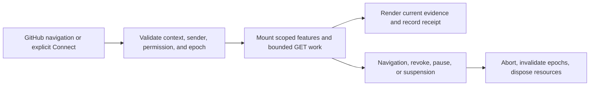
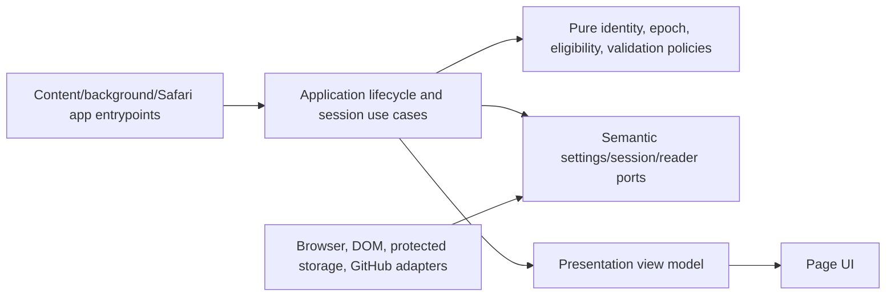

# GitHub Browser Extension Runtime, Lifecycle, Protected Sessions, and Browser Evidence

- Status: H2 implementation for review; browser acceptance recorded separately
- Date: 2026-10-25
- Catalog capability ID: `github-browser-extension`
- Last verified: 2026-10-26; deterministic source/tests; exact browser receipts belong to the implementation PR
- Owners: Copilot maintainers
- Scope: Define H2 browser runtime lifecycle, protected session handling, and actual Chrome, Firefox, and Safari extension-loaded evidence within the complete GitHub productivity extension.
- Related issues/PRs: [Issue #703](https://github.com/vypdev/copilot/issues/703); dependency #702 completed by merged PR #715; product baseline merged PR #699
- Required review gates: product UX, architecture, testing, documentation, security/operations
- Open decisions blocking readiness: None identified by supplied answers. Environment-specific Safari automation, enablement, and signing prerequisites remain evidence to collect, not permission to substitute another browser.

## 1. Executive summary

H2 makes the extension runtime safe across navigation, suspension, refresh, settings changes, and protected-session transitions. Users receive stable behavior when a page changes or a browser API is unavailable; credentials remain protected and are removed promptly on disconnect, account change, or permission loss. Maintainers get reproducible evidence from extension-loaded Chrome, Firefox, and Safari, including the actual Safari containing app.

The extension MUST treat every navigation, object identity, setting change, and credential change as a new epoch. Work from an older epoch cannot update the page or retain access. Browser harnesses MUST report exact environment and artifact receipts; mocked APIs and ordinary WebKit are not evidence of actual extension loading or Safari acceptance.

```text
Open supported GitHub page -> validate context and permissions -> mount scoped feature resources -> perform bounded GET reads -> render current evidence -> abort and clean up on navigation, revoke, account change, or disposal
```

## 2. Problem, current behavior, and evidence

### 2.1 Problem

Users need extension features to remain correct as GitHub pages navigate or update in place, and to stop promptly when access is revoked or a session changes. Without epoch fencing and scoped cleanup, late results can appear on the wrong issue or pull request, including when both have the same number. Browser suspension and missing APIs also make background-dependent designs unreliable. Maintainers need actual-browser evidence that distinguishes a successful run from a missing prerequisite.

### 2.2 Current behavior

1. At the supplied base revision, H1 provides a private extension workspace, domain eligibility/target policies, typed target manifests, inert content/background entrypoints, and architecture/artifact/reproducibility gates.
2. H1 is not lifecycle, session, or actual-browser loading proof. It includes 56 extension tests across 9 files with 100% statements, branches, functions, and lines, plus 8 root CommonJS contract tests, as reported in the authorized answer.
3. The existing specifications define the complete proposed product and remain authoritative for overall scope. Current files include the primary, functional catalog, platform/delivery, action integration, control center/setup, and foundation specifications.
4. H2 now supplies the implementation below. `extension/src/domain/` owns identity/settings/message/scheduling decisions; `application/` owns feature scopes, atomic settings, protected sessions and the gateway; narrow browser/DOM/GET adapters are composed by synchronous target entrypoints. Runtime/build evidence is separate from the actual browser receipts and full-product acceptance.

### 2.3 Evidence

- Code/workflow/documentation references: `extension/src/infrastructure/content_entry.ts`, `extension/src/infrastructure/background_entry.ts`, `extension/src/domain/eligibility.ts`, `extension/src/domain/target.ts`, `extension/src/infrastructure/target_manifests.ts`, `extension/tooling/architecture_validation.mts`, `extension/tooling/artifact_validation.mts`, `extension/tooling/build.mts`, `extension/tooling/cli.mts`, `extension/README.md`, `docs/development/browser-extension.mdx`.
- Existing owning specifications: `specs/github-browser-extension.md`, `specs/github-browser-extension-functional-catalog.md`, `specs/github-browser-extension-platforms-and-delivery.md`, `specs/github-browser-extension-action-integration.md`, `specs/github-browser-extension-control-center-and-setup.md`, and `specs/github-browser-extension-foundation.md`.
- Incidents or concrete examples: the authorized issue evidence identifies same-number issue/PR ambiguity, navigation races, stale/private evidence, storage failure, revocation, and permission denial as required risks. No production incident is asserted.
- External primary sources: official Chrome for Testing, Mozilla product metadata, and installed Safari/Xcode versions as recorded in the authorized answer dated 2026-10-25. Implementers must capture actual downloaded binary and driver hashes and returned capabilities.
- Unknowns: whether a particular runner has Safari enablement, automation, and signing prerequisites; implementation-selected dependency versions; and actual results of the specified browser runs.

### 2.4 Retrospective classification (as-built baselines only)

Not applicable: this is a prospective specification and does not reconstruct an implemented baseline.

## 3. Actors, surfaces, and terminology

| Actor | Goal | Entry point | Visible surfaces |
|---|---|---|---|
| GitHub user | Read extension evidence safely and understand connection state | Supported GitHub page; explicit Connect action | Page UI, settings, connection and permission status |
| Extension runtime | Mount and dispose feature resources exactly once per active context | Content/background browser events | Page UI and internal bounded diagnostics |
| Maintainer | Verify supported browser behavior and investigate prerequisites | Harness command and CI/operator workflow | Browser receipt, test report, contributor docs |

**Epoch** means a monotonically changing identity for route, GitHub object, settings snapshot, or credential session. **Protected session** means credential material held only by an approved protected session facility, never ordinary settings or disk fallback. **Actual-browser receipt** means a record binding source revision, generated extension artifact, fixtures, OS, browser, driver, and observed extension-loaded assertions. **Reader port** means an application-facing semantic read capability limited to approved GET operations.

The complete capability remains the 150-function product. H2 owns cross-cutting runtime and integration evidence and MUST NOT claim or duplicate any inventory feature.

## 4. Goals

| Requirement | Behavior |
|---|---|
| H2-R01 | Mount, refresh, and dispose are idempotent and safe under reentrant events; every owned observer, listener, timer, and request has an explicit scope. |
| H2-R02 | Route, object, settings, and credential epochs fence stale updates; issue and pull request identity remain distinct even when their numbers match. |
| H2-R03 | Navigation, feature pause, permission denial, revoke, account change, logout, and background restart abort or invalidate work and clean up owned resources. |
| H2-R04 | Preserve native editor contents, selection, and focus during refresh and adjacent UI updates. |
| H2-R05 | Settings are versioned, bounded, nonsecret, validated, and migrated safely; future schemas do not trigger destructive fallback. |
| H2-R06 | Session credentials use protected storage with trusted-context exposure where available, exact extension-only Connect initiation, and no ordinary disk fallback. |
| H2-R07 | Validate message sender, frame, origin, and closed typed payloads; reader ports permit only approved GET reads and deny redirects that escape allowed origins. |
| H2-R08 | Scheduler and cache are bounded and activity-aware, obey the existing I6 limits, use session timestamps, and do not rely on worker keepalive or timer polling. |
| H2-R09 | Test required API floors and deterministic API absence, permission denial, storage/quota errors, rollback, future schemas, races, disposal, and synthetic-secret isolation. |
| H2-R10 | Provide isolated, extension-loaded Chrome and Firefox harnesses and a Safari harness using the actual containing app and generated Safari extension resources. |
| H2-R11 | Browser receipts identify exact source tree/revision, artifact and fixture hashes, OS, browser, driver/container identities, capabilities, and observed lifecycle/security outcomes; prerequisite failures remain explicit failures. |
| H2-R12 | Update the owning specifications, catalog evidence, tests, and user/contributor documentation together in the implementation PR; retain complete product scope and existing root gates. |

## 4.1 Non-goals

1. Replacing or reducing the 150-function inventory or 803-case complete-product floor.
2. Claiming all 96 core cases complete before producer, consumer, packaging, and other required dependencies land.
3. Treating H1 inert-entry, VM, mocked WebExtension, or ordinary WebKit runs as actual-browser loading proof.
4. Store publication, signing approval, or compatibility claims beyond the defined evidence.
5. Real tokens or private repositories in automated fixtures.

## 4.2 Fixed product/safety invariants

1. A stale epoch MUST NOT render, persist, or authorize new work.
2. Session secrets MUST NOT enter settings, logs, fixtures, or ordinary disk persistence.
3. The extension MUST NOT perform writes through the semantic reader port.
4. Incognito contexts are refused for protected-session behavior.
5. Missing prerequisites MUST be reported truthfully and cannot be converted to a pass by substituting a different engine or mocked extension API.
6. Existing root gates and complete product scope remain in force.

## 5. Current versus proposed product journey

| Stage | Current | Proposed | User/operator effect |
|---|---|---|---|
| Page lifecycle | H1 entrypoints are inert; runtime behavior is not established | Idempotent scoped mount, refresh, abort, and disposal keyed by epochs | Stale page work is discarded and resources are released |
| Connect and read | Protected-session behavior is not established | Explicit Connect, protected credential handling, validated GET-only reads | Connection and denial states are understandable; no hidden write authority |
| Browser evidence | H1 checks do not prove extension loading | Isolated loaded-extension browser runs with exact receipts | Maintainers can inspect what was actually exercised |



Text equivalent: GitHub navigation or Connect -> validate trust and current epoch -> mount scoped read features -> render current evidence -> on navigation, revoke, pause, or suspension abort work and dispose resources.

## 6. Functional behavior and state model

### 6.1 Happy path

1. The entrypoint parses the browser event and asks pure eligibility policy whether the supported page/context may run.
2. The application obtains immutable route/object/settings/credential epoch values and creates a feature scope.
3. Infrastructure adapters attach only scope-owned observers and listeners. The scheduler starts bounded work only while activity permits.
4. The semantic reader port validates origin, method, redirect target, and response shape before returning domain data.
5. Presentation renders only if all captured epochs remain current; native editor value, selection, and focus are preserved.
6. Disposal aborts requests, disconnects observers, removes listeners, clears volatile secret references, and prevents late results from committing.

### 6.2 Alternative paths

- Missing required browser API: disable the dependent operation, show a concise unsupported/unavailable state, and emit a failed capability receipt; do not keep a worker alive to simulate support.
- Permission denial or API permission loss: stop affected reads, invalidate credential and request epochs as applicable, and show the required user action.
- Background suspension/restart: reconstruct from safe nonsecret state, revalidate session and permissions, and show disconnected/revalidating until confirmed. Do not assume timers or in-memory work continued.
- Feature pause: dispose only that feature's scope; unrelated features remain active.
- Storage quota/error: preserve the prior valid settings/session state where possible, report impact and recovery action, and never write secret material to fallback storage.

### 6.3 State machine

| State | Entered when | User-visible meaning | Allowed next states | Recovery/owner |
|---|---|---|---|---|
| Inactive | Unsupported route, incognito, or feature paused | This feature is not active here | Mounting, Inactive | User navigates or enables feature; eligibility policy |
| Mounting | Eligible current context begins setup | Preparing the page feature | Active, Unavailable, Disposing | Runtime coordinator |
| Active | Scoped resources and current permissions are ready | Current page evidence is available | Refreshing, Disposing, Unavailable | Feature application service |
| Refreshing | Current epoch requests new evidence | Updating current page evidence | Active, Disposing, Unavailable | Epoch fence and reader port |
| Disposing | Navigation, revoke, pause, or teardown | Stopping old page work | Inactive, Mounting | Scope owner; abort and cleanup |
| Unavailable | Permission/API/storage failure | Feature cannot safely update | Mounting, Disposing, Inactive | Explicit retry, permission action, or navigation |

Duplicate mount/refresh/dispose calls MUST converge on one active scope and one cleanup. Out-of-order results are discarded. Cancellation is terminal for the associated request. Partial reads may retain already validated nonsecret evidence only when its freshness is explicit; private or stale evidence is not presented as current.

## 7. User-facing configuration

| Input | Type | Recommended default | Allowed values/range | Scope/persistence |
|---|---|---|---|---|
| Feature enabled | Boolean per feature | `true` for product-enabled features; user can pause independently | true/false | Versioned nonsecret settings; feature scope |
| Cache lifetime | Fixed safety bound, not a setting | 60 seconds; 1 MiB/128 entries maximum | No caller override; session-private process cache is dropped on suspension | Background; persisted scheduling timestamps survive worker restart |
| Scheduler activity | Semantic operation input, not a persistent setting | Visible active online tab; explicit manual read | Hidden/inactive/offline/paused refuses work; future pending consumers may use fixed 60-second cadence | Reread at each request; no keepalive |
| Protected connection | Explicit user action | Disconnected until Connect | connected/disconnected; no user-supplied token setting | Protected session facility only |

Validation MUST reject unknown settings, enums and out-of-bound values. Cache limits and scheduler safety are deliberately not accepted as settings. Settings writes are schema-versioned, atomic where supported, and never contain credentials. Missing settings migrate to documented safe defaults; retired values map through explicit migration; unknown future schema is preserved and treated as unavailable rather than reset. An operation snapshots its settings and epoch at start; a relevant settings change increments the epoch and cancels the old operation.

Recommended configuration: enabled feature, active-tab scheduler, default I6 bounded cache, disconnected until explicit Connect. Meaningful alternative: pause an individual feature while other features remain enabled. Credentials, origins, arbitrary URLs, executable code, and safety limits are intentionally not configurable.

## 8. Clean Architecture

### 8.1 Responsibilities and dependency direction

| Layer/boundary | Owns | Must not own/import |
|---|---|---|
| Domain/pure policy | Eligibility, identity, epoch comparisons, settings validation/migration decisions, message schemas, cache/scheduler decisions | Browser globals, framework APIs, provider DTOs, storage implementations |
| Application | Mount/refresh/dispose and Connect/revoke use cases; immutable input/output; orchestration and cancellation | Concrete browser SDK calls or DOM mutation policy |
| Adapters/data | Semantic GitHub read mapping, protected session adapter, settings repository, browser capability mapping | Product policy or unrestricted network authority |
| Infrastructure/composition | Browser APIs, DOM scopes, observers, abort controllers, scheduler clock, containing-app wiring | Business decisions duplicated from domain/application |
| Entrypoints | Parse browser events, establish trust context, call application | Duplicated lifecycle orchestration or unvalidated message forwarding |
| Presentation | View models and accessible rendering; preserve native editor/focus state | Credential access, network calls, or mutation policy |



Text equivalent: entrypoints call application use cases; application depends on pure policies and semantic ports; infrastructure adapters implement ports; presentation receives safe view models.

### 8.2 Contracts, state, and trust boundaries

- Pure decisions: supported context, issue-versus-PR identity, epoch currency, settings migration, sender/frame/origin/message validation, cache and scheduler eligibility.
- Application contracts: immutable mount, refresh, pause, connect, revoke, and dispose commands/results with operation identity and cancellation outcome.
- Semantic ports: bounded nonsecret settings read/write, protected session connect/read/revoke, clock, and GET-only GitHub reader.
- Durable state/schema ownership: settings adapter owns versioned nonsecret schema; protected session adapter owns credentials using the platform's protected facility. No fallback from protected storage to ordinary disk.
- Concurrency/idempotency strategy: one keyed runtime scope per tab/frame/object/feature; epoch increments fence old operations; abort plus commit-time validation handles races that ignore abort.
- Trusted and untrusted inputs: browser sender metadata, frame ID, origin, page DOM, messages, GitHub payloads, and fixtures are untrusted. Only exact packaged extension context may initiate Connect. Closed typed schemas reject extra or malformed fields.
- Provider error mapping: permission denial, missing API, quota/storage failure, network/rate-limit, redirect denial, suspension, and malformed response are distinct safe outcomes; diagnostics exclude secrets.

### 8.3 Executable architecture constraints

The existing AST/import and artifact/hash/reproducibility gates remain. Add checks that pure domain modules import no browser/framework/provider modules; application imports only domain and semantic ports; reader adapters reject non-GET methods and disallowed redirects; composition is the only browser-global boundary; entrypoints do not duplicate use-case orchestration; and schemas validate closed typed messages and settings fixtures. Keep new modules at or below 220 lines and Svelte components at or below 90 lines unless a reviewed decomposition exception is recorded.

## 9. UI/UX and content contract

### 9.1 Information hierarchy

1. Whether this feature is connected and current.
2. What evidence was updated and its freshness.
3. What happens next.
4. Whether the user must reconnect, grant permission, or do nothing.
5. Impact and retained state.
6. Direct navigation to the relevant GitHub object or settings.
7. Sanitized diagnostics in progressive disclosure.

### 9.2 Representative primary view

```markdown
# GitHub activity

> **Current status:** Connected; this issue was refreshed just now.
>
> **Action required:** No action required.

## Progress

- [x] Confirmed this is issue #42 in `octo/example`
- [x] Loaded permitted read-only activity

## What happens next

Choose Read current activity to collect this page. Leaving or hiding the page cancels its work. H2 does not start automatic polling.

## Links

[Open issue #42](https://github.com/octo/example/issues/42) · [Connection settings](#connection-settings)

<details>
<summary>Technical details</summary>
Current page scope; no credential values are displayed.
</details>
```

Required variants:

**Pending/no action:** “Checking this page”; “No action required”; evidence is not yet shown as current.

**Action required:** “GitHub access is disconnected”; “Reconnect in extension settings”; prior evidence is marked stale and no new reads run.

**Blocked/failed:** “This feature could not update”; cause: permission/API unavailable; action: enable the named permission or retry; retained state: previous safe settings remain and evidence is marked stale.

**Partial:** “Some activity could not be refreshed”; successful validated sections remain timestamped; action identifies retry; no failed operation is described as if successful.

**Complete:** “Connected; evidence refreshed”; display the current object kind and number, timestamp, and descriptive link.

### 9.3 Issue, PR, and comment behavior

H2 does not create or update GitHub issues, PRs, comments, labels, checks, or notifications. This section is not applicable to external GitHub mutations because H2 is a local extension runtime/read-evidence increment. Browser harness reports use deterministic titles and one artifact receipt per run; retries replace or append machine-readable run artifacts without comments or notifications. Links must be descriptive and point only to the relevant issue/PR, settings, or receipt. The full product’s Action-owned GitHub UX remains governed by the owning SDDs.

### 9.4 Accessibility, localization, and responsive behavior

Use repository-supported locale conventions and fallback; H2 adds no independent locale. All status and freshness meaning is text, not color or icon alone. Preserve logical headings, labels, keyboard focus, and native editor content/selection. Narrow layouts must avoid horizontal scrolling for primary status. Sanitize untrusted Markdown, HTML, URLs, mentions, and message strings; render only allowlisted links and text. Mermaid has the adjacent textual equivalent above.

## 10. Failure, recovery, and cleanup

| Failure/partial state | User impact | Retained facts | Automatic retry | Required action | Cleanup |
|---|---|---|---|---|---|
| Navigation/object epoch changes mid-read | Old content could be misleading | Previously validated evidence with stale marker | No; new context starts its own bounded read | None | Abort and dispose old scope |
| API absent or permission denied | Feature cannot refresh | Safe settings; timestamped stale evidence | No background polling | Enable permission or continue without feature | Stop affected requests and listeners |
| Protected storage denied/quota error | Cannot safely establish/retain session | Prior valid protected session if adapter confirms it | One bounded retry only for transient adapter result | Reconnect or free storage | No disk fallback; clear partial volatile material |
| Revoke/account change/logout | Access ends immediately | Nonsecret settings and explicitly stale cached evidence if policy allows | No | Reconnect for new account | Invalidate credential epoch, abort, purge session cache |
| Background suspension/restart | In-flight operation may not complete | Nonsecret settings only | Revalidate on next event; no keepalive | None unless permission/session changed | Release stale scope on restart |
| Harness prerequisite missing | Browser acceptance cannot be established | Failure receipt with missing prerequisite | No silent substitution | Configure documented runner prerequisite | Remove temporary profile/artifact safely |
| Reader redirect/malformed response | Evidence is withheld | Safe diagnostic category, no response secrets | No for denied origin; bounded policy retry for eligible transient failures | Retry or inspect access | Abort response and discard payload |

Errors follow `impact -> cause -> action -> retained state`. Cleanup is idempotent and completion of cleanup is observable in tests/receipts.

## 11. Security, permissions, and privacy

1. Request only documented browser permissions needed for supported GitHub reads and the explicit Connect flow; denial leaves unrelated features operable.
2. Treat page content, messages, frame data, sender metadata, API payloads, and fixture content as untrusted. Validate sender, frame, origin, closed typed schema, and allowed redirect before use.
3. Use synthetic credentials only in tests; never log, persist in settings, include in screenshots/receipts, or store in ordinary disk fallback. Automated fixtures use original public repository data and no private repositories.
4. Protect against replay and forgery with session/credential epochs and exact extension sender checks. Refuse incognito protected sessions. Revoke, account-change, logout, and permission-loss events invalidate access before accepting late results.
5. Reader ports are GET-only, bounded, rate-aware, and cannot expose arbitrary URL or fetch authority to page scripts.

## 12. Observability and operational UX

- User-facing state: connection, permission/API availability, evidence freshness, and next action.
- Job Summary/operator evidence: harness run matrix, exact environment, artifact/fixture hashes, loaded-extension assertions, permission/suspension/revoke observations, limitations, and prerequisite failures.
- Logs, metrics, and correlation: local bounded diagnostic categories keyed by nonsecret operation ID; no credential, private content, or raw message payloads.
- Pending external dependency versus workflow failure: missing runner/browser/Safari prerequisite is an explicit failed prerequisite receipt; implementation or assertion failure is a test failure. Neither is a pass.
- Rate-limit/retry behavior: obey existing I6 limits, honor provider retry guidance within bounded policy, and never poll to keep a worker alive.
- Noise/comment budget: no GitHub comments or notifications for H2; one consolidated harness receipt per run.

## 13. Compatibility, migration, rollout, and rollback

- Existing in-flight operations/data: H1 has no established user runtime/session data. Preserve existing root contracts and extension target manifest contracts.
- Schema/configuration migration: version settings with explicit migration; absent schema initializes safe defaults; retired values map explicitly; future schema is not overwritten. Credentials are not migrated through settings.
- Deprecated behavior and compatibility window: none established. API floor tests are deterministic surface/absence tests and do not claim old floor binaries were run.
- Rollout stages/feature flag if needed: land inert runtime services and harness infrastructure behind non-user-visible composition until the required evidence is ready; enable product behavior only through the owning feature specifications.
- Rollback and irreversible effects: local runtime can be disabled and scopes disposed; no external GitHub write is performed by H2. Preserve settings that can be read safely and clear protected session state on explicit revoke.

## 14. Testing strategy

The H2 inventory below is additional cross-cutting evidence. It does not replace or claim the 96 stable core cases in primary SDD §14. The issue identifies lifecycle-owned portions of F configuration, N01–N14, S01–S07/S11–S16, and E01–E06/E09–E12; the implementation PR must map these exact existing IDs to their owner cases and finalize coverage only when producer, consumer, packaging, and other dependencies are present. The 96-case total remains pending until then. Full product acceptance remains 150 functions and 803 distinct cases across all three desktop targets.

| Case ID | Area | Requirements | Scenario |
|---|---|---|---|
| github-browser-extension-runtime-C01 | Domain/configuration/pure planning | H2-R01,H2-R02 | Reentrant mount for the same tab, frame, object, and feature returns one active scope and stable identity. |
| github-browser-extension-runtime-C02 | Domain/configuration/pure planning | H2-R02 | Same-number issue and pull request produce distinct object identities and epochs. |
| github-browser-extension-runtime-C03 | Domain/configuration/pure planning | H2-R05 | Missing, retired, invalid, and future settings versions resolve to safe non-destructive outcomes. |
| github-browser-extension-runtime-C04 | Domain/configuration/pure planning | H2-R07 | Closed message policy rejects malformed, extra-field, wrong-origin, and wrong-frame inputs. |
| github-browser-extension-runtime-C05 | Domain/configuration/pure planning | H2-R08 | Scheduler and cache policy enforce I6 bounds and pause while inactive. |
| github-browser-extension-runtime-C06 | Domain/configuration/pure planning | H2-R02,H2-R04 | Current epoch policy accepts matching result and rejects route/object/settings/credential epoch mismatch. |
| github-browser-extension-runtime-C07 | State/application/idempotency/races | H2-R01,H2-R03 | Mount, refresh, and repeated dispose release observers/listeners exactly once. |
| github-browser-extension-runtime-C08 | State/application/idempotency/races | H2-R02,H2-R03 | Navigation during a request aborts it and late resolution cannot update the new page. |
| github-browser-extension-runtime-C09 | State/application/idempotency/races | H2-R02 | Settings change fences in-flight result and starts with the new snapshot. |
| github-browser-extension-runtime-C10 | State/application/idempotency/races | H2-R03 | Pausing one feature disposes its resources while another feature remains active. |
| github-browser-extension-runtime-C11 | State/application/idempotency/races | H2-R03,H2-R06 | Revoke invalidates credential epoch before a late response can commit. |
| github-browser-extension-runtime-C12 | State/application/idempotency/races | H2-R03,H2-R08 | Background restart revalidates permission/session without relying on keepalive or timer polling. |
| github-browser-extension-runtime-C13 | State/application/idempotency/races | H2-R04 | Refresh preserves native editor value, selection, and focus. |
| github-browser-extension-runtime-C14 | State/application/idempotency/races | H2-R01,H2-R03 | Rapid route/object transitions dispose old scope and mount only the final current identity. |
| github-browser-extension-runtime-C15 | Application use cases | H2-R03,H2-R06 | Account change and logout abort active work, clear protected session references, and require revalidation. |
| github-browser-extension-runtime-C16 | Application use cases | H2-R03,H2-R09 | Permission loss stops affected reads and exposes an actionable unavailable result. |
| github-browser-extension-runtime-C17 | Application use cases | H2-R06 | Connect succeeds only from exact packaged extension context and yields no credential to page content. |
| github-browser-extension-runtime-C18 | Application use cases | H2-R03,H2-R05 | Storage quota failure preserves prior valid settings and does not partially publish a new version. |
| github-browser-extension-runtime-C19 | Adapters/provider error mapping | H2-R06,H2-R09 | Protected-store denial or quota error never falls back to ordinary disk and reports a safe category. |
| github-browser-extension-runtime-C20 | Adapters/provider error mapping | H2-R07 | Reader adapter rejects POST and every non-GET method. |
| github-browser-extension-runtime-C21 | Adapters/provider error mapping | H2-R07 | Reader adapter rejects cross-origin redirect and malformed payload without exposing raw data. |
| github-browser-extension-runtime-C22 | Adapters/provider error mapping | H2-R09 | Required API floor surface works while deterministic API absence produces explicit unavailable result. |
| github-browser-extension-runtime-C23 | Adapters/provider error mapping | H2-R08,H2-R09 | Activity-aware scheduler enforces bounded concurrency, cache limits, and session timestamps under synthetic clock. |
| github-browser-extension-runtime-C24 | Workflows/permissions/schemas/setup | H2-R05,H2-R09 | Settings migration covers absent, prior, retired, invalid, rollback, and future schema fixtures without secret fields. |
| github-browser-extension-runtime-C25 | Workflows/permissions/schemas/setup | H2-R03,H2-R06 | Incognito protected-session attempt is refused and no credential storage is invoked. |
| github-browser-extension-runtime-C26 | Workflows/permissions/schemas/setup | H2-R03,H2-R07 | Sender/frame/origin mismatch cannot invoke Connect, session, or reader ports. |
| github-browser-extension-runtime-C27 | Presentation/accessibility/sanitization | H2-R02,H2-R04 | Same-number issue and PR render distinct labels and descriptive links while retaining editor focus. |
| github-browser-extension-runtime-C28 | Presentation/accessibility/sanitization | H2-R03,H2-R09 | Permission denial view states impact, cause, action, and retained stale evidence in text. |
| github-browser-extension-runtime-C29 | Presentation/accessibility/sanitization | H2-R04,H2-R12 | Narrow layout and keyboard traversal expose status and next action without color-only meaning. |
| github-browser-extension-runtime-C30 | Presentation/accessibility/sanitization | H2-R07 | Untrusted Markdown, HTML, mentions, commands, and URLs render as sanitized text or allowlisted links. |
| github-browser-extension-runtime-C31 | Integration/security/migration | H2-R09 | Synthetic credential marker is absent from settings, logs, snapshots, receipts, and rendered output. |
| github-browser-extension-runtime-C32 | Integration/security/migration | H2-R10,H2-R11 | Chrome for Testing 156.0.8078.47 revision 1706539 runs isolated with extension loaded and records hashes/capabilities. |
| github-browser-extension-runtime-C33 | Integration/security/migration | H2-R10,H2-R11 | Firefox 158.0.1 stable runs isolated with extension loaded and records driver/capabilities. |
| github-browser-extension-runtime-C34 | Integration/security/migration | H2-R10,H2-R11 | Firefox ESR 153.5.1esr runs isolated with extension loaded and records driver/capabilities. |
| github-browser-extension-runtime-C35 | Integration/security/migration | H2-R10,H2-R11 | Safari 27.0.1 build 22625.1.29.11.28 in macOS 27.0.1 build 26A434 uses actual containing app and generated Safari extension resources. |
| github-browser-extension-runtime-C36 | Integration/security/migration | H2-R10,H2-R11 | Missing Safari enablement, automation, or signing prerequisite yields explicit failed prerequisite receipt and no WebKit substitution. |
| github-browser-extension-runtime-C37 | Integration/security/migration | H2-R10,H2-R11 | Browser receipt binds source tree/revision, artifact and fixture hashes, OS, browser, driver/container identity, and observed assertions. |
| github-browser-extension-runtime-C38 | Integration/security/migration | H2-R09,H2-R10 | API floor compatibility policies for Chrome 140, Firefox/ESR 140, and Safari 18.2/macOS 15.2 are exercised with surface and absence fakes, without claiming those binaries ran. |

| Area | Minimum distinct cases | Behaviors/risks covered |
|---|---:|---|
| Domain/configuration/pure planning | 6 | Observable scenarios in the case inventory. |
| State/application/idempotency/races | 8 | Observable scenarios in the case inventory. |
| Application use cases | 4 | Observable scenarios in the case inventory. |
| Adapters/provider error mapping | 5 | Observable scenarios in the case inventory. |
| Workflows/permissions/schemas/setup | 3 | Observable scenarios in the case inventory. |
| Presentation/accessibility/sanitization | 4 | Observable scenarios in the case inventory. |
| Integration/security/migration | 8 | Observable scenarios in the case inventory. |
| Total | 38 | Distinct inventory cases; repeated executions do not add cases. |

Coverage requirements: existing root gates remain unchanged. New pure evidence, eligibility, identity, intent, and approval policies require 100% branch coverage. Other new modules require at least 95% statement and 90% branch coverage with changed executable lines covered. Use deterministic clocks, IDs, browser API fakes, and original public fixtures; no real waits, live services, real tokens, or private repositories. Parameterized rows count separately only when independently observable behavior is asserted. Add risk-derived cases when review finds uncovered behavior. Actual browser receipt runs are required evidence and do not substitute for unit/contract coverage. Human review must inspect Safari containing-app setup and primary state readability.

## 15. Documentation and discoverability

| Path | Change |
|---|---|
| `specs/github-browser-extension-runtime.md` | create |
| `specs/github-browser-extension.md` | update |
| `specs/github-browser-extension-platforms-and-delivery.md` | update |
| `specs/github-browser-extension-foundation.md` | update |
| `specs/github-browser-extension-functional-catalog.md` | update |
| `specs/github-browser-extension-control-center-and-setup.md` | update |
| `specs/catalog.json` | update |
| `specs/CATALOG.md` | update |
| `docs/development/browser-extension.mdx` | update |
| `extension/README.md` | update |
| `docs/development/specifications.mdx` | reference |
| `extension/test/contracts/architecture.test.ts` | update |
| `extension/test/integration/runtime.test.ts` | create |
| `extension/test/integration/browser-harness.test.ts` | create |
| `extension/tooling/runtime_harness.mts` | create |

User documentation MUST explain normal connection, feature pause, freshness, permission denial, and disconnect. Setup documentation MUST explain each browser harness prerequisite, especially that Safari requires the actual containing app and generated Safari resources. Contributor documentation MUST explain epoch ownership, scope cleanup, ports, and receipt reproduction. Operator guidance MUST distinguish failed prerequisites from failed assertions and list receipt fields. Examples and schemas must be synchronized with contract tests. Validate navigation and catalog with repository specification commands during implementation; this draft itself does not claim those checks have run.

## 16. Acceptance

1. Given an eligible GitHub issue, when the runtime mounts and reads permitted data, then the correct issue evidence appears with freshness and the read port has performed only GET requests.
2. Given an issue and pull request with the same number, when each is loaded, then their identities, labels, and links remain distinct.
3. Given a route, object, settings, or credential epoch change during a read, when the old request resolves late, then it cannot render or persist and its owned resources are disposed.
4. Given repeated or reentrant mount, refresh, and dispose events, when they are delivered in any order, then exactly one current scope remains and cleanup runs idempotently.
5. Given a feature is paused, when its scope is disposed, then its observers and requests stop while independently enabled features continue.
6. Given permission denial, missing API, storage/quota error, malformed response, or disallowed redirect, when an operation fails, then the UI states impact, cause, action, and retained state without exposing secrets.
7. Given Connect is requested from a page frame, wrong sender, wrong origin, or incognito context, when validation runs, then no protected session is created or exposed.
8. Given revoke, logout, account change, or permission loss, when the event is accepted, then the relevant epoch is invalidated, active requests are aborted, protected credentials are cleared, and late results are rejected.
9. Given background suspension and restart, when the next browser event arrives, then permission and session are revalidated without worker keepalive or timer polling.
10. Given refresh while a native editor has focus and a selection, when presentation updates, then its value, selection, and focus are preserved.
11. Given synthetic credentials and original public fixtures, when the automated suite runs, then no secret marker appears in logs, settings, receipts, or rendered UI and no private repository is accessed.
12. Given the defined Chrome and Firefox versions, when isolated extension-loaded harnesses run, then exact artifact, source, fixture, OS, driver, capability, and loaded-extension evidence is recorded.
13. Given the Safari environment, when the actual Safari containing app loads generated Safari extension resources, then a receipt records the exact Safari/macOS/Xcode identity and extension-loaded assertions.
14. Given Safari automation or signing prerequisites are unavailable, when the harness is invoked, then it emits a failed prerequisite receipt and does not substitute ordinary WebKit or claim acceptance.
15. Given API floors Chrome 140, Firefox/ESR 140, and Safari 18.2/macOS 15.2, when floor APIs and deterministic absence are exercised, then the report explicitly distinguishes simulated surface evidence from binaries actually run.
16. Given a future settings schema, when this version reads it, then it preserves data and reports unavailable settings rather than resetting or downgrading it.
17. Given an implementation PR is prepared, when its owning SDDs, catalog, tests, and docs are reviewed, then the full 96 core cases are not claimed until all producer/consumer/packaging dependencies have landed; complete product scope remains 150 functions and 803 cases.

## 17. Requirements traceability

| Requirement | Cases |
|---|---|
| H2-R01 | github-browser-extension-runtime-C01, github-browser-extension-runtime-C07, github-browser-extension-runtime-C14 |
| H2-R02 | github-browser-extension-runtime-C01, github-browser-extension-runtime-C02, github-browser-extension-runtime-C06, github-browser-extension-runtime-C08, github-browser-extension-runtime-C09, github-browser-extension-runtime-C27 |
| H2-R03 | github-browser-extension-runtime-C07, github-browser-extension-runtime-C08, github-browser-extension-runtime-C10, github-browser-extension-runtime-C11, github-browser-extension-runtime-C12, github-browser-extension-runtime-C14, github-browser-extension-runtime-C15, github-browser-extension-runtime-C16, github-browser-extension-runtime-C18, github-browser-extension-runtime-C25, github-browser-extension-runtime-C26, github-browser-extension-runtime-C28 |
| H2-R04 | github-browser-extension-runtime-C06, github-browser-extension-runtime-C13, github-browser-extension-runtime-C27, github-browser-extension-runtime-C29 |
| H2-R05 | github-browser-extension-runtime-C03, github-browser-extension-runtime-C18, github-browser-extension-runtime-C24 |
| H2-R06 | github-browser-extension-runtime-C11, github-browser-extension-runtime-C15, github-browser-extension-runtime-C17, github-browser-extension-runtime-C19, github-browser-extension-runtime-C25 |
| H2-R07 | github-browser-extension-runtime-C04, github-browser-extension-runtime-C20, github-browser-extension-runtime-C21, github-browser-extension-runtime-C26, github-browser-extension-runtime-C30 |
| H2-R08 | github-browser-extension-runtime-C05, github-browser-extension-runtime-C12, github-browser-extension-runtime-C23 |
| H2-R09 | github-browser-extension-runtime-C16, github-browser-extension-runtime-C19, github-browser-extension-runtime-C22, github-browser-extension-runtime-C23, github-browser-extension-runtime-C24, github-browser-extension-runtime-C28, github-browser-extension-runtime-C31, github-browser-extension-runtime-C38 |
| H2-R10 | github-browser-extension-runtime-C32, github-browser-extension-runtime-C33, github-browser-extension-runtime-C34, github-browser-extension-runtime-C35, github-browser-extension-runtime-C36, github-browser-extension-runtime-C37, github-browser-extension-runtime-C38 |
| H2-R11 | github-browser-extension-runtime-C32, github-browser-extension-runtime-C33, github-browser-extension-runtime-C34, github-browser-extension-runtime-C35, github-browser-extension-runtime-C36, github-browser-extension-runtime-C37 |
| H2-R12 | github-browser-extension-runtime-C29 |

## 18. Implementation sequence

1. Update this companion and affected owner SDDs with current-code acceptance mappings and explicit prerequisites; reserve case IDs and add architecture constraints.
2. Implement pure identity, epoch, settings, message, and eligibility policies with exhaustive branch tests.
3. Implement runtime scope registry, cancellation, idempotent lifecycle, and presentation preservation.
4. Add protected session, settings, and GET-only reader adapters with permission, storage, redirect, and error contract tests.
5. Implement bounded activity-aware scheduler/cache and restart/revalidation behavior.
6. Build isolated Chrome/Firefox harnesses and the Safari actual-containing-app harness with receipt schema and prerequisite failures.
7. Update user/setup/operator/contributor docs and catalog evidence alongside behavior.
8. Run existing root gates, changed-module coverage, architecture/artifact checks, all browser receipts, and manual UX review; report unrun or blocked matrices accurately. Current H2 emits a source-tree digest in all three execution contexts; the harness rejects an old content, options or background bundle even if its manifest version matches.

## 19. Definition of Done

- [ ] Every H2 requirement has an acceptance scenario and reciprocal case inventory entry.
- [ ] Architecture boundaries and forbidden imports are automatically checked.
- [ ] Numeric budget generated from the case inventory passes; pure policy branches are 100%, other new modules meet 95% statements/90% branches, and changed executable lines are covered.
- [ ] Configuration bounds, safe defaults, protected-session ownership, and schema migration agree with tests and docs.
- [ ] Primary pending, action-required, blocked, partial, and complete states are implemented and reviewed.
- [ ] Accessibility, localization conventions, responsive behavior, editor/focus preservation, sanitization, and noise budgets pass.
- [ ] User/setup/operator/contributor docs and browser prerequisite instructions are discoverable.
- [ ] Failure, partial success, cancellation, race handling, revocation, and cleanup pass.
- [ ] Chrome, Firefox stable/ESR, and actual Safari-containing-app receipts are present or explicitly failed with prerequisites; no substitute run is represented as acceptance.
- [ ] Synthetic-only credentials and public original fixtures are used; no private repository or real token is used in automation.
- [ ] Existing root gates remain unchanged and pass.
- [ ] Owning SDDs and catalog evidence are current; `specs/CATALOG.md` is generated from current catalog and `pnpm run validate:specifications` passes.
- [ ] No readiness-blocking decision remains unresolved; incomplete full-product dependencies and the 96/803 acceptance status are reported accurately.

## 20. References and decisions

- Primary sources: Issue #703 and authorized answers; capability catalog at revision `5f8382a0a5c70a1d1c32955c75fc49609756a51a`.
- Related specs/ADRs/issues/PRs: the six owning specifications listed in §2.3; dependency #702 merged in PR #715 at `5f8382a0a5c70a1d1c32955c75fc49609756a51a`; product contract merged PR #699.
- Decisions and rejected alternatives: preserve complete product and 803-case acceptance floor; H2 does not own feature inventory; use actual loaded extensions and actual Safari containing app; no worker keepalive; no real tokens/private fixtures; API-floor fakes do not imply binaries were run.
- Browser matrix: macOS 27.0.1 build 26A434 with Xcode 27.1 build 25183.120.5; Chrome for Testing 156.0.8078.47 revision 1706539; Firefox stable 158.0.1; Firefox ESR 153.5.1esr; Safari 27.0.1 build 22625.1.29.11.28 using private development version 0.1.0 and an isolated development identity distinct from store identity. Record downloaded hashes, driver versions, and returned capabilities.
- API floors: Chrome 140, Firefox/ESR 140, Safari 18.2/macOS 15.2. Test surfaces and deterministic absence; do not claim those floor binaries ran.
- Follow-up work outside this spec: full multi-OS/current/previous product matrix, human UX, signing/store approval, and any product behavior outside the H2-owned cross-cutting runtime and evidence increment.

### Implementation evidence and bounded delivery

The exact modules/tests are catalogued in `specs/catalog.json`. H2 has no
Action-status producer or finding decoder and makes no ready-to-merge claim.
The runtime-health section and packaged connection page are engineering surfaces,
not completed inventory functions or the complete H3 local center. Current
connection is one explicitly selected read-role session (within the product's
five-identity ceiling); multi-identity selection/profile UI remains H3 work.

Settings v1 has `schemaVersion`, optimistic `revision`, `features`, `density`,
`locale`, `theme`, `shortcuts`, `paused` and numeric-ID `repositories`. Defaults,
64 KiB, 100 repository overrides and 20 bounded saved views are enforced by
`domain/settings.ts`; unsupported/secret/cyclic fields fail without publication.
A prior schema-0 compact preference migrates atomically; this is a tested
migration fixture, not a claim that schema 0 was released. A future record stays
read-only. `SettingsRepository` serializes migrations and writes and retains one
complete nonsecret rollback in the same storage operation. Full settings editing,
imports/exports/profile and rollback UI are owned by the complete center hito.

The observer reconciles a scoped route anchor with constant work and never scans
editor content. One controller owns its nodes, listeners and AbortController;
route, native-object, settings and credential generations fence late results.
An unavailable configuration exposes a disabled recovery diagnostic; it never
activates product features. A protected direct load installs no resources.
Background message listeners register before asynchronous storage operations.
A hidden page releases its matching lease; an obsolete release cannot cancel
another generation. No GitHub comment, mutation, notification, AI invocation,
keepalive interval or external telemetry is introduced.

Protected session storage is the only credential location. Unsupported storage
or denial produces unavailable/disconnected, never a disk fallback. Connect
requests the exact optional API host in a local user gesture, canonicalizes the
viewer/repository with GETs, then atomically enables that numeric repository.
Every read is scoped to that identity and current native tab; disconnect,
observed viewer mismatch/logout, 401 or host revocation invalidates the epoch
before abort/clear. Storage failure is explicit; it cannot prove a PAT was
revoked at GitHub. Normal browser restart requires explicit reconnect.

The read adapter exposes only viewer/repository/issue/PR semantic operations.
It omits cookies, refuses redirects, bounds UTF-8/JSON responses to 1 MiB and
uses a scoped 20-second deadline. The shared scheduler deduplicates tabs, caps
concurrency at two, persists hourly quotas/next-allowed timestamps in protected
session storage and has no timer loop. Private response cache is memory-only,
at most 128 entries/1 MiB/60 seconds, and is invalidated on credential changes;
it is deliberately dropped on worker suspension. Missing state is revalidated
before reads. Rate-limit updates share the same serialized state gate as read
reservations. Cooldown, quota and provider-limit states carry a nonsecret next-allowed timestamp through the gateway to localized wait guidance; the reader honors both Retry-After seconds and HTTP-date values. Exhausted safe-integer settings revisions reject writes without replacing the recovery envelope. H2 manual reads obey the 10-second cooldown; future automatic
consumers cannot bypass I6 or poll hidden pages.

The actual harness uses native ChromeDriver/geckodriver/SafariDriver. It starts
from an unauthenticated public github.com bootstrap, replaces its main DOM with
an independently authored fixture, and never injects extension code or mocks
its APIs. It verifies 20 route cycles, protected navigation, native draft bytes,
selection/focus, exact target permissions and all three executed source digests.
Chrome uses an isolated profile; Firefox uses a temporary add-on and isolated
profile with the local driver access required for extension-page automation.
Firefox's observed nullable defaults/absolute extension paths are normalized by
an explicit closed allowlist; permission/code expansion is rejected. Safari
uses an actual built and registered ad-hoc containing app, verifies its embedded
resources/signature/identifiers, and loads those resources in native Safari's
separate automation session through its WebExtension endpoint. Native-profile
container enablement and API/permission UX are separate human prerequisites;
WebKit and harness fakes are never substituted as browser evidence. Receipts
state this distinction and retain failed prerequisites/assertions explicitly.

The 38 H2 cases remain the minimum, with additional boundary/race/security cases.
The following retained core portions are exercised through those owner cases;
this is not a claim that their complete producer/consumer/product scenarios pass:

| Retained core portions | H2 owner cases/evidence | Remaining complete-product dependency |
|---|---|---|
| bex-F-C01–bex-F-C10, bex-F-C12 | C01–C06, C18, C24, settings/protocol tests | Feature/profile/import/export UI and current evidence consumers |
| bex-N-C01–bex-N-C14 | C01–C02, C06–C16, runtime/DOM/gateway/session tests | All registered feature adapters and full interaction/performance matrix |
| bex-S-C01–bex-S-C07, bex-S-C11–bex-S-C16 | C04, C11, C15–C26, C30–C31, closed transport and session tests | Producer/evidence/export/operations contracts and human permission matrix |
| bex-E-C01–bex-E-C06, bex-E-C09–bex-E-C12 | C12, C22–C25, C32–C38, exact native receipts | Full feature set, multi-OS/version, human accessibility/performance and signed delivery |

The complete 150 functions/803 cases stay proposed. Contributor/user recovery,
commands and browser prerequisites are in `docs/development/browser-extension.mdx`
and `docs/browser-extension/runtime.mdx`. No store/release availability is implied.


### ESR runner decision (2026-10-26)

The official macOS ESR 153.5.1esr bundle passes deep code-signature verification
but cannot create a Marionette session on this macOS 27.0.1 machine in either
headed or headless mode. Its native startup reports a sandbox-extension/GPU
helper failure; no browser sandbox or OS protection is disabled to obtain a pass.
Retain that failed prerequisite separately. The executable ESR acceptance job
uses the product's supported hosted Ubuntu matrix entry (baseline 24.04+) with the same exact
153.5.1esr browser and geckodriver 0.37.1, official distribution URLs, isolated
profiles, download hashes and genuine extension loading. This is Linux ESR
evidence, not a macOS ESR pass; macOS ESR remains part of the complete-product
platform matrix. Chrome/Firefox stable and Safari evidence identify their actual
macOS build independently. The CI job contains no provider credential or write
permission and retains its native receipt even on failure.


### Local verification receipt (2026-10-26)

The extension suite currently passes 172 tests in 26 files (56 retained H1
engineering cases plus 112 H2 cases/regressions). All 38 required H2 case IDs
appear in the executable suites. The local report covers 1,070/1,070 lines;
new pure domain branches are 100%; remaining per-file statement/branch/function
gates pass. Per-file executable-line coverage is now enforced at 100% rather
than the prior 95%, with no runtime exclusion or lowered gate. These deterministic
results are not native-browser proof. Exact-head CI/Codecov and native/human
browser receipts are recorded in the PR, with every failure left explicit.
