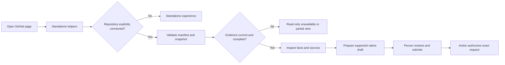
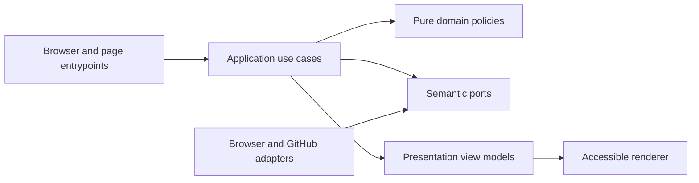

# GitHub browser extension and Action-connected usability

- Status: Draft
- Date: 2026-10-25
- Catalog capability ID: `github-browser-extension`
- Last verified: not applicable (prospective capability)
- Owners: Copilot maintainers
- Scope: Specify standalone GitHub usability and optional Action context in Chrome, Firefox, and Safari; runtime and feature deployment are future work.
- Related issues/PRs: [Issue #694](https://github.com/vypdev/copilot/issues/694)
- Required review gates: product UX, architecture, testing, documentation, security/operations, browser acceptance, and Safari delivery
- Open decisions blocking readiness: Product, security, architecture, and browser reviewers must resolve any material questions before this draft can become Ready for implementation. No additional authorized answers were supplied.

## 1. Executive summary

Specify an original extension that improves GitHub usability in the page context and optionally displays verified Copilot Action evidence. Standalone features work without an Action, backend, credential, or connected account. Connected mode is explicitly enabled per repository and remains read-only except for preparing narrowly scoped native comment drafts that a person reviews and submits. The Action remains the authority for accepting any submitted command.

The central rule is that absent, stale, incomplete, conflicting, or untrusted evidence never means zero findings, success, or permission to act. Opening, navigating, and rendering GitHub pages never submits comments, mutates repository state, triggers an Action, or runs an agent.

```text
Install -> use standalone page helpers -> optionally connect a selected repository -> validate pinned Action evidence -> inspect state and sources -> prepare a supported native draft -> person reviews and submits -> Action authorizes the exact request
```

## 2. Problem, current behavior, and evidence

### 2.1 Problem

GitHub users need personal navigation, focus, and view controls alongside native issues, pull requests, code, checks, and releases. Action output can describe repository work but cannot add personal on-page controls. Separate dashboards lose page context. Connected summaries also need careful provenance and completeness handling so that an attractive panel does not overstate current state or authority.

### 2.2 Current behavior

1. The repository has an Action and catalogued specifications for its current status, analysis, findings, lifecycle, publication, locale, and command-authorization contracts.
2. An Action cannot add personal controls to github.com pages. No extension implementation is asserted by this draft.
3. The supplied catalog has no existing owner for this cross-browser extension capability. Existing Action source, test, and documentation locations are integration baseline evidence only, not proof of extension behavior or framework support.

### 2.3 Evidence

- Code/workflow/documentation references: `src/actions/github_action.ts`; `src/application/usecases/read_copilot_status_workflow.ts`; `src/application/usecases/__tests__/read_copilot_status_workflow.test.ts`; `docs/development/specifications.mdx`; `docs/issues/comment-commands.mdx`; supplied catalog evidence at commit `c78f75c9d1d1f05f8fb5bf63224604af9002e4bd`.
- Incidents or concrete examples: Issue #694 identifies the limitation that Actions cannot add personal on-page controls.
- External primary sources: dated Chrome, Mozilla, and Apple compatibility/API references must be verified and recorded during implementation planning; the supplied evidence does not include their URLs or versions. Technical research may inspect public extensions for mechanics only; no source, selectors, CSS, assets, prose, or branding may be copied.
- Unknowns: Exact current vendor support windows, API details, store review requirements at delivery time, benchmark measurements, and any future implementation choices not fixed below.

### 2.4 Retrospective classification (as-built baselines only)

Not applicable: this is a prospective specification and reconstructs no implemented extension baseline.

## 3. Actors, surfaces, and terminology

| Actor | Goal | Entry point | Visible surfaces |
|---|---|---|---|
| GitHub user | Navigate and focus native content efficiently | GitHub page, toolbar, or settings | Page helpers, panel, preferences |
| Repository maintainer | Opt a repository into connected context | Extension settings and reviewed repository manifest | Repository controls and evidence panel |
| Reviewer/request author | Inspect facts and prepare a supported request | Issue/PR panel or verified native review-thread reply | Source links and native draft editor |
| Action operator | Publish durable current status and authorize a submitted request | Existing Action lifecycle | Existing GitHub issue/PR and run surfaces |
| Extension contributor | Implement within browser and Clean Architecture boundaries | Development documentation | Code, fixtures, browser acceptance artifacts |

“Standalone” means a feature that needs only GitHub page content and local preferences. “Connected mode” means optional, per-repository reads of explicitly declared Action evidence and canonical GitHub resources. “Snapshot” is a bounded, versioned Action publication; it is not live policy certification. “Finding” is a source-identified result with provenance and completeness. “Draft” is text prepared in GitHub’s native editor but not submitted. “Generation” is the active page/repository/credential identity fence used to reject stale asynchronous results.

## 4. Goals

### 4.1 Goals

| Requirement | Behavior |
|---|---|
| BEX-USABILITY | Deliver U1–U6 standalone usability, preserve native behavior, handle navigation/lifecycle, provide bounded settings, accessible localized surfaces, performance budgets, and a documented roadmap. |
| BEX-CONNECTED | Deliver K1–K3 optional connected context with least-privilege read access, trusted Action evidence, bounded reads, explicit freshness/completeness, and human-submitted supported drafts. |
| BEX-PLATFORM | Specify Chrome, Firefox, and Safari delivery; portable core and adapters; privacy/security; real-browser acceptance; documentation; signing, delivery, and rollback. |

U1–U6 comprise canonical links/permalinks, diff navigation and focus, conversation/thread controls, personal view preferences, discoverable accessible shortcuts, and settings/recovery. K1–K3 comprise issue/PR context, findings navigation, and supported native command drafts. Roadmap items include richer notification triage, cross-repository views, further code/release helpers, separately authorized API writes, Enterprise, and mobile.

### 4.2 Non-goals

1. Runtime implementation, extension stores, and feature deployment are future work.
2. No dashboard replacement, hosted authentication prerequisite, backend, telemetry, or history/private-code collection by default.
3. No correction of foreign forks and no implement, sync, release, or deploy drafts in MVP.
4. No mobile or GitHub Enterprise support in MVP; unsupported hosts fail gracefully.
5. No copied third-party extension implementation or product branding.

### 4.3 Fixed product/safety invariants

1. Standalone functionality requires no Action, backend, or credential. Connected mode is explicitly opt-in per repository; public reads may be anonymous.
2. Private reads may use an optional user-owned fine-grained PAT limited to selected repositories, with read-only Metadata, Contents, Issues, Pull requests, and Actions permissions only as needed. Respect organization approval, SSO, and endpoint restrictions. No client secret, workflow/bot PAT, cookie scraping, classic-token fallback, write scope, or hosted authentication prerequisite.
3. Credentials and private evidence stay in protected `storage.session`, are cleared or invalidated on disconnect/revocation, and require reconnect after browser restart. Never expose them through content-script messages, page DOM, synchronized/exported preferences, URLs, or diagnostics.
4. The Action owns authority. A reviewed `.copilot/browser-extension.json` pinned to an observed default-branch commit declares numeric producer ID, permitted workflow paths, and capabilities. Markers, labels, check names, stale runs, and source pointers alone establish no authority.
5. Validate author, repository, conversation, run/attempt/workflow, head/base/policy/configuration identity, collection fences, observation time, freshness, pagination/completeness, and source links. Source pointers locate evidence; they do not authorize it. Hidden live policy is only assessed at source time.
6. Missing evidence never means zero findings or green readiness. Keep durable lifecycle, transient activity, and human waiting distinct.
7. K3 prepares status/analyze only in the supported issue/PR conversation. Fix/dismiss prepares only in a verified current same-repository finding’s supported native PR review-thread reply, with a verified viewer write hint. Unknown authority or target yields read-only or copy-only guidance. Preserve existing drafts: append/keep/cancel; replace only by explicit user choice. The person reviews and submits; the Action then authorizes actor, target, event, and exact revision.
8. API compatibility floors: Chrome 140; Firefox 140 including ESR 140 compatibility; Safari 18.2 on macOS 15.2+. Desktop targets are Windows 11, macOS 15.2+, and Ubuntu 24.04 for Chrome/Firefox. These API floors do not assert vendor security support. Chrome uses an MV3 service worker; Firefox and Safari use nonpersistent background scripts. Real Safari acceptance is mandatory; generic WebKit is insufficient.
9. Use a shared portable core with browser adapters and reviewed manifest/build differences. Integrated page panel must not depend on a vendor-only sidebar. Future hosts require optional exact-host permissions and per-host credentials.
10. Initial Action publication creates/catalogues only `specs/github-browser-extension.md`. Later authorized branch work adds companions and JSON evidence under the same proposed capability. Share only the pure `src/domain/browser_extension_contract/index.ts` boundary; browser bundles contain no Node-only imports, credentials, or mutating Action entrypoints.

## 5. Current versus proposed product journey

| Stage | Current | Proposed | User/operator effect |
|---|---|---|---|
| Page usability | Native GitHub page; no Action-provided personal controls | Standalone helpers beside native content | User navigates and focuses without connecting an account |
| Repository connection | No extension contract | Explicit per-repository opt-in and least-privilege read setup | User chooses scope and can pause it |
| Evidence | Existing Action-owned status contracts | Bounded snapshot plus canonical reads and identity/completeness fences | Panel distinguishes current, stale, partial, and unavailable facts |
| Request | Existing Action authorization contract | Extension prepares only a supported native draft | Person reviews/submits; Action authorizes exact revision |
| Delivery | No extension delivery | Three desktop browsers, actual Safari acceptance, owned signing/store process | Maintainers plan prerequisites and rollback |



Text equivalent: open a page, use standalone helpers, optionally connect a repository, validate evidence, inspect facts, prepare a supported draft, and rely on the person and Action for submission and authorization.

## 6. Functional behavior and state model

### 6.1 Happy path

1. Installation requests no blanket host or write permission; user configures standalone defaults.
2. On a supported page, an eligible feature mounts once, owns its DOM resources, and preserves native content and URL queries.
3. User may explicitly connect a repository. The extension checks the reviewed manifest at a pinned observed default-branch commit and requests only selected-repository read access if needed.
4. Background reader validates the versioned snapshot and performs allowlisted canonical reads with bounded concurrency, conditional requests, pagination, and freshness checks.
5. Panel shows source-linked facts and explicit limitations. Supported command preparation requires verified context and viewer write hint; all other cases stay read-only/copy-only.
6. Person reviews and submits the native draft. The Action independently authorizes actor, target, event, and exact revision.

### 6.2 Alternative paths

- Public repositories may be read anonymously. Private access denial, unsupported endpoint, missing approval, or missing credential yields unavailable/read-only connected UI; standalone features continue.
- Missing manifest, incompatible producer, unknown capability, or malformed evidence disables connected projections with upgrade guidance.
- Incomplete pagination or collection yields partial scope and no aggregate zero or ready state.
- Ambiguous issue/PR references remain plain text. Missing DOM anchors disable only affected controls.
- Offline, rate limit, provider errors, or stale data retain clearly labeled historical source facts and offer bounded recovery.
- Unsupported pages, hosts, and private browsing do not trigger connected reads; non-supported targets leave native GitHub usable.

### 6.3 State machine

| State | Entered when | User-visible meaning | Allowed next states | Recovery/owner |
|---|---|---|---|---|
| Standalone | Default or disconnected | Page helpers work without account connection | Connected, paused, unsupported | User settings |
| Pending | A bounded read is active | Shows completed facts and active run; no human action required | Complete, partial, stale, unavailable, blocked | Reader; cancel on identity change |
| Complete | Valid current snapshot and required collection are complete | Facts are assessed for stated revision/time | Pending, stale, partial, unavailable | Refresh under bounded policy |
| Partial | Some required evidence/coverage is missing | Verified facts remain; aggregate readiness omitted | Pending, stale, unavailable | Reader/operator source |
| Stale | Snapshot expired, superseded, or identity changed | Previous assessment is historical; current counts unknown | Pending, unavailable | Refresh after identity fence |
| Action required | A verified human response is required by source | Names actor and exact destination | Pending, blocked, complete | Human at native destination |
| Blocked | Evidence or prerequisite prevents transition | Cause and impact with retained facts | Pending, unavailable, complete | User, maintainer, or Action owner |
| Unavailable | Access, network, host, or compatibility prevents reading | Native GitHub links remain; Action failure is not implied | Pending, standalone, unsupported | User or provider recovery |
| Unsupported | Page/browser/host outside MVP | Connected controls absent; standalone eligible features may remain | Standalone | Product support boundary |

Duplicate mounts are idempotent. Stale, out-of-order, canceled, or superseded results cannot render. Partial completion preserves independently verified source facts. Resource disposal is mandatory on navigation, pause, permission revocation, account change, and extension update.

## 7. User-facing configuration

| Input | Type | Recommended default | Allowed values/range | Scope/persistence |
|---|---|---|---|---|
| Feature enabled | Boolean per known feature | Enabled for safe U1–U6 defaults where page anchors are supported | true/false | Global preference; repository pause overrides |
| Repository connection | Boolean | Off | on/off | Numeric repository ID; local protected settings; pause wins |
| Private read credential | User-owned fine-grained PAT | Absent | Selected repositories and needed read-only permissions | Protected session storage only; reconnect after restart |
| Density | Enum | Comfortable | comfortable/compact | Personal preference; documented supported surfaces |
| Thread collapse | Enum | Preserve native state | preserve/remember supported collapse state | Personal preference |
| Shortcut set | Enum | Off | off/documented shortcut set | Global; never steals editable-field/native shortcuts |
| Locale | Enum | Browser/user choice with complete English fallback | English/Spanish | Personal extension locale; independent of Action publication locale |
| Import | JSON object | Not applicable | At most 64 KiB; known bounded settings only | Validate completely before write |

Validation rejects unknown feature activation, invalid enums, unsafe URLs/code, and cross-field settings that imply auto-submission or weakened evidence rules. Settings are snapshotted per operation; repository identity uses numeric IDs so rename preserves the intended preferences without cross-repository bleed. Interrupted migrations preserve the last complete version. Future schema is read-only and exportable. Retired values are ignored with a visible migration explanation; unknown values never activate behavior. Reset clears preferences and session state as selected. Export excludes credentials, private evidence, and human draft contents. Import/export never includes arbitrary executable configuration.

Recommended example: standalone U1–U6 defaults, connected mode off, comfortable density, shortcuts off. Meaningful alternative: enable connection for one numeric repository ID, use anonymous public reads or a narrowly scoped session PAT for private reads, and set compact density. Evidence and authorization invariants are not configurable.

## 8. Clean Architecture

### 8.1 Responsibilities and dependency direction

| Layer/boundary | Owns | Must not own/import |
|---|---|---|
| Domain/pure policy | Evidence identity, freshness/completeness, settings invariants, safe target resolution | Browser APIs, provider DTOs, DOM, Node APIs |
| Application | Immutable use cases, semantic ports, orchestration and identity fences | Concrete SDKs, process globals, rendering |
| Adapters/data | Map browser/provider data and typed errors to semantic contracts | Product policy or authority decisions |
| Infrastructure/composition | Browser-specific storage, messaging, fetch, lifecycle wiring | Business decisions or broad permissions |
| Entrypoints | Validate event sender and adapt browser/page events | Duplicate orchestration or arbitrary network proxy |
| Presentation | View models, accessible renderers, native draft preparation UI | Evidence trust decisions, automatic submission |



Text equivalent: entrypoints validate and call application use cases; domain policies decide pure invariants; semantic ports isolate browser/provider access; adapters implement ports; view models feed renderers.

### 8.2 Contracts, state, and trust boundaries

- Pure decisions: repository/conversation/run identity, capability allowlist, freshness, completeness, settings validation, safe URL and target resolution, draft eligibility.
- Application contracts: immutable read request/result types with explicit repository/page/credential epochs, abort signal, and result provenance.
- Semantic ports: canonical GitHub read, reviewed-manifest read, snapshot read, protected session credential access, page lifecycle, local settings, clock, and safe draft insertion affordance.
- Durable state/schema ownership: local preferences are versioned and migrated atomically; credentials and private evidence live only in protected session storage; no process global is sole durable state. Action snapshot schema and manifest schema are separately versioned.
- Concurrency/idempotency: bounded GET concurrency; conditional reads/cache; generation and identity fences before and after collection; abort obsolete work; coalesce same-target refreshes across tabs within budget; foreground refresh and background silence.
- Trusted and untrusted inputs: GitHub DOM, comments, Markdown, URLs, messages, snapshots, markers, labels, and source pointers are untrusted until validated against numeric identity and policy.
- Provider error mapping: 401 clears protected credentials/evidence and requests reconnect; 403 means unavailable without broader fallback; masked private 404 means access unknown; offline retains historical facts without retry loop; secondary rate limits use provider guidance or bounded backoff.

### 8.3 Executable architecture constraints

Automated checks must reject domain imports of browser, Node, UI, or provider SDK modules; cycles and dependency-direction violations; browser bundles containing Node-only imports, credentials, or mutating Action entrypoints; undeclared manifest permissions/hosts; remote executable code; schema incompatibility; and arbitrary URL/method/body message protocols. Parse dependency graphs, generated manifests, schema fixtures, package boundaries, and workflow structures rather than grepping prose. Preserve the private extension/pnpm workspace, root overrides and quality gates, TypeScript conventions, and locked Vite/Vitest baseline. Do not impose a `src/` root or `.test.ts` naming convention on consumer repositories. Only the pure `src/domain/browser_extension_contract/index.ts` boundary is shared.

## 9. UI/UX and content contract

### 9.1 Information hierarchy

1. Current status
2. Completed facts
3. Next transition
4. Human action or explicit statement that none is needed
5. Impact and inspectable links
6. Expandable sanitized diagnostics

Keep native facts inspectable. Deterministic headings, labels, and markers; idempotent updates; bounded comment and notification noise where Action output changes. Do not hide blockers, required actions, native checks, or reviews. Filtered generated content must show loaded-scope counts and immediate restore.

### 9.2 Representative primary view

```markdown
# Copilot context for PR 42

**Current status:** Partial assessment for commit `abc1234` at 2026-10-25 10:00 UTC.

**Completed:** 8 findings were collected from 2 of 3 review sources.

**Next:** Review the remaining source coverage. No overall readiness result is available.

**Human action:** None is required to let the current Action run finish.

[Open PR 42](https://github.com/example/project/pull/42) · [Inspect Action run](https://github.com/example/project/actions/runs/123)

<details><summary>Evidence details</summary>

The snapshot is partial. Current aggregate finding count and live policy state are unknown.

</details>
```

Concrete state variants:

**Pending/no action:** “Status: Analysis is running for PR 42. Completed: repository and head identity verified. Next: the Action is collecting review findings. Human action: none. Inspect the active run.”

**Action required:** “Status: Clarification is needed before analysis continues. Completed: the current head and prior findings are retained. Next: @maintainer should answer in the linked PR conversation. Impact: readiness remains unknown. Inspect the run and conversation.”

**Blocked/failed:** “Status: Connected evidence is unavailable. Cause: GitHub denied this read. Action: review selected-repository access or continue with native GitHub. Retained: the prior snapshot is labeled historical. No Action failure is implied.”

**Partial:** “Status: Review coverage is incomplete. Completed: 8 findings from 2 of 3 sources. Next: wait for or inspect the missing source. Human action: none unless the source identifies an actor. Impact: no aggregate readiness or zero count is shown.”

**Complete:** “Status: Snapshot complete for commit `abc1234`, assessed 2026-10-25 10:00 UTC. Completed: all declared sources were collected. Next: inspect findings and native checks. Human review obligations remain. This records source-time assessment, not hidden live policy.”

### 9.3 Issue, PR, and comment behavior

- Deterministic panel titles identify repository and conversation; native destinations use exact observed canonical links.
- Page opening, navigation, and rendering never submit, mutate repository state, trigger Actions, or run agents.
- Existing Action durable publication remains the lifecycle authority. Extension projections are read-only; markers and source links alone do not confer trust.
- No extension comment is emitted automatically. Existing Action output updates must be idempotent and have an explicit bounded noise budget.
- Labels and checks are supplemental; they cannot establish identity, freshness, completeness, or authorization alone.
- Preserve shared URL queries until explicit Restore. Canonical references must not guess between an issue and a same-number PR.

### 9.4 Accessibility, localization, and responsive behavior

Support English and Spanish with explicit language ownership and atomic fallback to complete English. Personal extension locale may differ from Action publication locale. Provide keyboard navigation, accessible names, focus restoration, screen-reader announcements, 200% zoom, narrow layouts, high contrast, reduced motion, and light/dark support. Visuals have text equivalents. Keep headings, tables, and links descriptive and readable. Sanitize untrusted Markdown/HTML; render unsafe URLs as unavailable text. Shortcuts are opt-in and respect native shortcuts, editable controls, and composition events.

## 10. Failure, recovery, and cleanup

| Failure/partial state | User impact | Retained facts | Automatic retry | Required action | Cleanup |
|---|---|---|---|---|---|
| Missing/invalid manifest | Connected mode unavailable | Standalone preferences and controls | No | Review repository setup | Clear rejected evidence |
| 401 | Private connected reads stop | No credential-derived current evidence | No | Reconnect | Clear token and private evidence |
| 403 or masked private 404 | Access unknown/unavailable | Clearly historical facts only | Bounded on explicit refresh | Check approval/selected access | No permission expansion |
| Offline/rate limit | Current refresh delayed | Historical facts labeled by time | No loop; bounded provider/backoff policy | Retry when allowed | Abort obsolete requests |
| Partial pagination/source coverage | Aggregate unknown | Verified source facts | Bounded continuation only | Inspect missing source if needed | Preserve completeness markers |
| Head/base/policy identity change | Previous aggregate no longer current | Historical snapshot with provenance | One fenced refresh | Inspect current run | Clear aggregate satisfaction/counts |
| Navigation/account/revocation race | Old result could be misleading | No stale result accepted | Fresh identity read only | Reconnect if needed | Abort, increment epoch, clear private state |
| Broken/missing anchor | One helper unavailable | Other features unaffected | No | Use native control | Dispose only affected resources |
| Migration interruption | Settings may be old | Prior complete version | Safe one-time retry | None unless future schema | Atomic commit/rollback |
| Disable/uninstall/update | Controls or connected mode stop | No repository side effects | No | Re-enable if desired | Dispose listeners, observers, secrets |

Errors follow impact, cause, action, retained-state order. User can restore native GitHub behavior by disabling a feature or extension. No cleanup action mutates the repository.

## 11. Security, permissions, and privacy

1. Installation asks no blanket host or API-write permissions. Optional exact-host/site access is requested only for the user-selected supported host and feature; MVP host is github.com. Standalone operation remains available when access is denied.
2. Treat DOM, comments, Markdown, URLs, messages, and Action data as untrusted. Validate sender, tab, frame, origin, closed message schema, safe URL allowlist, canonical repository identity, and operation capability. Reject arbitrary URL/method/body requests and command separators or line breaks in finding operands.
3. Keep PATs and private evidence in protected session storage only. No content-script access, page DOM, synchronized/exported preferences, URLs, logs, or diagnostics. Redact tokens. No history/private-code collection or telemetry by default.
4. Protect login, authorization, and settings routes from observers and connected reads. No credentials on cross-origin redirects. Private browsing refuses connected operation and retains no navigation evidence.
5. Account change invalidates the old epoch before clearing credentials/cache. Logout or viewer-change signal pauses connection without claiming PAT revocation. Revocation blocks late responses from repopulating private state.
6. No remote executable patches. Review build output, manifests, permissions, CSP, dependencies, and generated artifacts. Unknown authority/target is read-only or copy-only.
7. Browser security support is a separate release decision from API compatibility floors. Maintainers must record dated primary browser references and supported release evidence.

## 12. Observability and operational UX

- User-facing state: pending, action-required, failed/blocked, partial, complete, unavailable/incompatible, and stale, with facts and source time.
- Job Summary/operator evidence: existing Action remains owner of durable lifecycle and summary publication; extension does not certify hidden live policy or create a parallel authority.
- Logs, metrics, and correlation: no telemetry by default; local diagnostics are opt-in, bounded, sanitized, and exclude credentials, private evidence, and draft contents. Correlation uses non-secret run/repository identifiers only when safe.
- Pending external dependency versus workflow failure: show separately; a pending human or external source is not an Action failure.
- Rate-limit/retry behavior: conditional reads, bounded concurrency, foreground refresh, background silence, provider-aware retry timing, abort on identity change.
- Noise/comment budget: extension generates no automatic comments or notifications; Action updates are idempotent and bounded by the existing publication contract.

## 13. Compatibility, migration, rollout, and rollback

- Existing in-flight operations/data: extension must not alter Action runs; generation fences prevent old responses affecting new pages or repositories.
- Schema/configuration migration: version settings and snapshot/manifest contracts; reject malformed or duplicate-key JSON; preserve prior settings atomically; future settings remain read-only/exportable; future snapshot major disables connected projections.
- Deprecated behavior and compatibility window: old/no/future producer versions retain standalone use and disclose connected compatibility; support window is a release decision backed by dated browser/provider evidence.
- Rollout stages: specification and catalog first; implementation and companions later under approved branch work; browser artifacts and actual acceptance evidence precede release. Store publication is a separate delivery gate.
- Rollback and irreversible effects: reviewed code/settings rollback restores a compatible view without credential backup. Disable/uninstall clears session secrets and owned resources and causes no repository side effects.
- Safari delivery owner: maintainers’ Safari release owner provisions Apple Developer/App Store Connect roles, bundle IDs, signing custody, containing-app packaging, privacy/support/store assets, review, updates, and rollback. Default route is App Store Connect Web Extension Packager, then TestFlight, then macOS App Store containing app; Xcode development/fallback remains available. Actual Mac/Safari acceptance is required. These accounts and store operations are future prerequisites, not authorized actions of this specification issue.

## 14. Testing strategy

The inventory below defines 96 distinct future implementation scenarios. They are not executed tests. Browser matrix repetitions do not add distinct cases. Retained Action contract cases remain owned by their existing specifications and are not counted here. Require repository quality thresholds to remain in force, full branch coverage for new pure evidence/authorization policies, deterministic clocks and fakes, replay/race tests, semantic golden assertions beyond snapshots, structural workflow/schema checks, and manual UX evidence automation cannot establish.

| Area | Minimum distinct cases | Behaviors/risks covered |
|---|---:|---|
| Domain/configuration/pure planning | 12 | Observable scenarios in the case inventory. |
| State/application/idempotency/races | 14 | Observable scenarios in the case inventory. |
| Adapters/provider error mapping | 12 | Observable scenarios in the case inventory. |
| Workflows/permissions/schemas/setup | 16 | Observable scenarios in the case inventory. |
| Presentation/localization/accessibility/sanitization | 14 | Observable scenarios in the case inventory. |
| Integration/security/migration | 28 | Observable scenarios in the case inventory. |
| Total | 96 | Distinct inventory cases; repeated executions do not add cases. |

| Case ID | Area | Requirements | Scenario |
|---|---|---|---|
| bex-F-C01 | Domain/configuration/pure planning | BEX-USABILITY | Unsupported page mounts no feature and makes no API request. |
| bex-F-C02 | Domain/configuration/pure planning | BEX-USABILITY | Fresh settings resolve all shipped defaults without a credential. |
| bex-F-C03 | Domain/configuration/pure planning | BEX-USABILITY | Repository pause wins over an enabled global feature. |
| bex-F-C04 | Domain/configuration/pure planning | BEX-USABILITY | Repository rename retains numeric-ID preferences without affecting another repository. |
| bex-F-C05 | Domain/configuration/pure planning | BEX-USABILITY | Invalid setting enum is rejected with previous settings intact. |
| bex-F-C06 | Domain/configuration/pure planning | BEX-USABILITY | Unknown feature ID does not activate code or corrupt known preferences. |
| bex-F-C07 | Domain/configuration/pure planning | BEX-USABILITY | An import over 64 KiB is rejected before any settings write. |
| bex-F-C08 | Domain/configuration/pure planning | BEX-USABILITY | Interrupted migration retains the prior complete settings version. |
| bex-F-C09 | Domain/configuration/pure planning | BEX-USABILITY | A supported old settings version migrates once with the same second-run result. |
| bex-F-C10 | Domain/configuration/pure planning | BEX-USABILITY | A future settings schema remains read-only and exportable. |
| bex-F-C11 | Domain/configuration/pure planning | BEX-USABILITY | Opening a shared filtered link preserves its query until explicit Restore. |
| bex-F-C12 | Domain/configuration/pure planning | BEX-USABILITY | An imported preference cannot enable auto-submission or weaken evidence checks. |
| bex-N-C01 | State/application/idempotency/races | BEX-USABILITY | Initial load creates one owned control set per eligible feature. |
| bex-N-C02 | State/application/idempotency/races | BEX-USABILITY | Soft navigation disposes the old page generation before mounting the new one. |
| bex-N-C03 | State/application/idempotency/races | BEX-USABILITY | Partial React refresh restores one keyed control without rewriting native content. |
| bex-N-C04 | State/application/idempotency/races | BEX-USABILITY | Back/forward restoration preserves native scroll and one extension generation. |
| bex-N-C05 | State/application/idempotency/races | BEX-USABILITY | A virtualized file insertion gets one helper with loaded-scope counts. |
| bex-N-C06 | State/application/idempotency/races | BEX-USABILITY | Removed native anchors release their owned observers and listeners. |
| bex-N-C07 | State/application/idempotency/races | BEX-USABILITY | Repeated initialization does not duplicate a button or draft request. |
| bex-N-C08 | State/application/idempotency/races | BEX-USABILITY | Navigation aborts pending reads and retires their generation. |
| bex-N-C09 | State/application/idempotency/races | BEX-USABILITY | A late response cannot restore a disposed page view. |
| bex-N-C10 | State/application/idempotency/races | BEX-USABILITY | A previous repository response never renders in the new repository. |
| bex-N-C11 | State/application/idempotency/races | BEX-USABILITY | Two tabs coalesce one target refresh within the shared request budget. |
| bex-N-C12 | State/application/idempotency/races | BEX-USABILITY | An extension update retires old owned controls and offers one refresh affordance. |
| bex-N-C13 | State/application/idempotency/races | BEX-USABILITY | Pausing during collection prevents further reads and DOM updates. |
| bex-N-C14 | State/application/idempotency/races | BEX-USABILITY | After twenty navigation cycles resource counts return to the declared disposal baseline. |
| bex-A-C01 | Adapters/provider error mapping | BEX-CONNECTED | The copied issue URL identifies the observed canonical repository and issue. |
| bex-A-C02 | Adapters/provider error mapping | BEX-CONNECTED | The PR helper links the exact observed PR without selecting a same-number issue. |
| bex-A-C03 | Adapters/provider error mapping | BEX-CONNECTED | A file permalink contains the verified immutable commit and line anchor. |
| bex-A-C04 | Adapters/provider error mapping | BEX-CONNECTED | Ambiguous references stay plain text rather than guessed links. |
| bex-A-C05 | Adapters/provider error mapping | BEX-CONNECTED | Missing DOM anchor disables only the affected helper. |
| bex-A-C06 | Adapters/provider error mapping | BEX-CONNECTED | Denied clipboard access offers selectable text without claiming copy success. |
| bex-A-C07 | Adapters/provider error mapping | BEX-CONNECTED | A 401 clears protected credentials/evidence and exposes reconnect guidance. |
| bex-A-C08 | Adapters/provider error mapping | BEX-CONNECTED | A 403 marks current connected evidence unavailable without broader access fallback. |
| bex-A-C09 | Adapters/provider error mapping | BEX-CONNECTED | A masked private 404 is unknown access, not proof the object does not exist. |
| bex-A-C10 | Adapters/provider error mapping | BEX-CONNECTED | Offline refresh retains clearly historical source facts and creates no retry loop. |
| bex-A-C11 | Adapters/provider error mapping | BEX-CONNECTED | A secondary rate limit postpones requests until the provider or bounded backoff allows them. |
| bex-A-C12 | Adapters/provider error mapping | BEX-CONNECTED | Incomplete pagination exposes partial scope and no aggregate zero or ready state. |
| bex-I-C01 | Workflows/permissions/schemas/setup | BEX-CONNECTED | Missing reviewed manifest leaves standalone features usable and connected mode off. |
| bex-I-C02 | Workflows/permissions/schemas/setup | BEX-CONNECTED | A valid pinned manifest and compatible source expose only declared capabilities. |
| bex-I-C03 | Workflows/permissions/schemas/setup | BEX-CONNECTED | A future schema major disables connected projections with upgrade guidance. |
| bex-I-C04 | Workflows/permissions/schemas/setup | BEX-CONNECTED | Malformed or duplicate-key source JSON is rejected before projection. |
| bex-I-C05 | Workflows/permissions/schemas/setup | BEX-CONNECTED | A copied marker from a different numeric author never becomes trusted evidence. |
| bex-I-C06 | Workflows/permissions/schemas/setup | BEX-CONNECTED | Foreign repository/conversation identity is rejected despite matching display names. |
| bex-I-C07 | Workflows/permissions/schemas/setup | BEX-CONNECTED | Missing explicit association does not invent an issue, branch or PR link. |
| bex-I-C08 | Workflows/permissions/schemas/setup | BEX-CONNECTED | Multiple reported linked PRs require a PR-specific view instead of choosing the newest. |
| bex-I-C09 | Workflows/permissions/schemas/setup | BEX-CONNECTED | An older run attempt or generation cannot overwrite newer observed evidence. |
| bex-I-C10 | Workflows/permissions/schemas/setup | BEX-CONNECTED | A changed head clears aggregate satisfaction and current finding counts. |
| bex-I-C11 | Workflows/permissions/schemas/setup | BEX-CONNECTED | Changed base/public policy identity clears the prior aggregate; hidden live policy remains unknown. |
| bex-I-C12 | Workflows/permissions/schemas/setup | BEX-CONNECTED | Expired or future-skewed observation time yields stale/unavailable, not a current assessment. |
| bex-I-C13 | Workflows/permissions/schemas/setup | BEX-CONNECTED | Partial review coverage preserves source facts but keeps the aggregate finding count unknown. |
| bex-I-C14 | Workflows/permissions/schemas/setup | BEX-CONNECTED | Inconsistent finding totals/items are rejected rather than rounded to zero. |
| bex-I-C15 | Workflows/permissions/schemas/setup | BEX-CONNECTED | Unsupported capability tokens never execute code or enable a command. |
| bex-I-C16 | Workflows/permissions/schemas/setup | BEX-CONNECTED | A final identity/page/credential fence rejects a response superseded during collection. |
| bex-V-C01 | Presentation/localization/accessibility/sanitization | BEX-USABILITY | Standalone view explains optional connection while U controls remain available. |
| bex-V-C02 | Presentation/localization/accessibility/sanitization | BEX-USABILITY | Pending view names completed facts, the active run and that no human action is required. |
| bex-V-C03 | Presentation/localization/accessibility/sanitization | BEX-USABILITY | Action-required view names the responsible actor and exact clarification destination. |
| bex-V-C04 | Presentation/localization/accessibility/sanitization | BEX-USABILITY | Blocked view follows impact, cause, action and retained-facts order. |
| bex-V-C05 | Presentation/localization/accessibility/sanitization | BEX-USABILITY | Partial view retains verified facts and omits overall readiness. |
| bex-V-C06 | Presentation/localization/accessibility/sanitization | BEX-USABILITY | Complete snapshot view includes assessed revision/time and preserves human-review obligations. |
| bex-V-C07 | Presentation/localization/accessibility/sanitization | BEX-USABILITY | Stale view separates the previous assessment from unknown current finding counts. |
| bex-V-C08 | Presentation/localization/accessibility/sanitization | BEX-USABILITY | Unavailable view links native GitHub and does not imply underlying Action work failed. |
| bex-V-C09 | Presentation/localization/accessibility/sanitization | BEX-USABILITY | Unsupported locale falls back atomically to complete English while Spanish is complete. |
| bex-V-C10 | Presentation/localization/accessibility/sanitization | BEX-USABILITY | Keyboard focus survives refresh and all controls have accessible names. |
| bex-V-C11 | Presentation/localization/accessibility/sanitization | BEX-USABILITY | Light/dark, high contrast, 200 percent zoom and narrow layout retain readable actions. |
| bex-V-C12 | Presentation/localization/accessibility/sanitization | BEX-USABILITY | Keeping or canceling a prepared request preserves every existing native draft byte. |
| bex-V-C13 | Presentation/localization/accessibility/sanitization | BEX-USABILITY | Append request happens once despite rerender and leaves submission to the user. |
| bex-V-C14 | Presentation/localization/accessibility/sanitization | BEX-USABILITY | Unsupported correction context offers an exact copy-only destination without inserting a broad request. |
| bex-S-C01 | Integration/security/migration | BEX-PLATFORM | An unapproved host or cross-origin redirect receives no credential or provider request. |
| bex-S-C02 | Integration/security/migration | BEX-PLATFORM | Protected login/token/settings routes install no private observers or connected reads. |
| bex-S-C03 | Integration/security/migration | BEX-PLATFORM | Standalone installation requests no API write or blanket host permission. |
| bex-S-C04 | Integration/security/migration | BEX-PLATFORM | Content scripts cannot retrieve the protected session token through storage or messages. |
| bex-S-C05 | Integration/security/migration | BEX-PLATFORM | Token-bearing diagnostics are redacted and no raw credential is returned to a view. |
| bex-S-C06 | Integration/security/migration | BEX-PLATFORM | Forged origin/frame/tab sender fails before any semantic read operation. |
| bex-S-C07 | Integration/security/migration | BEX-PLATFORM | An arbitrary URL/method/body message is rejected by the closed background protocol. |
| bex-S-C08 | Integration/security/migration | BEX-PLATFORM | A finding operand containing command separators or line breaks cannot create a mutation draft. |
| bex-S-C09 | Integration/security/migration | BEX-PLATFORM | Unsafe source URLs render as unavailable text rather than executable links. |
| bex-S-C10 | Integration/security/migration | BEX-PLATFORM | Hostile Markdown/HTML cannot inject DOM, executable selectors or control text. |
| bex-S-C11 | Integration/security/migration | BEX-PLATFORM | Settings/diagnostic export excludes tokens, private evidence and human draft contents. |
| bex-S-C12 | Integration/security/migration | BEX-PLATFORM | Account change invalidates the old epoch before clearing its credential and cache. |
| bex-S-C13 | Integration/security/migration | BEX-PLATFORM | Observed logout/different-viewer signal pauses connection without claiming the PAT was revoked. |
| bex-S-C14 | Integration/security/migration | BEX-PLATFORM | Revocation blocks late responses from repopulating cleared private session state. |
| bex-S-C15 | Integration/security/migration | BEX-PLATFORM | Private browsing refuses connected operation and retains no navigation evidence. |
| bex-S-C16 | Integration/security/migration | BEX-PLATFORM | Bundle/manifest checks reject remote executable code and undeclared permission expansion. |
| bex-E-C01 | Integration/security/migration | BEX-PLATFORM | Chrome loads the exact generated artifact and exercises all eligible MVP capabilities. |
| bex-E-C02 | Integration/security/migration | BEX-PLATFORM | Firefox loads the target artifact on stable and selected ESR with the same semantics. |
| bex-E-C03 | Integration/security/migration | BEX-PLATFORM | A real Safari containing-app extension is enabled and exercised; generic WebKit cannot substitute. |
| bex-E-C04 | Integration/security/migration | BEX-PLATFORM | Chrome worker suspension resumes with session state or an explicit disconnect and fresh identity read. |
| bex-E-C05 | Integration/security/migration | BEX-PLATFORM | Firefox/Safari event-page restart does not rely on persistent process globals. |
| bex-E-C06 | Integration/security/migration | BEX-PLATFORM | Optional API site-access revocation aborts reads while standalone U features remain usable. |
| bex-E-C07 | Integration/security/migration | BEX-PLATFORM | A repository without Copilot still provides standalone functionality without a token. |
| bex-E-C08 | Integration/security/migration | BEX-PLATFORM | Old/no/future producer versions retain standalone use and disclose connected compatibility. |
| bex-E-C09 | Integration/security/migration | BEX-PLATFORM | Reviewed code/settings rollback restores a compatible view without credential backup. |
| bex-E-C10 | Integration/security/migration | BEX-PLATFORM | Disable/uninstall releases owned resources and session secrets without repository side effects. |
| bex-E-C11 | Integration/security/migration | BEX-PLATFORM | A native/other-extension equivalent prevents duplicate helpers and leaves original controls intact. |
| bex-E-C12 | Integration/security/migration | BEX-PLATFORM | Measured startup, DOM, retained-memory and request work meets the published budgets. |

Define reproducible startup, DOM, retained-memory, and API request budgets and benchmark environment before implementation acceptance; do not present estimates as measured results. Test exact generated artifacts in real Chrome and Firefox stable/selected ESR, and real Safari on Mac. Record manual readability, keyboard/screen-reader, zoom, contrast, reduced-motion, navigation, and store/package evidence. Verify structural permissions, schema fixtures, migration, CSP, and package outputs.

## 15. Documentation and discoverability

| Path | Change |
|---|---|
| `specs/github-browser-extension.md` | create |
| `specs/github-browser-extension-action-integration.md` | create |
| `specs/github-browser-extension-platforms-and-delivery.md` | create |
| `specs/catalog.json` | update |
| `specs/CATALOG.md` | update |
| `docs.json` | update |
| `README.md` | update |
| `specs/browser-extension/status-v1.schema.json` | create |
| `specs/browser-extension/manifest-v1.schema.json` | create |
| `specs/browser-extension/examples/status-invalid-head-v1.json` | create |
| `specs/browser-extension/examples/manifest-v1.json` | create |
| `specs/browser-extension/examples/status-pr-v1.json` | create |
| `specs/browser-extension/examples/status-issue-v1.json` | create |
| `docs/browser-extension/index.mdx` | create |
| `docs/browser-extension/features.mdx` | create |
| `docs/browser-extension/installation.mdx` | create |
| `docs/browser-extension/permissions.mdx` | create |
| `docs/browser-extension/configuration.mdx` | create |
| `docs/browser-extension/privacy.mdx` | create |
| `docs/browser-extension/troubleshooting.mdx` | create |
| `docs/browser-extension/compatibility.mdx` | create |
| `docs/browser-extension/architecture.mdx` | create |
| `docs/browser-extension/action-contract.mdx` | create |
| `.copilot/browser-extension.json` | create |
| `src/domain/browser_extension_contract/index.ts` | create |
| `extension/package.json` | create |
| `src/actions/github_action.ts` | reference |
| `src/application/usecases/read_copilot_status_workflow.ts` | reference |
| `src/application/usecases/__tests__/read_copilot_status_workflow.test.ts` | reference |
| `docs/development/specifications.mdx` | reference |
| `docs/issues/comment-commands.mdx` | reference |

| Audience | Artifact/page | Required content | Validation/navigation |
|---|---|---|---|
| User | `docs/browser-extension/index.mdx`, `features.mdx` | Normal path, standalone defaults, feature inventory, roadmap, visual with text equivalent | Registered route, link checks, reviewed examples |
| Setup owner | `installation.mdx`, `permissions.mdx` | Supported browsers, optional permissions, PAT scope, organization approval, Safari prerequisites | Permission contract and manifest fixtures |
| User/admin | `configuration.mdx`, `privacy.mdx` | All bounded settings, precedence, import/export, session storage, retention and cleanup | Settings/schema fixtures and privacy review |
| Operator | `troubleshooting.mdx`, `action-contract.mdx` | State/recovery, replay boundaries, evidence provenance, freshness, cleanup | Decision tree and snapshot fixtures |
| User/setup owner | `compatibility.mdx` | Floors, dated vendor support evidence, deprecation and rollback | Release matrix and link validation |
| Contributor | `architecture.mdx` | Boundaries, trust model, contracts, package/build rules, validation | Architecture/dependency checks |
| Maintainer | `specs/CATALOG.md`, `README.md`, `docs.json` | Proposed capability discoverability and navigation | `pnpm run validate:specifications` and documentation checks |

Documentation must lead with the normal user path and a useful visual, then explain configuration, failures, migration, and internals. Keep examples synchronized with fixtures/contracts. The table classifies proposed paths: `create` means a future file, not implementation authorization; `update` and `reference` identify existing immutable-base files. Directory trees, when shown by later documentation, belong in fenced examples and do not assert current directories.

## 16. Acceptance scenarios

1. Given a supported GitHub page and no credential, when the user opens it, then eligible standalone controls appear once, preserve native content, and make no API request unless a feature requires one.
2. Given a shared filtered URL, when the page loads, then its query remains unchanged until the user explicitly chooses Restore.
3. Given a repository explicitly connected with a valid pinned manifest and compatible snapshot, when bounded reads finish with complete identity and coverage, then the panel displays source-linked facts for the assessed revision and time.
4. Given missing, stale, incomplete, contradictory, or future-major evidence, when projection is attempted, then no green readiness or zero finding aggregate appears and standalone features remain usable.
5. Given an ambiguous reference or missing page anchor, when a helper is invoked, then it does not guess and only the affected helper is disabled.
6. Given a verified supported K3 target and viewer write hint, when the user chooses prepare, then the exact request is appended once to the native draft while preserving existing draft bytes; the user must review and submit.
7. Given an unsupported target, foreign fork, unknown authority, or malformed operand, when draft preparation is attempted, then the extension offers read-only or exact copy-only guidance and inserts no broad request.
8. Given 401, 403, masked private 404, offline, or rate limit, when connected reads fail, then the specified recovery is shown, access is not broadened, and historical facts remain clearly labeled.
9. Given navigation, account change, pause, permission revocation, or uninstall during a read, when a late response arrives, then the identity fence rejects it and private state/resources are cleared as required.
10. Given forged sender/message, unapproved host, unsafe URL, hostile markup, or remote executable code, when input reaches a boundary, then it is rejected before provider access or rendering.
11. Given Chrome 140+, Firefox 140 including selected ESR, and Safari 18.2 on macOS 15.2+, when exact delivery artifacts are tested, then all MVP semantics pass; Safari evidence comes from actual Safari, not generic WebKit.
12. Given implementation readiness review, when reviewers inspect the draft, then each BEX requirement maps exactly to executable cases, documentation deliverables exist in the implementation plan, and no material gate remains unresolved.

## 17. Requirements traceability

| Requirement | Cases |
|---|---|
| BEX-USABILITY | bex-F-C01, bex-F-C02, bex-F-C03, bex-F-C04, bex-F-C05, bex-F-C06, bex-F-C07, bex-F-C08, bex-F-C09, bex-F-C10, bex-F-C11, bex-F-C12, bex-N-C01, bex-N-C02, bex-N-C03, bex-N-C04, bex-N-C05, bex-N-C06, bex-N-C07, bex-N-C08, bex-N-C09, bex-N-C10, bex-N-C11, bex-N-C12, bex-N-C13, bex-N-C14, bex-V-C01, bex-V-C02, bex-V-C03, bex-V-C04, bex-V-C05, bex-V-C06, bex-V-C07, bex-V-C08, bex-V-C09, bex-V-C10, bex-V-C11, bex-V-C12, bex-V-C13, bex-V-C14 |
| BEX-CONNECTED | bex-A-C01, bex-A-C02, bex-A-C03, bex-A-C04, bex-A-C05, bex-A-C06, bex-A-C07, bex-A-C08, bex-A-C09, bex-A-C10, bex-A-C11, bex-A-C12, bex-I-C01, bex-I-C02, bex-I-C03, bex-I-C04, bex-I-C05, bex-I-C06, bex-I-C07, bex-I-C08, bex-I-C09, bex-I-C10, bex-I-C11, bex-I-C12, bex-I-C13, bex-I-C14, bex-I-C15, bex-I-C16 |
| BEX-PLATFORM | bex-S-C01, bex-S-C02, bex-S-C03, bex-S-C04, bex-S-C05, bex-S-C06, bex-S-C07, bex-S-C08, bex-S-C09, bex-S-C10, bex-S-C11, bex-S-C12, bex-S-C13, bex-S-C14, bex-S-C15, bex-S-C16, bex-E-C01, bex-E-C02, bex-E-C03, bex-E-C04, bex-E-C05, bex-E-C06, bex-E-C07, bex-E-C08, bex-E-C09, bex-E-C10, bex-E-C11, bex-E-C12 |

Requirement mapping uses only the inventory above. Product, architecture, browser, privacy, and documentation review evidence is additionally required at the named gates; it does not substitute for executable case links.

## 18. Implementation sequence

1. Resolve readiness decisions and publish the primary SDD/catalog entry; later branch work authors the Action integration and platform/delivery companions.
2. Define versioned snapshot/manifest schemas, fixtures, compatibility rules, and pure shared boundary; add structural architecture, package, permission, and schema checks.
3. Implement pure settings, identity, freshness, completeness, safe-target, and draft-eligibility policies with full branch coverage.
4. Implement application use cases, semantic ports, session-state ownership, concurrency bounds, cancellation, and identity fences.
5. Implement browser adapters, Action snapshot publication changes, canonical read mapping, provider error contracts, and workflow/schema contract tests.
6. Implement page lifecycle and presentation states, settings, native draft affordance, accessibility, localization, and UX fixtures.
7. Deliver documentation, migration/recovery, security review, browser packaging, actual Chrome/Firefox/Safari acceptance, performance evidence, and rollback evidence alongside implementation slices.
8. Register only evidence that exists; generate `specs/CATALOG.md` and run repository specification, schema, docs, quality, and package validation before release.

## 19. Definition of Done

- [ ] Every normative requirement has acceptance and traceability.
- [ ] Architecture boundaries are implemented and automatically enforced.
- [ ] Numeric test budget, distribution, and coverage requirements pass.
- [ ] Configuration defaults, limits, validation, persistence, and migration agree.
- [ ] Primary UI states and content examples are implemented and reviewed.
- [ ] Accessibility, localization, responsive behavior, sanitization, and noise budgets pass.
- [ ] User/setup/operator/contributor documentation is complete and discoverable.
- [ ] Failure, partial success, retry, idempotency, security, and cleanup pass.
- [ ] Required generated artifacts and repository validation commands pass.
- [ ] `specs/catalog.json` evidence and `specs/CATALOG.md` are current and `pnpm run validate:specifications` passes.
- [ ] Chrome and Firefox artifacts pass target acceptance; actual Mac/Safari acceptance is recorded.
- [ ] Safari delivery owner, signing/store prerequisites, and rollback evidence are recorded before store release.
- [ ] No readiness-blocking decision remains unresolved.

## 20. References and decisions

- Primary sources: Chrome, Mozilla, and Apple browser/API compatibility documentation to be dated and cited by implementation planning; Issue #694 at https://github.com/vypdev/copilot/issues/694.
- Related specs/ADRs/issues/PRs: Existing catalogued Action status, analysis, findings, lifecycle, publication, locale, and command-authorization specifications at the validated catalog commit; repository specification standard in `specs/README.md` and template in `specs/_template.md`.
- Decisions and rejected alternatives: Six maintainer-authorized decisions in issue context define standalone/connected auth, evidence contract, human-submitted drafts, browser floors, Safari ownership/delivery, and architecture/workspace boundary. Dashboards lose native context; Action-only output lacks personal controls. No third-party extension code or product narrative is copied.
- Follow-up work explicitly outside this spec: Runtime implementation, companion SDD creation, Action producer changes, schemas/fixtures, docs, catalog updates, browser packaging and store deployment, credential setup, signing, and feature release. Initial capability catalog record remains proposed and contains only `specs/github-browser-extension.md` as its spec; no future runtime/test evidence is asserted.