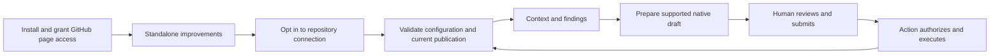

# GitHub Browser Extension — Complete Product and Quality Contract

- Status: Ready for review — proposed, not implemented
- Date: 2026-10-25
- Catalog capability ID: `github-browser-extension`
- Last verified: 2026-10-25, repository/source research only; no extension execution
- Owners: Copilot maintainers (product, engineering, security and release)
- Scope: Complete GitHub productivity product: 150 required capabilities, local control center, full Copilot integration and shared setup across desktop Chrome, Firefox and Safari.
- Related issues/PRs: [Issue #694](https://github.com/vypdev/copilot/issues/694)
- Required review gates: product UX, architecture, testing, documentation, security/operations
- Open decisions blocking design readiness: None for the declared desktop github.com product. Implementation, real browser/security/accessibility evidence and store acceptance remain mandatory delivery gates.

## 1. Executive summary

The extension is a complete GitHub productivity application: 150 required capabilities in 12 families, a packaged full-page configuration/work center, comprehensive Copilot Action tooling and an integrated shared setup journey. Page-local improvements and local configuration work without the Action, credentials or a resident server. Connected evidence, native command drafts and separately enabled reviewed operations add repository context without transferring policy ownership to the browser.

The [complete functional catalog](github-browser-extension-functional-catalog.md) defines every required function, its access/default, observable result, boundary and tests. The [local center and setup contract](github-browser-extension-control-center-and-setup.md) defines configuration UX and reuse of existing setup UI/application decisions. Work is implemented in dependency-sized increments; all registered functions and quality gates remain required for product acceptance.

```text
Install → enable selected GitHub improvements → visit issue/PR
  → optionally connect repository → inspect current context/findings
  → prepare supported request → review and submit in GitHub → inspect Action result
```

The user owns personal settings and comment submission. GitHub owns native facts.
The Action owns automation policy, evidence and managed branch lifecycle. This
document defines product behavior; [integration](github-browser-extension-action-integration.md)
defines its data contract and [platforms](github-browser-extension-platforms-and-delivery.md)
defines browser architecture, security and delivery. The complete catalog and center/setup companions are equally normative; no smaller umbrella inventory limits their scope.

## 2. Problem, current behavior, and evidence

### 2.1 Problem

Developers repeatedly navigate files, references and conversation history. Authors
and reviewers also reconstruct Copilot progress from labels, status comments,
findings, checks and runs. Shared automation cannot retain each person's view
preferences or add contextual controls throughout their browser session.

### 2.2 Observed behavior

1. `README.md` describes the existing issue → branch → implementation → PR → review
   → release flow, CLI and local web setup assistant.
2. `specs/catalog.json` catalogues managed issue lifecycle, SDD readiness, comment
   authorization, Bugbot reconciliation and exact-revision PR readiness.
3. `src/application/usecases/read_copilot_status_workflow.ts` combines native
   issue/PR facts, SDD evidence and PR readiness; it is not a browser API.
4. `src/application/ports/pull_request_status_read_ports.ts` already separates
   read-only evidence access from approval mutation.
5. `specs/comment-automation-and-authorization.md` restricts command contexts and
   write authority. A general issue comment cannot invent a branch target.

These are integration evidence, not evidence that browser support exists.
The proposed catalog entry references existing Action entrypoints, read ports,
status tests and documentation because the catalog requires existing evidence
paths even for proposed capabilities. Those paths establish the integration
baseline only. This change verifies specifications, schemas and examples; it
does not establish extension code, runtime tests or browser support.
The current local web setup assistant configures repositories; it is not the
extension runtime or a required resident server.

### 2.3 Evidence and unknowns

Related owning contracts: [managed lifecycle](managed-issue-and-branch-lifecycle.md),
[SDD status](pre-branch-sdd-status-readiness.md),
[PR readiness](guarded-pull-request-approval-status.md),
[commands](comment-automation-and-authorization.md),
[findings](bugbot-review-state-reconciliation.md),
[publication](semantic-github-publication-and-notification.md) and
[locale](repository-locale-and-localization.md).
Browser primary sources and technical mechanics research are recorded in the
platform companion. Prototype performance, real browser results and store
acceptance are unknown until implementation; this proposal claims none of them.

### 2.4 Retrospective classification

Not applicable: this is a prospective product contract, not an as-built baseline.

The [H1 engineering companion](github-browser-extension-foundation.md) now adds a private inert build foundation and its own engineering evidence. The 150 product functions, 803 required product cases and actual loaded-browser acceptance remain proposed; engineering tests do not replace those gates.

## 3. Actors, surfaces, and terminology

| Actor | Goal | Entry point | Visible surfaces |
|---|---|---|---|
| Developer | Navigate and read more efficiently | Repository/file/diff/list | Inline controls, personal preferences |
| Issue/PR author | Understand the next action | Issue or PR | Copilot panel and native composer |
| Reviewer | Inspect current findings with history | PR conversation or Files changed | Findings navigator and native review threads |
| Repository maintainer | Enable trusted connected data | Reviewed default-branch configuration | Discovery, compatibility and Action source links |
| Extension operator | Configure/recover a browser installation | Toolbar/options | Permissions, session connection, feature diagnostics |

**Standalone** means page-local features without API credentials or Copilot.
**Connected** means explicitly enabled reads from a compatible repository.
**Current** means identity and freshness checks pass at observation time.
**Historical** is inspectable past evidence, never current readiness.
**Prepared** means a draft exists; **submitted** and **executed** are later facts.
The extension's name in examples is provisional `Copilot`; no store or trademark
availability is claimed. Naming does not block this design.

## 4. Goals, non-goals, and fixed invariants

### 4.1 Normative product requirements

- **P1 — Independent utility:** U1–U6 work without a token, Action or backend.
- **P2 — Complete scope:** all 150 catalog capabilities, the complete local center and integrated setup are required on all three declared desktop browsers; implementation order cannot reduce final acceptance.
- **P3 — Honest context:** K1/K2 use the integration contract, show source/time and
  distinguish missing, stale, partial and historical evidence from completion.
- **P4 — Explicit effects:** command drafts preserve native human submission; separately enabled regular triage/run operations use closed reviewed intents, fresh live checks and verified results. Rendering never authorizes an effect.
- **P5 — Personal control:** each feature has an explicit default, repository
  override and reversible disable/pause/reset path.
- **P6 — Native usability:** filters expose hidden counts, never silently hide
  required action, and leave native content, editors and checks reachable.
- **P7 — Inclusive presentation:** all primary states have keyboard, screen-reader,
  light/dark, zoom/narrow and complete EN/ES/FR/PT presentations.
- **P8 — Bounded work:** page work, requests and notification noise obey the
  platform/integration budgets and stop on pause, navigation or revocation.
- **P9 — Verifiable delivery:** the complete catalog, 803-case minimum (96 core + 659 feature + 48 center/setup integration cases), documentation and real browser/UX/security evidence accompany implementation.

The formal requirement IDs BEX-P1 through BEX-P9 correspond to P1 through P9
below. All normative tables below refine those requirements. A reference to a companion's requirement
incorporates that requirement; explanatory examples are not evidence of delivery.

| Requirement | Behavior |
|---|---|
| BEX-P1 | Standalone utility without Action, credential or backend. |
| BEX-P2 | Complete 150-capability product, local center and shared setup across Chrome, Firefox and desktop Safari. |
| BEX-P3 | Source-bound, complete and honest current versus historical context. |
| BEX-P4 | Exact-context native drafts plus explicitly reviewed closed optional operations; no unsolicited effects. |
| BEX-P5 | Bounded personal defaults, overrides, migration, pause and recovery. |
| BEX-P6 | Idempotent native coexistence and explicit reversible filtering. |
| BEX-P7 | Accessible, localized and responsive presentation for every primary state. |
| BEX-P8 | Bounded DOM/network work and cancellation without unsolicited writes. |
| BEX-P9 | Traceable tests, secure artifacts, documentation and actual browser proof. |

### 4.2 Outcomes and non-goals

Acceptance demonstrates: standalone installation without authentication; one
primary next action in every connected state; one mount per feature/page; no
request caused by rendering that posts a comment or invokes AI; and the complete
browser matrix and catalog acceptance before a release is advertised as complete.

This specification change defines future implementation and acceptance, not a runtime release. Required functions include comprehensive page tools, read-only context, native human-submitted commands, selected optional regular-label/assignee/run operations, full local configuration/workspaces and shared setup. The product never silently approves/merges/deploys, runs arbitrary scripts, scrapes cookies, changes managed refs or hidden Action state, or introduces hosted billing/telemetry. Mobile and Enterprise remain separately verified host/platform contracts and are not advertised implicitly.

### 4.3 Fixed invariants

P3/P4/P6 cannot be weakened by settings. An extension cannot grant Action write
authority, create or rename a managed branch, infer a missing PR association, or
turn absent findings into zero. Native controls remain the recovery path.

## 5. Current versus proposed product journey

| Stage | Current | Proposed | User effect |
|---|---|---|---|
| Install | Separate automation/setup tooling | Explain standalone and optional connection | Immediate value without credentials |
| Navigate | Native links and repeated manual browsing | U1/U2 helpers beside known destinations | Fewer context switches |
| Read | Repeated layout/filter choices | U3/U4, with visible filtering | Personal readable view |
| Understand work | Compare comments/checks/runs | K1 with verified links and observation time | Know status and responsible actor |
| Review | Open findings across threads | K2 grouped navigator with native links | Find active versus historical evidence |
| Request work | Remember command/context restrictions | K3 preview in the correct composer | Explicit target and human submission |
| Recover | Guess whether extension/Action failed | Per-feature reason and native fallback | Isolated recovery |



Text equivalent: install → standalone use → optional connection → verified
context → prepared draft → human submission → Action result → refreshed context.
Denied connection leaves standalone use available.

## 6. Functional behavior and state model

### 6.1 Complete product inventory

The normative [functional catalog](github-browser-extension-functional-catalog.md) and its [structured inventory](browser-extension/feature-catalog.v1.json) define all 150 required functions, defaults, permissions, sources, freshness, privacy, browser support, acceptance and test IDs. U1–U6 and K1–K3 are umbrella names for foundational controls and the context/findings/draft entry points; the complete catalog defines final product scope. Test cases use the retained bex namespace; detailed feature cases use bexp and center/setup integration cases use bexhub.

| Family | Required functions | User-visible scope |
|---|---:|---|
| Navigation/context | 12 | Command palette, exact links, ref/branch context, previews, bookmarks and menus |
| Code/files/diffs | 14 | Tree/path/symbol navigation, filters, readability, patch/history/rename context and review checkpoints |
| Pull requests/reviews | 14 | Readiness, findings/threads, drafts, changed-since-review, reviewers, conflicts/queue and evidence |
| Issues/discussions | 12 | Triage/forms/relationships, explicit adjustments, duplicate research, notes, bulk selection and dependencies |
| Search/views | 8 | Query builder, saved searches, bounded cross-repository results, collections and accessible navigation |
| Notifications/attention | 8 | Native inbox grouping/selection/actions, personal snooze, optional alerts and privacy |
| Actions/checks | 10 | Source-aware checks/attempts/annotations, failure comparisons, explicit retry/cancel, dispatch handoff and artifacts |
| Releases/repository changes | 8 | Tags/comparisons/unreleased evidence, changelog drafts, provenance/security navigation and attention |
| Personal workspaces | 8 | Selected my-work views, named workspaces, queues, profiles, session drafts and compatibility |
| Copilot Action | 24 | Full lifecycle, SDD workbench, current supported commands, findings, sync/doctor/history, release/deploy/recovery and policy |
| Local control center | 14 | Full application, feature/profile/connection/permission/appearance/language/privacy/activity/recovery management |
| Shared setup/management | 18 | Inspector, complete questionnaire, quick/batch plans, runners, credential handoff, audits, Apply, doctor/drift/recovery and parity |

### 6.2 Feature/access model

Local controls require only page access; additional selected-repository reads require explicit connection. Native drafts retain append/keep/cancel, correct context and human submission. Optional writes are separate named regular triage/run operations, never a generic request client; protected lifecycle/deployment operations hand off to authoritative native controls/Action. Setup uses shared presentation and the CLI-owned protected authority described in the center companion. Every function needs tested unavailable/partial/recovery behavior; access requirements do not remove a function from delivery acceptance.

Features share native coexistence, original adapters/assets, disposal, source honesty, privacy, performance and accessibility requirements. No feature reads drafts for remote analysis or starts a model on page open. No personal preference is written into repository files.

### 6.3 State model

| State | Entered when | Visible meaning / primary action | Transition / owner |
|---|---|---|---|
| Standalone | Connected mode off/manifest absent | Improvements available / Configure connection | User can opt in; U features independent |
| Loading | Bounded collection in progress | Checking current context / no action needed | Reader → current, partial, unavailable |
| Pending | Verified Action work in progress | Waiting for run / Inspect run | Action completes or user revisits |
| Action required | Verified clarification/review blocker | Waiting for author/maintainer / Open source question | Human acts, Action republishes |
| Blocked | Proven failed prerequisite | Work blocked, retained facts shown / Inspect blocker | Operator/author repairs; fresh evidence |
| Partial | Some facts succeeded, others unavailable | Completed facts retained; no aggregate readiness / Inspect missing evidence | Fresh complete collection |
| Complete snapshot | All required facts pass at fenced identity | Latest assessment complete at time T / View result | New revision/event invalidates snapshot |
| Stale | TTL, identity, policy or generation changed | Previous result is historical / Refresh current context | Reader obtains fresh source |
| Unavailable/incompatible | Denied/malformed/future major/missing producer | Current context unavailable / Open native GitHub | Operator restores compatibility/access |
| Paused | Repository/features disabled | Extension paused here / Resume | User resumes; old requests stay canceled |

Terminal native close/merge is shown directly with its reason and source; a
historical percentage or finding card cannot reopen it. State priority and
evidence ownership are specified in I4/I5.

## 7. User-facing configuration

Settings schema version 1 is extension-owned; no secrets are accepted by this
schema. Unknown top-level keys, unknown feature IDs, invalid enums or oversized
imports are rejected with no partial write. Import size is at most 64 KiB and
repository overrides at most 100. Repository identities use GitHub numeric ID,
not a mutable name alone; renamed repositories retain their preference mapping.

| Input | Type / default | Allowed values | Scope and persistence |
|---|---|---|---|
| `features` | Map; defaults in §6.1 | Known IDs → boolean | Global plus per-repo override, local storage |
| `density` | Enum; `comfortable` | `comfortable`, `compact` | Global, repo override |
| `locale` | Enum; `auto` | `auto`, `en`, `es`, `fr`, `pt` | Global; browser primary language then complete-message EN fallback |
| `theme` | Enum; `github` | `github`, `light`, `dark` | Global; GitHub tokens/contrast respected |
| `shortcuts` | Boolean; `false` | true/false | Global, repo override; fixed conflict-aware binding catalog |
| `connected` | Boolean; `false` | true/false | Explicit numeric repository opt-in |
| `paused` | Boolean; `false` | true/false | Global or repository; pause wins over enabled flags |
| `savedViews` | Map; empty | ≤20 query strings, ≤2,000 chars each; issue/PR routes only | Repo; explicit restore, not automatic route replacement |

K1/K2/K3 feature switches default enabled, but their eligibility is false until
the user explicitly connects that repository; they never auto-connect. U5 help
exists by default while additional key bindings stay off. If all connected features are
disabled, no connected reads are scheduled. Import cannot grant host permission,
restore a credential or activate a new repository connection: imported connection
preferences require a separate local user opt-in, and an active pause remains
effective until explicitly resumed. Export previews repository preference scope;
private API evidence and credentials are never part of settings.

Precedence: fixed safety/compatibility rules → emergency pause → tab pause → repository pause →
repository setting → organization setting → host/account preference → global preference → shipped default. The center companion owns profile names and limits. Snapshots take an
immutable settings version per operation; a pause/revocation cancels it even
after snapshotting. Unknown newer schema makes settings read-only with export
and downgrade guidance; it is never silently rewritten. Migrations are atomic,
idempotent and retain one previous non-secret settings version until next
successful startup. Reset preview distinguishes global from current-repo reset;
disconnect also clears protected session data under D4.

Recommended settings: comfortable, locale auto, GitHub theme, U features at their
row defaults, shortcuts and connected mode off. Alternative: compact and U5
enabled in one repository, with K1/K2 connected there only. A repository cannot
override personal locale, grant credentials or turn K3 into auto-submission.

## 8. Clean Architecture design

The platform companion D2/D3 specifies the component graph, semantic ports and
executable import/message/manifest boundaries. Product owns feature eligibility,
information hierarchy and next-action selection; presentation never owns
authorization or provider state. Integration I1–I10 owns transport/provenance and
Action-side changes. Browser code cannot import the Action composition root,
Node process/filesystem adapters or runtime credentials.

View settings are durable local state. API evidence and credentials are separate
session state. Native GitHub and Action publications remain the durable shared
source; browser memory never establishes a successful operation.

## 9. UI/UX and content contract

### 9.1 Primary context panel

P3/P7: heading `Copilot`, one textual state, completed facts, next actor/action,
impact, source links, then collapsed technical detail. Do not show internal schema
IDs in the main flow. On wide screens mount beneath issue/PR header; at ≤760 CSS
pixels use an in-flow collapsible panel, not a fixed overlay. Native headings,
editors and checks are not displaced or hidden. No injected control duplicates a
native equivalent with the same destination and effect.

```text
Copilot · PR #158                      Updated 24 seconds ago
Changes required — waiting for the PR author
Completed: specification published · branch verified · CI completed
2 current findings; review covers this revision
Next: inspect the findings before preparing a correction request.
[View findings]  [Issue #142] [Specification] [Inspect run]
Technical details ▸ head/base, policy, run attempt and source time
```

### 9.2 Required state variants

```text
Pending
Copilot is reviewing this revision. Branch verification completed.
No action required. [Inspect current run]

Action required
Specification needs your answer. Branch has not been published.
Next: the issue author answers Q2. [Open clarification]

Blocked
Current context cannot confirm verification: the verification run failed.
The published specification and branch remain available.
Next: inspect the failure before retrying through GitHub. [Inspect blocker]

Partial
Specification and branch verified. Current review evidence is unavailable.
No overall readiness is claimed. [Inspect available sources]

Complete snapshot
Latest assessment completed for revision abc1234 at 10:42.
0 current findings with complete coverage. Human review still applies.
[View assessment]

Stale
A newer revision is open. The 10:42 assessment describes the previous revision.
Current finding count is unknown. [Refresh current context]

Unavailable / incompatible
Connected context is unavailable for this Action version.
Your GitHub view preferences still work. [Open native checks]
```

Errors follow impact → cause → action → retained facts. Sources use descriptive
links, and absent links are omitted rather than rendered as dead controls.
The findings view labels `Current`, `Historical`, `Coverage incomplete` in text;
color/severity icons supplement text. Empty current findings is shown only with
complete current coverage; otherwise `Current finding count unavailable`.

### 9.3 Draft preparation and noise

Preview target repository/PR/thread, exact command and consequence before editing.
For a nonempty editor, offer `Append request`, `Keep my draft`, `Cancel`; a
separate `Replace draft…` path previews the old draft and requires confirmation.
If safe targeting fails, show a copyable command and exact destination link.
Appending is idempotent by operation ID and current editor digest; no duplicate
append after rerender. Do not claim a copied draft was inserted.

Opening/refreshing a page creates zero comments, notifications, Actions or AI
requests. K3 native submission creates the user's normal GitHub comment; existing
Action publication budgets remain authoritative. Extension diagnostics use local
nonmodal messages; no notification permission is requested.

### 9.4 Accessibility and localization

The complete product must meet WCAG 2.2 AA for extension-owned UI and complete user journeys; this is an acceptance target, not a claim about native GitHub. All four locales and the human evaluation gates in the platform companion are required.

P7/D5: every action has an accessible name, visible focus and keyboard path;
expanded state is programmatic; dynamic results use a polite bounded status
announcement. Preserve focus on equivalent owned control after refresh, otherwise
restore a safe parent without stealing focus from native editing. Help bindings
are discoverable and conflict-checked. Respect reduced motion and 200% zoom,
320 CSS pixel layout, high contrast, and EN/ES/FR/PT complete catalogs. Resolve the
extension's locale once per render; unsupported language uses complete English.
Action publications retain their repository locale and are clearly attributed;
do not machine-translate command operands or diagnostic source text.

## 10. Failure, recovery, and cleanup

| Failure | Impact and retained facts | Recovery | Cleanup |
|---|---|---|---|
| Missing DOM anchor | A named feature unavailable; native page works | Disable feature or reload after update | Owned nodes/listeners only |
| Navigation while loading | Old response cannot affect new repo/PR | New page generation starts fresh | Abort old request/observers |
| Offline/denied/rate limited | Connected evidence unavailable/stale | Native source and bounded retry I6 | Purge denied private data |
| Bad settings import | Existing preferences retained | Correct error/export current version | No partial migration |
| Extension updated in open tab | Duplicate generation rejected | One refresh prompt; native UI stays | Retire old owned generation |
| Draft already edited | Request not inserted | Keep, append, replace explicitly, or copy | No draft telemetry/persistence |
| Pause/uninstall | Owned enhancement removed; repository unaffected | Resume/reinstall intentionally | D4 session/credential cleanup |

The platform companion defines suspension, partial writes, settings quota and
rollback; the integration companion defines replay, stale identity and API
limits. No recovery automatically submits or retries a mutation.

## 11. Security, permissions, and privacy

P1/P4/P6 incorporate I7–I9 and D4. Standalone operation uses GitHub page access and
local settings. Optional API permission/authentication is requested at connection
time with exact origin and selected repository explanation. Tokens, private
evidence, code, drafts and browsing history are excluded from synchronized
preferences, exports, telemetry and diagnostics. No remote executable features,
custom scripts or arbitrary fetch/command messages are supported.

## 12. Observability and operational UX

Per-feature diagnostics show enabled/paused/unsupported/error, affected surface,
extension version, browser adapter and sanitized error code. They do not include
page text, draft contents, private paths or credentials. Explicit export previews
the sanitized report. Connected detail adds source/time/run link without bulk
logs. No network telemetry ships by default. Action Job Summaries remain inspectable
source evidence; future producer changes add a publication outcome and source
identity under I10 without extra timeline comments.

## 13. Compatibility, migration, rollout, and rollback

U features remain available with old/no Action. Connected schema compatibility is
I2; an unsupported major fails closed for C features. Existing native comments,
labels, drafts and checks are not migrated into extension ownership.

Rollout sequence: internal unpacked builds on all three browsers → opt-in pilot
with public/private fixtures → beta stores/TestFlight → reviewed release across
the three targets. Each stage needs D8 evidence. Pausing one broken feature is
the first recovery; a reviewed compatible package/settings version is rollback.
Store version monotonicity may require publishing a higher version containing a
revert rather than installing an older signed version. Never promise immediate
store review or silently drop Safari to call the complete product shipped.

## 14. Testing strategy and numeric budget

**96 retained distinct core implementation cases**, covering foundational policy, lifecycle and evidence behavior. These are one part of the complete product budget: the functional catalog owns 659 additional cases and center/setup owns 48, for **803 distinct cases**. The core budget below is independently derived from
asynchronous DOM navigation, a new trust/compatibility contract and three browser
packages. This specification change does not create or claim these tests.

| Area / case IDs | Minimum | Covered behavior inventory | Owner |
|---|---:|---|---|
| bex-F-C01–bex-F-C12 pure feature/configuration | 12 | eligibility by surface; defaults; pause precedence; repo identity/rename; invalid enum; unknown feature; oversized import; atomic migration; old schema; future schema; saved query precedence; nonconfigurable invariants | Product/platform |
| bex-N-C01–bex-N-C14 lifecycle/races | 14 | initial mount; soft navigation; partial refresh; back/forward; virtualized insertion; removal; dedup; request cancellation; late response; cross-repo response; two tabs; update generation; pause during work; bounded observer disposal | Platform |
| bex-A-C01–bex-A-C12 adapters/API | 12 | canonical issue; canonical PR; exact file SHA; ambiguous link; missing anchor; clipboard denied; 401; 403; masked 404; offline; 429/secondary limit; incomplete pagination | Platform/integration |
| bex-I-C01–bex-I-C16 Action contract | 16 | absent manifest; valid manifest; unknown major; malformed payload; untrusted author; foreign repo; missing native association; multiple PRs; superseded run; head changed; base/policy changed; stale time; partial coverage; corrupt counts; unknown capabilities; final identity fence | Integration |
| bex-V-C01–bex-V-C14 presentation/drafts | 14 | standalone; pending; action-required; blocked; partial; complete; stale; unavailable; EN/ES fallback; keyboard/focus; light/dark/zoom; editor preservation; append dedup; wrong-context copy fallback | Product |
| bex-S-C01–bex-S-C16 permissions/security | 16 | host allowlist; protected route; least privilege; session token isolation; secret redaction; origin/sender spoof; arbitrary fetch rejection; command injection; unsafe URL; hostile Markdown; export exclusion; account change; logout; revocation; private/incognito separation; remote-code prohibition | Platform/integration |
| bex-E-C01–bex-E-C12 packaging/migration/integration | 12 | Chrome load; Firefox load; Safari real extension load; worker suspension; event-page restart; API permission revoked; no-Action usability; mixed-version compatibility; settings rollback; uninstall cleanup; coexistence; performance budget | Platform |
| **Total** | **96** | Repeated matrix execution is not a new behavior | All |

| Area | Minimum distinct cases | Behaviors/risks covered |
|---|---|---|
| Feature policies | 12 | See the observable F inventory rows below. |
| Navigation lifecycle | 14 | See the observable N inventory rows below. |
| Provider adapters | 12 | See the observable A inventory rows below. |
| Action evidence | 16 | See the observable I inventory rows below. |
| Presentation and drafts | 14 | See the observable V inventory rows below. |
| Security and permissions | 16 | See the observable S inventory rows below. |
| Packaging and integration | 12 | See the observable E inventory rows below. |
| Total | 96 | Retained core cases only; add 659 catalog and 48 center/setup cases for the 803-case product total. Matrix reruns do not add cases. |

| Case ID | Area | Requirements | Scenario |
|---|---|---|---|
| bex-F-C01 | Feature policies | BEX-P1, BEX-P2 | Unsupported page mounts no feature and makes no API request. |
| bex-F-C02 | Feature policies | BEX-P1, BEX-P5 | Fresh settings resolve all shipped defaults without a credential. |
| bex-F-C03 | Feature policies | BEX-P5, BEX-P8 | Repository pause wins over an enabled global feature. |
| bex-F-C04 | Feature policies | BEX-P5 | Repository rename retains numeric-ID preferences without affecting another repository. |
| bex-F-C05 | Feature policies | BEX-P5 | Invalid setting enum is rejected with previous settings intact. |
| bex-F-C06 | Feature policies | BEX-P2, BEX-P5 | Unknown feature ID does not activate code or corrupt known preferences. |
| bex-F-C07 | Feature policies | BEX-P5, BEX-P9 | An import over 64 KiB is rejected before any settings write. |
| bex-F-C08 | Feature policies | BEX-P5, BEX-P9 | Interrupted migration retains the prior complete settings version. |
| bex-F-C09 | Feature policies | BEX-P5 | A supported old settings version migrates once with the same second-run result. |
| bex-F-C10 | Feature policies | BEX-P5 | A future settings schema remains read-only and exportable. |
| bex-F-C11 | Feature policies | BEX-P1, BEX-P6 | Opening a shared filtered link preserves its query until explicit Restore. |
| bex-F-C12 | Feature policies | BEX-P3, BEX-P4, BEX-P5 | An imported preference cannot enable auto-submission or weaken evidence checks. |
| bex-N-C01 | Navigation lifecycle | BEX-P6, BEX-P8 | Initial load creates one owned control set per eligible feature. |
| bex-N-C02 | Navigation lifecycle | BEX-P6, BEX-P8 | Soft navigation disposes the old page generation before mounting the new one. |
| bex-N-C03 | Navigation lifecycle | BEX-P6 | Partial React refresh restores one keyed control without rewriting native content. |
| bex-N-C04 | Navigation lifecycle | BEX-P6 | Back/forward restoration preserves native scroll and one extension generation. |
| bex-N-C05 | Navigation lifecycle | BEX-P6, BEX-P8 | A virtualized file insertion gets one helper with loaded-scope counts. |
| bex-N-C06 | Navigation lifecycle | BEX-P6, BEX-P8 | Removed native anchors release their owned observers and listeners. |
| bex-N-C07 | Navigation lifecycle | BEX-P4, BEX-P6 | Repeated initialization does not duplicate a button or draft request. |
| bex-N-C08 | Navigation lifecycle | BEX-P3, BEX-P8 | Navigation aborts pending reads and retires their generation. |
| bex-N-C09 | Navigation lifecycle | BEX-P3, BEX-P8 | A late response cannot restore a disposed page view. |
| bex-N-C10 | Navigation lifecycle | BEX-P3 | A previous repository response never renders in the new repository. |
| bex-N-C11 | Navigation lifecycle | BEX-P8 | Two tabs coalesce one target refresh within the shared request budget. |
| bex-N-C12 | Navigation lifecycle | BEX-P6, BEX-P9 | An extension update retires old owned controls and offers one refresh affordance. |
| bex-N-C13 | Navigation lifecycle | BEX-P5, BEX-P8 | Pausing during collection prevents further reads and DOM updates. |
| bex-N-C14 | Navigation lifecycle | BEX-P6, BEX-P8 | After twenty navigation cycles resource counts return to the declared disposal baseline. |
| bex-A-C01 | Provider adapters | BEX-P1, BEX-P6 | The copied issue URL identifies the observed canonical repository and issue. |
| bex-A-C02 | Provider adapters | BEX-P1, BEX-P6 | The PR helper links the exact observed PR without selecting a same-number issue. |
| bex-A-C03 | Provider adapters | BEX-P1, BEX-P6 | A file permalink contains the verified immutable commit and line anchor. |
| bex-A-C04 | Provider adapters | BEX-P1, BEX-P6 | Ambiguous references stay plain text rather than guessed links. |
| bex-A-C05 | Provider adapters | BEX-P1, BEX-P6 | Missing DOM anchor disables only the affected helper. |
| bex-A-C06 | Provider adapters | BEX-P1, BEX-P6 | Denied clipboard access offers selectable text without claiming copy success. |
| bex-A-C07 | Provider adapters | BEX-P3, BEX-P8 | A 401 clears protected credentials/evidence and exposes reconnect guidance. |
| bex-A-C08 | Provider adapters | BEX-P3, BEX-P8 | A 403 marks current connected evidence unavailable without broader access fallback. |
| bex-A-C09 | Provider adapters | BEX-P3 | A masked private 404 is unknown access, not proof the object does not exist. |
| bex-A-C10 | Provider adapters | BEX-P3, BEX-P8 | Offline refresh retains clearly historical source facts and creates no retry loop. |
| bex-A-C11 | Provider adapters | BEX-P8 | A secondary rate limit postpones requests until the provider or bounded backoff allows them. |
| bex-A-C12 | Provider adapters | BEX-P3, BEX-P8 | Incomplete pagination exposes partial scope and no aggregate zero or ready state. |
| bex-I-C01 | Action evidence | BEX-P1, BEX-P3 | Missing reviewed manifest leaves standalone features usable and connected mode off. |
| bex-I-C02 | Action evidence | BEX-P2, BEX-P3 | A valid pinned manifest and compatible source expose only declared capabilities. |
| bex-I-C03 | Action evidence | BEX-P2, BEX-P3 | A future schema major disables connected projections with upgrade guidance. |
| bex-I-C04 | Action evidence | BEX-P3, BEX-P9 | Malformed or duplicate-key source JSON is rejected before projection. |
| bex-I-C05 | Action evidence | BEX-P3, BEX-P9 | A copied marker from a different numeric author never becomes trusted evidence. |
| bex-I-C06 | Action evidence | BEX-P3 | Foreign repository/conversation identity is rejected despite matching display names. |
| bex-I-C07 | Action evidence | BEX-P3 | Missing explicit association does not invent an issue, branch or PR link. |
| bex-I-C08 | Action evidence | BEX-P3, BEX-P4 | Multiple reported linked PRs require a PR-specific view instead of choosing the newest. |
| bex-I-C09 | Action evidence | BEX-P3 | An older run attempt or generation cannot overwrite newer observed evidence. |
| bex-I-C10 | Action evidence | BEX-P3 | A changed head clears aggregate satisfaction and current finding counts. |
| bex-I-C11 | Action evidence | BEX-P3 | Changed base/public policy identity clears the prior aggregate; hidden live policy remains unknown. |
| bex-I-C12 | Action evidence | BEX-P3, BEX-P8 | Expired or future-skewed observation time yields stale/unavailable, not a current assessment. |
| bex-I-C13 | Action evidence | BEX-P3 | Partial review coverage preserves source facts but keeps the aggregate finding count unknown. |
| bex-I-C14 | Action evidence | BEX-P3, BEX-P9 | Inconsistent finding totals/items are rejected rather than rounded to zero. |
| bex-I-C15 | Action evidence | BEX-P2, BEX-P3 | Unsupported capability tokens never execute code or enable a command. |
| bex-I-C16 | Action evidence | BEX-P3, BEX-P8 | A final identity/page/credential fence rejects a response superseded during collection. |
| bex-V-C01 | Presentation and drafts | BEX-P1, BEX-P7 | Standalone view explains optional connection while U controls remain available. |
| bex-V-C02 | Presentation and drafts | BEX-P3, BEX-P7 | Pending view names completed facts, the active run and that no human action is required. |
| bex-V-C03 | Presentation and drafts | BEX-P3, BEX-P7 | Action-required view names the responsible actor and exact clarification destination. |
| bex-V-C04 | Presentation and drafts | BEX-P3, BEX-P7 | Blocked view follows impact, cause, action and retained-facts order. |
| bex-V-C05 | Presentation and drafts | BEX-P3, BEX-P7 | Partial view retains verified facts and omits overall readiness. |
| bex-V-C06 | Presentation and drafts | BEX-P3, BEX-P7 | Complete snapshot view includes assessed revision/time and preserves human-review obligations. |
| bex-V-C07 | Presentation and drafts | BEX-P3, BEX-P7 | Stale view separates the previous assessment from unknown current finding counts. |
| bex-V-C08 | Presentation and drafts | BEX-P3, BEX-P7 | Unavailable view links native GitHub and does not imply underlying Action work failed. |
| bex-V-C09 | Presentation and drafts | BEX-P7 | Unsupported locale falls back atomically to complete English while Spanish is complete. |
| bex-V-C10 | Presentation and drafts | BEX-P6, BEX-P7 | Keyboard focus survives refresh and all controls have accessible names. |
| bex-V-C11 | Presentation and drafts | BEX-P7 | Light/dark, high contrast, 200 percent zoom and narrow layout retain readable actions. |
| bex-V-C12 | Presentation and drafts | BEX-P4, BEX-P6, BEX-P7 | Keeping or canceling a prepared request preserves every existing native draft byte. |
| bex-V-C13 | Presentation and drafts | BEX-P4, BEX-P6 | Append request happens once despite rerender and leaves submission to the user. |
| bex-V-C14 | Presentation and drafts | BEX-P4, BEX-P7 | Unsupported correction context offers an exact copy-only destination without inserting a broad request. |
| bex-S-C01 | Security and permissions | BEX-P8, BEX-P9 | An unapproved host or cross-origin redirect receives no credential or provider request. |
| bex-S-C02 | Security and permissions | BEX-P8, BEX-P9 | Protected login/token/settings routes install no private observers or connected reads. |
| bex-S-C03 | Security and permissions | BEX-P1, BEX-P9 | Standalone installation requests no API write or blanket host permission. |
| bex-S-C04 | Security and permissions | BEX-P9 | Content scripts cannot retrieve the protected session token through storage or messages. |
| bex-S-C05 | Security and permissions | BEX-P9 | Token-bearing diagnostics are redacted and no raw credential is returned to a view. |
| bex-S-C06 | Security and permissions | BEX-P3, BEX-P9 | Forged origin/frame/tab sender fails before any semantic read operation. |
| bex-S-C07 | Security and permissions | BEX-P8, BEX-P9 | An arbitrary URL/method/body message is rejected by the closed background protocol. |
| bex-S-C08 | Security and permissions | BEX-P4, BEX-P9 | A finding operand containing command separators or line breaks cannot create a mutation draft. |
| bex-S-C09 | Security and permissions | BEX-P3, BEX-P9 | Unsafe source URLs render as unavailable text rather than executable links. |
| bex-S-C10 | Security and permissions | BEX-P6, BEX-P9 | Hostile Markdown/HTML cannot inject DOM, executable selectors or control text. |
| bex-S-C11 | Security and permissions | BEX-P5, BEX-P9 | Settings/diagnostic export excludes tokens, private evidence and human draft contents. |
| bex-S-C12 | Security and permissions | BEX-P3, BEX-P9 | Account change invalidates the old epoch before clearing its credential and cache. |
| bex-S-C13 | Security and permissions | BEX-P3, BEX-P9 | Observed logout/different-viewer signal pauses connection without claiming the PAT was revoked. |
| bex-S-C14 | Security and permissions | BEX-P3, BEX-P9 | Revocation blocks late responses from repopulating cleared private session state. |
| bex-S-C15 | Security and permissions | BEX-P9 | Private browsing refuses connected operation and retains no navigation evidence. |
| bex-S-C16 | Security and permissions | BEX-P2, BEX-P9 | Bundle/manifest checks reject remote executable code and undeclared permission expansion. |
| bex-E-C01 | Packaging and integration | BEX-P2, BEX-P9 | Chrome loads the exact generated artifact and exercises all eligible registered product capabilities. |
| bex-E-C02 | Packaging and integration | BEX-P2, BEX-P9 | Firefox loads the target artifact on stable and selected ESR with the same semantics. |
| bex-E-C03 | Packaging and integration | BEX-P2, BEX-P9 | A real Safari containing-app extension is enabled and exercised; generic WebKit cannot substitute. |
| bex-E-C04 | Packaging and integration | BEX-P3, BEX-P8 | Chrome worker suspension resumes with session state or an explicit disconnect and fresh identity read. |
| bex-E-C05 | Packaging and integration | BEX-P3, BEX-P8 | Firefox/Safari event-page restart does not rely on persistent process globals. |
| bex-E-C06 | Packaging and integration | BEX-P1, BEX-P8, BEX-P9 | Optional API site-access revocation aborts reads while standalone U features remain usable. |
| bex-E-C07 | Packaging and integration | BEX-P1, BEX-P2 | A repository without Copilot still provides standalone functionality without a token. |
| bex-E-C08 | Packaging and integration | BEX-P2, BEX-P3, BEX-P9 | Old/no/future producer versions retain standalone use and disclose connected compatibility. |
| bex-E-C09 | Packaging and integration | BEX-P5, BEX-P9 | Reviewed code/settings rollback restores a compatible view without credential backup. |
| bex-E-C10 | Packaging and integration | BEX-P6, BEX-P9 | Disable/uninstall releases owned resources and session secrets without repository side effects. |
| bex-E-C11 | Packaging and integration | BEX-P6, BEX-P9 | A native/other-extension equivalent prevents duplicate helpers and leaves original controls intact. |
| bex-E-C12 | Packaging and integration | BEX-P8, BEX-P9 | Measured startup, DOM, retained-memory and request work meets the published budgets. |

Keep existing repository thresholds. New pure evidence/authorization decisions
require 100% branch coverage; other changed modules retain applicable budgets.
Use fake clocks/IDs/providers, deterministic HTML/API fixtures, semantic UI
assertions and schema/manifest/dependency parsing, not only snapshots or grep.
bex-E-C03 requires actual Safari-extension evidence; generic WebKit does not suffice.
D8 supplies the browser/OS matrix, real screen-reader/keyboard/theme artifacts and
performance measurement procedure. Every behavior inventory item above has a
stable case ID; matrix permutations are recorded separately.

## 15. Documentation and discoverability

These are implementation deliverables; this specification does not publish an
installation claim in user docs. Add a **docs/browser-extension/** navigation group
in `docs.json` only when its linked files exist and clearly carry availability.

| Audience | Planned artifact | Required content / validation |
|---|---|---|
| User | `docs/browser-extension/index.mdx`, `features.mdx` | Standalone → optional connected journey, feature defaults, visual/text example; links checked |
| Setup owner | `installation.mdx`, `permissions.mdx` | Three store/dev install paths, optional read token, repository manifest, no bot token; fixture-checked examples |
| User | `configuration.mdx`, `privacy.mdx` | Complete bounds/precedence, export/reset, session data, no telemetry; settings schema fixtures |
| Operator | `troubleshooting.mdx`, `compatibility.mdx` | Unavailable/stale/partial, revoke, pause, upgrade/rollback, browser table; recovery fixture links |
| Contributor | `architecture.mdx`, `action-contract.mdx` | Ports, trust, schema ownership and tests; executable boundary/schema checks |

Also update README discoverability and the existing Action status/command docs
when compatible producer support actually ships. Run repository documentation,
asset/frontmatter, navigation and specification checks for changed artifacts.


Publication inventory relative to the PR base develop: all five extension specifications are created by this PR. The Action first created the primary file in its initial SDD commit, then contributor commits expanded it; the PR-level Change column therefore says create. This is a full-product change plan relative to that base, not a claim that every row ships in this specification PR. README, docs.json and future user-documentation paths
are explicit design deliverables, not files shipped by this specification PR.

| Path | Change |
|---|---|
| specs/github-browser-extension.md | create |
| specs/github-browser-extension-action-integration.md | create |
| specs/github-browser-extension-platforms-and-delivery.md | create |
| specs/github-browser-extension-functional-catalog.md | create |
| specs/github-browser-extension-control-center-and-setup.md | create |
| specs/browser-extension/feature-catalog.v1.json | create |
| specs/browser-extension/feature-catalog.schema.json | create |
| specs/browser-extension/feature-catalog-index.schema.json | create |
| specs/browser-extension/features/NAV.v1.json | create |
| specs/browser-extension/features/CODE.v1.json | create |
| specs/browser-extension/features/REVIEW.v1.json | create |
| specs/browser-extension/features/ISSUE.v1.json | create |
| specs/browser-extension/features/SEARCH.v1.json | create |
| specs/browser-extension/features/NOTIFY.v1.json | create |
| specs/browser-extension/features/CI.v1.json | create |
| specs/browser-extension/features/RELEASE.v1.json | create |
| specs/browser-extension/features/WORK.v1.json | create |
| specs/browser-extension/features/COPILOT.v1.json | create |
| specs/browser-extension/features/CENTER.v1.json | create |
| specs/browser-extension/features/SETUP.v1.json | create |
| specs/browser-extension/requests-v2.schema.json | create |
| specs/browser-extension/examples/requests-v2.json | create |
| scripts/validate-browser-extension-specifications.cjs | create |
| test-support/browser-extension-specifications.test.cjs | create |
| package.json | update |
| pnpm-lock.yaml | update |
| specs/local-web-setup-assistant.md | update |
| specs/setup-configuration-management.md | update |
| specs/catalog.json | update |
| specs/CATALOG.md | update |
| docs.json | update |
| README.md | update |
| specs/browser-extension/status-v1.schema.json | create |
| specs/browser-extension/manifest-v1.schema.json | create |
| specs/browser-extension/examples/status-invalid-head-v1.json | create |
| specs/browser-extension/examples/manifest-v1.json | create |
| specs/browser-extension/examples/status-pr-v1.json | create |
| specs/browser-extension/examples/status-issue-v1.json | create |
| docs/browser-extension/index.mdx | create |
| docs/browser-extension/features.mdx | create |
| docs/browser-extension/installation.mdx | create |
| docs/browser-extension/permissions.mdx | create |
| docs/browser-extension/configuration.mdx | create |
| docs/browser-extension/privacy.mdx | create |
| docs/browser-extension/troubleshooting.mdx | create |
| docs/browser-extension/compatibility.mdx | create |
| docs/browser-extension/architecture.mdx | create |
| docs/browser-extension/action-contract.mdx | create |

## 16. Acceptance scenarios

1. Install with no token/Action: U1–U6 work; connected panel offers explicit setup.
2. Open a shared issue filter: its query remains unchanged until Restore is chosen.
3. Hide generated files: show count and Restore all; native required action stays.
4. Navigate/back while context loads: one owned control set; old response discarded.
5. Current compatible Action assessment: show exact identity/time/source and next
   actor; no claim that the extension authorizes merge.
6. New head/partial findings/denied source: no zero count or overall ready state.
7. Prepare fix in unsupported context: copy-only guidance to a verified location;
   no broad issue comment that pretends to target a branch.
8. Existing native draft: retain bytes on cancel/keep; append once; no submission.
9. Pause/disconnect: stop requests and remove owned enhancements/session evidence;
   native GitHub and repository state are unchanged.
10. All browser matrix cases and human evidence meet D8 before complete product acceptance;
    a missing Safari result is a release blocker, not a generic WebKit substitute.

## 17. Requirements traceability

| Requirement | Owning policy/use case/adapter/presentation | Verification | Documentation |
|---|---|---|---|
| P1 | Feature eligibility, page adapters | bex-F-C01–bex-F-C02, bex-A-C01–bex-A-C06, bex-E-C07 | index/features |
| P2 | Feature registry/catalog and package gates | bex-F-C06, bex-E-C01–bex-E-C03, D8 review | features/compatibility |
| P3 | I1–I7 evidence reader, context/findings VM | bex-I-C01–bex-I-C16, bex-V-C02–bex-V-C08 | action-contract/troubleshooting |
| P4 | DraftRequest and NativeComposer port | bex-V-C12–bex-V-C14, bex-S-C08, I8 acceptance | features/permissions |
| P5 | Settings/pause/migration use cases | bex-F-C03–bex-F-C12, bex-N-C13, bex-E-C09–bex-E-C10 | configuration/privacy |
| P6 | Feature lifecycle and renderers | bex-N-C01–bex-N-C14, bex-V-C10–bex-V-C12, bex-E-C11 | features/troubleshooting |
| P7 | Catalog/render/focus policies | bex-V-C01–bex-V-C14, D8 human matrix | features/compatibility |
| P8 | Request scheduler, observer budget | bex-A-C07–bex-A-C12, bex-E-C04–bex-E-C06/bex-E-C12 | privacy/troubleshooting |
| P9 | Build/schema/import/store gates | bex-S-C01–bex-S-C16, bex-E-C01–bex-E-C12 and doc validation | architecture/installation |

| Requirement | Cases |
|---|---|
| BEX-P1 | bex-F-C01, bex-F-C02, bex-F-C11, bex-A-C01, bex-A-C02, bex-A-C03, bex-A-C04, bex-A-C05, bex-A-C06, bex-I-C01, bex-V-C01, bex-S-C03, bex-E-C06, bex-E-C07 |
| BEX-P2 | bex-F-C01, bex-F-C06, bex-I-C02, bex-I-C03, bex-I-C15, bex-S-C16, bex-E-C01, bex-E-C02, bex-E-C03, bex-E-C07, bex-E-C08 |
| BEX-P3 | bex-F-C12, bex-N-C08, bex-N-C09, bex-N-C10, bex-A-C07, bex-A-C08, bex-A-C09, bex-A-C10, bex-A-C12, bex-I-C01, bex-I-C02, bex-I-C03, bex-I-C04, bex-I-C05, bex-I-C06, bex-I-C07, bex-I-C08, bex-I-C09, bex-I-C10, bex-I-C11, bex-I-C12, bex-I-C13, bex-I-C14, bex-I-C15, bex-I-C16, bex-V-C02, bex-V-C03, bex-V-C04, bex-V-C05, bex-V-C06, bex-V-C07, bex-V-C08, bex-S-C06, bex-S-C09, bex-S-C12, bex-S-C13, bex-S-C14, bex-E-C04, bex-E-C05, bex-E-C08 |
| BEX-P4 | bex-F-C12, bex-N-C07, bex-I-C08, bex-V-C12, bex-V-C13, bex-V-C14, bex-S-C08 |
| BEX-P5 | bex-F-C02, bex-F-C03, bex-F-C04, bex-F-C05, bex-F-C06, bex-F-C07, bex-F-C08, bex-F-C09, bex-F-C10, bex-F-C12, bex-N-C13, bex-S-C11, bex-E-C09 |
| BEX-P6 | bex-F-C11, bex-N-C01, bex-N-C02, bex-N-C03, bex-N-C04, bex-N-C05, bex-N-C06, bex-N-C07, bex-N-C12, bex-N-C14, bex-A-C01, bex-A-C02, bex-A-C03, bex-A-C04, bex-A-C05, bex-A-C06, bex-V-C10, bex-V-C12, bex-V-C13, bex-S-C10, bex-E-C10, bex-E-C11 |
| BEX-P7 | bex-V-C01, bex-V-C02, bex-V-C03, bex-V-C04, bex-V-C05, bex-V-C06, bex-V-C07, bex-V-C08, bex-V-C09, bex-V-C10, bex-V-C11, bex-V-C12, bex-V-C14 |
| BEX-P8 | bex-F-C03, bex-N-C01, bex-N-C02, bex-N-C05, bex-N-C06, bex-N-C08, bex-N-C09, bex-N-C11, bex-N-C13, bex-N-C14, bex-A-C07, bex-A-C08, bex-A-C10, bex-A-C11, bex-A-C12, bex-I-C12, bex-I-C16, bex-S-C01, bex-S-C02, bex-S-C07, bex-E-C04, bex-E-C05, bex-E-C06, bex-E-C12 |
| BEX-P9 | bex-F-C07, bex-F-C08, bex-N-C12, bex-I-C04, bex-I-C05, bex-I-C14, bex-S-C01, bex-S-C02, bex-S-C03, bex-S-C04, bex-S-C05, bex-S-C06, bex-S-C07, bex-S-C08, bex-S-C09, bex-S-C10, bex-S-C11, bex-S-C12, bex-S-C13, bex-S-C14, bex-S-C15, bex-S-C16, bex-E-C01, bex-E-C02, bex-E-C03, bex-E-C06, bex-E-C08, bex-E-C09, bex-E-C10, bex-E-C11, bex-E-C12 |

## 18. Implementation sequence

1. Review the complete five-SDD contract, 150-function catalog, 803-case acceptance inventory and explicit authority/architecture constraints.
2. Build the full local center, shared setup presentation/contracts and portable feature registry with real three-browser harnesses.
3. Deliver native navigation/code/review/issue/search/notification/Actions/release/workspace families in dependency-sized increments, with tests and docs together.
4. Deliver the versioned Action producer/evidence reader, complete compatible command catalog, findings/SDD/lifecycle/recovery views and exact-context native drafts.
5. Deliver closed optional user-write operations and shared setup inspector/quick adjustments/full wizard/batch/doctor with protected credential/Apply handoff.
6. Complete every required function, four locales, accessibility, performance/security/partial-state acceptance, signed artifacts and full documentation.
7. Audit all 150 functions and all 803 distinct cases plus the actual browser/OS/version evidence before general product acceptance. Work waves do not constitute reduced product scopes.

## 19. Definition of Done

For this specification issue: five linked decision-complete SDDs and the complete structured functional catalog, proposed
catalog evidence, a generated catalog, valid links and passing specification
checks; no runtime claim. Product/architecture/security review remains explicit.

For future implementation:
- [ ] P1–P9 and I/D companion requirements have acceptance evidence and traceability.
- [ ] Architecture, manifests, schemas and package constraints are executable.
- [ ] All 803 distinct core/feature/center cases, coverage budgets and real three-browser/OS matrix pass.
- [ ] Bounds/defaults/settings migration and recovery match this contract.
- [ ] Primary states, draft preservation, accessibility and complete EN/ES/FR/PT pass.
- [ ] Failure/races/security/privacy/cleanup and zero unsolicited writes pass.
- [ ] User/setup/operator/contributor docs exist and navigation is validated.
- [ ] Platform accounts/signing and store readiness have named maintainer owners.
- [ ] Catalog evidence distinguishes specification, implementation and live proof.
- [ ] `pnpm run generate:specifications` and `pnpm run validate:specifications` pass.
- [ ] No material architecture/public behavior/data safety decision remains open.

## 20. References and decisions

Decisions: complete 150-function desktop product; packaged full-page local center; shared original setup presentation and one CLI-owned privileged engine; all current compatible Action request families; bounded read/native draft/reviewed optional write separation; one trustworthy producer contract; and real accessibility/security/performance/documentation/browser acceptance. No reduced feature inventory can satisfy final acceptance. Primary sources and implementation constraints are in the companions. All code, selectors, assets, UX and prose are independently authored.

The original 96 core cases keep their stable identifiers and observable intent. Product scope is expanded by the additional structured feature and center/setup inventories; implementation evidence remains distinct from this specification.

The expanded specification retains all 96 case identities from the Action-published inventory for issue #694. The detailed BEX-P requirements refine the three initial grouping requirements; all retained cases keep their observable scenario intent.
