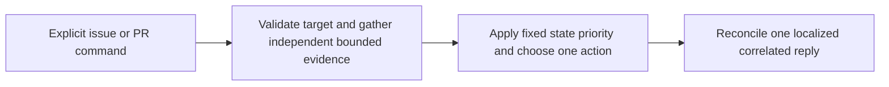
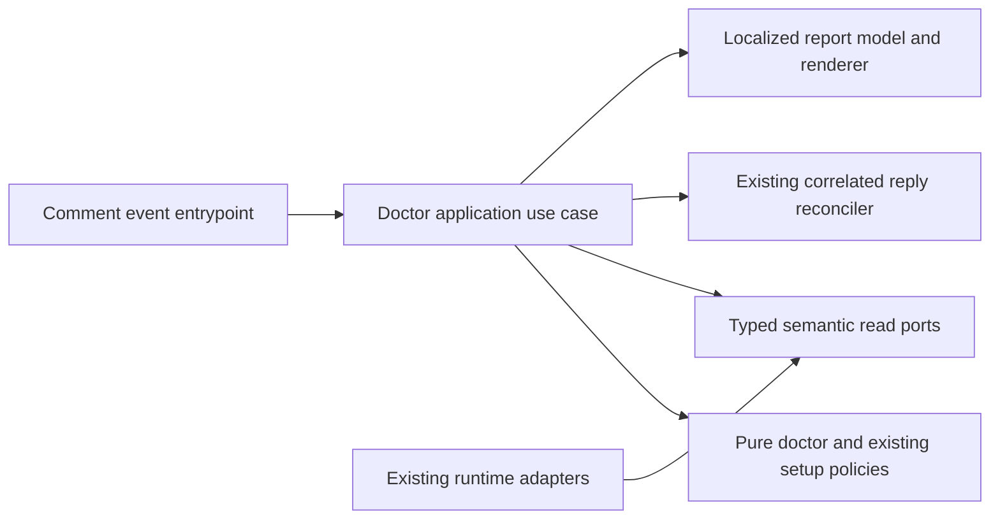

# GitHub Runtime Doctor Command

- Status: Implemented and locally validated on the Action-managed #461 branch; live command acceptance pending
- Date: 2026-10-11
- Catalog capability ID: `setup-and-doctor`
- Last verified: 2026-10-11 (572 full suites, 7,544 passing tests; live acceptance pending)
- Owners: setup-and-doctor capability owner; implementation owners to be confirmed in review
- Scope: Add deterministic `/copilot doctor` replies to issue and pull request conversations using bounded read-only evidence about runtime prerequisites.
- Related issues/PRs: Issue #461
- Required review gates: product UX, architecture, testing, documentation, security/operations
- Open decisions blocking readiness: None identified in the supplied issue and answers.

## 1. Executive summary

A repository participant who can comment may invoke `/copilot doctor` in an issue or pull request. The command checks a fixed set of runtime and workflow prerequisites, reports the status and source of each check, and gives one primary next action. It performs no model call and makes no repair or other repository mutation. Each successful read is evidence only for that read; unavailable evidence is never presented as proof of a missing permission or unhealthy credential.

```text
/c​​opilot doctor -> bounded independent reads -> one correlated, localized reply with check states, evidence links, and one primary action
```

## 2. Problem, current behavior, and evidence

### 2.1 Problem

Maintainers investigating a policy-unavailable recommendation result may need to inspect workflow logs and run a local doctor. `/copilot diagnose` is an AI investigation and does not provide a deterministic runtime configuration audit. Participants need safe, inspectable evidence in the conversation without sharing tokens or installing a local CLI.

### 2.2 Current behavior

Facts supported by the issue: the prior live round produced a policy-unavailable assessment even though the policy was valid; diagnosis required workflow logs and local doctor; `/copilot diagnose` is AI-assisted. The issue does not establish the exact current command admission implementation or the existing adapter method names. Those must be verified against repository code during implementation.

### 2.3 Evidence

- Code/workflow/documentation references: issue #461 identifies the existing setup/doctor policies, comment-automation, semantic GitHub communication, issue-start-and-sdd-readiness, `specs/catalog.json`, and the feature workflow as the relevant owners and sources. Exact file paths and contract details require repository verification.
- Verified implementation baseline on 2026-10-11: `src/domain/github_runtime_doctor.ts` contains the fixed seven-group contract, trusted approval-policy parsing, and deterministic aggregate priority. `/copilot doctor` is recognized and listed in English/Spanish help, but the comment route intentionally returns a sanitized unavailable error until evidence adapters and correlated rendering are composed. No runtime evidence group is currently complete.
- Incidents or concrete examples: a live recommendation assessment reported policy unavailable although the policy was valid; investigation required workflow logs and local doctor.
- External primary sources: not required to define this repository behavior.
- Unknowns: current concrete port APIs, workflow contract shape, existing test commands and thresholds, and documentation route names must be confirmed before implementation.

### 2.4 Retrospective classification (as-built baselines only)

Not applicable: this is a prospective specification and does not reconstruct an implemented baseline.

## 3. Actors, surfaces, and terminology

| Actor | Goal | Entry point | Visible surfaces |
|---|---|---|---|
| Repository participant | Understand actionable runtime prerequisites | Explicit `/copilot doctor` comment | Issue or PR reply and linked evidence |
| Maintainer/operator | Fix a proven prerequisite or investigate unavailable evidence | Reply links and workflow run | Repository settings/policy source and run logs |
| Workflow | Gather bounded evidence and publish one response | Existing comment event workflow | One reconciled issue/PR comment |

“Evidence group” means one bounded prerequisite assessment in the fixed order in §6. “Unavailable” means the command could not establish a fact because a read or sample was absent or failed. “Blocked” means a successful, authoritative read or pure policy established an invalid required prerequisite. “Current PR identity” means the exact PR identified by the event and verified through a canonical current PR read, including a final head freshness check.

## 4. Goals, non-goals, and fixed invariants

### 4.1 Goals

1. Provide a deterministic, read-only runtime audit in issue and PR conversations.
2. Preserve independent successful results when another evidence group is unavailable.
3. Give each result a distinct state, inspectable source/link, and safe next action.
4. Reuse existing policies and semantic read ports when their trust and credential roles match.

### 4.2 Non-goals

1. Model invocation, diagnosis, repair, setup provisioning, or mutation of files, labels, variables, secrets, projects, checks, or reviews.
2. Testing credential write access, secret values or health, organization grants unavailable to the runtime, or local setup-operator PAT behavior in an Action run.
3. Certifying CI, coverage, producer health, write grants, or the entire runtime credential from names or successful reads.

### 4.3 Fixed product/safety invariants

1. Explicit-command admission and bot-loop guards remain in force; any participant permitted by GitHub to comment may invoke the command. No organization-membership gate is added.
2. No new configuration flag, credential, or permission requirement is introduced.
3. Never infer a missing grant from a denied, absent, malformed, or incomplete read. Never expose tokens, secret values, raw provider diagnostics, or guessed zero values.
4. PR identity comes from the event PR marker and exact PR number, then canonical current identity/head reads. Never search other PRs or infer a linked issue from an equal number.
5. A successful policy read proves only that read. A declared `producerAttested` value is input, not independently verified producer health.

## 5. Current versus proposed product journey

| Stage | Current | Proposed | User/operator effect |
|---|---|---|---|
| Request | Runtime audit is not described as a deterministic conversation command | Explicit `/copilot doctor` follows existing admission and bot-loop rules | Participant requests a safe audit in context |
| Evidence | Incident investigation may require logs and local doctor | Fixed seven-group bounded reads and existing pure policies | Successful facts remain useful even when other reads fail |
| Reply | No command-specific report contract is established by issue evidence | One localized, correlated reply with state, source, link, and primary action | Participant can inspect and act without token sharing |



Text equivalent: explicit issue/PR command -> independent bounded reads and policy evaluation -> one prioritized action -> one reconciled reply.

## 6. Functional behavior and state model

### 6.1 Happy path

1. The existing comment entrypoint admits an explicit `/copilot doctor` request and rejects bot loops using current guards.
2. The application identifies an issue target or exact PR target. For a PR it verifies canonical identity and current head; a final freshness check detects a changed head.
3. The application evaluates the seven groups in §6.2. It continues independent reads after failures and retains safe results.
4. Pure aggregation assigns each group `pass`, `warning`, `blocked`, `unavailable`, or `not-applicable`. Overall severity is `blocked`, then `unavailable`, then `warning`, then `pass`; not-applicable checks are excluded. If all checks are not applicable, overall state is not applicable.
5. The presenter chooses the first actionable check in the fixed group order within the highest severity and produces one localized reply through the current reply reconciler.

### 6.2 Evidence groups and alternatives

The fixed order is:

1. Effective issue-workflow and dependency configuration, validated by existing pure policies.
2. Pre-branch SDD eligibility and repository catalog/template prerequisites. Help/exempt issues mark these checks not applicable.
3. Linked-branch readiness when the current issue requires branch work. Missing optional linked issue context on a PR does not invalidate the PR; issue checks depending on it are not applicable.
4. Installed issue, comment, and PR workflow contracts read from one verified default-branch revision. Inspect documented structural contracts only; do not infer token write grants from workflow contents.
5. Approval policy accessibility and strict validity, using the existing effective repository/organization Actions Variables policy reader and strict `PR_APPROVAL_POLICY` v1 parser, including established precedence.
6. Declared approval prerequisites when policy mode is active. Valid `off` makes active-assessment checks not applicable; valid `recommend` or `guarded` reports declared settings. A verified missing value retains existing off semantics. Never fall back to an injected variable after trusted read failure.
7. Exact current PR identity/head when the target is a PR. For issue targets this group is not applicable.

Proven invalid required configuration, invalid policy, or failed required contract is blocked. Denied/missing ports, malformed provider response, network error, incomplete sample, or failed canonical identity/head read is unavailable, never proof of missing permission. A failure to read policy is unavailable; a successfully read malformed policy is blocked.

### 6.3 State machine and delivery behavior

| State | Entered when | User-visible meaning | Allowed next states | Recovery/owner |
|---|---|---|---|---|
| Gathering | An admitted request starts | Checks are being evaluated | Reported, unavailable report | Application use case |
| Reported | Checks are summarized | Current evidence and next action are shown | Updated on same delivery replay | Reply reconciler |
| Partial report | One or more checks are unavailable but other results exist | Some evidence is usable; remaining checks need investigation | Updated on replay or new request | Participant/operator |
| Stale target | PR head changes before final freshness check | Current PR evidence cannot be confirmed | Unavailable report | Participant retries after inspecting PR |

The existing correlated reply identity is exact repository, conversation target, and source comment ID. Redelivery/replay for the same delivery updates or reuses one reply. A new user request creates a new correlated reply. No extra cards or notifications are published. Existing lifecycle and waiting labels are preserved. No other durable state schema is introduced by this feature.

## 7. User-facing configuration

There is no new user-facing configuration. The command uses existing effective configuration and policy semantics. Recommended configuration is the repository’s existing valid setup and approval policy; a meaningful alternative is a valid approval policy mode of `off`, which makes active-assessment prerequisites not applicable. No new override is permitted.

- Existing precedence and operation-time reread behavior must be preserved by the owning readers and policies; implementation must verify their actual contract.
- Missing policy value follows existing off semantics only when the trusted reader successfully establishes absence. Read failure is unavailable and must not use an injected fallback.
- Unknown, malformed, or retired policy values are handled by the existing strict parser; malformed successfully read policy is blocked.
- Safety invariants in §4.3 are not configurable.

## 8. Clean Architecture design

### 8.1 Responsibilities and dependency direction

| Layer/boundary | Owns | Must not own/import |
|---|---|---|
| Domain/pure policy | Check state, severity priority, applicability, action selection, and validation decisions | GitHub SDK, provider DTOs, network or rendering |
| Application | Doctor use case, fixed evidence plan, independent reads, aggregation inputs, immutable outputs | Concrete SDK/process calls, provider DTOs, mutations |
| Semantic ports | Narrow runtime configuration, classification, repository content, linked-branch readiness, canonical PR, approval-policy reads, and reply reconciliation capabilities | Provider response models or policy decisions |
| Data/provider adapters | Mapping GitHub/runtime responses and provider errors into semantic results | Product state priority or permission inference |
| Infrastructure/composition | Wiring existing runtime credential and installed capabilities | Business policy or local operator PAT fabrication |
| Entrypoints | Parse/adapt comment event and enforce existing admission/loop guards | Duplicate orchestration or target-number inference |
| Presentation | Localized bounded report and sanitized links | Reads, mutations, or state transitions |



Text equivalent: event entrypoint calls the application; application combines pure policy with typed read ports, then supplies a view model to the renderer and the existing reply reconciler.

### 8.2 Contracts, state, and trust boundaries

- Pure decisions: group applicability, check classification from explicit semantic outcomes, severity priority, and primary action selection.
- Application contracts: immutable request target, bounded evidence results, check view models, and report outcome. No provider DTOs cross the application boundary.
- Semantic ports: reuse existing narrow runtime configuration, issue classification, repository content, linked-branch readiness, canonical PR, approval-policy read, and correlated reply capabilities only where trust and runtime credential roles match.
- Durable state/schema ownership: existing comment correlation/reconciler owns reply identity. No feature-specific durable state is required.
- Concurrency/idempotency: use existing delivery correlation and reconciler; recheck PR head freshness before publication. A stale head produces unavailable target evidence.
- Trusted and untrusted inputs: GitHub event identity and authoritative read results are validated at adapters; comments, repository content, provider strings, and workflow files are untrusted data. Workflow files are read, parsed for documented structure, and never executed.
- Provider error mapping: permission denied, missing port, malformed response, network failure, and incomplete sample map to unavailable with safe category only. Do not expose raw diagnostics or synthesize absent values.

### 8.3 Executable architecture constraints

Automated checks MUST enforce no provider SDK/DTO imports in domain or application contracts, no dependency from domain to adapters or presentation, no write port in the doctor use case, and no workflow-content execution path. Contract tests MUST parse workflow structure at one authoritative default-branch revision. Existing architecture and dependency checks remain required.

## 9. UI/UX and content contract

### 9.1 Information hierarchy

The reply starts with overall state, completed facts, next transition, one primary action, impact, and inspectable links. Technical details follow in a compact details section. Each check shows a textual state, evidence source/link when available, and short safe detail. No raw provider diagnostics or guessed zeros appear.

### 9.2 Representative primary view and variants

```markdown
<!-- stable doctor marker and existing correlation identity -->

# 🩺 Runtime doctor: Partially available

> **Current status:** Some runtime prerequisites could not be read.
>
> **Action required:** Inspect the [workflow run](RUN_URL) and documented read access, then retry `/copilot doctor`.

## Checks

- **Pass — Effective workflow configuration:** Validated by the existing setup policy. [Configuration source](SOURCE_URL)
- **Unavailable — Approval policy:** The policy could not be read, so its validity is unknown. [Workflow run](RUN_URL)
- **Not applicable — PR identity:** This command was run in an issue.

Other checks completed; unavailable evidence does not establish a missing permission.

<details>
<summary>Technical details</summary>

Safe check categories and authoritative revision or PR links only.

</details>
```

Concrete state variants:

- Pending/no action: “Runtime doctor is collecting the bounded checks. No repository changes are being made.” A pending comment is only used if existing entrypoint lifecycle already publishes one; no second comment is created.
- Action required: “Blocked — the required SDD template prerequisite is invalid. Correct the linked template/catalog entry, then retry.” Link to the specific source.
- Blocked/failed before side effects: “Blocked — the policy was read but is invalid. Correct the policy at [policy source](URL), then retry. No repository changes were made.”
- Partially complete: use the representative view; retain pass facts and identify unavailable groups without implying failure of successful reads.
- Complete: “Pass — all applicable checks passed. No action required.” List evidence sources and explain excluded not-applicable checks.

### 9.3 Issue, PR, and comment behavior

- Deterministic title: “Runtime doctor: `<overall state>`”; purpose is bounded runtime prerequisite evidence.
- Merge/close/retry does not trigger repair. A new explicit command performs a new audit. Existing PR and issue lifecycle behavior remains authoritative.
- Durable marker and idempotency use the existing correlated reply identity; replay updates/reuses the same reply.
- One correlated reply per source comment/delivery; no additional cards or notifications.
- Labels and checks are not modified and are not used as inferred evidence.
- Links point to authoritative source files/settings where safe, exact PR, and relevant workflow run. Never fabricate links or infer a linked issue.

### 9.4 Accessibility, localization, and responsive behavior

English and Spanish catalogs are complete and use existing atomic fallback. Status is text, not color or emoji alone. Markdown remains readable on narrow screens, uses logical headings and descriptive links, and avoids wide tables. Escape/sanitize untrusted Markdown, HTML, mentions, commands, markers, and URLs according to existing publication policy. Render only allowlisted repository/GitHub destinations; reject unsafe schemes. Provide textual explanations for all icons and status distinctions.

## 10. Failure, recovery, and cleanup

| Failure/partial state | User impact | Retained facts | Automatic retry | Required action | Cleanup |
|---|---|---|---|---|---|
| Trusted policy read denied or unavailable | Policy status unknown | Other successful checks | Existing bounded workflow retry only | Inspect run and documented read access; retry | None |
| Policy read succeeds but strict parse fails | Required policy blocked | Read source and other checks | No automatic repair | Correct policy and retry | None |
| Workflow sample incomplete or malformed | Contract evidence unavailable | Verified checks from same operation | Bounded existing retry if supported | Inspect run/source and retry | None |
| Required contract proven invalid | Blocked prerequisite | Contract revision and other checks | No | Correct contract at linked source | None |
| PR identity/head read fails or head becomes stale | PR evidence unavailable | Non-PR independent checks | No blind repeat | Inspect exact PR and retry | None |
| Reply publication fails | User may not see the report | Safe operation result may be logged with correlation | Existing reconciler behavior | Inspect workflow run | No duplicate reply on replay |

User-facing error order is impact, cause, action, retained state. Successful reads remain distinct from failed reads. Cleanup is not applicable because the use case performs no repair or repository mutation.

## 11. Security, permissions, and privacy

1. Use only installed runtime credential capabilities and existing read ports. GitHub’s ability to access a private conversation remains authoritative; do not add organization-membership checks.
2. Treat comments, repository files, workflow contents, and provider strings as untrusted. Parse documented structure only; never execute file contents.
3. Never disclose tokens, secret values, credential health, raw provider diagnostics, or local setup-operator PAT details. Do not claim write permission, producer health, or whole-credential validity.
4. Preserve explicit command admission and bot-loop guards. Correlate publication to exact repository, conversation target, and source comment; revalidate exact PR identity/head.
5. Make no mutations to files, labels, variables, secrets, projects, checks, reviews, or approval state.

## 12. Observability and operational UX

- User-facing state: overall state and independent check states, source/link, and one primary action.
- Job Summary/operator evidence: existing workflow summary/log facilities may record correlation and safe categories; exact existing facility is to be verified. Never log secrets or raw provider diagnostics.
- Logs, metrics, and correlation: use existing workflow run and reply correlation identifiers; do not create a new externally visible event stream.
- Pending external dependency versus workflow failure: unavailable evidence identifies the safe category and run link; it is not described as a proven missing grant.
- Rate-limit/retry behavior: follow existing read adapter and workflow retry bounds; no unbounded polling. Exact bounds must match current repository policy.
- Noise/comment budget: one correlated reply, updated on replay; no extra cards or notifications.

## 13. Compatibility, migration, rollout, and rollback

No persisted feature schema or configuration migration is introduced. Existing in-flight comment lifecycle, waiting labels, locale selection, command admission, and reply reconciliation remain in force. Deploy through the installed feature workflow and its in-progress label before implementation is considered ready, as required by the issue context; do not introduce a feature flag. Rollback removes command routing and presentation while retaining existing comments as historical records. No irreversible repository effects are performed.

## 14. Testing strategy and numeric budget

The minimum is **52 distinct cases**, derived from seven evidence groups, multiple provider failure classes, replay/identity risks, and localized user-visible states. A parameterized row counts only when it exercises a distinct behavior.

| Area | Minimum distinct cases | Behaviors/risks covered |
|---|---:|---|
| Domain/configuration/pure planning | 12 | State mapping, applicability, strict policy states, off/recommend/guarded, precedence, severity, action selection |
| State/application/idempotency/races | 10 | Independent reads, partial reports, replay reuse, new request identity, stale PR head, ordering, cancellation/error retention |
| Adapters/provider contracts | 8 | Denied, missing port, malformed response, network failure, incomplete sample, trusted absence, canonical PR mapping |
| Workflows/setup/schema | 6 | One verified default revision, structural workflow contract, existing admission/loop guards, no permission inference, installed workflow integration |
| UI/UX/localization/sanitization | 8 | Five states, English/Spanish fallback, safe links, mention/Markdown/HTML sanitization, compact mobile-readable content |
| Integration/security/compatibility | 8 | No-write/no-model guarantee, exact PR identity, no issue-number inference, secret non-disclosure, authorization, replay and existing lifecycle |
| **Total** | **52** | No double counting |

Keep repository-wide coverage budgets. New pure policy MUST meet at least 90% branch coverage or the repository’s higher existing threshold. Changed modules MUST meet existing thresholds without reducing repository coverage. Use table-driven tests, deterministic IDs/clocks and fakes; no live GitHub services or real waits. Workflow checks parse structure rather than grep prose. Golden reply fixtures are supplemented by semantic assertions for headings, status, action, links, locale, and sanitization. Manual UX evidence: reviewers inspect narrow-screen rendering in English and Spanish and confirm the primary action and evidence links are understandable without logs.

## 15. Documentation and discoverability

| Audience | Artifact/page | Required content | Validation/navigation |
|---|---|---|---|
| User | Existing command/help documentation | `/copilot doctor` use, states, example, no-write boundary | Help catalog and route/link validation |
| Setup owner | Setup/doctor documentation | Seven evidence groups, existing policy precedence, unavailable vs invalid | Contract fixtures and docs links |
| Operator | Troubleshooting/runbook | State interpretation, run inspection, retry, exact PR identity, safe recovery | Decision-tree review and route validation |
| Contributor | Architecture/spec and catalog | Ports, trust boundaries, correlation, test budget, workflow contracts | Specification validator and architecture checks |

Document that local setup operator PAT and Action runtime PAT are distinct and that the former is not available in the Action run. Examples must be checked against reply fixtures and existing policy fixtures. Update catalog evidence and generated catalog view as required by repository specification workflow.

## 16. Acceptance scenarios

1. Given an admitted issue command and all applicable valid reads, when `/copilot doctor` runs, then one localized reply reports pass, links to sources, and says no action is required.
2. Given a verified invalid required configuration, when the command runs, then that check and overall report are blocked with the linked source and a correction action.
3. Given a valid approval policy, when the trusted policy reader succeeds, then parser and policy-owned precedence determine the result; an injected value does not override a trusted read.
4. Given a denied policy read and successful unrelated reads, when the command runs, then policy is unavailable, successful checks remain visible, and no missing permission is claimed.
5. Given a successfully read malformed policy, when parsing completes, then policy is blocked; this differs from unavailable read evidence.
6. Given a valid `off` policy, when active approval prerequisites are considered, then those checks are not applicable; a missing value is off only when the trusted read proves absence.
7. Given an issue exempt from pre-branch SDD checks, when the audit runs, then those checks are not applicable and do not lower overall severity.
8. Given a PR with no optional linked issue, when the audit runs, then PR checks proceed and linked-issue checks are not applicable.
9. Given a PR event with exact PR identity, when canonical identity succeeds but the head changes before publication, then PR evidence is unavailable and no other PR is searched.
10. Given issue and PR numbers that happen to match, when the command runs, then no issue is inferred from the PR number.
11. Given two workflow contract reads from different revisions, when the evidence is assembled, then the sample is unavailable or rejected; a report never combines revisions as one verified contract set.
12. Given a provider response containing unsafe Markdown, mentions, HTML markers, or an unsafe URL, when rendered, then content is sanitized and no unintended mention or link is emitted.
13. Given the same delivery is replayed, when reconciliation runs, then the same correlated reply is updated/reused; a new source comment creates a new reply.
14. Given a participant allowed by GitHub to comment but not known to be an organization member, when they invoke the command, then existing admission rules apply and no new membership gate is added.
15. Given any result state, when rendered in English or Spanish, then atomic locale fallback produces readable text status and exactly one primary action.
16. Given the completed implementation, when documentation and architecture checks run, then catalog/spec validation, workflow structural contracts, test budget, and no-write/no-model checks pass.

## 17. Requirements traceability

| Requirement | Policy/use case/adapter/presentation | Test or evidence | Documentation |
|---|---|---|---|
| Seven bounded groups and applicability | Application plan and setup/doctor policies | Pure policy and orchestration cases | Setup/doctor reference |
| Partial results and unavailable semantics | Application result mapping | Read failure matrix | Operator troubleshooting |
| Approval precedence and strict parse | Existing policy reader/parser | Trusted absence, failure, malformed, mode cases | Setup/doctor reference |
| Exact PR identity and freshness | Event adapter and canonical PR port | Identity/head/replay integration cases | Operator troubleshooting |
| One correlated localized reply | Existing reconciler and renderer | Replay, locale, semantic UI cases | User command/help docs |
| No mutation, model, or secret disclosure | Use case ports and output sanitizer | Security/no-write/no-model tests | User and contributor docs |
| Architecture and workflow boundaries | Ports/adapters and workflow contract parser | Architecture and workflow checks | Contributor spec |

## 18. Implementation sequence

1. Verify repository standard, catalog capability, owning setup/doctor SDD, comment-automation and semantic-publication contracts, issue-start-and-sdd-readiness, and installed feature workflow. Keep this companion proportional and preserve the owning contract.
2. Define immutable application result and semantic port contracts; add architecture constraints forbidding write/model dependencies.
3. Implement pure status, applicability, severity, and action policies with risk-derived tests.
4. Orchestrate independent reads, policy validation, exact PR freshness, and partial-result retention.
5. Reuse existing adapters and correlate publication through the existing reply reconciler; add structural workflow contract checks.
6. Implement localized presentation, safe links, sanitization, and golden/semantic fixtures.
7. Complete user, setup, operator, and contributor documentation; update catalog evidence and generated artifacts as required.
8. Run repository validation, coverage, workflow/security checks, and manual English/Spanish narrow-screen UX review before readiness.

## 19. Definition of Done

Implementation status: **implemented in the managed feature branch; live
promotion and browser acceptance pending**. The runtime composition binds only
metadata queries using the installed runtime credential. The command performs
all seven groups, retains independent successful checks, validates the effective
profile/start settings using the owning policies, and inspects the dependency
reference already resolved by runtime setup. It does not certify an entire remote
dependency graph from that setting.

The canonical policy reader is shared with the approval observer and retains
repository-over-organization precedence. Its read-only method never consults an
injected variable after failure. Files use six fixed paths, 200,000 decoded UTF-8
bytes per file, one exact 40-hex default-branch revision, and a final revision
fence. Workflow YAML uses the JSON schema and is never executed. Native branch
queries retain their 100-node complete-page boundary and refuse ambiguous,
foreign or moved refs. Exact PR identity uses the existing canonical read policy
and a final head fence. Group states and actions are closed; raw source text,
provider errors and credentials never enter the report.

The fixed 52-case floor is retained. Original implementation evidence covered **167 distinct
feature cases** without double counting existing observer tests: 57 domain and
configuration cases (the original ten domain cases plus fifteen new prerequisite
cases); 23 application cases; 46 provider cases (39 metadata adapters plus seven
new policy-reader cases); ten workflow structural cases; 17 presentation cases;
and 14 integration cases (eight command/security, three composition, two
semantic correlation cases, and one real issue-route configuration regression). The nine-suite focused run passed 138 tests; the additional real issue-route suite passed 18 tests,
including compatibility tests outside this 167-case feature budget. The full managed-branch suite passed 569 suites and 7,454 tests (35 existing
platform skips), with every repository coverage budget and setup ledger check
passing. Doctor bypasses only the incompatible-configuration mutation guard and SDD-continuation getter so it can report their blocked state; mutation commands retain those gates. Generated bundles, live issue/PR commands and narrow-screen browser
acceptance must be recorded separately before final readiness.

- [ ] Every normative requirement has acceptance and traceability.
- [ ] Architecture boundaries are implemented and automatically enforced; doctor has no mutation or model capability.
- [ ] Numeric 52-case minimum, distribution, coverage requirements, and repository budgets pass.
- [ ] Existing policy defaults, precedence, validation, and trusted-read semantics are preserved.
- [ ] Primary report states and content examples are implemented and reviewed.
- [ ] English/Spanish, fallback, accessibility, responsive behavior, sanitization, and one-reply noise budget pass.
- [ ] User/setup/operator/contributor documentation is discoverable and examples match fixtures.
- [ ] Partial evidence, failures, retry, idempotency, PR freshness, security, and cleanup pass.
- [ ] Required workflow structural contracts and repository validation commands pass.
- [ ] `specs/catalog.json` evidence and `specs/CATALOG.md` are current and `pnpm run validate:specifications` passes.
- [ ] Feature workflow and in-progress label requirements are satisfied before implementation readiness.
- [ ] No readiness-blocking decision remains unresolved.

## 20. References and decisions

- Primary sources: Issue #461 and supplied answers Q1–Q7; repository standard and template as provided in the application task.
- Related specs/ADRs/issues/PRs: setup-and-doctor owning specification; comment-automation; semantic GitHub communication; issue-start-and-sdd-readiness; exact paths and current contract details to be verified in repository.
- Decisions: preserve existing owning contract and use a focused companion; no new configuration or permission; independent partial reads; blocked/unavailable distinction; exact PR identity; one correlated localized reply.
- Follow-up work outside this spec: any repair workflow, credential write testing, local setup provisioning, or broader credential-health certification.

### Live dogfooding correction: ambiguous content absence

Bugbot review `38162038624` on PR #466 found that a contents API 404 was falsely reported as proven missing. Human `/copilot fix` comment `6112079942` correctly fetched the current managed head but the Windows agent produced no safe changes; run `38162629567` failed without a commit. That failure is retained as an unfulfilled agent-write test, not certified repair.

The managed correction now proves absence independently: a lazily shared read resolves the exact default commit to its tree, then reads a complete recursive tree at that immutable tree SHA. It rejects changed identities, truncation, duplicate/unsafe/malformed entries, and metadata beyond 10,000 entries. Only verified absence may become `missing`; a file present in the tree with contents 404, denied proof, or incomplete proof is unavailable. The six fixed content paths and 200,000-byte decoded-file budget stay unchanged; at most two additional immutable reads are shared across all 404s. Eleven distinct provider cases cover the live finding and proof boundaries. Fresh full validation and a live review of this correction remain pending.

The managed absence correction passed 572 full suites and 7,544 tests, with 35 existing platform skips (7,579 total). All existing budgets passed; the changed provider reached 100% lines/statements/functions and 95.53% branches. This evidence validates the manual correction, not a successful Windows agent write. The second read-only diagnosis with explicit `login=false` also reported rejection before process startup, so login handling is not established as the cause and no runtime permission was relaxed.

### Workflow eligibility correction from live Bugbot review

Review `4242759214` correctly found that any Action step in any job could make
the workflow group pass. The group now requires a job and Action step eligible
for the expected event. Disabled jobs/steps, event-name contradictions and empty
activity filters are blocked. A bounded three-valued condition policy recognizes
booleans, event-name comparisons, negation, parentheses and AND/OR; runtime facts
or unsupported expressions remain unavailable. YAML/expressions are never
executed. A separate enabled Action job can establish evidence independently of
a disabled candidate. This structural check does not certify a future job run,
runner availability or all configured activity filters.

The repair adds 32 distinct pure-policy cases (25 condition cases and 7 workflow
scenarios), increasing this feature from 135 to 167 cases. Fresh hosted checks
and a new independent review remain required before promotion.

The workflow eligibility repair passed 573 full suites and 7,576 tests, with 35 existing platform skips (7,611 total). Its condition policy reached 100% lines/functions, 98.33% statements and 92.64% branches. Specification/catalog, documentation, lint, graph update and bundle compilation passed; hosted verification and review remain separate live gates.

### Native synchronization and independent review

The Action resolved both the ambiguous-absence finding `4242617946` and the workflow-eligibility finding `4242759214` in subsequent independent review. Run `38167519200` on `windows-intel-runner-2` completed 573 suites and 7,596 tests, with 20 platform skips (7,616 total), validated the integrated branch and published synchronized head `00fef5bdcc31c010e4755e696512ed973df6c2f7`. The correlated receipt is PR comment `6113381932` for request `6112743331`. The contributor checkout confirms the common parent `c47f612f3fceac6ae54908f62bdad9977da06a4d` is an ancestor and validates the published bundles.

This is successful native Windows verification and an Action-owned remote synchronization. It does not establish successful Codex sandbox commands on the Windows service account, nor live `/copilot doctor` acceptance before promotion. Hosted CI and a fresh review of the synchronized head remain separate gates.

### Native current-parent integration and activity isolation (2026-10-12)

The Action synchronized the exact managed branch as `dd3921f44f51edce6b79a46a52412517497d01ed` in run `38254943897` on `apple-intel-runner-3`, passing 580 suites, 7,902 tests and all five configured checks with the existing 35 skips. No manual parent merge or foundation copy was used.

The integrated shared activity policy treated the newly recognized `doctor` command as agent-capable, despite the query having no model port. Two actual issue/review-comment policy contracts failed before the correction. `doctor` is now included in the deterministic command set, so it does not inspect agent configuration or acquire activity labels. These two cases extend the current distinct feature inventory from 167 to 169 without changing the original 52-case floor or recounting shared activity tests. Fresh current-head review and live command acceptance remain required.

### Bound compiler fixture memory after native worker exhaustion (2026-10-12)

Native parent synchronization `38277723562` on Ubuntu resolved the conflict and passed 7,955 tests, but Jest reported “worker ran out of memory and crashed” while loading `raw_error_logging_boundaries.test.ts`. Its repository scan and six taint/sanitizer fixtures each rebuilt the full TypeScript project. The architecture test now constructs one real compiler/checker graph containing the unchanged project and all six isolated fixture modules. Every original assertion still resolves real production logger and sanitizer symbols; no mock, skip, worker/heap adjustment, coverage or platform reduction is introduced. The 169-case doctor inventory is unchanged because this is shared test infrastructure rather than a new capability. A fresh native integration must certify the correction.

### Native prerequisite and absence-proof findings (2026-10-12)

Native review found three concrete defects: `4249698862` dropped unavailable linked refs before claiming absence or uniqueness; `4249700033` accepted non-string dependency values through regular-expression coercion; `4249700043` accepted an empty capability catalog despite the canonical validator requiring a non-empty array. The provider MUST keep any null association, missing/null ref or mixed unavailable/valid page unavailable, without a fallback live-ref read. Only an actually empty complete page proves absence. Effective dependency branches MUST be strings before syntax validation. The prerequisite check MUST reject an empty catalog.

Ten additional distinct cases cover four incomplete native pages, five coerced non-string branch values and the canonical empty-catalog contract. The own feature inventory increases from 169 to 179; the original 52-case floor, six fixed content reads, permissions, query-only ownership and all coverage gates remain unchanged. Fresh native review, parent integration and live command acceptance remain required.

Local verification of these findings passed 581 suites and 7,914 tests with 35 configured platform skips (7,949 total), every unchanged global/module coverage budget and 308/350 setup acceptance with 42 explicitly open. Types, lint, documentation, specification/catalog validation and graph update passed.

### Native nullable bodies and malformed report/workflow boundaries (2026-10-12)

Native findings `4251088780`, `4251088791` and `4251088796` exposed three additional boundaries. A valid native null issue body MUST normalize to an empty body while preserving independently verified issue fields; missing or malformed body values remain rejected. Aggregation MUST reject an unknown check group rather than drop blocked evidence, with a fixed error that excludes the supplied group. A present workflow activity filter MUST be a non-empty array of non-empty strings; scalar, null, object or mixed non-string forms are blocked. These checks neither execute workflow content nor certify write permission.

Six new cases reproduced all three findings: one native null body, one unknown blocked group among otherwise not-applicable groups and four malformed activity-filter shapes. The own feature inventory is 185 distinct cases, with the original 52-case floor and all read/provenance/coverage boundaries retained. Native review, parent recovery and post-promotion live acceptance remain required.

Local verification of the second native findings passed 581 suites and 7,920 tests with 35 configured platform skips (7,955 total). All global/module gates, types, lint, documentation, specifications and graph update passed. Bundles were rebuilt before staging.

### Conservative mixed-type workflow expressions (2026-10-12)

Native finding `4251251731` identified strict mixed-type equality that contradicted GitHub's documented numeric coercion. This bounded interpreter deliberately does not model mixed-type coercion; it MUST return unknown for such comparisons, rather than certify the job as disabled or active. Same-type supported literals and existing three-valued boolean combinations remain unchanged. A workflow whose only eligible candidate depends on such a comparison is unavailable. See [GitHub expression operators](https://docs.github.com/en/actions/reference/workflows-and-actions/expressions#operators).

Four additional cases reproduced the old classification: mixed equality in both operand orders, mixed inequality, and the complete workflow eligibility projection. The own feature inventory increases from 185 to 189 distinct cases; the original 52-case floor, 1,000-character/32-depth bounds, no-eval rule and all coverage gates remain unchanged. Native review and parent/live acceptance remain required.

Local mixed-type verification passed 581 suites and 7,924 tests with 35 configured platform skips (7,959 total). All global/module gates, types, lint, documentation, specifications and graph update passed. Generated bundles are included. Native review and parent/live acceptance remain required.

### Required entry activities (2026-10-13)

Native finding `4251622516` showed that a syntactically valid `types: [deleted]`
for `issue_comment` could pass even though a newly posted doctor request cannot
start that workflow. The parser MUST require `labeled` for issue start, `created`
for new issue-comment commands, and `opened` for PR enrichment when the corresponding
explicit activity filter is present. Omitted filters retain GitHub's all-activity
behavior. Unknown dynamic conditions remain unknown; this does not execute YAML,
expand permissions, or certify runtime/runner health.

Three distinct workflow regression cases failed before the fix and cover these
three entry points, including acceptance of their required activities. The own
inventory is **192 distinct feature contracts** (189 retained plus these three);
the original 52-case floor and all coverage guards remain in force.
`docs/issues/comment-commands.mdx` describes the operational check and the
conservative dynamic-condition limitation. Primary event semantics:
https://docs.github.com/en/actions/reference/workflows-and-actions/events-that-trigger-workflows.
Native current-head review and live promotion remain pending.


### Catalog prerequisites and literal branch references (2026-10-13)

Finding `4253464300` remained valid after being automatically marked obsolete:
a catalog with missing canonical metadata or nonexistent specifications could
still pass. Finding `4253483689` also showed invalid Git branch components such
as `develop/`, `develop//main` and `develop/.` being certified. Thirteen of the
14 initial regressions failed before the correction; focused verification now
passes 148 cases across configuration, catalog, provider, use case and domain.

Prerequisites MUST require the canonical nonempty id/title/status/scope/owner/date
metadata, supported status and real calendar date, unique capability identities
and titles, six evidence arrays with required nonempty values except workflows,
normalized paths inside their declared boundaries, and unique specification
ownership. Every referenced evidence path MUST resolve to a regular file in the
complete immutable Git-tree inventory at the same default revision. Tree or
symlink entries cannot certify a file. This is bounded structural/evidence
validation; as-built document contents and uncatalogued specification discovery
remain the full repository validator's responsibility rather than a six-file
remote content claim.

The complete tree proof is now required for successful catalog evidence as well
as ambiguous content 404s. It retains the fixed six content reads, 200,000-byte
per-file budget and 10,000-entry tree ceiling. Truncation, denied proof, malformed
identity or moved default head remain unavailable. Configuration, default branch
and linked branch use one pure bounded literal-reference decision, rejecting
empty, dot-prefixed, dot-terminated and `.lock` path components. No process or
sandbox invocation is added to doctor.

The own inventory is **224 distinct feature cases**: 192 retained + 14 initial
regressions + 14 canonical-structure/real-catalog contracts + four inventory/ref
adapter cases. No shared cases are counted again. Full gates, native review and
live acceptance remain pending; a structural pass still cannot certify model or
tool execution, runner availability, or write permissions.

Native finding `4254657957` exposed that the Contents API can return a symlink target as a file, as documented by [GitHub](https://docs.github.com/en/rest/repos/contents#get-repository-content). Every successful content read MUST also prove a regular blob at the same path in the already pinned immutable tree (`100644` or `100755`). A symlink/directory response cannot establish required configuration or workflow presence. Three distinct provider regressions cover symlink mode, non-regular tree mode and accepted executable regular blobs; the dedicated inventory becomes 224 + 3 = **227**. All six content paths, the shared tree read, decoded-file/tree ceilings, credential scope and current-head fence remain unchanged.


### Conservative matrix eligibility (2026-10-13)

Native review `38355935682` identified an Action job with a statically empty
matrix being reported as runnable. The workflow contract MUST reject an empty
static axis without include/exclude transformations as blocked. Simple nonempty
static literal axes can establish structural eligibility; dynamic matrices or
axes, expression-valued entries, unsupported values and include/exclude
transformations MUST remain unavailable rather than claiming a job will run.
Another independently eligible Action job may still establish the workflow
contract. This is read-only evidence, not a runtime execution simulator; workflow
conditions and all existing callback requirements continue to apply.

See GitHub's primary [matrix documentation](https://docs.github.com/en/actions/how-tos/write-workflows/choose-what-workflows-do/run-job-variations)
for combinations, dynamic input and include/exclude behavior. The pure policy
never evaluates expressions, expands combinations, reads provider state or
changes workflow configuration. There are no new settings or permissions.

Nineteen distinct regressions extend the inventory from 227 to **246**: sixteen
pure shape/literal/empty/dynamic/transformation cases and three complete workflow
projections that failed before the correction. The new pure policy requires
100% lines, statements, branches and functions; global/module gates remain.
User documentation explains that unsupported scheduling evidence yields
Unavailable, and the catalog includes the pure policy and its tests. Acceptance
requires a static empty matrix to withhold Pass, dynamic/transformed matrices to
withhold certification, and ordinary nonmatrix/static eligible jobs to retain
their existing structural result. Native review and integrated live commands
remain required before completion.
