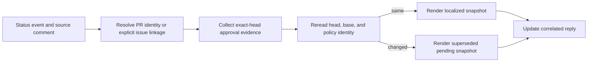
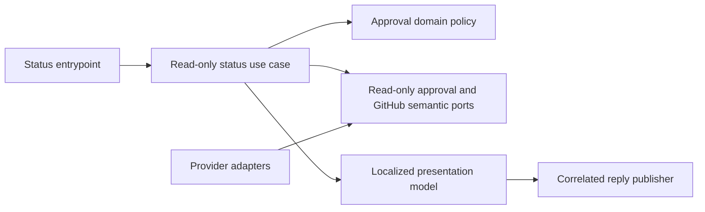

# Exact-head PR readiness in `/copilot status`

- Status: Implemented and locally validated on the Action-managed #462 branch; live acceptance pending
- Date: 2026-10-11
- Catalog capability ID: `guarded-pull-request-approval` (companion to the existing capability)
- Last verified: 2026-10-11 (568 full suites and 7,428 passing tests; live checks pending)
- Owners: product and engineering owners for guarded pull-request approval (individual owners not specified)
- Scope: Add a read-only, localized `/copilot status` view of evidence-based readiness for the exact current pull request head, preserving existing status, approval, and SDD-readiness contracts.
- Related issues/PRs: Issue #462; companion to `specs/guarded-pull-request-approval-status.md`; preserves the SDD-readiness feature from #454.
- Required review gates: product UX, architecture, testing, documentation, security/operations
- Open decisions blocking readiness: None for implementation. Parent synchronization must preserve #454 immutable SDD evidence and #461 trusted policy reading; live rollout remains pending.

## 1. Executive summary

A developer running `/copilot status` in a pull-request conversation receives one compact reply that reports evidence for that PR’s current canonical head and a single actionable next step. In an issue conversation, status assesses only one explicitly linked open PR; zero links means not applicable, and multiple links require a PR-specific request. Every readiness fact must come from the existing approval evidence contracts and be fenced to the current repository, pull number, head SHA, base SHA, and policy identity. Failed or denied evidence reads are unavailable; missing running checks are pending; proven failed prerequisites are blocked. A stale assessment or a check’s name alone can never certify readiness. The command does not invoke approval, repair, model, or lifecycle mutation behavior.

```text
/copilot status -> resolve conversation identity/link -> collect strict current-head evidence -> reread head/base/policy -> update one correlated reply with localized state and next action
```

## 2. Problem, current behavior, and evidence

### 2.1 Problem

Developers inspecting a PR have to gather information from multiple comments and check surfaces to understand whether it can proceed and why it cannot. Status should summarize current evidence and safe next steps without implying that incomplete, denied, stale, or merely name-matched evidence proves readiness.

### 2.2 Current behavior

1. The former status path required a complete current Bugbot counts card and could discard unrelated CI evidence when that card was unavailable.
2. The managed implementation adds physically frozen read ports, exact event identity, native issue linkage, and independent projections of the canonical approval gates.
3. Final narrow PR revision, policy, and native issue-association reads fence every readiness publication. No status port exposes approval submission or assessment publication.

### 2.3 Evidence

- Application: `src/application/usecases/read_copilot_status_workflow.ts`; pure policy: `src/application/policies/pull_request_readiness_policy.ts`; shared canonical gates: `src/domain/pull_request_approval.ts`.
- Provider: `src/data/repository/pull_request/pull_request_status_query_repository.ts`; composition: `src/infrastructure/composition/pull_request_status_composition_root.ts`; port: `src/application/ports/pull_request_status_read_ports.ts`.
- Native issue linkage uses `Issue.closedByPullRequestsReferences(first: 100, includeClosedPrs: false)`, verifies complete pagination, counts, open state and both repository identities. Unsupported or denied provider reads are unavailable. Primary API contract: [GitHub issue GraphQL fields](https://docs.github.com/en/graphql/reference/issues).
- Focused tests pass locally; full coverage, parent compatibility and live English/Spanish GitHub UX are still pending. No live success is inferred from local fixtures.

### 2.4 Retrospective classification (as-built baselines only)

Not applicable: this is a prospective specification and does not reconstruct an implemented baseline.

## 3. Actors, surfaces, and terminology

| Actor | Goal | Entry point | Visible surfaces |
|---|---|---|---|
| Developer in PR conversation | Understand exact-head readiness and next action | `/copilot status` in PR conversation | One correlated PR comment with safe PR, check/run, and documentation links |
| Developer in issue conversation | Understand readiness of an explicitly linked PR | `/copilot status` in issue conversation | One correlated issue comment, or ambiguity guidance |
| Repository operator | Diagnose unavailable evidence or policy mode | Status reply and linked provider surfaces | Safe read-access, run, policy, and documentation destinations |

Terms: **exact head** means evidence bound to repository ID, pull number, head SHA, and base SHA, with applicable policy identity. **Canonical PR read** means the current authoritative pull-request read after resolving the event identity. **Unavailable** means evidence could not be verified, including denied, failed, or incomplete required reads. **Pending** means required work is known to be in progress or the final identity fence changed. **Blocked** means a prerequisite is proven failed or unsafe. **Satisfied** means all required evidence meets the installed strict policy at the fenced revision; in recommend mode it is explicitly only a recommendation snapshot. **Not applicable** means the fact does not apply, such as no linked PR on an issue or approval policy disabled. These states are distinct and must not be collapsed.

## 4. Goals, non-goals, and fixed invariants

### 4.1 Goals

1. Give a developer a concise, verifiable readiness view for the exact current PR revision and one primary next action.
2. Handle PR and issue entrypoints deterministically, including unresolved identity, missing optional context, and multiple linked PRs.
3. Reuse strict existing approval assessment decisions and preserve producer provenance and safety controls.
4. Ship complete English and Spanish catalogs, documentation, and catalog evidence together.

### 4.2 Non-goals

1. Submit reviews or approvals, merge, repair, rerun checks, change labels, or otherwise mutate PR lifecycle state.
2. Invoke a model or infer readiness from assessment prose, matching check names, assumed coverage zeros, or stale evidence.
3. Change recommendation, guarded-approval authorization, or the SDD-readiness feature from #454.
4. Add a configuration flag for this read-only view.

### 4.3 Fixed product/safety invariants

1. A successful check name or legacy prose alone MUST NOT certify a required check or readiness.
2. Evidence MUST bind to repository ID, pull number, head SHA, and base SHA; final reread MUST match head, base, and policy identity before satisfied fields can be published.
3. A head/base/policy change during collection MUST produce a superseded/pending result and retry action, with no stale satisfied fields.
4. The status path MUST NOT call `ObservePullRequestApprovalUseCase.execute`, because it can publish assessments and submit approvals.
5. Existing `producerAttested` requirements, approval guards, recommendation behavior, notification budget, lifecycle, and waiting-label behavior remain intact.

## 5. Current versus proposed product journey

| Stage | Current | Proposed | User/operator effect |
|---|---|---|---|
| PR identity | Fragmented status inspection is reported; implementation is unverified | Resolve event PR marker plus exact repository/PR number, then canonical PR read | No same-number issue or branch-name guess can select a PR |
| Issue linkage | Current behavior unverified | Use exactly one authoritative explicitly linked open PR | Zero is not applicable; multiple links request PR-specific status |
| Evidence | Multiple check surfaces and comments | Read-only projection of strict approval evidence contracts | Independent CI, coverage, Bugbot, and review states with provenance |
| Result publication | Current behavior unverified | Fence source comment and final head/base/policy; update correlated reply | Replay does not duplicate replies; changed evidence is refreshed safely |
| Next action | No consolidated action reported | One localized primary action with safe links | Developer can recover, wait, inspect blocker, or seek human review |



Text equivalent: status event -> deterministic identity/link resolution -> exact-head evidence collection -> final identity fence -> localized current or superseded snapshot -> one correlated reply.

## 6. Functional behavior and state model

### 6.1 Happy path

1. The entrypoint validates the status event and source-comment identity.
2. For a PR conversation, it requires the event’s PR marker and exact repository/PR number, then reads the canonical current PR. An unresolvable identity is unavailable.
3. For an issue, it considers exactly one authoritative explicitly linked open PR. Zero is not applicable; more than one is ambiguous and asks the user to run status in the selected PR conversation. It MUST NOT infer linkage from a same-number issue, newest PR, or branch name.
4. The application requests read-only `ApprovalEvidence`, `ApprovalCheckFact`, `ApprovalBugbotFact`, and `ApprovalReviewFact` through a projection of `PullRequestApprovalPort`, and applies `parsePullRequestApprovalPolicy` and `decidePullRequestApproval` without invoking the mutating observer use case.
5. It preserves provenance: check `sourceAppId`, `workflowName`, `headSha`, `runId`, and `attempt`; current verified `testedMergeSha` and parents; numeric coverage head/base; Bugbot head, coverage, outcome, and counts; review `commitId` and completeness.
6. It rereads canonical PR head/base and policy identity. If any differ from collection identity, it publishes a superseded/pending snapshot with no satisfied fields from stale evidence.
7. It renders one compact reply in English or Spanish, with independent CI, coverage, Bugbot, and review states, policy mode/limitations, safe links, and one primary next action.

### 6.2 Alternative paths

- Off policy: report approval assessment as not applicable/disabled; make no readiness claim. Independently verified native facts may still be shown.
- Recommend policy: use the same strict evidence decision; label satisfaction a recommendation snapshot requiring human review. Never approve.
- Guarded policy: report the read-only snapshot and identify the existing observer as the next operational surface; do not submit a review or promise merge.
- Required evidence read denied, failed, or incomplete: mark that evidence unavailable, not satisfied. Optional missing issue context does not invalidate an exact PR.
- Required check absent but known to be running: pending. Proven failed check or unsafe prerequisite: blocked. Never infer success from a name match.
- Replay: update/reuse the single reply correlated to exact repository, conversation, and source comment. A different source comment gets a new reply.

### 6.3 State machine

| State | Entered when | User-visible meaning | Allowed next states | Recovery/owner |
|---|---|---|---|---|
| Not applicable | Issue has no linked PR, or policy is off for approval assessment | This assessment does not apply; no readiness claim | Not applicable, unavailable | Select a PR if desired; policy owner controls policy |
| Unavailable | Identity cannot resolve or required evidence is denied, failed, or incomplete | Current readiness cannot be verified | Pending, blocked, satisfied after fresh collection | Restore documented read access or inspect run, then retry |
| Blocked | Required prerequisite is proven failed or unsafe | A specific verified prerequisite prevents readiness | Pending, satisfied after remediation and fresh evidence | Follow the linked proven blocker |
| Pending | Required work is running or identity fence changed | Current snapshot is incomplete or superseded | Unavailable, blocked, satisfied after fresh collection | Wait/retry current revision |
| Satisfied snapshot | All strict required evidence passes at final fenced identity | Evidence meets policy at this snapshot | Any state after new event/current identity change | Human review in recommend mode; observer surface in guarded mode |
| Ambiguous linkage | Issue has more than one authoritative linked open PR | Status cannot choose a PR safely | Exact PR conversation assessment | Run `/copilot status` in selected PR conversation |

Priority when summarizing combined evidence: unavailable identity/evidence, then proven blocked, then pending, then satisfied. Secondary blockers may appear as short details but do not replace the single primary action.

## 7. User-facing configuration

| Input | Type | Recommended default | Allowed values/range | Scope/persistence |
|---|---|---|---|---|
| Approval policy | Existing repository policy | Existing installed policy; no new default introduced | Existing off, recommend, guarded modes only | Read at collection and final fence; policy identity must remain stable |
| Reply locale | Existing locale resolution | Existing repository locale behavior; supported output catalogs are English and Spanish | English, Spanish, or existing fallback behavior | Per operation snapshot |

Validation: use existing policy parser and reject malformed policy according to its current contract; do not add a status-specific override. Locale fallback MUST be atomic so a reply never mixes English and Spanish fragments. There are no new cross-field combinations. No configuration migration is introduced. Unknown or absent values follow existing repository policy/locale behavior and must be verified in implementation. No arbitrary URLs, refs, commands, or secrets may be configured. Exact identity fencing, strict evidence rules, no-mutation behavior, and approval safety are not configurable.

Recommended example: leave the repository’s installed approval policy and locale settings unchanged and run `/copilot status` in the target PR conversation. Meaningful alternative: run status in an issue with exactly one explicitly linked open PR; status assesses that PR under the same policy.

## 8. Clean Architecture design

### 8.1 Responsibilities and dependency direction

| Layer/boundary | Owns | Must not own/import |
|---|---|---|
| Domain/pure policy | Existing policy parsing and decision codes; readiness state precedence and invariant checks | Provider SDKs, Markdown, network calls |
| Application | Read-only status use case, identity/evidence/final-fence orchestration, immutable result | Concrete provider DTOs, mutation use cases |
| Adapters/data | Map provider reads into semantic evidence, linked PR facts, safe URLs and provider errors | Readiness policy decisions |
| Infrastructure/composition | Wire read-only port projection, localization catalogs, correlation/reply store | Business decisions |
| Entrypoints | Adapt status event and source-comment identity; establish trusted event context | Duplicated evidence orchestration |
| Presentation | Localized compact view model and Markdown renderer | Evidence collection, lifecycle mutations |



Text equivalent: trusted status entrypoint calls a read-only application use case; the use case applies domain policy to semantic-port data; provider adapters supply facts; presentation renders a localized view; a correlation-aware publisher updates one reply.

### 8.2 Contracts, state, and trust boundaries

- Pure decisions: reuse `parsePullRequestApprovalPolicy` and `decidePullRequestApproval`; represent unavailable, pending, blocked, satisfied, not-applicable, and ambiguous distinctly.
- Application contracts: immutable request includes repository, conversation, source comment, entrypoint kind, and resolved identity; result carries fenced identity, evidence states, policy mode, safe links, and one action.
- Semantic ports: read-only projection of `PullRequestApprovalPort`; canonical PR identity/head/base read; authoritative explicit linked-open-PR query; correlated reply upsert.
- Durable state/schema ownership: existing comment correlation mechanism owns reply identity; no new durable readiness assessment or schema is required by this proposal.
- Concurrency/idempotency: fence current source and final PR head/base/policy before publish; upsert on exact repository/conversation/source-comment tuple. Changed identity strips all stale satisfied fields.
- Trusted and untrusted inputs: event marker and provider reads are validated; issue, PR, comment, check, review, workflow, and provider text are untrusted data. Do not execute embedded commands or trust Markdown/URLs from them.
- Provider error mapping: denied, failed, or incomplete required reads map to unavailable; known in-progress required checks map to pending; proven failures map to blocked; absent optional issue context maps to not applicable.

### 8.3 Executable architecture constraints

- Add dependency checks that prevent status application/presentation from importing provider SDK DTOs and prevent status orchestration from calling approval mutation/observer use cases.
- Add contract tests that parse evidence schemas and assert required provenance fields survive provider mapping.
- Add a workflow/static call-graph check proving the status route cannot submit reviews, approvals, repairs, labels, or lifecycle mutations.
- Add catalog validation for capability ownership and English/Spanish message-key parity.

## 9. UI/UX and content contract

### 9.1 Information hierarchy

1. Overall current snapshot state and abbreviated verified head.
2. Independent CI, coverage, Bugbot, and native-review facts.
3. One primary next action and policy limitation.
4. Safe PR/check/run/docs links.
5. Short secondary blockers and technical provenance only when useful.

### 9.2 Representative primary view

Satisfied guarded-mode example:

```markdown
<!-- stable status correlation marker -->

## PR readiness snapshot

**PR:** #123 · head `a1b2c3d` · **Status:** Evidence satisfies the current policy snapshot

- CI: Satisfied for this head
- Coverage: Satisfied · head 84% / base 81%
- Bugbot: Satisfied · current complete evidence
- Reviews: Satisfied · no blocking review found
- Policy: Guarded · snapshot only; no approval or merge was submitted

**Next action:** Review the current PR and use the existing approval observer if appropriate.

[Open pull request](https://github.com/example/project/pull/123) · [View check run](https://github.com/example/project/actions/runs/456) · [Read approval policy](https://github.com/example/project/blob/main/docs/approval.md)
```

Concrete state variants (all text and links localized):

- Pending/no action: “Status: Checks are still running for head `a1b2c3d`. CI: Pending; coverage: Satisfied; Bugbot: Pending; reviews: Satisfied. Next action: Wait for current checks, then retry status.”
- Action required/unavailable: “Status: Readiness cannot be verified. The required check read was denied. Next action: Restore documented check access, inspect the run, and retry. No readiness claim was made.”
- Blocked: “Status: A required check failed for head `a1b2c3d`. Next action: Inspect the linked failed run and fix the reported prerequisite.”
- Partially complete/superseded: “Status: The PR changed during evidence collection. Earlier evidence is not shown as current. Next action: Retry status for the new head.”
- Completed/satisfied recommendation: “Status: Recommendation snapshot satisfies the current policy for head `a1b2c3d`. Human review is still required; no approval was submitted. Next action: Review the PR.”

### 9.3 Issue, PR, and comment behavior

- Deterministic title: “PR readiness snapshot”; purpose is read-only current evidence.
- Merge/close/retry: reply links do not perform lifecycle changes; retry means invoking status again.
- Durable marker and idempotent update: preserve existing exact repository/conversation/source-comment correlation; replay updates one reply; distinct source comment creates a new reply.
- Comment/notification budget: one reply per source comment; replay updates that reply. Respect the existing notification budget; its numeric value is an implementation unknown to verify.
- Labels and checks: supplemental only; neither labels nor check names independently certify readiness.
- Direct links: canonical PR, verified check/run, and documented recovery/policy page; URLs must be generated from trusted provider identifiers and allowlisted repository origins.

### 9.4 Accessibility, localization, and responsive behavior

English and Spanish catalogs MUST be complete and have atomic fallback. Status names must be textual, not color-dependent. Keep the compact reply readable on narrow screens with short lines, descriptive link text, logical headings, and no wide tables. Support GitHub light/dark rendering. Escape untrusted Markdown and HTML; suppress mentions and commands; reject unsafe URL schemes and external provider-supplied destinations; do not reflect markers or check summaries as executable content. Mermaid is documentation-only and has the adjacent textual equivalent above.

## 10. Failure, recovery, and cleanup

| Failure/partial state | User impact | Retained facts | Automatic retry | Required action | Cleanup |
|---|---|---|---|---|---|
| PR identity cannot resolve | No target can be verified | Conversation/source correlation | No unbounded retry | Re-run in canonical PR conversation | No new state |
| Required evidence denied/failed/incomplete | Readiness unavailable | Independently verified facts clearly labeled | No; user retries after access/run recovery | Restore documented read access or inspect linked run | Update correlated reply on replay |
| Required check running/missing with known in-progress status | Snapshot pending | Other independently verified facts | No automatic polling specified | Wait, then retry current status | Replace same reply on replay |
| Required check proven failed | PR is blocked by known prerequisite | Failure and safe run link | No | Fix the proven prerequisite | Fresh status replaces snapshot |
| Head/base/policy changed during collection | Collected evidence is superseded | New canonical identity only; no stale satisfied fields | No | Retry status for current revision | Upsert same correlated reply |
| Issue has no explicit linked PR | No PR assessment applies | Verified absence of linkage | No | Use status in a PR conversation if desired | No state |
| Issue has multiple linked open PRs | Selection is ambiguous | Link count/ambiguity | No | Select a PR and run status there | No state |
| Reply publication fails | No visible result despite read-only collection | No durable assessment required | Bounded behavior follows existing publisher policy | Retry command | Do not duplicate on replay |

Errors use impact -> cause -> action -> retained state and never imply approval or mutation succeeded.

## 11. Security, permissions, and privacy

1. Request only read permissions needed for canonical PR, explicit linkage, checks, reviews, coverage/Bugbot evidence, and correlated comment update; verify exact grants against repository setup before implementation.
2. Treat event fields and all GitHub content/provider summaries as untrusted. Validate event identity and construct links from trusted repository identifiers.
3. Do not log secrets or unnecessary review/comment content; retain no new evidence history beyond the existing correlated reply mechanism.
4. Prevent forged/stale evidence through producer attestation, exact provenance binding, final head/base/policy fence, and replay correlation. The status path MUST have no approval or lifecycle write capability.

## 12. Observability and operational UX

- User-facing state: one of not applicable, unavailable, ambiguous, blocked, pending, or satisfied snapshot, with independent evidence states.
- Job Summary/operator evidence: not applicable unless the existing workflow already provides a status summary; this feature’s required user surface is the correlated comment. Do not create a second noisy summary by default.
- Logs, metrics, and correlation: record non-sensitive outcome code and correlation identifiers for source comment and repository/PR; do not log raw untrusted summaries.
- Pending external dependency versus workflow failure: explicit pending check state differs from failed evidence read (unavailable) and proven failed prerequisite (blocked).
- Rate-limit/retry behavior: use existing bounded provider retry policy; no polling loop. Retry publication only according to existing publisher rules.
- Noise/comment budget: one correlated reply per source comment; replay updates; preserve existing global notification budget.

## 13. Compatibility, migration, rollout, and rollback

- Existing in-flight operations/data: do not rewrite approval assessments or existing status/SDD-readiness comments; new status replies use the established correlation policy.
- Schema/configuration migration: none planned; no new configuration flag or durable evidence schema.
- Deprecated behavior and compatibility window: preserve current status and #454 behavior; exact compatibility fixtures are to be identified from repository tests.
- Rollout stages/feature flag if needed: no new flag is proposed; integrate behind existing command routing and policy behavior. Rollout mechanism remains subject to repository conventions.
- Rollback and irreversible effects: feature can be removed or command path disabled; it performs no approval, repair, or lifecycle mutation. Already posted replies remain and must be clearly snapshots.

## 14. Testing strategy and numeric budget

Minimum budget: 40 distinct risk-derived cases, exceeding the requested floor of 32. Each case covers a distinct behavior; parameter rows count separately only where the behavior differs.

| Area | Implemented distinct cases | Behaviors/risks covered |
|---|---:|---|
| Domain/configuration/pure planning | 30 | Canonical gates, states, policy modes, provenance, numeric coverage, documentation exemption, policy and revision fences |
| State/application/idempotency/races | 24 | Exact event identity; complete zero/one/multiple native links; denied reads; head/base/policy/association races; independent finding evidence |
| Adapters/provider contracts | 19 | Complete native pagination and counts; repository/PR identity; canonical narrow revision; denied provider reads |
| Workflows/setup/schema | 5 | Two real route contracts plus credential/configuration/default composition contracts |
| UI/UX/localization/sanitization | 16 | Textual states; EN/ES/atomic fallback; trusted GitHub Enterprise link; untrusted code/revision; one action; bounded reply; counts availability |
| Integration/security/migration | 9 | Seven command/security contracts plus two physically frozen port/receiver contracts |
| **Total** | **103** | No double counting; minimum acceptance floor remains 40 |

The existing approval, parser, generic reply-correlation and status tests are retained as compatibility checks and are not counted in this new-case budget. Composition cases are divided between workflow and integration rows, never counted twice.

Coverage: retain repository-wide thresholds; new pure policy must reach at least 95% branch coverage; changed modules must meet existing thresholds with no uncovered safety branch. Use table-driven tests, deterministic clocks/IDs and fakes, replay and race tests, adapter contract tests, structural workflow checks, and semantic UI assertions alongside golden fixtures. No real waits or live services. Manual UX evidence must show English and Spanish replies at narrow and desktop widths, light/dark themes, and comprehension of primary action without logs.

## 15. Documentation and discoverability

| Audience | Artifact/page | Required content | Validation/navigation |
|---|---|---|---|
| User | Existing `/copilot status` command guide | PR and issue journeys, states, examples, policy-mode caveats, safe next actions | Command docs link and tested examples |
| Setup owner | Existing permissions/setup guide | Minimum read and reply-update permissions; provider evidence prerequisites | Workflow permission contract test |
| Operator | Troubleshooting/recovery docs | Unavailable vs pending vs blocked, denied access, changed-head retry, ambiguous linkage | Recovery links in localized catalog |
| Contributor | Approval/status architecture docs | Read-only projection, evidence provenance, identity fence, forbidden mutation path | Architecture dependency/call-graph checks |

Update English and Spanish catalogs, documentation, and catalog evidence in the same implementation change. Keep examples synchronized with fixtures. Update `specs/catalog.json` and generated `specs/CATALOG.md` using repository procedures, then validate specifications.

## 16. Acceptance scenarios

1. Given a PR event with a resolvable marker and canonical PR, when all required provenance-bound evidence passes and final head/base/policy match, then one localized satisfied snapshot is published with abbreviated verified head, independent evidence, safe links, and mode-appropriate next action.
2. Given a PR event whose identity cannot resolve, when status runs, then the result is unavailable, makes no readiness claim, and directs the user to restore documented access or use the canonical PR conversation.
3. Given an issue with zero explicit linked open PRs, when status runs, then it reports not applicable and does not select a same-number PR or scan branches.
4. Given an issue with multiple explicit linked open PRs, when status runs, then it reports ambiguity and asks for status in the selected PR conversation.
5. Given a required evidence read that is denied, failed, or incomplete, when status runs, then that source is unavailable and cannot contribute satisfied readiness.
6. Given a required check known to be running, when status runs, then it is pending; given a proven failed prerequisite, then it is blocked with a safe run link.
7. Given a successful check name with missing or mismatched producer provenance, when status runs, then the check is not satisfied.
8. Given head, base, or policy identity changes during collection, when the final fence runs, then the reply is superseded/pending and contains no stale satisfied fields.
9. Given recommend mode and satisfied evidence, when status runs, then the reply calls it a recommendation snapshot and requires human review without submitting approval.
10. Given guarded mode and satisfied evidence, when status runs, then it identifies the existing observer as the next operational surface without submitting review or promising merge.
11. Given off policy, when status runs, then approval assessment is disabled/not applicable and no readiness claim is made; independently verified native facts may appear.
12. Given the same source comment is replayed after evidence changes, when status runs again, then its single correlated reply is updated; a distinct source comment receives a distinct reply.
13. Given malicious Markdown, mention syntax, command text, or unsafe URL in provider content, when rendered, then it is escaped or omitted and cannot execute or notify unintended users.
14. Given English and Spanish locales, when each primary state is rendered, then all content is localized consistently and fallback never mixes catalogs.
15. Given the feature is integrated, when architecture and workflow checks run, then status cannot import provider DTOs in application/presentation or reach approval/lifecycle mutation capabilities.
16. Given existing status and #454 SDD-readiness behavior, when the feature ships, then their established behavior remains covered by compatibility tests and documentation links.

## 17. Requirements traceability

| Requirement | Policy/use case/adapter/presentation | Test or evidence | Documentation |
|---|---|---|---|
| Exact PR identity and final fence | Status application + canonical PR port | Identity and head/base/policy race cases | User/operator recovery guide |
| Explicit issue linkage | Linkage adapter + application resolver | Zero/one/multiple link cases | User command guide |
| Strict evidence and provenance | Existing domain policy + read-only evidence adapter | Provenance and denied/incomplete contract cases | Contributor architecture guide |
| Policy mode semantics | Domain decision + presenter | Off/recommend/guarded cases | User guide |
| Replay and bounded reply | Correlation port/publisher | Replay and notification budget cases | Operator/contributor docs |
| Localization and safe content | Catalog/presentation | English/Spanish, sanitization, responsive cases | User guide and catalog evidence |
| No mutation | Application boundary/composition | Call-graph and permission checks | Setup and contributor docs |
| Preserve status and #454 | Entrypoint integration | Compatibility acceptance case | User docs |

## 18. Implementation sequence

1. Verify existing command, policy, evidence, catalog, permission, correlation, and documentation contracts; record exact repository paths in the implementation change.
2. Define immutable status contracts, semantic read-only ports, identity fence, and architecture/call-graph constraints.
3. Implement pure state precedence and policy projection with focused tests.
4. Implement identity/link resolution, evidence orchestration, final reread, and replay-safe application flow.
5. Add provider mappings with provenance preservation and explicit error mapping.
6. Add localized presentation, safe links, fixtures, and accessibility review.
7. Update user/setup/operator/contributor documentation and catalog evidence together.
8. Run the numeric test budget, compatibility checks, coverage, architecture checks, catalog validation, and manual UX review.

## 19. Definition of Done

- [ ] Every normative requirement maps to acceptance and traceability evidence.
- [ ] Exact repository/PR identity and final head/base/policy fence are enforced.
- [ ] Strict existing evidence policy and provenance are reused; stale or name-only evidence cannot satisfy readiness.
- [ ] Status has no approval, repair, model, or lifecycle mutation capability.
- [ ] Issue linkage behavior for zero, one, and multiple PRs is deterministic.
- [ ] Replay updates one correlated reply and respects existing notification/lifecycle budgets.
- [x] Numeric test budget of 103 distinct cases and coverage requirements pass.
- [ ] English and Spanish catalogs are complete with atomic fallback and safe rendering.
- [ ] User, setup, operator, and contributor documentation is complete and discoverable.
- [ ] Existing status and #454 SDD-readiness behavior remain compatible.
- [ ] Required architecture, workflow, permission, and contract checks pass.
- [ ] `specs/catalog.json` evidence and `specs/CATALOG.md` are current and `pnpm run validate:specifications` passes.
- [ ] No readiness-blocking decision remains unresolved.

## 20. References and decisions

- Primary sources: Issue #462 and explicit owner answers Q1–Q7 supplied with the issue.
- Related specs/ADRs/issues/PRs: `specs/guarded-pull-request-approval-status.md`; #454 SDD-readiness; #462.
- Decisions: exact event marker plus canonical PR read; explicit issue linkage only; policy-mode behavior; existing evidence contracts and provenance; correlated replay update; compact localized reply and safe action mapping are resolved by owner answers.
- Follow-up work outside this spec: any changes to approval authorization, recommendation policy, PR lifecycle, SDD readiness, or new status configuration are excluded.

### Managed implementation details and remaining live evidence

The command rejects arguments instead of silently ignoring them. Trusted absence of policy is distinct from denial; malformed policy reports blocked with an unavailable mode. Required facts use the canonical `decideApprovalChecks`, `decideApprovalCoverage`, `decideApprovalBugbot`, and `decideApprovalReviews` gates, preserving native approval decision ordering. A complete zero-link issue has no invalid finding-card row. Unavailable count details preserve verified approval facts and do not introduce a second recovery command.

The provider limits native linkage to 100 complete references; collection is read-only and uses the runtime repository identity. Status reuses the existing approval collector once, then reads only fresh head/base and policy for the final fence. No new setting, credentials, timeout, threshold, lifecycle behavior, or agent invocation is introduced. The current implementation renders verified PR links; it deliberately omits provider-supplied check URLs rather than guessing their trust.

- [x] Full coverage and all existing budgets pass on this managed head.
- [ ] Action parent synchronization retains both immutable SDD readiness and PR readiness.
- [ ] A real human comment exercises PR status, issue linkage, reply replay, and a revision change.
- [ ] English and Spanish replies are inspected in GitHub at desktop and narrow widths.

The shared GitHub Action input reader now lives in infrastructure, with pure JSON/default precedence and delimited-value parsing in domain. Existing action import paths remain forwarding facades. This preserves configured JSON/environment precedence, required input behavior and token masking while keeping composition independent of entrypoint-owned contracts. Existing input-source/input-reader cases provide compatibility evidence; they are not counted again in the 103 new cases.

Local acceptance on the managed implementation passed 568 suites and 7,428 tests with 34 existing platform skips (7,462 total). The new pure readiness policy, native provider adapter and read-only composition each reached 100% lines/statements/branches/functions. The changed status application reached 97.43% lines, 95.04% statements, 97.84% branches and 100% functions, passing every existing coverage budget. These local figures do not certify live parent compatibility, GitHub replies, hosted CI, or native approval.


### Independent final-head fence from live dogfooding

Bugbot finding `4242855091` exposed reuse of a previously read revision at the final head fence. The application now always performs the narrow independent current-head read after comments, revision and policy collection. A denied final read cannot certify readiness or counts. If the revision read and independent head read contradict one another, old finding counts remain unavailable. Two additional regression cases reproduce movement during the final policy read and denial of the independent head read, increasing this feature from 103 to 105 distinct cases. This correction does not change approval authority, provider limits or policy semantics.

The correction first passed all 568 suites and 7,430 tests, with 34 existing platform skips (7,464 total). The Action subsequently synchronized the parent into commit `134ec5ac648a95b31bafc7c6fa49bc380c35d48d`; native Ubuntu verification passed 571 suites and 7,514 tests, with 35 existing platform skips (7,549 total). Reapplying only the owned correction to that exact Action head passed 571 suites and 7,516 tests, with 35 skips (7,551 total). The changed status workflow reached 97.46% lines, 95.09% statements, 97.8% branches and 100% functions. Typecheck, lint, specification/catalog, documentation, graph update and compilation passed. Fresh live review, shared SDD-status integration and command acceptance remain required before promotion.
