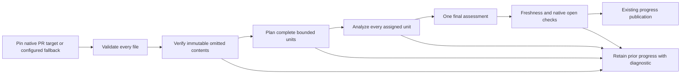
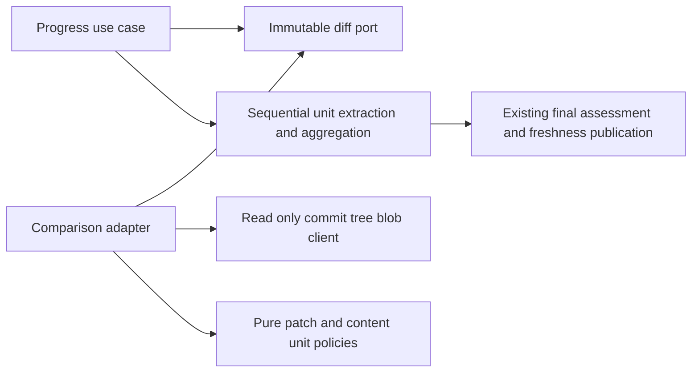
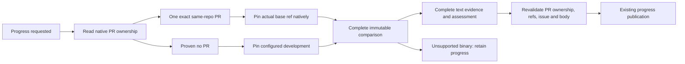

# Complete immutable progress evidence

- Status: Implemented; remote verification pending
- Date: 2026-10-27
- Catalog capability ID: github-communication-experience
- Owners: Copilot maintainers
- Scope: native comparison ownership, complete text recovery, and honest diagnostics for unsupported binary evidence.
- Related issue: [#726](https://github.com/vypdev/copilot/issues/726)
- Review gates: UX, architecture, security, tests, documentation and operations.
- Open decisions blocking readiness: none.

## 1. Executive summary

Progress MUST use every required file from one pinned comparison. When a source
patch is absent, structurally incomplete, inconsistent with its changed-line
totals or too large for one source part, Copilot MUST try bounded immutable Git
content recovery. It MUST analyze every resulting unit before one final
assessment. An unavailable assessment retains the previous progress.

```text
Native PR target or configured fallback -> pinned comparison -> validate inventory -> verify missing contents -> plan all
bounded units -> scope -> analyze every part -> final assessment -> freshness
checks -> existing progress publication
```

## 2. Problem and evidence

The #611 guard correctly stopped progress when a required patch was missing,
but deliberately offered no content recovery. #547 supplied bounded multipart
analysis only for complete whole-file patches. Neither supports the complete
1.49 MB comparison reported in #726 when eight of 52 text patches are omitted,
including a 215,522-byte registry with zero provider line statistics. Additional
issue receipts reproduce an independently verified identical text rename and a
109,259-byte added JSON file with nonzero statistics. These are observed consumer
receipts; the exact GitHub omission threshold is unknown. Synthetic fixtures
reproduce their dimensions without copying private consumer sources.

This is a prospective extension of the owning communication SDD, not a claim
that the earlier fail-closed behavior was an accidental regression.

## 3. Actors, surfaces and terminology

Maintainers trigger the existing progress route through the Action or CLI. The
configured provider supplies an immutable comparison; the model supplies
untrusted observations, never execution attestations. Existing progress labels,
assessment cards, run logs and Job Summaries remain the product surfaces.

A **source unit** is one complete admitted patch/metadata record or a contiguous
UTF-8 content slice with file identity, side, offset and total bytes. A **part**
is a bounded collection of units. A **recovered file** has independently verified
base/head presence, paths, modes, blob hashes and exact contents. For divergent
branches, the preimage is the comparison's pinned merge base, not the current
development tree. The selected comparison-base SHA and head still identify the
comparison and the final freshness checks.

## 4. Goals, non-goals and invariants

- MUST recover complete regular UTF-8 text, including empty files, lockfiles,
  specifications, additions, removals and content-proven renames/copies.
- MUST NOT infer empty or identical content from zero statistics, filename,
  extension, provider URLs or model claims.
- MUST NOT omit files, shorten content, promote source reports into CI claims,
  inspect a checkout, execute commands or publish partial percentages.
- Existing `build/` and exact `specs/CATALOG.md` metadata exceptions remain;
  editable catalogs, SDDs and other registries are not added to that list.
- Binary/non-UTF8 contents, symlinks and submodules are unsupported recovery
  inputs. No consumer code, permission expansion or new workflow is required.
- GitHub's conservative comparison ceiling remains fewer than 300 files.

## 5. Product journey



Text equivalent: validate all files, recover exact contents when needed, plan
all units, analyze all parts, assess once, recheck freshness and publish. Any
incomplete, over-budget, failed or stale stage preserves previous progress.
Previously an omitted patch stopped immediately; now recoverable text proceeds
without requiring a consumer representation workaround.

## 6. Functional and state contract

1. MUST validate all paths, statuses, duplicate paths and numeric facts before
   object retrieval. A complete patch MUST account for every unified hunk and
   match both changed-line totals; cumulative or in-hunk truncation triggers
   recovery rather than partial model input.
2. Recovery MUST resolve exact commit trees and nonrecursive subtrees. Every
   directory response MUST match its requested SHA and be nontruncated. A path
   MUST resolve uniquely; absence is proven by a complete directory. No response
   URL, mutable ref or candidate filesystem path is followed.
3. Added files MUST be absent at the preimage and present at head; removed files
   MUST have the inverse presence. Other supported changes MUST have both
   contents; rename/copy MUST supply a safe previous path. Regular file modes
   MUST be retained. Equal rename blob hashes MUST be independently resolved
   before content is supplied once with both identities.
4. Blob size, encoding, canonical base64, decoded length and recomputed Git blob
   SHA-1 MUST agree. Text MUST roundtrip as UTF-8 and contain no NUL. BOM, CRLF,
   final newline and supplementary characters MUST remain exact.
5. Complete contents MUST split into contiguous code-point-safe slices, with
   deterministic unit IDs and complete side/path/hash/mode/offset/byte totals.
   All units, manifests, prompt envelopes and fact budgets MUST be admitted
   before the first model call. Recovered evidence uses explicit unit responses
   even when it fits one part; legacy complete patches retain their old path
   schema. Every unit response MUST match partition ID, locale, unit ID and path
   exactly once. Duplicate, extra, missing and cross-part replay facts fail.
6. Aggregation MUST independently reject incomplete assignments. Only after all
   parts validate may one final progress assessment occur. Native open status,
   issue body and both branch SHAs MUST still pass existing freshness fences.
7. Recovery caches and partial facts MUST be invocation-local. Replay reloads
   pinned evidence with fresh budgets; no partial durable checkpoint is reused.

States are pending recovery, admitted evidence, partial analysis in memory,
complete assessment, stale/canceled and blocked. Partial analysis is never a
published percentage. No new durable state or schema is introduced.

## 7. Configuration and fixed limits

Automatic recovery is the default and has no new input, flag, secret, variable
or precedence rule. The recommended path is normal progress assessment; the
meaningful alternative for an unsupported/oversized comparison is smaller
reviewed changes. Manual inspection never certifies Copilot completion.

| Fixed per-invocation limit | Bound and validation |
|---|---:|
| Changed-file inventory | 299 maximum; 300 is completeness-unknown |
| Recovered files | 64 |
| Each recovered blob | 1,048,576 bytes, checked before download |
| Total represented recovered side bytes | 4,194,304, including cache hits |
| Git object requests | 256, charged before request |
| Directory entries visited | 50,000, across nonrecursive directories |
| Evidence units | 512, exact unique IDs |
| Slice JSON text | 120,000 bytes, including JSON escaping |
| Source part and manifest | 256,000 bytes each, unchanged |
| Parts | 16 maximum, unchanged |
| Combined model facts | 384,000 bytes maximum, unchanged |
| Complete runtime prompt | 524,288 bytes, unchanged |

The slice bound leaves framing space inside a source part; two ordinary slices
can share a part. Total multipart capacity remains independent of content
retrieval capacity: an admitted blob can still exceed serialized/model budgets.
Fact prose remains adaptively bounded at at most 600 Unicode code points; the
reservation includes every unit identity as well as the issue/scope envelope.
Limits cannot be overridden by repository text or model output.

## 8. Architecture and executable boundaries



Text equivalent: the application depends on an immutable diff capability, the
adapter obtains provider objects, pure policies plan complete units, and the
existing application orchestrates extraction, assessment and publication.
Provider DTOs and hashing stay in data/infrastructure; pure policies perform no
I/O. `GithubProgressObjectClient` exposes only commit/tree/blob reads. Composition
binds the same repository and credential. Architecture/dependency, type, workflow
and provider-contract tests MUST pass; no workspace/process capability is added
to the progress query port.

## 9. UI/UX and content

Existing localization and semantic ownership remain. No new comment, card,
notification, command, control or completion cadence is introduced. Run logs
show bounded part progress; existing result/Job Summary owns the outcome.
Representative plain-language states:

```text
Pending: Collecting complete evidence for this revision. No action required.
Partial analysis: Assessing evidence part 2 of 7. Previous progress remains
published until all parts and the final assessment finish.
Complete: Progress assessed from the pinned revision. CI remains a separate gate.
Blocked: Progress was not assessed; immutable text could not be verified.
Action: Inspect the named paths in the pinned comparison or split reviewed work.
Retained state: Existing progress labels and assessments were preserved.
Technical details: validation.evidence-unavailable; Unreviewed paths (2):
"specs/a.md", "specs/registry.json"; linked workflow run.
```

These illustrate existing operator surfaces, not extra timeline messages.
Error content MUST follow impact, cause, action and retained state. Diagnostics
MUST identify at most eight exact unreviewed paths and disclose the total count;
all required files remain unreviewed until model admission succeeds. Source
contents, credentials and provider URLs MUST NOT appear in diagnostics. Existing
renderers sanitize Markdown, commands, mentions and control characters. English,
Spanish and existing fallback remain; diagnostic paths are literal data. Textual
statuses and descriptive run links preserve narrow-screen and light/dark
readability; neither color nor the diagram is the sole status signal.

## 10. Failure, recovery and cleanup

| Failure | Result, recovery and retained state |
|---|---|
| Missing object/invalid bytes/unsupported content | Terminal `validation.evidence-unavailable`, named paths; inspect or split work; prior progress retained |
| Content/work/serialization/fact budget | Terminal `validation.evidence-too-large`, named recovery paths; reduce/split; prior progress retained |
| Genuine transport/auth/rate limit | Original provider classification and retryability; no deterministic omission mislabeled as outage |
| Invalid/failed middle part or final result | Existing model failure; no final percentage after a failed part and no progress publication |
| Head/base/body movement, native closure or cancellation | Existing stale/canceled outcome; previous progress retained |

No external effect requires rollback during content recovery. In-memory caches
and facts are discarded at invocation end. Other independently completed workflow
effects keep their existing outcome reporting and cleanup; this feature does
not claim that an entire multi-step invocation had no effects.

## 11. Security and privacy

Only existing repository Contents read access is used. Commit SHA, tree SHA and
blob SHA are validated; paths reject absolute/traversal/empty segments, backslash
and NUL and are at most 1,024 UTF-8 bytes. Symlinks are never dereferenced.
Provider objects cannot inject URLs or executable commands. Source, issue text,
scopes and model facts MUST retain the #717 untrusted-data envelopes. No private
consumer source is added to fixtures. Git hashes prove byte identity under the
provider's object contract, not successful tests or semantic correctness.

## 12. Observability

Existing correlation/error records and linked run details expose nonretryability,
retained progress, a bounded reason and uncovered paths. Sequential part logs
remain bounded by 16. There is no per-file conversation spam or raw blob logging.
Provider exceptions remain genuine provider errors; recovery availability is not
claimed until bytes and the full plan validate.

## 13. Compatibility, rollout and rollback

This extends #547/#611 rather than weakening completeness. Complete ordinary
patches keep their path response contract and publication identity. Recovered
units use a schema understood by this runtime only; they are not persisted or
passed between runtime versions. Upgrade through the normal reviewed package/
Action delivery; no consumer form, lockfile restructuring or state migration is
required. Rollback restores fail-closed omission behavior, not a partial review.
Live consumer verification remains separate from synthetic upstream acceptance.

## 14. Numeric test budget

Minimum **104 distinct regression cases**, derived from identity, completeness,
resource, aggregation and publication risks. Parameterized behaviors count once
per distinct scenario; the communication ledger separately counts conservative
new declarations, without double counting this extension.

| Area | Minimum | Required risk coverage |
|---|---:|---|
| Pure patch/content/partition/response policies | 46 | Hunk totals/truncation, UTF-8 slices, identities, exact unit facts, aggregate completeness |
| Provider adapters | 40 | Exact objects, presence, rename, bytes/hash, tree traversal, all budgets, outages and replay |
| Application/integration | 16 | Complete aggregation, failed/malformed parts, stale heads/native closure, no model before admission |
| Composition/localized contract | 2 | Read-only binding and retained-state recovery guidance |

Pure policies MUST have 100% statements/branches/functions/lines; new recovery
adapter SHOULD also achieve 100%. Existing global/module/setup-acceptance
budgets, extension tests, full Jest, build/type/lint, workflows, documentation,
package/CLI/API/web smoke and Graphify updates remain required. Deterministic
fakes use no live service or waits. Semantic assertions accompany content
fixtures; visual/manual review checks concise operator meaning and readable
limits rather than treating a snapshot as complete UX evidence.

## 15. Documentation and discoverability

Update branch-management progress guidance, agent execution contract and operator
error reference together. Register this SDD in the existing communication catalog
and link it from the owning SDD. Explain defaults, supported text/rename recovery,
limits, partial/failure retention, exact-SHA behavior and migration. Existing docs
navigation and validation remain; no new route is required.

## 16. Acceptance

- The synthetic 52-file/8-omission comparison and 215,522-byte registry MUST
  preserve every required path and byte across multiple bounded parts.
- A 109,259-byte added JSON file and a separately proven identical text rename
  MUST assess without changing consumer representation.
- Empty added/removed text MUST have object-proven presence; zero stats alone
  MUST NOT make unknown content reviewable.
- Cumulative/in-hunk truncation MUST recover full contents; unavailable recovery,
  binary content, forged identity, wrong presence or any exhausted budget MUST
  make zero model/progress calls before admission.
- A failed/malformed/replayed part MUST prevent final assessment and publication;
  all valid parts plus a valid final assessment and fresh sources allow one
  existing publication. Retry MUST not reuse partial facts or stale hashes.
- English/Spanish operator outcomes MUST explain recovery and retained state;
  composition and architecture checks MUST preserve read-only capabilities.

## 17. Traceability

| Requirement | Owner | Automated evidence | Documentation |
|---|---|---|---|
| Complete hunks and totals | patch completeness policy | `progress_patch_completeness_policy.test.ts` | execution contract |
| Immutable objects and bounded recovery | recovery/comparison adapters | `immutable_progress_content_repository.test.ts`, `progress_diff_recovery.test.ts` | branch management/error reference |
| Lossless slices and exact facts | content, partition, response policies | `progress_content_evidence_policy.test.ts` plus existing policy suites | branch management |
| Atomic assessment and freshness | progress/summarization use cases | recovered cases in `progress_multipart.integration.test.ts` and existing scope cases | execution contract |
| Capability binding/localized retention | composition and error catalog | composition contract plus existing localized/error tests | error reference |

## 18. Implementation sequence

Define identities and limits, implement/test immutable recovery and unit planning,
connect exact response aggregation, update localized diagnostics/specs/docs,
then run full coverage, architecture/contract/package checks, Graphify, normal
hooks and remote review/CI. No change to deployment or remote branch ownership.

## 19. Definition of Done

Every normative behavior maps to acceptance above; numeric budget and exhaustive
pure coverage pass; all source and prompt budgets precede models; unsupported,
partial, stale and retry states retain progress; no extra permission or comment
route exists; docs/catalog/ledger and generated bundles agree; normal local and
remote validation pass. No unresolved decision or claimed live consumer result
may substitute for evidence.

## 20. References and decisions

- [Owning communication SDD](./semantic-github-publication-and-notification.md).
- [GitHub comparison API](https://docs.github.com/en/rest/commits/commits#compare-two-commits): first-page inventory limited to 300 files.
- [Git tree API](https://docs.github.com/en/rest/git/trees#get-a-tree): explicit truncation; nonrecursive subtree retrieval.
- [Git blob API](https://docs.github.com/en/rest/git/blobs#get-a-blob): immutable blob ID, base64 bytes and Contents read permission.
- #726 receipts provide consumer dimensions and object identities, not a claimed
  universal GitHub patch size threshold. Metadata-only and larger-global-cap
  workarounds are rejected because they weaken or evade complete analysis.

## 21. Native PR comparison source and inherited binary evidence — #727

- Status: Implemented; verification pending (2026-10-27).
- Owner: existing `github-communication-experience` capability.
- Evidence: [#727](https://github.com/vypdev/copilot/issues/727), isolated from the
  separate optional Check Run publication issue #728.
- Open decisions: none; a native review target owns its comparison, while an
  actually changed unsupported binary remains unassessed.

### Problem, product decision and exact evidence

The reported zstandard head `4ac3c633f45166acd2b14c169fe675b6e640d1a6`
compared with development `22eb4de4ce8f5d959b735cb4c7a91c3ca35cf73e`
has 55 changed paths, including five different binary blobs with zero provider
line counters and intentionally absent text patches. Native PR #172 targeted
`master` at `804c1a879ba54d766547ef31cb1ae8a88cfde8dc`. The exact production
comparison has 15 text files, no missing patches, ahead=6 and behind=0; those
binary paths are unchanged in that complete inventory. This was reproduced by
read-only public API queries. A successful consumer build is separate evidence,
not proof of binary correctness. Synthetic tests preserve these relationships
without adopting consumer changes or special filename rules.

Progress MUST use the actual base of one native open, same-repository PR that
owns the exact managed head. Proven native absence MUST retain the configured
development fallback. It MUST NOT use a target named in issue prose, local Git,
model output, a response URL, or the first of several candidates. This fixes
inherited production files through the correct complete comparison; no binary
is silently filtered or declared content-reviewed. The independently pinned
base and head plus the provider-confirmed comparison preimage form the lineage
context. Patchless changed binaries remaining in that selected inventory MUST
retain the existing fail-closed result before any model or progress mutation.
Binary add/modify/delete/rename are not automatically reviewable from metadata.

### Journey and architecture



Text equivalent: read ownership, select the native target or verified fallback,
pin native refs, admit the complete comparison, assess supported evidence, then
revalidate all identities before existing publication. An ambiguous/unavailable
source, unsupported binary or stale owner retains previous progress.

`BoundProgressComparisonSourceQueryPort` exposes only semantic source reads.
The data adapter lists exact `owner:branch`, `state=open`, page 1, at most two
candidates, then gets the sole candidate authoritatively. It MUST validate PR
number/open state, both repository identities, exact head ref/SHA and safe base
ref. Fork/foreign/malformed results MUST fail closed. Two candidates MUST be
ambiguous without guessing or pagination. Provider outages remain provider
errors; absence cannot be inferred from an unavailable query. Runtime composition
MUST supply this capability; a missing port is configuration-unsupported.

The pure source policy selects and freezes one source snapshot. The application
MUST pin `base.ref` through the native branch-head port: PR `base.sha` can retain
a historical snapshot. It MUST reread the acceptance body, then ownership, then native refs before
publication, even for a previously absent PR. Closure, creation, retarget, replacement, head/base movement,
native issue closure and body edits invalidate publication. Native branch names
remain untrusted JSON inside a noncolliding prompt data envelope; Unicode control
characters are escaped for operator logs. No workspace, process, PR write, actor
impersonation, credential expansion or synchronization capability is introduced.
Existing dependency-cycle/type/provider/workflow checks enforce the boundaries.

### Domain/state, compatibility and fixed configuration

The states are unresolved source, verified configured fallback, verified native
PR source, admitted evidence, in-memory assessment, stale/blocked and published.
Only the last state may change progress. No new card, label, comment, event,
notification, completion cadence, durable partial checkpoint or state migration
is added. `developmentBranch` in result payloads retains its configured meaning;
`comparisonBaseBranch`, `comparisonSource` and `baseSha` disclose the actual
immutable assessment provenance. These are result facts, not configuration.

There is no opt-in flag or new setting. The normal recommendation is the real
native review target; standalone work with no PR uses configured development
(default `develop`). A native release/custom branch is supported under the same
same-repository checks. No human/model-provided alternate SHA or base is accepted.
The fixed source budget is two candidates, at most two native PR reads per source
check, two checks per successful assessment; native branch refs are limited to
255 UTF-8 bytes and the complete branch-identity JSON prompt to 4,096 bytes.
All #726 comparison/recovery/model limits remain unchanged.

### Binary diagnostics, UX and operator recovery

An unsupported binary/non-text blob MUST report the closed
`progress-binary-evidence-unavailable` recovery descriptor under existing
`validation.evidence-unavailable`, nonretryable for the identical input. The
shared CLI/GitHub presenter MUST show exact bounded paths, disclose the total
unreviewed count and distinguish unavailable progress from project verification.
The complete pinned unreviewed inventory MUST be logged in at most 299 numbered
records. Each path is a reversible JSON literal in a noncolliding code span;
control/bidi characters, mentions, HTML and table separators remain inert.
No file contents, credentials or provider URLs enter the diagnostic.

Structured recovery stores at most eight complete prefix paths within 8,192
serialized UTF-8 bytes; it MUST stop before a whole path exceeds the budget,
never clip a path. Each path retains the existing 1,024-byte bound. The displayed
named count and total MUST disclose a bounded excerpt, with all paths inspectable
in run details. Public error serialization MUST stay bounded below the GitHub
comment limit for worst-case admitted path fixtures. This is a diagnostic bound,
not permission to omit source from analysis.

Representative existing operator surfaces (not new timeline cards):

```text
Pending: Checking progress for issue #171.
Technical source: native PR #172, master@804c1a8 -> head@4ac3c63.
Next: collect complete pinned evidence. No human action required.

Complete: Progress updated to 70%.
[R1] Prepare dependency hook — Source implementation observed; project execution
remains a separate verification result.

Blocked/partial analysis: Progress was not assessed. Existing progress retained.
No partial percentage is published; retry reloads the complete current evidence.

Impact: Progress was not assessed because required binary or non-text contents
cannot be reviewed. Unreviewed paths (5 total; 5 shown; complete inventory in run
details): `"lib/linux.so"`; `"lib/windows.dll"`; ...
Action: Inspect the intended PR base and pinned paths. Actually changed binary
contents require reviewable source and provenance; metadata or a successful build
does not establish binary correctness.
Retained state: Existing labels/assessments preserved; no model assessment made.
Project verification remains a separate result. Retryable: No.
```

Pending/complete/stale/partial states reuse existing progress/run ownership and
links. Inspecting an intended base is not authorization to retarget a PR merely
to hide changes, change policy, synthesize success or split existing production
libraries. An actual unsupported changed binary still cannot receive a model
percentage without a future adequate evidence capability. Existing English,
Spanish/regional resolution and fallback apply atomically. Narrow/mobile and
light/dark views use textual labels and native run links, never color alone.
No partial facts become a completed assessment; other workflow verification
results keep their independent success/failure and cleanup facts.

### Numeric acceptance budget and traceability

Additional minimum **90 distinct regression cases**, allocated without double
counting the earlier #726 budget: 24 pure source/ref/freshness decisions, 30
provider identity/bounds/binary cases, 20 application integration/races, and 16
closed diagnostic/localization/sanitization cases. New pure policies/domain
helpers MUST have 100% statements/branches/functions/lines; source/recovery
adapters MUST achieve 100%; changed progress orchestration MUST retain at least
95% statements/lines and 90% branches/functions. Existing global gates remain.
Deterministic fakes use no waits/live services. All root/extension tests, types,
lint, build/package smoke, docs/workflows/spec/catalog and Graphify remain gates.
The communication ledger separately uses conservative declaration counts.

| Requirement | Executable owner/evidence | User documentation |
|---|---|---|
| Exact native target/default and all source races | source policy/repository plus `progress_comparison_source.integration.test.ts` | branch management |
| 55 development paths versus 15 native production text paths | coherent synthetic Git-object and comparison fixture in integration suite | execution contract |
| Binary operations/zero counters/provider and byte limits | `progress_binary_evidence.test.ts`, immutable adapter regressions | troubleshooting/error reference |
| Closed path facts, bounded serialization, EN/ES/fallback and inert names | `progress_binary_evidence_diagnostic.test.ts` plus shared error/prompt/composition suites | operator error reference |
| No extra authority/cycles, all prompt/source budgets | required read-only port, composition/type/cycle tests and existing envelope gates | contributor execution contract |

Acceptance MUST reproduce the native 55/15 distinction, retain all paths when a
binary truly remains unassessed, make zero model/label calls before complete
admission, reject ambiguous/foreign/changed sources and malicious metadata, and
permit one existing publication only after fresh complete evidence. Rollout is
a normal reviewed runtime/package upgrade with no consumer edits or new scopes.
Rollback returns the previous configured-development comparison and generic
binary guidance; it does not enable partial reviews. The implementation sequence
is contracts/pure policy, read-only adapter, source fences, diagnostics/prompts,
then tests/specs/docs/generated bundles and full verification. DoD requires every
acceptance case, numeric/exhaustive budgets, architecture, UX/localization,
documentation and normal local/remote gates; live consumer adoption is separate.

Primary sources: [native PR reads](https://docs.github.com/en/rest/pulls/pulls#get-a-pull-request)
and [pinned comparisons](https://docs.github.com/en/rest/commits/commits#compare-two-commits).


## 22. Bounded framed assessment for coherent large comparisons — #773

- Status: implementation contract, 2026-10-29.
- Owner: existing `github-communication-experience` capability.
- Evidence: [#773](https://github.com/vypdev/copilot/issues/773).
- Open decisions: none; use invocation-local multipart execution, without durable cross-run checkpoints.

This section supersedes earlier native single-frame and 16-part bounds in this
document. The direct legacy recovery adapter retains its original profile.

### Observed boundary and intended outcome

The reported pinned base `b461b78c035928856862b995d9008a64b3d59848`, preimage
`2ef0f5d5125b08e2a481d30ede0e1cdd88e4cc85` and head
`55792600c0be6aa581d34880073eb29abde634b7` have 140 comparison paths and 85
omitted patches. Read-only immutable commit/tree metadata independently shows
85 added regular blobs, 4,446,409 represented side bytes and a largest blob of
1,106,150 bytes. These are advertised object sizes, not a claim that private
blob bytes were decoded or a consumer assessment executed here. Returned patch
text totals 1,035,821 bytes; API line counters are not a complete source-size
measurement or the original comparison's historical 72,064 additions.

The file, blob and total recovery limits in section 7 each independently block
this workload; the old sixteen-part capacity can also block the full serialized
comparison. A file-count edit alone is insufficient. The native progress route
MUST admit a coherent supported large text package through bounded recovery
frames and analysis rounds, preserving every path, exact contents and freshness.
Consumers MUST NOT split product scope, omit registries or weaken evidence to
fit one old frame. Unsupported content or exhausted total capacity still retains
prior progress and never publishes a subset percentage.

### Fixed capacity and compatibility

Automatic framed recovery has no repository flag, permission, secret or model
policy override. Direct legacy recovery and the existing small-patch protocol
remain supported. Native complete comparisons use the framed capacity below
when recovery/multipart analysis is needed. This versioned profile supersedes
the single-frame ceilings for that native route; it does not remove resource
checks. A Git blob is returned whole, so a bounded 2 MiB blob allowance is
necessary for the observed 1.1 MB file. UTF-8 source slices and model requests
remain independently bounded.

| Resource | Per recovery frame/request | Total invocation bound |
|---|---:|---:|
| Recovery frames | one active frame | 4 |
| Recovered files | 64 | 256 |
| Represented recovered side bytes, including cache hits | 4,194,304 | 16,777,216 |
| Each recovered blob | 2,097,152 bytes, checked before download | included in side-byte budget |
| Immutable object requests, charged before I/O | 256 | 1,024 |
| Directory entries visited | 50,000 | 200,000 |
| Complete comparison inventory | existing 299 maximum | unchanged |
| Source-part JSON / full manifest | existing 256,000 bytes each | 64 parts maximum |
| Analysis rounds | 16 parts each | 4 rounds |
| Evidence units / JSON slice text | 512 / 120,000 bytes | unchanged |
| Combined model facts / complete runtime prompt | 384,000 / 524,288 bytes | unchanged |

A recovery frame is a bounded accounting epoch; a file may require object reads
across epochs. A claim that cannot fit the remaining epoch advances automatically
to the next one, charging global totals too. A single overlarge claim or a total
limit MUST fail before its operation. Cache hits still charge represented bytes;
failed provider requests still consume requests. Accounting epochs and model
rounds need not align. Both are finite and observable. Complete serialization,
unit, fact and request-envelope budgets MUST pass before model admission; raw
byte capacity does not guarantee admissible JSON escaping or prompt framing.

### Source, request and receipt protocol

```text
pin native source -> validate every path -> verify all immutable bytes in bounded frames
 -> complete hashed source plan -> reserve scope/request/fact budgets
 -> classify issue scope -> bind parts to this attempt and scope
 -> assess all parts/rounds -> validate complete receipts -> final assessment
 -> native issue/body/ownership/base/head freshness fences -> existing publication
```

Text equivalent: collect and verify the complete source first, bind every model
request to that source and this assessment, then publish once after all receipts
and the final result remain valid and current.

1. Existing path/status/presence/tree/blob/hash/UTF-8 requirements remain. Every
   source part MUST carry a SHA-256 identity covering its exact evidence, units,
   paths, ordinal and immutable base/head/preimage. A complete canonical manifest
   binds every required path, unit and source-part digest, resource usage and one
   host-generated attempt UUID. The data adapter owns entropy; source and model
   text cannot select it. Corrupt/missing/duplicate/reordered plan records fail
   validation before any model request.
2. After issue-only acceptance scope validates, a deterministic request binding
   MUST include that manifest/attempt, source-part identity, complete issue,
   extracted scope and target locale. Its fixed-length ID is echoed through the
   existing exact `partitionId` field/schema. A response from another head,
   scope, attempt, part or round MUST be rejected. Source IDs and request IDs
   remain distinct; neither model confidence nor a copied path certifies a part.
3. Validated receipts MUST retain their returned request identity through
   aggregation. Aggregation MUST independently require exactly one receipt for
   every assignment, reject duplicates/missing/cross-assignment replays and
   revalidate exact unit/path facts. It MUST NOT manufacture a matching receipt
   header from an expected array index. Source/resource metadata and all
   model-derived facts remain separate from CI/build/test execution evidence.
4. All actual request envelopes include the same security/schema wrapper used
   by the findings adapter. Move that pure envelope formatter to application
   policy with the existing data import retained as a compatibility facade.
   Preflight scope, every part and the reserved final-assessment envelope,
   including schema bytes and bounded framing reserve, before source analysis;
   recheck the actual scope/final request after classification. No truncation or
   lowered fact/identity requirement may make a request fit.
5. A failed/malformed/unsupported middle part prevents final assessment and all
   progress mutations. Existing native issue, body, PR ownership and both ref
   fences still run before publication. Zero progress retains its existing
   meaning; new receipts cannot grant merge/verification approval.

### Architecture, state and operations

The existing semantic diff port gains optional immutable framed-plan metadata;
legacy injected port results retain their contract. Pure policies own finite
accounting, canonical hashes, request binding and receipt completeness. Data
adapters own read-only provider objects, byte/hash checks and the fresh attempt
UUID. Existing progress orchestration owns scope, sequential rounds, final
assessment and publication fences. No workspace, subprocess, consumer-code
execution, provider write or new credential capability enters recovery.
Dependency/cycle/type/composition contracts MUST continue to enforce these
boundaries. Source caches, partial facts and receipts remain invocation-local.

Automatic continuation is the next bounded part/round in the same invocation.
If interrupted, rerun the existing progress/Commits workflow for the current
managed source; it reloads complete evidence with a fresh attempt and budgets.
It does not reuse partial facts or claim a durable checkpoint. Moving heads or
scope invalidate the old attempt. This is the supported multipart route for the
reported package, not a promise of unbounded comparisons. Total-limit failures
show exact capacity/usage and retained state; retrying an identical over-limit
input cannot enlarge a limit. Do not recommend splitting coherent product scope
or retargeting a PR to hide files. Binary/non-text support remains outside this
correction; its existing recovery descriptor and source-only distinction stay.

Representative existing run/summary surfaces, with no extra timeline comments:

```text
Pending: Collecting all evidence for the pinned comparison. Previous progress remains.
Technical details: 140 required paths; recovery frame 2/4; source bytes 4,446,409/16,777,216.
Partial analysis: Assessing part 17/25, round 2/2. No percentage is published yet.
Complete: All 25 part receipts validated; final assessment and native freshness checks completed.
Interrupted: Progress was not assessed. Previous progress retained. Rerun the current source;
a fresh bounded attempt collects all evidence again, without reusing partial receipts.
Blocked: Complete evidence exceeds supported total capacity. No partial assessment published.
Action: Inspect the bounded resource/coverage details and linked current workflow result.
```

Numbers are illustrative fixture dimensions/plan counts, not a fixed part count
promise. Existing locale/fallback, sanitizer, narrow/mobile/light/dark text,
correlation/run links and semantic comment ownership remain. Resource/path
errors MUST use closed reasons and bounded counters/path excerpts; no source
contents, credentials, raw provider URLs or model text may become recovery
instructions. Diagnostic improvement for a completed final assessment rejected
by scope policy is separately tracked in #774.

### Numeric acceptance budget, documentation and rollout

Allocate **96 additional distinct regression cases**, without double counting
existing #726/#727 cases:

| Area | Minimum | Acceptance/risk |
|---|---:|---|
| Pure capacity, source/request identities and receipt policies | 36 | epoch/global/single-claim limits, canonical manifests, every bound context, duplicate/missing/replayed receipts, exact full envelopes |
| Provider adapters and immutable recovery | 32 | 140-path geometry, blob integrity/presence/encoding, framed/global exhaustion, cached accounting, fresh attempts and legacy compatibility |
| Application/integration and races | 16 | all rounds before one final assessment, malformed middle/late source, no early model/publication, changed head/base/body/native owner and interrupted retry |
| Closed diagnostics, locale and composition contracts | 12 | usage/retained state, bounded inert paths/reasons, supported automatic continuation, read-only binding and existing locale fallback |
| **Total** | **96** | distinct executable behaviors; repeated full-suite runs do not add cases |

One realistic success and one late-corruption integration fixture preserve the
140/85/4,446,409/1,106,150-byte geometry and approximately 1 MB of complete
patches, without copying private source. They MUST verify every supplied byte
and unit and tail markers; all other boundaries use smaller deterministic
fixtures. The two large instrumented fixtures have an explicit 30-second test
budget on every platform; existing test timeouts remain unchanged. New pure
policies MUST reach 100% lines/statements/functions/branches, recovery adapters
100%, and changed orchestration at least 95% lines/statements and 90%
branches/functions. Existing global/module/setup/extension and quality budgets
remain. A fake model proves transport/completeness behavior, not semantic model
accuracy or real consumer execution.

Update branch-management progress guidance, agent execution contract and operator
error reference with the supported native route, limits, progress states,
retry/continuation and scope-independent verification distinction. Register new
code/tests in the owning catalog/communication ledger and regenerate the index.
Rollout is the normal reviewed runtime/package upgrade, without consumer policy
forks or extra scopes. Rollback restores the former fail-closed capacity;
there is no persisted partial state to migrate. Implementation order is contract
and risk fixtures, pure budgets/protocol/envelope, adapters, orchestration and
receipts, diagnostics/docs/catalog, then complete verification. DoD requires all
96 cases and coverage, unchanged security/quality/architecture gates, full root/
extension/type/lint/spec/docs/workflow/build/package checks, Graphify, normal
hooks and exact-head CI/platform/review with no active findings before merge.

### Executable evidence for #773

The eight new suites execute **172 additional cases**: 109 pure capacity/protocol/
receipt/envelope cases, 32 immutable adapter cases, 19 application/integration
cases (including the two large fixtures), and 12 diagnostic/localization cases.
The existing binary suite adds one further regression for binary refusal between
legacy and framed blob limits. Parameterized rows are distinct executed cases;
the shared communication ledger conservatively records 91 test declarations and
counts each parameterized declaration only once. These measures are different
and are not added together. Existing provider, ownership and native-open races
remain in their original suites.

The large success and late-corruption fixtures failed at the original 64-file
boundary before implementation. Current fixtures verify the complete synthetic
140-path package, 85 recovered blobs, all tail markers, exact reconstructed
SHA-256 contents, 4,446,409 recovered bytes, the 1,106,150-byte largest registry
and exactly 1,035,821 complete-patch bytes. They exercise more than 16 source
parts and permit only one progress publication after every request and final
native fence. The failure fixture corrupts the last recovered blob and permits
no model request or label mutation. The native adapter keeps its verified Git
blob SHA-1 checks; synthetic reconstructed-content SHA-256 is an independent test
oracle, not a replacement for immutable object verification.

Consumer evidence was limited to authorized read-only comparison and immutable
commit/tree metadata for the exact cited SHAs. No consumer source was executed
or modified, no private blob bytes were copied into fixtures, and a fake model
is not a semantic accuracy, deployment or live-consumer assessment claim. Normal
root/extension coverage and local/remote quality gates are required separately
before merge.

Local root verification passes 782 suites and 14,452 tests, with the existing 35
skips. Global coverage is 98.05% lines, 97.26% statements, 97.94% functions and
94.96% branches. All five new pure policies and the immutable content recovery
adapter reach 100% on every metric. The native comparison adapter has 100%
lines/statements/functions and 98.21% branches; orchestration has 100%
lines/statements/functions and at least 95.83% branches. Every existing coverage
budget passes; setup remains 336/350 with 14 explicitly open acceptance cases.
