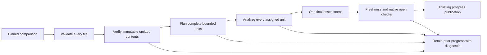
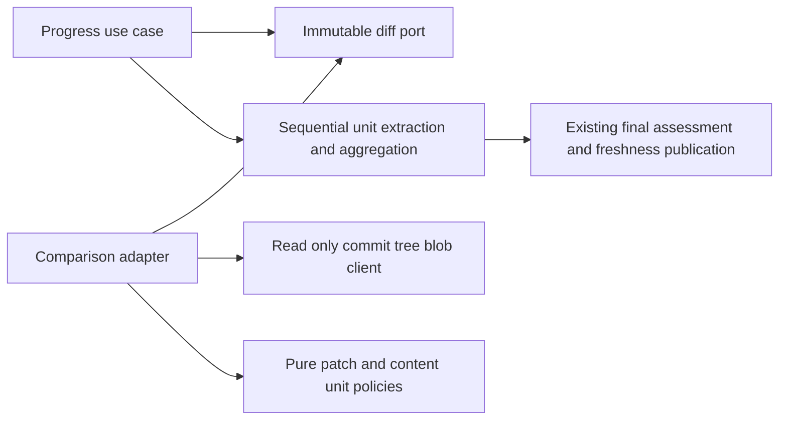

# Complete immutable progress content recovery

- Status: Implemented; remote verification pending
- Date: 2026-10-27
- Catalog capability ID: github-communication-experience
- Owners: Copilot maintainers
- Scope: complete progress evidence when GitHub omits, truncates or cannot fit a required text patch.
- Related issue: [#726](https://github.com/vypdev/copilot/issues/726)
- Review gates: UX, architecture, security, tests, documentation and operations.
- Open decisions blocking readiness: none.

## 1. Executive summary

Progress MUST use every required file from one pinned comparison. When a source
patch is absent, structurally incomplete, inconsistent with its changed-line
totals or too large for one source part, Copilot MUST try bounded immutable Git
content recovery. It MUST analyze every resulting unit before one final
assessment. An unavailable assessment retains the previous progress.

```text
Pinned comparison -> validate inventory -> verify missing contents -> plan all
bounded units -> scope -> analyze every part -> final assessment -> freshness
checks -> existing progress publication
```

## 2. Problem and evidence

The #611 guard correctly stopped progress when a required patch was missing,
but deliberately offered no content recovery. #547 supplied bounded multipart
analysis only for complete whole-file patches. Neither supports the complete
1.49 MB comparison reported in #726 when eight of 52 text patches are omitted,
including a 215,522-byte registry with zero provider line statistics. Additional
issue receipts reproduce an independently verified identical text rename and a
109,259-byte added JSON file with nonzero statistics. These are observed consumer
receipts; the exact GitHub omission threshold is unknown. Synthetic fixtures
reproduce their dimensions without copying private consumer sources.

This is a prospective extension of the owning communication SDD, not a claim
that the earlier fail-closed behavior was an accidental regression.

## 3. Actors, surfaces and terminology

Maintainers trigger the existing progress route through the Action or CLI. The
configured provider supplies an immutable comparison; the model supplies
untrusted observations, never execution attestations. Existing progress labels,
assessment cards, run logs and Job Summaries remain the product surfaces.

A **source unit** is one complete admitted patch/metadata record or a contiguous
UTF-8 content slice with file identity, side, offset and total bytes. A **part**
is a bounded collection of units. A **recovered file** has independently verified
base/head presence, paths, modes, blob hashes and exact contents. For divergent
branches, the preimage is the comparison's pinned merge base, not the current
development tree. The requested development SHA and head still identify the
comparison and the final freshness checks.

## 4. Goals, non-goals and invariants

- MUST recover complete regular UTF-8 text, including empty files, lockfiles,
  specifications, additions, removals and content-proven renames/copies.
- MUST NOT infer empty or identical content from zero statistics, filename,
  extension, provider URLs or model claims.
- MUST NOT omit files, shorten content, promote source reports into CI claims,
  inspect a checkout, execute commands or publish partial percentages.
- Existing `build/` and exact `specs/CATALOG.md` metadata exceptions remain;
  editable catalogs, SDDs and other registries are not added to that list.
- Binary/non-UTF8 contents, symlinks and submodules are unsupported recovery
  inputs. No consumer code, permission expansion or new workflow is required.
- GitHub's conservative comparison ceiling remains fewer than 300 files.

## 5. Product journey



Text equivalent: validate all files, recover exact contents when needed, plan
all units, analyze all parts, assess once, recheck freshness and publish. Any
incomplete, over-budget, failed or stale stage preserves previous progress.
Previously an omitted patch stopped immediately; now recoverable text proceeds
without requiring a consumer representation workaround.

## 6. Functional and state contract

1. MUST validate all paths, statuses, duplicate paths and numeric facts before
   object retrieval. A complete patch MUST account for every unified hunk and
   match both changed-line totals; cumulative or in-hunk truncation triggers
   recovery rather than partial model input.
2. Recovery MUST resolve exact commit trees and nonrecursive subtrees. Every
   directory response MUST match its requested SHA and be nontruncated. A path
   MUST resolve uniquely; absence is proven by a complete directory. No response
   URL, mutable ref or candidate filesystem path is followed.
3. Added files MUST be absent at the preimage and present at head; removed files
   MUST have the inverse presence. Other supported changes MUST have both
   contents; rename/copy MUST supply a safe previous path. Regular file modes
   MUST be retained. Equal rename blob hashes MUST be independently resolved
   before content is supplied once with both identities.
4. Blob size, encoding, canonical base64, decoded length and recomputed Git blob
   SHA-1 MUST agree. Text MUST roundtrip as UTF-8 and contain no NUL. BOM, CRLF,
   final newline and supplementary characters MUST remain exact.
5. Complete contents MUST split into contiguous code-point-safe slices, with
   deterministic unit IDs and complete side/path/hash/mode/offset/byte totals.
   All units, manifests, prompt envelopes and fact budgets MUST be admitted
   before the first model call. Recovered evidence uses explicit unit responses
   even when it fits one part; legacy complete patches retain their old path
   schema. Every unit response MUST match partition ID, locale, unit ID and path
   exactly once. Duplicate, extra, missing and cross-part replay facts fail.
6. Aggregation MUST independently reject incomplete assignments. Only after all
   parts validate may one final progress assessment occur. Native open status,
   issue body and both branch SHAs MUST still pass existing freshness fences.
7. Recovery caches and partial facts MUST be invocation-local. Replay reloads
   pinned evidence with fresh budgets; no partial durable checkpoint is reused.

States are pending recovery, admitted evidence, partial analysis in memory,
complete assessment, stale/canceled and blocked. Partial analysis is never a
published percentage. No new durable state or schema is introduced.

## 7. Configuration and fixed limits

Automatic recovery is the default and has no new input, flag, secret, variable
or precedence rule. The recommended path is normal progress assessment; the
meaningful alternative for an unsupported/oversized comparison is smaller
reviewed changes. Manual inspection never certifies Copilot completion.

| Fixed per-invocation limit | Bound and validation |
|---|---:|
| Changed-file inventory | 299 maximum; 300 is completeness-unknown |
| Recovered files | 64 |
| Each recovered blob | 1,048,576 bytes, checked before download |
| Total represented recovered side bytes | 4,194,304, including cache hits |
| Git object requests | 256, charged before request |
| Directory entries visited | 50,000, across nonrecursive directories |
| Evidence units | 512, exact unique IDs |
| Slice JSON text | 120,000 bytes, including JSON escaping |
| Source part and manifest | 256,000 bytes each, unchanged |
| Parts | 16 maximum, unchanged |
| Combined model facts | 384,000 bytes maximum, unchanged |
| Complete runtime prompt | 524,288 bytes, unchanged |

The slice bound leaves framing space inside a source part; two ordinary slices
can share a part. Total multipart capacity remains independent of content
retrieval capacity: an admitted blob can still exceed serialized/model budgets.
Fact prose remains adaptively bounded at at most 600 Unicode code points; the
reservation includes every unit identity as well as the issue/scope envelope.
Limits cannot be overridden by repository text or model output.

## 8. Architecture and executable boundaries



Text equivalent: the application depends on an immutable diff capability, the
adapter obtains provider objects, pure policies plan complete units, and the
existing application orchestrates extraction, assessment and publication.
Provider DTOs and hashing stay in data/infrastructure; pure policies perform no
I/O. `GithubProgressObjectClient` exposes only commit/tree/blob reads. Composition
binds the same repository and credential. Architecture/dependency, type, workflow
and provider-contract tests MUST pass; no workspace/process capability is added
to the progress query port.

## 9. UI/UX and content

Existing localization and semantic ownership remain. No new comment, card,
notification, command, control or completion cadence is introduced. Run logs
show bounded part progress; existing result/Job Summary owns the outcome.
Representative plain-language states:

```text
Pending: Collecting complete evidence for this revision. No action required.
Partial analysis: Assessing evidence part 2 of 7. Previous progress remains
published until all parts and the final assessment finish.
Complete: Progress assessed from the pinned revision. CI remains a separate gate.
Blocked: Progress was not assessed; immutable text could not be verified.
Action: Inspect the named paths in the pinned comparison or split reviewed work.
Retained state: Existing progress labels and assessments were preserved.
Technical details: validation.evidence-unavailable; Unreviewed paths (2):
"specs/a.md", "specs/registry.json"; linked workflow run.
```

These illustrate existing operator surfaces, not extra timeline messages.
Error content MUST follow impact, cause, action and retained state. Diagnostics
MUST identify at most eight exact unreviewed paths and disclose the total count;
all required files remain unreviewed until model admission succeeds. Source
contents, credentials and provider URLs MUST NOT appear in diagnostics. Existing
renderers sanitize Markdown, commands, mentions and control characters. English,
Spanish and existing fallback remain; diagnostic paths are literal data. Textual
statuses and descriptive run links preserve narrow-screen and light/dark
readability; neither color nor the diagram is the sole status signal.

## 10. Failure, recovery and cleanup

| Failure | Result, recovery and retained state |
|---|---|
| Missing object/invalid bytes/unsupported content | Terminal `validation.evidence-unavailable`, named paths; inspect or split work; prior progress retained |
| Content/work/serialization/fact budget | Terminal `validation.evidence-too-large`, named recovery paths; reduce/split; prior progress retained |
| Genuine transport/auth/rate limit | Original provider classification and retryability; no deterministic omission mislabeled as outage |
| Invalid/failed middle part or final result | Existing model failure; no final percentage after a failed part and no progress publication |
| Head/base/body movement, native closure or cancellation | Existing stale/canceled outcome; previous progress retained |

No external effect requires rollback during content recovery. In-memory caches
and facts are discarded at invocation end. Other independently completed workflow
effects keep their existing outcome reporting and cleanup; this feature does
not claim that an entire multi-step invocation had no effects.

## 11. Security and privacy

Only existing repository Contents read access is used. Commit SHA, tree SHA and
blob SHA are validated; paths reject absolute/traversal/empty segments, backslash
and NUL and are at most 1,024 UTF-8 bytes. Symlinks are never dereferenced.
Provider objects cannot inject URLs or executable commands. Source, issue text,
scopes and model facts MUST retain the #717 untrusted-data envelopes. No private
consumer source is added to fixtures. Git hashes prove byte identity under the
provider's object contract, not successful tests or semantic correctness.

## 12. Observability

Existing correlation/error records and linked run details expose nonretryability,
retained progress, a bounded reason and uncovered paths. Sequential part logs
remain bounded by 16. There is no per-file conversation spam or raw blob logging.
Provider exceptions remain genuine provider errors; recovery availability is not
claimed until bytes and the full plan validate.

## 13. Compatibility, rollout and rollback

This extends #547/#611 rather than weakening completeness. Complete ordinary
patches keep their path response contract and publication identity. Recovered
units use a schema understood by this runtime only; they are not persisted or
passed between runtime versions. Upgrade through the normal reviewed package/
Action delivery; no consumer form, lockfile restructuring or state migration is
required. Rollback restores fail-closed omission behavior, not a partial review.
Live consumer verification remains separate from synthetic upstream acceptance.

## 14. Numeric test budget

Minimum **104 distinct regression cases**, derived from identity, completeness,
resource, aggregation and publication risks. Parameterized behaviors count once
per distinct scenario; the communication ledger separately counts conservative
new declarations, without double counting this extension.

| Area | Minimum | Required risk coverage |
|---|---:|---|
| Pure patch/content/partition/response policies | 46 | Hunk totals/truncation, UTF-8 slices, identities, exact unit facts, aggregate completeness |
| Provider adapters | 40 | Exact objects, presence, rename, bytes/hash, tree traversal, all budgets, outages and replay |
| Application/integration | 16 | Complete aggregation, failed/malformed parts, stale heads/native closure, no model before admission |
| Composition/localized contract | 2 | Read-only binding and retained-state recovery guidance |

Pure policies MUST have 100% statements/branches/functions/lines; new recovery
adapter SHOULD also achieve 100%. Existing global/module/setup-acceptance
budgets, extension tests, full Jest, build/type/lint, workflows, documentation,
package/CLI/API/web smoke and Graphify updates remain required. Deterministic
fakes use no live service or waits. Semantic assertions accompany content
fixtures; visual/manual review checks concise operator meaning and readable
limits rather than treating a snapshot as complete UX evidence.

## 15. Documentation and discoverability

Update branch-management progress guidance, agent execution contract and operator
error reference together. Register this SDD in the existing communication catalog
and link it from the owning SDD. Explain defaults, supported text/rename recovery,
limits, partial/failure retention, exact-SHA behavior and migration. Existing docs
navigation and validation remain; no new route is required.

## 16. Acceptance

- The synthetic 52-file/8-omission comparison and 215,522-byte registry MUST
  preserve every required path and byte across multiple bounded parts.
- A 109,259-byte added JSON file and a separately proven identical text rename
  MUST assess without changing consumer representation.
- Empty added/removed text MUST have object-proven presence; zero stats alone
  MUST NOT make unknown content reviewable.
- Cumulative/in-hunk truncation MUST recover full contents; unavailable recovery,
  binary content, forged identity, wrong presence or any exhausted budget MUST
  make zero model/progress calls before admission.
- A failed/malformed/replayed part MUST prevent final assessment and publication;
  all valid parts plus a valid final assessment and fresh sources allow one
  existing publication. Retry MUST not reuse partial facts or stale hashes.
- English/Spanish operator outcomes MUST explain recovery and retained state;
  composition and architecture checks MUST preserve read-only capabilities.

## 17. Traceability

| Requirement | Owner | Automated evidence | Documentation |
|---|---|---|---|
| Complete hunks and totals | patch completeness policy | `progress_patch_completeness_policy.test.ts` | execution contract |
| Immutable objects and bounded recovery | recovery/comparison adapters | `immutable_progress_content_repository.test.ts`, `progress_diff_recovery.test.ts` | branch management/error reference |
| Lossless slices and exact facts | content, partition, response policies | `progress_content_evidence_policy.test.ts` plus existing policy suites | branch management |
| Atomic assessment and freshness | progress/summarization use cases | recovered cases in `progress_multipart.integration.test.ts` and existing scope cases | execution contract |
| Capability binding/localized retention | composition and error catalog | composition contract plus existing localized/error tests | error reference |

## 18. Implementation sequence

Define identities and limits, implement/test immutable recovery and unit planning,
connect exact response aggregation, update localized diagnostics/specs/docs,
then run full coverage, architecture/contract/package checks, Graphify, normal
hooks and remote review/CI. No change to deployment or remote branch ownership.

## 19. Definition of Done

Every normative behavior maps to acceptance above; numeric budget and exhaustive
pure coverage pass; all source and prompt budgets precede models; unsupported,
partial, stale and retry states retain progress; no extra permission or comment
route exists; docs/catalog/ledger and generated bundles agree; normal local and
remote validation pass. No unresolved decision or claimed live consumer result
may substitute for evidence.

## 20. References and decisions

- [Owning communication SDD](./semantic-github-publication-and-notification.md).
- [GitHub comparison API](https://docs.github.com/en/rest/commits/commits#compare-two-commits): first-page inventory limited to 300 files.
- [Git tree API](https://docs.github.com/en/rest/git/trees#get-a-tree): explicit truncation; nonrecursive subtree retrieval.
- [Git blob API](https://docs.github.com/en/rest/git/blobs#get-a-blob): immutable blob ID, base64 bytes and Contents read permission.
- #726 receipts provide consumer dimensions and object identities, not a claimed
  universal GitHub patch size threshold. Metadata-only and larger-global-cap
  workarounds are rejected because they weaken or evade complete analysis.
