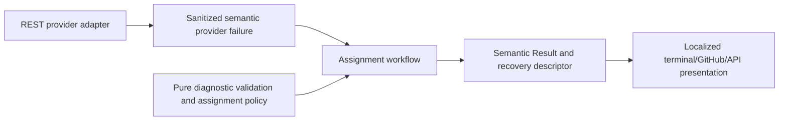

# Actionable issue assignment failures and safe retries

- Status: Implemented; local acceptance complete, delivery follows normal PR gates
- Date: 2026-11-03
- Catalog capability ID: `managed-issue-lifecycle`
- Owners: Copilot maintainers
- Scope: bounded assignment diagnostics, confirmed partial effects and replay
- Related issue: [#849](https://github.com/vypdev/copilot/issues/849)
- Required review: architecture, product content, security, tests, documentation,
  generated bundles, full current-head review and official diff coverage
- Open decisions blocking readiness: none

## 1. Executive summary

An assignment failure must name the failed stage and safe provider operation,
retain its known classification, and distinguish confirmed changes from an
unverified write. A retry reads current assignees before adding missing members.
Other lifecycle steps keep their own results and completed effects.

```text
read current assignees -> already sufficient: retain without membership lookup
                      -> lookup eligible members -> assign/verify creator
                      -> select/assign/verify additional members
failure -> safe stage, operation, HTTP category, confirmed/remaining counts
        -> continue independent lifecycle steps -> inspect results -> safe retry
```

## 2. Problem, observed behavior and evidence

The original immutable released SDK `3e7ceea08e6131360e026937d1c0cc1b120472e0`
failed in [Domus run 41337490802](https://github.com/vypdev/domus/actions/runs/41337490802)
on source `8ee7e1a15e91c91b6204ca97e8808c3207dee008`. Member lookup and assignment
failed, while type, Project/priority and configuration effects completed. The
published error only said `provider.unavailable`, retryable Yes. Its actual HTTP
status and cause are unknown. A later assigned issue does not prove this attempt
succeeded. No consumer rerun, credential change or source correction is required.

Current development evidence at `7d1e8d3b` shows adapters logging a generic error
then rethrowing raw exceptions, application wrapping them again as unavailable,
membership queried before counting existing assignees, and creator success
reported without checking the assignment response. Five SDK-owned functional
regressions fail before the fix. These observations do not reconstruct the
unavailable original exception. Historic motivation is unknown.

## 3. Actors, surfaces and terminology

The maintainer reads the existing workflow result/Job Summary and retries the same
issue workflow after addressing the stated cause. API and CLI users receive the
same semantic descriptor and localized view. A **confirmed assignment** is a
requested identity present in the returned native assignment list; a write that
throws or omits requested identities has an **unverified outcome**. It may have
applied remotely. Independent results are not inferred from assignment counts.

## 4. Goals, limits and fixed requirements

| ID | Requirement |
|---|---|
| R1 | Adapter failures MUST preserve a closed operation, bounded HTTP status when known and truthful semantic category; unknown failures MUST NOT be invented as transient. |
| R2 | Raw messages, response bodies, credentials and membership lists MUST NOT cross the failure boundary. Existing semantic correlation and narrowed retryability MUST survive wrapping. |
| R3 | The application MUST read current assignees first, skip satisfied targets, confirm requested assignments and retain confirmed partial results without claiming failed writes had no effect. |
| R4 | Retry MUST reread assignees, exclude the confirmed creator from additional selection and avoid repeating already-satisfied writes. Independent lifecycle results MUST remain intact. |
| R5 | Validated public diagnostics and English/Spanish presentation MUST name impact, stage/operation, recovery and retained/remaining facts; an unread count MUST be shown unavailable. |
| R6 | Documentation, catalog, architecture checks, generated bundles and current-head technical/review/coverage gates MUST accompany the correction. |

No model calls, new credentials, automatic retry loop, arbitrary diagnostic
strings, feature flag, new endpoint or persisted assignment journal are added.
The configured count remains an upper target, not a guarantee that enough
eligible members exist. A valid empty selection retains its existing explicit
unsuccessful result; it is distinct from a failed or malformed provider read.

## 5. Current versus proposed journey

| Stage | Current risk | Proposed behavior |
|---|---|---|
| Read | unnecessary membership failure on satisfied target | read current native assignments before membership |
| Failure | opaque transient label | adapter-owned operation/status/category plus application-owned stage |
| Write | unconfirmed creator claimed successful | verify returned identities, retain successful partial identities |
| Retry | creator can reenter additional selection | fresh read and current-plus-confirmed exclusion |
| Publication | generic unchanged-state text can hide partial effects | assignment-specific retained facts, other results kept separately |

## 6. State and functional behavior

Stages are `read-assignees`, `lookup-members`, `assign-creator`, `select-members`,
and `assign-members`. The application advances them immediately before the
corresponding semantic port operation. The adapter separately owns `list-teams`,
`list-team-members`, `read-assignees`, `add-assignees`, `initialize-client`, or
`unavailable` when no provider operation was established.

The creator has first preference only while the target still needs assignments.
Current/confirmed identities compare without case; duplicated response aliases
cannot multiply success counts. A returned assignment list that omits requested
identities produces `provider.contract-invalid`, retaining any identities that
were confirmed. No rollback removes a legitimate assignee.

Writes are `not-attempted`, `verified`, or `unverified`. Confirmed counts describe
this attempt only. An unread current list is unavailable, not a verified empty
list. Later selection failure after creator confirmation retains that success.

## 7. Configuration

`desired-assignees-count` stays a validated integer 0–10, default 1, from the
existing execution configuration snapshot. Zero remains a no-op before target
validation or provider/client access. Recommended: `1`; alternative: `2` for two
owners or `0` to disable. No new precedence, storage or migration is introduced.
Diagnostic allowlists, redaction, confirmation and retry classification are not
configurable. No raw provider text can become a setting or recovery template.

## 8. Clean Architecture



Text equivalent: adapters translate provider failures; application orchestration
adds stage and confirmed progress; pure validation bounds the descriptor;
presentation localizes the resulting facts without mutation authority.

`AssignmentProviderError` is an application-port error with a closed operation
and safe status, extending the existing semantic error. Raw causes terminate
at the adapter. `issueAssignmentFailure` preserves category/correlation and adds
application-owned progress. Existing bound port signatures/composition stay
unchanged. No application code parses Octokit DTOs. Architecture/import-boundary
checks enforce dependency direction; validators and type checks enforce exact
descriptor keys and bounded values. Existing assignment policy remains provider
free. Other lifecycle ownership and configuration persistence are unchanged.

## 9. Product content, accessibility and localization

Existing result surfaces are reused; there is no new comment/card or browser UI.

```text
Pending: Read current assignees, then add only missing eligible members.
Complete: The creator assignment was confirmed; no assignment remains required.
Action required: Assignment stopped while checking organization membership.
  Provider operation: organization teams; status: http-403.
  Check the configured credential, documented access and target resource.
  Verified new assignments: 0. Remaining target count: 1. Write: not attempted.
Partial: Additional-member selection failed after one confirmed creator.
  Verified new assignments: 1. Remaining target count: 1. Write: confirmed.
Failed write: Response unavailable. Write outcome unverified; it may have applied.
  Rerun the same workflow after recovery; current assignees are read again.
```

The existing error code, Retryable and correlation Reference remain visible.
Known 403 denial differs from 403/429 rate limiting. A 404 does not establish
absence of a private resource. English and Spanish use catalog IDs; other locales
retain existing catalog resolution/fallback. Text is readable without color,
emoji or tables, on narrow/light/dark surfaces. Only allowlisted identifiers and
counts enter templates; supplied Markdown, URLs or member names cannot become
diagnostic content. Existing workflow/run links and result ordering are retained.

## 10. Failure, recovery, idempotency and cleanup

| Failure | Retry guidance | Retained facts |
|---|---|---|
| 401/403 denial | inspect configured authentication/access before retry | verified assignees and independent completed effects |
| 404 | verify resource and access; do not infer private absence | same |
| 403/429 limited | wait for provider limit recovery | same; no in-process retry storm |
| 408/5xx/recognized transport failure | retry after provider recovery | confirmed writes; failed write may have applied |
| malformed response | investigate provider contract; no fake empty list | last verified facts only |
| unknown failure | investigate by correlation; no blind transient retry | bounded stage; unavailable status when unknown |

Retries read native state and skip a satisfied target. The additive native API
does not require deleting existing assignments. External concurrent writers can
race a read/add; this correction makes no transaction or conditional-write claim.
No durable assignment cache is introduced, so cancellation leaves native effects
for the next ordinary event to reread. Other steps keep their existing read/no-op
contracts. No new scratch runtime or production cleanup is needed.

Completion/replay integration MUST verify these effects together through the
actual completion and configuration persistence path: an assignment failure does
not undo the selected issue type, Project link or stored branch configuration.
A fresh run MUST retain one Project item and one configuration block. The
existing type setter may repeat an idempotent assignment of the same type ID;
this MUST NOT be represented as creating another type entity or as zero writes.

## 11. Security and privacy

Existing credential-bound ports and permissions remain. No failed diagnostic
authorizes expanding scopes. Safe metadata is extracted once and provider
exceptions are discarded. Structured recovery accepts exact keys, positive safe
target identity, known stages/operations, HTTP 100–599 or unavailable, and bounded
counts or explicit `unavailable` markers for unread current/remaining values. No token, organization/team/member list, raw cause or response is retained
in the error. SDK fault tests use fixed fakes and no service credentials.

Rate-limit classification MAY inspect the provider's response-body message
transiently, including when the top-level exception message is absent or only
`Forbidden`. The response body MUST NOT be retained in the semantic error, log,
Result or recovery descriptor. The two additional boundary regressions verify
both classification and redaction; they are part of the R1/R2 adapter budget.

## 12. Observability and operational UX

One assignment failure reaches its existing Result and log, with the same
correlation across adapter/application wrapping. Stage, operation, HTTP status,
category, retryability, observed/confirmed/remaining counts and write certainty
are available without raw exceptions. Independent type/Project/configuration
outcomes remain in their own lifecycle results; the assignment error does not
predict future success. No new metrics service, repeated comments or notification
budget is added. Logs and public rendering share the validated descriptor.

## 13. Compatibility, rollout and rollback

This is an additive recovery descriptor and internal error refinement with no
port/config schema migration. Legacy null/missing `assignees` still maps to an
empty native list; malformed non-list/row shapes fail closed. Unknown failures
now correctly require investigation instead of an invented retryable outage.
Creator success now requires confirmation. Existing successes and partial
results remain visible. Ship through normal SDK bundles/package and managed patch
after the bug backlog; rollback to the previous reviewed SDK does not undo native
effects and reinstates the diagnosed limitations. No consumer history is edited.

## 14. Numeric test budget and evidence

Minimum **60 new distinct cases**: 18 adapter classification/redaction/runtime
shape cases; 14 pure diagnostic validation/security cases; 12 application
confirmation/replay/partial-state cases; 8 localized presentation cases; 4 issue
route integration cases; and 4 semantic identity/serialization/architecture
compatibility cases. Cases count once; repeated runs do not count as new cases.

Local acceptance on 2026-11-04 passes **887 suites / 17,321 Jest tests**
(35 pre-existing skips) and **267 extension tests** at 100% in all four metrics.
There are **137 new distinct cases**: 29 pure validation, 69 provider/adapter,
14 application, 14 localized presentation, six issue-route/completion integration and five
semantic/serialization cases (four allocated from the 33 domain cases plus the
new exhaustive recovery-inventory case). No case is counted twice. All eleven
affected assignment modules reach 100% lines/statements/functions/branches.
The two completion cases retain type, Project and persisted configuration
together after HTTP 503 and HTTP 403 lookup failures and verify fresh retries
through real completion/storage logic with deterministic provider transports.
Full-suite LCOV hits **150/150 modified coverable lines**, with zero misses or
partials against `7d1e8d3b`. This is local evidence; official Codecov and remote
current-head checks remain PR delivery gates.

All changed coverable lines must be covered in full-suite LCOV and official
Codecov against the live base, with zero modified misses/partials. New pure
validation and presentation modules target 100% statements/branches/functions/
lines. Existing repository, extension, architecture and coverage budgets remain.
Use real SDK adapters with deterministic provider fakes, no sleeps or live fault
injection. Rendered content assertions cover safe English/Spanish output and
unknown/partial states; no VoiceOver or browser product UI changes are involved.

## 15. Documentation

Update assignment recovery in `docs/issues/assignees-and-projects.mdx` and the
error reference for operators. Link this companion from the managed lifecycle
SDD and catalog; regenerate `specs/CATALOG.md`. Existing authentication/setup and
configuration docs remain authoritative because permissions and inputs do not
change. Validate documentation/navigation and the SDD/catalog together.

## 16. Acceptance

Unavailable, denied, limited, malformed and unknown lookups produce distinct safe
diagnostics. An already assigned target performs no membership lookup/write.
Unconfirmed creator response is never success. Confirmed creator/additional
identities survive a later failure; a fresh retry adds only missing members.
A write that applied before throwing is not repeated after the fresh read.
Independent issue steps continue and retain their results after assignment
failure. API JSON and English/Spanish text preserve safe recovery/correlation.

## 17. Traceability

| Requirements | Verification | Documentation |
|---|---|---|
| R1–R2 | `src/data/repository/github/__tests__/assignment_provider_failure.test.ts` and `src/data/repository/__tests__/assignment_provider_contract.test.ts` | error reference |
| R3–R4 | `src/tooling/__tests__/issue_assignment_diagnostics.test.ts`, including four real issue-route cases; `src/tooling/__tests__/issue_assignment_completion.integration.test.ts`, covering completion, actual configuration persistence and replay after transient and persistent failures; and `src/application/policies/__tests__/assignee_assignment_policy.test.ts` | assignees and projects |
| R5 | `src/domain/__tests__/issue_assignment_diagnostic.test.ts`, `src/application/policies/__tests__/issue_assignment_messages.test.ts`, exhaustive `application_error_presentation_policy.test.ts` recovery inventory | both pages |
| R6 | architecture/types/docs/catalog/package/bundles and current-head CI/review/Codecov | this SDD/catalog |

## 18. Implementation sequence

Preserve original evidence; execute baseline failures; define bounded semantic
contracts; map adapters; retain application progress/confirmations; localize;
execute regression/architecture/full coverage; align docs/catalog and bundles;
publish normal commits; verify complete current-head review/Codecov/platforms.

## 19. Definition of Done

All six requirements, numeric budget and changed-line coverage pass; architecture
and generated artifacts remain valid; no secrets or unconfirmed-success claims
escape; documentation/catalog agree. Merge only with complete current-head review,
zero open findings/threads, all applicable checks and official diff coverage 100%
with zero misses/partials against the correct base. Then verify native issue
closure and retire owned disposable outputs while retaining evidence/rollback.

## 20. References and decisions

- [GitHub API troubleshooting](https://docs.github.com/en/rest/using-the-rest-api/troubleshooting-the-rest-api)
- [List teams](https://docs.github.com/en/rest/teams/teams#list-teams)
- [List team members](https://docs.github.com/en/rest/teams/members#list-team-members)
- [Managed lifecycle](./managed-issue-and-branch-lifecycle.md)
- [Semantic errors](./execution-error-and-context-hardening.md)

Primary provider documentation was checked on 2026-11-03. Preserve safe facts,
not raw provider messages. Read current assignment first to make satisfied
replays independent of membership availability. Keep the existing coordinator and
independent step contracts; no new transaction, persistence framework, model
qualification or consumer permission change is needed.
