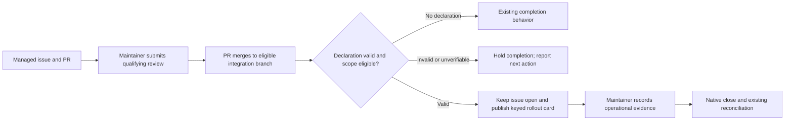
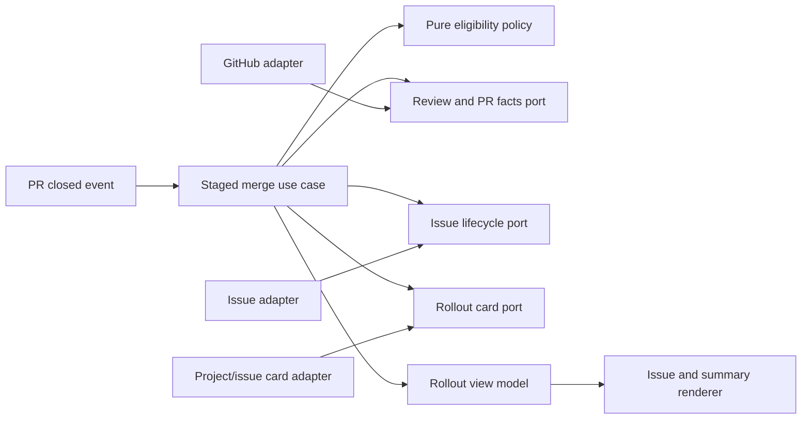

# Staged rollout after a preparatory pull request

- Status: Draft
- Date: 2026-11-06
- Catalog capability ID: managed-issue-lifecycle
- Last verified: not applicable (prospective companion)
- Owners: Copilot maintainers
- Scope: Define how an explicitly reviewed preparatory merge can leave its managed issue open as the sole tracker for post-merge operational acceptance.
- Related issues/PRs: [Issue #735](https://github.com/vypdev/copilot/issues/735); [VaultStadio issue #85](https://github.com/vypdev/vaultstadio/issues/85); [VaultStadio PR #108](https://github.com/vypdev/vaultstadio/pull/108)
- Required review gates: product UX, architecture, testing, documentation, security/operations
- Open decisions blocking readiness: None in the supplied answers. Draft remains blocked from implementation readiness until required review gates and repository validation are completed.

This is a proposed companion to the existing [managed issue and branch lifecycle specification](managed-issue-and-branch-lifecycle.md) and [issue assignment failure recovery specification](issue-assignment-failure-recovery.md). Preserve both as the owning baseline; this document adds only staged merge behavior. The catalog's existing paths identify current evidence locations, not proof of future implementation. The supplied implementation arrays are absent for a proposed owner, so this draft does not claim the proposed behavior exists or has been tested.

## 1. Executive summary

A maintainer may declare, through a qualifying GitHub PR review submitted before merge, that a preparatory PR completes implementation work while operational acceptance remains pending. Copilot then keeps the original managed issue open, assignable, and intact as the sole rollout tracker. It publishes one status card tied to the merged PR and reports “Rollout pending”; it does not mark the issue 100% complete. After reviewing evidence and completing the issue's existing checklist, a maintainer closes the issue through the existing native close and reconciliation path.

Without a valid declaration, ordinary close-on-merge behavior remains unchanged. A recognizable but invalid, stale, conflicting, unauthorized, or unverifiable declaration fails closed: Copilot does not perform merge-driven completion or publish 100%, and the issue remains actionable with a safe next step. This declaration grants no merge, deployment, activation, release, approval, or branch-protection authority.

```text
Managed issue + qualifying reviewed declaration -> preparatory PR merged -> issue remains open with Rollout pending card -> maintainer records operational evidence -> native issue close and reconciliation
```

## 2. Problem, current behavior, and evidence

### 2.1 Problem

Maintainers and assignees need a supported way to merge a prerequisite implementation PR without losing the issue that tracks trusted-source rollout and real operational acceptance. Automatic completion can make pending work appear finished, retire progress tracking, and remove the next action from the open issue. Green candidate tests and a merge do not establish trusted-main activation or official runtime verification.

### 2.2 Current behavior

1. A managed issue may be linked to a PR using non-closing context such as `Refs #85`.
2. In the reported consumer event, PR108 merged to `develop`; its description explicitly left operational acceptance pending. The subsequent Copilot `pull_request:closed` run succeeded, and the linked issue was closed by `vypbot` with progress later shown as 100%.
3. The reported merge preserved the verified candidate tree and left `master` and `VERIFICATION_SETUP=false` unchanged. Candidate macOS and Linux runs each executed 4,484 tests, but were not the immutable trusted-main Copilot protocol.
4. These are incident facts from the issue report, not a claim that this companion's behavior is implemented. The companion proposes an opt-in staged path while retaining ordinary completion for genuinely complete work.

### 2.3 Evidence

- Code/workflow/documentation references in the validated owning catalog: `.github/workflows/copilot_issue.yml`, `.github/workflows/copilot_commit.yml`; lifecycle entrypoints `src/application/usecases/issue_use_case.ts` and `src/application/usecases/commit_use_case.ts`; completion path `src/application/usecases/steps/issue/close_issue_after_merging_use_case.ts`; reconciliation paths `src/application/usecases/actions/reconcile_closed_issue_use_case.ts` and `src/application/usecases/actions/reconcile_closed_issue_metadata_use_case.ts`; progress and lifecycle policies and tests listed in the catalog.
- Current user documentation evidence: `docs/issues/notifications-and-auto-close.mdx`, `docs/issues/branch-management.mdx`, `docs/issues/labels-and-branch-types.mdx`, and `docs/issues/comment-commands.mdx`.
- Incident: [VaultStadio issue #85](https://github.com/vypdev/vaultstadio/issues/85), [PR #108](https://github.com/vypdev/vaultstadio/pull/108), [merge workflow run](https://github.com/vypdev/vaultstadio/actions/runs/40424079232), [macOS candidate run](https://github.com/vypdev/vaultstadio/actions/runs/40411879338), and [Linux candidate run](https://github.com/vypdev/vaultstadio/actions/runs/40416515611). The supplied report also identifies pre-merge evidence and progress comments #6430079839, #6430309650, and resulting progress card #6427726092.
- External primary sources: GitHub pull request review identity, commit association, submission, edit and dismissal facts must be obtained from the provider's review/event APIs; implementation must verify supported API semantics against GitHub documentation. No external source was supplied or independently verified for this draft.
- Unknowns: Exact current event payload/API behavior, repository permission mapping, card marker conventions, coverage thresholds, and available validation commands require confirmation against the repository implementation/toolchain before implementation. No workflow execution is evidenced by the catalog listing.

### 2.4 Retrospective classification (as-built baselines only)

Not applicable: this is a prospective companion and reconstructs no implemented baseline. The incident facts above are evidence motivating proposed behavior, not an as-built contract for Copilot.

## 3. Actors, surfaces, and terminology

| Actor | Goal | Entry point | Visible surfaces |
|---|---|---|---|
| Issue assignee | Keep all rollout acceptance actionable on the original issue | Managed PR merge | Issue status card, checklist, assignees |
| Maintainer/admin | Declare a qualifying staged merge; later review evidence and close | Submitted PR review; native issue close | PR review, issue, workflow summary |
| Copilot workflow | Evaluate declaration, preserve issue state, register rollout status | Same-repository PR closed event | Issue card, job summary, logs |
| Operator | Recover publication failures and inspect authorization result | Failed or replayed merge job | Job summary, sanitized logs, issue card |

**Managed issue** means the distinct issue already resolved by Copilot for processing that PR. **Staged declaration** means the exact submitted review body `Copilot-Stage-Rollout: #<issue-number>`. **Preparatory PR** means a regular same-repository PR merged into a non-default integration branch, with no native closing link or keyword for the staged issue. **Rollout pending** means implementation has merged while operational acceptance remains open. **Status card** means the single Copilot-owned issue card keyed to that preparatory PR. Candidate verification, trusted-source readiness, activation approval, and official operational verification are separate facts.

## 4. Goals

| Requirement | Behavior |
|---|---|
| SDD-I735-R1 | A valid staged declaration defers only Copilot's merge-driven completion for the exact distinct managed issue it names; that issue remains open, assigned, and retains its acceptance checklist. |
| SDD-I735-R2 | A declaration is valid only when a human GitHub review author has a current repository maintainer/admin role, the exact managed issue is named, and the review is submitted before merge, tied to the exact merged PR head, unedited, undismissed, and unconflicted. |
| SDD-I735-R3 | Staging is limited to regular same-repository managed PRs merged into a non-default integration branch without native closing links or keywords; invalid or unverifiable declarations hold Copilot completion and 100%. |
| SDD-I735-R4 | A staged merge publishes or updates one issue status card keyed to the preparatory PR with “Rollout pending,” the merged PR link, and a next action to finish the existing checklist and record evidence. |
| SDD-I735-R5 | Card publication is idempotent; a retry after a lost create response adopts the same card, while publication failure identifies the same failed merge job as recovery. |
| SDD-I735-R6 | Staged state cannot be overwritten by stale progress refresh; duplicate, replay, manual close, and reopen events preserve current native state and evidence. |
| SDD-I735-R7 | Human acceptance closes the original issue through existing native close and reconciliation behavior; no follow-up issue is created. |
| SDD-I735-R8 | Declaration content and workflow output are treated as untrusted data; the declaration grants no merge, activation, deployment, release, approval, or protection-bypass authority. |

### 4.1 Non-goals

1. Changing native GitHub closing-reference semantics or independent human closure.
2. Creating a follow-up issue or transferring the checklist.
3. Certifying trusted-main activation from candidate results, merge status, labels, or a progress percentage.
4. Changing branch protections, secrets, setup variables, refs, or deployment behavior.
5. Generalizing this contract to cross-repository, default-branch, or non-managed PRs.

### 4.2 Fixed invariants

1. The issue named by a declaration must equal the distinct managed issue already resolved for that PR; one declaration cannot stage other linked issues or change which issues Copilot processes.
2. Free text and `Refs` links are context only. Only a qualifying GitHub review supplies the declaration.
3. Native closing references/keywords retain existing behavior and disqualify the staged path for the named issue.
4. Staging leaves the original issue open, assigned, and with its complete acceptance; it never reports merge as 100% completion.
5. No green candidate run or staged declaration authorizes activation or weakens required checks.

## 5. Current versus proposed product journey

| Stage | Current | Proposed | User/operator effect |
|---|---|---|---|
| PR review | No staged lifecycle declaration is defined by this companion | Eligible maintainer submits exact review body before merge | Auditable, scoped declaration |
| Merge | Managed PR completion may close linked issue | Valid staged merge suppresses Copilot completion only for its exact issue | Original issue remains actionable |
| Progress | Merge may be projected as completion | One keyed “Rollout pending” card supersedes stale progress | Pending operational work remains visible |
| Acceptance | Closed issue follows existing reconciliation | Maintainer reviews evidence and natively closes original issue | Existing close/reconcile contract remains authoritative |
| Invalid declaration | No staged declaration contract | Hold Copilot completion and 100%; explain safe recovery | No accidental completion |



Text equivalent: managed issue and PR -> qualifying review and eligible merge -> validate declaration -> ordinary completion, safe hold, or open rollout tracker -> evidence review -> native issue close.

## 6. Functional behavior and state model

### 6.1 Happy path

1. Copilot resolves the PR's managed issue using existing issue-resolution rules before evaluating the declaration.
2. It reads submitted reviews and relevant PR facts, then validates reviewer identity/role, exact issue identity, merged head, timing, edit/dismissal state, conflicts, repository identity, target branch, and absence of native closing syntax.
3. With a valid declaration, the merge workflow records staged status for that issue/PR, leaves issue state, assignees, and acceptance untouched, and publishes or updates the keyed status card.
4. A maintainer uses the issue's existing checklist to record trusted source revision, separate activation approval, and official non-no-op verification evidence as applicable. For VaultStadio, evidence includes runtime, command, cleanup, and ref-publication proof.
5. The maintainer closes the original issue natively; existing reconciliation handles closure and preserves evidence.

### 6.2 Alternative paths

- No declaration: preserve ordinary close-on-merge behavior.
- Multiple managed issues: declaration applies only to its exact distinct issue; each other issue follows its own existing link and completion behavior. It cannot alter issue selection.
- Malformed, mismatched, unauthorized, bot-authored, stale, edited, dismissed, conflicting, or unverifiable declaration: keep the named managed issue open, do not mark it complete, and give a safe next action to review the existing issue and handle acceptance there.
- Unsupported repository/branch scope: hold Copilot completion for the declared managed issue and report the scope reason. Never treat unsupported context as authorization.
- Native closing reference/keyword: staged behavior is not eligible; preserve native close semantics and report the conflict for operator visibility.
- Card publication failure: retain staged decision and issue facts; fail the merge job with a retry instruction for that same job. Do not report successful registration.

### 6.3 State machine

| State | Entered when | User-visible meaning | Allowed next states | Recovery/owner |
|---|---|---|---|---|
| Ordinary completion | No recognizable staged declaration | Existing merge completion rules apply | Existing lifecycle states | Existing lifecycle owner |
| Declaration held | Recognizable declaration fails validation or cannot be verified | No Copilot completion; maintainer review needed | Retry verification or native acceptance/close | Maintainer; workflow reports reason |
| Rollout pending | Valid declaration and card registration succeed | Issue remains open; post-merge checklist is actionable | Rollout pending, natively completed, reopened | Assignee/maintainer |
| Registration failed | Valid staged decision but status card publication failed | Issue remains open; registration incomplete | Rollout pending after same-job retry | Operator retries failed merge job |
| Natively completed | Maintainer closes original issue | Acceptance reviewed and issue closed | Existing reconciliation/reopen behavior | Existing lifecycle path |

Duplicate merge delivery must not create another card or repeat completion effects. A lost create response must be reconciled by stable issue/PR identity and adopt the existing card. Older progress work cannot replace staged status. Replay after native close or reopen preserves the current native state and evidence.

## 7. User-facing configuration

No new user-facing configuration is proposed. The staged path is opt-in per PR through a typed review declaration; this keeps the existing close-on-merge default. The exact review body is `Copilot-Stage-Rollout: #<issue-number>` and `<issue-number>` is the already-resolved distinct managed issue number.

Validation rejects any body that does not exactly match, any issue mismatch, or a review that fails the role, timing, head, integrity, dismissal, conflict, repository, branch, or native-closing checks. Operation-time facts must be reread from GitHub when processing the merge event; no authorization is inferred from cached prose or labels. There is no migration setting, retired value, or arbitrary URL/ref/secret input. Non-configurable invariants are listed in section 4. The recommended form is the exact review body by a current human maintainer before merge. There is no alternate syntax; ordinary complete work uses no staged declaration.

## 8. Clean Architecture

### 8.1 Responsibilities and dependency direction

| Layer/boundary | Owns | Must not own/import |
|---|---|---|
| Domain/pure policy | Declaration syntax/result, eligibility facts, staged state and invariants | GitHub DTOs, SDK, workflow environment |
| Application | Validate staged merge, preserve issue completion state, register rollout status | Concrete GitHub SDK/process calls |
| Adapters/data | Map provider review/PR/issue facts; create/find/update keyed card; map provider errors | Product authorization policy |
| Infrastructure/composition | Bind review, issue, card, completion, and progress ports | Lifecycle decision logic |
| Entrypoints | Adapt PR-closed event and invoke existing workflow | Duplicate orchestration or policy |
| Presentation | Render deterministic issue card and job summary from view model | State transitions or provider mutation |



### 8.2 Contracts, state, and trust boundaries

- Pure decisions: parse exact declaration; compare issue identity; determine reviewer authority and review integrity from normalized facts; determine scope eligibility; classify no declaration, valid, invalid, or unverifiable.
- Application contracts: immutable input contains repository/PR/merged-head/target-branch facts and resolved managed issue; output records ordinary, staged, or held decision and card-registration result.
- Semantic ports: retrieve review and merge facts, current human role, issue state, and native closing references; find/create/update the status card; preserve issue assignees/checklist; invoke existing completion/reconciliation only on the ordinary or native path.
- Durable state/schema ownership: use existing issue/card provider state and stable marker keyed by repository, issue, and preparatory PR. No new storage schema is assumed; implementation must establish whether provider state suffices and document any migration before readiness.
- Concurrency/idempotency: serialize or conditionally reconcile per issue/PR identity; repeated events converge on one card and current native issue state. Stale progress writes must compare lifecycle version/ownership before update.
- Trusted and untrusted inputs: GitHub review bodies, comments, PR descriptions, issue text, labels, event payloads, and provider error text are untrusted. GitHub identity/role and review/commit association are provider facts but must be freshly validated.
- Provider error mapping: distinguish not found/permission denied/rate limit/transient/network ambiguity from invalid declaration. A lost create response requires lookup before retrying create.

### 8.3 Executable architecture constraints

Add dependency checks ensuring domain policies import no GitHub/workflow SDKs, application depends on semantic ports rather than provider DTOs, and renderers cannot mutate lifecycle state. Contract tests must assert the workflow uses the already-resolved issue and cannot expand declaration scope. Workflow structure checks must verify required permissions and same-repository/branch guards from parsed configuration, not prose grep. Exact validation command and thresholds remain to be verified against repository tooling before readiness.

## 9. UI/UX and content contract

### 9.1 Information hierarchy

1. Current status: Rollout pending.
2. Completed fact: the named preparatory PR merged.
3. Next transition: complete the original acceptance checklist and record evidence.
4. Human action: maintainer/assignee review is required.
5. Impact: issue remains open and assigned; operational acceptance is not certified.
6. Inspectable PR and evidence links.
7. Technical decision details in collapsed content/job summary.

### 9.2 Representative primary view

Pending/no action is not applicable for a staged issue: evidence acceptance always remains actionable until native completion.

```markdown
<!-- copilot-rollout-card: repository/issue-85/pr-108 -->

# 🚧 Rollout pending

> **Current status:** PR #108 merged to `develop`; operational acceptance remains open.
>
> **Action required:** Complete the acceptance checklist and record trusted-source and official verification evidence.

## Progress

- [x] Preparatory implementation merged: [PR #108](https://github.com/vypdev/vaultstadio/pull/108)
- [ ] Trusted-source readiness and required operational verification

## What happens next

Keep this issue open until a maintainer reviews the evidence and closes it through the normal issue workflow.

## Links

[Original rollout issue](https://github.com/vypdev/vaultstadio/issues/85) · [Merged preparatory PR](https://github.com/vypdev/vaultstadio/pull/108)

<details>
<summary>Technical details</summary>

Staged declaration review and merged head are validated by Copilot. Candidate test results do not certify trusted-main activation.
</details>
```

**Action-required variant:** The pending card above is the action-required state; it names the checklist and evidence to record.

**Blocked/failed before irreversible effects:** “Rollout status was not registered. Cause: GitHub could not confirm or publish the issue card. Action: retry this failed merge job. Retained state: the issue remains open and assigned; no activation or closure was performed.”

**Partially successful:** “PR #108 merged, but rollout tracking registration is incomplete. Action: retry this failed merge job. Retained state: merged PR and original open issue remain; operational acceptance is pending.”

**Completed:** “Operational acceptance reviewed and issue closed. The original checklist and evidence remain available in the issue; existing reconciliation has completed.”

### 9.3 Issue, PR, and comment behavior

- Deterministic card title: `Rollout pending`; purpose is to track post-merge acceptance on the original issue.
- Merge/retry: a valid declaration suppresses only Copilot merge-driven completion for the exact issue. Retry reconciles the same card. Native close invokes existing reconciliation.
- Durable marker: one card keyed by repository + issue number + PR number; update in place and preserve native close/reopen state.
- Comment/notification budget: no new comment for ordinary successful registration; update the owned card in place. At most one failure summary per workflow attempt; no repeated issue comments on replay.
- Labels and checks are supplemental only and cannot assert operational completion. Do not set 100% on merge.
- Link the original issue, merged PR, and evidence/run artifacts when available; sanitize destinations and render descriptive link text.

### 9.4 Accessibility, localization, and responsive behavior

Use the repository's supported locale source and fallback once verified; pending labels and action text must be localized consistently. Mermaid has the adjacent textual flow equivalent in section 5. Preserve textual status in addition to emoji. Use logical headings, descriptive links, narrow-screen readable lists, and light/dark GitHub theme contrast. Escape untrusted review text and provider values; never render arbitrary HTML, mentions, commands, markers, or URLs from issue/PR prose. The exact supported locales are an implementation-time repository fact to verify.

## 10. Failure, recovery, and cleanup

| Failure/partial state | User impact | Retained facts | Automatic retry | Required action | Cleanup |
|---|---|---|---|---|---|
| Review facts unavailable | Declaration cannot be trusted; completion held | Merged PR and open issue | Bounded provider retry, then fail closed | Retry job or maintainer reviews issue | No state deletion |
| Invalid or conflicting declaration | Issue stays actionable; no 100% | Declaration and reason in sanitized summary | No | Review existing issue and complete acceptance | No card unless valid staged decision |
| Card create/update denied or transiently fails | Tracking registration incomplete | Staged decision, PR, issue remain | No blind duplicate create | Retry same failed merge job | Lookup/adopt before create retry |
| Create succeeds but response is lost | Initial job may be uncertain | Stable issue/PR key | Reconcile on retry | Same-job retry | Adopt existing card |
| Duplicate or stale progress event | Risk of status regression | Card ownership and current state | Idempotent reconciliation | None unless conflict surfaced | Reject stale write |
| Native close/reopen during replay | Risk of overriding human state | Native issue state and evidence | Re-read before mutation | Existing lifecycle action | Preserve evidence and current state |

Errors follow impact -> cause -> action -> retained state. A successful PR merge is never described as failed because later card publication failed.

## 11. Security, permissions, and privacy

1. Use least-privilege permissions needed to read reviews/PR facts and update the issue-owned card; verify exact workflow permissions before implementation.
2. Require a current human maintainer/admin role and bind authorization to the exact issue, repository, PR, review submission, and merged head. Bot authors and role uncertainty fail closed.
3. Treat review body and all issue/PR text as untrusted; exact syntax alone is insufficient without provider identity, timing, integrity, and scope validation.
4. Protect against replay, duplicate delivery, edited/dismissed reviews, head changes, conflicting declarations, cross-issue scope, and lost-response duplication.
5. Do not log secrets, private runtime state, or raw scanner matches. Emit only sanitized identifiers, decision reason codes, and links suitable for authorized workflow logs.
6. The declaration cannot authorize merge, trusted-source activation, deployment, release, native approval, or protection bypass.

## 12. Observability and operational UX

- User-facing state: `Rollout pending`, `Declaration held`, or `Registration failed`; issue remains open for staged/held cases.
- Job Summary: show decision, exact issue/PR links, validated merged head, reason code, card result, and safe recovery action. Do not expose raw review content.
- Logs/correlation: correlate repository, issue, PR, workflow run, and stable card key; avoid secrets and untrusted raw Markdown.
- Pending dependency versus failure: operational acceptance pending is a product state, not a workflow failure; card registration failure is a workflow failure requiring same-job retry.
- Rate limits: bounded provider retries; ambiguous writes reconcile by key before another mutation.
- Noise: update the one owned card; no per-replay comments; failure summaries bounded as in section 9.3.

## 13. Compatibility, migration, rollout, and rollback

- Existing in-flight operations without a valid declaration retain current behavior. Existing ordinary complete merges continue to close/reconcile as before.
- No configuration or database schema migration is intended; confirm card marker compatibility and existing issue metadata before implementation.
- No deprecation of `Refs` or native closing syntax. `Refs` remains context; native closing links retain their existing native semantics and exclude staged eligibility.
- Roll out behind a narrowly scoped capability guard if the existing workflow supports safe staged activation; otherwise use a reviewed workflow release with observability and rollback plan. Do not invent a flag before confirming configuration conventions.
- Rollback disables staged interpretation for future events. It must not close staged issues or delete their cards; maintainers continue acceptance and native closure manually.

## 14. Testing strategy

Minimum budget counts only the new companion inventory below; retained baseline tests remain required and are not redeclared. The supplied catalog identifies existing lifecycle and completion tests, including `src/application/usecases/steps/issue/__tests__/close_issue_after_merging_use_case.test.ts`, `src/domain/__tests__/issue_completion.test.ts`, and reconciliation tests. No proposed acceptance case is represented as an executed test.

| Area | Minimum distinct cases | Behaviors/risks covered |
|---|---:|---|
| State/application/idempotency | 5 | Observable scenarios in the case inventory. |
| Workflows/setup/schema | 2 | Observable scenarios in the case inventory. |
| Adapters/provider contracts | 1 | Observable scenarios in the case inventory. |
| Domain/configuration/pure planning | 3 | Observable scenarios in the case inventory. |
| Security/abuse | 2 | Observable scenarios in the case inventory. |
| Integration/security/migration | 1 | Observable scenarios in the case inventory. |
| Total | 14 | Distinct inventory cases; repeated executions do not add cases. |

| Case ID | Area | Requirements | Scenario |
|---|---|---|---|
| rollout-I735-C01 | State/application/idempotency | SDD-I735-R1, SDD-I735-R6 | Ordinary merged PR with no staged declaration closes and reconciles the managed issue through existing behavior. |
| rollout-I735-C02 | State/application/idempotency | SDD-I735-R1, SDD-I735-R4 | Authorized VaultStadio preparatory merge leaves the full acceptance checklist and assignee on the original open issue and publishes Rollout pending. |
| rollout-I735-C03 | Workflows/setup/schema | SDD-I735-R5 | Card publication fails and the job summary directs retry of that same failed merge job. |
| rollout-I735-C04 | Adapters/provider contracts | SDD-I735-R5 | Card create succeeds but response is lost; retry finds and adopts the same card without duplicate publication. |
| rollout-I735-C05 | State/application/idempotency | SDD-I735-R5, SDD-I735-R6 | Duplicate merge delivery performs no new card publication and preserves current issue state. |
| rollout-I735-C06 | Domain/configuration/pure planning | SDD-I735-R2, SDD-I735-R8 | Free PR prose, including a `Refs` line, has no staged authorization effect. |
| rollout-I735-C07 | Domain/configuration/pure planning | SDD-I735-R2, SDD-I735-R3 | Malformed or issue-mismatched declaration holds Copilot completion and 100%. |
| rollout-I735-C08 | Security/abuse | SDD-I735-R2, SDD-I735-R8 | Insufficient maintainer role or bot-authored declaration holds completion. |
| rollout-I735-C09 | Security/abuse | SDD-I735-R2, SDD-I735-R8 | Wrong merged head, post-merge submission, edited review, or dismissed review is rejected and holds completion. |
| rollout-I735-C10 | Domain/configuration/pure planning | SDD-I735-R1, SDD-I735-R3 | A declaration for one managed issue does not stage or change processing of unrelated linked issues. |
| rollout-I735-C11 | State/application/idempotency | SDD-I735-R4, SDD-I735-R6 | Older progress work cannot replace the keyed Rollout pending card or project merge as 100%. |
| rollout-I735-C12 | Integration/security/migration | SDD-I735-R7 | Manual acceptance closes the original issue through existing reconciliation and preserves recorded evidence. |
| rollout-I735-C13 | State/application/idempotency | SDD-I735-R6 | Replay after manual closure or reopen preserves current native issue state and evidence. |
| rollout-I735-C14 | Workflows/setup/schema | SDD-I735-R3, SDD-I735-R8 | Staged declaration outside same-repository, regular PR, non-default integration-branch scope holds Copilot completion. |

Define thresholds by retaining repository-wide coverage gates and verifying exact values in repository configuration before readiness. New pure declaration/eligibility policy requires at least 90% branch coverage; changed application modules require at least 85% line coverage unless existing repository thresholds are stricter. Use table-driven policy tests, replay and stale-write fakes, provider contract tests, parsed workflow permission/branch checks, and semantic assertions over rendered content. Use deterministic clocks, IDs, and provider fakes; no live services or real waits. Golden Markdown fixtures must be paired with semantic checks for status, actions, links, and sanitization. Manual UX evidence must show issue readability at narrow width and confirm that maintainers can distinguish pending acceptance from completed work.

## 15. Documentation and discoverability

| Audience | Artifact/page | Required content | Validation/navigation |
|---|---|---|---|
| User/assignee | `docs/issues/notifications-and-auto-close.mdx` | Staged review syntax, normal close behavior, pending card, evidence checklist | Link from issue documentation index; validate links and example fixture |
| Setup owner/operator | `docs/issues/branch-management.mdx` | Scope, required GitHub review facts/permissions, same-job recovery | Contract fixture and workflow permission review |
| Contributor | `specs/managed-issue-and-branch-lifecycle.md` | Link to companion and retained lifecycle ownership | Specification navigation/ownership validation |
| Contributor | `specs/issue-assignment-failure-recovery.md` | Reference only if recovery contracts overlap; otherwise no change | Confirm overlap during implementation |
| Maintainer | `docs/issues/comment-commands.mdx` | Clarify free-text comments do not declare staged rollout | Link and example validation |
| Specification | `specs/managed-issue-and-branch-lifecycle-issue-735.md` | This prospective companion contract | Repository specification validator, command to verify |

| Path | Change |
|---|---|
| `specs/managed-issue-and-branch-lifecycle-issue-735.md` | create |
| `specs/managed-issue-and-branch-lifecycle.md` | reference |
| `specs/issue-assignment-failure-recovery.md` | reference |
| `specs/catalog.json` | update |
| `specs/CATALOG.md` | update |
| `docs/issues/notifications-and-auto-close.mdx` | update |
| `docs/issues/branch-management.mdx` | update |
| `docs/issues/comment-commands.mdx` | update |

Catalog updates must register this companion under `managed-issue-lifecycle` without inventing implementation evidence. Keep proposed entrypoint, code, and test evidence arrays empty until reviewed implementation exists; preserve nonempty specification and documentation paths. The catalog verification date records metadata/document review, not implementation execution. The supplied standard names `pnpm run validate:specifications` and `pnpm run generate:specifications` for this SDK repository, but availability and successful invocation have not been verified here.

## 16. Acceptance

1. Given an ordinary managed PR with no staged declaration, when it merges, then existing close-on-merge and reconciliation behavior completes normally.
2. Given a qualifying pre-merge maintainer review declaring the exact managed issue and an eligible merged PR, when the merge event is handled, then the original issue stays open and assigned with its full checklist and one keyed Rollout pending card.
3. Given a malformed, mismatched, stale, conflicting, unauthorized, edited, dismissed, post-merge, wrong-head, or unverifiable declaration, when the event is handled, then Copilot does not complete the named issue or report 100%, and provides a safe next action.
4. Given card publication fails before registration, when the job ends, then the issue remains open and the summary names the same failed merge job as retry action.
5. Given the card was created but the response was lost, when the same job is retried, then Copilot adopts the existing card and does not create a duplicate.
6. Given duplicate delivery or older progress work, when it is processed after staged registration, then the card and open issue remain in Rollout pending state without new publication or 100% progress.
7. Given a declaration naming one issue among multiple linked issues, when the PR merges, then only the exact resolved issue is staged and other issues retain their existing processing behavior.
8. Given a maintainer records evidence and closes the original issue, when existing reconciliation runs, then the issue closes through the native path and evidence is preserved; replay after close or reopen leaves current native state intact.
9. Given a declaration on a cross-repository PR, default-branch merge, non-regular PR, or PR with native closing syntax, when Copilot evaluates it, then staged completion is held or existing native semantics apply as specified, without granting activation or protection authority.
10. Given the pending card is viewed on a narrow screen or with a screen reader, then textual status, required action, progress, and descriptive links remain understandable without Mermaid or emoji.
11. Given the user documentation is reviewed, then it explains exact declaration syntax, default close behavior, staged recovery, and evidence expectations without implying that candidate success proves operational acceptance.

## 17. Requirements traceability

| Requirement | Cases |
|---|---|
| SDD-I735-R1 | rollout-I735-C01, rollout-I735-C02, rollout-I735-C10 |
| SDD-I735-R2 | rollout-I735-C06, rollout-I735-C07, rollout-I735-C08, rollout-I735-C09 |
| SDD-I735-R3 | rollout-I735-C07, rollout-I735-C10, rollout-I735-C14 |
| SDD-I735-R4 | rollout-I735-C02, rollout-I735-C11 |
| SDD-I735-R5 | rollout-I735-C03, rollout-I735-C04, rollout-I735-C05 |
| SDD-I735-R6 | rollout-I735-C01, rollout-I735-C05, rollout-I735-C11, rollout-I735-C13 |
| SDD-I735-R7 | rollout-I735-C12 |
| SDD-I735-R8 | rollout-I735-C06, rollout-I735-C08, rollout-I735-C09, rollout-I735-C14 |

## 18. Implementation sequence

1. Confirm GitHub review/role/head facts, existing managed issue resolution, current permissions, card markers, and repository validation commands; finalize immutable contracts and architecture checks.
2. Implement and test pure declaration parsing, scope eligibility, and fail-closed policy.
3. Implement application orchestration for ordinary, staged, held, and registration-failure outcomes with idempotency and native-state rereads.
4. Implement provider review/card adapters and parsed workflow guards, including lost-response reconciliation.
5. Implement issue card and job summary presentation, fixtures, accessibility, localization, and sanitization.
6. Update user/operator/contributor docs and catalog metadata; document migration/rollback and recovery.
7. Run repository and changed-module coverage gates, workflow/architecture checks, and manual UX review. These are planned activities, not executed validation.

## 19. Definition of Done

- [ ] Every requirement has acceptance and reciprocal case traceability.
- [ ] Domain, application, adapter, composition, entrypoint, and presentation boundaries have executable checks.
- [ ] Numeric test budget and verified repository/changed-module thresholds pass.
- [ ] Declaration defaults, exact syntax, scope, validation, and fail-closed behavior agree across code and docs.
- [ ] Pending, action-required, failure, partial-success, and completed content states are implemented and reviewed.
- [ ] Accessibility, localization, responsive behavior, sanitization, and notification budgets pass.
- [ ] User, setup, operator, contributor, recovery, and compatibility documentation is discoverable.
- [ ] Failure, partial success, replay, idempotency, permissions, and cleanup pass.
- [ ] Required generated artifacts and repository validation commands pass; unverified command availability is resolved before readiness.
- [ ] `specs/catalog.json` and `specs/CATALOG.md` reflect truthful proposed evidence; specification structure, ownership/evidence, and generated-view consistency pass the verified tooling.
- [ ] No readiness-blocking decision remains unresolved; this Draft is not implementation-ready until review gates and validation prerequisites are satisfied.

## 20. References and decisions

- Primary sources: [Issue #735](https://github.com/vypdev/copilot/issues/735); [VaultStadio issue #85](https://github.com/vypdev/vaultstadio/issues/85); [PR #108](https://github.com/vypdev/vaultstadio/pull/108); the supplied workflow run and candidate run links in section 2.3.
- Related specifications: `specs/managed-issue-and-branch-lifecycle.md` and `specs/issue-assignment-failure-recovery.md` are the existing owning specifications; this companion does not own itself as a preexisting baseline.
- Decision: retain the original issue as the sole rollout tracker; no follow-up issue is created.
- Decision: exact submitted review body `Copilot-Stage-Rollout: #<issue>` is required; only a current human maintainer/admin may author it; bind to exact pre-merge review and merged head.
- Decision: defer only Copilot merge-driven completion for eligible preparatory PRs; ordinary merges without declaration keep current behavior, and native closing semantics remain intact.
- Rejected alternatives: prose-only instructions, manual reopen as the product model, automatic follow-up creation, premature trusted-main promotion, activation from candidate evidence, and bypassing protections.
- Follow-up outside scope: activation/deployment/official verification execution and any product-specific operational checklist implementation.