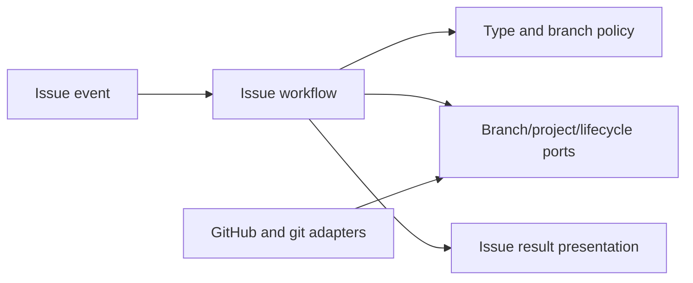

# Managed Issue and Branch Lifecycle

- Status: As-built baseline
- Date: 2026-09-13
- Last verified: 2026-10-13; reopened Project correction tracked in #492
- Owners: Copilot maintainers
- Scope: issue admission, metadata enrichment, managed branch creation, lifecycle state, and merge-driven closure
- Related issues/PRs: release orchestration and branch synchronization SDDs
- Required review gates: product UX, architecture, testing, documentation, security/operations
- Open decisions blocking readiness: none for the baseline

## 1. Executive summary

After a maintainer adds `in-progress`, Copilot turns an admitted typed issue into traceable work: it normalizes
metadata, links projects, selects a branch strategy, creates or reuses a linked
branch, persists parent/working branch facts, and communicates the next action.
Regular work starts from the configured development branch; a release starts
from the exact development HEAD at cut time; a hotfix starts from the latest
accepted production tag.

```text
issue -> permission/type/labels -> wait for in-progress -> optional SDD gate
      -> managed strategy -> verified linked branch -> branched/state:working
      -> commits/PR -> merged PR -> close linked issue
```

## 2. Problem, current behavior, and evidence

### 2.1 Problem

Labels, branch names, issue types, assignments, projects, progress state, and
closing behavior can drift when each maintainer performs them manually. Release
and hotfix origin mistakes are especially hard to recover.

### 2.2 Current behavior

1. The issue workflow verifies permission and closes disallowed issues.
2. It cleans requested stale branches, assigns members, normalizes title/type,
   links projects, and evaluates priority/size.
3. Every admitted issue waits for the fixed `in-progress` start label. When
   `issue-managed-branches` is enabled, branch-bearing types use a managed branch.
   `branched` is added only after exact linked remote branch verification.
4. Strategy precedence is hotfix, then release, then managed work.
5. Managed feature/bugfix/docs/chore branches originate from development;
   release branches persist development origin SHA; hotfix branches use the
   latest tag commit.
6. A created linked branch returns immutable branch facts; the issue route
   applies the returned configuration patch. An eligible issue with
   `pre-branch-sdd` first resolves blocking questions and publishes its SDD
   as the first branch commit. `state:specifying` and `state:working` distinguish
   the gate from implementation.
7. The workflow may answer help or recommend steps; new issues get one welcome.
8. A merged linked PR closes the issue through the PR lifecycle.

### 2.3 Evidence and contract classification

- Observed behavior: issue workflow/steps, branch preparation strategy and
  policies, branch repositories, lifecycle domain, and issue docs.
- Intentional contract: semantic origins, deterministic strategy precedence,
  idempotent reuse, persisted branch facts, and one welcome.
- Known debt and limitations: linked-branch propagation includes an adapter
  delay; project linking avoids list propagation by using the ProjectV2 item ID
  returned by the add mutation; lifecycle labels supplement rather than replace
  GitHub state.
- Unknown rationale: historic emoji/title defaults are treated as current
  presentation choices, not architectural necessities.
- Proposed improvements: replacing propagation delay with provider events needs
  a separate change proposal.

## 3. Actors, surfaces, and terminology

| Actor | Goal | Entry point | Visible surfaces |
|---|---|---|---|
| Issue author | request/understand work | issue template | issue body/comments |
| Maintainer | classify and launch | labels/edit | branch, project, lifecycle |
| Contributor | implement | linked branch | commits and PR |
| Copilot | keep facts aligned | issue/push/PR event | labels, title, comments |

“Parent” is the source line a working branch must contain. “Working branch” is
the linked branch for the issue. Lifecycle, temporary agent activity, and human
waiting labels are independent dimensions.

## 4. Goals, non-goals, and fixed invariants

### 4.1 Goals

1. A managed issue MUST expose its parent and working branch unambiguously.
2. Replayed events MUST not create duplicate branches or welcomes.
3. Release/hotfix origin MUST follow their semantic branch rules.

### 4.2 Non-goals

1. This SDD does not define post-promotion release orchestration.
2. It does not auto-merge contributor PRs.
3. It does not infer arbitrary branch graphs from prose.

### 4.3 Fixed product/safety invariants

1. Hotfix strategy wins if conflicting special labels are present.
2. Managed branch parent and target MUST differ and use safe names.
3. Release origin SHA and hotfix tag SHA MUST be retained once created.
4. Unauthorized issues MUST not create repository branches.

## 5. Current versus proposed product journey

| Stage | Manual/unclear risk | As-built contract | Effect |
|---|---|---|---|
| Classification | labels disagree | deterministic type/strategy | one branch meaning |
| Origin | latest branch guessed | semantic source + SHA | reproducible cut |
| Creation | duplicate branch | list/decision/reuse | replay safe |
| Tracking | prose only | config marker + linked branch + labels | machine/human trace |
| Completion | manual close | merged PR closes issue | lifecycle alignment |

P2-E changes internal state ownership and failure reporting without changing
the successful issue journey: leaf steps receive immutable capability requests,
provider credentials are bound by composition, and branch facts are applied by
the route only after the preparation step returns.

## 6. Functional behavior and state model

### 6.1 Happy path

1. An authorized issue is opened with an admitted work type and waits.
2. A maintainer adds `in-progress`; metadata and project state are normalized.
3. Any required SDD questions are resolved and the draft is validated off-branch.
4. The branch decision selects origin, safe name, and create/reuse behavior.
5. GitHub creates and links the branch; an eligible SDD becomes its first commit.
6. Copilot verifies the exact remote branch, adds `branched`, and marks `state:working`.
7. Commits and a linked PR advance review state; merge closes the issue.

Project enrichment is immediate and deterministic: the existing-item query or
add mutation returns the exact ProjectV2 item ID. A direct read of that node verifies its Project and current Status. Linking initializes the configured created status only when the field is null; an existing status is retained on edits, replay, and reopening. No fixed sleep or second board-list lookup is used. Missing, foreign, or malformed status evidence fails before mutation. A failed initialization leaves the valid item linked and can retry while the field remains unset. Explicit lifecycle transitions still move the issue to the configured in-progress status after branch readiness. A started branch-bearing issue reopening additionally restores its configured active Project state before priority/size enrichment, independently of whether its branch or SDD must be created again.

### 6.2 Alternative paths

- With `issue-managed-branches=false`, eligible regular work proceeds without an Action-managed branch; help is always branchless.
- Existing correct branch becomes a no-op; a rename decision may create the new safe name.
- Admitted help issues receive answers instead of branch recommendations. A
  successful executed answer to a help-issue comment restores `state:working`
  and clears the waiting state after a failed request. Skipped/failed answers
  cannot recover the phase, and answers on branch-bearing issues do not prove
  their blocked work recovered. Explicit planning commands retain `state:planned`.
- Release issues skip generic recommendations and delegate deployment later.
- Closed issues may reopen on push when configured.

### 6.3 State model

| State | Meaning | Next | Owner/recovery |
|---|---|---|---|
| classified | type/labels known | waiting to start | maintainer |
| waiting to start | `in-progress` absent | specifying/working | add `in-progress` |
| specifying | SDD gate needs answers or revision | working/blocked | answer status card |
| working | verified branch or authorized branchless help | reviewing/blocked | contributor |
| reviewing | linked PR open | changes-requested/verified | reviewers |
| ready | checks/review permit merge | complete/blocked | maintainer |
| blocked | action/input required | prior active state | named actor |
| complete | linked PR merged/issue closed | reopened if new work | maintainer |

Stale or duplicate events MUST reuse persisted/current GitHub facts. Cleanup is
explicit and must not delete unrelated branches.

## 7. User-facing configuration

| Input | Default | Bounds/alternatives | Persistence |
|---|---|---|---|
| `issue-managed-branches` | `true` | boolean; release/hotfix require true | workflow/Variable |
| `pre-branch-sdd` | `false` | boolean; requires managed branches | workflow/Variable |
| fixed start/readiness labels | `in-progress` / `branched` | not configurable | repository labels |
| `main-branch` / `development-branch` | `master` / `develop` | safe non-empty branch names | stored at operation cut where needed |
| `feature-tree`, `bugfix-tree`, `docs-tree`, `chore-tree` | matching names | safe prefixes | repository config |
| `release-tree`, `hotfix-tree` | matching names | safe prefixes | operation snapshot |
| `reopen-issue-on-push` | `true` | boolean | repository config |
| assignee count | `1` | 0–10 | repository config |

Labels, issue types, project columns, locale, title emoji, size thresholds, and
commit-prefix transforms are documented public inputs. Branch origin semantics,
authorization, SHA retention, and unrelated-branch protection are not configurable.

## 8. Clean Architecture design

| Boundary | Owns | Must not own/import |
|---|---|---|
| Domain/policies | lifecycle labels, strategy, branch decision | GitHub calls |
| Issue use case | required sequential orchestration | provider DTOs |
| Ports | branch list/create/link, metadata, project, lifecycle | Octokit types |
| Adapters | GraphQL/REST/git implementation | origin policy |
| Composition | concrete step graph | duplicate sequencing |
| Presentation | branch result/reminders/welcome | branch mutations |



Architecture tests MUST keep policies provider-free, application ports semantic,
and composition as the only concrete wiring owner.
The project-link semantic port returns a required ProjectV2 item ID. An add
response without that ID fails explicitly; the application never treats it as
an already-linked skip. The bound semantic initializer returns initialized, retained, or failed; the application publishes truthful copy for each outcome. The command adapter checks and initializes the exact returned item directly, while credentials and GraphQL details remain outside the use case. GitHub offers a separate read and write rather than a conditional field mutation, so concurrent native automation can still race a first initialization; serialized Copilot replay never intentionally overwrites a populated field.

## 9. UI/UX and content contract

```markdown
Pending: **This issue is classified and waiting.** Add `in-progress` to start.
Action required: **Answer the numbered SDD questions.** The branch is created after the contract is validated.
Blocked: **Branch creation was not authorized.** No branch was created; ask a maintainer to review access.
Partial: **The branch exists, but readiness is unverified.** Retry verification on the same issue and branch.
Complete: **The linked pull request was merged and the issue is closed.** No action is required.
```

The primary issue comment SHOULD link both parent and working branch and state
the next action. Titles, labels, markers, and welcome content are deterministic.
There is at most one welcome on issue creation. Visual indicators always have
text; links are descriptive; configured issue locale is used with English fallback.
Untrusted titles/body/branch text is sanitized before Markdown or commands.

## 10. Failure, recovery, and cleanup

| Failure | Impact | Retained facts | Retry | Action | Cleanup |
|---|---|---|---|---|---|
| permission denied | issue closed/no branch | reason result | after access fix | maintainer | none |
| origin/tag missing | special branch absent | issue/config | yes | repair branch/tag | none |
| create/link fails | no or partial link | provider state | yes | inspect branch first | do not duplicate |
| branch created, later metadata move fails | branch exists; configuration patch still returned | exact branch URL/name and patch | yes | continue work and retry metadata | never delete a valid branch implicitly |
| project/metadata fails | branch may exist | branch/config | yes | retry enrichment | none |
| project linked, status update fails | project membership remains but its configured status is unconfirmed | authoritative ProjectV2 item ID and link | yes | rerun enrichment | never delete the valid item implicitly |
| stale cleanup request | wrong deletion risk | all branches | no unsafe retry | re-resolve exact targets | exact branches only |

## 11. Security, permissions, and privacy

Permission checks precede branch mutation. Issue text, titles, labels, and
configuration markers are untrusted. Branch names and commit-prefix arguments
must be validated/quoted. Tokens stay in adapters. Cleanup and relinking operate
only on exact repository coordinates and resolved managed branches.

## 12. Observability and operational UX

Results identify each step, branch URLs, project/lifecycle changes, and the
first failure. Stored configuration owns parent/working branch and special
origin facts. GitHub linked branches and PR closing references provide external
evidence. Agent activity is temporary and removed in `finally`; stable lifecycle
and waiting labels remain actionable without logs.

## 13. Compatibility, migration, rollout, and rollback

Existing current-version configuration markers are restored. Missing historic
fields use bounded reconstruction from labels/branches; invalid markers fail or
are ignored according to parser policy, never executed. Renaming branch inputs
does not rewrite in-flight origin facts. Rollback removes only newly created
managed branches after exact validation; merged commits are not erased.

## 14. Testing strategy and numeric budget

| Area | Minimum cases | Risks |
|---|---:|---|
| Strategy/name/lifecycle policy | 36 | precedence, origins, labels, names, successful/skipped/failed help answers, other issues/events and planning precedence; eight typed implementation recovery/negative cases |
| Issue sequencing/idempotency | 22 | permission, reuse, replay, cleanup, authoritative help-kind projection |
| Branch/project/provider adapters | 24 | linking, pagination, errors |
| Workflow/template/config contract | 10 | events, inputs, issue types |
| Issue UX/localization/sanitization | 12 | views, links, one welcome |
| Integration/security/migration | 14 | issue→branch→PR, stale state, injection, help-label recovery and retained-label implementation recovery |
| **Total** | **118** | no double counting |

Global coverage remains mandatory; changed pure branch/lifecycle policy SHOULD
reach 95% branch coverage. The P2-E issue/PR context path additionally enforces
95% lines/statements and 90% branches/functions in its dedicated coverage gate.
Use deterministic propagation fakes, not real waits.
Manual evidence covers issue rendering, linked-branch discoverability, mobile,
dark/light, and non-English fallback.

## 15. Documentation and discoverability

| Audience | Artifact | Required content |
|---|---|---|
| User | branch management/type pages | launch and origins |
| Contributor | branch sync + PR pages | update and merge journey |
| Operator | notifications/troubleshooting | stuck/cleanup/reopen |
| Maintainer | architecture + this SDD | state ownership |

## 16. Acceptance scenarios

1. A feature issue without launcher waits and states the required label.
2. The same event with launcher creates one linked branch from development.
3. A replay reuses the branch and does not duplicate welcome or project item.
4. A release records exact development origin SHA; a hotfix uses latest tag SHA.
5. Conflicting release/hotfix flags select hotfix deterministically.
6. An unauthorized issue performs no branch mutation.
7. A provider failure after branch creation reports the retained branch.
8. A merged linked PR closes the issue and exposes completion.
9. Untrusted issue text cannot inject commands, mentions, or markers.
10. A branch helper cannot mutate route-owned configuration; the route applies
    exactly the returned frozen patch after the step completes.
11. Issue project linking uses the mutation-returned item ID for the status
    update without a timer or board-list read; replay reuses the existing item.

12. A successful executed answer on an admitted help issue replaces a stale
    blocked label with working and clears waiting labels. An ordinary issue
    answer, skipped/failed answer or unrelated event cannot trigger that recovery;
    authoritative admission owns help identity, and explicit plans stay planned.

## 17. Requirements traceability

| Requirement | Owner | Evidence | Documentation |
|---|---|---|---|
| strategy/origin | branch policies/preparation | strategy + preparation tests | branch management/release/hotfix |
| issue sequence | issue workflow | issue use-case tests | issue overview |
| lifecycle facts | lifecycle domain/use case | lifecycle tests, six help-policy cases, two admission projections and one label-recovery integration | labels pages/issue overview |
| provider linkage | branch repository/ports | repository tests | branch management |
| route-owned state | branch preparation outcome and issue route | projection, preparation, and coordinator patch tests | branch management/architecture |
| safe UX | presentation policies | result tests | examples |

## 18. Maintenance sequence

1. Update domain strategy/lifecycle and tests.
2. Update issue orchestration and idempotency tests.
3. Update semantic ports/adapters and provider fixtures.
4. Update result content, issue docs, templates, and catalog.
5. Run complete gates and human GitHub UX review.

## 19. Definition of Done

- [ ] Origins, branch state, retries, cleanup, and closure remain deterministic.
- [ ] Architecture checks and the baseline plus explicitly allocated extension budgets pass.
- [ ] All issue UI states and next actions are readable and localized/fallback-safe.
- [ ] Workflow/template/config/docs/catalog contracts agree.
- [ ] Security tests cover authorization, names, markers, and cleanup targeting.
- [ ] Human linked-branch and issue UX evidence is captured.

## 20. References and decisions

- Primary sources: catalogued issue/branch code, tests, workflows, and docs.
- Related SDDs: release orchestration; branch synchronization; PR lifecycle;
  issue and pull-request context hardening.
- Decision: semantic origins are fixed; surface naming remains bounded configuration.
- Rejected: arbitrary branch graphs and inferred release origin.
- Follow-up: event-driven branch propagation is outside this baseline.

Live evidence on 2026-10-10: issue #456 reopening/title change preserved the original branch SHA and removed the obsolete ref, but the later edit reset Project #2 from In Progress to Todo. Ten additional cases cover unset initialization, existing Todo/In Progress, null/foreign/missing/malformed item evidence, failed initialization, and truthful retained-state issue/PR rendering. The direct Status read follows [GitHub ProjectV2Item fieldValueByName](https://docs.github.com/en/graphql/reference/projects#projectv2item).


A status or description answer with no explicit lifecycle decision preserves
existing waiting labels. Receiving a human comment alone does not satisfy a
pending maintainer or issue-author action. Explicit working/help recovery and
other lifecycle transitions retain their documented clearing rules. The two
PR query regression cases are owned by the PR lifecycle SDD budget.

An issue-comment implementation operation can recover an earlier blocked issue
only from the closed `CommentAutomation.ImplementationReply` receipt described
in the comment automation SDD. Successful pushed and no-change outcomes move to
working and clear obsolete waiting state. Missing, malformed, skipped, foreign
or unrelated-event receipts preserve state; any executed failure takes priority.
The label adapter re-reads current labels before replacement and retains all
unrelated labels. This is operation recovery, not proof of feature acceptance or
permission to merge. Eight policy cases and one label integration case cover
this extension; the comment capability owns its separate receipt/rendering cases.


## Merge-completion reconciliation extension — issue #472 (2026-10-13)

Status: implementation in progress. The eight local native-status regressions
pass; adapters, reconciliation, historical SDD integration and live acceptance
remain incomplete. This section defines the target contract, not an implemented
baseline.

### Evidence and user journey

Native merge #471 closed #470 as completed and its Project became Done, while
55%, in-progress and state:working remained. Closed #454 similarly retained
90% and active labels. Status currently prefers labels and can describe finished
work as active. A model response/CLI success is independent of repository-tool
or implementation success; the first native implement attempt for #472
produced no safe paths and correctly failed without a push.

```text
verified linked merged PR -> read exact native issue -> close only if needed
 -> verify native closure -> plan managed label delta -> guarded per-label writes
 -> reread native state and metadata -> complete / retained partial facts
```

Native state owns whether work is closed/completed. Labels supplement that fact.
The operation MUST make no model call or new timeline comment and MUST NOT
create a terminal state:* label. The existing PR closing workflow is the entry
point; bot-authored closed webhooks MUST NOT be enabled for enrichment.

### State and metadata contract

| Verified native fact | Status | Completion metadata |
|---|---|---|
| Issue closed, reason completed | completed | Remove configured active/waiting/activity and fixed start labels; replace canonical old 0..100% progress with 100% |
| Issue closed, not planned or unknown reason | closed | Clear obsolete managed active/progress labels; do not assert 100% |
| PR closed and strictly merged | merged | Read-only status clears stale waiting guidance |
| PR closed, merge not established | closed | Do not infer merged from issue reason or labels |
| Open/reopened | Current active facts | Never reuse old completion evidence or reclose solely to repair labels |
| Missing, malformed or foreign identity | Unavailable / safe label fallback | No completion mutation or claim |

Kind/size/priority, branched, SDD, contract-change and unrelated labels MUST be
preserved. Use selective label removal/addition rather than replacing an
inventory: concurrent unrelated additions must not be lost. A complete bounded
native inventory is required (fixed maximum 1,000 labels). Only configured
managed label names and exact canonical 0..100% labels may be removed. Reject
conflicting managed/protected label configuration rather than erase historical
facts. No new public configuration is introduced.

Already-closed delivery MUST reconcile stale metadata and then become a no-op
when complete. A boolean close return alone is insufficient evidence. Each
metadata write MUST be preceded by a fresh bound native-state check; the final
reread must verify closure and the intended delta. State/reason changes,
reopening, provider failures or newly stale managed labels produce a truthful
partial result. GitHub mutations are not atomic; no imaginary conditional write,
rollback of another actor's labels or automatic reclosure is permitted.

### Architecture and authority

The pure planner owns terminal projection, protected/managed label selection
and canonical progress. The use case owns closure/read/write/final-fence ordering
and separate retained effects. Semantic ports expose normalized immutable native
facts and only exact issue state/label operations. Adapters validate the bound
repository and positive issue identity, reject PR subjects and malformed or
incomplete native data, and map failures without raw provider content.
Composition supplies physically frozen capabilities; a narrow TypeScript type
must not hide a runtime addComment or general replacement capability. Status
gets a physically read-only projection and reads current native facts after
queueing, rather than trusting an older event's closed state. The existing
Execution import, credential/context, dependency, coverage and workflow guards
remain mandatory.

Historical SDD evidence MUST survive removal of in-progress. The read-only SDD
query needs a verified closed/history path, without inserting a synthetic start
label or reopening work. Existing immutable first/current, catalog, profile,
author, branch and final identity proofs remain authoritative. A closed
unstarted issue without publication must not acquire a fictitious required SDD.
A retained ready/pending artifact must not instruct the user to implement or
answer old questions merely because the issue is closed.

### GitHub UI and recovery

Normal completion: native state completed, progress 100%, historical labels
retained, no active/waiting/activity labels, status completed. No human action.
Replay: the same facts remain; no state/label write or new comment.
Partial example: “The issue is closed. Completion metadata could not be fully
verified. Inspect the linked run and retry the verified merged-PR operation.
The native closure and unrelated labels were preserved.” If closure itself is
unverified, say so instead of claiming partial completion. Missing/foreign
proof offers inspection/retry and preserves prior facts. Status remains one
correlated read-only reply with English/Spanish content, trusted links and no
new notifications. No release/deployment or branch lifecycle change is added.

### Numeric budget, documentation and acceptance

Minimum **80 distinct new completion cases**, derived from the above risks:

| Area | Minimum | Coverage |
|---|---:|---|
| Pure completion/configuration planning | 14 | reasons, canonical progress, protected names, invalid configuration and no inferred state |
| Closure application/replay/partial/races | 20 | already closed, actual close, denied reads/writes, state/reason fences and idempotency |
| Native adapters | 13 | exact scope/issue identity, PR exclusion, malformed facts, bounded labels and provider errors |
| Native lifecycle projection | 18 | eight existing reproductions plus push/foreign/missing/malformed and strict PR facts |
| Current status reads | 10 | queue/event freshness, reopening, independent evidence and retained SDD projection |
| Physical composition/integration | 5 | frozen read/write boundaries, no conversation authority, actual Execution and native-close flow |
| **Total** | **80** | Existing cases retained, no duplicate declarations or double counting |

Eight additional historical-SDD contracts belong only to the owning SDD-readiness
companion and are excluded from this 80-case minimum. They cover completed
publication without start labels, no publication, contract-change, exempt help,
reopening, final native-state movement and English/Spanish suppression of obsolete actions. Its inventory must be updated from
actual distinct cases when implemented. New pure policy has 100% coverage;
changed application/adapters keep at least 95% lines/statements and 90%
branches/functions, with all global thresholds unchanged.

Update the command/lifecycle and operator recovery guides, this owning SDD,
SDD-readiness companion, catalog evidence and generated catalog together.
Acceptance requires a real managed bugfix: admission/branch/commit/PR/native
merge -> verified closed/completed + 100% + preserved unrelated/artifact labels
-> fresh status and no-op replay. Also exercise not-planned/unknown reason,
reopening and partial errors without fake completion, model calls or timeline
noise. All code, tests, coverage, types, lint, workflow/specification/docs,
generated bundles, normal hooks and live current-head checks remain required.
No complete or live acceptance claim is made by the current partial projection.

### Local implementation checkpoint (2026-10-13; live acceptance pending)

The native adapter, frozen per-issue target and read-only status facade are now
wired in the local managed branch. REST response URL, repository URL, positive
subject identity, PR exclusion, native state/reason and the bounded full label
inventory are verified. Requests reject HTTP redirects using the installed
Octokit request option, so a transferred repository cannot silently redirect
completion writes. Primary transport implementation:
https://github.com/octokit/request.js/blob/main/src/fetch-wrapper.ts.

The use case verifies the current native closed/strictly-merged PR before issue
closure. Every metadata write rereads native state/reason, and the final read
verifies the intended delta. A current reopened reason blocks reclosure on an old
delivery; known reopening during the operation also removes any current closed
claim. No timeline write, replacement label inventory, model, branch operation
or release authority enters this capability. Real `Execution` projection captures
frozen lifecycle and protected names rather than passing a mutable Labels object.

Local coverage verification passes 581 suites and 7,921 cases (35 existing
skips), including 96 distinct new completion cases: 21 pure-planning, 23 closure,
18 adapter, 18 projection, 11 current-read and five physical-binding cases.
The eight additional historical-SDD cases are allocated only to the status
companion, giving 104 new cases in the complete suite. Every existing coverage
budget passes, including the new pure planner at 100% and each guarded runtime
module at 95% lines/statements and 90% branches/functions. Generated artifacts,
normal hooks, current-head review and real closure/replay acceptance remain
pending. This checkpoint does not declare the correction complete.


### Native review: lifecycle/progress collision (2026-10-13)

Finding `4253765568` reproduced a completed issue losing `100%` when a configured
lifecycle label had that same name. All configured lifecycle names MUST reject
canonical progress names (`0%` through `100%`) before any mutation plan, alongside
the existing protected-label collision boundary. Two distinct endpoint cases
failed before the fix and now cover this configuration refusal; valid completed
metadata retains its marker. The completion inventory is now 98 (96 + 2); eight
historical-SDD cases remain allocated only to the status companion, for 106 new
cases overall. Full verification and native closure/replay remain pending.

The attempted native fixer run `38331274938` completed Codex execution but
refused generated Jest caches before committing. No native fix or push is claimed
by that run; its postflight/cache/reporting defects are tracked separately.


### Native state/reason verification (2026-10-13)

Finding `4253942474` showed that independent enum checks could authorize closure
from contradictory facts. Native Help fixtures #475/#476 verify the provider
contract with API version 2022-11-28: initial open/null; close/completed; reopening
with a supplied completed reason returns open/reopened; closing/reopened is
rejected with HTTP 422. A canonical duplicate reference produces closed/duplicate.
Both fixtures were closed after verification and #475 has no linked branch.
Primary source: https://docs.github.com/en/rest/issues/issues#update-an-issue.

The planner MUST reject open/completed, open/not_planned, open/duplicate and
closed/reopened before writes. Verified null remains unknown. Duplicate is a
recognized non-completed closure: remove obsolete activity/progress without
adding 100%, and project closed without waiting guidance. A fresh known open
state MUST clear retained-closure claims even when its reason is invalid.

Nine distinct new contracts cover four inconsistent pairs, duplicate planning,
provider normalization, status projection and two guarded closure cases. The
completion inventory is now 107 (98 + 9); eight historical-SDD contracts remain
allocated only to their companion, for 115 new cases overall. The fixture's open
default was corrected from synthetic completed to the provider's unknown/null.
Focused verification passes 122 cases; full gates and native acceptance remain
pending.

Native finding `4254501697` exposed label movement between the SDD query and the final native status read. The final issue fence MUST compare the complete label set as well as number/state/reason. Changed labels invalidate the status instead of combining new metadata with earlier SDD eligibility; order-only provider differences remain valid. Two new distinct status integration cases cover removed contract eligibility after a historical publication query and identical reordered labels. Allocate both to native completion/status (107 + 2 = **109**), separate from the SDD companion's 194-case inventory and its 12 added cases.

Native finding `4254598438` exposed additional asynchronous PR count reads after the issue fence. For a combined issue/linked-PR status, native issue identity/state/reason/labels MUST be fenced again after count collection, immediately before returning. Two new distinct integration cases reproduce reopening and label movement during that later phase. Native completion/status now owns **111** added cases; the 12 new SDD companion cases remain separate (123 overall). No write/model authority or limit changes.

Live legacy recovery kept artifact labels initially, but subsequent closed-issue labeled/unlabeled deliveries removed `branched` and `SDD`. A native closed issue event MUST bypass open-issue onboarding, branch/SDD preparation and readiness reconciliation. Reopened events remain open work. Two distinct event regressions reproduce added-label and removed-label callbacks without any branch/title/readiness mutation. Native completion/status owns 113 added cases, and its 12 companion cases stay separate. Restoring the verified original artifact labels requires the published correction first.


## Reopened Project state correction — issue #492 (2026-10-13)

### Evidence, journey, and boundaries

Native [#454 event 33158611454](https://github.com/vypdev/copilot/issues/454#event-33158611454)
records closure **by moving to Done in Project vypdev** during size enrichment
in [commit run 38442749084](https://github.com/vypdev/copilot/actions/runs/38442749084).
The enabled native Auto-close issue workflow closes items whose Status is Done;
Item reopened is disabled. Reopening retained Done, and reuse of an already
published SDD skipped the branch-creation-only active-column transition.
This correction restores active work using the existing configured Project
column. It MUST NOT change shared organization Project workflows, create a
branch, republish an SDD, or infer a new progress percentage.

```text
authorized admitted reopened issue + in-progress + branch-bearing kind
 -> reuse/link Project item -> verify native open/reopened/start
 -> restore configured active Status with per-write native fences
 -> verify retained issue state -> priority/size -> existing SDD/branch flow
```

The text equivalent is: authorization and admission happen first; explicit
resumption restores the active Project state before other field enrichment;
existing branch and immutable SDD evidence continue through their own guards.
This is a resumption transition, not the generic link initializer. Ordinary
edits and link replays continue to retain existing Status. Unstarted, branchless
help, closed, unmanaged and unauthorized issues MUST NOT enter this transition.

### State, architecture, security, and recovery

The issue route copies trusted `issues:reopened` into an immutable routing fact.
The application step depends only on the existing physically read-only native
issue facade and bound Project command port. The adapter owns exact repository,
issue and Project identity validation and no-op field comparisons; composition
owns credentials. No provider DTO, SDK, process, mutable Execution, close/label,
branch-management or model authority is passed to the step.

Before the first and every subsequent Project write, and immediately after each
write, native identity, open state, reopened reason and the fixed `in-progress`
label MUST remain verified. A missing capability or empty/failed step result
MUST stop later enrichment. A denied/unavailable read, native closure, removed
start label or provider failure produces a failed retained-state result, and
priority/size/SDD/branch work does not continue. Successful earlier Project
updates remain retained; no cross-Project rollback is attempted. GitHub provides
separate reads and writes rather than an atomic compare-and-set, so an external
change can still occur between them; the final guard reports known movement.
A replay uses adapter no-op comparisons and creates no conversation comment.

| State | Visible result | Next action |
|---|---|---|
| Pending | Issue is open; its prior Project status is being checked | Wait for the reopened-issue run |
| Complete | Project Status is the configured active column; branch and SDD history are retained | Continue on the linked Action branch |
| Action required | Start label was removed or native facts changed; enrichment stopped | Inspect current issue state and decide whether work should resume |
| Failed | Current Project state could not be verified | Inspect the linked run and configured Project access/column, then retry that run |
| Partial | Earlier Project updates were retained; later enrichment stopped | Correct the affected Project and retry the reopened-issue run |

The Job Summary supplies localized category recovery using existing catalogs;
internal step text and arbitrary provider messages are not timeline UI. Native
Project Status is the primary product evidence. There are zero new comments,
labels, public inputs, permissions or translation artifacts. Existing
`project-column-issue-in-progress` defaults/validation/operation snapshot remain
unchanged; recommend In Progress, allow another verified active column such as
Working. Operators must select an active option compatible with native Project
rules. A configured option that itself closes issues cannot be made safe by a
non-atomic application transition and remains an operator configuration error.

No data/schema migration is needed. Install the correction and retry the actual
reopened-issue workflow for retained terminal items; historical merged PRs do
not become open branch authority. Rollback restores earlier enrichment behavior
and requires manual active-column repair for reopened work.

### Numeric verification budget and executable acceptance

Allocate **29 distinct additional cases**, separate from the baseline and native
completion/status extensions: **18 guarded step cases** (success, no-op replay,
no Project, four stale native facts, read/write failures, before/after/between
Project races, retained partial effects, configured column, multiple Projects,
and two unsafe identities), plus **10 route cases** (existing branch and
published SDD, failed/missing/empty step, and five admission/security exclusions).
One additional provider case rejects an accepted Status mutation whose resulting field does not match the requested active option. Strengthen the existing composition and missing-mutation cases without counting them again. Deterministic
fakes replace network/sleeps. Changed guarded runtime coverage MUST remain at
least 95% lines/statements and 90% branches/functions; global 90% lines/statements,
88% functions and 82% branches remain unchanged. No new pure policy is needed.
Dependency/context/credential constraints, workflow/specification/documentation
validators, generated bundles and normal commit hooks remain required.

| Requirement | Implementation/evidence | Documentation |
|---|---|---|
| Resume before field enrichment, including published SDD reuse | issue route ordering tests and real reopened #454 Project state | assignees-and-projects, notifications-and-auto-close |
| Strict native/start identity and per-write fences | ResumeIssueProjectUseCase 18 cases and existing native adapter contracts | operator retry guidance |
| Exclusions and missing/failed capability stop | ten issue route cases and strengthened composition case | managed issue lifecycle guide |
| Quiet replay and retained partial facts | adapter no-op contract, guarded step tests, native timeline and Job Summary | notifications-and-auto-close |

Acceptance: a real admitted bugfix follows Action branch/commit/PR gates; after
promotion, reopen #454 with its existing start label and real linked follow-up
PR, verify Project Status moves from Done to the configured active column while
its branch HEAD and both immutable SDD publication commits stay unchanged.
A duplicate current reopened workflow retains the active state and publishes no
new resume-success comment. Close the explicitly authorized temporary issue
after comparison and resumption proof. Existing external Project workflow
settings MUST remain unchanged.

Definition of Done: all 29 cases and coverage gates pass; catalogs and generated
specification index, user/operator documentation and bundles agree; native
current-head CI/review and live resumption/replay evidence are recorded. This
section does not declare live acceptance complete before that evidence exists.


Native finding `4262466652` exposed an ambiguous adapter boolean: `false` meant
both already-active Status and an unconfirmed mutation. Ordinary-comment retry
`38450464672` on Ubuntu published `7cc5485b` after verification and independently
marked that finding fixed with complete coverage, zero active and zero unknown
findings. The Status adapter MUST reserve `false` for a verified unchanged field,
reject a missing mutation result, and reread the exact item's Status after an
accepted write. A mismatch or unavailable reread stops enrichment while retaining
provider effects. Size/priority and link initialization semantics are unchanged.
This one new post-write mismatch case belongs only to this extension's 29-case
allocation, and its existing missing-mutation case now asserts refusal. The
changed Status adapter joins the same 95%/90% runtime gate. Live #454 Project
resumption/replay acceptance remains pending until promotion.

## Native close-event completion metadata — dogfooding #496/#497 (2026-10-13)

Evidence: Help [#497](https://github.com/vypdev/copilot/issues/497) was natively
closed as completed, and [closed run 38471735084](https://github.com/vypdev/copilot/actions/runs/38471735084)
succeeded while `in-progress` and `state:working` remained. Its correlated
status correctly said completed, exposing contradictory labels. Existing
completion cleanup ran only through a verified merged PR; the native closed
route retired cards but did not reconcile metadata.

The native `issues:closed` route MUST now apply the existing pure completion
planner through a separate label-only bound capability before independently
retiring existing progress/synchronization cards. It MUST NOT enter the normal
issue route, prepare a model/runtime, create or delete a branch, change Project
Status, close/reopen the issue, create a comment, or replace a label inventory.
The configured managed labels and fixed start label are removed selectively;
canonical obsolete progress is replaced with 100% only for verified native
completed closure. Not-planned, duplicate and unknown closure clear obsolete
progress without asserting 100%. Historical kind/priority/size, branch/SDD and
unrelated labels remain protected by the existing planner contract.

```text
native closed event -> read current exact closed issue and reason
 -> validate configured/protected labels -> native fence before each label write
 -> final native/metadata verification -> independently retire existing cards
```

Text equivalent: the event selects cleanup, while fresh native reads authorize
only completion metadata. Each write rechecks identity/state/reason, and the
final read verifies the intended delta. A reopening, changed reason, unavailable
read, configuration conflict or newly stale managed label stops repair. Earlier
successful changes remain; the issue is never reclosed. Card retirement retains
its independent results even when metadata fails. A duplicate valid close run
becomes a no-write replay. Closed edited/labeled callbacks remain ignored, so
label mutation webhooks cannot loop back into cleanup or enrichment.

Architecture: `BoundIssueCompletionMetadataPort` physically exposes only frozen
per-issue `read`, `addLabel` and `removeLabel` closures. Repository/credential
binding stays in infrastructure. `ReconcileClosedIssueMetadataUseCase` uses the
existing domain planner and semantic native adapter; `ReconcileClosedIssueUseCase`
coordinates metadata and existing card cleanup. No Execution, SDK, token, broad
replacement, publication or native state authority crosses the leaf boundary.
The trusted route copies/freezes configured lifecycle/protected names once.
Existing architecture/import, credential, workflow and callback guards remain.

Operator states: **Complete: the issue is closed, active labels are cleared and
native completion progress is verified; no action required.** **Pending:
closed-event cleanup is running; inspect its run.** **Unavailable/failed:
closure remains authoritative, metadata could not be verified; inspect and
retry the native closed workflow.** **Partial: completed selective label changes
remain, later repair or card retirement failed; inspect the retained result and
retry.** **Reopened during repair: native work remains open; cleanup stops and
creates no completion claim.** Native issue/run/status provide links and plain
text state. There are zero new timeline comments, labels, inputs or translated
messages; existing localized semantic error recovery and native status apply.

Additional risk-derived floor: **25 distinct cases**, counted only here:
**21** guarded metadata cases (four reasons, replay, two unsafe identities,
three invalid native states, denied read/removal/addition, before-write reopening
and reason movement, missing facts, concurrent removed/unrelated/managed labels,
configuration conflict and partial reopening); **two** physical capability cases;
and **two** independent cleanup coordination cases. Strengthen the existing
closed-route and callback tests without counting them again. Each new runtime
module MUST pass 95% lines/statements and 90% branches/functions; repository
coverage and all preceding completion/retirement budgets remain unchanged.

Traceability: reason/label policy -> existing pure planner and 21 guarded cases;
per-write native fences and retained effects -> race/failure cases; no native
state/publication authority -> two capability cases; independent card cleanup ->
two coordinator cases; closed-only entrypoint and callback suppression ->
existing strengthened route tests. User/operator docs in
`docs/issues/notifications-and-auto-close.mdx` MUST cover native manual closure,
label cleanup, replay and retained partial recovery. No schema/data migration or
external Project workflow change is needed. Rollback retains native closure but
restores stale active labels and requires manual metadata repair.

Native acceptance MUST close the branchless Help fixture on promoted code,
verify only the expected label delta, inspect a no-write rerun, then reopen it
without stale completion guidance and close it after the fixture. Full coverage,
new module gates, build/bundles, lint/types, documentation/specifications/workflow
validators, Graphify and current-head CI/review/platform jobs remain mandatory.
No completed acceptance is claimed before native evidence is recorded.

## Concurrent completion convergence — #622 (2026-10-20)

Observed evidence: [#622](https://github.com/vypdev/copilot/issues/622) records
successful PR completion and a closed/completed issue followed by a failed
closed-event invocation with only `workflow.stale`. The exact production fence
is unknown; concurrent selective label writes and owned-card retirement can
reproduce equivalent failures deterministically. This extension preserves native
state authority and makes a verified duplicate explicit.

```text
merged PR / closed event -> fresh identity, closure and reason
 -> at most two selective metadata passes -> fresh final metadata verification
 -> independent owned-card retirement -> exact final-body/native verification
 -> verified / already-converged, or named partial failure
```

Text equivalent: merged-PR and closed-event cleanup share the same bounded
metadata repair. They do not authorize one another through labels. Each write
rechecks the native subject and original closure reason. A failed removal or
addition response MAY be adopted only when a fresh same-closure plan proves
that exact delta is satisfied. A newly observed managed delta receives one more
bounded pass; continuing churn fails as `provider.conflict`, retaining effects.
Reopening, identity movement, unavailable evidence or reason changes MUST stop
repair and MUST NOT cause a native close/reopen request from reconciliation.

The two existing card use cases retain separate results and one inventory of at
most 20 supported bot-owned cards each. `verifyClosedIssueCardRetirement`
checks the original witness before a write, then the exact intended final-body
witness and native closure afterward. If another invocation already retired
that same card, it adopts only the verified final witness and same closure.
Unknown edits, changed ownership, missing/unsupported bodies, or unreadable
witnesses never become success. An accepted write followed by failed readback
retains its confirmed effect count and fails. An ambiguous write response MAY
converge only after exact final-body and native verification. The final native
fence also applies to an empty inventory. No new inventory, comment, deletion,
model execution, branch operation or broad label replacement is authorized.

Architecture: the shared metadata workflow receives only a per-issue read/add/
remove capability. Native close remains in the existing verified merged-PR use
case. The card helper receives exact immutable witnesses and narrow callbacks;
it cannot discover or create targets. Closed diagnostic vocabulary lives in the
domain; application errors retain safe result/phase/native facts and counters;
the shared summary presents only verified semantic outcomes. Existing import,
credential and physical capability tests remain executable constraints.
`finishGithubAction` MUST continue to fail any independent required error; no
global stale-error suppression is introduced.

Representative Job Summary content:

| State | Visible content and next action |
| --- | --- |
| Pending | Closed-event workflow is running; inspect the native run. |
| Complete | `Issue cleanup: Reconciled: 3 · Already converged: 0. Required cleanup was freshly verified.` No action required. |
| Duplicate/converged | `Issue cleanup: Reconciled: 0 · Already converged: 3.` Fresh metadata and supported cards were verified; no retry needed. |
| Partial/failed | `Issue cleanup: unavailable`. Failure details identify `RetireProgressUseCase`, `card-verification`, native closed/completed, one confirmed change and one remaining change in the last verified plan. Resolve the named failure and retry only while still closed. |
| Reopened/reason changed | Failure details identify the fresh native state/reason. Keep reopened work open; inspect current state before a new invocation. |

English/Spanish summaries explain the same facts with stable machine identifiers;
other locales use existing catalog fallback/localization. Routine convergence
creates zero comments. Diagnostics exclude card bodies, label names, provider
messages and credentials. Counters are safe integers bounded to 0–3000; absent
native reads are explicitly unavailable and do not prove completion. The
summary never claims all cleanup complete from a successful metadata result
when another required cleanup result failed. Plain text/tables work on narrow
screens without relying on color or Mermaid.

Configuration: no new input, durable schema or permission is added. Two passes,
20 owned cards, exact witnesses and native fences are fixed safety bounds.
Existing lifecycle/protected-label configuration and precedence remain intact.
Rollout is additive for in-flight work; a fresh duplicate read is required for
adoption. Rollback restores the earlier false-failure risk but preserves native
closures and completed effects. Cancellation retains confirmed effects and
requires a fresh observation; it never broadens mutation authority.

Allocate **37 additional distinct cases**: seven concurrent metadata/replay/
reason cases (including real merged-PR plus closed-event overlap), sixteen
card-race/readback cases across both capabilities, two Action completion cases,
four semantic serialization/forgery cases and eight summary localization/
invalid-evidence cases. Strengthen existing final-delta, witness-count and
recovery-catalog fixtures without counting them again. Deterministic SDK/port
fakes replace network and waits. Repository 90% lines/statements, 88% functions,
82% branches remain required; new reconciliation helpers require 95% lines/
statements and 90% branches/functions. Existing per-capability budgets remain.

Traceability and acceptance: metadata overlap/failed-response fixtures prove
selective convergence; reopening/reason fixtures prove no later mutation;
card fixtures prove exact final-body adoption and retained partial effects;
Action fixtures prove independent failures remain failures; public-record and
summary fixtures reject forged facts and expose bounded recovery. User/operator
recovery lives in `docs/issues/notifications-and-auto-close.mdx`; the branch-sync
and notification SDDs reference this shared rule. Definition of Done includes
all 37 cases, coverage, types/lint, architecture/capability contracts, docs,
workflows/specifications/catalogs, generated bundles, Graphify and current-head
CI/review. Review the English/Spanish summary examples for readable status and
one next action. Production convergence is not claimed until a fresh promoted
consumer sequence verifies its native issue and required cleanup.
