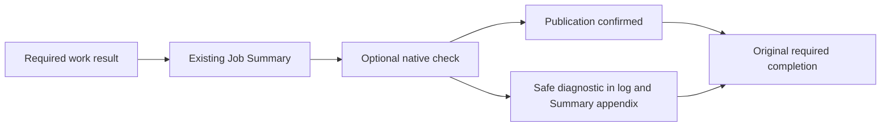

# Optional Check Run publication diagnostics

- Status: Implemented
- Date: 2026-10-28
- Last updated: 2026-10-30
- Catalog capability ID: github-communication-experience
- Owners: Copilot maintainers
- Scope: Make optional native evidence publication and operator log collection actionable without changing required workflow results.
- Related issues: [#728](https://github.com/vypdev/copilot/issues/728), [#817](https://github.com/vypdev/copilot/issues/817)
- Review gates: UX/localization, architecture, security/permissions, tests and operator documentation
- Open decisions blocking readiness: none

## 1. Executive summary

An optional Check Run can be unavailable even when required work completed or
failed independently. Operators MUST see the exact check, immutable head,
publication operation, credential route and sanitized provider facts. This MUST
NOT convert required success into failure, hide an earlier failure or claim an
unconfirmed provider write definitely did not happen.

Recommended setup: a step-scoped `COPILOT_EVIDENCE_TOKEN: ${{ github.token }}`
with job permissions `checks: write` and `contents: read`, while the Action's
configured product token remains separate. No new public Action input is added.

## 2. Problem, current behavior and evidence

Observed before this fix: completion catches evidence publication errors and
prints only a generic converted message. The adapter lets SDK exceptions escape;
provider facts are lost or a custom semantic error can supply private message
text. Generated and repository commit workflows lacked the dedicated evidence
mapping and granted only `contents: read` to their native token. PR/comment
review workflows already demonstrate the supported isolated route.

Issue #728 preserves consumer runs 40338528076, 40430400481 and 40449489903 at
runtime 39679e26. They establish the warning and routing, not the original HTTP
status, token type, permission defect or outage. The progress failure and package
publication failures in those runs remain independent. No consumer credential
was inspected and no live failure is claimed reproduced.

This is a prospective bug-fix contract, not a retrospective justification of the
old fallback. New tests use deterministic fault injection. Unknown historic
provider causes MUST remain unknown after the fix.

## 3. Actors, surfaces and terminology

Maintainers inspect the existing run log and Job Summary; workflow authors own
job permissions and step token mapping. `checks.create` is the one provider
operation. A credential *route* describes selection, never the token's type,
contents, identity or granted scopes. The native Check Run is an optional
projection; the required result and existing summary are authoritative.

## 4. Goals, non-goals and fixed invariants

MUST distinguish permission/credential rejection, rate limits, unavailable
transport/provider, invalid or inaccessible targets, conflicts and unknown
failures. MUST preserve exact required errors, correlation IDs and already
completed effects. MUST NOT expose raw errors, response bodies, auth headers,
request URLs, summary bodies or credentials in the new diagnostic.

Non-goals: suppress warnings, modify consumer repositories, release a runtime,
change review authority, retry provider writes automatically, create checks for
ineligible events, or introduce a durable check/upsert registry. Existing check
name/head identity remains unchanged; this does not claim create calls are
provider-idempotent after an ambiguous lost response.

## 5. Current versus proposed journey



Text equivalent: retain required work, write its summary, attempt the existing
optional projection, then finish with the original required outcome. A failed
optional attempt adds operator evidence, never a required failure result.

## 6. Functional behavior and state model

States are ineligible, pending optional attempt, confirmed, unconfirmed and
unconfirmed-with-summary-append-unavailable. Ineligible/no evidence/dry-run MUST
make no write or diagnostic. A confirmed write requires a positive safe-integer native check ID in the response before logging its existing success. Malformed responses produce a closed contract-invalid diagnostic without copying their body. An
unconfirmed write logs one localized diagnostic and appends only that diagnostic
to the existing summary when available. If append fails, one localized log note
MUST retain the primary diagnostic without changing completion.

Required failure remains red with the same error/correlation; required success
remains green. A partial external effect is never undone or reclassified as
absent. There is no automatic retry, parallel provider mutation, new issue/PR
comment, card, label or notification from this path.

## 7. Configuration and compatibility

| Setting | Default/precedence | Boundary |
|---|---|---|
| `COPILOT_EVIDENCE_TOKEN` | trimmed nonempty dedicated token wins | scoped to the consuming Action step; never persisted/logged |
| Action `token` | existing fallback when dedicated value absent/blank | credential capability is unknown; product operations still use this original token |
| Native commit job permissions | `checks: write`, `contents: read` | exact minimal set enforced for installed and repository workflows |

Existing custom workflows MAY preserve their explicit supported GitHub App
credential route. Fallback selection alone does not establish an unsupported
credential type. To adopt the recommended route, update the workflow mapping
and job permission, not the product token or repository protections. Other
lanes are not granted new permissions indiscriminately; ineligible events such
as a dispatch without verified head still publish no check. A legacy reporter
only gains diagnostics where its existing evidence-source policy permits one.

## 8. Clean Architecture and trust boundaries

`CopilotEvidencePublicationError` is a closed immutable error port: category,
HTTP status and request reference only, with no private cause. The data adapter
owns SDK inspection and maps both client creation and `checks.create` failures.
Pure presentation takes this closed error plus trusted publication identity,
route and resolved catalog. Completion owns ordering/log/summary delivery and
retains required results. No SDK headers or DTOs cross into the presenter.

Known HTTP/transport facts determine categories; unclassified errors remain
`unexpected`, not an asserted outage. Custom adapters that do not implement the
closed error port remain supported with an explicitly unknown diagnostic.

The raw-error logging guard MUST recognize only the exact production formatter
symbol, with a regression that rejects a same-named local spoof. It MUST NOT
exclude the completion file, allow arbitrary wrappers or stop scanning catches.

Executable boundaries: typecheck, architecture-cycle and raw-error logging tests, provider fault
injection, completion integration and structural workflow contract validation.
No filesystem/process/ref-write authority is added to the evidence capability.

## 9. UI/UX, localization and content

Pending remains the existing running Actions step, not a new pending check or card. The examples describe that meaning; only the failure/partial diagnostic is new.

Representative existing surfaces, not new timeline messages:

```text
Pending: Required stages completed; optional native check is being published.
Complete: Published Copilot / Verification Check Run for <exact head>.

Optional Check Run publication not confirmed
Impact: Native check status is not confirmed. The workflow result and existing
Job Summary remain authoritative.
Cause: GitHub denied the check publication request. Credential type and exact
policy cause are not inferred.
Action: Verify repository access and Checks write on the dedicated evidence
credential. Keep the product token separate; inspect the exact head before retry.
Retained state: Required-stage results and completed effects were preserved.
Details: operation=checks.create; check=Copilot / Verification; head=<full SHA>;
credential-route=action-token-fallback; error=authorization.denied;
status=403; request=AB12:CD34

Partial: The diagnostic remains in the log; its Summary appendix was not confirmed.
```

For a required failure, its own final error follows this independent warning.
Unknown facts use an unavailable placeholder; an unknown cause asks for inspection
without asserting an outage or suggesting broader credentials. Transport failures
explicitly say a check may already exist. English, Spanish/regional reuse and
atomic English fallback MUST apply to primary and secondary messages without
another model/catalog call on the failure path.

The Summary uses a plain heading, short impact/cause/action/retention paragraphs
and collapsed technical detail. Fixed check names and canonical nonzero SHA-1 or
SHA-256 IDs remain inert code data. Malformed names/heads are unavailable rather
than echoed. Narrow/mobile and light/dark use textual meaning, never color alone.

## 10. Failure, recovery and cleanup

| Observed fact | Guidance | Preserved state |
|---|---|---|
| 401/403 not rate limited | inspect supported dedicated credential, repository access and job Checks permission | original results/product token |
| 429 or proven secondary limit | follow provider limit guidance before retry | completed effects |
| 400/422 or 404 | inspect target/request or visibility; no guessed permission cause | pinned identity |
| 409/412 | inspect the same head/check before retry | previous successful effects |
| 408/5xx/known network code | publication unconfirmed; check may exist | summary and required completion |
| no classified fact | inspect closed details; cause unknown | no raw provider text |

No internal automatic retry is made. The operator MUST inspect the same native
head before any replay after a possibly completed write. Existing stable name/head
identity and other workflow idempotency rules remain. No rollback deletes a check.

## 11. Security, permissions and privacy

HTTP status MUST be an integer 100..599. Request references MUST be at most 64
characters, two to eight colon-separated hexadecimal components, no whitespace,
Markdown, HTML or command markers. Known credential echoes MUST be removed.
Only that selected header is considered; no bodies/other headers/URLs/stacks or
private causes enter the closed error. Output is bounded by fixed dictionaries,
fixed name/route sets and at most 64-byte IDs, not truncated arbitrary text.

The workflow contract MUST reject missing/overbroad permissions, missing token
mapping, a token mapped on another step, or substituting the product PAT. Normal
product mutations keep the configured token and permissions. Runtime/package
verification and all repository protections remain in force.

## 12. Observability and noise

One optional failure produces one primary log diagnostic and at most one Summary
appendix. A failed appendix can produce one secondary localized note. No new
metrics backend, persisted telemetry or conversation is introduced. Technical
identity is independent of the earlier required error's correlation ID; request
reference is explicitly unavailable if the provider did not supply a safe one.

## 13. Rollout and rollback

A normal reviewed package/runtime and workflow upgrade adopts the new diagnostic
and recommended commit token route. Existing preserved consumer workflows are
not edited automatically by this issue; setup maintenance/adoption remains its
existing reviewed operation. Reverting restores the old generic diagnostic and
fallback while preserving required-stage outcomes. No state migration is needed.

## 14. Testing strategy and numeric budget

Additional minimum **72 distinct cases**:20 closed-fact/sanitization cases,
20 provider mappings,12 application completion/retention cases,12 presentation/
localization cases and8 workflow credential-contract cases. Counts are distinct
behavioral rows, not multiplied across identical assertions. Existing global
budgets remain. New closed-error, adapter classifier, presenter and changed
evidence adapter MUST reach 100% lines/statements/functions/branches; changed
completion MUST retain at least 95% lines/statements and 90% branches/functions.

Fault injection covers both credential routes, blank dedicated values, every
provider category, private bodies/headers/semantic errors, malformed facts,
required success/failure, failed-deployment reporter shape, dry-run, ineligible
head, success, unavailable Summary and failed append. Deterministic fakes use no
live service or waits. Existing root/extension suites, build/package smoke,
spec/docs/workflow validation and Graphify remain required gates.

## 15. Documentation and discoverability

Update the owning communication SDD, Bugbot failure/recovery reference,
`docs/agents/execution-contract.mdx`, `docs/issues/workflow-setup.mdx` and
`docs/security-operations/operations/error-reference.mdx`. Show the recommended
mapping, compatibility fallback, exact diagnostic and unknown historic cause.
Register this SDD and code/tests in the owning catalog; regenerate CATALOG.md.

## 16. Acceptance scenarios

1. Each injected provider failure shows operation, check, complete valid head,
   credential route, distinct cause and safe status/reference or unavailable.
2. A failed optional write never changes required success or a required error's
   code/correlation; failed summary append also preserves that result.
3. Dedicated nonblank evidence token affects only native checks; absent/blank
   values preserve the existing Action token fallback without leaking either.
4. No request is retried internally; name/head and original conclusion stay fixed.
5. Invalid or private provider input never appears in log, Summary or closed error.
6. Installed/repository commit workflows use the exact scoped token/permissions;
   unrelated lanes/consumers and source eligibility remain unchanged.

## 17. Traceability

| Contract | Executable evidence | Documentation |
|---|---|---|
| closed safe facts/provider categories | `copilot_evidence_failure.test.ts`, diagnostic policy tests | error reference |
| optional ordering/retention/fallback | `optional_check_completion.test.ts`, existing completion suite | execution contract |
| EN/ES/fallback/inert content | diagnostic policy and completion integration | error reference |
| scoped native token and unchanged product token | workflow contract tests | workflow setup |

## 18. Implementation sequence

Closed port and adapter mapping; pure localized presentation; completion log and
Summary appendix; minimal workflow mapping and structural guards; tests, SDD/
documentation/catalog, generated bundles, Graphify and full validation.

## 19. Definition of Done

Every acceptance/budget/security/localization/architecture requirement MUST pass;
all required local/remote checks, current-head review without findings and full
Codecov patch coverage MUST pass before an authorized merge. Keep provider and
consumer-live claims separate. Validate specifications and package/build outputs;
perform owned iteration cleanup while retaining the source/evidence/rollback.

## 20. References and decisions

- [Checks API and supported credentials](https://docs.github.com/en/rest/checks/runs?apiVersion=2026-03-10)
- [GITHUB_TOKEN and least-privilege job permissions](https://docs.github.com/en/actions/tutorials/authenticate-with-github_token)
- Current live API reference lists GitHub App credential types; no generic PAT
  capability is inferred from a variable name or a denied response.
- No new check-upsert registry or automatic replay is added: an uncertain write
  is reported honestly, retaining existing identity and required-stage behavior.

## 21. Recoverable run-log collection — #817 (2026-10-30)

Issue #817 explicitly accepts a documented safe collection path when advisory
checks appear in the native Actions job inventory. Select that bounded remedy;
do not claim to repair GitHub's association or the CLI's whole-run retrieval.
Current evidence publication and Approval have separate adapters, and the
observed behavior does not establish either the CLI alone or one publisher
alone as the root cause. Preserve check names, conclusions, permissions,
credential routes and all required workflow outcomes.

Authorized read-only observation of existing consumer run `41113650469` at
`501553b73cc8cb2addd127255037ce260a380612` confirms three native records:

| Record | Steps | Runner | Conclusion |
|---|---:|---|---|
| `124262167251`, Copilot - Commit | 7 | 234 | failure |
| `124263870792`, Copilot / Approval | 0 | unavailable | neutral |
| `124269094417`, Copilot / Review | 0 | unavailable | neutral |

The advisory check belongs to GitHub Actions app `15368` and check suite
`111452270326`. With the same authorized account and installed `gh` 2.96.0,
whole-run `--log` exits 1 for missing log `124263870792`; selecting real job
`124262167251` exits 0. Both stdout streams contain the same 44,252 bytes
(SHA256 `665eac8dcc21da4494f8f4bad8946bfdd3873aa3bc40864c6f60bbb6b25c2027`).
Thus the whole-run failure can coexist with available partial output. The real
job's `validation.evidence-too-large` remains an independent required failure
already tracked by #773. No consumer code, checks or configuration were changed
or executed for this observation; no synthetic checks were created.

```text
pin run/attempt -> inventory every page -> classify native evidence
 -> collect each executable job ID -> retain exits/partial output -> account for coverage
```

Text equivalent: collect logs from the jobs that actually have execution
evidence, inspect advisory output separately and keep the bundle incomplete
when any intended executable job is pending, unknown or unavailable.

log-collection-R01: the operator guide MUST show the paginated native inventory,
including ID, name, status, conclusion, runner and step count. Latest-attempt
selection and the explicit older-attempt endpoint MUST be distinguished.
Incomplete metadata or pagination/API failure cannot certify a complete bundle.

log-collection-R02: zero steps/no runner alone MUST NOT classify a queued,
running or skipped executable job as an advisory check. Completed known check
output and native metadata establish the observed advisory case. Names and a
missing log alone are insufficient. Preserve pending, skipped and unknown states.

log-collection-R03: show `gh run view --repo OWNER/REPO --job JOB_ID --log` for
each real job, including failed jobs. Preserve individual exit statuses and
available partial output. A real-job download failure remains actionable;
continue collecting other available jobs but do not claim a complete bundle.
`--log-failed` alone is not full successful-step evidence. Log retrieval success
does not turn required workflow failure into success.

Architecture/configuration/security: documentation only; zero new runtime
policies, executors, commands, provider writes, settings, retries, permissions,
token routes or stored state. Native records and logs are evidence, never
authority to change check/approval/review/coverage outcomes. Keep raw private
consumer logs outside the repository; publish only the minimal native metadata,
exit/count/hash facts above. The [CLI manual](https://cli.github.com/manual/gh_run_view)
documents job-specific log retrieval and whole-run association limitations;
the [Actions jobs API](https://docs.github.com/en/rest/actions/workflow-jobs)
documents pagination and run/attempt identities. These sources do not attribute
this particular observation to a single root cause.

UX uses the existing native run, check output and troubleshooting page. A complete
collection accounts for every intended executed job; a partial collection names
pending/unavailable jobs and preserves retrieved logs; an advisory record directs
the operator to check output. No new notifications/cards or localized runtime
messages are introduced. The troubleshooting guide is the primary route, linked
from the existing error reference. Ordinary source/log access remains sufficient;
no check deletion, broader credential or blanket error suppression is a remedy.

**Risk-derived verification budget:** zero new runtime test cases because no
runtime behavior changes. Retain the existing 72-case publication contract and
all global/module budgets. Require three existing executable documentation
contracts (documentation routes/links, agent documentation, specifications/catalog)
plus the two independently observed read-only log commands above. Those two are
live observations, not new unique automated tests or fresh consumer execution.
Do not add tests that merely mirror prose. Full normal hooks and exact-head CI,
three native cleanup footers and complete review without active findings remain
required. Prove the built CLI and production source unchanged; an empty added
runtime coverage denominator is not a fabricated 100% patch result.

Acceptance maps R01 to the checked inventory example and API contract; R02 to
the state table plus the observed native projection; R03 to the working targeted
command, preserved whole-run failure and unchanged required error. Updating the
troubleshooting page, error-reference link, this owner and any catalog evidence
is the implementation. Reverting those documents is the rollback; no provider
history, branch, job or check is migrated or removed.
